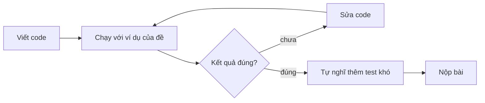

# Bài 0.1 – Chương trình đầu tiên

> **Tập 0** · Cần biết trước: dùng máy tính cơ bản · Thời lượng: khoảng 60 phút đọc, 3–4 giờ thực hành

**Học xong bài này, em sẽ:**

- viết, chạy và nộp một chương trình đọc dữ liệu và in kết quả, bằng Python hoặc C++;
- đọc dữ liệu từ tệp `.INP` và ghi ra tệp `.OUT` đúng quy định phòng thi;
- biết vì sao một chữ thừa trong kết quả cũng làm em mất điểm.

---

## 1. Bài toán mở màn: Tổng điểm

Cuối học kỳ, cô chủ nhiệm cần cộng điểm ba bài kiểm tra cho cả lớp. An đề nghị viết chương trình: nhập ba số nguyên a, b, c (0 ≤ a, b, c ≤ 10), in ra tổng của chúng.

| Vào | Ra |
| --- | --- |
| `7 8 9` | `24` |

> [!IMPORTANT]
> **Dừng lại và nghĩ.** Máy tính không "hiểu" đề bài. Em phải chỉ cho nó làm gì, theo thứ tự nào. Hãy viết ra giấy 3 bước máy cần làm để giải bài này.

<details>
<summary>Đáp án</summary>

1. Đọc ba số a, b, c.
2. Tính tổng s = a + b + c.
3. In s.

Mọi chương trình thi đấu đều có dạng **đọc → xử lý → in**.

</details>

---

## 2. Chương trình đầu tiên

Ba bước trên viết thành code như sau, mỗi ngôn ngữ một kiểu.

```python
# file: tong_diem.py
a, b, c = map(int, input().split())   # đọc 3 số trên cùng một dòng
s = a + b + c
print(s)
```

```cpp
// file: tong_diem.cpp
#include <bits/stdc++.h>     // nạp sẵn mọi thư viện chuẩn hay dùng
using namespace std;

int main() {
    int a, b, c;
    cin >> a >> b >> c;       // đọc 3 số, cách nhau bởi dấu cách hoặc xuống dòng
    int s = a + b + c;
    cout << s << '\n';        // in s rồi xuống dòng
    return 0;
}
```

Đọc từng dòng của bản Python:

| Dòng | Ý nghĩa |
| --- | --- |
| `input()` | đọc cả dòng `"7 8 9"` thành một xâu |
| `.split()` | tách xâu theo dấu cách: `["7", "8", "9"]` |
| `map(int, …)` | đổi từng phần thành số nguyên |
| `a, b, c = …` | gán lần lượt cho a, b, c |

C++ khác Python ở ba điểm: phải **khai báo kiểu** (`int a`), mỗi lệnh kết thúc bằng `;`, và chương trình chạy từ hàm `main`.



---

## 3. Đọc và ghi tệp như trong phòng thi

Trên các trang luyện tập (Codeforces, CSES, VNOJ), dữ liệu đến từ **bàn phím** (stdin) và in ra **màn hình** (stdout). Trong phòng thi HSG cấp tỉnh/thành phố, đề thường yêu cầu đọc từ tệp, ví dụ `TONGDIEM.INP`, và ghi ra `TONGDIEM.OUT`.

Cách dễ nhất là **chuyển hướng** nhập/xuất sang tệp, phần còn lại giữ nguyên:

```cpp
// file: tong_diem_tep.cpp
#include <bits/stdc++.h>
using namespace std;

int main() {
    freopen("TONGDIEM.INP", "r", stdin);    // từ đây cin đọc từ tệp
    freopen("TONGDIEM.OUT", "w", stdout);   // từ đây cout ghi vào tệp
    int a, b, c;
    cin >> a >> b >> c;
    cout << a + b + c << '\n';
    return 0;
}
```

```python
# file: tong_diem_tep.py
import sys
sys.stdin = open("TONGDIEM.INP", "r")      # từ đây input() đọc từ tệp
sys.stdout = open("TONGDIEM.OUT", "w")     # từ đây print() ghi vào tệp

a, b, c = map(int, input().split())
print(a + b + c)
```

> [!TIP]
> **Mẹo luyện tập.** Viết sẵn hai dòng chuyển hướng ở đầu chương trình. Khi luyện trên judge thì thêm `//` (C++) hoặc `#` (Python) để tắt chúng; khi thi thì bật lại. Bài 0.10 có checklist trước khi nộp.

---

## 4. Đọc nhanh khi dữ liệu lớn

Khi phải đọc hàng trăm nghìn số, cách đọc mặc định có thể chậm hơn cả phần tính toán. Hai câu thần chú:

```cpp
ios::sync_with_stdio(false);   // C++: đặt ở đầu main
cin.tie(nullptr);
```

```python
import sys
data = sys.stdin.buffer.read().split()   # Python: đọc toàn bộ một lần, rồi lấy dần
```

Ví dụ đọc n rồi n số và in tổng của chúng:

```python
# file: tong_day.py
import sys
data = sys.stdin.buffer.read().split()
n = int(data[0])
print(sum(map(int, data[1:n + 1])))
```

```cpp
// file: tong_day.cpp
#include <bits/stdc++.h>
using namespace std;
int main() {
    ios::sync_with_stdio(false);
    cin.tie(nullptr);
    int n;
    cin >> n;
    long long s = 0;              // tổng có thể rất lớn, xem bài 0.2
    for (int i = 0; i < n; i++) {
        long long x;
        cin >> x;
        s += x;
    }
    cout << s << '\n';
}
```

Em chưa cần hiểu hết vòng `for`: bài 0.4 sẽ giải thích.

---

## 5. Bẫy thường gặp

> [!WARNING]
> **Bẫy 1: in thừa chữ.** `print("Tong la:", s)` hay `cout << "Nhap a: "` đều làm kết quả sai, vì máy chấm so **từng ký tự**. Chỉ in đúng những gì đề yêu cầu.

> [!WARNING]
> **Bẫy 2: sai tên tệp.** `TONGDIEM.INP` khác `tongdiem.inp` trên một số máy, khác hẳn `TONGDIEM.IN`. Hãy sao chép tên tệp từ đề, đừng gõ lại.

> [!WARNING]
> **Bẫy 3: đọc sai dạng dữ liệu.** `int(input())` chỉ đọc được khi dòng đó có **một** số. Dòng có nhiều số phải dùng `input().split()`. Trong C++, `cin >>` không quan tâm số nằm trên một dòng hay nhiều dòng.

---

## 6. Bài tập

| Nấc | Bài | Ý chính |
| --- | --- | --- |
| Khởi động | Viết lại `tong_diem` bằng ngôn ngữ còn lại | Làm quen cú pháp |
| Khởi động | Đọc hai số a, b, in ra 4 dòng: a + b, a − b, a × b, a mod b | Nhiều dòng kết quả |
| Luyện | Sửa `tong_diem_tep` để đọc từ `DIEM.INP`, ghi ra `DIEM.OUT`; tự tạo tệp vào bằng trình soạn thảo rồi chạy | Quy trình phòng thi |
| Luyện | Tạo tài khoản [Codeforces](https://codeforces.com) và [CSES](https://cses.fi), nộp thử [Watermelon (4A)](https://codeforces.com/problemset/problem/4/A) sau khi học bài 0.3 | Nộp bài lên judge |
| Thử thách | Đọc n (n ≤ 10⁶) rồi n số; in tổng. Đo thời gian chạy khi bật và tắt đọc nhanh | Thấy tác dụng của đọc nhanh |

---

## 7. Tóm tắt và checkpoint

1. Mọi chương trình thi đấu: **đọc → xử lý → in**.
2. Python: `map(int, input().split())`. C++: `cin >> a >> b`.
3. Phòng thi: chuyển hướng sang tệp bằng `freopen` (C++) hoặc gán `sys.stdin/sys.stdout` (Python).
4. Không in thừa chữ, sao chép đúng tên tệp.

<details><summary>Lệnh nào trong C++ làm <code>cin</code> đọc từ tệp <code>BAI.INP</code>?</summary><code>freopen("BAI.INP", "r", stdin);</code></details>
<details><summary>Vì sao <code>print("Ket qua:", s)</code> bị chấm sai?</summary>Máy chấm so từng ký tự; phần chữ "Ket qua:" không có trong kết quả mong đợi.</details>

**Checkpoint:**

- [ ] Không nhìn sách, viết được chương trình đọc từ `BAI.INP`, ghi ra `BAI.OUT` bằng ngôn ngữ em chọn.
- [ ] Nộp thành công ít nhất một bài lên một judge trực tuyến.
