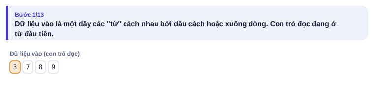
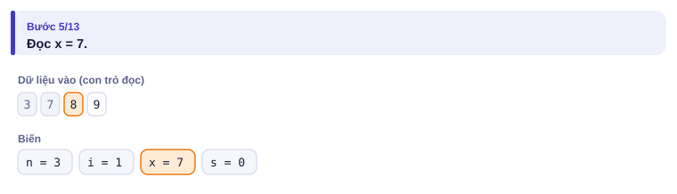
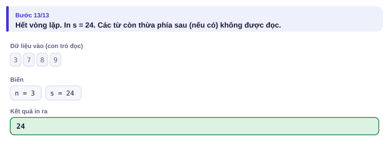
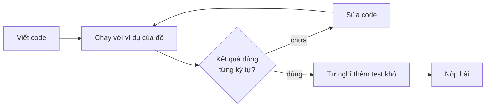

# Bài 0.1 – Chương trình đầu tiên

> **Tập 0 · Nhập môn tư duy lập trình**
> Cần biết trước: dùng máy tính cơ bản (mở thư mục, tạo tệp, gõ phím).
> Thời lượng: khoảng 60 phút đọc, cộng 3–4 giờ thực hành trong tuần.

**Học xong bài này, em sẽ:**

- viết, chạy và nộp một chương trình theo khuôn **đọc → xử lý → in**, bằng Python hoặc C++;
- hiểu máy đọc dữ liệu vào **từng "từ" một**, không quan tâm xuống dòng;
- đọc từ tệp `.INP`, ghi ra tệp `.OUT` đúng quy định phòng thi;
- biết vì sao một chữ thừa trong kết quả cũng làm em mất điểm.

> [!TIP]
> **Học cùng trang mô phỏng.** Mở [mô phỏng đọc dữ liệu](../../mo-phong/t0-doc-du-lieu.html), bấm **Tiếp ▶** để xem con trỏ đọc nhảy qua từng số. Thử ví dụ "số trên nhiều dòng" để thấy xuống dòng không làm thay đổi gì. Bật **Đoán trước** để tự tính tổng trước khi máy hiện.

Ba bạn đồng hành xuyên suốt bộ sách: **An** thích code ngay, **Bảo** thích tìm quy luật, **Chi** cẩn thận và hay bắt lỗi.

---

## 1. Bài toán mở màn: Tổng điểm

Cuối học kỳ, cô chủ nhiệm cần cộng điểm ba bài kiểm tra cho cả lớp. An đề nghị viết chương trình: nhập ba số nguyên a, b, c (0 ≤ a, b, c ≤ 10), in ra tổng của chúng.

| Vào | Ra |
| --- | --- |
| `7 8 9` | `24` |

Nghe thì dễ, nhưng máy tính không "hiểu" đề bài. Nó chỉ làm đúng từng lệnh em viết, theo đúng thứ tự em viết. Bài này dạy em cách ra lệnh cho nó.

---

## 2. Dừng lại 10 phút

> [!IMPORTANT]
> **Dừng lại và nghĩ.** Lấy giấy bút, trả lời trước khi đọc tiếp:
> 1. Viết ra 3 bước máy cần làm để giải bài Tổng điểm.
> 2. Nếu dữ liệu vào là `7` (xuống dòng) `8 9` thì máy có đọc được không? Em đoán thế nào?
> 3. Nếu chương trình in `Tong la 24` thì máy chấm cho đúng hay sai?

<details>
<summary>Đáp án</summary>

1. **Đọc** ba số a, b, c → **tính** s = a + b + c → **in** s. Mọi chương trình thi đấu đều theo khuôn **đọc → xử lý → in**.
2. Với `cin >>` trong C++ hoặc cách đọc cả tệp rồi tách trong Python (mục 5), máy đọc được: nó coi dấu cách và xuống dòng như nhau. Riêng `input().split()` của Python chỉ đọc **một dòng**, nên sẽ thiếu số (Bẫy 3).
3. **Sai.** Máy chấm so **từng ký tự** với đáp án `24`. Chữ `Tong la ` thừa ra làm hai kết quả khác nhau.

</details>

---

## 3. Lời giải ngây thơ và vì sao nó chưa ổn

An gõ ngay chương trình Python đầu tiên của mình:

```python
a = int(input("Nhap a: "))
b = int(input("Nhap b: "))
c = int(input("Nhap c: "))
print("Tong la", a + b + c)
```

Chạy trên máy, An gõ từng số, thấy `Tong la 24`, rất vui. Nhưng nộp lên máy chấm thì **sai cả ba chỗ**:

| Chỗ sai | Vì sao |
| --- | --- |
| `input("Nhap a: ")` | Chữ `Nhap a: ` được **in ra** kết quả. Máy chấm thấy thừa chữ. |
| Ba lần `input()` | Đề cho ba số **trên cùng một dòng** `7 8 9`. Lần đọc đầu lấy cả dòng `"7 8 9"`, `int("7 8 9")` báo lỗi. |
| `print("Tong la", …)` | Kết quả đúng phải chỉ là `24`. |

> [!NOTE]
> Máy chấm không có người ngồi gõ phím. Nó đưa **toàn bộ** dữ liệu vào chương trình một lần, rồi so kết quả in ra với đáp án **từng ký tự**. Lời nhắc "Nhap a" chỉ có ích khi người ngồi gõ; trong thi đấu, nó là chữ thừa.

---

## 4. Ý tưởng then chốt

> [!IMPORTANT]
> **Dữ liệu vào là một dãy các "từ" cách nhau bởi dấu cách hoặc xuống dòng. Mỗi lệnh đọc lấy đúng từ tiếp theo, rồi con trỏ đọc nhảy qua.** Chương trình chỉ in đúng đáp án, không thêm một chữ nào.

### Chạy từng bước

Ví dụ với chương trình đọc n rồi n số và in tổng (đây là dạng tổng quát của bài Tổng điểm), dữ liệu vào `3` / `7 8 9`. Mỗi bước, hãy đoán trước rồi mới mở hình.

<details>
<summary><b>Bước 1</b> – Trước khi đọc: con trỏ ở đâu?</summary>



Bốn "từ" `3`, `7`, `8`, `9`. Dòng nào chứa từ nào không quan trọng.

</details>

<details>
<summary><b>Bước 2</b> – Đã đọc n = 3, giờ đọc số đầu tiên: x bằng mấy?</summary>



Từ `3` đã được dùng (mờ đi). Con trỏ ở `7`, nên x = 7.

</details>

<details>
<summary><b>Bước 3</b> – Sau ba lần đọc và cộng: in ra gì?</summary>



s = 0 + 7 + 8 + 9 = 24. Chỉ in đúng `24`.

</details>



---

## 5. Mã giả và cài đặt

```text
đọc a, b, c
s ← a + b + c
in s
```

```python
# file: tong_diem.py
a, b, c = map(int, input().split())   # đọc 3 số trên cùng một dòng
s = a + b + c
print(s)
```

```cpp
// file: tong_diem.cpp
#include <bits/stdc++.h>     // nạp sẵn mọi thư viện chuẩn hay dùng
using namespace std;

int main() {
    int a, b, c;
    cin >> a >> b >> c;       // đọc 3 số, cách nhau bởi dấu cách hoặc xuống dòng
    int s = a + b + c;
    cout << s << '\n';        // in s rồi xuống dòng
    return 0;
}
```

Đọc từng phần của bản Python:

| Đoạn code | Ý nghĩa | Với dữ liệu `7 8 9` |
| --- | --- | --- |
| `input()` | đọc cả dòng thành một xâu | `"7 8 9"` |
| `.split()` | tách xâu theo dấu cách | `["7", "8", "9"]` |
| `map(int, …)` | đổi từng phần thành số nguyên | `7, 8, 9` |
| `a, b, c = …` | gán lần lượt | a = 7, b = 8, c = 9 |

C++ khác Python ở ba điểm: phải **khai báo kiểu** (`int a`), mỗi lệnh kết thúc bằng `;`, và chương trình chạy từ hàm `main`.

### Đọc và ghi tệp như trong phòng thi

Trên các trang luyện tập (Codeforces, CSES, VNOJ), dữ liệu đến từ **bàn phím** (stdin) và in ra **màn hình** (stdout). Trong phòng thi HSG cấp tỉnh/thành phố, đề thường yêu cầu đọc từ tệp, ví dụ `TONGDIEM.INP`, và ghi ra `TONGDIEM.OUT`. Cách dễ nhất là **chuyển hướng** nhập/xuất sang tệp, phần còn lại giữ nguyên:

```cpp
// file: tong_diem_tep.cpp
#include <bits/stdc++.h>
using namespace std;

int main() {
    freopen("TONGDIEM.INP", "r", stdin);    // từ đây cin đọc từ tệp
    freopen("TONGDIEM.OUT", "w", stdout);   // từ đây cout ghi vào tệp
    int a, b, c;
    cin >> a >> b >> c;
    cout << a + b + c << '\n';
    return 0;
}
```

```python
# file: tong_diem_tep.py
import sys
sys.stdin = open("TONGDIEM.INP", "r")      # từ đây input() đọc từ tệp
sys.stdout = open("TONGDIEM.OUT", "w")     # từ đây print() ghi vào tệp

a, b, c = map(int, input().split())
print(a + b + c)
```

### Đọc nhanh khi dữ liệu lớn

Khi phải đọc hàng trăm nghìn số, cách đọc mặc định có thể chậm hơn cả phần tính toán. Hai "câu thần chú":

```cpp
ios::sync_with_stdio(false);   // C++: đặt ở đầu main
cin.tie(nullptr);
```

```python
import sys
data = sys.stdin.buffer.read().split()   # Python: đọc toàn bộ một lần, rồi lấy dần
```

Ví dụ đọc n rồi n số và in tổng của chúng (đúng chương trình trong trang mô phỏng):

```python
# file: tong_day.py
import sys
data = sys.stdin.buffer.read().split()
n = int(data[0])
print(sum(map(int, data[1:n + 1])))
```

```cpp
// file: tong_day.cpp
#include <bits/stdc++.h>
using namespace std;
int main() {
    ios::sync_with_stdio(false);
    cin.tie(nullptr);
    int n;
    cin >> n;
    long long s = 0;              // tổng có thể rất lớn, xem bài 0.2
    for (int i = 0; i < n; i++) {
        long long x;
        cin >> x;
        s += x;
    }
    cout << s << '\n';
}
```

Em chưa cần hiểu hết vòng `for`: bài 0.4 sẽ giải thích.

---

## 6. Vì sao đúng, chạy bao lâu

- **Đúng** vì chương trình làm đúng ba bước của mục 2, không thêm, không bớt. Với bài đơn giản, "chứng minh" chính là đối chiếu từng bước với đề.
- **Chạy bao lâu:** một máy tính thường làm khoảng 10⁸ phép tính đơn giản mỗi giây. Cộng ba số chỉ tốn vài phép: tức thì. Phần **tốn thời gian nhất** của nhiều bài lại là **đọc dữ liệu**: đọc 10⁶ số, mỗi số một dòng, bằng `input()` trong Python mất khoảng 0,8 giây (gần hết giới hạn 1 giây của nhiều đề), còn đọc cả tệp một lần như `tong_day.py` chỉ mất khoảng 0,15 giây (đo trên máy thường).

---

## 7. Bẫy thường gặp

> [!WARNING]
> **Bẫy 1: in thừa chữ.** `print("Tong la:", s)` hay `cout << "Nhap a: "` đều làm kết quả sai, vì máy chấm so **từng ký tự**. Chỉ in đúng những gì đề yêu cầu.
> *Test phá:* bất kỳ test nào, kể cả ví dụ của đề.

> [!WARNING]
> **Bẫy 2: sai tên tệp.** `TONGDIEM.INP` khác `tongdiem.inp` trên một số máy, khác hẳn `TONGDIEM.IN`. Hãy **sao chép** tên tệp từ đề, đừng gõ lại. Quên bỏ dấu `//` trước `freopen` cũng là một dạng sai tên tệp: chương trình đọc từ bàn phím, đứng chờ mãi.
> *Test phá:* máy chấm phòng thi; trên máy nhà em vẫn chạy "đúng".

> [!WARNING]
> **Bẫy 3: đọc sai dạng dữ liệu.** `int(input())` chỉ đọc được khi dòng đó có **đúng một** số. Dòng có nhiều số phải dùng `input().split()`; số nằm trên nhiều dòng thì đọc cả tệp như `tong_day.py`. Trong C++, `cin >>` không quan tâm số nằm trên một dòng hay nhiều dòng.
> *Test phá:* `7` (xuống dòng) `8 9` với chương trình dùng `input().split()` một lần.

> [!WARNING]
> **Bẫy 4: quên xuống dòng hoặc in sai dấu cách.** Đề yêu cầu "mỗi số trên một dòng" thì phải in đúng như vậy. Phần lớn máy chấm bỏ qua dấu cách thừa cuối dòng, nhưng **không** bỏ qua việc dính hai số vào nhau (`2410` thay vì `24 10`).

---

## 8. Ví dụ giảm dần hỗ trợ

Ví dụ 1 là bài Tổng điểm đã giải trọn ở trên. Hai ví dụ dưới đây giảm dần phần hỗ trợ.

### Ví dụ 2 – Điền vào chỗ trống: Mảnh vườn

Nhà Chi có mảnh vườn hình chữ nhật dài d, rộng r mét (1 ≤ d, r ≤ 1000). Đọc d, r từ tệp `VUON.INP`, ghi ra tệp `VUON.OUT` hai số trên hai dòng: **chu vi** và **diện tích**.

| VUON.INP | VUON.OUT |
| --- | --- |
| `5 3` | `16`<br>`15` |

Điền vào bốn chỗ `____`:

```text
#include <bits/stdc++.h>
using namespace std;
int main() {
    freopen("____", "r", stdin);
    freopen("____", "w", stdout);
    int d, r;
    cin >> d >> r;
    cout << ____ << '\n';
    cout << ____ << '\n';
}
```

<details>
<summary>Đáp án</summary>

`VUON.INP`, `VUON.OUT`, `2 * (d + r)`, `d * r`.

```cpp
// file: vuon.cpp
#include <bits/stdc++.h>
using namespace std;
int main() {
    freopen("VUON.INP", "r", stdin);
    freopen("VUON.OUT", "w", stdout);
    int d, r;
    cin >> d >> r;
    cout << 2 * (d + r) << '\n';
    cout << d * r << '\n';
}
```

```python
# file: vuon.py
import sys
sys.stdin = open("VUON.INP", "r")
sys.stdout = open("VUON.OUT", "w")
d, r = map(int, input().split())
print(2 * (d + r))
print(d * r)
```

</details>

### Ví dụ 3 – Tự làm: Vé xe buýt

Một nhóm có n học sinh đi xe buýt, mỗi vé giá g đồng (1 ≤ n ≤ 100, 1000 ≤ g ≤ 10000). Lớp đã có sẵn k đồng (0 ≤ k ≤ 10⁶). Đọc n, g, k (cùng một dòng), in **số tiền còn thiếu**, hoặc `0` nếu đủ tiền.

| Vào | Ra |
| --- | --- |
| `30 7000 150000` | `60000` |
| `2 5000 20000` | `0` |

> [!IMPORTANT]
> Tự viết trọn chương trình trước khi mở lời giải. Gợi ý duy nhất: tổng tiền vé là n × g; nếu số đó không lớn hơn k thì in 0.

<details>
<summary>Lời giải</summary>

```python
# file: ve_xe.py
n, g, k = map(int, input().split())
can = n * g
print(max(0, can - k))
```

```cpp
// file: ve_xe.cpp
#include <bits/stdc++.h>
using namespace std;
int main() {
    long long n, g, k;
    cin >> n >> g >> k;
    cout << max(0LL, n * g - k) << '\n';
}
```

`max(0, …)` thay cho một câu `if`: nếu tiền thiếu âm (tức là dư) thì lấy 0. Bài 0.3 sẽ học `if` đầy đủ.

</details>

---

## 9. Bài tập

Mục tiêu tối thiểu: làm hết nấc Khởi động và Luyện. Bài kiểu đề thi làm sau cùng, có bấm giờ.

| Nấc | Bài | Nguồn | Ý chính |
| --- | --- | --- | --- |
| Khởi động | Viết lại `tong_diem` bằng ngôn ngữ còn lại | Tự luyện | Làm quen cú pháp |
| Khởi động | Đọc hai số a, b, in ra 4 dòng: a + b, a − b, a × b, a mod b | Tự luyện | Nhiều dòng kết quả |
| Luyện | Tạo tài khoản [Codeforces](https://codeforces.com), nộp [Way Too Long Words (71A)](https://codeforces.com/problemset/problem/71/A) sau bài 0.6 và [Watermelon (4A)](https://codeforces.com/problemset/problem/4/A) sau bài 0.3 | Codeforces · 800 | Nộp bài lên judge |
| Luyện | Tạo tài khoản [CSES](https://cses.fi), đọc đề [Weird Algorithm](https://cses.fi/problemset/task/1068) (sẽ giải ở bài 0.4) | CSES 1068 | Làm quen judge quốc tế |
| Thử thách | Đọc n (n ≤ 10⁶) rồi n số; in tổng. Đo thời gian chạy khi bật và khi tắt đọc nhanh | Tự luyện | Thấy tác dụng của đọc nhanh |
| Kiểu đề thi | Tổng dãy số | Bài của sách, chấm theo subtask | Xem bên dưới |

### Bài kiểu đề thi: Tổng dãy số

**Đề bài.** Đọc từ `TONGDAY.INP`: dòng đầu n, dòng sau n số nguyên a₁ … aₙ. Ghi ra `TONGDAY.OUT` tổng các số.

Subtask: 50% có n ≤ 10 và |aᵢ| ≤ 100; 50% còn lại có n ≤ 10⁶ và |aᵢ| ≤ 10⁹.

| TONGDAY.INP | TONGDAY.OUT |
| --- | --- |
| `3`<br>`7 8 9` | `24` |

<details>
<summary><b>Gợi ý 1</b> – hướng đi (đủ 50% điểm)</summary>

Đọc n, rồi đọc từng số và cộng dồn vào một biến tổng. Đừng quên hai dòng chuyển hướng tệp.

</details>

<details>
<summary><b>Gợi ý 2</b> – vì sao có thể mất 50% còn lại?</summary>

Với n = 10⁶ và mọi số bằng 10⁹, tổng là 10¹⁵. Biến `int` của C++ chỉ chứa tới khoảng 2,1·10⁹. Còn Python đọc 10⁶ số bằng `input()` từng dòng thì không đủ nhanh, và nếu đề đặt nhiều số trên một dòng dài thì càng phải đọc cả tệp một lần.

</details>

<details>
<summary><b>Gợi ý 3</b> – lời giải đầy đủ</summary>

Dùng `long long` cho tổng trong C++, và đọc nhanh: chính là `tong_day.cpp` / `tong_day.py` ở mục 5, thêm hai dòng chuyển hướng sang `TONGDAY.INP` / `TONGDAY.OUT`.

</details>

---

## 10. Tóm tắt, flashcard và checkpoint

**Tóm tắt trong 5 dòng.**

1. Mọi chương trình thi đấu: **đọc → xử lý → in**.
2. Dữ liệu vào là dãy các "từ"; mỗi lệnh đọc lấy từ tiếp theo. C++ `cin >>` không quan tâm xuống dòng; Python `input()` đọc một dòng.
3. Phòng thi: chuyển hướng sang tệp bằng `freopen` (C++) hoặc gán `sys.stdin/sys.stdout` (Python).
4. Không in thừa chữ, sao chép đúng tên tệp.
5. Dữ liệu lớn: đọc nhanh (`sync_with_stdio`, `sys.stdin.buffer.read()`).

**Flashcard.** Đọc mặt trước, tự trả lời thành tiếng, rồi mới mở mặt sau. Ôn lại sau 1, 3, 7 và 21 ngày.

<details><summary>Lệnh nào trong C++ làm <code>cin</code> đọc từ tệp <code>BAI.INP</code>?</summary><code>freopen("BAI.INP", "r", stdin);</code></details>
<details><summary>Vì sao <code>print("Ket qua:", s)</code> bị chấm sai?</summary>Máy chấm so từng ký tự; phần chữ "Ket qua:" không có trong đáp án.</details>
<details><summary>Dòng <code>7 8 9</code>: vì sao <code>int(input())</code> báo lỗi?</summary>Nó cố đổi cả xâu "7 8 9" thành một số. Phải tách bằng <code>.split()</code> trước.</details>
<details><summary>Ba khối chính của mọi chương trình thi đấu?</summary>Đọc → xử lý → in.</details>
<details><summary>Hai dòng "đọc nhanh" của C++?</summary><code>ios::sync_with_stdio(false); cin.tie(nullptr);</code></details>

**Ôn xoắn ốc.** Đây là bài đầu tiên nên chưa có kiến thức cũ để ôn. Từ bài 0.2, mục này sẽ trộn bài của các bài trước.

**Checkpoint – em đã sẵn sàng sang bài tiếp theo nếu:**

- [ ] Không nhìn sách, viết được chương trình đọc từ `BAI.INP`, ghi ra `BAI.OUT` bằng ngôn ngữ em chọn, trong dưới 5 phút.
- [ ] Giải thích được bằng lời "con trỏ đọc" nhảy thế nào với dữ liệu `3` / `7 8 9`.
- [ ] Làm xong Ví dụ 3 mà không mở lời giải.
- [ ] Nộp thành công ít nhất một bài lên một judge trực tuyến.

Chưa đạt? Nếu vướng ô 1, đọc lại mục 5 và gõ lại hai chương trình đọc tệp. Nếu vướng ô 2, mở trang mô phỏng và chạy ví dụ "số trên nhiều dòng". Nếu vướng ô 3, làm lại Ví dụ 2 rồi thử lại.
