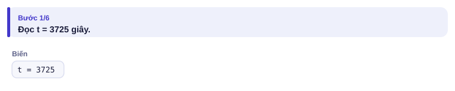
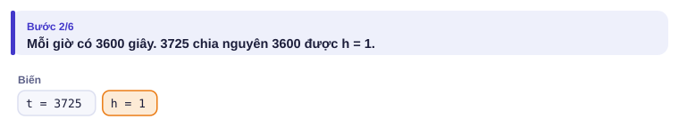
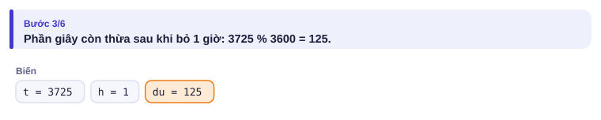
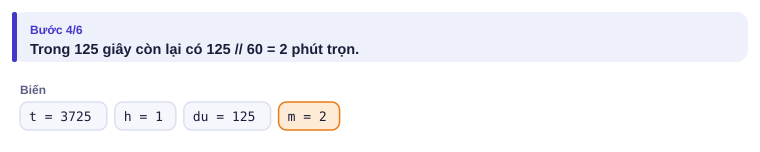
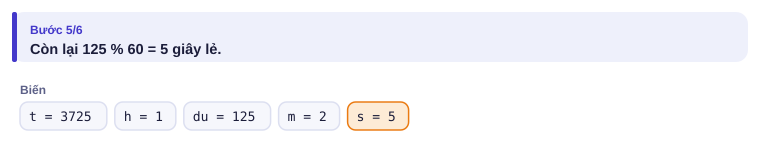

# Bài 0.2 – Biến và phép toán

> **Tập 0 · Nhập môn tư duy lập trình**
> Cần biết trước: bài 0.1 (đọc → xử lý → in).
> Thời lượng: khoảng 60 phút đọc, cộng 3–4 giờ thực hành trong tuần.

**Học xong bài này, em sẽ:**

- dùng thành thạo **chia lấy phần nguyên** và **chia lấy dư** để tách một số thành nhiều phần;
- biết mỗi kiểu số trong C++ chứa được tới đâu, và tránh **tràn số**, lỗi "im lặng" nguy hiểm nhất;
- làm tròn lên một phép chia mà không dùng số thực.

> [!TIP]
> **Học cùng trang mô phỏng.** Mở [mô phỏng đổi giây](../../mo-phong/t0-doi-giay.html). Bật **Đoán trước** rồi bấm **Tiếp ▶**: trước mỗi phép `//` và `%`, trang hỏi em kết quả. Thử với t = 86399 và t = 10⁹.

---

## 1. Bài toán mở màn: Đổi giây

Đồng hồ thể thao của Bảo ghi thời gian chạy bộ quanh hồ Con Rùa bằng **giây**. Bảo muốn đổi sang giờ, phút, giây. Nhập t (0 ≤ t ≤ 10⁹), in ba số h m s.

| Vào | Ra |
| --- | --- |
| `3725` | `1 2 5` |
| `59` | `0 0 59` |

---

## 2. Dừng lại 10 phút

> [!IMPORTANT]
> **Dừng lại và nghĩ.**
> 1. 3725 giây là bao nhiêu phút tròn, dư bao nhiêu giây? Em đã dùng phép tính nào?
> 2. Từ số phút tròn đó, làm sao ra số giờ và số phút lẻ?
> 3. Với t = 10⁹, số giờ là bao nhiêu? Có vượt 2 tỉ không?

<details>
<summary>Đáp án</summary>

1. 3725 : 60 = 62 phút, dư 5 giây. Đó là **chia lấy phần nguyên** (62) và **chia lấy dư** (5).
2. 62 : 60 = 1 giờ, dư 2 phút. Vậy đáp án là `1 2 5`.
3. 10⁹ : 3600 ≈ 277 777 giờ: không vượt 2 tỉ. Nhưng nếu đề cho t tới 10¹⁸ thì riêng việc **lưu** t đã cần kiểu số lớn hơn `int` (mục 4).

</details>

---

## 3. Lời giải ngây thơ và vì sao nó chưa ổn

An nghĩ: "chia cho 60 là ra phút" và dùng phép chia thường của Python:

```python
t = int(input())
print(t / 3600, t / 60, t)
```

Với `3725`, chương trình in `1.0347222222222223 62.083333333333336 3725`. Có **ba** lỗi:

| Lỗi | Vì sao |
| --- | --- |
| `t / 3600` ra số thực | Python `/` luôn cho số thực. Cần chia lấy phần nguyên `//`. |
| `t / 60` là **tổng** số phút (62) | Đề cần số phút **lẻ** sau khi đã bỏ các giờ tròn (2). |
| `t` là tổng số giây | Đề cần số giây lẻ (5). |

Bài học: phải **bỏ dần** từng phần lớn trước, phần còn lại mới đổi tiếp.

---

## 4. Ý tưởng then chốt

> [!IMPORTANT]
> **Với a, b nguyên dương: a = (a chia nguyên b) × b + (a chia dư b). Phần nguyên cho biết "có bao nhiêu cái b trọn vẹn", phần dư là "cái còn thừa".** Tách số giây thành giờ, phút, giây chính là làm phép này hai lần.

| Phép toán | Python | C++ | 17 và 5 cho ra |
| --- | --- | --- | --- |
| Chia lấy phần nguyên | `17 // 5` | `17 / 5` (cả hai là số nguyên) | 3 |
| Chia lấy dư | `17 % 5` | `17 % 5` | 2 |
| Chia ra số thực | `17 / 5` | `17.0 / 5` | 3.4 |

Kiểm tra: 17 = 3 × 5 + 2. ✓

### Chạy từng bước

Với t = 3725. Mỗi bước, hãy tính trước rồi mới mở hình.

<details>
<summary><b>Bước 1</b> – Đọc t</summary>



</details>

<details>
<summary><b>Bước 2</b> – h = t // 3600 bằng mấy?</summary>



</details>

<details>
<summary><b>Bước 3</b> – Phần giây còn thừa du = t % 3600 bằng mấy?</summary>



</details>

<details>
<summary><b>Bước 4</b> – Trong du giây có mấy phút trọn?</summary>



</details>

<details>
<summary><b>Bước 5</b> – Còn bao nhiêu giây lẻ?</summary>



Kiểm tra lại: 1 · 3600 + 2 · 60 + 5 = 3725. ✓

</details>

> [!NOTE]
> **Hai mẹo dùng `%` cả đời.** `n % 10` là chữ số cuối của n; `n // 10` là n bỏ chữ số cuối. `n % 2 == 0` nghĩa là n chẵn.

---

## 5. Mã giả và cài đặt

```text
đọc t
h  ← t chia nguyên 3600
du ← t chia dư 3600
m  ← du chia nguyên 60
s  ← du chia dư 60
in h, m, s
```

```python
# file: doi_giay.py
t = int(input())
h = t // 3600            # số giờ tròn
du = t % 3600            # số giây còn thừa sau khi bỏ các giờ tròn
m = du // 60             # số phút tròn trong phần thừa
s = du % 60              # số giây lẻ
print(h, m, s)
```

```cpp
// file: doi_giay.cpp
#include <bits/stdc++.h>
using namespace std;
int main() {
    long long t;
    cin >> t;
    long long h = t / 3600, du = t % 3600;
    long long m = du / 60, s = du % 60;
    cout << h << ' ' << m << ' ' << s << '\n';
}
```

### Tràn số: lỗi im lặng nguy hiểm nhất

Python tự mở rộng số nguyên, tính được cả 2¹⁰⁰⁰. **C++ thì không.** Mỗi kiểu số chỉ chứa được một khoảng giá trị:

| Kiểu C++ | Khoảng giá trị (xấp xỉ) | Dùng khi |
| --- | --- | --- |
| `int` | −2,1·10⁹ … 2,1·10⁹ | giá trị chắc chắn dưới 2·10⁹ |
| `long long` | −9,2·10¹⁸ … 9,2·10¹⁸ | tổng, tích, mọi thứ có thể vượt 10⁹ |

Vượt khoảng thì C++ **không báo lỗi** mà cho ra một số sai, thường là số âm. Hình dung đồng hồ công-tơ-mét của xe máy: chạy quá 99999 km thì quay về 00000.

Ví dụ: tính 1 + 2 + … + n với n ≤ 10⁶. Công thức n(n + 1)/2 với n = 10⁶ cho khoảng 5·10¹¹, vượt `int`.

```cpp
// file: tong_1_n.cpp
#include <bits/stdc++.h>
using namespace std;
int main() {
    long long n;                    // dùng long long ngay từ đầu
    cin >> n;
    cout << n * (n + 1) / 2 << '\n';
}
```

```python
# file: tong_1_n.py
n = int(input())
print(n * (n + 1) // 2)             # dùng // để kết quả là số nguyên
```

Nếu khai báo `int n` thì với n = 10⁶, phép nhân `n * (n + 1)` tràn và chương trình in `-363189984` thay vì `500000500000`.

### Làm tròn lên mà không dùng số thực

Cần bao nhiêu chuyến xe 45 chỗ để chở 100 học sinh? 100/45 = 2,22…, nên cần **3** chuyến. Đó là phép chia **làm tròn lên**.

Với a, b nguyên dương: **làm tròn lên của a/b = (a + b − 1) chia nguyên b.** Lý do: cộng thêm b − 1 làm phần nguyên tăng thêm 1 khi và chỉ khi a có phần dư khác 0.

| a | b | (a + b − 1) // b | Kiểm tra |
| --- | --- | --- | --- |
| 100 | 45 | 144 // 45 = 3 | 2 chuyến chở 90, thiếu 10 ✓ |
| 90 | 45 | 134 // 45 = 2 | vừa khít ✓ |
| 1 | 45 | 45 // 45 = 1 | ✓ |

---

## 6. Vì sao đúng, chạy bao lâu

- **Đúng:** h là số giờ tròn vì 3600·h ≤ t < 3600·(h + 1). Phần còn lại du = t − 3600h luôn nhỏ hơn 3600, nên m = du // 60 nhỏ hơn 60 và s = du % 60 nhỏ hơn 60: đúng dạng giờ–phút–giây. Ghép lại: 3600h + 60m + s = 3600h + du = t.
- **Chạy bao lâu:** 4 phép tính, tức thì, dù t lớn bao nhiêu. Đây là bài **O(1)**: số phép tính không phụ thuộc độ lớn dữ liệu.

---

## 7. Bẫy thường gặp

> [!WARNING]
> **Bẫy 1: `long long` nhưng vẫn tràn.** Với `int a, b;` thì `long long x = a * b;` vẫn tràn, vì phép nhân xảy ra **trước** khi gán, trên kiểu `int`. Sửa: `long long x = 1LL * a * b;`, hoặc khai báo a, b là `long long` từ đầu. Quy tắc an toàn ở Tập 0: **cứ dùng `long long`** cho mọi số có thể lớn.
> *Test phá:* a = b = 100000, kết quả đúng là 10¹⁰.

> [!WARNING]
> **Bẫy 2: dùng `ceil(a / b)` với số thực.** Số thực có sai số. Với số lớn cỡ 10¹⁸, `ceil` có thể cho kết quả lệch 1. Luôn dùng công thức số nguyên `(a + b - 1) // b`.
> *Test phá:* a = 10¹⁸ − 1, b = 1: `ceil(a / b)` trong Python cho 10¹⁸ (sai), công thức nguyên cho 10¹⁸ − 1.

> [!WARNING]
> **Bẫy 3: số âm.** Python `-7 // 2` cho −4 (làm tròn xuống), C++ `-7 / 2` cho −3 (bỏ phần thập phân). Tương tự `-7 % 2` là 1 trong Python nhưng −1 trong C++. Đề có số âm thì phải kiểm tra kỹ.

> [!WARNING]
> **Bẫy 4: chia cho 0.** `a % b` hay `a // b` với b = 0 làm chương trình dừng với lỗi. Đọc kỹ ràng buộc: nếu đề cho phép b = 0 thì phải xử lý riêng.

---

## 8. Ví dụ giảm dần hỗ trợ

### Ví dụ 2 – Điền vào chỗ trống: Xe đưa đón

Trường thuê xe k chỗ để chở n học sinh đi tham quan (1 ≤ n, k ≤ 10¹⁸). Cần ít nhất bao nhiêu xe?

| Vào | Ra |
| --- | --- |
| `100 45` | `3` |
| `90 45` | `2` |

```text
n, k = map(int, input().split())
print(____)
```

<details>
<summary>Đáp án</summary>

`(n + k - 1) // k`. Với số tới 10¹⁸, bản C++ phải dùng `long long`: n + k − 1 tới 2·10¹⁸ vẫn vừa.

```python
# file: xe_dua_don.py
n, k = map(int, input().split())
print((n + k - 1) // k)
```

```cpp
// file: xe_dua_don.cpp
#include <bits/stdc++.h>
using namespace std;
int main() {
    long long n, k;
    cin >> n >> k;
    cout << (n + k - 1) / k << '\n';
}
```

</details>

### Ví dụ 3 – Tự làm: Đảo số

Nhập một số nguyên có đúng ba chữ số n (100 ≤ n ≤ 999). In số đọc ngược (bỏ số 0 ở đầu nếu có).

| Vào | Ra |
| --- | --- |
| `123` | `321` |
| `540` | `45` |

> [!IMPORTANT]
> Tự làm trước. Gợi ý: tách ba chữ số bằng `% 10` và `// 10` như mẹo ở mục 4, rồi ghép lại theo thứ tự ngược.

<details>
<summary>Lời giải</summary>

Chữ số hàng đơn vị là `n % 10`, hàng chục là `n // 10 % 10`, hàng trăm là `n // 100`. Ghép ngược: đơn vị × 100 + chục × 10 + trăm. Phép ghép tự bỏ số 0 ở đầu, vì 0 × 100 = 0.

```python
# file: dao_so.py
n = int(input())
dv, ch, tr = n % 10, n // 10 % 10, n // 100
print(dv * 100 + ch * 10 + tr)
```

```cpp
// file: dao_so.cpp
#include <bits/stdc++.h>
using namespace std;
int main() {
    int n;
    cin >> n;
    int dv = n % 10, ch = n / 10 % 10, tr = n / 100;
    cout << dv * 100 + ch * 10 + tr << '\n';
}
```

</details>

---

## 9. Bài tập

| Nấc | Bài | Nguồn | Ý chính |
| --- | --- | --- | --- |
| Khởi động | [Elephant](https://codeforces.com/problemset/problem/617/A) | CF 617A · 800 | Làm tròn lên |
| Khởi động | [Soldier and Bananas](https://codeforces.com/problemset/problem/546/A) | CF 546A · 800 | Tổng 1..n, chú ý kết quả không âm |
| Luyện | [Theatre Square](https://codeforces.com/problemset/problem/1/A) | CF 1A · 1000 | Làm tròn lên + tràn số |
| Luyện | [Domino piling](https://codeforces.com/problemset/problem/50/A) | CF 50A · 800 | Chia nguyên |
| Luyện | Nhập số nguyên dương n (n ≤ 10¹⁸), in tổng các chữ số của n | Tự luyện | `% 10` và `// 10` lặp lại (xem trước bài 0.4) |
| Thử thách | [Trailing Zeros](https://cses.fi/problemset/task/1618) | CSES 1618 | Đếm thừa số 5 trong n! |
| Kiểu đề thi | Đồng hồ | Bài của sách, chấm theo subtask | Xem bên dưới |

### Bài kiểu đề thi: Đồng hồ

**Đề bài.** Một buổi chiếu phim bắt đầu lúc h giờ m phút s giây (0 ≤ h < 24, 0 ≤ m, s < 60) và kéo dài t giây. Hỏi phim kết thúc lúc mấy giờ (đồng hồ 24 giờ, qua nửa đêm thì quay về 0)? In ba số h m s. Đọc từ `DONGHO.INP`, ghi ra `DONGHO.OUT`.

Subtask: 40% có t < 60 và phim kết thúc trong cùng một phút; 30% có t ≤ 10⁶; 30% có t ≤ 10¹⁸.

| DONGHO.INP | DONGHO.OUT |
| --- | --- |
| `23 59 30 100` | `0 1 10` |

<details>
<summary><b>Gợi ý 1</b> – hướng đi (đủ 40% điểm)</summary>

Khi phim kết thúc trong cùng một phút, chỉ cần cộng t vào s.

</details>

<details>
<summary><b>Gợi ý 2</b> – ý then chốt</summary>

Đổi giờ bắt đầu ra **tổng số giây kể từ nửa đêm**, cộng t, rồi đổi ngược lại như bài Đổi giây. Một ngày có 86 400 giây, nên số giờ phải chia dư cho 24 (hoặc tổng số giây chia dư cho 86 400).

</details>

<details>
<summary><b>Gợi ý 3</b> – lời giải đầy đủ</summary>

Tổng x = 3600h + 60m + s + t có thể tới khoảng 10¹⁸ + 86 400: vẫn vừa `long long`. Lấy x % 86400 trước, rồi tách như bài Đổi giây.

```python
# file: dongho.py
with open("DONGHO.INP") as f:
    h, m, s, t = map(int, f.read().split())
x = (3600 * h + 60 * m + s + t) % 86400
with open("DONGHO.OUT", "w") as f:
    f.write(f"{x // 3600} {x % 3600 // 60} {x % 60}\n")
```

```cpp
// file: dongho.cpp
#include <bits/stdc++.h>
using namespace std;
int main() {
    freopen("DONGHO.INP", "r", stdin);
    freopen("DONGHO.OUT", "w", stdout);
    long long h, m, s, t;
    cin >> h >> m >> s >> t;
    long long x = (3600 * h + 60 * m + s + t) % 86400;
    cout << x / 3600 << ' ' << x % 3600 / 60 << ' ' << x % 60 << '\n';
}
```

</details>

---

## 10. Tóm tắt, flashcard và checkpoint

**Tóm tắt trong 5 dòng.**

1. `a // b` (Python), `a / b` (C++ với số nguyên): chia lấy phần nguyên. `a % b`: chia lấy dư. Luôn có a = (a // b)·b + a % b.
2. Tách một số thành nhiều phần: bỏ dần phần lớn nhất trước, phần dư mới đổi tiếp.
3. C++: mọi số có thể vượt 2·10⁹ dùng `long long`; nhân hai `int` thì viết `1LL * a * b`.
4. Làm tròn lên a/b: `(a + b - 1) // b`. Không dùng số thực.
5. Số âm: Python và C++ chia khác nhau; chia cho 0 làm chương trình dừng.

**Flashcard.**

<details><summary>Chữ số hàng chục của n là gì?</summary><code>n // 10 % 10</code></details>
<details><summary><code>int a = 100000, b = 100000; long long x = a * b;</code> có đúng không?</summary>Sai: tràn số khi nhân trên kiểu <code>int</code>. Viết <code>1LL * a * b</code>.</details>
<details><summary>Làm tròn lên 100/45 bằng số nguyên?</summary><code>(100 + 45 - 1) // 45 = 3</code>.</details>
<details><summary><code>int</code> chứa được tới khoảng bao nhiêu?</summary>Khoảng 2,1·10⁹ (2³¹ − 1).</details>
<details><summary>Python <code>-7 // 2</code> và C++ <code>-7 / 2</code> cho gì?</summary>Python −4, C++ −3.</details>

**Ôn xoắn ốc** (kiến thức bài 0.1; mỗi bài tối đa 20 phút):

- Viết lại `tong_diem_tep` không nhìn sách, đổi tên tệp thành `ON.INP` / `ON.OUT`.
- [Way Too Long Words](https://codeforces.com/problemset/problem/71/A) (CF 71A): chỉ đọc hiểu đề, nghĩ cách đọc dữ liệu.
- Đọc n rồi n số trên **nhiều dòng**, in tổng (dùng cách đọc cả tệp).

**Checkpoint – em đã sẵn sàng sang bài tiếp theo nếu:**

- [ ] Giải đúng CF 1A Theatre Square trong lần nộp đầu tiên.
- [ ] Giải thích được cho bạn vì sao `1LL * a * b` khác `a * b`.
- [ ] Làm xong Ví dụ 3 (Đảo số) mà không mở lời giải.
- [ ] Đạt trọn điểm bài Đồng hồ khi tự làm trong 20 phút.

Chưa đạt? Nếu vướng ô 1 hoặc 2, đọc lại mục "Tràn số" và "Làm tròn lên" ở mục 5. Nếu vướng ô 3 hoặc 4, chạy lại trang mô phỏng với chế độ Đoán trước cho tới khi đoán đúng mọi bước.
