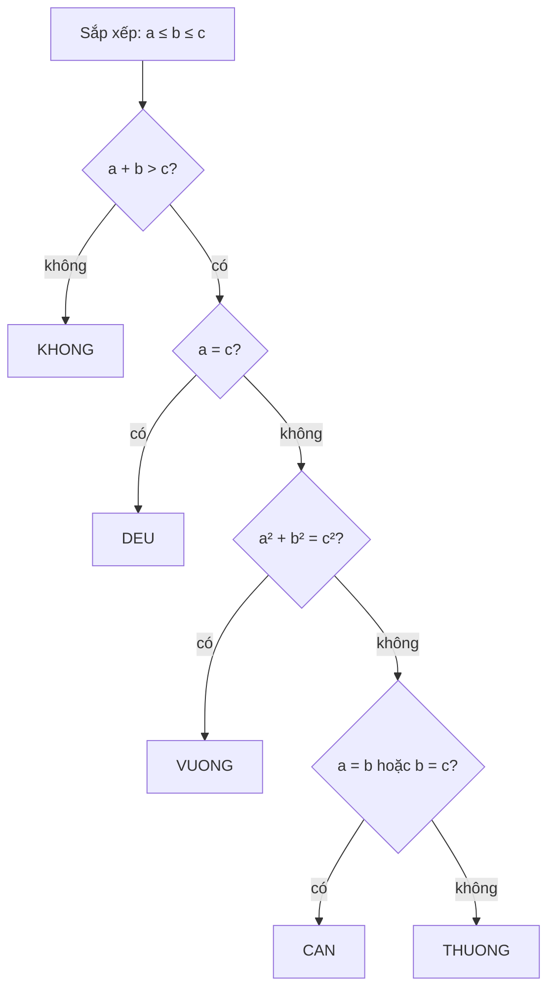
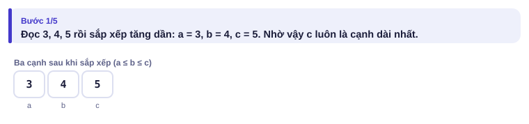
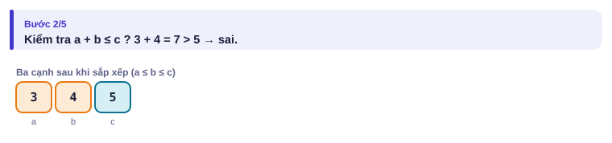
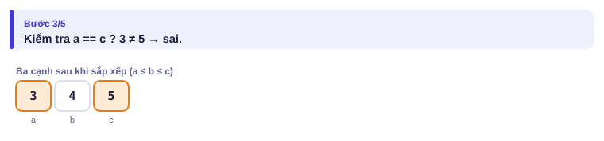
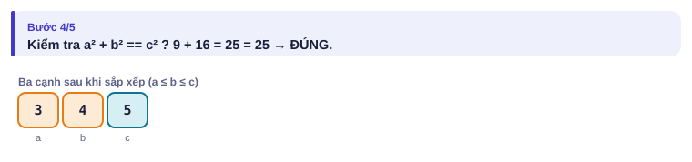
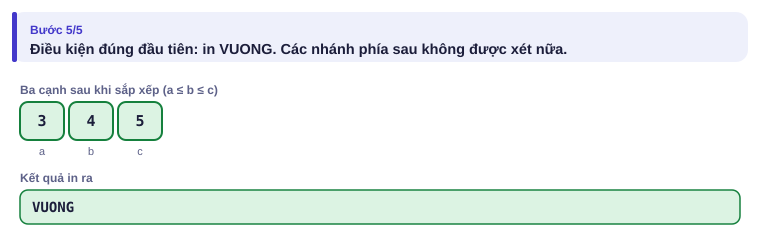

# Bài 0.3 – Rẽ nhánh

> **Tập 0 · Nhập môn tư duy lập trình**
> Cần biết trước: bài 0.2 (phép toán, tràn số).
> Thời lượng: khoảng 70 phút đọc, cộng 4 giờ thực hành trong tuần.

**Học xong bài này, em sẽ:**

- viết `if / elif / else` để chương trình chọn đúng một trong nhiều trường hợp;
- sắp xếp **thứ tự kiểm tra** sao cho trường hợp đặc biệt được xét trước;
- tự lập **bảng test biên** trước khi nộp: kỹ năng phân biệt người đạt giải với người mất điểm oan.

> [!TIP]
> **Học cùng trang mô phỏng.** Mở [mô phỏng phân loại tam giác](../../mo-phong/t0-tam-giac.html). Bật **Đoán trước**: trước mỗi điều kiện, trang hỏi em nó đúng hay sai. Thử lần lượt các ví dụ "đều", "cân", "không ghép được", và để ý **dòng mã được tô sáng dừng ở đâu**.

---

## 1. Bài toán mở màn: Phân loại tam giác

Chi đo ba thanh tre dài a, b, c (1 ≤ a, b, c ≤ 10⁹) và muốn biết ghép được tam giác gì. In một trong các từ:

- `KHONG` nếu ba thanh không ghép được tam giác;
- `DEU` nếu tam giác đều;
- `CAN` nếu tam giác cân (nhưng không đều);
- `VUONG` nếu tam giác vuông;
- `THUONG` cho các trường hợp còn lại.

| Vào | Ra |
| --- | --- |
| `3 4 5` | `VUONG` |
| `2 2 3` | `CAN` |
| `1 2 3` | `KHONG` |

---

## 2. Dừng lại 10 phút

> [!IMPORTANT]
> **Dừng lại và nghĩ.**
> 1. Ba độ dài thế nào thì **không** ghép được tam giác? Vì sao `1 2 3` không được?
> 2. Tam giác đều có phải là tam giác cân không? Điều đó ảnh hưởng gì tới thứ tự kiểm tra?
> 3. Đề không có "vuông cân". Có tam giác nào với ba cạnh **nguyên** vừa vuông vừa cân không?

<details>
<summary>Đáp án</summary>

1. Ghép được khi và chỉ khi tổng hai cạnh bất kỳ **lớn hơn hẳn** cạnh còn lại. Với `1 2 3`: 1 + 2 = 3, không lớn hơn hẳn, ba thanh nằm thẳng hàng.
2. Có: đều thì cũng có hai cạnh bằng nhau. Nếu hỏi "cân?" trước, tam giác đều sẽ bị in nhầm `CAN`. Trường hợp **đặc biệt hơn** phải được hỏi **trước**.
3. Không. Vuông cân thì cạnh huyền bằng cạnh góc vuông nhân √2, mà √2 không phải số hữu tỉ, nên không thể cả ba cạnh đều nguyên. Đề bỏ trường hợp này là có lý do.

</details>

---

## 3. Lời giải ngây thơ và vì sao nó sai

An viết ngay, kiểm tra từng điều kiện bằng các `if` rời nhau, không sắp xếp:

```python
a, b, c = map(int, input().split())
if a + b <= c:
    print("KHONG")
if a == b == c:
    print("DEU")
if a == b or b == c or a == c:
    print("CAN")
if a * a + b * b == c * c:
    print("VUONG")
```

Chi thử vài test và tìm ra ba lỗi:

| Test | An in ra | Đúng là | Lỗi |
| --- | --- | --- | --- |
| `2 2 2` | `DEU` rồi `CAN` | `DEU` | Các `if` rời nhau: nhiều điều kiện cùng đúng thì in nhiều dòng |
| `5 3 4` | (không in gì) | `VUONG` | Chỉ thử a² + b² = c², nhưng cạnh dài nhất là a |
| `3 1 1` | `CAN` | `KHONG` | Chỉ thử a + b ≤ c; phải thử với cạnh dài nhất |
| `4 5 6` | (không in gì) | `THUONG` | Thiếu nhánh "còn lại" |

> [!NOTE]
> Lỗi của An không phải do không biết cú pháp, mà do **không xét hết trường hợp**. Đây là nguồn mất điểm số một ở các bài dễ trong phòng thi.

---

## 4. Ý tưởng then chốt

> [!IMPORTANT]
> **Sắp xếp ba cạnh để c luôn là cạnh dài nhất, rồi kiểm tra các trường hợp bằng một chuỗi `if / elif / else` duy nhất, trường hợp đặc biệt trước. Máy dừng ở điều kiện đúng đầu tiên.**

Sau khi sắp xếp a ≤ b ≤ c:

- ghép được tam giác khi và chỉ khi a + b > c (hai bất đẳng thức còn lại tự đúng vì c lớn nhất);
- đều khi a = c (vì a ≤ b ≤ c, a = c kéo theo a = b = c);
- vuông khi a² + b² = c²;
- cân khi a = b hoặc b = c.



### Chạy từng bước

Với dữ liệu `3 4 5`. Mỗi bước, đoán điều kiện đúng hay sai rồi mới mở.

<details>
<summary><b>Bước 1</b> – Sau khi sắp xếp, a, b, c là gì?</summary>



</details>

<details>
<summary><b>Bước 2</b> – a + b ≤ c đúng hay sai?</summary>



</details>

<details>
<summary><b>Bước 3</b> – a = c đúng hay sai?</summary>



</details>

<details>
<summary><b>Bước 4</b> – a² + b² = c² đúng hay sai?</summary>



</details>

<details>
<summary><b>Bước 5</b> – In gì? Nhánh "cân" có được xét không?</summary>



Không. Gặp điều kiện đúng đầu tiên là máy in rồi **bỏ qua** mọi nhánh phía sau.

</details>

---

## 5. Mã giả và cài đặt

```text
đọc a, b, c rồi sắp xếp để a ≤ b ≤ c
nếu a + b ≤ c          → in KHONG
ngược lại nếu a = c     → in DEU
ngược lại nếu a² + b² = c² → in VUONG
ngược lại nếu a = b hoặc b = c → in CAN
ngược lại               → in THUONG
```

```python
# file: tam_giac.py
a, b, c = sorted(map(int, input().split()))   # sau khi sắp xếp: a <= b <= c
if a + b <= c:
    print("KHONG")
elif a == c:                                   # a <= b <= c và a == c thì cả ba bằng nhau
    print("DEU")
elif a * a + b * b == c * c:
    print("VUONG")
elif a == b or b == c:
    print("CAN")
else:
    print("THUONG")
```

```cpp
// file: tam_giac.cpp
#include <bits/stdc++.h>
using namespace std;
int main() {
    long long x[3];
    cin >> x[0] >> x[1] >> x[2];
    sort(x, x + 3);                       // x[0] <= x[1] <= x[2]
    long long a = x[0], b = x[1], c = x[2];
    if (a + b <= c) cout << "KHONG";
    else if (a == c) cout << "DEU";
    else if (a * a + b * b == c * c) cout << "VUONG";
    else if (a == b || b == c) cout << "CAN";
    else cout << "THUONG";
    cout << '\n';
}
```

Các phép so sánh dùng được trong điều kiện:

| Ý nghĩa | Python | C++ |
| --- | --- | --- |
| bằng / khác | `==` / `!=` | `==` / `!=` |
| nhỏ hơn, nhỏ hơn hoặc bằng | `<`, `<=` | `<`, `<=` |
| và / hoặc / phủ định | `and` / `or` / `not` | `&&` / `\|\|` / `!` |

---

## 6. Vì sao đúng, chạy bao lâu

- **Đúng:** sau khi sắp xếp, mỗi bộ ba rơi vào **đúng một** nhánh, vì chuỗi `elif` chỉ chọn điều kiện đúng đầu tiên. Thứ tự KHONG → DEU → VUONG → CAN bảo đảm: tam giác không ghép được không bao giờ bị gọi là cân; tam giác đều không bao giờ bị gọi là cân. VUONG đứng trước CAN cũng an toàn vì không có tam giác cạnh nguyên nào vừa vuông vừa cân (mục 2).
- **Chạy bao lâu:** sắp xếp 3 số và vài phép so sánh: O(1).

### Kỹ năng quan trọng nhất: tự liệt kê test biên

Ví dụ của đề thường dễ. Bộ test chấm thì có cả trường hợp "ở mép". Trước khi nộp, hãy lập một bảng như Chi:

| Test | Kiểm tra điều gì | Đáp án |
| --- | --- | --- |
| `2 3 4` | trường hợp thường | `THUONG` |
| `5 3 4` | cạnh lớn nhất không đứng cuối | `VUONG` |
| `2 2 2` | đều phải ra `DEU`, không ra `CAN` | `DEU` |
| `3 2 2` | cân, cạnh bằng nhau không đứng cạnh nhau | `CAN` |
| `1 2 3` | suy biến: tổng **bằng** cạnh còn lại | `KHONG` |
| `1 1 100` | tổng nhỏ hơn hẳn | `KHONG` |
| `1000000000 1000000000 1000000000` | giá trị lớn nhất: a + b và a² có tràn không? | `DEU` |

> [!NOTE]
> **Thói quen của người đạt giải.** Với mỗi bài, liệt kê ít nhất: giá trị nhỏ nhất, giá trị lớn nhất, các giá trị bằng nhau, và trường hợp "vừa đúng bằng" ở mỗi điều kiện.

---

## 7. Bẫy thường gặp

> [!WARNING]
> **Bẫy 1: nhiều `if` rời thay vì `elif`.** Viết `if a == c: print("DEU")` rồi `if a == b or b == c: print("CAN")` thì tam giác đều in **hai** dòng. Các trường hợp loại trừ nhau phải dùng `elif` / `else if`.
> *Test phá:* `2 2 2`.

> [!WARNING]
> **Bẫy 2: `=` và `==`.** `=` là gán, `==` là so sánh. Trong C++, `if (a = b)` vẫn biên dịch được nhưng gán b vào a rồi kiểm tra a khác 0: sai hoàn toàn.
> *Test phá:* `2 3 4` với `if (a = c)`: luôn in `DEU`.

> [!WARNING]
> **Bẫy 3: tràn số trong điều kiện.** Với a, b, c ≤ 10⁹ kiểu `int`, phép `a + b` có thể lên 2·10⁹ và tràn; `a * a` chắc chắn tràn. Đó là lý do bản C++ dùng `long long`.
> *Test phá:* `1000000000 1000000000 1000000000`.

> [!WARNING]
> **Bẫy 4: so sánh số thực.** Đừng kiểm tra tam giác vuông bằng `sqrt(a*a + b*b) == c`. Số thực có sai số. So sánh bình phương bằng số nguyên như trên.

---

## 8. Ví dụ giảm dần hỗ trợ

### Ví dụ 2 – Điền vào chỗ trống: Năm nhuận

Năm y (1 ≤ y ≤ 10⁹) là năm nhuận nếu y chia hết cho 400, hoặc y chia hết cho 4 nhưng không chia hết cho 100. In `YES` hoặc `NO`.

| Vào | Ra |
| --- | --- |
| `2024` | `YES` |
| `1900` | `NO` |
| `2000` | `YES` |

```text
y = int(input())
if ____:
    print("YES")
elif ____:
    print("NO")
elif ____:
    print("YES")
else:
    print("NO")
```

<details>
<summary>Đáp án</summary>

Trường hợp đặc biệt nhất (chia hết cho 400) đứng đầu, rồi tới "chia hết cho 100", cuối cùng mới tới "chia hết cho 4": `y % 400 == 0`, `y % 100 == 0`, `y % 4 == 0`.

```python
# file: nam_nhuan.py
y = int(input())
if y % 400 == 0:
    print("YES")
elif y % 100 == 0:
    print("NO")
elif y % 4 == 0:
    print("YES")
else:
    print("NO")
```

```cpp
// file: nam_nhuan.cpp
#include <bits/stdc++.h>
using namespace std;
int main() {
    long long y;
    cin >> y;
    if (y % 400 == 0) cout << "YES";
    else if (y % 100 == 0) cout << "NO";
    else if (y % 4 == 0) cout << "YES";
    else cout << "NO";
    cout << '\n';
}
```

</details>

### Ví dụ 3 – Tự làm: Ngày hợp lệ

Nhập ngày d, tháng m, năm y (1 ≤ d, m ≤ 100, 1 ≤ y ≤ 10⁹). In `YES` nếu là ngày có thật trong lịch, ngược lại in `NO`. Tháng 1, 3, 5, 7, 8, 10, 12 có 31 ngày; tháng 4, 6, 9, 11 có 30 ngày; tháng 2 có 29 ngày nếu năm nhuận, 28 ngày nếu không.

| Vào | Ra |
| --- | --- |
| `29 2 2024` | `YES` |
| `29 2 2023` | `NO` |
| `31 4 2025` | `NO` |

> [!IMPORTANT]
> Tự làm trước, và **lập bảng test biên trước khi code**: tháng 0, tháng 13, ngày 0, ngày 31 của tháng 30 ngày, 29/2 năm nhuận và không nhuận, 29/2/1900.

<details>
<summary>Lời giải</summary>

Tính số ngày tối đa của tháng m trước, rồi chỉ cần một điều kiện cuối.

```python
# file: ngay_hop_le.py
d, m, y = map(int, input().split())
nhuan = y % 400 == 0 or (y % 4 == 0 and y % 100 != 0)
if m < 1 or m > 12:
    toi_da = 0
elif m == 2:
    toi_da = 29 if nhuan else 28
elif m in (4, 6, 9, 11):
    toi_da = 30
else:
    toi_da = 31
print("YES" if 1 <= d <= toi_da else "NO")
```

```cpp
// file: ngay_hop_le.cpp
#include <bits/stdc++.h>
using namespace std;
int main() {
    long long d, m, y;
    cin >> d >> m >> y;
    bool nhuan = y % 400 == 0 || (y % 4 == 0 && y % 100 != 0);
    int toi_da;
    if (m < 1 || m > 12) toi_da = 0;
    else if (m == 2) toi_da = nhuan ? 29 : 28;
    else if (m == 4 || m == 6 || m == 9 || m == 11) toi_da = 30;
    else toi_da = 31;
    cout << (1 <= d && d <= toi_da ? "YES" : "NO") << '\n';
}
```

</details>

---

## 9. Bài tập

| Nấc | Bài | Nguồn | Ý chính |
| --- | --- | --- | --- |
| Khởi động | [Watermelon](https://codeforces.com/problemset/problem/4/A) | CF 4A · 800 | Một điều kiện, có bẫy ở giá trị nhỏ |
| Khởi động | [Bear and Big Brother](https://codeforces.com/problemset/problem/791/A) | CF 791A · 800 | Xem trước vòng lặp |
| Luyện | [Anton and Danik](https://codeforces.com/problemset/problem/734/A) | CF 734A · 800 | Ba trường hợp kết quả |
| Luyện | [Vanya and Fence](https://codeforces.com/problemset/problem/677/A) | CF 677A · 800 | Điều kiện trong vòng lặp |
| Thử thách | [Coin Piles](https://cses.fi/problemset/task/1754) | CSES 1754 | Tìm điều kiện cần và đủ |
| Kiểu đề thi | Cước taxi | Bài của sách, chấm theo subtask | Xem bên dưới |

### Bài kiểu đề thi: Cước taxi

**Đề bài.** Hãng taxi tính cước theo số km nguyên d (1 ≤ d ≤ 10⁹): km đầu tiên giá 15 000 đồng; từ km thứ 2 tới km thứ 30, mỗi km 12 000 đồng; từ km thứ 31 trở đi, mỗi km 10 000 đồng. Đọc d từ `TAXI.INP`, ghi số tiền ra `TAXI.OUT`.

Subtask: 30% có d ≤ 30; 40% có d ≤ 10⁵; 30% có d ≤ 10⁹.

| TAXI.INP | TAXI.OUT |
| --- | --- |
| `1` | `15000` |
| `10` | `123000` |
| `35` | `413000` |

<details>
<summary><b>Gợi ý 1</b> – hướng đi (đủ 30% điểm)</summary>

Với d ≤ 30: tiền = 15 000 + (d − 1) × 12 000.

</details>

<details>
<summary><b>Gợi ý 2</b> – ý then chốt</summary>

Chia thành ba nhánh theo d: d = 1; 2 ≤ d ≤ 30; d > 30. Ở nhánh cuối, tiền của 30 km đầu là một hằng số (15 000 + 29 × 12 000 = 363 000), cộng thêm (d − 30) × 10 000. Kiểm tra với d = 35: 363 000 + 5 × 10 000 = 413 000. ✓

</details>

<details>
<summary><b>Gợi ý 3</b> – lời giải đầy đủ (vì sao có người mất 30% cuối?)</summary>

Với d = 10⁹, số tiền khoảng 10¹³: vượt `int`. Dùng `long long` trong C++.

```python
# file: taxi.py
with open("TAXI.INP") as f:
    d = int(f.read())
if d == 1:
    tien = 15000
elif d <= 30:
    tien = 15000 + (d - 1) * 12000
else:
    tien = 15000 + 29 * 12000 + (d - 30) * 10000
with open("TAXI.OUT", "w") as f:
    f.write(f"{tien}\n")
```

```cpp
// file: taxi.cpp
#include <bits/stdc++.h>
using namespace std;
int main() {
    freopen("TAXI.INP", "r", stdin);
    freopen("TAXI.OUT", "w", stdout);
    long long d, tien;
    cin >> d;
    if (d == 1) tien = 15000;
    else if (d <= 30) tien = 15000 + (d - 1) * 12000;
    else tien = 15000 + 29 * 12000 + (d - 30) * 10000;
    cout << tien << '\n';
}
```

</details>

---

## 10. Tóm tắt, flashcard và checkpoint

**Tóm tắt trong 5 dòng.**

1. Các trường hợp loại trừ nhau: một chuỗi `if / elif / else`; máy dừng ở điều kiện đúng đầu tiên.
2. Trường hợp **đặc biệt hơn** kiểm tra **trước** (đều trước cân, chia hết cho 400 trước chia hết cho 100).
3. Sắp xếp dữ liệu trước giúp giảm số trường hợp phải xét.
4. So sánh bằng số nguyên, không dùng số thực; coi chừng tràn số trong điều kiện.
5. Trước khi nộp, lập bảng test biên: nhỏ nhất, lớn nhất, bằng nhau, "vừa đúng bằng".

**Flashcard.**

<details><summary>Điều kiện để a, b, c (a ≤ b ≤ c) ghép được tam giác?</summary><code>a + b > c</code> (lớn hơn hẳn).</details>
<details><summary>Vì sao phải kiểm tra "đều" trước "cân"?</summary>Tam giác đều cũng thỏa điều kiện cân; kiểm tra cân trước sẽ in sai <code>CAN</code>.</details>
<details><summary>Khác nhau giữa nhiều <code>if</code> rời và một chuỗi <code>elif</code>?</summary>Các <code>if</code> rời được xét hết, có thể in nhiều lần; chuỗi <code>elif</code> chỉ chạy nhánh đúng đầu tiên.</details>
<details><summary>Năm 1900 có nhuận không?</summary>Không: chia hết cho 100 nhưng không chia hết cho 400.</details>
<details><summary>Bốn loại test biên luôn phải thử?</summary>Nhỏ nhất, lớn nhất, các giá trị bằng nhau, "vừa đúng bằng" ở mỗi điều kiện.</details>

**Ôn xoắn ốc** (kiến thức bài 0.1–0.2; mỗi bài tối đa 20 phút):

- [Theatre Square](https://codeforces.com/problemset/problem/1/A) (CF 1A): làm tròn lên, tràn số.
- Đổi giây (bài 0.2) với t ≤ 10¹⁸, viết lại không nhìn sách.
- Đọc từ `ON.INP` hai số a, b; ghi ra `ON.OUT` số lớn hơn (dùng `if`).

**Checkpoint – em đã sẵn sàng sang bài tiếp theo nếu:**

- [ ] Viết lại bài Phân loại tam giác không nhìn sách, đúng cả 7 test ở bảng mục 6.
- [ ] Làm xong Ví dụ 3 (Ngày hợp lệ) mà không mở lời giải, có lập bảng test biên trước.
- [ ] AC [Watermelon](https://codeforces.com/problemset/problem/4/A) trong lần nộp đầu tiên.
- [ ] Đạt trọn điểm bài Cước taxi khi tự làm trong 25 phút.

Chưa đạt? Nếu vướng ô 1, chạy lại trang mô phỏng với từng ví dụ và đọc lại mục 4. Nếu vướng ô 2 hoặc 3, đọc lại mục 3 (lời giải ngây thơ) và bảng test biên ở mục 6. Nếu vướng ô 4, đọc lại Bẫy 3.
