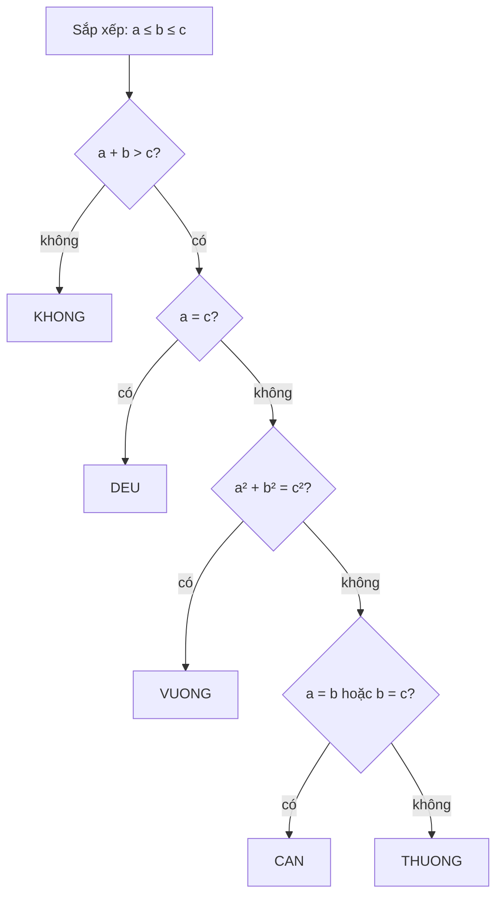

# Bài 0.3 – Rẽ nhánh

> **Tập 0** · Cần biết trước: bài 0.2 · Thời lượng: khoảng 60 phút đọc, 4 giờ thực hành

**Học xong bài này, em sẽ:**

- dùng `if / elif / else` (Python) và `if / else if / else` (C++) để chọn hướng xử lý;
- kết hợp điều kiện bằng `and`, `or`, `not` (`&&`, `||`, `!` trong C++);
- **tự liệt kê test biên** để không bỏ sót trường hợp, kỹ năng phân biệt bài 10 điểm với bài 6 điểm.

---

## 1. Bài toán mở màn: Phân loại tam giác

Chi đo ba thanh tre dài a, b, c (1 ≤ a, b, c ≤ 10⁹) và muốn biết ghép được tam giác gì. In một trong các từ:

- `KHONG` nếu ba thanh không ghép được tam giác;
- `DEU` nếu tam giác đều;
- `CAN` nếu tam giác cân (nhưng không đều);
- `VUONG` nếu tam giác vuông;
- `THUONG` cho các trường hợp còn lại.

| Vào | Ra |
| --- | --- |
| `3 4 5` | `VUONG` |
| `2 2 3` | `CAN` |
| `1 2 3` | `KHONG` |

> [!IMPORTANT]
> **Dừng lại và nghĩ.**
> 1. Ba độ dài thế nào thì **không** ghép được tam giác? Vì sao `1 2 3` không được?
> 2. Đề không có "vuông cân". Có tam giác nào với ba cạnh **nguyên** vừa vuông vừa cân không?

<details>
<summary>Đáp án</summary>

1. Ghép được khi và chỉ khi tổng hai cạnh bất kỳ **lớn hơn hẳn** cạnh còn lại. Với `1 2 3`: 1 + 2 = 3, không lớn hơn hẳn, ba thanh nằm thẳng hàng.
2. Không. Vuông cân thì cạnh huyền bằng cạnh góc vuông nhân √2, mà √2 không phải số hữu tỉ, nên không thể cả ba cạnh đều nguyên. Đề bỏ trường hợp này là có lý do.

</details>

---

## 2. Xét trường hợp theo thứ tự

Bảo gợi ý: **sắp xếp ba cạnh** để c là cạnh lớn nhất. Khi đó chỉ cần kiểm tra a + b > c, và tam giác vuông khi a² + b² = c².

Thứ tự kiểm tra rất quan trọng: tam giác đều cũng là tam giác cân, nên phải hỏi "đều?" **trước** "cân?".



```python
# file: tam_giac.py
a, b, c = sorted(map(int, input().split()))   # sau khi sắp xếp: a <= b <= c
if a + b <= c:
    print("KHONG")
elif a == c:                                   # a <= b <= c và a == c thì cả ba bằng nhau
    print("DEU")
elif a * a + b * b == c * c:
    print("VUONG")
elif a == b or b == c:
    print("CAN")
else:
    print("THUONG")
```

```cpp
// file: tam_giac.cpp
#include <bits/stdc++.h>
using namespace std;
int main() {
    long long x[3];
    cin >> x[0] >> x[1] >> x[2];
    sort(x, x + 3);                       // x[0] <= x[1] <= x[2]
    long long a = x[0], b = x[1], c = x[2];
    if (a + b <= c) cout << "KHONG";
    else if (a == c) cout << "DEU";
    else if (a * a + b * b == c * c) cout << "VUONG";
    else if (a == b || b == c) cout << "CAN";
    else cout << "THUONG";
    cout << '\n';
}
```

---

## 3. Kỹ năng quan trọng nhất: tự liệt kê test biên

Ví dụ của đề thường dễ. Bộ test chấm thì có cả trường hợp "ở mép". Trước khi nộp, hãy lập một bảng như Chi:

| Test | Kiểm tra điều gì | Đáp án |
| --- | --- | --- |
| `2 3 4` | trường hợp thường | `THUONG` |
| `5 3 4` | cạnh lớn nhất không đứng cuối | `VUONG` |
| `2 2 2` | đều phải ra `DEU`, không ra `CAN` | `DEU` |
| `3 2 2` | cân, cạnh bằng nhau không đứng cạnh nhau | `CAN` |
| `1 2 3` | suy biến: tổng **bằng** cạnh còn lại | `KHONG` |
| `1 1 100` | tổng nhỏ hơn hẳn | `KHONG` |
| `1000000000 1000000000 1000000000` | giá trị lớn nhất: a + b và a² có tràn không? | `DEU` |

> [!NOTE]
> **Thói quen của người đạt giải.** Với mỗi bài, liệt kê ít nhất: giá trị nhỏ nhất, giá trị lớn nhất, các giá trị bằng nhau, và trường hợp "vừa đúng bằng" ở mỗi điều kiện.

---

## 4. Bẫy thường gặp

> [!WARNING]
> **Bẫy 1: nhiều `if` rời thay vì `elif`.** Viết `if a == c: print("DEU")` rồi `if a == b or b == c: print("CAN")` thì tam giác đều in **hai** dòng. Các trường hợp loại trừ nhau phải dùng `elif` / `else if`.

> [!WARNING]
> **Bẫy 2: `=` và `==`.** `=` là gán, `==` là so sánh. Trong C++, `if (a = b)` vẫn biên dịch được nhưng sai hoàn toàn.

> [!WARNING]
> **Bẫy 3: tràn số trong điều kiện.** Với a, b, c ≤ 10⁹ kiểu `int`, phép `a + b` có thể lên 2·10⁹ và tràn; `a * a` chắc chắn tràn. Đó là lý do bản C++ dùng `long long`.

> [!WARNING]
> **Bẫy 4: so sánh số thực.** Đừng kiểm tra tam giác vuông bằng `sqrt(a*a + b*b) == c`. Số thực có sai số. So sánh bình phương bằng số nguyên như trên.

---

## 5. Bài tập

| Nấc | Bài | Nguồn | Ý chính |
| --- | --- | --- | --- |
| Khởi động | [Watermelon](https://codeforces.com/problemset/problem/4/A) | CF 4A · 800 | Một điều kiện, có bẫy ở giá trị nhỏ |
| Khởi động | [Bear and Big Brother](https://codeforces.com/problemset/problem/791/A) | CF 791A · 800 | Xem trước vòng lặp |
| Luyện | [Anton and Danik](https://codeforces.com/problemset/problem/734/A) | CF 734A · 800 | Ba trường hợp kết quả |
| Luyện | Nhập năm y (1 ≤ y ≤ 10⁹), in `YES` nếu y là năm nhuận | Tự luyện | Chia hết cho 4 nhưng không chia hết cho 100, hoặc chia hết cho 400 |
| Luyện | Nhập ngày, tháng, năm; in `YES` nếu là ngày hợp lệ | Tự luyện | Nhiều nhánh, tận dụng bài năm nhuận |
| Thử thách | [Coin Piles](https://cses.fi/problemset/task/1754) | CSES 1754 | Tìm điều kiện cần và đủ |

---

## 6. Tóm tắt và checkpoint

1. Các trường hợp loại trừ nhau: `if / elif / else`. Trường hợp đặc biệt hơn kiểm tra **trước**.
2. Sắp xếp dữ liệu trước giúp giảm số trường hợp phải xét.
3. Trước khi nộp, lập bảng test biên: nhỏ nhất, lớn nhất, bằng nhau, "vừa đúng bằng".

<details><summary>Điều kiện để a, b, c (a ≤ b ≤ c) ghép được tam giác?</summary><code>a + b > c</code> (lớn hơn hẳn).</details>
<details><summary>Vì sao phải kiểm tra "đều" trước "cân"?</summary>Tam giác đều cũng thỏa điều kiện cân; kiểm tra cân trước sẽ in sai <code>CAN</code>.</details>

**Checkpoint:**

- [ ] Viết lại bài Phân loại tam giác không nhìn sách, đúng cả 7 test ở bảng mục 3.
- [ ] AC bài năm nhuận và bài ngày hợp lệ.
