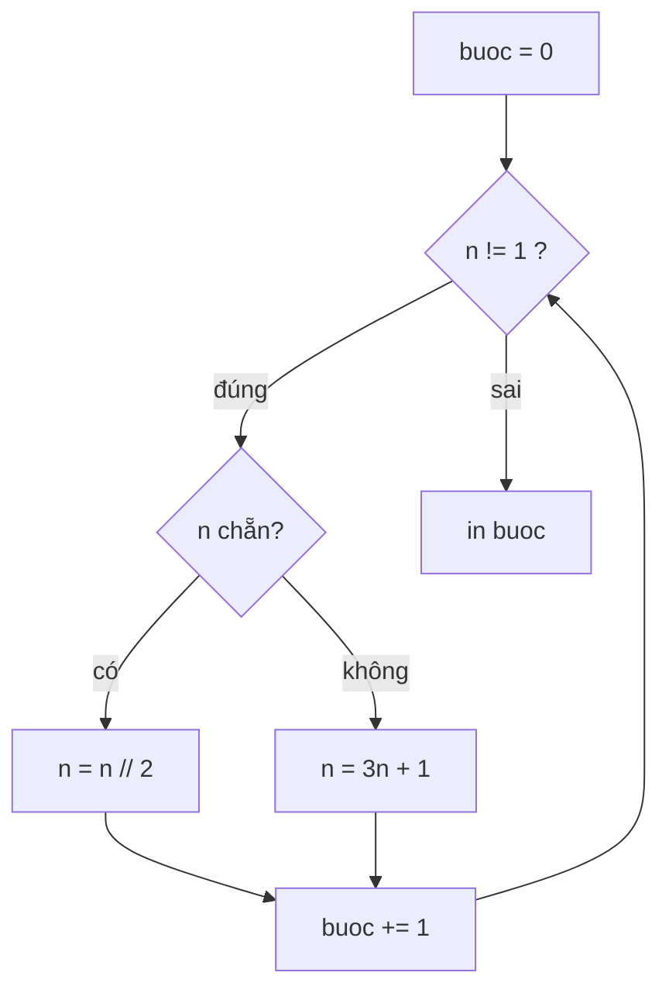
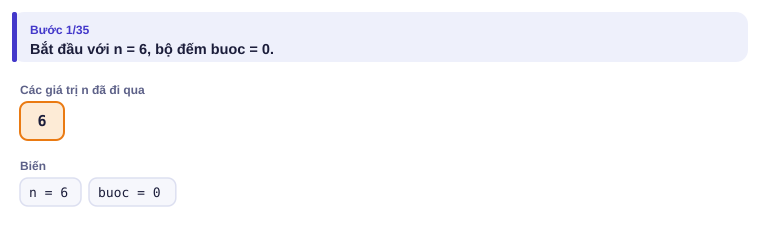
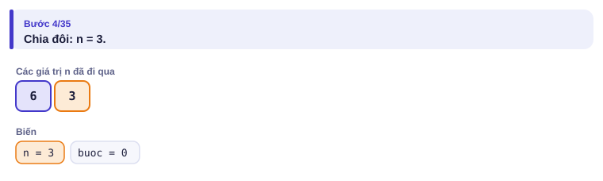
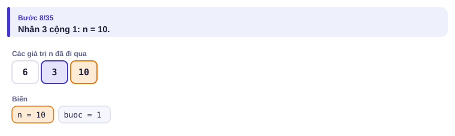
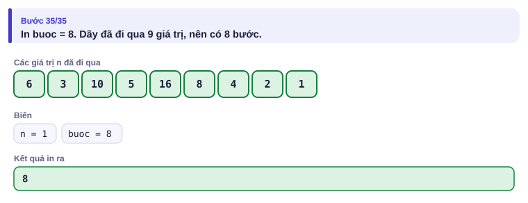

# Bài 0.4 – Vòng lặp

> **Tập 0 · Nhập môn tư duy lập trình**
> Cần biết trước: bài 0.2 (chia nguyên, chia dư), bài 0.3 (rẽ nhánh).
> Thời lượng: khoảng 75 phút đọc, cộng 4–5 giờ thực hành trong tuần.

**Học xong bài này, em sẽ:**

- chọn đúng `while` (biết điều kiện dừng) hay `for` (biết số lần lặp);
- dùng thành thạo ba mẫu lặp: **tính tổng, đếm, tìm lớn nhất**, và mẫu **tách chữ số**;
- kẻ **bảng chạy tay** để gỡ lỗi vòng lặp;
- ước lượng chương trình có chạy kịp 1 giây không **trước khi** viết code.

> [!TIP]
> **Học cùng trang mô phỏng.** Mở [mô phỏng Trò chơi về 1](../../mo-phong/t0-ve-mot.html). Bật **Đoán trước**: mỗi vòng lặp, trang hỏi n tiếp theo. Thử n = 27 và bấm **⏯ Tự chạy** để thấy dãy dài 111 bước.

---

## 1. Bài toán mở màn: Trò chơi về 1

An nghĩ ra trò chơi: bắt đầu từ số nguyên dương n. Nếu n chẵn thì chia đôi, nếu lẻ thì nhân 3 rồi cộng 1. Lặp lại tới khi n = 1. Hỏi cần bao nhiêu bước? (1 ≤ n ≤ 10⁶)

| Vào | Ra |
| --- | --- |
| `6` | `8` |
| `1` | `0` |

---

## 2. Dừng lại 10 phút

> [!IMPORTANT]
> **Dừng lại và nghĩ.**
> 1. Tự chơi bằng tay với n = 6. Viết ra dãy số và đếm số bước.
> 2. Trước khi chơi, em có biết sẽ cần bao nhiêu bước không? Điều đó cho em biết nên dùng `for` hay `while`.
> 3. Với n = 1, đáp án là bao nhiêu? Chương trình của em có xử lý được không?

<details>
<summary>Đáp án</summary>

1. 6 → 3 → 10 → 5 → 16 → 8 → 4 → 2 → 1: **tám** bước.
2. Không biết trước số bước, chỉ biết **điều kiện dừng** (n = 1), nên dùng `while`.
3. 0 bước: n đã bằng 1. Vòng `while n != 1` không chạy lượt nào, in 0. Đây là test biên dễ quên.

</details>

---

## 3. Lời giải ngây thơ và vì sao nó chưa ổn

Chưa biết vòng lặp, An viết "lặp bằng tay":

```python
n = int(input())
buoc = 0
if n != 1:
    n = n // 2 if n % 2 == 0 else 3 * n + 1
    buoc += 1
if n != 1:
    n = n // 2 if n % 2 == 0 else 3 * n + 1
    buoc += 1
# ... chép thêm bao nhiêu lần nữa?
print(buoc)
```

Với n = 6 cần chép đoạn `if` 8 lần. Với n = 27 cần 111 lần, và với n ≤ 10⁶ có số cần tới **524** bước. Không ai chép tay nổi, và chép thiếu một lần là sai. Máy tính sinh ra để **lặp lại** công việc: em chỉ cần viết thân vòng lặp **một lần** và nói cho máy khi nào dừng.

---

## 4. Ý tưởng then chốt

> [!IMPORTANT]
> **Vòng lặp = điều kiện + thân. `while điều_kiện:` kiểm tra điều kiện trước mỗi lượt; đúng thì chạy thân rồi quay lại kiểm tra, sai thì thoát. Thân vòng lặp phải làm thay đổi thứ gì đó trong điều kiện, nếu không vòng lặp chạy mãi.**



### Chạy từng bước

Với n = 6. Đoán trước rồi mới mở hình.

<details>
<summary><b>Bước 1</b> – Trạng thái ban đầu</summary>



</details>

<details>
<summary><b>Bước 2</b> – n = 6 chẵn: n tiếp theo bằng mấy?</summary>



</details>

<details>
<summary><b>Bước 3</b> – n = 3 lẻ: n tiếp theo bằng mấy?</summary>



</details>

<details>
<summary><b>Bước 4</b> – Khi nào dừng, in gì?</summary>



</details>

Toàn bộ quá trình dưới dạng **bảng chạy tay**, mỗi dòng là trạng thái sau một lượt:

| Lượt | n trước | Chẵn/lẻ | n sau | buoc |
| :---: | :---: | :---: | :---: | :---: |
| 1 | 6 | chẵn | 3 | 1 |
| 2 | 3 | lẻ | 10 | 2 |
| 3 | 10 | chẵn | 5 | 3 |
| 4 | 5 | lẻ | 16 | 4 |
| 5 | 16 | chẵn | 8 | 5 |
| 6 | 8 | chẵn | 4 | 6 |
| 7 | 4 | chẵn | 2 | 7 |
| 8 | 2 | chẵn | 1 | 8 |

Tới đây n = 1, điều kiện `n != 1` sai, vòng lặp dừng.

> [!NOTE]
> **Kỹ năng gỡ lỗi số 1: bảng chạy tay.** Khi code ra kết quả sai, hãy kẻ bảng như trên, mỗi cột là một biến. Hoặc in giá trị biến trong mỗi lượt lặp (nhớ xóa trước khi nộp).

---

## 5. Mã giả và cài đặt

```text
đọc n
buoc ← 0
trong khi n ≠ 1:
    nếu n chẵn: n ← n / 2
    ngược lại:  n ← 3n + 1
    buoc ← buoc + 1
in buoc
```

```python
# file: ve_mot.py
n = int(input())
buoc = 0
while n != 1:
    if n % 2 == 0:
        n //= 2
    else:
        n = 3 * n + 1
    buoc += 1
print(buoc)
```

```cpp
// file: ve_mot.cpp
#include <bits/stdc++.h>
using namespace std;
int main() {
    long long n;          // giá trị có thể vượt 10⁹ giữa chừng (xem bẫy 2)
    cin >> n;
    int buoc = 0;
    while (n != 1) {
        if (n % 2 == 0) n /= 2;
        else n = 3 * n + 1;
        buoc++;
    }
    cout << buoc << '\n';
}
```

### `for`: lặp với số lần biết trước

Bài: tính tổng các số từ 1 đến n chia hết cho 3 hoặc 5 (1 ≤ n ≤ 10⁶). Với n = 10: 3 + 5 + 6 + 9 + 10 = 33.

```python
# file: tong_3_5.py
n = int(input())
s = 0
for i in range(1, n + 1):          # i chạy 1, 2, ..., n (range dừng TRƯỚC n + 1)
    if i % 3 == 0 or i % 5 == 0:
        s += i
print(s)
```

```cpp
// file: tong_3_5.cpp
#include <bits/stdc++.h>
using namespace std;
int main() {
    int n;
    cin >> n;
    long long s = 0;
    for (int i = 1; i <= n; i++)
        if (i % 3 == 0 || i % 5 == 0) s += i;
    cout << s << '\n';
}
```

Ba mẫu lặp gặp mãi trong thi đấu:

| Mẫu | Khởi tạo | Trong vòng lặp |
| --- | --- | --- |
| Tính tổng | `s = 0` | `s += x` |
| Đếm | `dem = 0` | `if (điều kiện) dem += 1` |
| Tìm lớn nhất | `mx = phần tử đầu` (hoặc rất nhỏ) | `if x > mx: mx = x` |

Tách chữ số là một mẫu `while` kinh điển:

```python
# file: tong_chu_so.py
n = int(input())
s = 0
while n > 0:
    s += n % 10     # lấy chữ số cuối
    n //= 10        # bỏ chữ số cuối
print(s)
```

---

## 6. Vì sao đúng, chạy bao lâu

**Đúng:** mỗi lượt lặp làm đúng một bước của trò chơi và tăng `buoc` đúng 1, nên khi thoát, `buoc` bằng số bước đã làm. Vòng lặp dừng ngay khi n = 1, đúng như luật chơi.

**Chạy bao lâu** là câu hỏi em phải tự trả lời **trước khi** viết code. Quy ước thô:

| Ngôn ngữ | Số phép tính đơn giản mỗi giây (xấp xỉ) |
| --- | --- |
| C++ | 10⁸ |
| Python | 10⁷ (chậm hơn khoảng 10 lần) |

Đếm số lượt lặp theo n:

| Code | Số lượt | n = 10⁶ thì |
| --- | --- | --- |
| một `for` từ 1 đến n | n | 10⁶: rất nhanh |
| hai `for` lồng nhau, mỗi cái tới n | n² | 10¹²: **quá chậm** |
| `while n > 0: n //= 10` | số chữ số của n | 7: tức thì |
| `while n > 1: n //= 2` | khoảng log₂ n | 20: tức thì |
| Trò chơi về 1 | không có công thức, nhưng đã kiểm tra: mọi n ≤ 10⁶ cần tối đa 524 bước | tức thì |

Với tổng các số chia hết cho 3 hoặc 5, Bảo tìm được **công thức** chạy tức thì kể cả khi n = 10¹⁸: tổng các bội của 3, cộng tổng các bội của 5, **trừ** tổng các bội của 15 (vì bị cộng hai lần).

```python
# file: tong_3_5_cong_thuc.py
n = int(input())

def tong_boi(k):            # tổng k + 2k + ... + mk, với m = n // k
    m = n // k
    return k * m * (m + 1) // 2

print(tong_boi(3) + tong_boi(5) - tong_boi(15))
```

Bài 0.7 sẽ giải thích `def`. Ý tưởng "cộng hai lần thì trừ đi" gọi là **bao hàm – loại trừ**, sẽ gặp lại ở Tập 3.

---

## 7. Bẫy thường gặp

> [!WARNING]
> **Bẫy 1: lệch một (off-by-one).** `range(1, n)` chỉ chạy tới n − 1. `for (i = 0; i <= n; i++)` chạy n + 1 lượt. Luôn thử với n nhỏ (n = 1, n = 2) để kiểm tra.
> *Test phá:* bài tổng 3 hoặc 5 với n = 3 (đáp án 3; dùng `range(1, n)` sẽ ra 0).

> [!WARNING]
> **Bẫy 2: giá trị trung gian vượt giới hạn.** Trong Trò chơi về 1, n ≤ 10⁶ nhưng giá trị giữa chừng có thể lớn hơn nhiều: với n = 704 511, dãy lên tới hơn 5,6·10¹⁰. Bản C++ phải dùng `long long`.
> *Test phá:* n = 704511.

> [!WARNING]
> **Bẫy 3: vòng lặp vô hạn.** Quên cập nhật biến điều kiện (`n //= 10`) thì `while` chạy mãi. Trên judge, em nhận lỗi quá thời gian (TLE) thay vì sai đáp án.

> [!WARNING]
> **Bẫy 4: khởi tạo sai vị trí.** Đặt `s = 0` **bên trong** vòng lặp thì mỗi lượt tổng lại về 0. Khởi tạo luôn đặt **trước** vòng lặp.

---

## 8. Ví dụ giảm dần hỗ trợ

### Ví dụ 2 – Điền vào chỗ trống: Đếm ước

Nhập n (1 ≤ n ≤ 10⁶). Đếm số ước nguyên dương của n.

| Vào | Ra |
| --- | --- |
| `12` | `6` |
| `1` | `1` |

```text
n = int(input())
dem = ____
for d in range(1, ____):
    if ____:
        dem += 1
print(dem)
```

<details>
<summary>Đáp án</summary>

`0`, `n + 1`, `n % d == 0`. Mẫu **đếm**: khởi tạo 0, tăng khi thỏa điều kiện. Thử lại với n = 1: d chỉ chạy một giá trị là 1, đếm được 1. ✓

```python
# file: dem_uoc.py
n = int(input())
dem = 0
for d in range(1, n + 1):
    if n % d == 0:
        dem += 1
print(dem)
```

```cpp
// file: dem_uoc.cpp
#include <bits/stdc++.h>
using namespace std;
int main() {
    int n, dem = 0;
    cin >> n;
    for (int d = 1; d <= n; d++)
        if (n % d == 0) dem++;
    cout << dem << '\n';
}
```

Bài 0.8 sẽ làm nhanh hơn nhiều, chỉ cần thử d tới √n.

</details>

### Ví dụ 3 – Tự làm: Số đảo ngược

Nhập n (1 ≤ n ≤ 10¹⁸). In số đọc ngược của n, bỏ các số 0 ở đầu.

| Vào | Ra |
| --- | --- |
| `1234` | `4321` |
| `1200` | `21` |

> [!IMPORTANT]
> Tự làm trước. Gợi ý: dùng mẫu tách chữ số, nhưng thay vì cộng vào tổng thì **ghép** vào số mới: `r = r * 10 + chữ số`.

<details>
<summary>Lời giải</summary>

Mỗi lượt lấy chữ số cuối của n, gắn vào cuối r. Số 0 ở cuối n trở thành 0 ở đầu r, tự biến mất vì 0 × 10 = 0.

```python
# file: so_dao_nguoc.py
n = int(input())
r = 0
while n > 0:
    r = r * 10 + n % 10
    n //= 10
print(r)
```

```cpp
// file: so_dao_nguoc.cpp
#include <bits/stdc++.h>
using namespace std;
int main() {
    long long n, r = 0;
    cin >> n;
    while (n > 0) {
        r = r * 10 + n % 10;
        n /= 10;
    }
    cout << r << '\n';
}
```

Với n ≤ 10¹⁸, số đảo ngược có tối đa 18 chữ số (riêng 10¹⁸ đảo thành 1), nên vẫn vừa `long long` (tới khoảng 9,2·10¹⁸).

</details>

---

## 9. Bài tập

| Nấc | Bài | Nguồn | Ý chính |
| --- | --- | --- | --- |
| Khởi động | [Weird Algorithm](https://cses.fi/problemset/task/1068) | CSES 1068 | Như bài mở màn, in cả dãy |
| Khởi động | [Bear and Big Brother](https://codeforces.com/problemset/problem/791/A) | CF 791A · 800 | `while` mô phỏng theo năm |
| Luyện | [Nearly Lucky Number](https://codeforces.com/problemset/problem/110/A) | CF 110A · 800 | Tách chữ số, đếm |
| Luyện | [Beautiful Year](https://codeforces.com/problemset/problem/271/A) | CF 271A · 800 | Thử lần lượt từng năm |
| Thử thách | [Number Spiral](https://cses.fi/problemset/task/1071) | CSES 1071 | Không thể lặp tới 10⁹: phải tìm công thức |
| Kiểu đề thi | Gửi tiết kiệm | Bài của sách, chấm theo subtask | Xem bên dưới |

### Bài kiểu đề thi: Gửi tiết kiệm

**Đề bài.** Chi gửi a đồng vào ngân hàng, lãi suất p% mỗi tháng. Cuối mỗi tháng, ngân hàng cộng tiền lãi bằng (số tiền hiện có × p) chia nguyên 100 vào tài khoản. Sau ít nhất bao nhiêu tháng số tiền đạt **ít nhất** b đồng? Đọc a, b, p từ `TIETKIEM.INP`, ghi ra `TIETKIEM.OUT`. (100 ≤ a ≤ b ≤ 10¹⁵, 1 ≤ p ≤ 100)

Subtask: 40% có b ≤ 2a và p ≥ 10; 60% còn lại không có ràng buộc thêm.

| TIETKIEM.INP | TIETKIEM.OUT |
| --- | --- |
| `1000 1100 5` | `2` |
| `500 500 3` | `0` |

Ví dụ 1: sau tháng 1 có 1000 + 50 = 1050; sau tháng 2 có 1050 + 52 = 1102 ≥ 1100.

<details>
<summary><b>Gợi ý 1</b> – hướng đi (đủ 40% điểm)</summary>

Mô phỏng từng tháng bằng `while tien < b`. Đừng quên trường hợp a ≥ b ngay từ đầu (đáp án 0).

</details>

<details>
<summary><b>Gợi ý 2</b> – vòng lặp có quá chậm không?</summary>

Vì a ≥ 100 nên tiền lãi mỗi tháng ít nhất 1 đồng, vòng lặp chắc chắn dừng. Với p = 1, tiền tăng khoảng 1% mỗi tháng; từ 100 lên 10¹⁵ cần khoảng 3 000 tháng: rất nhanh. (Nếu a có thể nhỏ hơn 100 với p = 1 thì lãi bằng 0 và vòng lặp chạy mãi: đề đặt a ≥ 100 là có lý do.)

</details>

<details>
<summary><b>Gợi ý 3</b> – lời giải đầy đủ</summary>

Tích tien × p tới khoảng 10¹⁵ × 100 = 10¹⁷: vừa `long long`.

```python
# file: tietkiem.py
with open("TIETKIEM.INP") as f:
    a, b, p = map(int, f.read().split())
thang = 0
while a < b:
    a += a * p // 100
    thang += 1
with open("TIETKIEM.OUT", "w") as f:
    f.write(f"{thang}\n")
```

```cpp
// file: tietkiem.cpp
#include <bits/stdc++.h>
using namespace std;
int main() {
    freopen("TIETKIEM.INP", "r", stdin);
    freopen("TIETKIEM.OUT", "w", stdout);
    long long a, b, p;
    cin >> a >> b >> p;
    int thang = 0;
    while (a < b) {
        a += a * p / 100;
        thang++;
    }
    cout << thang << '\n';
}
```

</details>

---

## 10. Tóm tắt, flashcard và checkpoint

**Tóm tắt trong 5 dòng.**

1. Biết điều kiện dừng nhưng không biết số lần: `while`. Biết số lần: `for`.
2. Ba mẫu: tổng, đếm, lớn nhất. Tách chữ số: `% 10` rồi `// 10`; ghép số: `r = r * 10 + c`.
3. Thân vòng lặp phải làm thay đổi điều kiện; khởi tạo đặt trước vòng lặp.
4. Gỡ lỗi bằng bảng chạy tay; luôn thử n nhỏ (1, 2) để bắt lỗi lệch một.
5. Trước khi code, đếm số lượt lặp: C++ khoảng 10⁸ mỗi giây, Python khoảng 10⁷.

**Flashcard.**

<details><summary><code>range(1, n)</code> chạy những giá trị nào?</summary>1, 2, …, n − 1 (không có n).</details>
<details><summary>Lấy chữ số cuối và bỏ chữ số cuối của n?</summary><code>n % 10</code> và <code>n // 10</code>.</details>
<details><summary>Hai vòng <code>for</code> lồng nhau tới n = 10⁵ trong C++ có kịp 1 giây không?</summary>10¹⁰ phép: không kịp (C++ khoảng 10⁸ phép mỗi giây).</details>
<details><summary>Với n = 1, Trò chơi về 1 in gì?</summary>0: vòng lặp không chạy lượt nào.</details>
<details><summary>Vì sao Trò chơi về 1 cần <code>long long</code> trong C++?</summary>Giá trị giữa chừng có thể vượt 2·10⁹, ví dụ n = 704 511 lên tới hơn 5·10¹⁰.</details>

**Ôn xoắn ốc** (kiến thức bài 0.1–0.3; mỗi bài tối đa 20 phút):

- [Watermelon](https://codeforces.com/problemset/problem/4/A) (CF 4A): điều kiện có bẫy giá trị nhỏ.
- Cước taxi (bài 0.3), viết lại không nhìn sách.
- [Elephant](https://codeforces.com/problemset/problem/617/A) (CF 617A): làm tròn lên.

**Checkpoint – em đã sẵn sàng sang bài tiếp theo nếu:**

- [ ] AC [Weird Algorithm](https://cses.fi/problemset/task/1068) trong lần nộp đầu tiên.
- [ ] Kẻ được bảng chạy tay cho Trò chơi về 1 với n = 7 (16 bước) mà không sai dòng nào.
- [ ] Làm xong Ví dụ 3 (Số đảo ngược) mà không mở lời giải.
- [ ] Đạt trọn điểm bài Gửi tiết kiệm khi tự làm trong 25 phút.

Chưa đạt? Nếu vướng ô 1 hoặc 2, mở trang mô phỏng, bật Đoán trước và chạy lại với n = 7. Nếu vướng ô 3, đọc lại mẫu tách chữ số ở mục 5. Nếu vướng ô 4, đọc lại Gợi ý 2 và Bẫy 2.
