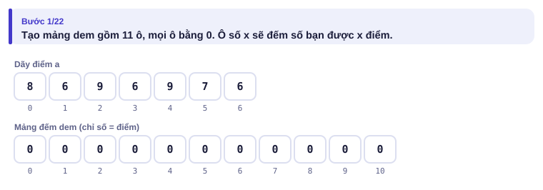
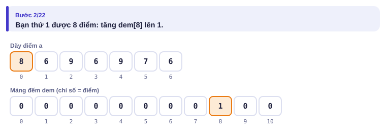
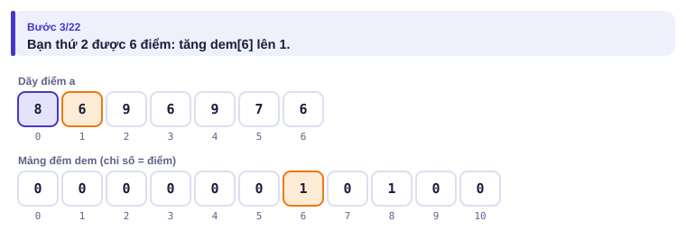
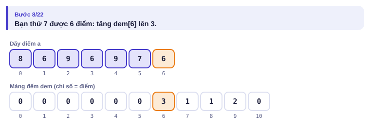
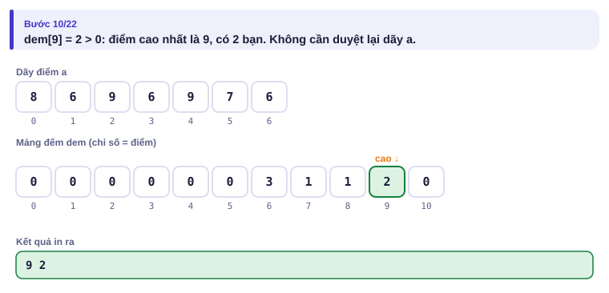
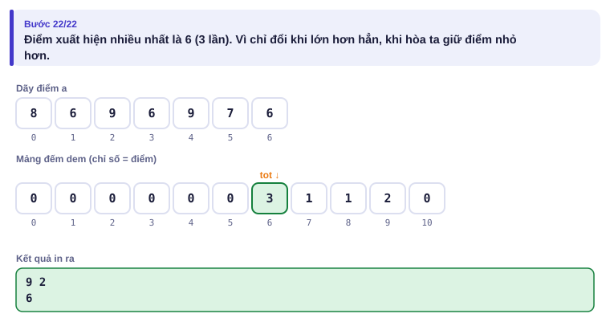

# Bài 0.5 – Mảng

> **Tập 0 · Nhập môn tư duy lập trình**
> Cần biết trước: bài 0.4 (vòng lặp, ba mẫu tổng – đếm – lớn nhất).
> Thời lượng: khoảng 75 phút đọc, cộng 4–5 giờ thực hành trong tuần.

**Học xong bài này, em sẽ:**

- lưu cả dãy dữ liệu vào **mảng** và truy cập phần tử bằng chỉ số;
- dùng **mảng đếm** để trả lời "giá trị x xuất hiện mấy lần" trong O(1) sau một lượt duyệt;
- dùng **mảng đánh dấu** để trả lời "giá trị x đã xuất hiện chưa";
- tránh lỗi chỉ số ra ngoài mảng, lỗi mà C++ không hề báo.

> [!TIP]
> **Học cùng trang mô phỏng.** Mở [mô phỏng mảng đếm](../../mo-phong/t0-thong-ke.html). Bật **Đoán trước**: mỗi bạn được bỏ vào hộp, trang hỏi hộp đó giờ chứa mấy. Thử ví dụ "hai điểm cùng nhiều nhất" để thấy vì sao in điểm nhỏ hơn.

---

## 1. Bài toán mở màn: Thống kê điểm

Lớp của Chi có n bạn (1 ≤ n ≤ 10⁵), mỗi bạn có điểm nguyên từ 0 đến 10. Hãy in:

1. điểm cao nhất và số bạn đạt điểm đó;
2. điểm **xuất hiện nhiều nhất** (nếu có nhiều điểm như vậy, in điểm nhỏ nhất).

| Vào | Ra |
| --- | --- |
| `7`<br>`8 6 9 6 9 7 6` | `9 2`<br>`6` |

---

## 2. Dừng lại 10 phút

> [!IMPORTANT]
> **Dừng lại và nghĩ.**
> 1. Làm bằng tay với ví dụ: em ghi chép thế nào để không phải đọc lại dãy nhiều lần?
> 2. An định: với mỗi bạn, đếm xem có bao nhiêu bạn cùng điểm. Với n = 10⁵, cách này cần khoảng bao nhiêu phép so sánh?
> 3. Có cách nào nhanh hơn, khi biết điểm chỉ từ 0 đến 10?

<details>
<summary>Đáp án</summary>

1. Kẻ 11 cột 0, 1, …, 10 và gạch một vạch vào cột tương ứng mỗi khi đọc một điểm, như kiểm phiếu bầu lớp trưởng.
2. Hai vòng lặp lồng nhau: n² = 10¹⁰ phép, quá chậm (bài 0.4).
3. Chính là cách kiểm phiếu: **11 cái hộp**, mỗi hộp đếm số bạn đạt một mức điểm. Duyệt danh sách **một lần**, bỏ mỗi bạn vào đúng hộp.

</details>

---

## 3. Lời giải ngây thơ và vì sao nó chậm

Cách của An: với mỗi bạn i, đếm số bạn j có cùng điểm.

```python
n = int(input())
a = list(map(int, input().split()))
tot, nhieu = 0, 0
for i in range(n):
    dem = 0
    for j in range(n):            # vòng lặp lồng: n × n lượt
        if a[j] == a[i]:
            dem += 1
    if dem > nhieu or (dem == nhieu and a[i] < tot):
        tot, nhieu = a[i], dem
print(tot)
```

Kết quả đúng, nhưng số lượt lặp là n × n. Với n = 10⁵ là 10¹⁰ lượt: Python cần khoảng 1000 giây, C++ cần khoảng 100 giây. Điểm mấu chốt: cách này **đếm đi đếm lại** cùng một mức điểm. Bạn thứ 2 và bạn thứ 4 cùng 6 điểm, nhưng mỗi bạn lại đếm số người 6 điểm từ đầu.

---

## 4. Ý tưởng then chốt

> [!IMPORTANT]
> **Khi giá trị nhỏ (ở đây 0..10), dùng chính giá trị làm chỉ số mảng: `dem[x]` đếm số lần x xuất hiện. Duyệt dãy một lần, mỗi phần tử tăng đúng một ô. Sau đó mọi câu hỏi về tần suất đều trả lời ngay.**

Mảng `a` có n phần tử: `a[0], a[1], …, a[n-1]`. Chỉ số **bắt đầu từ 0** trong cả Python lẫn C++.

| Thao tác | Python | C++ |
| --- | --- | --- |
| Tạo mảng n số 0 | `a = [0] * n` | `vector<long long> a(n, 0);` |
| Đọc n số vào mảng | `a = list(map(int, input().split()))` | `for (auto &x : a) cin >> x;` |
| Độ dài | `len(a)` | `a.size()` |
| Duyệt từng phần tử | `for x in a:` | `for (auto x : a)` |
| Lớn nhất | `max(a)` | `*max_element(a.begin(), a.end())` |

### Chạy từng bước

Với dãy `8 6 9 6 9 7 6`. Đoán trước rồi mới mở hình.

<details>
<summary><b>Bước 1</b> – Mảng đếm lúc đầu</summary>



</details>

<details>
<summary><b>Bước 2</b> – Bạn đầu tiên được 8 điểm: ô nào thay đổi?</summary>



</details>

<details>
<summary><b>Bước 3</b> – Bạn thứ hai được 6 điểm</summary>



</details>

<details>
<summary><b>Bước 4</b> – Sau khi xét hết 7 bạn, dem[6] bằng mấy?</summary>



</details>

<details>
<summary><b>Bước 5</b> – Điểm cao nhất: dò từ ô 10 xuống</summary>



</details>

<details>
<summary><b>Bước 6</b> – Điểm xuất hiện nhiều nhất</summary>



</details>

Toàn bộ quá trình đếm dưới dạng bảng (chỉ các ô thay đổi):

| Sau khi xét | dem[6] | dem[7] | dem[8] | dem[9] |
| --- | :---: | :---: | :---: | :---: |
| 8 | 0 | 0 | 1 | 0 |
| 6 | 1 | 0 | 1 | 0 |
| 9 | 1 | 0 | 1 | 1 |
| 6 | 2 | 0 | 1 | 1 |
| 9 | 2 | 0 | 1 | 2 |
| 7 | 2 | 1 | 1 | 2 |
| 6 | **3** | 1 | 1 | **2** |

---

## 5. Mã giả và cài đặt

```text
dem[0..10] ← 0
với mỗi điểm x trong dãy: dem[x] ← dem[x] + 1
cao ← 10; trong khi dem[cao] = 0: cao ← cao − 1
in cao, dem[cao]
tot ← 0
với k từ 0 tới 10: nếu dem[k] > dem[tot] thì tot ← k
in tot
```

```python
# file: thong_ke.py
n = int(input())
a = list(map(int, input().split()))
dem = [0] * 11
for x in a:
    dem[x] += 1

cao = 10                      # dò từ điểm 10 xuống tới ô đầu tiên khác 0
while dem[cao] == 0:
    cao -= 1
print(cao, dem[cao])

tot = 0                       # điểm xuất hiện nhiều nhất
for k in range(11):           # duyệt từ nhỏ tới lớn, chỉ đổi khi lớn hơn HẲN
    if dem[k] > dem[tot]:
        tot = k
print(tot)
```

```cpp
// file: thong_ke.cpp
#include <bits/stdc++.h>
using namespace std;
int main() {
    int n;
    cin >> n;
    vector<int> dem(11, 0);
    for (int i = 0; i < n; i++) {
        int x;
        cin >> x;
        dem[x]++;
    }
    int cao = 10;
    while (dem[cao] == 0) cao--;
    cout << cao << ' ' << dem[cao] << '\n';
    int tot = 0;
    for (int k = 0; k <= 10; k++)
        if (dem[k] > dem[tot]) tot = k;
    cout << tot << '\n';
}
```

> [!NOTE]
> Vì sao dùng `>` chứ không phải `>=`? Đề yêu cầu "nếu nhiều điểm cùng xuất hiện nhiều nhất thì in điểm nhỏ nhất". Duyệt từ nhỏ tới lớn và chỉ đổi khi lớn hơn **hẳn** thì giữ lại điểm nhỏ nhất. Đổi thành `>=` sẽ giữ điểm **lớn** nhất.

### Mảng đánh dấu: Số bị thiếu

Các số 1, 2, …, n được ghi lên n tấm thẻ, nhưng bị mất một thẻ. Cho n và n − 1 số còn lại, tìm số bị mất (2 ≤ n ≤ 2·10⁵). Đây là bài [Missing Number](https://cses.fi/problemset/task/1083) trên CSES.

Ý tưởng: mảng `co[1..n]` toàn `False`; thấy số x thì đặt `co[x] = True`; số nào vẫn `False` là số bị mất. Mảng đánh dấu là mảng đếm chỉ quan tâm "0 hay khác 0".

```python
# file: so_bi_thieu.py
import sys
data = sys.stdin.buffer.read().split()
n = int(data[0])
co = [False] * (n + 1)          # dùng chỉ số 1..n, bỏ trống ô 0
for x in data[1:n]:
    co[int(x)] = True
for v in range(1, n + 1):
    if not co[v]:
        print(v)
        break
```

```cpp
// file: so_bi_thieu.cpp
#include <bits/stdc++.h>
using namespace std;
int main() {
    ios::sync_with_stdio(false);
    cin.tie(nullptr);
    int n;
    cin >> n;
    vector<bool> co(n + 1, false);
    for (int i = 0; i < n - 1; i++) {
        int x;
        cin >> x;
        co[x] = true;
    }
    for (int v = 1; v <= n; v++)
        if (!co[v]) { cout << v << '\n'; break; }
}
```

> [!TIP]
> **Cách khác của Bảo:** số bị mất = (1 + 2 + … + n) − (tổng các số còn lại). Không cần mảng, nhưng nhớ dùng `long long` (bài 0.2).

---

## 6. Vì sao đúng, chạy bao lâu

- **Đúng:** sau vòng lặp đếm, `dem[k]` bằng đúng số bạn được k điểm, vì mỗi bạn làm tăng **đúng một** ô, là ô của điểm bạn đó. Dò từ ô 10 xuống, ô khác 0 đầu tiên là điểm cao nhất. Duyệt k tăng dần và chỉ đổi khi lớn hơn hẳn thì `tot` là điểm nhỏ nhất trong các điểm có số lần lớn nhất.
- **Chạy bao lâu:** n lượt để đếm, cộng tối đa 11 lượt dò và 11 lượt tìm `tot`: tổng khoảng n + 22 phép, tức là **O(n)**. Với n = 10⁵, nhanh hơn cách của An khoảng 100 000 lần.
- **Bộ nhớ:** mảng đếm cần (giá trị lớn nhất + 1) ô. Giá trị tới 10⁶ thì cần 10⁶ ô: vẫn ổn (khoảng 4 MB với `int`). Giá trị tới 10⁹ thì không thể (Bẫy 2).

---

## 7. Bẫy thường gặp

> [!WARNING]
> **Bẫy 1: chỉ số ra ngoài mảng.** Mảng `[0] * n` không có ô `a[n]`. Muốn dùng chỉ số 1..n thì tạo mảng n + 1 ô. Python báo lỗi `IndexError`; C++ **không báo**, chỉ cho kết quả rác hoặc dừng đột ngột.
> *Test phá:* bài Số bị thiếu với số bị mất là n, khi mảng chỉ tạo n ô.

> [!WARNING]
> **Bẫy 2: mảng đếm cho giá trị quá lớn.** Mảng đếm chỉ dùng được khi giá trị nhỏ (vài triệu trở xuống). Giá trị tới 10⁹ thì cần cách khác: sắp xếp (Tập 1) hoặc `map`/`dict` (Tập 2).

> [!WARNING]
> **Bẫy 3: đọc sai số phần tử.** Bài Số bị thiếu chỉ có **n − 1** số. Đọc thừa một số là lỗi hay gặp, nhất là khi dùng vòng `for` n lần trong C++: chương trình đứng chờ một số không bao giờ tới.

> [!WARNING]
> **Bẫy 4: dùng `>=` thay vì `>` khi tìm lớn nhất có điều kiện hòa.** Kết quả đổi từ "nhỏ nhất" sang "lớn nhất" trong các giá trị hòa.
> *Test phá:* `5` / `10 10 0 0 5`: đáp án là 0, dùng `>=` ra 10.

---

## 8. Ví dụ giảm dần hỗ trợ

### Ví dụ 2 – Điền vào chỗ trống: Bầu lớp trưởng

Lớp có m ứng viên đánh số 1..m (1 ≤ m ≤ 100) và n lá phiếu (1 ≤ n ≤ 10⁵), mỗi phiếu ghi số của một ứng viên. In số của ứng viên được nhiều phiếu nhất (hòa thì in số nhỏ nhất).

| Vào | Ra |
| --- | --- |
| `3 6`<br>`2 3 2 1 3 3` | `3` |

```text
m, n = map(int, input().split())
phieu = list(map(int, input().split()))
dem = [0] * (____)
for x in phieu:
    ____
tot = 1
for k in range(____, m + 1):
    if ____:
        tot = k
print(tot)
```

<details>
<summary>Đáp án</summary>

`m + 1` (dùng chỉ số 1..m), `dem[x] += 1`, `2`, `dem[k] > dem[tot]`.

```python
# file: bau_lop_truong.py
m, n = map(int, input().split())
phieu = list(map(int, input().split()))
dem = [0] * (m + 1)
for x in phieu:
    dem[x] += 1
tot = 1
for k in range(2, m + 1):
    if dem[k] > dem[tot]:
        tot = k
print(tot)
```

```cpp
// file: bau_lop_truong.cpp
#include <bits/stdc++.h>
using namespace std;
int main() {
    int m, n;
    cin >> m >> n;
    vector<int> dem(m + 1, 0);
    for (int i = 0; i < n; i++) {
        int x;
        cin >> x;
        dem[x]++;
    }
    int tot = 1;
    for (int k = 2; k <= m; k++)
        if (dem[k] > dem[tot]) tot = k;
    cout << tot << '\n';
}
```

</details>

### Ví dụ 3 – Tự làm: Ghép tất

Bảo có n chiếc tất (1 ≤ n ≤ 10⁵), chiếc thứ i có màu cᵢ (1 ≤ cᵢ ≤ 1000). Hai chiếc cùng màu ghép thành một đôi. Ghép được nhiều nhất bao nhiêu đôi?

| Vào | Ra |
| --- | --- |
| `9`<br>`10 20 20 10 10 30 50 10 20` | `3` |

> [!IMPORTANT]
> Tự làm trước. Gợi ý: nếu biết có bao nhiêu chiếc mỗi màu, mỗi màu ghép được bao nhiêu đôi?

<details>
<summary>Lời giải</summary>

Đếm số chiếc mỗi màu bằng mảng đếm; màu có k chiếc ghép được k // 2 đôi. Ví dụ: màu 10 có 4 chiếc (2 đôi), màu 20 có 3 chiếc (1 đôi), màu 30 và 50 mỗi màu 1 chiếc (0 đôi): tổng 3.

```python
# file: ghep_tat.py
n = int(input())
c = list(map(int, input().split()))
dem = [0] * 1001
for x in c:
    dem[x] += 1
print(sum(k // 2 for k in dem))
```

```cpp
// file: ghep_tat.cpp
#include <bits/stdc++.h>
using namespace std;
int main() {
    int n;
    cin >> n;
    vector<int> dem(1001, 0);
    for (int i = 0; i < n; i++) {
        int x;
        cin >> x;
        dem[x]++;
    }
    long long doi = 0;
    for (int k = 1; k <= 1000; k++) doi += dem[k] / 2;
    cout << doi << '\n';
}
```

</details>

---

## 9. Bài tập

| Nấc | Bài | Nguồn | Ý chính |
| --- | --- | --- | --- |
| Khởi động | [Missing Number](https://cses.fi/problemset/task/1083) | CSES 1083 | Mảng đánh dấu |
| Khởi động | [Team](https://codeforces.com/problemset/problem/231/A) | CF 231A · 800 | Đọc nhiều dòng, đếm |
| Luyện | [Next Round](https://codeforces.com/problemset/problem/158/A) | CF 158A · 800 | Truy cập phần tử thứ k |
| Luyện | [Increasing Array](https://cses.fi/problemset/task/1094) | CSES 1094 | So sánh phần tử với phần tử trước |
| Luyện | [George and Accommodation](https://codeforces.com/problemset/problem/467/A) | CF 467A · 800 | Đếm có điều kiện |
| Thử thách | [Young Physicist](https://codeforces.com/problemset/problem/69/A) | CF 69A · 1000 | Tổng theo từng cột |
| Kiểu đề thi | Số khác nhau | Bài của sách, chấm theo subtask | Xem bên dưới |

### Bài kiểu đề thi: Số khác nhau

**Đề bài.** Cho dãy n số nguyên a₁ … aₙ (1 ≤ n ≤ 10⁶, 1 ≤ aᵢ ≤ 10⁶). Đếm số **giá trị khác nhau** trong dãy. Đọc từ `KHACNHAU.INP` (dòng đầu n, dòng sau n số), ghi ra `KHACNHAU.OUT`.

Subtask: 40% có n ≤ 1000; 30% có n ≤ 10⁵ và aᵢ ≤ 100; 30% không có ràng buộc thêm.

| KHACNHAU.INP | KHACNHAU.OUT |
| --- | --- |
| `6`<br>`5 1 5 2 1 5` | `3` |

<details>
<summary><b>Gợi ý 1</b> – hướng đi (đủ 40% điểm)</summary>

Với mỗi i, kiểm tra xem aᵢ đã xuất hiện ở vị trí j < i chưa; nếu chưa thì đếm. Hai vòng lặp lồng nhau, khoảng n²/2 = 5·10⁵ phép khi n = 1000.

</details>

<details>
<summary><b>Gợi ý 2</b> – ý then chốt</summary>

"Đã xuất hiện chưa?" chính là câu hỏi của **mảng đánh dấu**. Giá trị ≤ 10⁶ nên mảng 10⁶ + 1 ô là đủ.

</details>

<details>
<summary><b>Gợi ý 3</b> – lời giải đầy đủ</summary>

Duyệt dãy: gặp x mà `co[x]` còn `False` thì tăng đáp án và đặt `co[x] = True`. O(n + 10⁶). Với n = 10⁶, Python phải đọc nhanh (bài 0.1).

```python
# file: khacnhau.py
import sys
data = open("KHACNHAU.INP", "rb").read().split()
n = int(data[0])
co = bytearray(10**6 + 1)        # bytearray: mảng đánh dấu gọn và nhanh
kq = 0
for x in map(int, data[1:n + 1]):
    if not co[x]:
        co[x] = 1
        kq += 1
open("KHACNHAU.OUT", "w").write(f"{kq}\n")
```

```cpp
// file: khacnhau.cpp
#include <bits/stdc++.h>
using namespace std;
int main() {
    freopen("KHACNHAU.INP", "r", stdin);
    freopen("KHACNHAU.OUT", "w", stdout);
    ios::sync_with_stdio(false);
    cin.tie(nullptr);
    int n;
    cin >> n;
    vector<bool> co(1000001, false);
    int kq = 0;
    for (int i = 0; i < n; i++) {
        int x;
        cin >> x;
        if (!co[x]) { co[x] = true; kq++; }
    }
    cout << kq << '\n';
}
```

</details>

---

## 10. Tóm tắt, flashcard và checkpoint

**Tóm tắt trong 5 dòng.**

1. Mảng: dãy hộp đánh số từ 0. Muốn dùng 1..n thì tạo n + 1 ô.
2. Giá trị nhỏ cần đếm tần suất: **mảng đếm**, O(n) thay cho O(n²).
3. Cần biết "đã xuất hiện chưa": **mảng đánh dấu**.
4. Tìm lớn nhất có điều kiện hòa: chọn chiều duyệt và `>` hay `>=` cho đúng đề.
5. C++ không kiểm tra chỉ số: tự cẩn thận với biên mảng.

**Flashcard.**

<details><summary>Đếm số lần xuất hiện của các giá trị từ 0 đến 10⁶ trong dãy 10⁶ số: cách nào nhanh?</summary>Mảng đếm 10⁶ + 1 ô, duyệt dãy một lần: khoảng 2·10⁶ phép.</details>
<details><summary><code>a = [0] * 5</code>; <code>a[5] = 1</code> có lỗi gì?</summary>Ra ngoài mảng: chỉ số hợp lệ là 0..4.</details>
<details><summary>Vì sao không dùng mảng đếm cho giá trị tới 10⁹?</summary>Cần 10⁹ ô (khoảng 4 GB): vượt bộ nhớ. Dùng sắp xếp hoặc map.</details>
<details><summary>Duyệt k tăng dần với <code>dem[k] &gt; dem[tot]</code> cho ra giá trị nào khi hòa?</summary>Giá trị nhỏ nhất trong các giá trị hòa.</details>
<details><summary>Mảng đánh dấu khác mảng đếm ở đâu?</summary>Chỉ lưu "có / không" thay vì số lần.</details>

**Ôn xoắn ốc** (kiến thức bài 0.2–0.4; mỗi bài tối đa 20 phút):

- [Weird Algorithm](https://cses.fi/problemset/task/1068) (CSES 1068): vòng lặp `while`.
- Đếm ước (bài 0.4, Ví dụ 2), viết lại không nhìn sách.
- [Soldier and Bananas](https://codeforces.com/problemset/problem/546/A) (CF 546A): tổng và tràn số.

**Checkpoint – em đã sẵn sàng sang bài tiếp theo nếu:**

- [ ] Viết lại bài Thống kê điểm không nhìn sách, đúng cả ví dụ "hai điểm cùng nhiều nhất".
- [ ] Giải bài Số bị thiếu bằng cả hai cách (mảng đánh dấu và công thức tổng).
- [ ] Làm xong Ví dụ 3 (Ghép tất) mà không mở lời giải.
- [ ] Đạt trọn điểm bài Số khác nhau khi tự làm trong 25 phút.

Chưa đạt? Nếu vướng ô 1, mở trang mô phỏng, bật Đoán trước và chạy lại cả ba ví dụ. Nếu vướng ô 2 hoặc 4, đọc lại "Mảng đánh dấu" ở mục 5. Nếu vướng ô 3, đọc lại mục 4 rồi làm lại Ví dụ 2.
