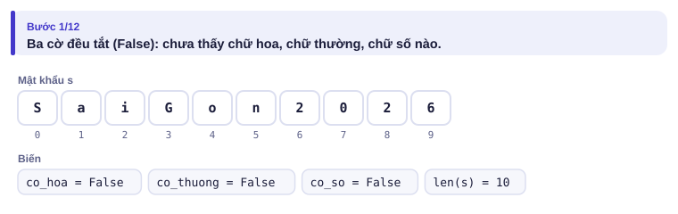
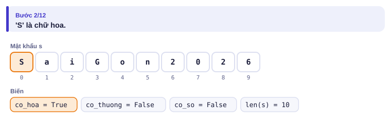
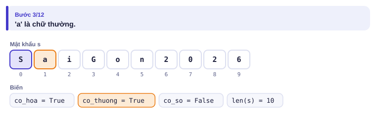
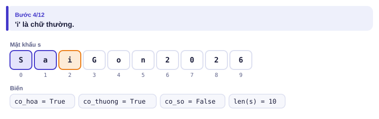
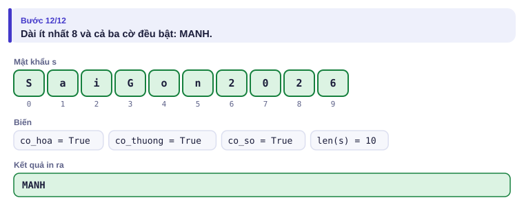
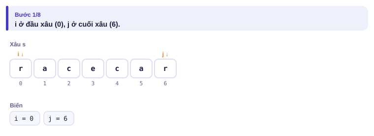
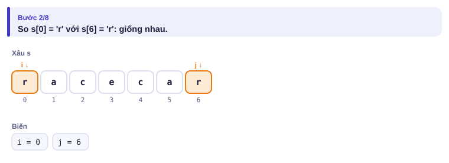
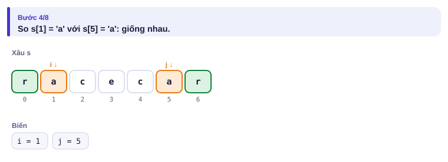
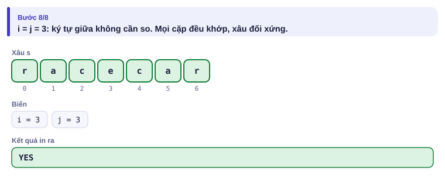

# Bài 0.6 – Xâu ký tự

> **Tập 0 · Nhập môn tư duy lập trình**
> Cần biết trước: bài 0.5 (mảng, mảng đếm).
> Thời lượng: khoảng 75 phút đọc, cộng 4–5 giờ thực hành trong tuần.

**Học xong bài này, em sẽ:**

- duyệt xâu như duyệt mảng, dùng **biến cờ** để ghi nhận "đã gặp";
- hiểu mỗi ký tự là một con số (mã ASCII) và dùng `ch - 'a'` để nối xâu với mảng đếm;
- kiểm tra xâu đối xứng bằng **hai chỉ số đi vào giữa**;
- đọc đúng dòng có dấu cách trong cả Python và C++.

> [!TIP]
> **Học cùng hai trang mô phỏng.** [Mô phỏng mật khẩu mạnh](../../mo-phong/t0-mat-khau.html): xem ba biến cờ bật dần khi duyệt từng ký tự. [Mô phỏng xâu đối xứng](../../mo-phong/t0-doi-xung.html): xem i và j đi vào giữa, dừng ngay ở cặp khác nhau đầu tiên. Bật **Đoán trước** ở cả hai trang.

---

## 1. Bài toán mở màn: Mật khẩu mạnh

Quán cà phê gần trường đặt quy định: mật khẩu Wi-Fi **mạnh** nếu dài ít nhất 8 ký tự và có đủ cả chữ hoa, chữ thường, chữ số. Nhập mật khẩu (không chứa dấu cách, dài không quá 100), in `MANH` hoặc `YEU`.

| Vào | Ra |
| --- | --- |
| `SaiGon2026` | `MANH` |
| `saigon2026` | `YEU` |

---

## 2. Dừng lại 10 phút

> [!IMPORTANT]
> **Dừng lại và nghĩ.**
> 1. Em cần kiểm tra bao nhiêu điều kiện?
> 2. Với điều kiện "có chữ hoa", em duyệt xâu thế nào? Phải duyệt hết xâu không?
> 3. Có cách nào kiểm tra cả ba loại ký tự chỉ trong **một** lượt duyệt?

<details>
<summary>Đáp án</summary>

1. Bốn điều kiện: độ dài ≥ 8, có chữ hoa, có chữ thường, có chữ số.
2. Duyệt từng ký tự; gặp một chữ hoa là đủ biết "có", nhưng nếu không có thì phải duyệt tới hết mới biết.
3. Dùng ba **biến cờ** `co_hoa`, `co_thuong`, `co_so` ban đầu là sai; duyệt từng ký tự một lần, gặp loại nào thì bật cờ loại đó.

</details>

---

## 3. Lời giải ngây thơ và vì sao nó sai

An dùng một biến cờ duy nhất và tắt/bật theo ký tự **cuối cùng** gặp được:

```python
s = input()
loai = ""
for ch in s:
    if 'A' <= ch <= 'Z':
        loai = "hoa"
    elif 'a' <= ch <= 'z':
        loai = "thuong"
print("MANH" if len(s) >= 8 and loai == "hoa" else "YEU")
```

Biến `loai` chỉ nhớ loại của ký tự **gần nhất**, quên hết các ký tự trước. Với `SaiGon2026`, ký tự chữ cuối là `n` nên `loai = "thuong"` và chương trình in `YEU`: sai. Cờ phải **chỉ bật, không bao giờ tắt**, và mỗi điều kiện cần một cờ riêng.

---

## 4. Ý tưởng then chốt

> [!IMPORTANT]
> **Biến cờ bắt đầu ở False và chỉ được bật lên True khi gặp điều cần tìm. Sau một lượt duyệt, cờ cho biết "đã từng gặp hay chưa". Mỗi câu hỏi "có … không" cần một cờ riêng.**

### Chạy từng bước

Với `SaiGon2026`. Đoán loại ký tự trước rồi mới mở.

<details>
<summary><b>Bước 1</b> – Ba cờ lúc đầu</summary>



</details>

<details>
<summary><b>Bước 2</b> – Ký tự 'S': cờ nào bật?</summary>



</details>

<details>
<summary><b>Bước 3</b> – Ký tự 'a'</summary>



</details>

<details>
<summary><b>Bước 4</b> – Ký tự 'i': cờ đã bật rồi thì sao?</summary>



Bật lại một cờ đã bật không thay đổi gì. Cờ không bao giờ bị tắt.

</details>

<details>
<summary><b>Bước 5</b> – Kết luận</summary>



</details>

---

## 5. Mã giả và cài đặt

```text
co_hoa, co_thuong, co_so ← sai
với mỗi ký tự ch của s:
    nếu ch là chữ hoa: co_hoa ← đúng
    nếu ch là chữ thường: co_thuong ← đúng
    nếu ch là chữ số: co_so ← đúng
in MANH nếu độ dài ≥ 8 và cả ba cờ đúng, ngược lại in YEU
```

```python
# file: mat_khau.py
s = input().strip()
co_hoa = co_thuong = co_so = False
for ch in s:
    if 'A' <= ch <= 'Z':
        co_hoa = True
    elif 'a' <= ch <= 'z':
        co_thuong = True
    elif '0' <= ch <= '9':
        co_so = True
if len(s) >= 8 and co_hoa and co_thuong and co_so:
    print("MANH")
else:
    print("YEU")
```

```cpp
// file: mat_khau.cpp
#include <bits/stdc++.h>
using namespace std;
int main() {
    string s;
    cin >> s;
    bool co_hoa = false, co_thuong = false, co_so = false;
    for (char ch : s) {
        if ('A' <= ch && ch <= 'Z') co_hoa = true;
        else if ('a' <= ch && ch <= 'z') co_thuong = true;
        else if ('0' <= ch && ch <= '9') co_so = true;
    }
    if (s.size() >= 8 && co_hoa && co_thuong && co_so) cout << "MANH\n";
    else cout << "YEU\n";
}
```

### Mã ASCII: mỗi ký tự là một con số

Máy tính lưu mỗi ký tự bằng một số. Các chữ cái và chữ số **nằm liền nhau** theo thứ tự:

| Ký tự | `'0'` … `'9'` | `'A'` … `'Z'` | `'a'` … `'z'` |
| --- | --- | --- | --- |
| Mã | 48 … 57 | 65 … 90 | 97 … 122 |

Nhờ vậy so sánh `'A' <= ch <= 'Z'` ở trên mới đúng, và:

| Muốn | Python | C++ |
| --- | --- | --- |
| Mã của ký tự | `ord(ch)` | `(int)ch` |
| Ký tự từ mã | `chr(m)` | `(char)m` |
| Chữ số `'7'` thành số 7 | `ord(ch) - ord('0')` hoặc `int(ch)` | `ch - '0'` |
| Vị trí chữ cái (`'a'` là 0) | `ord(ch) - ord('a')` | `ch - 'a'` |
| Đổi thành chữ hoa | `ch.upper()` | `toupper(ch)` |

`ch - 'a'` là cầu nối giữa xâu và mảng: đếm tần suất 26 chữ cái bằng mảng đếm 26 ô, như bài 0.5.

### Xâu đối xứng: hai chỉ số đi vào giữa

Một câu là **đối xứng** nếu đọc xuôi và ngược giống nhau, sau khi bỏ mọi ký tự không phải chữ hoặc số và không phân biệt hoa thường. Ví dụ `Top spot!` → `topspot` → đối xứng. Nhập một dòng (có thể có dấu cách, dài không quá 10⁵), in `YES` hoặc `NO`.

Ý tưởng: lọc lấy chữ và số, đổi về chữ thường; đặt i ở đầu, j ở cuối; so t[i] với t[j], khớp thì tiến i, lùi j; gặp cặp khác nhau là kết luận ngay.

<details>
<summary><b>Hình</b> – Hai chỉ số với xâu <code>racecar</code> (mở lần lượt)</summary>






</details>

```python
# file: doi_xung.py
s = input()
t = [ch.lower() for ch in s if ch.isalnum()]   # lọc chữ và số, đổi về thường
print("YES" if t == t[::-1] else "NO")         # t[::-1] là t đảo ngược
```

```cpp
// file: doi_xung.cpp
#include <bits/stdc++.h>
using namespace std;
int main() {
    string s, t;
    getline(cin, s);                 // đọc cả dòng, kể cả dấu cách
    for (char ch : s)
        if (isalnum((unsigned char)ch)) t += tolower(ch);
    bool ok = true;
    int i = 0, j = (int)t.size() - 1;
    while (i < j) {                  // hai chỉ số đi vào giữa
        if (t[i] != t[j]) { ok = false; break; }
        i++; j--;
    }
    cout << (ok ? "YES" : "NO") << '\n';
}
```

Bản Python dùng `t[::-1]` (xâu đảo ngược) cho gọn; nó so cả xâu chứ không dừng sớm, nhưng vẫn O(n).

---

## 6. Vì sao đúng, chạy bao lâu

- **Mật khẩu:** cờ `co_hoa` đúng khi và chỉ khi có ít nhất một chữ hoa, vì nó chỉ được bật khi gặp chữ hoa và không bao giờ bị tắt. Tương tự với hai cờ còn lại. Một lượt duyệt, **O(n)** với n là độ dài xâu.
- **Đối xứng:** nếu mọi cặp (t[i], t[n − 1 − i]) đều khớp thì đọc ngược giống đọc xuôi; chỉ cần một cặp lệch là không đối xứng. Hai chỉ số gặp nhau sau tối đa n/2 lượt: **O(n)**.

---

## 7. Bẫy thường gặp

> [!WARNING]
> **Bẫy 1: `cin >> s` chỉ đọc tới dấu cách.** Dòng có dấu cách thì dùng `getline(cin, s)`. Nếu trước đó đã `cin >> n`, phải bỏ ký tự xuống dòng còn sót bằng `cin.ignore()` trước khi `getline`.
> *Test phá:* `Top spot!` với `cin >> s`: chỉ đọc được `Top`.

> [!WARNING]
> **Bẫy 2: ký tự xuống dòng ẩn.** Tệp tạo trên Windows có thể kết thúc dòng bằng `\r\n`. Trong Python, `input().strip()` bỏ được ký tự thừa ở hai đầu; trong C++, khi dùng `getline` hãy cẩn thận với `\r` ở cuối.

> [!WARNING]
> **Bẫy 3: nối xâu trong vòng lặp ở Python.** `t = t + ch` lặp 10⁵ lần có thể chậm. Gom vào `list` rồi `''.join(...)` khi cần một xâu.

> [!WARNING]
> **Bẫy 4: dùng một biến cho nhiều câu hỏi "có … không".** Như lời giải của An ở mục 3.
> *Test phá:* `SaiGon2026`.

---

## 8. Ví dụ giảm dần hỗ trợ

### Ví dụ 2 – Điền vào chỗ trống: Chữ cái phổ biến nhất

Nhập một xâu gồm chữ thường (dài không quá 10⁵). In chữ cái xuất hiện nhiều nhất (hòa thì in chữ đứng trước trong bảng chữ cái) và số lần xuất hiện.

| Vào | Ra |
| --- | --- |
| `banana` | `a 3` |

```text
s = input().strip()
dem = [0] * ____
for ch in s:
    dem[____] += 1
tot = 0
for k in range(26):
    if dem[k] > dem[tot]:
        tot = k
print(____, dem[tot])
```

<details>
<summary>Đáp án</summary>

`26`, `ord(ch) - ord('a')`, `chr(ord('a') + tot)`. Mảng đếm của bài 0.5, chỉ số là vị trí chữ cái.

```python
# file: chu_pho_bien.py
s = input().strip()
dem = [0] * 26
for ch in s:
    dem[ord(ch) - ord('a')] += 1
tot = 0
for k in range(26):
    if dem[k] > dem[tot]:
        tot = k
print(chr(ord('a') + tot), dem[tot])
```

```cpp
// file: chu_pho_bien.cpp
#include <bits/stdc++.h>
using namespace std;
int main() {
    string s;
    cin >> s;
    int dem[26] = {0};
    for (char ch : s) dem[ch - 'a']++;
    int tot = 0;
    for (int k = 0; k < 26; k++)
        if (dem[k] > dem[tot]) tot = k;
    cout << char('a' + tot) << ' ' << dem[tot] << '\n';
}
```

</details>

### Ví dụ 3 – Tự làm: Viết tắt

Nhập một dòng gồm các từ (chữ cái, có thể hoa hoặc thường) cách nhau bởi **một hoặc nhiều** dấu cách. In chữ viết tắt: chữ cái đầu của mỗi từ, viết hoa.

| Vào | Ra |
| --- | --- |
| `thanh pho   ho chi minh` | `TPHCM` |
| `  hoc sinh gioi` | `HSG` |

> [!IMPORTANT]
> Tự làm trước. Gợi ý: một ký tự là "chữ cái đầu của từ" khi nó không phải dấu cách và ký tự đứng trước nó là dấu cách (hoặc nó đứng đầu dòng).

<details>
<summary>Lời giải</summary>

Python có `split()` tự bỏ mọi dấu cách thừa; C++ dùng đúng điều kiện ở gợi ý.

```python
# file: viet_tat.py
s = input()
print("".join(w[0].upper() for w in s.split()))
```

```cpp
// file: viet_tat.cpp
#include <bits/stdc++.h>
using namespace std;
int main() {
    string s, kq;
    getline(cin, s);
    for (int i = 0; i < (int)s.size(); i++)
        if (s[i] != ' ' && (i == 0 || s[i - 1] == ' '))
            kq += toupper(s[i]);
    cout << kq << '\n';
}
```

</details>

---

## 9. Bài tập

| Nấc | Bài | Nguồn | Ý chính |
| --- | --- | --- | --- |
| Khởi động | [Way Too Long Words](https://codeforces.com/problemset/problem/71/A) | CF 71A · 800 | Độ dài, ký tự đầu và cuối |
| Khởi động | [Word Capitalization](https://codeforces.com/problemset/problem/281/A) | CF 281A · 800 | Đổi chữ hoa |
| Luyện | [Petya and Strings](https://codeforces.com/problemset/problem/112/A) | CF 112A · 800 | So sánh không phân biệt hoa thường |
| Luyện | [String Task](https://codeforces.com/problemset/problem/118/A) | CF 118A · 1000 | Lọc ký tự, dựng xâu mới |
| Luyện | [Boy or Girl](https://codeforces.com/problemset/problem/236/A) | CF 236A · 800 | Đếm chữ cái khác nhau bằng mảng 26 ô |
| Thử thách | [Palindrome Reorder](https://cses.fi/problemset/task/1755) | CSES 1755 | Đếm tần suất rồi dựng xâu đối xứng |
| Kiểu đề thi | Mật mã Caesar | Bài của sách, chấm theo subtask | Xem bên dưới |

### Bài kiểu đề thi: Mật mã Caesar

**Đề bài.** Mã hóa một xâu bằng cách dịch mỗi **chữ cái** đi k vị trí trong bảng chữ cái, quay vòng từ z về a (giữ nguyên hoa hay thường); ký tự không phải chữ cái giữ nguyên. Đọc từ `CAESAR.INP`: dòng đầu k (0 ≤ k ≤ 10⁹), dòng sau là xâu (dài không quá 10⁵, có thể có dấu cách). Ghi xâu đã mã hóa ra `CAESAR.OUT`.

Subtask: 40% có k ≤ 25 và xâu chỉ gồm chữ thường; 60% còn lại không có ràng buộc thêm.

| CAESAR.INP | CAESAR.OUT |
| --- | --- |
| `3`<br>`Xin chao, Zed!` | `Alq fkdr, Chg!` |

<details>
<summary><b>Gợi ý 1</b> – hướng đi (đủ 40% điểm)</summary>

Với chữ thường ch: vị trí p = ch − 'a'; vị trí mới (p + k) mod 26; ký tự mới 'a' + vị trí mới.

</details>

<details>
<summary><b>Gợi ý 2</b> – k rất lớn</summary>

Dịch 26 vị trí thì quay về chỗ cũ, nên chỉ cần k mod 26. Làm điều này **trước** khi cộng để tránh mọi lo về tràn số.

</details>

<details>
<summary><b>Gợi ý 3</b> – lời giải đầy đủ</summary>

Xử lý riêng chữ hoa với gốc 'A', chữ thường với gốc 'a', còn lại giữ nguyên. Nhớ đọc cả dòng có dấu cách.

```python
# file: caesar.py
with open("CAESAR.INP") as f:
    k = int(f.readline()) % 26
    s = f.readline().rstrip("\r\n")
kq = []
for ch in s:
    if 'a' <= ch <= 'z':
        kq.append(chr(ord('a') + (ord(ch) - ord('a') + k) % 26))
    elif 'A' <= ch <= 'Z':
        kq.append(chr(ord('A') + (ord(ch) - ord('A') + k) % 26))
    else:
        kq.append(ch)
with open("CAESAR.OUT", "w") as f:
    f.write("".join(kq) + "\n")
```

```cpp
// file: caesar.cpp
#include <bits/stdc++.h>
using namespace std;
int main() {
    freopen("CAESAR.INP", "r", stdin);
    freopen("CAESAR.OUT", "w", stdout);
    long long k;
    string s;
    cin >> k;
    cin.ignore();                    // bỏ ký tự xuống dòng sau k
    getline(cin, s);
    if (!s.empty() && s.back() == '\r') s.pop_back();
    k %= 26;
    for (char &ch : s) {
        if ('a' <= ch && ch <= 'z') ch = 'a' + (ch - 'a' + k) % 26;
        else if ('A' <= ch && ch <= 'Z') ch = 'A' + (ch - 'A' + k) % 26;
    }
    cout << s << '\n';
}
```

</details>

---

## 10. Tóm tắt, flashcard và checkpoint

**Tóm tắt trong 5 dòng.**

1. Duyệt xâu như duyệt mảng; mỗi câu hỏi "có … không" dùng một biến cờ chỉ bật, không tắt.
2. Ký tự là số: `ch - 'a'` cho vị trí chữ cái, `ch - '0'` cho giá trị chữ số.
3. Đếm tần suất chữ cái: mảng 26 ô, chỉ số `ch - 'a'`.
4. Đối xứng: hai chỉ số đi vào giữa, dừng ở cặp lệch đầu tiên.
5. Dòng có dấu cách: `input()` (Python), `getline` (C++; nhớ `cin.ignore()` sau `cin >>`).

**Flashcard.**

<details><summary>Trong C++, <code>'7' - '0'</code> bằng bao nhiêu?</summary>7.</details>
<details><summary>Đếm tần suất các chữ thường trong xâu: dùng mảng bao nhiêu ô, chỉ số là gì?</summary>26 ô, chỉ số <code>ch - 'a'</code>.</details>
<details><summary>Vì sao biến cờ không bao giờ được tắt?</summary>Cờ trả lời "đã từng gặp chưa"; đã gặp một lần thì mãi là "đã gặp".</details>
<details><summary>Dịch chữ 'y' đi 3 vị trí theo kiểu Caesar được chữ gì?</summary>'b' (y → z → a → b).</details>
<details><summary>Sau <code>cin &gt;&gt; n</code>, vì sao <code>getline</code> đọc ra xâu rỗng?</summary>Ký tự xuống dòng sau n còn sót lại; gọi <code>cin.ignore()</code> trước.</details>

**Ôn xoắn ốc** (kiến thức bài 0.3–0.5; mỗi bài tối đa 20 phút):

- [Team](https://codeforces.com/problemset/problem/231/A) (CF 231A): đọc nhiều dòng, đếm có điều kiện.
- Ghép tất (bài 0.5, Ví dụ 3), viết lại không nhìn sách.
- Năm nhuận (bài 0.3, Ví dụ 2) bằng một biểu thức điều kiện duy nhất.

**Checkpoint – em đã sẵn sàng sang bài tiếp theo nếu:**

- [ ] Viết lại bài Mật khẩu mạnh và Xâu đối xứng không nhìn sách.
- [ ] AC [Boy or Girl](https://codeforces.com/problemset/problem/236/A) bằng mảng 26 ô.
- [ ] Làm xong Ví dụ 3 (Viết tắt) bằng C++ mà không mở lời giải.
- [ ] Đạt trọn điểm bài Mật mã Caesar khi tự làm trong 30 phút.

Chưa đạt? Nếu vướng ô 1, chạy lại hai trang mô phỏng với chế độ Đoán trước. Nếu vướng ô 2, đọc lại bảng mã ASCII ở mục 5. Nếu vướng ô 3 hoặc 4, đọc lại Bẫy 1 và Bẫy 2.
