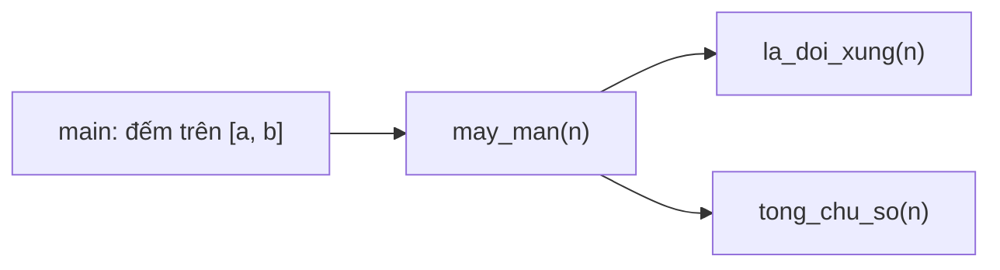
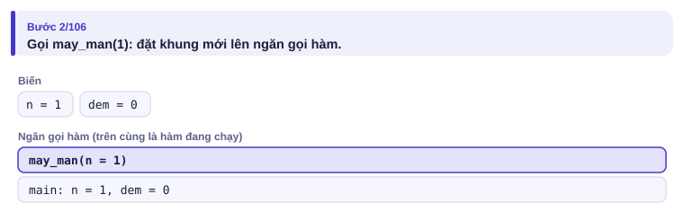
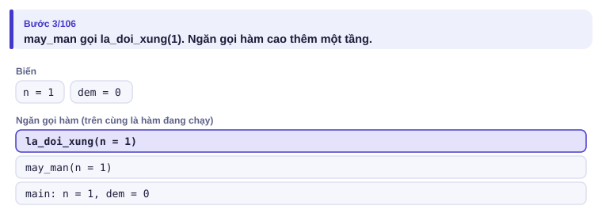
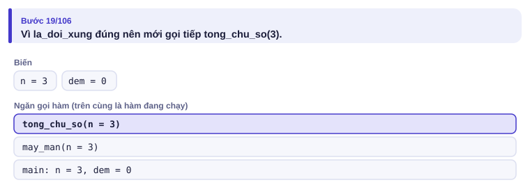
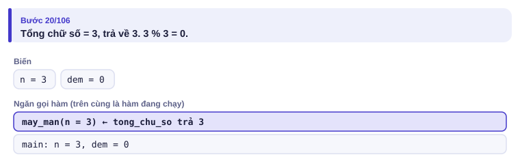
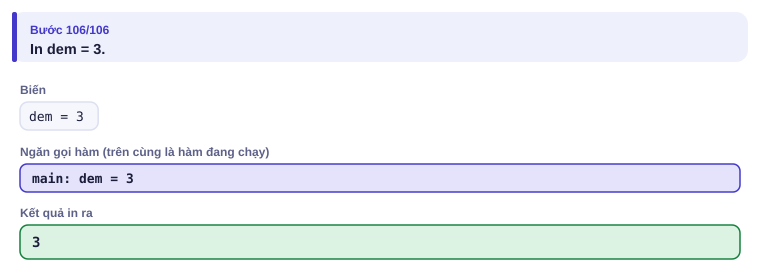

# Bài 0.7 – Hàm: chia nhỏ bài toán

> **Tập 0 · Nhập môn tư duy lập trình**
> Cần biết trước: bài 0.4 (vòng lặp, tách chữ số), bài 0.6 (xâu).
> Thời lượng: khoảng 60 phút đọc, cộng 3–4 giờ thực hành trong tuần.

**Học xong bài này, em sẽ:**

- tách một bài thành các **việc con**, mỗi việc một hàm có tên rõ nghĩa;
- hiểu máy chạy hàm thế nào qua **ngăn gọi hàm**: gọi thì đặt khung lên, `return` thì gỡ xuống;
- kiểm tra từng hàm riêng trước khi ghép;
- phân biệt truyền **bản sao** và truyền **bản gốc** (`&`) trong C++.

> [!TIP]
> **Học cùng trang mô phỏng.** Mở [mô phỏng hàm gọi hàm](../../mo-phong/t0-so-may-man.html). Xem ngăn gọi hàm cao lên khi `may_man` gọi `la_doi_xung`, và thấp xuống khi hàm `return`. Bật **Đoán trước** để tự tính giá trị trả về.

---

## 1. Bài toán mở màn: Số may mắn

Một số nguyên dương gọi là **may mắn** nếu nó đối xứng (đọc xuôi ngược như nhau) và tổng các chữ số chia hết cho 3. Đếm số may mắn trong đoạn [a, b] (1 ≤ a ≤ b ≤ 10⁶).

| Vào | Ra |
| --- | --- |
| `1 30` | `3` |
| `30 70` | `2` |

---

## 2. Dừng lại 10 phút

> [!IMPORTANT]
> **Dừng lại và nghĩ.**
> 1. Tự liệt kê các số may mắn trong hai ví dụ để kiểm tra đáp án.
> 2. Bài này gồm những "việc con" nào? Việc nào em đã biết làm từ các bài trước?
> 3. Nếu viết tất cả trong một khối, chương trình có mấy vòng lặp lồng nhau?

<details>
<summary>Đáp án</summary>

1. Đoạn [1, 30]: các số đối xứng là 1…9, 11, 22; tổng chữ số chia hết cho 3 chỉ có 3, 6, 9. Đoạn [30, 70]: số đối xứng là 33, 44, 55, 66; chỉ 33 (tổng 6) và 66 (tổng 12) thỏa.
2. Ba việc con: tính tổng chữ số (bài 0.4); kiểm tra đối xứng (bài 0.6, hoặc đảo số ở bài 0.4); đếm trên đoạn [a, b].
3. Một vòng `for` ngoài, bên trong có **hai** vòng `while` tách chữ số. Viết chung một khối thì biến lẫn vào nhau, rất dễ sai (mục 3).

</details>

---

## 3. Lời giải ngây thơ và vì sao nó dễ sai

An viết tất cả trong một khối:

```python
a, b = map(int, input().split())
dem = 0
for n in range(a, b + 1):
    dao = 0
    while n > 0:                 # đảo số
        dao = dao * 10 + n % 10
        n //= 10
    s = 0
    while n > 0:                 # tổng chữ số
        s += n % 10
        n //= 10
    if dao == n and s % 3 == 0:
        dem += 1
print(dem)
```

Chương trình in `0` cho cả hai ví dụ. Chi kẻ bảng chạy tay với n = 3 và thấy: vòng `while` đầu tiên **đã biến n thành 0**. Vòng thứ hai không chạy (s = 0) và phép so `dao == n` thành `3 == 0`. Lỗi nằm ở chỗ hai việc con **dùng chung một biến** n.

Khi tách mỗi việc thành một hàm, mỗi hàm có **bản n riêng** của nó, không ảnh hưởng nhau. Lỗi này biến mất.

---

## 4. Ý tưởng then chốt

> [!IMPORTANT]
> **Mỗi việc con là một hàm: nhận dữ liệu qua tham số, trả kết quả bằng `return`. Khi gọi hàm, máy đặt một khung mới chứa các biến riêng của hàm lên "ngăn gọi hàm"; khi `return`, khung được gỡ xuống và giá trị được mang về đúng chỗ gọi.**



### Chạy từng bước

Với đoạn [1, 30]. Đoán trước rồi mới mở.

<details>
<summary><b>Bước 1</b> – main gọi may_man(1): ngăn gọi hàm thế nào?</summary>



</details>

<details>
<summary><b>Bước 2</b> – may_man gọi la_doi_xung(1)</summary>



Ba tầng: main ở đáy, la_doi_xung ở trên cùng là hàm **đang chạy**. Mỗi tầng có biến n của riêng nó.

</details>

<details>
<summary><b>Bước 3</b> – Với n = 3: khi nào mới gọi tong_chu_so?</summary>



Chỉ khi la_doi_xung trả về đúng. Với số không đối xứng, toán tử `and` dừng sớm, tong_chu_so không bao giờ được gọi.

</details>

<details>
<summary><b>Bước 4</b> – tong_chu_so(3) trả về gì?</summary>



</details>

<details>
<summary><b>Bước 5</b> – Kết quả</summary>



</details>

---

## 5. Mã giả và cài đặt

```text
hàm tong_chu_so(n): cộng dồn n mod 10, bỏ chữ số cuối, tới khi n = 0
hàm la_doi_xung(n): so n với số đảo ngược của n
hàm may_man(n): la_doi_xung(n) và tong_chu_so(n) chia hết cho 3
main: đếm n trong [a, b] mà may_man(n) đúng
```

```python
# file: so_may_man.py
def tong_chu_so(n):
    s = 0
    while n > 0:
        s += n % 10
        n //= 10
    return s

def la_doi_xung(n):
    t = str(n)
    return t == t[::-1]

def may_man(n):
    return la_doi_xung(n) and tong_chu_so(n) % 3 == 0

a, b = map(int, input().split())
dem = 0
for n in range(a, b + 1):
    if may_man(n):
        dem += 1
print(dem)
```

```cpp
// file: so_may_man.cpp
#include <bits/stdc++.h>
using namespace std;

int tong_chu_so(int n) {
    int s = 0;
    while (n > 0) { s += n % 10; n /= 10; }
    return s;
}

bool la_doi_xung(int n) {
    int goc = n, dao = 0;
    while (n > 0) { dao = dao * 10 + n % 10; n /= 10; }
    return dao == goc;
}

bool may_man(int n) {
    return la_doi_xung(n) && tong_chu_so(n) % 3 == 0;
}

int main() {
    int a, b;
    cin >> a >> b;
    int dem = 0;
    for (int n = a; n <= b; n++)
        if (may_man(n)) dem++;
    cout << dem << '\n';
}
```

Cấu tạo một hàm:

| Phần | Python | C++ |
| --- | --- | --- |
| Khai báo | `def ten(tham_so):` | `kieu_tra_ve ten(kieu tham_so) { … }` |
| Trả kết quả | `return gia_tri` | `return gia_tri;` |
| Hàm không trả gì | bỏ `return` | kiểu `void` |
| Gọi hàm | `ten(5)` | `ten(5)` |

> [!TIP]
> **Kiểm tra từng hàm riêng.** Trước khi chạy cả bài, thử `tong_chu_so(1234)` phải ra 10, `la_doi_xung(121)` ra đúng, `la_doi_xung(120)` ra sai. Lỗi được khoanh vùng trong một hàm nhỏ thì dễ sửa hơn nhiều.

### Tham số trong C++: bản sao hay bản gốc?

Mặc định C++ **sao chép** tham số. Hàm sửa bản sao thì biến bên ngoài không đổi. Đó chính là lý do `la_doi_xung` sửa n thoải mái mà vòng `for` ở main không bị ảnh hưởng. Muốn hàm sửa **bản gốc**, thêm `&`:

```cpp
void tang_sai(int x)  { x++; }   // sửa bản sao: vô tác dụng
void tang_dung(int &x) { x++; }  // sửa bản gốc
```

Python thì khác: số và xâu không sửa được tại chỗ, muốn đổi thì `return` giá trị mới; còn `list` truyền vào hàm thì hàm sửa được trực tiếp.

---

## 6. Vì sao đúng, chạy bao lâu

- **Đúng:** mỗi hàm được kiểm tra riêng với vài giá trị; `may_man` chỉ ghép hai điều kiện theo đúng định nghĩa của đề; main đếm đúng trên [a, b]. Vì mỗi hàm có biến riêng, không có lỗi "dùng chung biến" như mục 3.
- **Chạy bao lâu:** b − a + 1 ≤ 10⁶ số, mỗi số tốn khoảng 7 bước tách chữ số cho mỗi hàm. Khoảng 10⁷ phép: C++ tức thì, Python khoảng 1–2 giây. Gọi hàm tốn thêm một chút chi phí nhỏ, nhưng không đổi bậc độ phức tạp.

---

## 7. Bẫy thường gặp

> [!WARNING]
> **Bẫy 1: truyền mảng lớn theo bản sao.** `void xu_ly(vector<int> a)` sao chép cả mảng mỗi lần gọi. Gọi 10⁵ lần với mảng 10⁵ phần tử là 10¹⁰ thao tác. Dùng `const vector<int> &a` khi chỉ đọc.

> [!WARNING]
> **Bẫy 2: quên `return`.** Hàm Python không có `return` trả về `None`; hàm C++ khai báo kiểu `int` mà quên `return` cho kết quả rác, không báo lỗi.
> *Test phá:* `if may_man(3):` với `may_man` quên `return`: luôn sai trong Python.

> [!WARNING]
> **Bẫy 3: `return` nằm trong vòng lặp.** `return` kết thúc hàm **ngay lập tức**. Đặt `return s` thụt vào trong `while` thì hàm trả về sau lượt đầu tiên.
> *Test phá:* `tong_chu_so(1234)` trả về 4 thay vì 10.

> [!WARNING]
> **Bẫy 4: quên `&` khi muốn sửa bản gốc.** Viết hàm đổi chỗ `void doi(int a, int b)` thì sau khi gọi, hai biến bên ngoài vẫn như cũ.

---

## 8. Ví dụ giảm dần hỗ trợ

### Ví dụ 2 – Điền vào chỗ trống: Số hoàn hảo

Một số nguyên dương là **hoàn hảo** nếu bằng tổng các ước dương nhỏ hơn nó, ví dụ 6 = 1 + 2 + 3. Nhập n (1 ≤ n ≤ 10⁴), in các số hoàn hảo không vượt quá n, mỗi số một dòng.

| Vào | Ra |
| --- | --- |
| `30` | `6`<br>`28` |

```text
def tong_uoc_nho_hon(x):
    s = 0
    for d in range(1, ____):
        if x % d == 0:
            s += d
    return ____

n = int(input())
for x in range(1, n + 1):
    if ____:
        print(x)
```

<details>
<summary>Đáp án</summary>

`x` (ước nhỏ hơn x nên dừng trước x), `s`, `tong_uoc_nho_hon(x) == x`. Với n = 10⁴, số phép khoảng n²/2 = 5·10⁷: C++ nhanh, Python vài giây. Bài 0.8 sẽ làm nhanh hơn nhiều.

```python
# file: so_hoan_hao.py
def tong_uoc_nho_hon(x):
    s = 0
    for d in range(1, x):
        if x % d == 0:
            s += d
    return s

n = int(input())
for x in range(1, n + 1):
    if tong_uoc_nho_hon(x) == x:
        print(x)
```

```cpp
// file: so_hoan_hao.cpp
#include <bits/stdc++.h>
using namespace std;
int tong_uoc_nho_hon(int x) {
    int s = 0;
    for (int d = 1; d < x; d++)
        if (x % d == 0) s += d;
    return s;
}
int main() {
    int n;
    cin >> n;
    for (int x = 1; x <= n; x++)
        if (tong_uoc_nho_hon(x) == x) cout << x << '\n';
}
```

</details>

### Ví dụ 3 – Tự làm: Sắp xếp ba số

Nhập ba số nguyên x, y, z (|x|, |y|, |z| ≤ 10⁹). In ba số theo thứ tự tăng dần, **không dùng** hàm sắp xếp có sẵn. Yêu cầu: trong C++, viết hàm `void doi_neu_lon(long long &a, long long &b)` đổi chỗ a và b nếu a > b, rồi gọi nó ba lần.

| Vào | Ra |
| --- | --- |
| `5 -2 3` | `-2 3 5` |

> [!IMPORTANT]
> Tự làm trước. Gợi ý: gọi hàm cho các cặp (x, y), (y, z), (x, y). Hãy chạy tay để thấy vì sao ba lần là đủ.

<details>
<summary>Lời giải</summary>

Lần gọi thứ hai đưa số lớn nhất về z; lần thứ ba sắp xong x, y. Python không có `&` cho số: hàm trả về cặp mới.

```cpp
// file: sap_xep_ba.cpp
#include <bits/stdc++.h>
using namespace std;
void doi_neu_lon(long long &a, long long &b) {
    if (a > b) { long long t = a; a = b; b = t; }
}
int main() {
    long long x, y, z;
    cin >> x >> y >> z;
    doi_neu_lon(x, y);
    doi_neu_lon(y, z);
    doi_neu_lon(x, y);
    cout << x << ' ' << y << ' ' << z << '\n';
}
```

```python
# file: sap_xep_ba.py
def doi_neu_lon(a, b):
    return (b, a) if a > b else (a, b)

x, y, z = map(int, input().split())
x, y = doi_neu_lon(x, y)
y, z = doi_neu_lon(y, z)
x, y = doi_neu_lon(x, y)
print(x, y, z)
```

</details>

---

## 9. Bài tập

| Nấc | Bài | Nguồn | Ý chính |
| --- | --- | --- | --- |
| Khởi động | Viết hàm `dao_nguoc(n)` trả về số đảo ngược của n; dùng nó để viết lại `la_doi_xung` | Tự luyện | Hàm gọi hàm |
| Luyện | [Translation](https://codeforces.com/problemset/problem/41/A) | CF 41A · 800 | Hàm đảo xâu |
| Luyện | [Twins](https://codeforces.com/problemset/problem/160/A) | CF 160A · 900 | Tách bước sắp xếp và bước chọn |
| Thử thách | Đếm số may mắn trong [a, b] với b ≤ 10¹²: chỉ **sinh** các số đối xứng (lấy nửa đầu rồi lật) thay vì thử mọi số | Tự luyện | Đổi cách nhìn để giảm số phép tính |
| Kiểu đề thi | Tổng chữ số nguyên tố | Bài của sách, chấm theo subtask | Xem bên dưới |

### Bài kiểu đề thi: Tổng chữ số nguyên tố

**Đề bài.** Đếm số nguyên x trong đoạn [a, b] (1 ≤ a ≤ b ≤ 10⁶) có **tổng chữ số là số nguyên tố**. Đọc a, b từ `TONGNT.INP`, ghi ra `TONGNT.OUT`.

Subtask: 50% có b ≤ 1000; 50% còn lại có b ≤ 10⁶.

| TONGNT.INP | TONGNT.OUT |
| --- | --- |
| `10 20` | `5` |

Các số thỏa: 11 (2), 12 (3), 14 (5), 16 (7), 20 (2).

<details>
<summary><b>Gợi ý 1</b> – hướng đi</summary>

Hai việc con: `tong_chu_so(x)` (đã có) và `la_nguyen_to(k)`: k ≥ 2 và không chia hết cho số nào từ 2 tới k − 1.

</details>

<details>
<summary><b>Gợi ý 2</b> – có cần nhanh hơn không?</summary>

Với x ≤ 10⁶, tổng chữ số tối đa là 9 × 6 = 54. `la_nguyen_to` chỉ phải xét số ≤ 54, rất nhanh. Phần tốn thời gian là tách chữ số của 10⁶ số: khoảng 7·10⁶ phép, ổn với cả hai ngôn ngữ.

</details>

<details>
<summary><b>Gợi ý 3</b> – lời giải đầy đủ</summary>

Với Python, có thể tính trước `nt[k]` cho k = 0..54 để mỗi lần chỉ tra mảng (bài 0.5).

```python
# file: tongnt.py
def tong_chu_so(x):
    s = 0
    while x > 0:
        s += x % 10
        x //= 10
    return s

def la_nguyen_to(k):
    if k < 2:
        return False
    for d in range(2, k):
        if k % d == 0:
            return False
    return True

with open("TONGNT.INP") as f:
    a, b = map(int, f.read().split())
nt = [la_nguyen_to(k) for k in range(55)]      # tính trước cho mọi tổng có thể
dem = 0
for x in range(a, b + 1):
    if nt[tong_chu_so(x)]:
        dem += 1
with open("TONGNT.OUT", "w") as f:
    f.write(f"{dem}\n")
```

```cpp
// file: tongnt.cpp
#include <bits/stdc++.h>
using namespace std;
int tong_chu_so(int x) {
    int s = 0;
    while (x > 0) { s += x % 10; x /= 10; }
    return s;
}
bool la_nguyen_to(int k) {
    if (k < 2) return false;
    for (int d = 2; d < k; d++)
        if (k % d == 0) return false;
    return true;
}
int main() {
    freopen("TONGNT.INP", "r", stdin);
    freopen("TONGNT.OUT", "w", stdout);
    int a, b, dem = 0;
    cin >> a >> b;
    for (int x = a; x <= b; x++)
        if (la_nguyen_to(tong_chu_so(x))) dem++;
    cout << dem << '\n';
}
```

</details>

---

## 10. Tóm tắt, flashcard và checkpoint

**Tóm tắt trong 5 dòng.**

1. Mỗi hàm làm một việc, có tên nói rõ việc đó; mỗi hàm có biến riêng.
2. Gọi hàm: đặt khung lên ngăn gọi hàm; `return`: gỡ khung và mang giá trị về.
3. Kiểm tra từng hàm với vài giá trị trước khi ghép.
4. `return` kết thúc hàm ngay; đừng đặt nhầm vào trong vòng lặp.
5. C++: `&` để sửa bản gốc; `const &` để truyền mảng lớn mà không sao chép.

**Flashcard.**

<details><summary>Có bao nhiêu số may mắn trong đoạn [1, 30]?</summary>3: các số 3, 6, 9.</details>
<details><summary>Vì sao nên viết <code>const vector&lt;int&gt; &amp;a</code> thay vì <code>vector&lt;int&gt; a</code>?</summary>Tránh sao chép cả mảng mỗi lần gọi hàm.</details>
<details><summary>Hàm Python không có <code>return</code> trả về gì?</summary><code>None</code>.</details>
<details><summary>Trong <code>la_doi_xung(n) and tong_chu_so(n) % 3 == 0</code>, khi nào <code>tong_chu_so</code> không được gọi?</summary>Khi <code>la_doi_xung(n)</code> sai: <code>and</code> dừng sớm.</details>
<details><summary><code>void tang(int x) { x++; }</code> có làm tăng biến truyền vào không?</summary>Không: x là bản sao. Phải viết <code>int &amp;x</code>.</details>

**Ôn xoắn ốc** (kiến thức bài 0.4–0.6; mỗi bài tối đa 20 phút):

- [Nearly Lucky Number](https://codeforces.com/problemset/problem/110/A) (CF 110A): tách chữ số.
- Chữ cái phổ biến nhất (bài 0.6, Ví dụ 2), viết lại không nhìn sách.
- Số khác nhau (bài 0.5, bài kiểu đề thi), viết lại bằng ngôn ngữ còn lại.

**Checkpoint – em đã sẵn sàng sang bài tiếp theo nếu:**

- [ ] Viết lại bài Số may mắn với ít nhất 3 hàm, không nhìn sách.
- [ ] Vẽ được ngăn gọi hàm (ba tầng) khi máy đang chạy `tong_chu_so(33)` trong bài Số may mắn.
- [ ] Giải thích được cho bạn sự khác nhau giữa `int x` và `int &x` trong tham số.
- [ ] Đạt trọn điểm bài Tổng chữ số nguyên tố khi tự làm trong 25 phút.

Chưa đạt? Nếu vướng ô 1 hoặc 2, mở trang mô phỏng và chạy lại với đoạn [30, 40]. Nếu vướng ô 3, làm lại Ví dụ 3. Nếu vướng ô 4, đọc lại Gợi ý 1–2 và kiểm tra riêng từng hàm.
