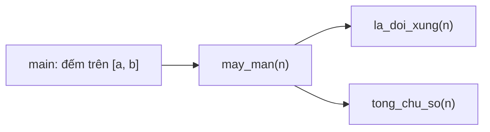

# Bài 0.7 – Hàm: chia nhỏ bài toán

> **Tập 0** · Cần biết trước: bài 0.4–0.6 · Thời lượng: khoảng 45 phút đọc, 3 giờ thực hành

**Học xong bài này, em sẽ:**

- tách một bài toán thành các hàm nhỏ, mỗi hàm làm đúng một việc;
- kiểm tra riêng từng hàm trước khi ghép;
- biết khi nào hàm C++ cần tham chiếu `&`.

---

## 1. Bài toán mở màn: Số may mắn

Một số nguyên dương gọi là **may mắn** nếu nó đối xứng (đọc xuôi ngược như nhau) và tổng các chữ số chia hết cho 3. Đếm số may mắn trong đoạn [a, b] (1 ≤ a ≤ b ≤ 10⁶).

| Vào | Ra |
| --- | --- |
| `1 30` | `3` |
| `30 70` | `2` |

> [!IMPORTANT]
> **Dừng lại và nghĩ.** Tự liệt kê các số may mắn trong hai ví dụ để kiểm tra đáp án. Bài này gồm những "việc con" nào?

<details>
<summary>Đáp án</summary>

Đoạn [1, 30]: các số đối xứng là 1…9, 11, 22; tổng chữ số chia hết cho 3 chỉ có 3, 6, 9. Đoạn [30, 70]: số đối xứng là 33, 44, 55, 66; chỉ 33 (tổng 6) và 66 (tổng 12) thỏa.

Ba việc con: tính tổng chữ số; kiểm tra đối xứng; đếm trên đoạn [a, b]. Thói quen tốt: **luôn tự kiểm tra ví dụ bằng tay** trước khi code.

</details>

---

## 2. Mỗi việc con là một hàm

```python
# file: so_may_man.py
def tong_chu_so(n):
    s = 0
    while n > 0:
        s += n % 10
        n //= 10
    return s

def la_doi_xung(n):
    t = str(n)
    return t == t[::-1]

def may_man(n):
    return la_doi_xung(n) and tong_chu_so(n) % 3 == 0

a, b = map(int, input().split())
print(sum(1 for n in range(a, b + 1) if may_man(n)))
```

```cpp
// file: so_may_man.cpp
#include <bits/stdc++.h>
using namespace std;

int tong_chu_so(int n) {
    int s = 0;
    while (n > 0) { s += n % 10; n /= 10; }
    return s;
}

bool la_doi_xung(int n) {
    int goc = n, dao = 0;
    while (n > 0) { dao = dao * 10 + n % 10; n /= 10; }
    return dao == goc;
}

bool may_man(int n) {
    return la_doi_xung(n) && tong_chu_so(n) % 3 == 0;
}

int main() {
    int a, b;
    cin >> a >> b;
    int dem = 0;
    for (int n = a; n <= b; n++)
        if (may_man(n)) dem++;
    cout << dem << '\n';
}
```

Cách các hàm gọi nhau:



> [!TIP]
> **Kiểm tra từng hàm riêng.** Trước khi chạy cả bài, thử `tong_chu_so(1234)` phải ra 10, `la_doi_xung(121)` ra đúng, `la_doi_xung(120)` ra sai. Lỗi được khoanh vùng trong một hàm nhỏ thì dễ sửa hơn nhiều.

Số phép tính: b − a + 1 ≤ 10⁶ số, mỗi số tốn khoảng 7 bước tách chữ số. Khoảng 10⁷ phép: C++ tức thì, Python vài giây. Với Python, có thể chỉ sinh các số đối xứng thay vì thử mọi số (thử thách ở mục 4).

---

## 3. Tham số trong C++: bản sao hay bản gốc?

Mặc định C++ **sao chép** tham số. Hàm sửa bản sao thì biến bên ngoài không đổi. Muốn sửa bản gốc, thêm `&`:

```cpp
void tang_sai(int x)  { x++; }   // sửa bản sao: vô tác dụng
void tang_dung(int &x) { x++; }  // sửa bản gốc
```

Python thì khác: số và xâu không sửa được tại chỗ, muốn đổi thì `return` giá trị mới; còn `list` truyền vào hàm thì hàm sửa được trực tiếp.

> [!WARNING]
> **Bẫy: truyền mảng lớn theo bản sao.** `void xu_ly(vector<int> a)` sao chép cả mảng mỗi lần gọi. Gọi 10⁵ lần với mảng 10⁵ phần tử là 10¹⁰ thao tác. Dùng `const vector<int> &a` khi chỉ đọc.

> [!WARNING]
> **Bẫy: quên `return`.** Hàm Python không có `return` trả về `None`; hàm C++ khai báo kiểu `int` mà quên `return` cho kết quả rác, không báo lỗi.

---

## 4. Bài tập

| Nấc | Bài | Nguồn | Ý chính |
| --- | --- | --- | --- |
| Khởi động | Viết hàm `dao_nguoc(n)` trả về số đảo ngược của n; dùng nó để viết lại `la_doi_xung` | Tự luyện | Hàm gọi hàm |
| Luyện | [Translation](https://codeforces.com/problemset/problem/41/A) | CF 41A · 800 | Hàm đảo xâu |
| Luyện | [Twins](https://codeforces.com/problemset/problem/160/A) | CF 160A · 900 | Tách bước sắp xếp và bước chọn |
| Thử thách | Đếm số may mắn trong [a, b] với b ≤ 10¹²: chỉ **sinh** các số đối xứng (lấy nửa đầu rồi lật) thay vì thử mọi số | Tự luyện | Đổi cách nhìn để giảm số phép tính |

---

## 5. Tóm tắt và checkpoint

1. Mỗi hàm làm một việc, có tên nói rõ việc đó.
2. Kiểm tra từng hàm với vài giá trị trước khi ghép.
3. C++: `&` để sửa bản gốc; `const &` để truyền mảng lớn mà không sao chép.
4. Luôn tự kiểm tra ví dụ bằng tay trước khi code.

<details><summary>Có bao nhiêu số may mắn trong đoạn [1, 30]?</summary>3: các số 3, 6, 9.</details>
<details><summary>Vì sao nên viết <code>const vector&lt;int&gt; &amp;a</code> thay vì <code>vector&lt;int&gt; a</code>?</summary>Tránh sao chép cả mảng mỗi lần gọi hàm.</details>

**Checkpoint:**

- [ ] Viết lại bài Số may mắn với ít nhất 3 hàm, không nhìn sách.
- [ ] Giải thích được cho bạn sự khác nhau giữa `int x` và `int &x` trong tham số.
