# Bài 0.8 – Số học cơ bản

> **Tập 0 · Nhập môn tư duy lập trình**
> Cần biết trước: bài 0.4 (vòng lặp), 0.5 (mảng đánh dấu), 0.7 (hàm).
> Thời lượng: khoảng 90 phút đọc, cộng 6 giờ thực hành trong 1,5 tuần.

**Học xong bài này, em sẽ:**

- tính ƯCLN bằng **thuật toán Euclid** và BCNN mà không tràn số;
- kiểm tra số nguyên tố và liệt kê ước trong **O(√n)**;
- dùng **sàng Eratosthenes** để tìm mọi số nguyên tố tới 10⁶–10⁷.

Đây là nhóm bài gặp nhiều nhất ở đề HSG lớp 9.

> [!TIP]
> **Học cùng hai trang mô phỏng.** [Mô phỏng Euclid](../../mo-phong/t0-euclid.html): thử cặp số 10⁹ và 999 999 999 để thấy chỉ cần rất ít bước. [Mô phỏng sàng Eratosthenes](../../mo-phong/t0-sang.html): xem các bội bị gạch theo từng số nguyên tố, với N tới 120. Bật **Đoán trước** ở cả hai trang.

---

## 1. Bài toán mở màn: Hai ngọn đèn

Trên cầu Ba Son có hai ngọn đèn trang trí. Đèn thứ nhất chớp sau mỗi a giây, đèn thứ hai sau mỗi b giây (1 ≤ a, b ≤ 10⁹). Lúc 0 giây cả hai cùng chớp. Hỏi sau bao nhiêu giây chúng lại cùng chớp lần đầu tiên?

| Vào | Ra |
| --- | --- |
| `4 6` | `12` |
| `1000000000 999999999` | `999999999000000000` |

---

## 2. Dừng lại 10 phút

> [!IMPORTANT]
> **Dừng lại và nghĩ.**
> 1. Liệt kê các thời điểm đèn 1 chớp và đèn 2 chớp với a = 4, b = 6. Thời điểm chung đầu tiên là gì? Đó là khái niệm toán học nào?
> 2. Liên hệ giữa BCNN và ƯCLN là gì?
> 3. Với a, b gần 10⁹, đáp án cỡ bao nhiêu? Có vừa `int` không?

<details>
<summary>Đáp án</summary>

1. Đèn 1: 4, 8, **12**, 16, … Đèn 2: 6, **12**, 18, … Thời điểm chung đầu tiên là **bội chung nhỏ nhất** BCNN(4, 6) = 12.
2. BCNN(a, b) × ƯCLN(a, b) = a × b. Với 4 và 6: 12 × 2 = 24 = 4 × 6. Vậy chỉ cần tính ƯCLN.
3. Tới khoảng 10¹⁸: phải dùng `long long`, và phải cẩn thận thứ tự nhân chia (Bẫy 1).

</details>

---

## 3. Lời giải ngây thơ và vì sao nó chậm

An thử lần lượt các bội của a cho tới khi gặp một số chia hết cho b:

```python
a, b = map(int, input().split())
t = a
while t % b != 0:
    t += a
print(t)
```

Đúng với `4 6`. Nhưng với `1000000000 999999999`, đáp án là a × 999 999 999, nên vòng lặp chạy gần **10⁹ lượt**: Python cần khoảng 100 giây. Tương tự, tìm ƯCLN bằng cách thử mọi d từ min(a, b) trở xuống cũng tới 10⁹ lượt. Cần một cách đi tắt.

---

## 4. Ý tưởng then chốt

> [!IMPORTANT]
> **ƯCLN(a, b) = ƯCLN(b, a mod b), và ƯCLN(a, 0) = a.** Mỗi bước thay cặp (a, b) bằng cặp nhỏ hơn hẳn; số nhỏ giảm ít nhất một nửa sau hai bước, nên chỉ cần khoảng 2·log₂ của số đó: với số cỡ 10⁹ là dưới 90 bước.

Vì sao đúng: mọi số chia hết cả a và b thì chia hết a − kb = a mod b, và ngược lại. Hai cặp có cùng tập ước chung, nên cùng ƯCLN.

### Chạy từng bước

Với a = 4, b = 6. Tính `a mod b` trước rồi mới mở.

<details>
<summary><b>Bước 1</b> – Cặp ban đầu</summary>

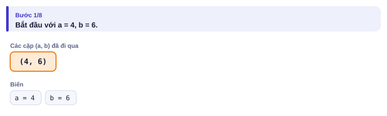

</details>

<details>
<summary><b>Bước 2</b> – 4 mod 6 = ? (a nhỏ hơn b thì sao?)</summary>

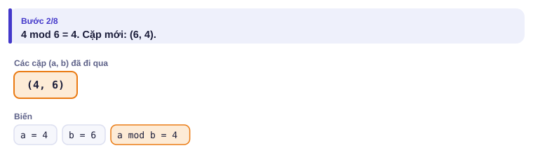

a < b thì a mod b = a: bước đầu chỉ **đổi chỗ** hai số. Không cần viết code riêng cho trường hợp này.

</details>

<details>
<summary><b>Bước 3</b> – 6 mod 4 = ?</summary>

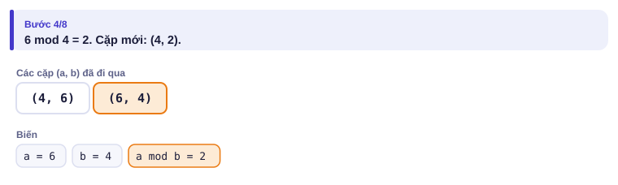

</details>

<details>
<summary><b>Bước 4</b> – 4 mod 2 = ?</summary>

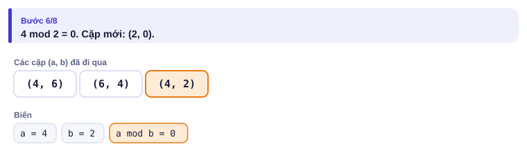

</details>

<details>
<summary><b>Bước 5</b> – b = 0: ƯCLN và BCNN</summary>

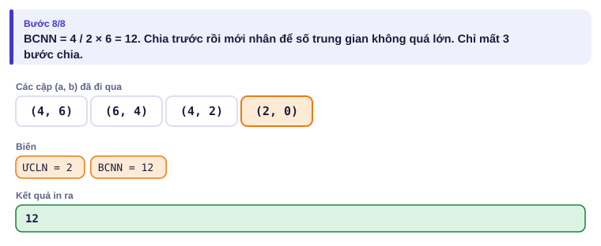

</details>

---

## 5. Mã giả và cài đặt

```text
hàm ucln(a, b):
    trong khi b ≠ 0: (a, b) ← (b, a mod b)
    trả về a
bcnn ← a / ucln(a, b) × b      (chia trước, nhân sau)
```

```python
# file: hai_ngon_den.py
def ucln(a, b):
    while b != 0:
        a, b = b, a % b
    return a

a, b = map(int, input().split())
print(a // ucln(a, b) * b)      # chia TRƯỚC rồi mới nhân
```

```cpp
// file: hai_ngon_den.cpp
#include <bits/stdc++.h>
using namespace std;
long long ucln(long long a, long long b) {
    while (b != 0) {
        long long r = a % b;
        a = b;
        b = r;
    }
    return a;
}
int main() {
    long long a, b;
    cin >> a >> b;
    cout << a / ucln(a, b) * b << '\n';   // chia trước để giá trị trung gian nhỏ hơn
}
```

> [!NOTE]
> Python có sẵn `math.gcd(a, b)`; C++ (từ C++17) có `gcd(a, b)`. Em nên biết tự viết, vì ý tưởng Euclid còn dùng ở nhiều bài khác.

### Ước và số nguyên tố trong O(√n)

Nếu d là ước của n thì n / d cũng là ước. Trong mỗi cặp (d, n/d), một số **không vượt quá √n**. Vậy chỉ cần thử d từ 1 tới √n.

Ví dụ n = 36: các cặp (1, 36), (2, 18), (3, 12), (4, 9), (6, 6). Thử d = 1..6 là đủ.

```python
# file: kiem_tra_nguyen_to.py
def la_nguyen_to(n):
    if n < 2:
        return False
    d = 2
    while d * d <= n:          # tương đương d <= căn n, nhưng không dùng số thực
        if n % d == 0:
            return False
        d += 1
    return True

n = int(input())
print("YES" if la_nguyen_to(n) else "NO")
```

```cpp
// file: kiem_tra_nguyen_to.cpp
#include <bits/stdc++.h>
using namespace std;
bool la_nguyen_to(long long n) {
    if (n < 2) return false;
    for (long long d = 2; d * d <= n; d++)
        if (n % d == 0) return false;
    return true;
}
int main() {
    long long n;
    cin >> n;
    cout << (la_nguyen_to(n) ? "YES" : "NO") << '\n';
}
```

Với n ≤ 10¹², vòng lặp chạy tối đa 10⁶ lượt: nhanh.

### Sàng Eratosthenes

Khi cần **mọi** số nguyên tố tới N (hoặc kiểm tra nhiều số), dùng sàng: viết các số 2..N; lấy số nhỏ nhất chưa bị gạch, đó là số nguyên tố p; gạch mọi bội của p **bắt đầu từ p²**; lặp lại tới khi p² > N.

<details>
<summary><b>Hình</b> – Sàng với N = 30 (mở lần lượt, đoán trước số bị gạch)</summary>

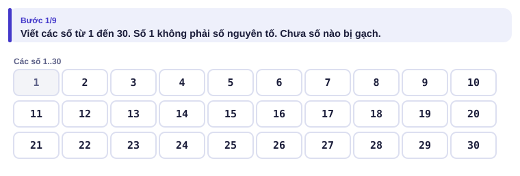
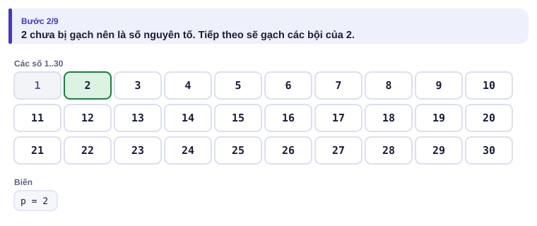
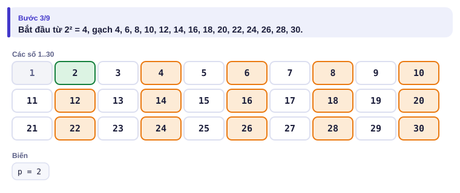
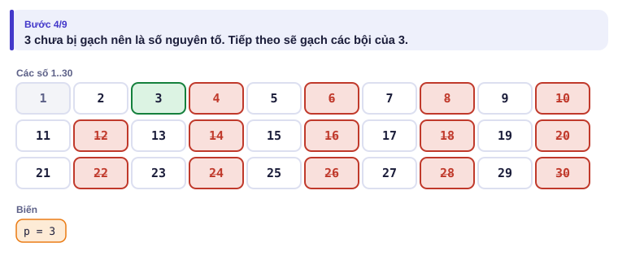
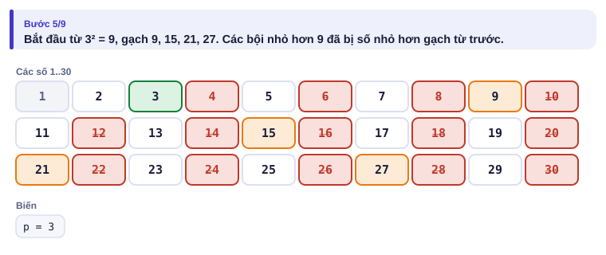
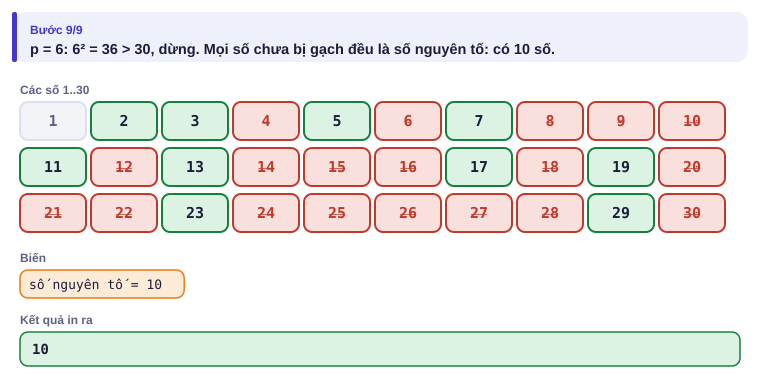

</details>

Còn lại: **2, 3, 5, 7, 11, 13, 17, 19, 23, 29**. Vì sao bắt đầu từ p²? Các bội nhỏ hơn như 2p, 3p, …, (p − 1)p đã bị gạch bởi các số nguyên tố nhỏ hơn p.

Bài: nhập N (2 ≤ N ≤ 10⁶), in số lượng số nguyên tố không vượt quá N.

```python
# file: sang.py
n = int(input())
nt = [True] * (n + 1)
nt[0] = nt[1] = False
p = 2
while p * p <= n:
    if nt[p]:
        for k in range(p * p, n + 1, p):
            nt[k] = False
    p += 1
print(sum(nt))
```

```cpp
// file: sang.cpp
#include <bits/stdc++.h>
using namespace std;
int main() {
    int n;
    cin >> n;
    vector<bool> nt(n + 1, true);
    nt[0] = nt[1] = false;
    for (long long p = 2; p * p <= n; p++)
        if (nt[p])
            for (long long k = p * p; k <= n; k += p) nt[k] = false;
    cout << count(nt.begin(), nt.end(), true) << '\n';
}
```

> [!TIP]
> **Python với N = 10⁷.** Thay vòng `for k` bằng phép gán lát cắt trên `bytearray`: `nt[p*p::p] = bytes(len(range(p*p, n + 1, p)))`. Nhanh hơn nhiều lần (xem bài kiểu đề thi ở mục 9).

---

## 6. Vì sao đúng, chạy bao lâu

| Thuật toán | Vì sao đúng | Số phép (xấp xỉ) |
| --- | --- | --- |
| Euclid | Cặp (a, b) và (b, a mod b) có cùng tập ước chung | khoảng 2·log₂(min(a, b)): dưới 90 với số tới 10¹⁸ |
| Kiểm tra nguyên tố | n hợp số thì có ước d với 2 ≤ d ≤ √n | √n: 10⁶ với n = 10¹² |
| Sàng | Mỗi hợp số bị gạch bởi ước nguyên tố nhỏ nhất của nó | N log log N, gần như N |

So với lời giải ngây thơ ở mục 3 (10⁹ lượt), Euclid nhanh hơn khoảng **mười triệu** lần.

---

## 7. Bẫy thường gặp

> [!WARNING]
> **Bẫy 1: BCNN tràn số.** `a * b / ucln(a, b)` tính `a * b` trước, có thể vượt cả `long long` khi a, b gần 10¹⁸ hoặc vượt `int` khi a, b gần 10⁹. Luôn **chia trước, nhân sau**.
> *Test phá:* `1000000000 999999999` với kiểu `int`.

> [!WARNING]
> **Bẫy 2: 1 không phải số nguyên tố.** Hàm kiểm tra phải trả về sai với n = 0 và n = 1.
> *Test phá:* n = 1.

> [!WARNING]
> **Bẫy 3: dùng `sqrt` số thực.** `for (d = 2; d <= sqrt(n); d++)` có thể sai lệch với n lớn do sai số. Viết `d * d <= n` với `d` kiểu `long long`.

> [!WARNING]
> **Bẫy 4: đếm ước bị trùng ở số chính phương.** Khi đếm ước theo cặp (d, n/d), nếu d × d = n thì d và n/d là **một** ước, chỉ đếm một lần.
> *Test phá:* n = 36 có 9 ước, không phải 10.

---

## 8. Ví dụ giảm dần hỗ trợ

### Ví dụ 2 – Điền vào chỗ trống: Đếm ước nhanh

Nhập n (1 ≤ n ≤ 10¹²). Đếm số ước nguyên dương của n trong O(√n).

| Vào | Ra |
| --- | --- |
| `36` | `9` |
| `1000000000000` | `169` |

```text
n = int(input())
dem = 0
d = 1
while ____:
    if n % d == 0:
        dem += ____
    d += 1
print(dem)
```

<details>
<summary>Đáp án</summary>

`d * d <= n`, và `1 if d * d == n else 2`: mỗi ước d ≤ √n đi kèm một ước n/d; riêng d = √n thì hai ước là một (Bẫy 4).

```python
# file: dem_uoc_nhanh.py
n = int(input())
dem = 0
d = 1
while d * d <= n:
    if n % d == 0:
        dem += 1 if d * d == n else 2
    d += 1
print(dem)
```

```cpp
// file: dem_uoc_nhanh.cpp
#include <bits/stdc++.h>
using namespace std;
int main() {
    long long n;
    cin >> n;
    int dem = 0;
    for (long long d = 1; d * d <= n; d++)
        if (n % d == 0) dem += (d * d == n) ? 1 : 2;
    cout << dem << '\n';
}
```

</details>

### Ví dụ 3 – Tự làm: ƯCLN của cả dãy

Nhập n (1 ≤ n ≤ 10⁵) rồi n số nguyên dương (≤ 10¹⁸). In ƯCLN của cả dãy.

| Vào | Ra |
| --- | --- |
| `4`<br>`12 18 30 42` | `6` |

> [!IMPORTANT]
> Tự làm trước. Gợi ý: ƯCLN(a, b, c) = ƯCLN(ƯCLN(a, b), c). Bắt đầu từ g = 0, vì ƯCLN(0, x) = x.

<details>
<summary>Lời giải</summary>

Gộp dần từng số vào g. Mỗi lần gọi Euclid tốn rất ít bước, nên tổng cộng gần như O(n).

```python
# file: ucln_day.py
import sys
def ucln(a, b):
    while b != 0:
        a, b = b, a % b
    return a

data = sys.stdin.read().split()
n = int(data[0])
g = 0
for x in data[1:n + 1]:
    g = ucln(g, int(x))
print(g)
```

```cpp
// file: ucln_day.cpp
#include <bits/stdc++.h>
using namespace std;
long long ucln(long long a, long long b) {
    while (b != 0) { long long r = a % b; a = b; b = r; }
    return a;
}
int main() {
    int n;
    cin >> n;
    long long g = 0;
    for (int i = 0; i < n; i++) {
        long long x;
        cin >> x;
        g = ucln(g, x);
    }
    cout << g << '\n';
}
```

</details>

---

## 9. Bài tập

| Nấc | Bài | Nguồn | Ý chính |
| --- | --- | --- | --- |
| Khởi động | [Almost Prime](https://codeforces.com/problemset/problem/26/A) | CF 26A · 900 | Đếm ước nguyên tố |
| Luyện | [T-primes](https://codeforces.com/problemset/problem/230/B) | CF 230B · 1300 | Sàng + số chính phương |
| Luyện | Nhập n số (n ≤ 10⁵, mỗi số ≤ 10⁶), đếm có bao nhiêu số nguyên tố | Tự luyện | Sàng một lần, tra nhiều lần |
| Thử thách | [Counting Divisors](https://cses.fi/problemset/task/1713) | CSES 1713 | Sàng ước cho nhiều truy vấn |
| Kiểu đề thi | Cặp nguyên tố sinh đôi | Bài của sách, chấm theo subtask | Xem bên dưới |

### Bài kiểu đề thi: Cặp nguyên tố sinh đôi

**Đề bài.** Hai số nguyên tố p và p + 2 gọi là một cặp **sinh đôi**, ví dụ (3, 5), (5, 7), (11, 13). Đếm số cặp sinh đôi với p + 2 ≤ N (1 ≤ N ≤ 10⁷). Đọc N từ `CAPNT.INP`, ghi ra `CAPNT.OUT`.

Subtask: 40% có N ≤ 10⁴; 30% có N ≤ 10⁶; 30% có N ≤ 10⁷.

| CAPNT.INP | CAPNT.OUT |
| --- | --- |
| `20` | `4` |

Bốn cặp: (3, 5), (5, 7), (11, 13), (17, 19).

<details>
<summary><b>Gợi ý 1</b> – hướng đi (đủ 40% điểm)</summary>

Với mỗi p từ 2 tới N − 2, kiểm tra p và p + 2 bằng hàm `la_nguyen_to` O(√n). Khoảng N·√N = 10⁶ phép với N = 10⁴.

</details>

<details>
<summary><b>Gợi ý 2</b> – ý then chốt</summary>

Cần biết tính nguyên tố của **mọi** số tới N: sàng Eratosthenes một lần, rồi mỗi lần kiểm tra chỉ là tra mảng.

</details>

<details>
<summary><b>Gợi ý 3</b> – lời giải đầy đủ (vì sao Python dễ mất 30% cuối?)</summary>

Với N = 10⁷, sàng bằng vòng `for k` trong Python mất nhiều giây. Dùng `bytearray` và gán lát cắt: đo trên máy thường khoảng 0,5 giây. Bản C++ dùng `vector<bool>` hoặc `vector<char>` đều nhanh.

```python
# file: capnt.py
with open("CAPNT.INP") as f:
    n = int(f.read())
nt = bytearray([1]) * (n + 3)
nt[0] = nt[1] = 0
p = 2
while p * p <= n:
    if nt[p]:
        nt[p * p::p] = bytes(len(range(p * p, n + 3, p)))
    p += 1
dem = sum(1 for q in range(2, n - 1) if nt[q] and nt[q + 2])
with open("CAPNT.OUT", "w") as f:
    f.write(f"{dem}\n")
```

```cpp
// file: capnt.cpp
#include <bits/stdc++.h>
using namespace std;
int main() {
    freopen("CAPNT.INP", "r", stdin);
    freopen("CAPNT.OUT", "w", stdout);
    int n;
    cin >> n;
    vector<char> nt(n + 3, 1);
    nt[0] = nt[1] = 0;
    for (long long p = 2; p * p <= n; p++)
        if (nt[p])
            for (long long k = p * p; k <= n + 2; k += p) nt[k] = 0;
    int dem = 0;
    for (int q = 2; q + 2 <= n; q++)
        if (nt[q] && nt[q + 2]) dem++;
    cout << dem << '\n';
}
```

</details>

---

## 10. Tóm tắt, flashcard và checkpoint

**Tóm tắt trong 5 dòng.**

1. ƯCLN: Euclid, `a, b = b, a % b` tới khi b = 0. BCNN = a / ƯCLN × b (chia trước).
2. Ước, kiểm tra nguyên tố: thử d với `d * d <= n`, O(√n); số chính phương thì đừng đếm trùng.
3. Nhiều số cần kiểm tra, hoặc cần mọi số nguyên tố tới N: sàng Eratosthenes, gạch từ p².
4. 0 và 1 không phải số nguyên tố.
5. Python với N lớn: `bytearray` và gán lát cắt.

**Flashcard.**

<details><summary>ƯCLN(48, 18) qua từng bước Euclid?</summary>(48, 18) → (18, 12) → (12, 6) → (6, 0): bằng 6.</details>
<details><summary>Trong sàng, vì sao bắt đầu gạch từ p²?</summary>Các bội kp với k &lt; p đã bị gạch bởi một số nguyên tố nhỏ hơn p.</details>
<details><summary>Có bao nhiêu số nguyên tố không vượt quá 30?</summary>10.</details>
<details><summary>Vì sao viết <code>a / g * b</code> chứ không viết <code>a * b / g</code>?</summary><code>a * b</code> có thể tràn trước khi chia.</details>
<details><summary>36 có bao nhiêu ước? Vì sao không phải 10?</summary>9; cặp (6, 6) chỉ là một ước.</details>

**Ôn xoắn ốc** (kiến thức bài 0.5–0.7; mỗi bài tối đa 20 phút):

- [Missing Number](https://cses.fi/problemset/task/1083) (CSES 1083): mảng đánh dấu.
- Số hoàn hảo (bài 0.7, Ví dụ 2): làm lại với cách đếm ước O(√n) của bài này.
- [Boy or Girl](https://codeforces.com/problemset/problem/236/A) (CF 236A): mảng 26 ô.

**Checkpoint – em đã sẵn sàng sang bài tiếp theo nếu:**

- [ ] Viết sàng Eratosthenes và Euclid không nhìn sách, mỗi thuật toán trong dưới 5 phút.
- [ ] Chạy tay được Euclid với (1071, 462) và ra 21.
- [ ] AC [T-primes](https://codeforces.com/problemset/problem/230/B).
- [ ] Đạt trọn điểm bài Cặp nguyên tố sinh đôi (cả N = 10⁷) khi tự làm trong 30 phút.

Chưa đạt? Nếu vướng ô 1 hoặc 2, mở hai trang mô phỏng và chạy lại với chế độ Đoán trước. Nếu vướng ô 3, đọc lại "Ước và số nguyên tố trong O(√n)" và Bẫy 4. Nếu vướng ô 4, đọc lại Gợi ý 3 và mẹo `bytearray`.
