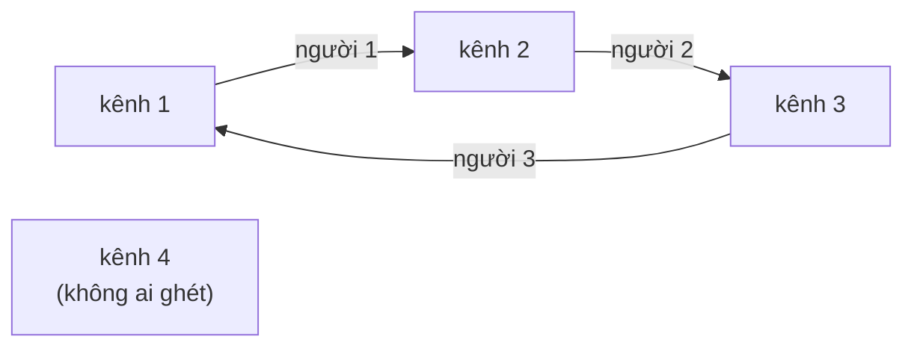

# Bài 0.9 – Mô phỏng

> **Tập 0** · Cần biết trước: bài 0.5 (mảng đánh dấu), 0.7 · Thời lượng: khoảng 75 phút đọc, 5 giờ thực hành

**Học xong bài này, em sẽ:**

- biến mô tả bằng lời của đề thành các bước code, không bỏ sót luật nào;
- chọn **trạng thái** cần lưu và cập nhật nó qua từng bước;
- phát hiện quá trình **lặp vô hạn** bằng mảng đánh dấu;
- giải trọn một bài mô phỏng kiểu bài 1 của đề HSG cấp tỉnh/thành phố chỉ với kiến thức Tập 0.

---

## 1. Bài toán mở màn: Tranh điều khiển TV

Nhà Bảo có N người xem TV (đánh số 1..N, **số nhỏ là nhỏ tuổi hơn**) và M kênh. Người i thích kênh aᵢ và ghét kênh bᵢ (aᵢ ≠ bᵢ). Lúc đầu TV đang mở kênh P.

Nếu có người ghét kênh đang mở, thì **người nhỏ tuổi nhất** trong số đó giành điều khiển và chuyển sang kênh mình thích. Quá trình lặp lại. Hãy in **số lần chuyển kênh** cho tới khi không ai ghét kênh đang mở, hoặc `-1` nếu việc chuyển kéo dài mãi.

Giới hạn: 1 ≤ N, M ≤ 10⁵. Subtask: 30% có N, M ≤ 1000 và mỗi kênh bị tối đa 1 người ghét; 60% có N, M ≤ 1000.

| Vào | Ra |
| --- | --- |
| `3 4 2`<br>`3 2`<br>`1 3`<br>`2 4` | `2` |
| `4 4 1`<br>`2 1`<br>`3 2`<br>`1 3`<br>`4 1` | `-1` |

Ví dụ 1: kênh 2 bị người 1 ghét, chuyển sang 3; kênh 3 bị người 2 ghét, chuyển sang 1; không ai ghét kênh 1, dừng sau 2 lần.

> [!IMPORTANT]
> **Dừng lại và nghĩ.**
> 1. Chạy tay ví dụ 2. Vì sao đáp án là `-1`?
> 2. Làm sao chương trình **biết** việc chuyển sẽ kéo dài mãi, khi nó không thể chạy mãi để kiểm tra?
> 3. Có khi nào đáp án là 0 không?

<details>
<summary>Đáp án</summary>

1. Kênh 1: người 1 và người 4 cùng ghét, người 1 nhỏ tuổi hơn nên chuyển sang 2. Kênh 2: người 2 chuyển sang 3. Kênh 3: người 3 chuyển sang 1. Quay lại kênh 1, mọi thứ lặp lại mãi.
2. Chỉ có M kênh. Nếu một kênh **xuất hiện lần thứ hai**, mọi bước sau sẽ lặp y như trước. Dùng mảng đánh dấu `da_gap[1..M]` (bài 0.5).
3. Có: nếu không ai ghét P thì không cần chuyển lần nào, đáp án là 0. **Luôn tự xét trường hợp biên**, kể cả khi ví dụ của đề không có.

</details>

---

## 2. Mô phỏng đúng như đề: lấy 60% điểm

Trạng thái chỉ gồm **kênh hiện tại** và **số lần chuyển**. Mỗi bước, duyệt người xem từ nhỏ tuổi đến lớn tuổi, tìm người đầu tiên ghét kênh hiện tại.

Chạy tay ví dụ 2:

| Bước | Kênh hiện tại | Đã gặp trước đó? | Người nhỏ tuổi nhất ghét nó | Chuyển sang | Số lần chuyển |
| :---: | :---: | :---: | :---: | :---: | :---: |
| 1 | 1 | không | người 1 | 2 | 1 |
| 2 | 2 | không | người 2 | 3 | 2 |
| 3 | 3 | không | người 3 | 1 | 3 |
| 4 | 1 | **có** | — | — | in `-1` |

```python
# file: kenhtv_mo_phong.py
n, m, p = map(int, input().split())
a = [0] * (n + 1)
b = [0] * (n + 1)
for i in range(1, n + 1):
    a[i], b[i] = map(int, input().split())

da_gap = [False] * (m + 1)
cur, doi = p, 0
while True:
    if da_gap[cur]:                 # kênh lặp lại: chuyển mãi không dừng
        print(-1)
        break
    da_gap[cur] = True
    nguoi = 0
    for i in range(1, n + 1):       # tìm người nhỏ tuổi nhất ghét cur
        if b[i] == cur:
            nguoi = i
            break
    if nguoi == 0:                  # không ai ghét: xong
        print(doi)
        break
    cur = a[nguoi]
    doi += 1
```

Mỗi kênh được xét tối đa một lần, mỗi lần duyệt N người: tổng khoảng N × M phép. Với N, M ≤ 1000 là 10⁶ phép, đủ 60% điểm. Với N, M = 10⁵ là 10¹⁰ phép: quá chậm.

---

## 3. Nâng cấp: tính trước, lấy trọn điểm

An để ý: câu hỏi "người nhỏ tuổi nhất ghét kênh x là ai?" luôn có **cùng một đáp án**, bất kể đang ở bước nào. Vậy tính trước cho mọi x **một lần**, lưu vào mảng `sau[x]` = kênh mà x bị chuyển sang (0 nếu không ai ghét x).

Cách tính: duyệt người xem từ nhỏ tuổi đến lớn tuổi; với người i, nếu `sau[b[i]]` chưa có thì gán `sau[b[i]] = a[i]`. Người ghi trước là người nhỏ tuổi hơn.

Với ví dụ 2: `sau[1] = 2` (người 4 cũng ghét kênh 1 nhưng ghi sau nên bị bỏ qua), `sau[2] = 3`, `sau[3] = 1`, `sau[4] = 0`.

```python
# file: kenhtv.py
import sys
data = sys.stdin.buffer.read().split()
n, m, p = int(data[0]), int(data[1]), int(data[2])
sau = [0] * (m + 1)
for i in range(n):
    ai, bi = int(data[3 + 2 * i]), int(data[4 + 2 * i])
    if sau[bi] == 0:                # chỉ người nhỏ tuổi nhất ghét bi được ghi
        sau[bi] = ai

da_gap = [False] * (m + 1)
cur, doi = p, 0
while sau[cur] != 0:
    if da_gap[cur]:
        doi = -1
        break
    da_gap[cur] = True
    cur = sau[cur]
    doi += 1
print(doi)
```

```cpp
// file: kenhtv.cpp
#include <bits/stdc++.h>
using namespace std;
int main() {
    // Khi thi: bỏ // ở hai dòng dưới
    // freopen("KENHTV.INP", "r", stdin);
    // freopen("KENHTV.OUT", "w", stdout);
    ios::sync_with_stdio(false);
    cin.tie(nullptr);
    int n, m, p;
    cin >> n >> m >> p;
    vector<int> sau(m + 1, 0);
    for (int i = 1; i <= n; i++) {
        int a, b;
        cin >> a >> b;
        if (sau[b] == 0) sau[b] = a;    // người nhỏ tuổi hơn được ghi trước
    }
    vector<bool> da_gap(m + 1, false);
    int cur = p, doi = 0;
    while (sau[cur] != 0) {
        if (da_gap[cur]) { doi = -1; break; }
        da_gap[cur] = true;
        cur = sau[cur];
        doi++;
    }
    cout << doi << '\n';
}
```

Tổng thời gian: N bước tính trước, cộng tối đa M bước đi theo `sau`. Khoảng 2·10⁵ phép: tức thì.



Hình trên vẽ mảng `sau` của ví dụ 2: mỗi kênh có **tối đa một mũi tên đi ra**. Đi từ 1 thì rơi vào vòng 1 → 2 → 3 → 1. Nếu bắt đầu ở kênh 4, đáp án là 0. Cấu trúc này gọi là **đồ thị hàm**; em sẽ gặp lại nó ở Tập 2.

---

## 4. Nguyên tắc khi làm bài mô phỏng

1. **Đọc kỹ từng luật**, gạch chân các chữ "nhỏ tuổi nhất", "đầu tiên", "lớn hơn hẳn".
2. **Chọn trạng thái tối thiểu** cần lưu (ở đây: kênh hiện tại, số lần chuyển, mảng đã gặp).
3. **Viết bản mô phỏng thẳng thắn trước**, kể cả khi chậm: nó lấy được subtask nhỏ và là lời giải để đối chiếu.
4. **Tìm việc lặp lại** trong mô phỏng để tính trước, như mảng `sau`.
5. **Đối chiếu hai bản** trên nhiều test nhỏ ngẫu nhiên trước khi nộp bản nhanh.

> [!WARNING]
> **Bẫy 1: bỏ qua trường hợp đáp án 0.** Không ai ghét P thì in `0`. Ví dụ của đề không có trường hợp này, em phải tự nghĩ ra.

> [!WARNING]
> **Bẫy 2: lấy nhầm người.** Nếu ghi đè `sau[b] = a` cho mọi người, ai ghi **cuối** (lớn tuổi nhất) thắng, trái đề. Chỉ ghi khi ô còn trống.

> [!WARNING]
> **Bẫy 3: phát hiện vòng lặp bằng "đếm quá nhiều bước".** Cách "chuyển quá 10⁶ lần thì in −1" có thể đúng nhưng khó chứng minh và dễ chậm. Mảng đánh dấu cho kết luận chắc chắn sau tối đa M bước.

---

## 5. Bài tập

| Nấc | Bài | Nguồn | Ý chính |
| --- | --- | --- | --- |
| Khởi động | [Stones on the Table](https://codeforces.com/problemset/problem/266/A) | CF 266A · 800 | Mô phỏng đơn giản trên xâu |
| Khởi động | [Bit++](https://codeforces.com/problemset/problem/282/A) | CF 282A · 800 | Làm theo từng lệnh |
| Luyện | [Tram](https://codeforces.com/problemset/problem/116/A) | CF 116A · 800 | Trạng thái: số người trên tàu |
| Luyện | [Football](https://codeforces.com/problemset/problem/96/A) | CF 96A · 900 | Đếm chuỗi liên tiếp |
| Luyện | Viết chương trình sinh test ngẫu nhiên nhỏ cho Tranh điều khiển TV, đối chiếu `kenhtv_mo_phong` với `kenhtv` trên 500 test | Tự luyện | Kỹ năng stress test |
| Thử thách | [Repetitions](https://cses.fi/problemset/task/1069) | CSES 1069 | Theo dõi trạng thái dài nhất |

---

## 6. Tóm tắt và checkpoint

1. Mô phỏng = trạng thái + luật cập nhật, theo đúng thứ tự đề mô tả.
2. Quá trình có thể lặp mãi: đánh dấu trạng thái đã gặp; gặp lại thì kết luận ngay.
3. Câu hỏi lặp lại có cùng đáp án: tính trước một lần, lưu vào mảng.
4. Viết bản chậm trước, bản nhanh sau, đối chiếu hai bản.

<details><summary>Trong Tranh điều khiển TV, vì sao chỉ ghi <code>sau[b]</code> khi ô đó còn trống?</summary>Người xem được duyệt từ nhỏ tuổi đến lớn tuổi; người đầu tiên ghi chính là người nhỏ tuổi nhất ghét kênh b.</details>
<details><summary>Sau tối đa bao nhiêu bước thì chương trình chắc chắn biết đáp án?</summary>M + 1 bước: chỉ có M kênh, bước thứ M + 1 chắc chắn gặp lại một kênh cũ hoặc đã dừng.</details>

**Checkpoint:**

- [ ] Viết lại cả hai bản lời giải Tranh điều khiển TV, chạy đúng cả hai ví dụ.
- [ ] Viết xong chương trình stress test ở nấc Luyện và cho nó chạy 500 test không lỗi.
