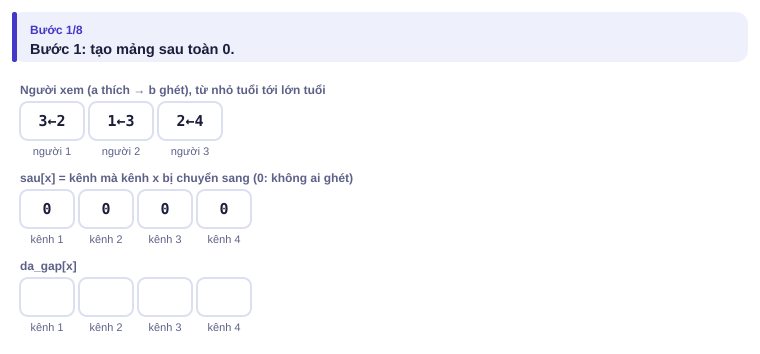
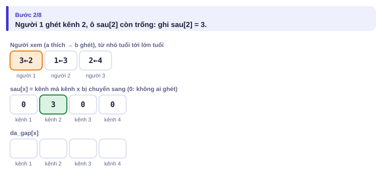
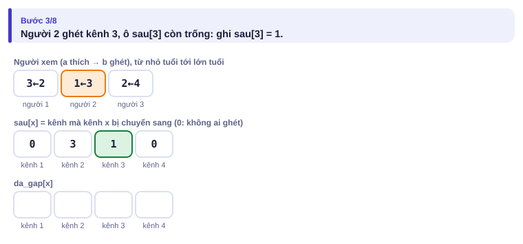
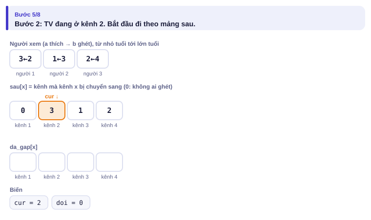
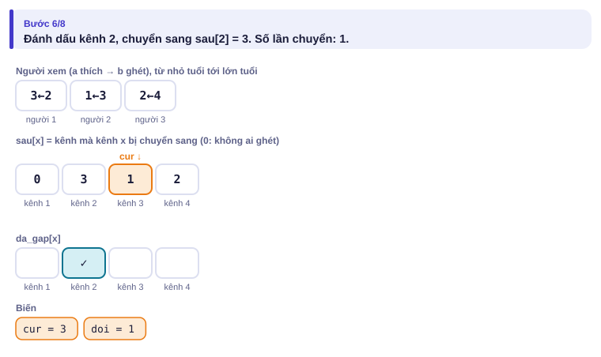
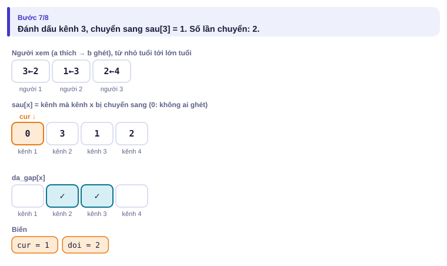
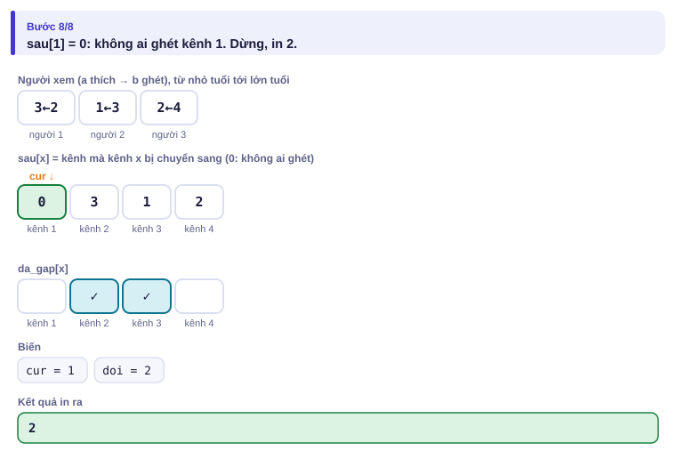
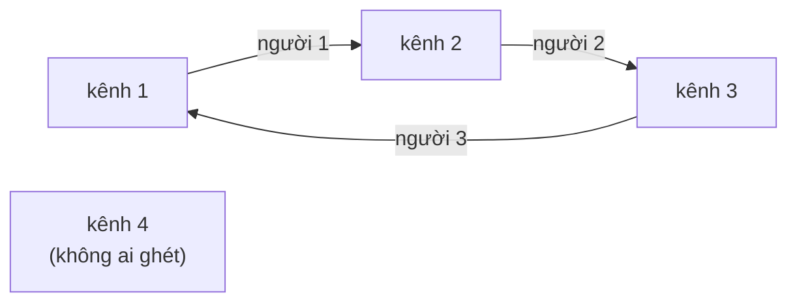

# Bài 0.9 – Mô phỏng

> **Tập 0 · Nhập môn tư duy lập trình**
> Cần biết trước: bài 0.5 (mảng đánh dấu), 0.7 (hàm).
> Thời lượng: khoảng 75 phút đọc, cộng 5 giờ thực hành trong tuần.

**Học xong bài này, em sẽ:**

- biến mô tả bằng lời của đề thành các bước code, không bỏ sót luật nào;
- chọn **trạng thái** cần lưu và cập nhật nó qua từng bước;
- phát hiện quá trình **lặp vô hạn** bằng mảng đánh dấu;
- tăng tốc mô phỏng bằng cách **tính trước** những câu hỏi lặp đi lặp lại;
- giải trọn một bài mô phỏng kiểu bài 1 của đề HSG cấp tỉnh/thành phố chỉ với kiến thức Tập 0.

> [!TIP]
> **Học cùng trang mô phỏng.** Mở [mô phỏng Tranh điều khiển TV](../../mo-phong/t0-kenh-tv.html). Chạy cả ba ví dụ: "dừng sau 2 lần", "chuyển mãi" và "đáp án 0". Bật **Đoán trước** để tự quyết định có ghi vào mảng `sau` hay không, và TV chuyển sang kênh nào.

---

## 1. Bài toán mở màn: Tranh điều khiển TV

Nhà Bảo có N người xem TV (đánh số 1..N, **số nhỏ là nhỏ tuổi hơn**) và M kênh. Người i thích kênh aᵢ và ghét kênh bᵢ (aᵢ ≠ bᵢ). Lúc đầu TV đang mở kênh P.

Nếu có người ghét kênh đang mở, thì **người nhỏ tuổi nhất** trong số đó giành điều khiển và chuyển sang kênh mình thích. Quá trình lặp lại. Hãy in **số lần chuyển kênh** cho tới khi không ai ghét kênh đang mở, hoặc `-1` nếu việc chuyển kéo dài mãi.

Giới hạn: 1 ≤ N, M ≤ 10⁵. Subtask: 30% có N, M ≤ 1000 và mỗi kênh bị tối đa 1 người ghét; 60% có N, M ≤ 1000.

| Vào | Ra |
| --- | --- |
| `3 4 2`<br>`3 2`<br>`1 3`<br>`2 4` | `2` |
| `4 4 1`<br>`2 1`<br>`3 2`<br>`1 3`<br>`4 1` | `-1` |

Ví dụ 1: kênh 2 bị người 1 ghét, chuyển sang 3; kênh 3 bị người 2 ghét, chuyển sang 1; không ai ghét kênh 1, dừng sau 2 lần.

---

## 2. Dừng lại 10 phút

> [!IMPORTANT]
> **Dừng lại và nghĩ.**
> 1. Chạy tay ví dụ 2. Vì sao đáp án là `-1`?
> 2. Làm sao chương trình **biết** việc chuyển sẽ kéo dài mãi, khi nó không thể chạy mãi để kiểm tra?
> 3. Có khi nào đáp án là 0 không?

<details>
<summary>Đáp án</summary>

1. Kênh 1: người 1 và người 4 cùng ghét, người 1 nhỏ tuổi hơn nên chuyển sang 2. Kênh 2: người 2 chuyển sang 3. Kênh 3: người 3 chuyển sang 1. Quay lại kênh 1, mọi thứ lặp lại mãi.
2. Chỉ có M kênh. Nếu một kênh **xuất hiện lần thứ hai**, mọi bước sau sẽ lặp y như trước. Dùng mảng đánh dấu `da_gap[1..M]` (bài 0.5).
3. Có: nếu không ai ghét P thì không cần chuyển lần nào, đáp án là 0. **Luôn tự xét trường hợp biên**, kể cả khi ví dụ của đề không có.

</details>

---

## 3. Lời giải ngây thơ: mô phỏng đúng như đề (60% điểm)

Trạng thái chỉ gồm **kênh hiện tại**, **số lần chuyển** và mảng **đã gặp**. Mỗi bước, duyệt người xem từ nhỏ tuổi đến lớn tuổi, tìm người đầu tiên ghét kênh hiện tại.

Chạy tay ví dụ 2:

| Bước | Kênh hiện tại | Đã gặp trước đó? | Người nhỏ tuổi nhất ghét nó | Chuyển sang | Số lần chuyển |
| :---: | :---: | :---: | :---: | :---: | :---: |
| 1 | 1 | không | người 1 | 2 | 1 |
| 2 | 2 | không | người 2 | 3 | 2 |
| 3 | 3 | không | người 3 | 1 | 3 |
| 4 | 1 | **có** | — | — | in `-1` |

```python
# file: kenhtv_mo_phong.py
n, m, p = map(int, input().split())
a = [0] * (n + 1)
b = [0] * (n + 1)
for i in range(1, n + 1):
    a[i], b[i] = map(int, input().split())

da_gap = [False] * (m + 1)
cur, doi = p, 0
while True:
    if da_gap[cur]:                 # kênh lặp lại: chuyển mãi không dừng
        print(-1)
        break
    da_gap[cur] = True
    nguoi = 0
    for i in range(1, n + 1):       # tìm người nhỏ tuổi nhất ghét cur
        if b[i] == cur:
            nguoi = i
            break
    if nguoi == 0:                  # không ai ghét: xong
        print(doi)
        break
    cur = a[nguoi]
    doi += 1
```

**Vì sao chỉ được 60%?** Mỗi kênh được xét tối đa một lần, mỗi lần duyệt N người: tổng khoảng N × M phép. Với N, M ≤ 1000 là 10⁶ phép: đủ nhanh. Với N, M = 10⁵ là 10¹⁰ phép: quá chậm.

---

## 4. Ý tưởng then chốt

> [!IMPORTANT]
> **Câu hỏi "người nhỏ tuổi nhất ghét kênh x là ai?" luôn có cùng một đáp án, bất kể đang ở bước nào. Tính trước cho mọi x một lần, lưu vào mảng `sau[x]` = kênh mà x bị chuyển sang (0 nếu không ai ghét x). Sau đó mô phỏng chỉ còn là đi theo mảng.**

Cách tính: duyệt người xem từ nhỏ tuổi đến lớn tuổi; với người i, nếu `sau[b[i]]` chưa có thì gán `sau[b[i]] = a[i]`. Người ghi trước là người nhỏ tuổi hơn.

### Chạy từng bước

Với ví dụ 1. Đoán trước rồi mới mở.

<details>
<summary><b>Bước 1</b> – Mảng sau lúc đầu</summary>



</details>

<details>
<summary><b>Bước 2</b> – Người 1 (thích 3, ghét 2): ghi gì?</summary>



</details>

<details>
<summary><b>Bước 3</b> – Người 2 (thích 1, ghét 3)</summary>



Người 3 (thích 2, ghét 4) ghi tiếp `sau[4] = 2`. Xong phần tính trước.

</details>

<details>
<summary><b>Bước 4</b> – Bắt đầu đi từ kênh P = 2</summary>



</details>

<details>
<summary><b>Bước 5</b> – Từ kênh 2, đi theo sau[2]</summary>



</details>

<details>
<summary><b>Bước 6</b> – Từ kênh 3, đi theo sau[3]</summary>



</details>

<details>
<summary><b>Bước 7</b> – sau[1] = 0: dừng</summary>



</details>

Mảng `sau` của ví dụ 2 vẽ thành sơ đồ:



Mỗi kênh có **tối đa một mũi tên đi ra**. Đi từ 1 thì rơi vào vòng 1 → 2 → 3 → 1. Nếu bắt đầu ở kênh 4, đáp án là 0. Cấu trúc này gọi là **đồ thị hàm**; em sẽ gặp lại nó ở Tập 2.

---

## 5. Mã giả và cài đặt

```text
sau[1..M] ← 0
với i từ 1 tới N: nếu sau[b_i] = 0 thì sau[b_i] ← a_i
cur ← P; doi ← 0
trong khi sau[cur] ≠ 0:
    nếu da_gap[cur]: doi ← −1; dừng
    da_gap[cur] ← đúng; cur ← sau[cur]; doi ← doi + 1
in doi
```

```python
# file: kenhtv.py
import sys
data = sys.stdin.buffer.read().split()
n, m, p = int(data[0]), int(data[1]), int(data[2])
sau = [0] * (m + 1)
for i in range(n):
    ai, bi = int(data[3 + 2 * i]), int(data[4 + 2 * i])
    if sau[bi] == 0:                # chỉ người nhỏ tuổi nhất ghét bi được ghi
        sau[bi] = ai

da_gap = [False] * (m + 1)
cur, doi = p, 0
while sau[cur] != 0:
    if da_gap[cur]:
        doi = -1
        break
    da_gap[cur] = True
    cur = sau[cur]
    doi += 1
print(doi)
```

```cpp
// file: kenhtv.cpp
#include <bits/stdc++.h>
using namespace std;
int main() {
    // Khi thi: bỏ // ở hai dòng dưới
    // freopen("KENHTV.INP", "r", stdin);
    // freopen("KENHTV.OUT", "w", stdout);
    ios::sync_with_stdio(false);
    cin.tie(nullptr);
    int n, m, p;
    cin >> n >> m >> p;
    vector<int> sau(m + 1, 0);
    for (int i = 1; i <= n; i++) {
        int a, b;
        cin >> a >> b;
        if (sau[b] == 0) sau[b] = a;    // người nhỏ tuổi hơn được ghi trước
    }
    vector<bool> da_gap(m + 1, false);
    int cur = p, doi = 0;
    while (sau[cur] != 0) {
        if (da_gap[cur]) { doi = -1; break; }
        da_gap[cur] = true;
        cur = sau[cur];
        doi++;
    }
    cout << doi << '\n';
}
```

---

## 6. Vì sao đúng, chạy bao lâu

- **Đúng:** `sau[x]` cho đúng kết quả của một bước chuyển từ kênh x, vì người ghi đầu tiên vào ô `sau[x]` là người nhỏ tuổi nhất ghét x. Đi theo `sau` chính là làm lại từng bước của đề. Nếu một kênh lặp lại thì từ đó trở đi mọi bước lặp lại y hệt (mỗi kênh chỉ có một cách đi tiếp), nên in −1 là đúng.
- **Chạy bao lâu:** N bước tính trước, cộng tối đa M + 1 bước đi theo `sau`. Khoảng 2·10⁵ phép: tức thì. Từ 10¹⁰ xuống 2·10⁵ chỉ nhờ một quan sát.

### Nguyên tắc khi làm bài mô phỏng

1. **Đọc kỹ từng luật**, gạch chân các chữ "nhỏ tuổi nhất", "đầu tiên", "lớn hơn hẳn".
2. **Chọn trạng thái tối thiểu** cần lưu (ở đây: kênh hiện tại, số lần chuyển, mảng đã gặp).
3. **Viết bản mô phỏng thẳng thắn trước**, kể cả khi chậm: nó lấy được subtask nhỏ và là lời giải để đối chiếu.
4. **Tìm việc lặp lại** trong mô phỏng để tính trước, như mảng `sau`.
5. **Đối chiếu hai bản** trên nhiều test nhỏ ngẫu nhiên trước khi nộp bản nhanh.

---

## 7. Bẫy thường gặp

> [!WARNING]
> **Bẫy 1: bỏ qua trường hợp đáp án 0.** Không ai ghét P thì in `0`. Ví dụ của đề không có trường hợp này, em phải tự nghĩ ra.
> *Test phá:* `2 3 3` / `1 2` / `3 1`.

> [!WARNING]
> **Bẫy 2: lấy nhầm người.** Nếu ghi đè `sau[b] = a` cho mọi người, ai ghi **cuối** (lớn tuổi nhất) thắng, trái đề. Chỉ ghi khi ô còn trống.
> *Test phá:* ví dụ 2 (người 1 và người 4 cùng ghét kênh 1).

> [!WARNING]
> **Bẫy 3: phát hiện vòng lặp bằng "đếm quá nhiều bước".** Cách "chuyển quá 10⁶ lần thì in −1" có thể đúng nhưng khó chứng minh và dễ chậm. Mảng đánh dấu cho kết luận chắc chắn sau tối đa M bước.

---

## 8. Ví dụ giảm dần hỗ trợ

### Ví dụ 2 – Điền vào chỗ trống: Robot trên đường ray

Robot đứng ở vị trí 0 trên đường ray từ 0 tới m (1 ≤ m ≤ 10⁹). Nhận một xâu lệnh (dài không quá 10⁵) gồm `L` (lùi 1) và `R` (tiến 1); lệnh nào làm robot ra khỏi đường ray thì **bỏ qua**. In vị trí cuối cùng.

| Vào | Ra |
| --- | --- |
| `2`<br>`LRRRLR` | `2` |

```text
m = int(input())
s = input().strip()
vi_tri = 0
for lenh in s:
    if lenh == 'L' and ____:
        vi_tri -= 1
    elif lenh == 'R' and ____:
        vi_tri += 1
print(vi_tri)
```

<details>
<summary>Đáp án</summary>

`vi_tri > 0`, `vi_tri < m`. Trạng thái chỉ là một số; luật "bỏ qua" chính là điều kiện kèm theo mỗi lệnh. Chạy tay: L bị bỏ qua (đang ở 0); R → 1; R → 2; R bị bỏ qua (đang ở m = 2); L → 1; R → 2.

```python
# file: robot.py
m = int(input())
s = input().strip()
vi_tri = 0
for lenh in s:
    if lenh == 'L' and vi_tri > 0:
        vi_tri -= 1
    elif lenh == 'R' and vi_tri < m:
        vi_tri += 1
print(vi_tri)
```

```cpp
// file: robot.cpp
#include <bits/stdc++.h>
using namespace std;
int main() {
    long long m, vi_tri = 0;
    string s;
    cin >> m >> s;
    for (char lenh : s) {
        if (lenh == 'L' && vi_tri > 0) vi_tri--;
        else if (lenh == 'R' && vi_tri < m) vi_tri++;
    }
    cout << vi_tri << '\n';
}
```

</details>

### Ví dụ 3 – Tự làm: Chuyền bóng

n bạn đứng thành vòng (1 ≤ n ≤ 10⁵). Bạn i luôn chuyền bóng cho bạn pᵢ (pᵢ ≠ i). Bóng bắt đầu ở bạn 1. Sau đúng k lần chuyền (0 ≤ k ≤ 10⁵), bóng ở bạn nào?

| Vào | Ra |
| --- | --- |
| `4 5`<br>`3 1 4 2` | `3` |

> [!IMPORTANT]
> Tự làm trước. Gợi ý: trạng thái là "bóng đang ở ai". Đây là mảng `sau` của bài mở màn, nhưng không cần mảng đánh dấu vì k đã cho trước.

<details>
<summary>Lời giải</summary>

Chạy tay: bóng ở 1; lần 1 → p₁ = 3; lần 2 → p₃ = 4; lần 3 → p₄ = 2; lần 4 → p₂ = 1; lần 5 → p₁ = 3. Đáp án 3. Mỗi lần chuyền chỉ là một phép gán `cur = p[cur]`.

```python
# file: chuyen_bong.py
n, k = map(int, input().split())
p = [0] + list(map(int, input().split()))   # p[1..n]
cur = 1
for _ in range(k):
    cur = p[cur]
print(cur)
```

```cpp
// file: chuyen_bong.cpp
#include <bits/stdc++.h>
using namespace std;
int main() {
    int n, k;
    cin >> n >> k;
    vector<int> p(n + 1);
    for (int i = 1; i <= n; i++) cin >> p[i];
    int cur = 1;
    for (int t = 0; t < k; t++) cur = p[cur];
    cout << cur << '\n';
}
```

Bóng đi theo vòng 1 → 3 → 4 → 2 → 1 dài 4, nên với k rất lớn (tới 10¹⁸) chỉ cần k mod 4 lần chuyền. Tập 2 (đồ thị hàm) sẽ tổng quát hóa ý này.

</details>

---

## 9. Bài tập

| Nấc | Bài | Nguồn | Ý chính |
| --- | --- | --- | --- |
| Khởi động | [Stones on the Table](https://codeforces.com/problemset/problem/266/A) | CF 266A · 800 | Mô phỏng đơn giản trên xâu |
| Khởi động | [Bit++](https://codeforces.com/problemset/problem/282/A) | CF 282A · 800 | Làm theo từng lệnh |
| Luyện | [Tram](https://codeforces.com/problemset/problem/116/A) | CF 116A · 800 | Trạng thái: số người trên tàu |
| Luyện | [Football](https://codeforces.com/problemset/problem/96/A) | CF 96A · 900 | Đếm chuỗi liên tiếp |
| Luyện | Viết chương trình sinh test ngẫu nhiên nhỏ cho Tranh điều khiển TV, đối chiếu `kenhtv_mo_phong` với `kenhtv` trên 500 test | Tự luyện | Kỹ năng stress test |
| Thử thách | [Repetitions](https://cses.fi/problemset/task/1069) | CSES 1069 | Theo dõi trạng thái dài nhất |
| Kiểu đề thi | Quầy thu ngân | Bài của sách, chấm theo subtask | Xem bên dưới |

### Bài kiểu đề thi: Quầy thu ngân

**Đề bài.** Siêu thị có một quầy thu ngân. Có n khách (1 ≤ n ≤ 10⁵); khách thứ i tới quầy lúc tᵢ và cần dᵢ phút để thanh toán (t₁ ≤ t₂ ≤ … ≤ tₙ). Khách được phục vụ theo thứ tự tới; quầy đang bận thì khách xếp hàng chờ. Hỏi khách cuối cùng thanh toán xong lúc nào? Đọc từ `QUAYTHU.INP` (dòng đầu n, n dòng sau mỗi dòng tᵢ dᵢ), ghi ra `QUAYTHU.OUT`.

Subtask: 50% có tᵢ, dᵢ ≤ 1000 và n ≤ 1000; 50% còn lại có tᵢ, dᵢ ≤ 10⁹.

| QUAYTHU.INP | QUAYTHU.OUT |
| --- | --- |
| `3`<br>`1 5`<br>`2 3`<br>`10 2` | `12` |

Khách 1: phút 1 → 6. Khách 2 tới lúc 2, chờ tới 6, xong lúc 9. Khách 3 tới lúc 10, quầy trống, xong lúc 12.

<details>
<summary><b>Gợi ý 1</b> – hướng đi (đủ 50% điểm)</summary>

Mô phỏng **từng phút**: mỗi phút xem quầy có trống không, có khách nào đang chờ không. Thời gian tối đa khoảng 10⁶ phút: chạy kịp.

</details>

<details>
<summary><b>Gợi ý 2</b> – ý then chốt</summary>

Không cần đi từng phút. Trạng thái chỉ cần **một số**: thời điểm quầy rảnh `ranh`. Khách i bắt đầu lúc max(ranh, tᵢ) và xong lúc đó cộng dᵢ. Đây là mô phỏng **theo sự kiện** thay vì theo thời gian.

</details>

<details>
<summary><b>Gợi ý 3</b> – lời giải đầy đủ</summary>

`ranh` có thể tới khoảng 10⁹ + 10⁵ × 10⁹ ≈ 10¹⁴: dùng `long long`.

```python
# file: quaythu.py
data = open("QUAYTHU.INP").read().split()
n = int(data[0])
ranh = 0
for i in range(n):
    t, d = int(data[1 + 2 * i]), int(data[2 + 2 * i])
    ranh = max(ranh, t) + d
open("QUAYTHU.OUT", "w").write(f"{ranh}\n")
```

```cpp
// file: quaythu.cpp
#include <bits/stdc++.h>
using namespace std;
int main() {
    freopen("QUAYTHU.INP", "r", stdin);
    freopen("QUAYTHU.OUT", "w", stdout);
    int n;
    cin >> n;
    long long ranh = 0;
    for (int i = 0; i < n; i++) {
        long long t, d;
        cin >> t >> d;
        ranh = max(ranh, t) + d;
    }
    cout << ranh << '\n';
}
```

</details>

---

## 10. Tóm tắt, flashcard và checkpoint

**Tóm tắt trong 5 dòng.**

1. Mô phỏng = trạng thái + luật cập nhật, theo đúng thứ tự đề mô tả.
2. Quá trình có thể lặp mãi: đánh dấu trạng thái đã gặp; gặp lại thì kết luận ngay.
3. Câu hỏi lặp lại có cùng đáp án: tính trước một lần, lưu vào mảng.
4. Thời gian lớn: mô phỏng theo sự kiện thay vì từng đơn vị thời gian.
5. Viết bản chậm trước, bản nhanh sau, đối chiếu hai bản.

**Flashcard.**

<details><summary>Trong Tranh điều khiển TV, vì sao chỉ ghi <code>sau[b]</code> khi ô đó còn trống?</summary>Người xem được duyệt từ nhỏ tuổi đến lớn tuổi; người đầu tiên ghi chính là người nhỏ tuổi nhất ghét kênh b.</details>
<details><summary>Sau tối đa bao nhiêu bước thì chương trình chắc chắn biết đáp án?</summary>M + 1 bước: chỉ có M kênh, bước thứ M + 1 chắc chắn gặp lại một kênh cũ hoặc đã dừng.</details>
<details><summary>Trạng thái của bài Quầy thu ngân là gì?</summary>Một số: thời điểm quầy rảnh.</details>
<details><summary>Đồ thị hàm là gì?</summary>Mỗi đỉnh có tối đa một mũi tên đi ra; đi mãi thì hoặc dừng, hoặc rơi vào một vòng.</details>
<details><summary>Bước đầu tiên khi làm một bài mô phỏng?</summary>Đọc kỹ và gạch chân từng luật; chọn trạng thái tối thiểu.</details>

**Ôn xoắn ốc** (kiến thức bài 0.5–0.8; mỗi bài tối đa 20 phút):

- [Increasing Array](https://cses.fi/problemset/task/1094) (CSES 1094): duyệt mảng, so với phần tử trước.
- ƯCLN của cả dãy (bài 0.8, Ví dụ 3), viết lại không nhìn sách.
- Viết tắt (bài 0.6, Ví dụ 3) bằng ngôn ngữ còn lại.

**Checkpoint – em đã sẵn sàng sang bài tiếp theo nếu:**

- [ ] Viết lại cả hai bản lời giải Tranh điều khiển TV, chạy đúng cả hai ví dụ và test "đáp án 0".
- [ ] Viết xong chương trình stress test ở nấc Luyện và cho nó chạy 500 test không lỗi.
- [ ] Làm xong Ví dụ 3 (Chuyền bóng) mà không mở lời giải.
- [ ] Đạt trọn điểm bài Quầy thu ngân khi tự làm trong 25 phút.

Chưa đạt? Nếu vướng ô 1, mở trang mô phỏng và chạy lại ba ví dụ. Nếu vướng ô 2, xem trước bài 1.9 (stress test). Nếu vướng ô 4, đọc lại Gợi ý 2: chuyển từ "từng phút" sang "từng khách".
