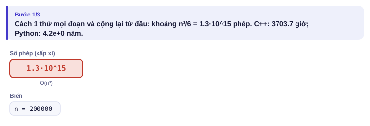
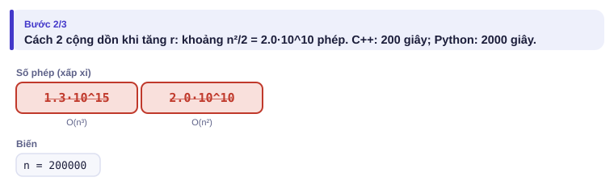
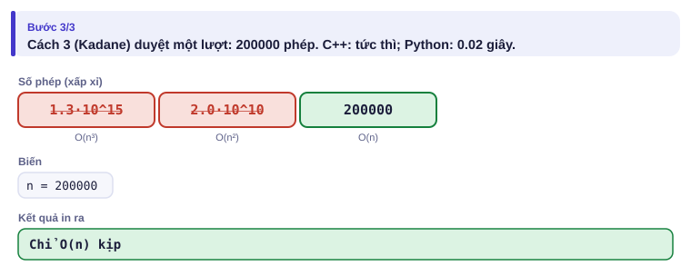
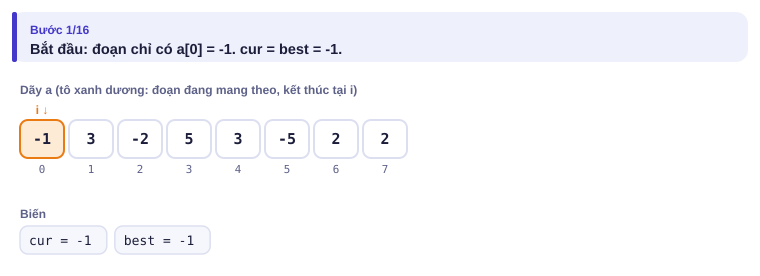
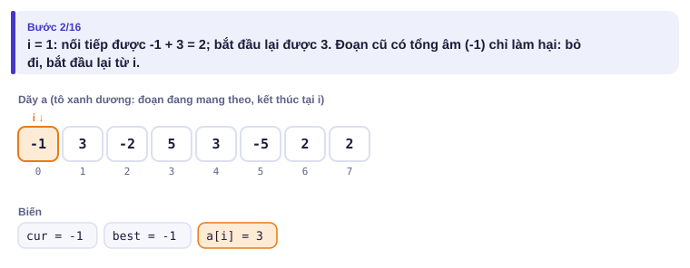
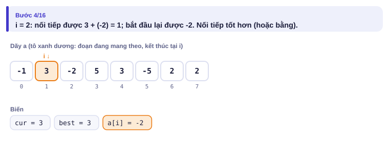
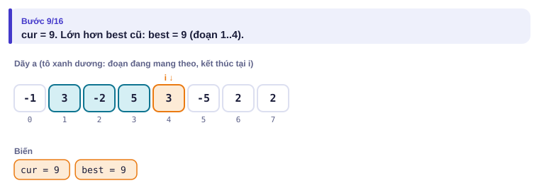
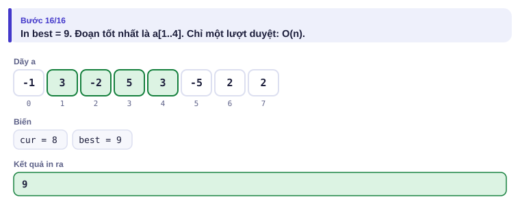

# Bài 1.1 – Độ phức tạp

> **Tập 1 · Nền tảng thuật toán**
> Cần biết trước: Tập 0, đặc biệt bài 0.4 (đếm số lượt lặp).
> Thời lượng: khoảng 75 phút đọc, cộng 4 giờ thực hành trong tuần.

**Học xong bài này, em sẽ:**

- dùng ký hiệu O để mô tả tốc độ của thuật toán;
- **đọc ràng buộc của đề để đoán độ phức tạp cần đạt**, trước khi nghĩ lời giải;
- thấy cùng một bài có thể giải bằng O(n³), O(n²) hoặc O(n), và mỗi cách lấy được bao nhiêu điểm;
- hiểu và cài đặt thuật toán **Kadane** tìm đoạn con có tổng lớn nhất.

> [!TIP]
> **Học cùng hai trang mô phỏng.** [Đếm số phép](../../mo-phong/t1-so-phep.html): nhập n và xem ba cách giải chạy hết bao lâu. [Kadane](../../mo-phong/t1-kadane.html): bật **Đoán trước** để tự tính `cur` ở mỗi bước; thử ví dụ "toàn số âm".

---

## 1. Bài toán mở màn: Chuỗi ngày lãi nhất

Quán nước mía của nhà An ghi lãi (hoặc lỗ, số âm) của n ngày liên tiếp. An muốn tìm một **đoạn ngày liên tiếp** có tổng lãi lớn nhất. Đoạn phải có ít nhất 1 ngày. (1 ≤ n ≤ 2·10⁵, |aᵢ| ≤ 10⁹)

| Vào | Ra |
| --- | --- |
| `8`<br>`-1 3 -2 5 3 -5 2 2` | `9` |

Đoạn tốt nhất là `3 -2 5 3`, tổng 9.

---

## 2. Dừng lại 10 phút

> [!IMPORTANT]
> **Dừng lại và nghĩ.**
> 1. Có bao nhiêu đoạn con liên tiếp trong một dãy n phần tử?
> 2. Nếu thử hết và mỗi đoạn cộng lại từ đầu, với n = 2·10⁵ thì cần khoảng bao nhiêu phép tính? Mất bao lâu?
> 3. Một đoạn có tổng âm ở **đầu** có bao giờ nằm trong đáp án tốt nhất không?

<details>
<summary>Đáp án</summary>

1. Chọn điểm đầu l và điểm cuối r ≥ l: khoảng n²/2 đoạn, tức 2·10¹⁰ đoạn.
2. Mỗi đoạn cộng lại từ đầu thì còn nhân thêm khoảng n/3 nữa: khoảng 10¹⁵ phép, C++ chạy hàng nghìn giờ.
3. Không: bỏ phần đầu có tổng âm đi thì tổng còn lại **lớn hơn**. Nhận xét này là chìa khóa của mục 4.

</details>

---

## 3. Lời giải ngây thơ và vì sao nó chậm

Ta không đếm chính xác số phép tính, chỉ quan tâm nó **tăng theo n nhanh cỡ nào**. Bỏ hằng số và các số hạng nhỏ: n²/2 + 3n viết là **O(n²)**.

**Cách 1 – O(n³).** Thử mọi đoạn [l, r], cộng lại từ đầu.

```cpp
for (int l = 0; l < n; l++)
    for (int r = l; r < n; r++) {
        long long s = 0;
        for (int k = l; k <= r; k++) s += a[k];
        best = max(best, s);
    }
```

**Cách 2 – O(n²).** Giữ nguyên l, khi tăng r chỉ cần **cộng thêm** a[r] vào tổng cũ.

```cpp
// file: tong_lon_nhat_n2.cpp
#include <bits/stdc++.h>
using namespace std;
int main() {
    int n;
    cin >> n;
    vector<long long> a(n);
    for (auto &x : a) cin >> x;
    long long best = LLONG_MIN;
    for (int l = 0; l < n; l++) {
        long long s = 0;
        for (int r = l; r < n; r++) {
            s += a[r];                  // tổng đoạn [l, r] = tổng [l, r-1] + a[r]
            best = max(best, s);
        }
    }
    cout << best << '\n';
}
```

So sánh với n = 2·10⁵ (thử lại trên [trang Đếm số phép](../../mo-phong/t1-so-phep.html)):

<details>
<summary><b>Hình</b> – số phép của ba cách với n = 2·10⁵</summary>





</details>

| Cách | Độ phức tạp | Số phép (xấp xỉ) | Kịp 1 giây với C++? |
| --- | --- | --- | --- |
| 1 | O(n³) | 10¹⁵ | Chỉ với n ≤ 500 |
| 2 | O(n²) | 2·10¹⁰ | Chỉ với n ≤ 10⁴ |
| 3 (mục 4) | O(n) | 2·10⁵ | Có |

Nếu đề chia subtask n ≤ 500, n ≤ 5000, n ≤ 2·10⁵ thì ba cách lần lượt lấy được các mức điểm đó. **Viết cách dễ trước, nộp, rồi mới nâng cấp.**

---

## 4. Ý tưởng then chốt

> [!IMPORTANT]
> **Gọi `cur` là tổng lớn nhất của đoạn kết thúc tại vị trí i. Đoạn đó hoặc chỉ gồm a[i], hoặc là đoạn tốt nhất kết thúc tại i − 1 nối thêm a[i]: cur = max(a[i], cur + a[i]).** Nói cách khác: nếu tổng đang mang theo làm kết quả nhỏ đi, bỏ nó và bắt đầu lại từ a[i]. Đây là thuật toán **Kadane**, O(n).

### Chạy từng bước

Với dãy `-1 3 -2 5 3 -5 2 2`. Tính `cur` trước rồi mới mở.

<details>
<summary><b>Bước 1</b> – Khởi tạo</summary>



</details>

<details>
<summary><b>Bước 2</b> – i = 1: nối tiếp hay bắt đầu lại?</summary>



</details>

<details>
<summary><b>Bước 3</b> – i = 2: a[i] = −2 âm, có bắt đầu lại không?</summary>



Không: 3 + (−2) = 1 vẫn lớn hơn −2. Đoạn đang mang theo vẫn có ích.

</details>

<details>
<summary><b>Bước 4</b> – Sau i = 4, best bằng mấy?</summary>



</details>

<details>
<summary><b>Bước 5</b> – Kết quả</summary>



</details>

Toàn bộ dưới dạng bảng chạy tay:

| i | a[i] | cur trước | cur + a[i] | cur mới | best |
| :---: | :---: | :---: | :---: | :---: | :---: |
| 0 | −1 | — | — | −1 | −1 |
| 1 | 3 | −1 | 2 | **3** (bỏ phần âm) | 3 |
| 2 | −2 | 3 | 1 | 1 | 3 |
| 3 | 5 | 1 | 6 | 6 | 6 |
| 4 | 3 | 6 | 9 | 9 | **9** |
| 5 | −5 | 9 | 4 | 4 | 9 |
| 6 | 2 | 4 | 6 | 6 | 9 |
| 7 | 2 | 6 | 8 | 8 | 9 |

---

## 5. Mã giả và cài đặt

```text
cur ← a[0]; best ← a[0]
với i từ 1 tới n − 1:
    cur  ← max(a[i], cur + a[i])
    best ← max(best, cur)
in best
```

```cpp
// file: tong_lon_nhat.cpp
#include <bits/stdc++.h>
using namespace std;
int main() {
    ios::sync_with_stdio(false);
    cin.tie(nullptr);
    int n;
    cin >> n;
    long long cur = 0, best = LLONG_MIN;
    for (int i = 0; i < n; i++) {
        long long x;
        cin >> x;
        cur = (i == 0) ? x : max(x, cur + x);
        best = max(best, cur);
    }
    cout << best << '\n';
}
```

```python
# file: tong_lon_nhat.py
import sys
data = sys.stdin.buffer.read().split()
n = int(data[0])
a = list(map(int, data[1:n + 1]))
cur = best = a[0]
for i in range(1, n):
    cur = max(a[i], cur + a[i])
    best = max(best, cur)
print(best)
```

Bản C++ đọc từng số và xử lý ngay, không cần lưu cả mảng.

### Đọc ràng buộc để đoán thuật toán

Máy chấm chạy khoảng 10⁸ phép đơn giản mỗi giây (C++). Từ giới hạn n, em suy ra độ phức tạp tối đa:

| n tối đa | Độ phức tạp chấp nhận được | Hướng nghĩ thường gặp |
| --- | --- | --- |
| 10 | O(n!) | Thử mọi hoán vị (bài 1.7) |
| 20 | O(2ⁿ · n) | Thử mọi tập con (bài 1.7) |
| 500 | O(n³) | Ba vòng lặp lồng nhau |
| 5 000 | O(n²) | Hai vòng lặp lồng nhau |
| 10⁵ – 10⁶ | O(n log n) hoặc O(n) | Sắp xếp (1.2), tìm nhị phân (1.4), tiền tố (1.3), hai con trỏ (1.5) |
| 10¹⁸ | O(log n) hoặc O(1) | Công thức, tìm nhị phân trên đáp án (1.4) |

log₂(10⁶) ≈ 20, nên O(n log n) với n = 10⁶ là khoảng 2·10⁷ phép: vẫn nhanh.

> [!TIP]
> **Thói quen mới:** đọc đề xong, việc đầu tiên là ghi ra giấy "n ≤ … nên cần O(…)". Bảng này gợi ý em nên nghĩ theo hướng nào.

---

## 6. Vì sao đúng, chạy bao lâu

**Bất biến:** sau khi xử lý xong vị trí i, `cur` là tổng lớn nhất của các đoạn **kết thúc đúng tại i**, và `best` là tổng lớn nhất của mọi đoạn nằm trong a[0..i].

- Đúng với i = 0: chỉ có một đoạn [0, 0].
- Giả sử đúng với i − 1. Một đoạn kết thúc tại i hoặc là [i, i] (tổng a[i]), hoặc là một đoạn kết thúc tại i − 1 nối thêm a[i]; đoạn tốt nhất loại sau có tổng cur cũ + a[i]. Lấy max của hai loại được đúng cur mới. Mọi đoạn trong a[0..i] hoặc nằm trong a[0..i−1] (đã có trong best cũ), hoặc kết thúc tại i (là cur mới): nên best mới cũng đúng.

**Chạy bao lâu:** mỗi phần tử xử lý O(1): tổng O(n). Bộ nhớ O(1) ở bản C++.

---

## 7. Bẫy thường gặp

> [!WARNING]
> **Bẫy 1: khởi tạo `best = 0`.** Nếu mọi ngày đều lỗ, đáp án là số âm lớn nhất, nhưng code in ra 0. Khởi tạo bằng phần tử đầu tiên hoặc một số rất nhỏ (`LLONG_MIN`). Bài 1.9 sẽ dùng stress test để bắt lỗi này.
> *Test phá:* `5` / `-4 -2 -7 -1 -3` (đáp án −1).

> [!WARNING]
> **Bẫy 2: quên hằng số khi n "vừa đủ".** O(n²) với n = 10⁴ là 10⁸: thường kịp với C++, thường **không** kịp với Python.

> [!WARNING]
> **Bẫy 3: tràn số.** Tổng đoạn có thể tới 2·10⁵ × 10⁹ = 2·10¹⁴: phải dùng `long long`.
> *Test phá:* n = 2·10⁵, mọi số bằng 10⁹.

> [!WARNING]
> **Bẫy 4: `cur = max(0, cur + a[i])`.** Đây là một biến thể hay gặp trên mạng, chỉ đúng khi đề cho phép đoạn **rỗng** (tổng 0). Đề này bắt buộc ít nhất 1 ngày.

---

## 8. Ví dụ giảm dần hỗ trợ

### Ví dụ 2 – Điền vào chỗ trống: Tổng lớn nhất của k ngày liên tiếp

Cho n, k (1 ≤ k ≤ n ≤ 2·10⁵) và dãy a. Tìm tổng lớn nhất của một đoạn **đúng k** phần tử liên tiếp, trong O(n).

| Vào | Ra |
| --- | --- |
| `6 3`<br>`1 -2 4 3 -1 2` | `6` |

Ý tưởng: tính tổng k phần tử đầu; khi "trượt" cửa sổ sang phải một ô, cộng phần tử mới và **trừ** phần tử rời khỏi cửa sổ.

```text
s = sum(a[0:k]); best = s
for i in range(k, n):
    s = s + ____ - ____
    best = max(best, s)
```

<details>
<summary>Đáp án</summary>

`a[i]` và `a[i - k]`. Mỗi lần trượt tốn O(1), tổng O(n) thay vì O(n·k).

```python
# file: k_ngay.py
n, k = map(int, input().split())
a = list(map(int, input().split()))
s = sum(a[:k])
best = s
for i in range(k, n):
    s = s + a[i] - a[i - k]
    best = max(best, s)
print(best)
```

```cpp
// file: k_ngay.cpp
#include <bits/stdc++.h>
using namespace std;
int main() {
    int n, k;
    cin >> n >> k;
    vector<long long> a(n);
    for (auto &x : a) cin >> x;
    long long s = 0;
    for (int i = 0; i < k; i++) s += a[i];
    long long best = s;
    for (int i = k; i < n; i++) {
        s = s + a[i] - a[i - k];
        best = max(best, s);
    }
    cout << best << '\n';
}
```

</details>

### Ví dụ 3 – Tự làm: Chuỗi ngày lỗ nặng nhất

Cùng dữ liệu như bài mở màn, tìm đoạn liên tiếp có tổng **nhỏ nhất**.

| Vào | Ra |
| --- | --- |
| `8`<br>`-1 3 -2 5 3 -5 2 2` | `-5` |

> [!IMPORTANT]
> Tự làm trước. Gợi ý: đảo dấu mọi phần tử thì "nhỏ nhất" thành "lớn nhất"; hoặc sửa thẳng công thức Kadane.

<details>
<summary>Lời giải</summary>

`cur = min(a[i], cur + a[i])`, `best = min(best, cur)`. Đáp án là −5 (chỉ ngày thứ 6): đoạn `-2` đứng một mình chỉ là −2, còn mọi đoạn chứa −5 và thêm ngày khác đều có tổng lớn hơn −5.

```python
# file: lo_nang_nhat.py
n = int(input())
a = list(map(int, input().split()))
cur = best = a[0]
for i in range(1, n):
    cur = min(a[i], cur + a[i])
    best = min(best, cur)
print(best)
```

```cpp
// file: lo_nang_nhat.cpp
#include <bits/stdc++.h>
using namespace std;
int main() {
    int n;
    cin >> n;
    vector<long long> a(n);
    for (auto &x : a) cin >> x;
    long long cur = a[0], best = a[0];
    for (int i = 1; i < n; i++) {
        cur = min(a[i], cur + a[i]);
        best = min(best, cur);
    }
    cout << best << '\n';
}
```

</details>

---

## 9. Bài tập

| Nấc | Bài | Nguồn | Ý chính |
| --- | --- | --- | --- |
| Khởi động | [Maximum Subarray Sum](https://cses.fi/problemset/task/1643) | CSES 1643 | Đúng bài mở màn |
| Khởi động | Với mỗi đoạn code trong mục 3, tự đo thời gian chạy với n = 10³, 10⁴, 10⁵ | Tự luyện | Cảm nhận độ phức tạp |
| Luyện | [Two Knights](https://cses.fi/problemset/task/1072) | CSES 1072 | Từ thử hết sang công thức |
| Luyện | [Bit Strings](https://cses.fi/problemset/task/1617) | CSES 1617 | O(n) với phép lấy dư |
| Thử thách | [Two Sets](https://cses.fi/problemset/task/1092) | CSES 1092 | Nhận xét toán để tránh vét cạn |
| Kiểu đề thi | Mua bán vàng | Bài của sách, chấm theo subtask | Xem bên dưới |

### Bài kiểu đề thi: Mua bán vàng

**Đề bài.** Giá vàng n ngày liên tiếp là p₁ … pₙ (1 ≤ n ≤ 10⁶, 1 ≤ pᵢ ≤ 10⁹). Chi được mua **một** chỉ vàng vào một ngày i và bán vào một ngày j > i. Lãi nhiều nhất là bao nhiêu? Nếu ngày nào mua cũng lỗ thì in 0 (không mua). Đọc từ `MUABAN.INP` (dòng đầu n, dòng sau n số), ghi ra `MUABAN.OUT`.

Subtask: 40% có n ≤ 5000; 60% còn lại có n ≤ 10⁶.

| MUABAN.INP | MUABAN.OUT |
| --- | --- |
| `6`<br>`7 1 5 3 6 4` | `5` |

Mua ngày 2 (giá 1), bán ngày 5 (giá 6).

<details>
<summary><b>Gợi ý 1</b> – hướng đi (đủ 40% điểm)</summary>

Thử mọi cặp i < j, lấy max của pⱼ − pᵢ. O(n²) = 2,5·10⁷ khi n = 5000.

</details>

<details>
<summary><b>Gợi ý 2</b> – ý then chốt</summary>

Cố định ngày bán j. Ngày mua tốt nhất là ngày có giá **thấp nhất trước j**. Giữ một biến `thap` là giá thấp nhất đã thấy khi duyệt từ trái sang: tương tự cách Kadane mang theo `cur`.

</details>

<details>
<summary><b>Gợi ý 3</b> – lời giải đầy đủ</summary>

Duyệt j từ trái sang: lãi = max(lãi, pⱼ − thap), rồi cập nhật thap = min(thap, pⱼ). Khởi tạo lãi = 0 xử lý luôn trường hợp "không mua". O(n). Với n = 10⁶, Python phải đọc nhanh.

```python
# file: muaban.py
data = open("MUABAN.INP", "rb").read().split()
n = int(data[0])
p = list(map(int, data[1:n + 1]))
thap, lai = p[0], 0
for x in p[1:]:
    lai = max(lai, x - thap)
    thap = min(thap, x)
open("MUABAN.OUT", "w").write(f"{lai}\n")
```

```cpp
// file: muaban.cpp
#include <bits/stdc++.h>
using namespace std;
int main() {
    freopen("MUABAN.INP", "r", stdin);
    freopen("MUABAN.OUT", "w", stdout);
    ios::sync_with_stdio(false);
    cin.tie(nullptr);
    int n;
    cin >> n;
    long long thap, lai = 0;
    cin >> thap;
    for (int i = 1; i < n; i++) {
        long long x;
        cin >> x;
        lai = max(lai, x - thap);
        thap = min(thap, x);
    }
    cout << lai << '\n';
}
```

</details>

---

## 10. Tóm tắt, flashcard và checkpoint

**Tóm tắt trong 5 dòng.**

1. Độ phức tạp đo tốc độ tăng theo n; bỏ hằng số và số hạng nhỏ.
2. Đọc giới hạn n → tra bảng ở mục 5 → biết cần O(…).
3. Một bài, nhiều lời giải: chậm lấy subtask nhỏ, nhanh lấy trọn điểm.
4. Kadane: cur = max(a[i], cur + a[i]); best = max(best, cur); khởi tạo bằng a[0].
5. Mang theo một giá trị "tốt nhất tới giờ" khi duyệt là mẹo O(n) dùng mãi (Kadane, giá thấp nhất, cửa sổ trượt).

**Flashcard.**

<details><summary>n ≤ 2000 thì nên nhắm độ phức tạp nào?</summary>O(n²) là an toàn (4·10⁶ phép); O(n³) = 8·10⁹ thì không kịp.</details>
<details><summary>Ý tưởng chính của Kadane?</summary>Tổng tốt nhất kết thúc tại i = max(a[i], tổng tốt nhất kết thúc tại i − 1 + a[i]).</details>
<details><summary>Vì sao không khởi tạo best = 0?</summary>Dãy toàn số âm thì đáp án âm; best = 0 sẽ in sai.</details>
<details><summary>n ≤ 20 gợi ý hướng nào?</summary>Thử mọi tập con, O(2ⁿ·n).</details>
<details><summary>O(n log n) với n = 10⁶ là khoảng bao nhiêu phép?</summary>Khoảng 2·10⁷.</details>

**Ôn xoắn ốc** (kiến thức Tập 0; mỗi bài tối đa 20 phút):

- [Weird Algorithm](https://cses.fi/problemset/task/1068) (CSES 1068): vòng lặp `while`, `long long`.
- [Missing Number](https://cses.fi/problemset/task/1083) (CSES 1083): mảng đánh dấu.
- Cặp nguyên tố sinh đôi (bài 0.8), viết lại sàng không nhìn sách.

**Checkpoint – em đã sẵn sàng sang bài tiếp theo nếu:**

- [ ] AC [Maximum Subarray Sum](https://cses.fi/problemset/task/1643) bằng Kadane.
- [ ] Giải thích được bất biến của Kadane bằng lời cho một bạn khác.
- [ ] Nhìn ràng buộc của 5 bài bất kỳ trên Codeforces, đoán đúng độ phức tạp cần đạt ít nhất 4 bài.
- [ ] Đạt trọn điểm bài Mua bán vàng khi tự làm trong 25 phút.

Chưa đạt? Nếu vướng ô 1 hoặc 2, mở trang mô phỏng Kadane, bật Đoán trước và chạy cả ba ví dụ, rồi đọc lại mục 6. Nếu vướng ô 3, đọc lại bảng ở mục 5. Nếu vướng ô 4, đọc lại Gợi ý 2.
