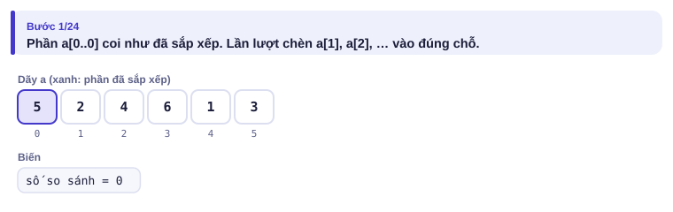
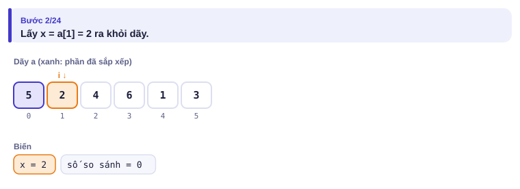
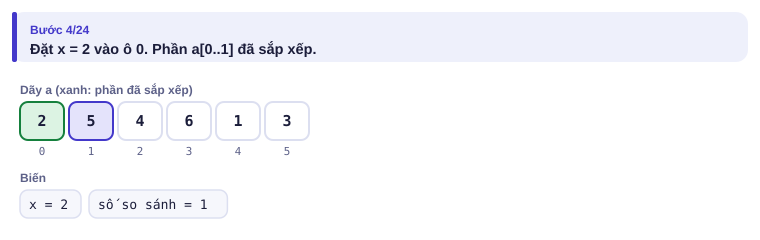
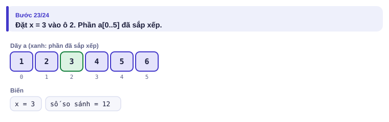
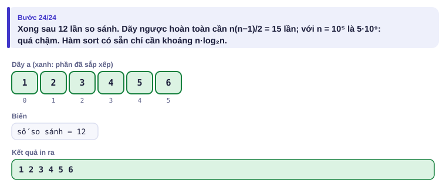
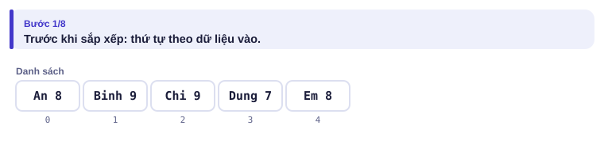
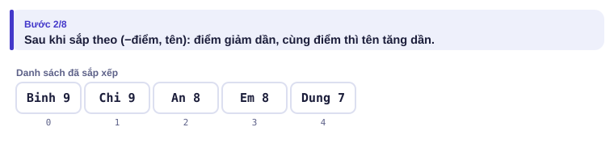
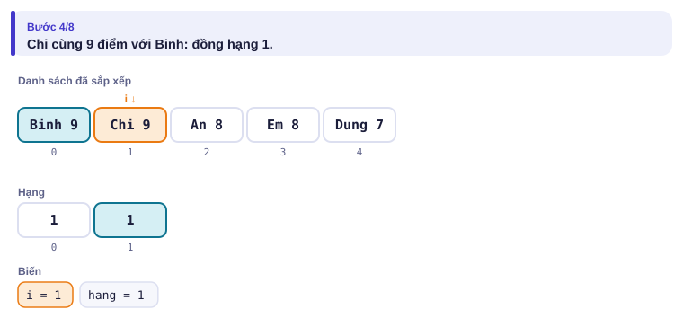
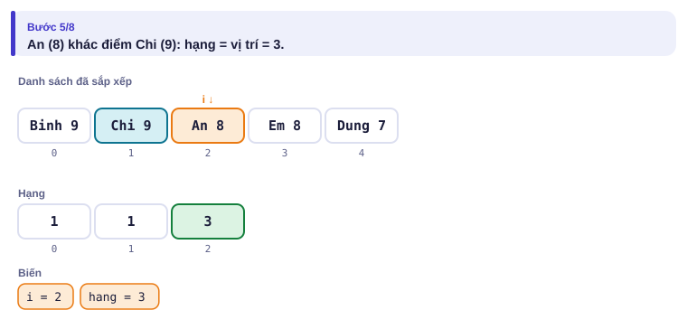
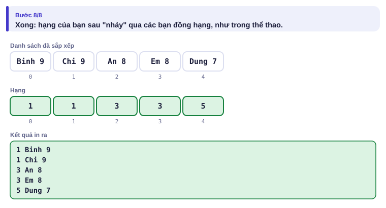

# Bài 1.2 – Sắp xếp

> **Tập 1 · Nền tảng thuật toán**
> Cần biết trước: bài 1.1 (độ phức tạp), bài 0.5 (mảng).
> Thời lượng: khoảng 70 phút đọc, cộng 4 giờ thực hành trong tuần.

**Học xong bài này, em sẽ:**

- hiểu vì sao tự viết sắp xếp đơn giản là O(n²), còn hàm có sẵn là O(n log n);
- sắp xếp theo **nhiều tiêu chí** (giảm dần, rồi tăng dần) bằng mẹo cặp và đổi dấu;
- dùng sắp xếp để **làm bài toán dễ đi**: phần tử bằng nhau đứng cạnh nhau, phần tử gần nhau về giá trị đứng gần nhau.

> [!TIP]
> **Học cùng hai trang mô phỏng.** [Sắp xếp chèn](../../mo-phong/t1-sap-xep-chen.html): đếm số lần so sánh với dãy ngẫu nhiên, dãy đã sắp và dãy ngược. [Bảng xếp hạng](../../mo-phong/t1-xep-hang.html): bật **Đoán trước** để tự tính hạng từng bạn, thử ví dụ "tất cả đồng điểm".

---

## 1. Bài toán mở màn: Bảng xếp hạng

Sau hội thi Tin học trẻ cấp trường, cô giáo cần in bảng xếp hạng n bạn (1 ≤ n ≤ 10⁵). Xếp theo điểm **giảm dần**; cùng điểm thì theo tên **tăng dần** (thứ tự từ điển). Bạn cùng điểm thì **đồng hạng**, và hạng tiếp theo bị "nhảy" như trong thể thao.

| Vào | Ra |
| --- | --- |
| `5`<br>`An 8`<br>`Binh 9`<br>`Chi 9`<br>`Dung 7`<br>`Em 8` | `1 Binh 9`<br>`1 Chi 9`<br>`3 An 8`<br>`3 Em 8`<br>`5 Dung 7` |

---

## 2. Dừng lại 10 phút

> [!IMPORTANT]
> **Dừng lại và nghĩ.**
> 1. Tự sắp xếp 5 bạn trong ví dụ bằng tay. Em so sánh hai bạn theo quy tắc nào?
> 2. Sau khi đã sắp xếp đúng thứ tự, làm sao biết hạng của bạn thứ i trong danh sách?
> 3. Khi nào hạng của bạn i bằng hạng của bạn i − 1?

<details>
<summary>Đáp án</summary>

1. So điểm trước: điểm cao hơn đứng trước. Bằng điểm mới so tên theo từ điển.
2. Bạn ở vị trí i (đếm từ 1) có hạng i, **trừ khi** cùng điểm với bạn ngay trước.
3. Khi cùng điểm: lấy luôn hạng của bạn trước. Chỉ cần một vòng lặp sau khi sắp xếp.

</details>

---

## 3. Lời giải ngây thơ và vì sao nó chậm

An chưa biết hàm sắp xếp có sẵn nên tự viết **sắp xếp chèn**, giống cách xếp bài trên tay: lấy từng lá, đẩy dần sang trái tới khi gặp lá nhỏ hơn.

```python
for i in range(1, n):
    x = a[i]
    j = i - 1
    while j >= 0 and a[j] > x:
        a[j + 1] = a[j]
        j -= 1
    a[j + 1] = x
```

<details>
<summary><b>Hình</b> – sắp xếp chèn dãy <code>5 2 4 6 1 3</code> (mở lần lượt)</summary>







</details>

Đúng, nhưng với dãy ngược hoàn toàn, phần tử thứ i phải đẩy qua i phần tử: tổng 1 + 2 + … + (n − 1) ≈ n²/2 lần so sánh. Với n = 10⁵ là 5·10⁹: quá chậm. Hàm sắp xếp có sẵn chỉ cần khoảng n·log₂n ≈ 1,7·10⁶ lần so sánh.

| | Python | C++ |
| --- | --- | --- |
| Tăng dần | `a.sort()` | `sort(a.begin(), a.end());` |
| Giảm dần | `a.sort(reverse=True)` | `sort(a.rbegin(), a.rend());` |
| Theo khóa | `a.sort(key=lambda x: ...)` | `sort(..., [](const T &x, const T &y){ return ...; });` |
| Độ phức tạp | O(n log n) | O(n log n) |

**Trong thi đấu, luôn dùng hàm có sẵn**, trừ khi đề yêu cầu khác. Biết sắp xếp chèn vẫn có ích: nó là cách tốt để hiểu "sắp xếp" làm gì, và rất nhanh khi dãy đã gần như sắp xếp sẵn.

---

## 4. Ý tưởng then chốt

> [!IMPORTANT]
> **Sắp xếp nhiều tiêu chí = sắp theo cặp (tiêu chí 1, tiêu chí 2). Cặp được so phần đầu trước, bằng nhau mới so phần sau. Muốn giảm dần theo một tiêu chí số thì đổi dấu nó.** Sau khi sắp xếp, các bạn cùng điểm đứng cạnh nhau, nên hạng tính được trong một lượt duyệt.

### Chạy từng bước

Với ví dụ của đề. Đoán trước rồi mới mở.

<details>
<summary><b>Bước 1</b> – Danh sách ban đầu</summary>



</details>

<details>
<summary><b>Bước 2</b> – Sau khi sắp theo (−điểm, tên), ai đứng đầu?</summary>



</details>

<details>
<summary><b>Bước 3</b> – Chi cùng 9 điểm với Binh: hạng mấy?</summary>



</details>

<details>
<summary><b>Bước 4</b> – An 8 điểm, đứng thứ 3: hạng mấy?</summary>



</details>

<details>
<summary><b>Bước 5</b> – Bảng xếp hạng hoàn chỉnh</summary>



</details>

---

## 5. Mã giả và cài đặt

```text
đọc n cặp (tên, điểm); đổi thành (−điểm, tên)
sắp xếp tăng dần
với i từ 0: nếu i = 0 hoặc điểm khác bạn i − 1 thì hang ← i + 1
            in hang, tên, điểm
```

```cpp
// file: xep_hang.cpp
#include <bits/stdc++.h>
using namespace std;
int main() {
    int n;
    cin >> n;
    vector<pair<int, string>> a(n);          // (−điểm, tên)
    for (auto &[d, ten] : a) {
        cin >> ten >> d;
        d = -d;
    }
    sort(a.begin(), a.end());
    int hang = 0;
    for (int i = 0; i < n; i++) {
        if (i == 0 || a[i].first != a[i - 1].first) hang = i + 1;   // điểm khác bạn trước
        cout << hang << ' ' << a[i].second << ' ' << -a[i].first << '\n';
    }
}
```

```python
# file: xep_hang.py
n = int(input())
a = []
for _ in range(n):
    ten, d = input().split()
    a.append((ten, int(d)))
a.sort(key=lambda x: (-x[1], x[0]))
hang = 0
for i, (ten, d) in enumerate(a):
    if i == 0 or d != a[i - 1][1]:
        hang = i + 1
    print(hang, ten, d)
```

### Sắp xếp làm bài toán dễ đi: đếm giá trị khác nhau

Đếm số giá trị khác nhau trong dãy n số (n ≤ 2·10⁵, giá trị tới 10⁹). Không dùng được mảng đếm (giá trị quá lớn, bài 0.5). Nhưng **sau khi sắp xếp, các số bằng nhau đứng liền nhau**: chỉ cần đếm số lần a[i] khác a[i − 1].

| Trước | `2 3 2 2 3` |
| --- | --- |
| Sau sắp xếp | `2 2 2 3 3` |
| Chỗ đổi giá trị | đầu dãy, và 2 → 3: **2** giá trị |

```cpp
// file: dem_phan_biet.cpp
#include <bits/stdc++.h>
using namespace std;
int main() {
    ios::sync_with_stdio(false);
    cin.tie(nullptr);
    int n;
    cin >> n;
    vector<long long> a(n);
    for (auto &x : a) cin >> x;
    sort(a.begin(), a.end());
    int dem = 0;
    for (int i = 0; i < n; i++)
        if (i == 0 || a[i] != a[i - 1]) dem++;
    cout << dem << '\n';
}
```

```python
# file: dem_phan_biet.py
import sys
data = sys.stdin.buffer.read().split()
n = int(data[0])
a = sorted(map(int, data[1:n + 1]))
print(sum(1 for i in range(n) if i == 0 or a[i] != a[i - 1]))
```

> [!NOTE]
> Python có cách ngắn hơn: `len(set(a))`. Biết cả hai cách vẫn quan trọng: ý "sắp xếp để các phần tử giống nhau đứng cạnh nhau" dùng được ở rất nhiều bài mà `set` không giúp được.

---

## 6. Vì sao đúng, chạy bao lâu

- **Đúng:** sau khi sắp theo (−điểm, tên), danh sách đúng thứ tự đề yêu cầu. Các bạn cùng điểm tạo thành một khối liền nhau; bạn đầu khối có hạng = vị trí (số bạn điểm cao hơn hẳn cộng 1), các bạn sau trong khối lấy cùng hạng đó. Đó đúng là định nghĩa đồng hạng.
- **Chạy bao lâu:** sắp xếp O(n log n), duyệt O(n): tổng O(n log n). So sánh hai tên tốn thêm thời gian theo độ dài tên, nhưng tên ngắn nên không đáng kể.

---

## 7. Bẫy thường gặp

> [!WARNING]
> **Bẫy 1: comparator dùng `<=`.** Trong C++, hàm so sánh tự viết phải trả về `a < b` **hẳn**. Dùng `<=` có thể làm chương trình chạy sai hoặc dừng đột ngột.

> [!WARNING]
> **Bẫy 2: hạng đồng hạng.** In `i + 1` cho mọi bạn là sai. Tiêu chí đồng hạng là **cùng điểm**, không phải cùng tên hay cùng vị trí.
> *Test phá:* ví dụ "tất cả đồng điểm" trên trang mô phỏng: mọi bạn phải hạng 1.

> [!WARNING]
> **Bẫy 3: sắp xếp làm mất vị trí ban đầu.** Nếu đề hỏi "vị trí ban đầu" thì phải lưu kèm chỉ số: sắp xếp các cặp (giá trị, chỉ số). Xem Ví dụ 3.

> [!WARNING]
> **Bẫy 4: tự viết sắp xếp O(n²) trong phòng thi.** Mất 10 phút viết, lại chạy không kịp với n = 10⁵. Học thuộc dòng `sort` của ngôn ngữ em dùng.

---

## 8. Ví dụ giảm dần hỗ trợ

### Ví dụ 2 – Điền vào chỗ trống: Hai bạn cao gần nhau nhất

Cho chiều cao n bạn (2 ≤ n ≤ 2·10⁵, chiều cao ≤ 10⁹). Tìm hiệu chiều cao **nhỏ nhất** giữa hai bạn bất kỳ.

| Vào | Ra |
| --- | --- |
| `5`<br>`160 145 172 158 149` | `2` |

```text
n = int(input())
a = list(map(int, input().split()))
a.____
print(min(____ for i in range(1, n)))
```

<details>
<summary>Đáp án</summary>

`sort()` và `a[i] - a[i - 1]`. Sau khi sắp xếp, hai số gần nhau nhất chắc chắn **đứng cạnh nhau**, nên chỉ cần xét n − 1 cặp liền kề thay vì n²/2 cặp.

```python
# file: gan_nhau_nhat.py
n = int(input())
a = list(map(int, input().split()))
a.sort()
print(min(a[i] - a[i - 1] for i in range(1, n)))
```

```cpp
// file: gan_nhau_nhat.cpp
#include <bits/stdc++.h>
using namespace std;
int main() {
    int n;
    cin >> n;
    vector<long long> a(n);
    for (auto &x : a) cin >> x;
    sort(a.begin(), a.end());
    long long best = LLONG_MAX;
    for (int i = 1; i < n; i++) best = min(best, a[i] - a[i - 1]);
    cout << best << '\n';
}
```

</details>

### Ví dụ 3 – Tự làm: Thứ tự xuất phát

n vận động viên (1 ≤ n ≤ 2·10⁵) có thời gian chạy thử tᵢ. Người chạy **nhanh hơn** (t nhỏ hơn) xuất phát trước; bằng thời gian thì người có số báo danh nhỏ hơn xuất phát trước. In số báo danh (1..n, theo thứ tự trong dữ liệu vào) theo thứ tự xuất phát.

| Vào | Ra |
| --- | --- |
| `4`<br>`12 10 12 9` | `4 2 1 3` |

> [!IMPORTANT]
> Tự làm trước. Gợi ý: Bẫy 3.

<details>
<summary>Lời giải</summary>

Sắp xếp các cặp (t, số báo danh): cặp tự so t trước rồi tới số báo danh, đúng như đề.

```python
# file: xuat_phat.py
n = int(input())
t = list(map(int, input().split()))
cap = sorted((t[i], i + 1) for i in range(n))
print(*[sbd for _, sbd in cap])
```

```cpp
// file: xuat_phat.cpp
#include <bits/stdc++.h>
using namespace std;
int main() {
    int n;
    cin >> n;
    vector<pair<long long, int>> cap(n);
    for (int i = 0; i < n; i++) { cin >> cap[i].first; cap[i].second = i + 1; }
    sort(cap.begin(), cap.end());
    for (auto [t, sbd] : cap) cout << sbd << ' ';
    cout << '\n';
}
```

</details>

---

## 9. Bài tập

| Nấc | Bài | Nguồn | Ý chính |
| --- | --- | --- | --- |
| Khởi động | [Distinct Numbers](https://cses.fi/problemset/task/1621) | CSES 1621 | Đếm giá trị khác nhau |
| Khởi động | [Helpful Maths](https://codeforces.com/problemset/problem/339/A) | CF 339A · 800 | Sắp xếp rồi in |
| Luyện | [Twins](https://codeforces.com/problemset/problem/160/A) | CF 160A · 900 | Sắp giảm dần rồi chọn |
| Luyện | [Apartments](https://cses.fi/problemset/task/1084) | CSES 1084 | Sắp xếp hai dãy, ghép cặp |
| Luyện | [Ferris Wheel](https://cses.fi/problemset/task/1090) | CSES 1090 | Sắp xếp + ghép nặng với nhẹ |
| Thử thách | [Restaurant Customers](https://cses.fi/problemset/task/1619) | CSES 1619 | Sắp xếp các sự kiện vào/ra |
| Kiểu đề thi | Học bổng | Bài của sách, chấm theo subtask | Xem bên dưới |

### Bài kiểu đề thi: Học bổng

**Đề bài.** Trường trao học bổng cho k học sinh có điểm cao nhất trong n học sinh (1 ≤ k ≤ n ≤ 2·10⁵, điểm 0..10⁹). Nếu có bạn **cùng điểm** với bạn đứng thứ k thì bạn đó cũng được nhận. Có bao nhiêu bạn nhận học bổng? Đọc từ `HOCBONG.INP` (dòng đầu n k, dòng sau n điểm), ghi ra `HOCBONG.OUT`.

Subtask: 40% có n ≤ 1000; 60% còn lại có n ≤ 2·10⁵.

| HOCBONG.INP | HOCBONG.OUT |
| --- | --- |
| `6 3`<br>`7 9 8 8 6 8` | `4` |

Sắp giảm dần: 9 8 8 8 7 6. Bạn thứ 3 có 8 điểm; bốn bạn có điểm ≥ 8.

<details>
<summary><b>Gợi ý 1</b> – hướng đi (đủ 40% điểm)</summary>

Tự viết sắp xếp chèn (O(n²)) rồi đếm, hoặc với mỗi bạn đếm số bạn điểm cao hơn hẳn: bạn được nhận nếu số đó nhỏ hơn k.

</details>

<details>
<summary><b>Gợi ý 2</b> – ý then chốt</summary>

Sắp xếp giảm dần bằng hàm có sẵn; gọi m là điểm của bạn thứ k. Đáp án là số bạn có điểm ≥ m.

</details>

<details>
<summary><b>Gợi ý 3</b> – lời giải đầy đủ</summary>

O(n log n). Chú ý chỉ số: bạn thứ k nằm ở ô k − 1.

```python
# file: hocbong.py
data = open("HOCBONG.INP", "rb").read().split()
n, k = int(data[0]), int(data[1])
d = sorted(map(int, data[2:2 + n]), reverse=True)
m = d[k - 1]
open("HOCBONG.OUT", "w").write(f"{sum(1 for x in d if x >= m)}\n")
```

```cpp
// file: hocbong.cpp
#include <bits/stdc++.h>
using namespace std;
int main() {
    freopen("HOCBONG.INP", "r", stdin);
    freopen("HOCBONG.OUT", "w", stdout);
    int n, k;
    cin >> n >> k;
    vector<long long> d(n);
    for (auto &x : d) cin >> x;
    sort(d.rbegin(), d.rend());
    long long m = d[k - 1];
    int dem = 0;
    for (auto x : d) if (x >= m) dem++;
    cout << dem << '\n';
}
```

</details>

---

## 10. Tóm tắt, flashcard và checkpoint

**Tóm tắt trong 5 dòng.**

1. Tự viết sắp xếp đơn giản là O(n²); luôn dùng sắp xếp có sẵn: O(n log n).
2. Nhiều tiêu chí: sắp theo cặp; giảm dần thì đổi dấu.
3. Cần nhớ vị trí ban đầu: sắp xếp cặp (giá trị, chỉ số).
4. Sau sắp xếp: phần tử bằng nhau đứng cạnh nhau, phần tử gần giá trị đứng gần nhau.
5. Đồng hạng: cùng điểm với bạn trước thì lấy hạng bạn trước, ngược lại hạng = vị trí.

**Flashcard.**

<details><summary>Sắp xếp các cặp (3, 'b'), (1, 'z'), (3, 'a') tăng dần cho ra gì?</summary>(1, 'z'), (3, 'a'), (3, 'b').</details>
<details><summary>Đếm giá trị khác nhau của dãy 10⁵ số tới 10⁹: cách nào?</summary>Sắp xếp rồi đếm số chỗ a[i] ≠ a[i−1]; hoặc <code>set</code>.</details>
<details><summary>Sắp xếp chèn dãy ngược hoàn toàn n phần tử cần bao nhiêu lần so sánh?</summary>n(n − 1)/2.</details>
<details><summary>Sắp giảm dần trong C++?</summary><code>sort(a.rbegin(), a.rend());</code></details>
<details><summary>Hai số gần nhau nhất trong dãy: vì sao chỉ cần xét cặp liền kề sau khi sắp xếp?</summary>Nếu a[i] &lt; a[j] không liền kề thì có a[k] nằm giữa, và một trong hai khoảng con nhỏ hơn hoặc bằng.</details>

**Ôn xoắn ốc** (kiến thức bài 1.1 và Tập 0; mỗi bài tối đa 20 phút):

- Mua bán vàng (bài 1.1), viết lại không nhìn sách.
- [Two Knights](https://cses.fi/problemset/task/1072) (CSES 1072): công thức thay vì thử hết.
- Số khác nhau (bài 0.5): so sánh mảng đánh dấu với cách sắp xếp ở bài này.

**Checkpoint – em đã sẵn sàng sang bài tiếp theo nếu:**

- [ ] Viết lại bài Bảng xếp hạng bằng C++ không nhìn sách.
- [ ] AC [Distinct Numbers](https://cses.fi/problemset/task/1621) và [Ferris Wheel](https://cses.fi/problemset/task/1090).
- [ ] Làm xong Ví dụ 3 (Thứ tự xuất phát) mà không mở lời giải.
- [ ] Đạt trọn điểm bài Học bổng khi tự làm trong 20 phút.

Chưa đạt? Nếu vướng ô 1, mở trang mô phỏng Bảng xếp hạng với chế độ Đoán trước. Nếu vướng ô 2 hoặc 3, đọc lại mục 4 và Bẫy 3. Nếu vướng ô 4, đọc lại Gợi ý 2 và chú ý chỉ số k − 1.
