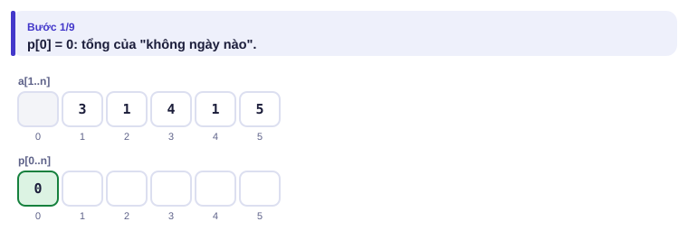
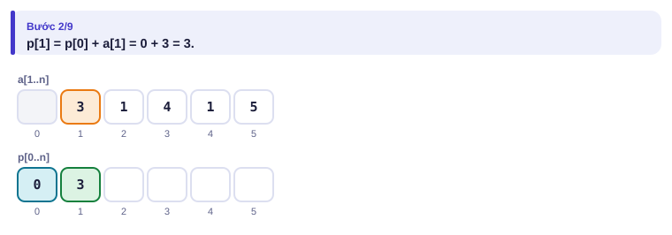
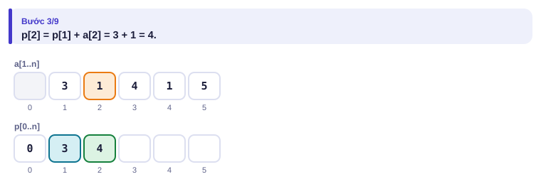
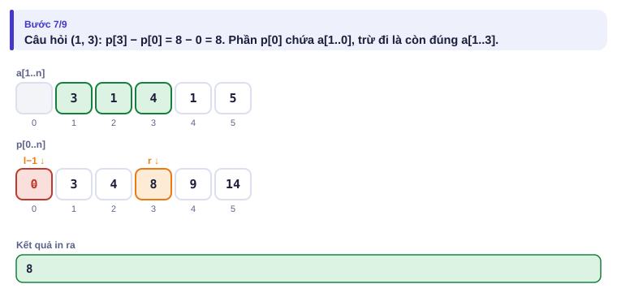
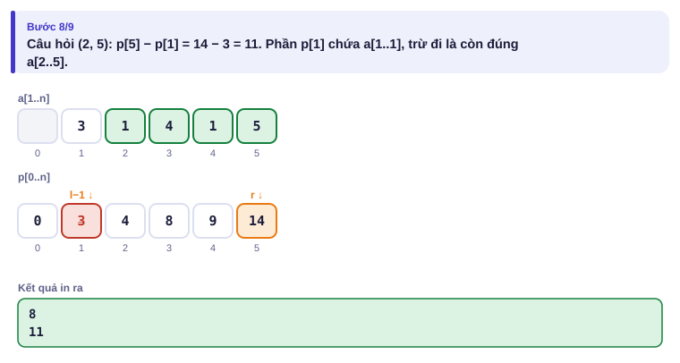
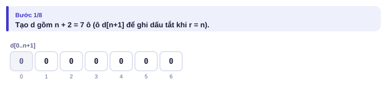
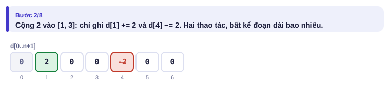
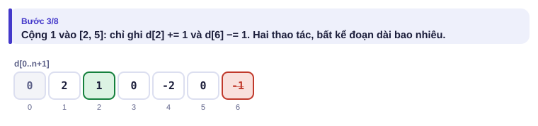
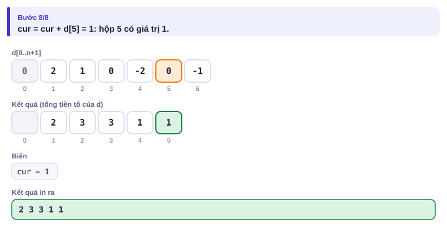

# Bài 1.3 – Tổng tiền tố và mảng hiệu

> **Tập 1 · Nền tảng thuật toán**
> Cần biết trước: bài 1.1 (độ phức tạp), bài 0.5 (mảng).
> Thời lượng: khoảng 75 phút đọc, cộng 4–5 giờ thực hành trong tuần.

**Học xong bài này, em sẽ:**

- trả lời mỗi câu hỏi "tổng đoạn [l, r]" bằng **một phép trừ** nhờ mảng tổng tiền tố;
- mở rộng sang hai chiều (hình chữ nhật trên lưới) bằng bao hàm – loại trừ;
- dùng **mảng hiệu** để cộng vào cả đoạn chỉ bằng hai thao tác;
- nhận ra khi nào đề cần tiền tố, khi nào cần mảng hiệu.

> [!TIP]
> **Học cùng hai trang mô phỏng.** [Tổng tiền tố](../../mo-phong/t1-tien-to.html): bật **Đoán trước** để tự tính p[i] và kết quả từng câu hỏi. [Mảng hiệu](../../mo-phong/t1-mang-hieu.html): xem chỉ hai dấu + và − làm thay đổi cả đoạn thế nào.

---

## 1. Bài toán mở màn: Doanh thu theo đoạn ngày

Quán của An có doanh thu n ngày a₁ … aₙ. Chủ quán hỏi q câu: "tổng doanh thu từ ngày l tới ngày r là bao nhiêu?". (1 ≤ n, q ≤ 2·10⁵, 1 ≤ aᵢ ≤ 10⁹)

| Vào | Ra |
| --- | --- |
| `5 3`<br>`3 1 4 1 5`<br>`1 3`<br>`2 5`<br>`4 4` | `8`<br>`11`<br>`1` |

---

## 2. Dừng lại 10 phút

> [!IMPORTANT]
> **Dừng lại và nghĩ.**
> 1. Cộng lại từ l tới r cho mỗi câu hỏi tốn bao nhiêu phép trong trường hợp xấu nhất?
> 2. Nếu em đã biết "tổng từ ngày 1 tới ngày r" và "tổng từ ngày 1 tới ngày l − 1", em tính tổng [l, r] thế nào?
> 3. Tính "tổng từ ngày 1 tới ngày r" cho **mọi** r mất bao lâu?

<details>
<summary>Đáp án</summary>

1. Mỗi câu tới n phép, q câu: q × n = 4·10¹⁰ phép, quá chậm.
2. Tổng [l, r] = (tổng 1..r) − (tổng 1..l−1): chỉ một phép trừ.
3. O(n): tổng 1..r = tổng 1..(r−1) + aᵣ, mỗi giá trị chỉ cộng thêm một số.

</details>

---

## 3. Lời giải ngây thơ và vì sao nó chậm

```python
for l, r in cau_hoi:
    print(sum(a[l - 1:r]))
```

Mỗi câu hỏi cộng lại từ đầu, dù hai câu hỏi liên tiếp có thể chung gần hết đoạn. Với n = q = 2·10⁵, số phép trường hợp xấu nhất là 4·10¹⁰: C++ hơn 6 phút, Python hơn 1 giờ. Cách này chỉ ăn subtask n, q ≤ 5000.

---

## 4. Ý tưởng then chốt

> [!IMPORTANT]
> **Tính trước p[i] = a₁ + … + aᵢ (với p[0] = 0) trong O(n). Khi đó tổng đoạn [l, r] = p[r] − p[l − 1], mỗi câu hỏi O(1).** Ta "trả trước" một lượt O(n) để mọi câu hỏi sau đó đều rẻ.

### Chạy từng bước

Với dãy `3 1 4 1 5`. Tính trước rồi mới mở.

<details>
<summary><b>Bước 1</b> – p[0] = 0</summary>



</details>

<details>
<summary><b>Bước 2</b> – p[1] = ?</summary>



</details>

<details>
<summary><b>Bước 3</b> – p[2] = ?</summary>



Cứ thế tới p[5] = 14. Mảng đầy đủ: p = 0 3 4 8 9 14.

</details>

<details>
<summary><b>Bước 4</b> – Câu hỏi (1, 3)</summary>



</details>

<details>
<summary><b>Bước 5</b> – Câu hỏi (2, 5): vì sao trừ p[1]?</summary>



</details>

---

## 5. Mã giả và cài đặt

```text
p[0] ← 0
với i từ 1 tới n: p[i] ← p[i − 1] + a[i]
với mỗi câu hỏi (l, r): in p[r] − p[l − 1]
```

```cpp
// file: tong_doan.cpp
#include <bits/stdc++.h>
using namespace std;
int main() {
    ios::sync_with_stdio(false);
    cin.tie(nullptr);
    int n, q;
    cin >> n >> q;
    vector<long long> p(n + 1, 0);
    for (int i = 1; i <= n; i++) {
        long long x;
        cin >> x;
        p[i] = p[i - 1] + x;
    }
    while (q--) {
        int l, r;
        cin >> l >> r;
        cout << p[r] - p[l - 1] << '\n';
    }
}
```

```python
# file: tong_doan.py
import sys
data = sys.stdin.buffer.read().split()
n, q = int(data[0]), int(data[1])
p = [0] * (n + 1)
for i in range(1, n + 1):
    p[i] = p[i - 1] + int(data[1 + i])
out = []
pos = 2 + n
for _ in range(q):
    l, r = int(data[pos]), int(data[pos + 1])
    pos += 2
    out.append(p[r] - p[l - 1])
print('\n'.join(map(str, out)))
```

Chú ý cách in: gom kết quả rồi in một lần nhanh hơn nhiều so với in từng dòng, nhất là trong Python.

### Hai chiều: bản đồ cây xanh

Bản đồ công viên là lưới n × n, `*` là ô có cây. Có q câu hỏi: hình chữ nhật từ hàng y₁ cột x₁ tới hàng y₂ cột x₂ có bao nhiêu cây? (n ≤ 1000, q ≤ 2·10⁵). Đây là bài [Forest Queries](https://cses.fi/problemset/task/1652).

Gọi **p[i][j]** = số cây trong hình chữ nhật từ (1, 1) tới (i, j). Khi đó:

- **Xây:** p[i][j] = ô(i, j) + p[i−1][j] + p[i][j−1] − p[i−1][j−1]
- **Hỏi:** cây trong (y₁, x₁)–(y₂, x₂) = p[y₂][x₂] − p[y₁−1][x₂] − p[y₂][x₁−1] + p[y₁−1][x₁−1]

Vì sao cộng lại p[y₁−1][x₁−1]? Hình chữ nhật góc trên trái bị **trừ hai lần**, nên phải cộng lại một lần (bao hàm – loại trừ, như bài 0.4).

```text
         x1        x2
   +-----+---------+
   |  D  |    B    |      Cần tính vùng A.
y1 +-----+---------+      p[y2][x2] = A + B + C + D
   |  C  |    A    |      p[y1-1][x2] = B + D
y2 +-----+---------+      p[y2][x1-1] = C + D
                          A = p[y2][x2] - (B+D) - (C+D) + D
```

```cpp
// file: rung_cay.cpp
#include <bits/stdc++.h>
using namespace std;
int main() {
    ios::sync_with_stdio(false);
    cin.tie(nullptr);
    int n, q;
    cin >> n >> q;
    vector<vector<int>> p(n + 1, vector<int>(n + 1, 0));
    for (int i = 1; i <= n; i++) {
        string row;
        cin >> row;
        for (int j = 1; j <= n; j++)
            p[i][j] = (row[j - 1] == '*') + p[i - 1][j] + p[i][j - 1] - p[i - 1][j - 1];
    }
    while (q--) {
        int y1, x1, y2, x2;
        cin >> y1 >> x1 >> y2 >> x2;
        cout << p[y2][x2] - p[y1 - 1][x2] - p[y2][x1 - 1] + p[y1 - 1][x1 - 1] << '\n';
    }
}
```

### Ngược lại: mảng hiệu

Bài toán ngược: có n hộp ban đầu toàn 0, và q thao tác "cộng v vào mọi hộp từ l tới r". Cuối cùng in giá trị từng hộp. (n, q ≤ 2·10⁵)

Mẹo: thay vì cộng cả đoạn, chỉ ghi hai dấu: **d[l] += v** và **d[r+1] −= v**. Cuối cùng lấy tổng tiền tố của d: dấu cộng có tác dụng từ l trở đi, dấu trừ "tắt" nó sau r.

<details>
<summary><b>Hình</b> – mảng hiệu với n = 5, thao tác (1, 3, +2) và (2, 5, +1)</summary>






</details>

| Vị trí | 1 | 2 | 3 | 4 | 5 | 6 |
| --- | :---: | :---: | :---: | :---: | :---: | :---: |
| d sau (1, 3, +2) | +2 | | | −2 | | |
| d sau (2, 5, +1) | +2 | +1 | | −2 | | −1 |
| Tổng tiền tố (kết quả) | 2 | 3 | 3 | 1 | 1 | |

```cpp
// file: mang_hieu.cpp
#include <bits/stdc++.h>
using namespace std;
int main() {
    ios::sync_with_stdio(false);
    cin.tie(nullptr);
    int n, q;
    cin >> n >> q;
    vector<long long> d(n + 2, 0);
    while (q--) {
        int l, r;
        long long v;
        cin >> l >> r >> v;
        d[l] += v;
        d[r + 1] -= v;
    }
    long long cur = 0;
    for (int i = 1; i <= n; i++) {
        cur += d[i];
        cout << cur << (i == n ? '\n' : ' ');
    }
}
```

> [!NOTE]
> Tổng tiền tố và mảng hiệu là **hai phép ngược nhau**: tiền tố của mảng hiệu cho lại mảng gốc. Đề có "nhiều câu hỏi tổng đoạn" thì nghĩ tới tiền tố; có "nhiều lần cộng vào đoạn, hỏi một lần ở cuối" thì nghĩ tới mảng hiệu.

---

## 6. Vì sao đúng, chạy bao lâu

- **Tiền tố:** p[r] = a₁ + … + aᵣ và p[l−1] = a₁ + … + aₗ₋₁; hiệu của chúng là đúng aₗ + … + aᵣ. Xây O(n), mỗi câu hỏi O(1): tổng **O(n + q)**.
- **Mảng hiệu:** sau khi lấy tiền tố, hộp i nhận v từ mọi thao tác có l ≤ i (dấu +v), trừ đi v ở những thao tác có r + 1 ≤ i (dấu −v). Hai điều kiện cùng đúng khi và chỉ khi l ≤ i ≤ r. Mỗi thao tác O(1), cuối cùng O(n): tổng **O(n + q)**.
- **Hai chiều:** xây O(n²), mỗi câu hỏi O(1).

---

## 7. Bẫy thường gặp

> [!WARNING]
> **Bẫy 1: lệch chỉ số.** Dùng p[0] = 0 và đánh số từ 1 giúp công thức `p[r] - p[l-1]` không cần trường hợp đặc biệt khi l = 1. Trộn chỉ số từ 0 và từ 1 là nguồn lỗi số một.
> *Test phá:* câu hỏi (1, 1).

> [!WARNING]
> **Bẫy 2: mảng hiệu thiếu ô.** `d[r + 1]` với r = n cần mảng có n + 2 ô.
> *Test phá:* thao tác (1, n, 5).

> [!WARNING]
> **Bẫy 3: tràn số.** Tổng tiền tố của 2·10⁵ số tới 10⁹ vượt `int`.

> [!WARNING]
> **Bẫy 4: in từng dòng trong Python.** 2·10⁵ lệnh `print` chậm hơn nhiều so với gom vào danh sách rồi in một lần bằng `'\n'.join(...)`.

---

## 8. Ví dụ giảm dần hỗ trợ

### Ví dụ 2 – Điền vào chỗ trống: Ngày mưa

Đài khí tượng ghi n ngày, ngày i có lượng mưa aᵢ mm (0 ≤ aᵢ ≤ 100). Trả lời q câu hỏi: trong các ngày l..r có bao nhiêu **ngày có mưa** (aᵢ > 0)? (n, q ≤ 2·10⁵)

| Vào | Ra |
| --- | --- |
| `6 2`<br>`0 5 0 12 3 0`<br>`1 6`<br>`3 4` | `3`<br>`1` |

```text
c = [0] * (n + 1)
for i in range(1, n + 1):
    c[i] = c[i - 1] + (____)
for l, r in cau_hoi:
    print(____)
```

<details>
<summary>Đáp án</summary>

`1 if a[i] > 0 else 0` và `c[r] - c[l - 1]`. Tiền tố của một dãy 0/1 chính là **tiền tố đếm**.

```python
# file: ngay_mua.py
import sys
data = sys.stdin.buffer.read().split()
n, q = int(data[0]), int(data[1])
c = [0] * (n + 1)
for i in range(1, n + 1):
    c[i] = c[i - 1] + (1 if int(data[1 + i]) > 0 else 0)
out = []
for k in range(q):
    l, r = int(data[2 + n + 2 * k]), int(data[3 + n + 2 * k])
    out.append(c[r] - c[l - 1])
print('\n'.join(map(str, out)))
```

```cpp
// file: ngay_mua.cpp
#include <bits/stdc++.h>
using namespace std;
int main() {
    ios::sync_with_stdio(false);
    cin.tie(nullptr);
    int n, q;
    cin >> n >> q;
    vector<int> c(n + 1, 0);
    for (int i = 1; i <= n; i++) {
        int x;
        cin >> x;
        c[i] = c[i - 1] + (x > 0);
    }
    while (q--) {
        int l, r;
        cin >> l >> r;
        cout << c[r] - c[l - 1] << '\n';
    }
}
```

</details>

### Ví dụ 3 – Tự làm: Đoạn cân bằng

Cho xâu s gồm `A` và `B` (dài n ≤ 2·10⁵) và q câu hỏi (l, r): đoạn s[l..r] (đánh số từ 1) có số chữ A **bằng** số chữ B không? In `YES` hoặc `NO`.

| Vào | Ra |
| --- | --- |
| `ABBABA`<br>`2`<br>`1 4`<br>`2 4` | `YES`<br>`NO` |

> [!IMPORTANT]
> Tự làm trước. Gợi ý: gán A = +1, B = −1. Đoạn cân bằng khi tổng của nó bằng 0.

<details>
<summary>Lời giải</summary>

Tiền tố của dãy ±1; đoạn cân bằng khi p[r] − p[l − 1] = 0, tức p[r] = p[l − 1].

```python
# file: can_bang.py
import sys
data = sys.stdin.read().split()
s, q = data[0], int(data[1])
n = len(s)
p = [0] * (n + 1)
for i in range(1, n + 1):
    p[i] = p[i - 1] + (1 if s[i - 1] == 'A' else -1)
out = []
for k in range(q):
    l, r = int(data[2 + 2 * k]), int(data[3 + 2 * k])
    out.append("YES" if p[r] == p[l - 1] else "NO")
print('\n'.join(out))
```

```cpp
// file: can_bang.cpp
#include <bits/stdc++.h>
using namespace std;
int main() {
    string s;
    int q;
    cin >> s >> q;
    int n = s.size();
    vector<int> p(n + 1, 0);
    for (int i = 1; i <= n; i++) p[i] = p[i - 1] + (s[i - 1] == 'A' ? 1 : -1);
    while (q--) {
        int l, r;
        cin >> l >> r;
        cout << (p[r] == p[l - 1] ? "YES" : "NO") << '\n';
    }
}
```

</details>

---

## 9. Bài tập

| Nấc | Bài | Nguồn | Ý chính |
| --- | --- | --- | --- |
| Khởi động | [Static Range Sum Queries](https://cses.fi/problemset/task/1646) | CSES 1646 | Đúng bài mở màn |
| Khởi động | [Forest Queries](https://cses.fi/problemset/task/1652) | CSES 1652 | Tiền tố hai chiều |
| Luyện | [Subarray Divisibility](https://cses.fi/problemset/task/1662) | CSES 1662 | Tiền tố + đếm số dư bằng nhau |
| Luyện | [Greg and Array](https://codeforces.com/problemset/problem/295/A) | CF 295A · 1400 | Mảng hiệu hai tầng |
| Thử thách | [Subarray Sums II](https://cses.fi/problemset/task/1661) | CSES 1661 | Tiền tố + đếm bằng `map` (xem trước Tập 2) |
| Kiểu đề thi | Láng nhựa | Bài của sách, chấm theo subtask | Xem bên dưới |

### Bài kiểu đề thi: Láng nhựa

**Đề bài.** Con đường dài n đoạn (1 ≤ n ≤ 10⁶). Có q đội thi công (1 ≤ q ≤ 2·10⁵); đội thứ k láng thêm một lớp nhựa dày vₖ mm (1 ≤ vₖ ≤ 1000) lên các đoạn từ lₖ tới rₖ. Sau khi mọi đội làm xong, in độ dày lớn nhất và số đoạn đạt độ dày đó. Đọc từ `LANGNHUA.INP` (dòng đầu n q, q dòng sau mỗi dòng l r v), ghi ra `LANGNHUA.OUT`.

Subtask: 40% có n, q ≤ 1000; 60% còn lại không có ràng buộc thêm.

| LANGNHUA.INP | LANGNHUA.OUT |
| --- | --- |
| `6 3`<br>`1 4 2`<br>`3 6 1`<br>`2 3 1` | `4 1` |

Độ dày từng đoạn: 2 3 4 3 1 1.

<details>
<summary><b>Gợi ý 1</b> – hướng đi (đủ 40% điểm)</summary>

Mỗi đội cộng thẳng vào từng đoạn: q × n = 10⁶ phép khi n, q ≤ 1000.

</details>

<details>
<summary><b>Gợi ý 2</b> – ý then chốt</summary>

"Nhiều lần cộng vào đoạn, hỏi một lần ở cuối": mảng hiệu. Sau khi lấy tiền tố được độ dày từng đoạn, tìm max và đếm.

</details>

<details>
<summary><b>Gợi ý 3</b> – lời giải đầy đủ</summary>

O(n + q). Độ dày tối đa 2·10⁵ × 1000 = 2·10⁸: vừa `int`, nhưng dùng `long long` cho chắc.

```python
# file: langnhua.py
data = open("LANGNHUA.INP", "rb").read().split()
n, q = int(data[0]), int(data[1])
d = [0] * (n + 2)
for k in range(q):
    l, r, v = int(data[2 + 3 * k]), int(data[3 + 3 * k]), int(data[4 + 3 * k])
    d[l] += v
    d[r + 1] -= v
cur, best, dem = 0, -1, 0
for i in range(1, n + 1):
    cur += d[i]
    if cur > best:
        best, dem = cur, 1
    elif cur == best:
        dem += 1
open("LANGNHUA.OUT", "w").write(f"{best} {dem}\n")
```

```cpp
// file: langnhua.cpp
#include <bits/stdc++.h>
using namespace std;
int main() {
    freopen("LANGNHUA.INP", "r", stdin);
    freopen("LANGNHUA.OUT", "w", stdout);
    ios::sync_with_stdio(false);
    cin.tie(nullptr);
    int n, q;
    cin >> n >> q;
    vector<long long> d(n + 2, 0);
    while (q--) {
        int l, r; long long v;
        cin >> l >> r >> v;
        d[l] += v; d[r + 1] -= v;
    }
    long long cur = 0, best = -1; int dem = 0;
    for (int i = 1; i <= n; i++) {
        cur += d[i];
        if (cur > best) { best = cur; dem = 1; }
        else if (cur == best) dem++;
    }
    cout << best << ' ' << dem << '\n';
}
```

</details>

---

## 10. Tóm tắt, flashcard và checkpoint

**Tóm tắt trong 5 dòng.**

1. p[i] = p[i−1] + aᵢ với p[0] = 0; tổng [l, r] = p[r] − p[l−1].
2. Đếm trên đoạn: tiền tố của dãy 0/1. Cân bằng hai loại: tiền tố của dãy ±1.
3. Hai chiều: xây bằng cộng hai, trừ một; hỏi bằng trừ hai, cộng một.
4. Cộng v vào đoạn [l, r] nhiều lần: d[l] += v, d[r+1] −= v, cuối cùng lấy tiền tố.
5. Tiền tố và mảng hiệu là hai phép ngược nhau.

**Flashcard.**

<details><summary>a = 2 7 1 8 2. Tổng đoạn [2, 4] qua mảng tiền tố?</summary>p = 0 2 9 10 18 20; p[4] − p[1] = 18 − 2 = 16.</details>
<details><summary>Vì sao công thức hỏi 2 chiều phải cộng lại p[y₁−1][x₁−1]?</summary>Vùng góc trên trái bị trừ hai lần.</details>
<details><summary>Cộng 5 vào đoạn [2, 4] bằng mảng hiệu ghi những gì?</summary>d[2] += 5, d[5] −= 5.</details>
<details><summary>Vì sao dùng p[0] = 0?</summary>Để công thức p[r] − p[l−1] đúng cả khi l = 1.</details>
<details><summary>Đề "nhiều câu hỏi tổng đoạn" hay "nhiều lần cộng vào đoạn" ứng với kỹ thuật nào?</summary>Câu hỏi tổng đoạn: tiền tố. Cộng vào đoạn, hỏi cuối: mảng hiệu.</details>

**Ôn xoắn ốc** (kiến thức bài 1.1–1.2; mỗi bài tối đa 20 phút):

- [Maximum Subarray Sum](https://cses.fi/problemset/task/1643) (CSES 1643): làm lại bằng tiền tố: tổng lớn nhất = max(p[r] − min p[l−1]).
- Hai bạn cao gần nhau nhất (bài 1.2, Ví dụ 2), viết lại không nhìn sách.
- [Apartments](https://cses.fi/problemset/task/1084) (CSES 1084): sắp xếp hai dãy.

**Checkpoint – em đã sẵn sàng sang bài tiếp theo nếu:**

- [ ] AC [Static Range Sum Queries](https://cses.fi/problemset/task/1646) và [Forest Queries](https://cses.fi/problemset/task/1652).
- [ ] Chạy tay được mảng hiệu với 3 thao tác bất kỳ mà không sai ô nào.
- [ ] Làm xong Ví dụ 3 (Đoạn cân bằng) mà không mở lời giải.
- [ ] Đạt trọn điểm bài Láng nhựa khi tự làm trong 25 phút.

Chưa đạt? Nếu vướng ô 1, mở trang mô phỏng Tổng tiền tố và đọc lại hình vùng A, B, C, D. Nếu vướng ô 2 hoặc 4, mở trang mô phỏng Mảng hiệu với chế độ Đoán trước. Nếu vướng ô 3, đọc lại mục 6 rồi làm lại Ví dụ 2.
