# Bài 1.4 – Tìm kiếm nhị phân

> **Tập 1 · Nền tảng thuật toán**
> Cần biết trước: bài 1.2 (sắp xếp), bài 1.1 (độ phức tạp).
> Thời lượng: khoảng 80 phút đọc, cộng 5 giờ thực hành trong tuần.

**Học xong bài này, em sẽ:**

- tìm một vị trí trong mảng đã sắp xếp chỉ với khoảng log₂n bước;
- thuộc **một khuôn tìm nhị phân duy nhất** và dùng nó cho mọi bài, không bị lặp vô hạn;
- dùng `lower_bound` / `upper_bound` (C++) và `bisect` (Python);
- **tìm nhị phân trên đáp án**: nhận ra dấu hiệu và viết hàm kiểm tra đơn điệu.

> [!TIP]
> **Học cùng hai trang mô phỏng.** [Tìm nhị phân trên mảng](../../mo-phong/t1-nhi-phan.html): thử ví dụ 16 phần tử để thấy chỉ cần 4 bước. [Tìm nhị phân trên đáp án](../../mo-phong/t1-nhi-phan-dap-an.html): xem khoảng thời gian [lo, hi] co lại. Bật **Đoán trước** ở cả hai trang.

---

## 1. Bài toán mở màn: Đếm theo khoảng điểm

Kỳ thi thử có n bạn với điểm a₁ … aₙ (1 ≤ n ≤ 2·10⁵, 0 ≤ aᵢ ≤ 10⁹). Thầy hỏi q câu: "có bao nhiêu bạn có điểm trong khoảng [l, r]?" (q ≤ 2·10⁵).

| Vào | Ra |
| --- | --- |
| `6 3`<br>`5 1 9 3 7 3`<br>`3 7`<br>`10 20`<br>`1 1` | `4`<br>`0`<br>`1` |

---

## 2. Dừng lại 10 phút

> [!IMPORTANT]
> **Dừng lại và nghĩ.**
> 1. Nếu dãy điểm đã sắp xếp tăng dần: `1 3 3 5 7 9`. Các bạn có điểm trong [3, 7] nằm ở đâu trong dãy?
> 2. Làm sao biết **số lượng** bạn trong khối đó nếu biết vị trí bắt đầu và kết thúc?
> 3. Trò chơi "đoán số từ 1 đến 1000, mỗi lần được nói lớn hơn hay nhỏ hơn": cần nhiều nhất bao nhiêu lần đoán?

<details>
<summary>Đáp án</summary>

1. Sau khi sắp xếp, các điểm trong [l, r] nằm **liền một khối**: `3 3 5 7` ở vị trí 1..4.
2. Số bạn = (vị trí đầu tiên có điểm > r) − (vị trí đầu tiên có điểm ≥ l) = 5 − 1 = 4.
3. 10 lần: mỗi lần đoán số ở giữa loại một nửa, 2¹⁰ = 1024 ≥ 1000. Tìm vị trí trong mảng 2·10⁵ phần tử cũng chỉ cần khoảng 18 lần.

</details>

---

## 3. Lời giải ngây thơ và vì sao nó chậm

Với mỗi câu hỏi, đếm trực tiếp:

```python
for l, r in cau_hoi:
    print(sum(1 for x in a if l <= x <= r))
```

Mỗi câu hỏi duyệt cả n bạn: q × n = 4·10¹⁰ phép. Kể cả sau khi sắp xếp, nếu tìm vị trí bằng cách đi từ đầu dãy thì vẫn O(n) mỗi câu. Cần một cách tìm vị trí nhanh hơn nhiều.

---

## 4. Ý tưởng then chốt

> [!IMPORTANT]
> **Giữ một khoảng [lo, hi] chắc chắn chứa đáp án. Mỗi bước xem phần tử giữa và loại một nửa. Khuôn này đúng khi câu hỏi "đúng(i)" có dạng sai sai … sai đúng đúng … đúng; nó tìm vị trí "đúng" đầu tiên.**

```text
lo ← 0, hi ← n                      // đáp án nằm trong [lo, hi]; hi = n nghĩa là "không có"
trong khi lo < hi:
    mid ← (lo + hi) / 2
    nếu đúng(mid): hi ← mid          // mid có thể là đáp án, giữ lại
    ngược lại:     lo ← mid + 1      // mid chắc chắn không phải
trả về lo
```

### Chạy từng bước

Tìm **vị trí đầu tiên có giá trị ≥ 4** trong `1 3 3 5 7 9`, tức đúng(i) là "a[i] ≥ 4". Đoán trước nửa nào bị loại rồi mới mở.

<details>
<summary><b>Bước 1</b> – Khoảng ban đầu</summary>

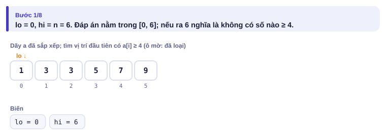

</details>

<details>
<summary><b>Bước 2</b> – mid = 3, a[3] = 5: loại nửa nào?</summary>

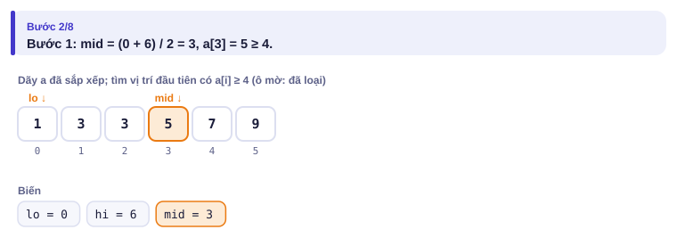
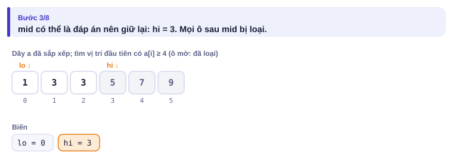

</details>

<details>
<summary><b>Bước 3</b> – mid = 1, a[1] = 3: loại nửa nào?</summary>

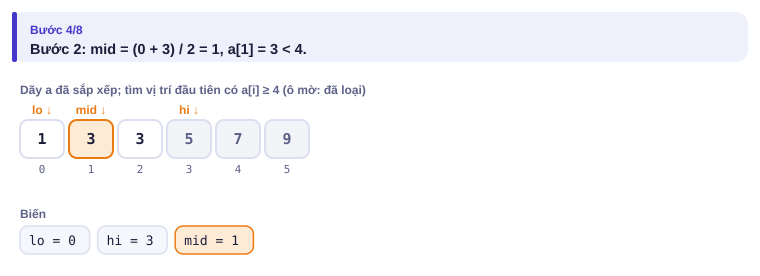
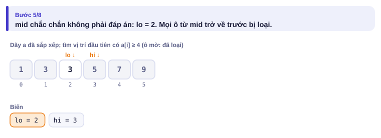

</details>

<details>
<summary><b>Bước 4</b> – Kết quả</summary>

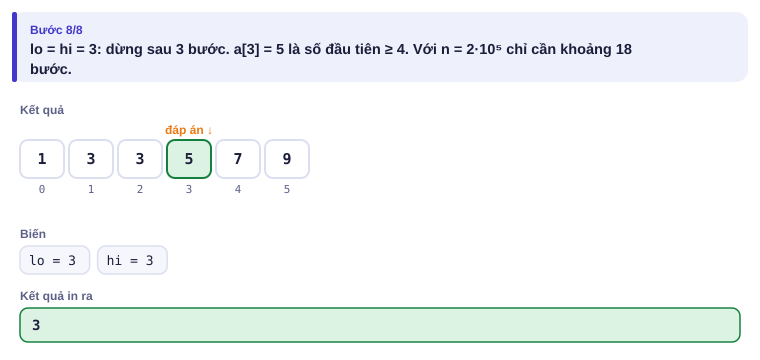

</details>

Toàn bộ dưới dạng bảng:

| lo | hi | mid | a[mid] | a[mid] ≥ 4? | Thu hẹp |
| :---: | :---: | :---: | :---: | :---: | --- |
| 0 | 6 | 3 | 5 | có | hi = 3 (đáp án ở ≤ 3) |
| 0 | 3 | 1 | 3 | không | lo = 2 (đáp án ở > 1) |
| 2 | 3 | 2 | 3 | không | lo = 3 |
| 3 | 3 | | | | dừng: đáp án **3** |

---

## 5. Mã giả và cài đặt

Khuôn ở mục 4 đã có sẵn trong thư viện:

| Cần tìm | C++ | Python (`import bisect`) |
| --- | --- | --- |
| vị trí đầu tiên ≥ x | `lower_bound(a.begin(), a.end(), x) - a.begin()` | `bisect.bisect_left(a, x)` |
| vị trí đầu tiên > x | `upper_bound(a.begin(), a.end(), x) - a.begin()` | `bisect.bisect_right(a, x)` |

```cpp
// file: dem_khoang.cpp
#include <bits/stdc++.h>
using namespace std;
int main() {
    ios::sync_with_stdio(false);
    cin.tie(nullptr);
    int n, q;
    cin >> n >> q;
    vector<long long> a(n);
    for (auto &x : a) cin >> x;
    sort(a.begin(), a.end());
    while (q--) {
        long long l, r;
        cin >> l >> r;
        cout << upper_bound(a.begin(), a.end(), r) - lower_bound(a.begin(), a.end(), l) << '\n';
    }
}
```

```python
# file: dem_khoang.py
import sys, bisect
data = sys.stdin.buffer.read().split()
n, q = int(data[0]), int(data[1])
a = sorted(map(int, data[2:2 + n]))
out = []
pos = 2 + n
for _ in range(q):
    l, r = int(data[pos]), int(data[pos + 1])
    pos += 2
    out.append(bisect.bisect_right(a, r) - bisect.bisect_left(a, l))
print('\n'.join(map(str, out)))
```

### Tìm nhị phân trên đáp án: Nhà máy

Xưởng có n máy, máy i làm xong một sản phẩm sau kᵢ giây. Các máy chạy song song. Cần ít nhất t sản phẩm. Hỏi thời gian ngắn nhất? (n ≤ 2·10⁵, t, kᵢ ≤ 10⁹). Đây là bài [Factory Machines](https://cses.fi/problemset/task/1620).

| Vào | Ra |
| --- | --- |
| `3 7`<br>`3 2 5` | `8` |

Tính thẳng đáp án thì khó. Nhưng câu hỏi **"trong T giây có làm đủ t sản phẩm không?"** thì dễ: máy i làm được T / kᵢ (chia nguyên) sản phẩm, cộng lại so với t. Và câu hỏi đó **đơn điệu**: T làm đủ thì T + 1 cũng đủ.

| T | 6 | 7 | 8 | 9 |
| --- | :---: | :---: | :---: | :---: |
| Số sản phẩm (T/3 + T/2 + T/5) | 2 + 3 + 1 = 6 | 2 + 3 + 1 = 6 | 2 + 4 + 1 = **7** | 3 + 4 + 1 = 8 |
| Đủ 7? | sai | sai | **đúng** | đúng |

Vậy ta tìm T nhỏ nhất làm "đủ" đúng, bằng đúng khuôn ở mục 4. Cận trên: máy nhanh nhất làm một mình cũng xong trong min(k) × t ≤ 10¹⁸ giây.

<details>
<summary><b>Hình</b> – khoảng [lo, hi] co lại với ví dụ trên (mở lần lượt)</summary>

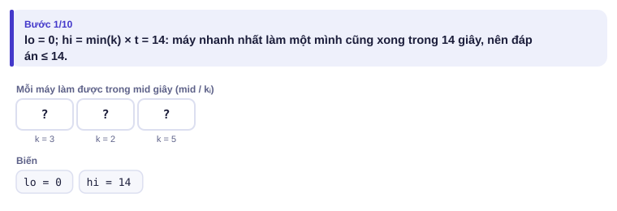
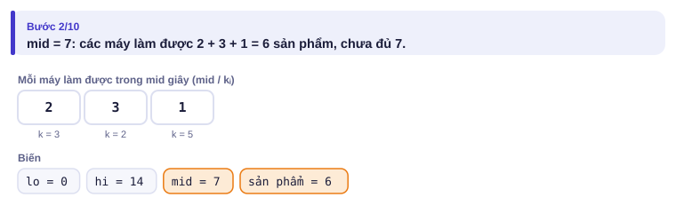
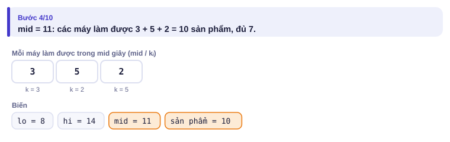
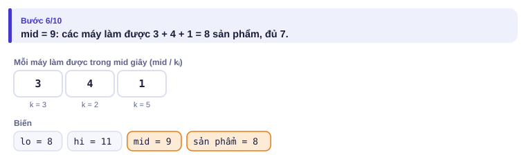
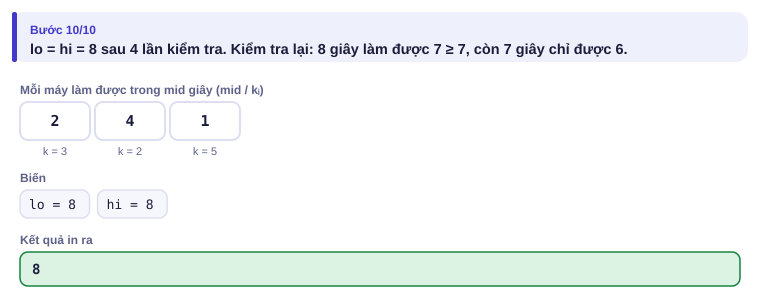

</details>

```cpp
// file: nha_may.cpp
#include <bits/stdc++.h>
using namespace std;
int n;
long long t;
vector<long long> k;

bool du(long long T) {                 // trong T giây có làm đủ t sản phẩm không?
    long long s = 0;
    for (long long x : k) {
        s += T / x;
        if (s >= t) return true;       // dừng sớm, tránh tràn số
    }
    return false;
}

int main() {
    cin >> n >> t;
    k.resize(n);
    for (auto &x : k) cin >> x;
    long long lo = 0, hi = *min_element(k.begin(), k.end()) * t;
    while (lo < hi) {
        long long mid = lo + (hi - lo) / 2;
        if (du(mid)) hi = mid;
        else lo = mid + 1;
    }
    cout << lo << '\n';
}
```

```python
# file: nha_may.py
import sys
data = sys.stdin.buffer.read().split()
n, t = int(data[0]), int(data[1])
k = list(map(int, data[2:2 + n]))

def du(T):
    return sum(T // x for x in k) >= t

lo, hi = 0, min(k) * t
while lo < hi:
    mid = (lo + hi) // 2
    if du(mid):
        hi = mid
    else:
        lo = mid + 1
print(lo)
```

> [!TIP]
> **Dấu hiệu nhận ra "tìm nhị phân trên đáp án":** đề hỏi "giá trị nhỏ nhất (lớn nhất) sao cho …", đáp án có thể rất lớn, và nếu **cho trước** đáp án thì kiểm tra dễ.

---

## 6. Vì sao đúng, chạy bao lâu

- **Bất biến:** mọi vị trí < lo đều "sai", mọi vị trí ≥ hi đều "đúng" (hoặc hi = n). Nếu đúng(mid) thì mọi vị trí ≥ mid đều đúng (đơn điệu), nên đặt hi = mid giữ bất biến; nếu sai thì mọi vị trí ≤ mid đều sai, đặt lo = mid + 1 cũng giữ bất biến. Khi lo = hi, đó chính là vị trí "đúng" đầu tiên.
- **Luôn dừng:** vì mid < hi và mid ≥ lo, mỗi bước khoảng [lo, hi) co lại ít nhất 1, và thực tế co còn một nửa.
- **Chạy bao lâu:** khoảng log₂(n) bước. Bài mở màn: O(n log n) sắp xếp + O(q log n) trả lời. Bài Nhà máy: log₂(10¹⁸) ≈ 60 lần kiểm tra, mỗi lần O(n): khoảng 1,2·10⁷ phép.

---

## 7. Bẫy thường gặp

> [!WARNING]
> **Bẫy 1: lặp vô hạn.** Viết `lo = mid` (thay vì `mid + 1`) với `mid = (lo + hi) / 2` có thể kẹt mãi khi hi = lo + 1. Dùng đúng khuôn ở mục 4 và đừng tự chế.

> [!WARNING]
> **Bẫy 2: tràn số trong hàm kiểm tra.** Tổng T / kᵢ có thể vượt 10¹⁸ × 2·10⁵. Dừng sớm khi tổng đã đủ, như trong `du`.
> *Test phá:* n = 2·10⁵ máy, mọi kᵢ = 1, t = 10⁹.

> [!WARNING]
> **Bẫy 3: tìm nhị phân trên mảng chưa sắp xếp.** `lower_bound` trên mảng chưa sắp xếp cho kết quả vô nghĩa, không báo lỗi.

> [!WARNING]
> **Bẫy 4: `mid = (lo + hi) / 2` tràn số.** Khi lo, hi gần 10¹⁸ thì lo + hi có thể vượt `long long`. Viết `lo + (hi - lo) / 2`.

---

## 8. Ví dụ giảm dần hỗ trợ

### Ví dụ 2 – Điền vào chỗ trống: Căn bậc hai nguyên

Nhập n (0 ≤ n ≤ 10¹⁸). In số nguyên x lớn nhất với x² ≤ n, **không** dùng `sqrt`.

| Vào | Ra |
| --- | --- |
| `30` | `5` |
| `1000000000000000000` | `1000000000` |

Mẹo: tìm x **nhỏ nhất** có x² > n (dạng sai…sai đúng…đúng), rồi trừ 1.

```text
lo, hi = 0, 10**9 + 1
while lo < hi:
    mid = (lo + hi) // 2
    if ____:
        hi = mid
    else:
        lo = mid + 1
print(____)
```

<details>
<summary>Đáp án</summary>

`mid * mid > n` và `lo - 1`. Cận trên 10⁹ + 1 vì (10⁹ + 1)² > 10¹⁸. Trong C++, mid ≤ 10⁹ + 1 nên mid² < 2·10¹⁸ vừa `long long`.

```python
# file: can_nguyen.py
n = int(input())
lo, hi = 0, 10**9 + 1
while lo < hi:
    mid = (lo + hi) // 2
    if mid * mid > n:
        hi = mid
    else:
        lo = mid + 1
print(lo - 1)
```

```cpp
// file: can_nguyen.cpp
#include <bits/stdc++.h>
using namespace std;
int main() {
    long long n;
    cin >> n;
    long long lo = 0, hi = 1000000001;
    while (lo < hi) {
        long long mid = lo + (hi - lo) / 2;
        if (mid * mid > n) hi = mid;
        else lo = mid + 1;
    }
    cout << lo - 1 << '\n';
}
```

</details>

### Ví dụ 3 – Tự làm: Cắt gỗ

Có n khúc gỗ dài a₁ … aₙ (1 ≤ n ≤ 2·10⁵, 1 ≤ aᵢ ≤ 10⁹). Cần cắt ra **ít nhất k** đoạn có cùng độ dài nguyên L (1 ≤ k ≤ 10⁹; phần thừa bỏ đi). L lớn nhất là bao nhiêu? In 0 nếu không thể.

| Vào | Ra |
| --- | --- |
| `3 7`<br>`10 15 8` | `4` |

> [!IMPORTANT]
> Tự làm trước. Gợi ý: L càng nhỏ thì càng cắt được nhiều đoạn. Hàm "cắt được ≥ k đoạn với độ dài L" đúng…đúng sai…sai: hãy tìm L **đầu tiên làm nó sai**, rồi trừ 1.

<details>
<summary>Lời giải</summary>

Với L = 4: 10/4 + 15/4 + 8/4 = 2 + 3 + 2 = 7 đoạn ✓. Với L = 5: 2 + 3 + 1 = 6 đoạn ✗. Đáp án 4. Tìm L nhỏ nhất làm "cắt được ≥ k" **sai** trong [1, max(a) + 1], rồi trừ 1; nếu ngay L = 1 đã sai thì kết quả 0, đúng như đề.

```python
# file: cat_go.py
import sys
data = sys.stdin.buffer.read().split()
n, k = int(data[0]), int(data[1])
a = list(map(int, data[2:2 + n]))

def du(L):
    return sum(x // L for x in a) >= k

lo, hi = 1, max(a) + 1
while lo < hi:
    mid = (lo + hi) // 2
    if not du(mid):
        hi = mid
    else:
        lo = mid + 1
print(lo - 1)
```

```cpp
// file: cat_go.cpp
#include <bits/stdc++.h>
using namespace std;
int n; long long k; vector<long long> a;
bool du(long long L) {
    long long s = 0;
    for (long long x : a) { s += x / L; if (s >= k) return true; }
    return false;
}
int main() {
    cin >> n >> k;
    a.resize(n);
    for (auto &x : a) cin >> x;
    long long lo = 1, hi = *max_element(a.begin(), a.end()) + 1;
    while (lo < hi) {
        long long mid = lo + (hi - lo) / 2;
        if (!du(mid)) hi = mid;
        else lo = mid + 1;
    }
    cout << lo - 1 << '\n';
}
```

</details>

---

## 9. Bài tập

| Nấc | Bài | Nguồn | Ý chính |
| --- | --- | --- | --- |
| Khởi động | [Interesting drink](https://codeforces.com/problemset/problem/706/B) | CF 706B · 1100 | `upper_bound` cho nhiều câu hỏi |
| Khởi động | [Factory Machines](https://cses.fi/problemset/task/1620) | CSES 1620 | Đúng mục 5 |
| Luyện | [Worms](https://codeforces.com/problemset/problem/474/B) | CF 474B · 1200 | Tiền tố + `lower_bound` |
| Luyện | [Array Division](https://cses.fi/problemset/task/1085) | CSES 1085 | Nhị phân trên tổng lớn nhất |
| Thử thách | [Hamburgers](https://codeforces.com/problemset/problem/371/C) | CF 371C · 1600 | Nhị phân trên số bánh |
| Kiểu đề thi | Chở hàng | Bài của sách, chấm theo subtask | Xem bên dưới |

### Bài kiểu đề thi: Chở hàng

**Đề bài.** Có n kiện hàng xếp theo thứ tự trên băng chuyền, kiện i nặng wᵢ (1 ≤ n ≤ 2·10⁵, 1 ≤ wᵢ ≤ 10⁹). Một xe chở tất cả trong **đúng k chuyến** (1 ≤ k ≤ n); mỗi chuyến lấy một nhóm kiện **liên tiếp**, giữ nguyên thứ tự. Tải trọng nhỏ nhất của xe là bao nhiêu? Đọc từ `CHOHANG.INP` (dòng đầu n k, dòng sau n số), ghi ra `CHOHANG.OUT`.

Subtask: 40% có n ≤ 100 và wᵢ ≤ 100; 60% còn lại không có ràng buộc thêm.

| CHOHANG.INP | CHOHANG.OUT |
| --- | --- |
| `5 3`<br>`2 4 2 5 1` | `6` |

Chia thành (2 4) (2) (5 1): chuyến nặng nhất 6. Với tải trọng 5 thì kiện 2 và 4 không đi chung được, cần ít nhất 4 chuyến.

<details>
<summary><b>Gợi ý 1</b> – hướng đi (đủ 40% điểm)</summary>

Thử tải trọng C lần lượt từ max(w) trở lên. Với mỗi C, xếp tham lam: đi từ trái sang, nhét kiện vào chuyến hiện tại nếu còn chỗ, hết chỗ thì mở chuyến mới. C đầu tiên dùng không quá k chuyến là đáp án. Tổng w ≤ 10⁴ nên thử tối đa 10⁴ giá trị.

</details>

<details>
<summary><b>Gợi ý 2</b> – ý then chốt</summary>

"Với tải trọng C, cần bao nhiêu chuyến?" giảm dần khi C tăng. Câu hỏi "C có đủ (≤ k chuyến) không?" có dạng sai…sai đúng…đúng: tìm nhị phân C trong [max(w), tổng(w)]. Dùng ít hơn k chuyến cũng được, vì có thể tách bớt chuyến (n ≥ k).

</details>

<details>
<summary><b>Gợi ý 3</b> – lời giải đầy đủ</summary>

Mỗi lần kiểm tra O(n), khoảng log₂(2·10¹⁴) ≈ 48 lần: tổng khoảng 10⁷ phép.

```python
# file: chohang.py
data = open("CHOHANG.INP", "rb").read().split()
n, k = int(data[0]), int(data[1])
w = list(map(int, data[2:2 + n]))

def du(C):
    chuyen, dang = 1, 0
    for x in w:
        if dang + x > C:
            chuyen += 1
            dang = 0
        dang += x
    return chuyen <= k

lo, hi = max(w), sum(w)
while lo < hi:
    mid = (lo + hi) // 2
    if du(mid):
        hi = mid
    else:
        lo = mid + 1
open("CHOHANG.OUT", "w").write(f"{lo}\n")
```

```cpp
// file: chohang.cpp
#include <bits/stdc++.h>
using namespace std;
int n, k; vector<long long> w;
bool du(long long C) {
    int chuyen = 1; long long dang = 0;
    for (long long x : w) {
        if (dang + x > C) { chuyen++; dang = 0; }
        dang += x;
    }
    return chuyen <= k;
}
int main() {
    freopen("CHOHANG.INP", "r", stdin);
    freopen("CHOHANG.OUT", "w", stdout);
    cin >> n >> k;
    w.resize(n);
    for (auto &x : w) cin >> x;
    long long lo = *max_element(w.begin(), w.end()), hi = accumulate(w.begin(), w.end(), 0LL);
    while (lo < hi) {
        long long mid = lo + (hi - lo) / 2;
        if (du(mid)) hi = mid;
        else lo = mid + 1;
    }
    cout << lo << '\n';
}
```

</details>

---

## 10. Tóm tắt, flashcard và checkpoint

**Tóm tắt trong 5 dòng.**

1. Mảng đã sắp: `lower_bound` (≥ x), `upper_bound` (> x); đếm trong [l, r] = upper(r) − lower(l).
2. Khuôn duy nhất: `while lo < hi: mid; nếu đúng(mid): hi = mid, ngược lại lo = mid + 1`.
3. Khuôn tìm vị trí "đúng" đầu tiên; muốn "lớn nhất thỏa" thì tìm "sai đầu tiên" rồi trừ 1.
4. Nhị phân trên đáp án: cần hàm kiểm tra **đơn điệu**, cận trên đủ lớn.
5. Chú ý tràn số: `lo + (hi - lo) / 2`, dừng sớm trong hàm kiểm tra.

**Flashcard.**

<details><summary>Trong <code>1 3 3 5 7 9</code>, <code>lower_bound(3)</code> và <code>upper_bound(3)</code> là vị trí nào?</summary>1 và 3 (chỉ số từ 0); có 3 − 1 = 2 số bằng 3.</details>
<details><summary>Điều kiện để tìm nhị phân trên đáp án?</summary>Hàm kiểm tra đơn điệu: sai … sai đúng … đúng.</details>
<details><summary>Tìm nhị phân trên 10⁶ phần tử cần khoảng bao nhiêu bước?</summary>20.</details>
<details><summary>Vì sao viết <code>lo = mid + 1</code> chứ không phải <code>lo = mid</code>?</summary>mid đã biết là sai; giữ lại có thể làm vòng lặp kẹt mãi khi hi = lo + 1.</details>
<details><summary>Dấu hiệu nhận ra "nhị phân trên đáp án"?</summary>Hỏi giá trị nhỏ nhất/lớn nhất sao cho…; đáp án rất lớn; cho trước đáp án thì kiểm tra dễ.</details>

**Ôn xoắn ốc** (kiến thức bài 1.1–1.3; mỗi bài tối đa 20 phút):

- [Static Range Sum Queries](https://cses.fi/problemset/task/1646) (CSES 1646): tiền tố.
- Học bổng (bài 1.2), làm lại bằng `upper_bound` trên dãy đã sắp.
- [Maximum Subarray Sum](https://cses.fi/problemset/task/1643) (CSES 1643): Kadane, viết lại không nhìn sách.

**Checkpoint – em đã sẵn sàng sang bài tiếp theo nếu:**

- [ ] Viết khuôn tìm nhị phân không nhìn sách và giải thích được bất biến.
- [ ] AC [Factory Machines](https://cses.fi/problemset/task/1620) và [Interesting drink](https://codeforces.com/problemset/problem/706/B).
- [ ] Làm xong Ví dụ 3 (Cắt gỗ) mà không mở lời giải.
- [ ] Đạt trọn điểm bài Chở hàng khi tự làm trong 30 phút.

Chưa đạt? Nếu vướng ô 1, mở trang mô phỏng tìm nhị phân trên mảng với chế độ Đoán trước và đọc lại mục 6. Nếu vướng ô 2 hoặc 4, mở trang mô phỏng nhị phân trên đáp án và đọc lại phần "Dấu hiệu". Nếu vướng ô 3, đọc lại dòng 3 của phần tóm tắt.
