# Bài 1.5 – Hai con trỏ

> **Tập 1 · Nền tảng thuật toán**
> Cần biết trước: bài 1.1 (độ phức tạp), bài 1.2 (sắp xếp), bài 1.3 (tiền tố).
> Thời lượng: khoảng 70 phút đọc, cộng 4–5 giờ thực hành trong tuần.

**Học xong bài này, em sẽ:**

- dùng **cửa sổ trượt** tìm đoạn liên tiếp dài nhất / ngắn nhất thỏa điều kiện về tổng;
- dùng **hai con trỏ từ hai đầu** trên mảng đã sắp xếp để tìm cặp có tổng cho trước;
- giải thích vì sao `while` lồng trong `for` vẫn chỉ là O(n) (**phân tích khấu hao**);
- biết khi nào hai con trỏ **không** dùng được.

> [!TIP]
> **Học cùng hai trang mô phỏng.** [Cửa sổ trượt](../../mo-phong/t1-cua-so.html): xem l và r chỉ đi một chiều, và biến "số bước" không bao giờ vượt 2n. [Hai đầu](../../mo-phong/t1-hai-dau.html): bật **Đoán trước** để tự quyết định tăng l hay giảm r.

---

## 1. Bài toán mở màn: Chạy bộ trong giới hạn

Đường chạy ven kênh Nhiêu Lộc chia thành n chặng liên tiếp, chặng i dài aᵢ mét (aᵢ ≥ 1). Chi chỉ đủ sức chạy tối đa S mét. Hỏi Chi chạy được nhiều nhất bao nhiêu chặng **liên tiếp**? (n ≤ 2·10⁵, aᵢ ≤ 10⁹, S ≤ 10¹⁸)

| Vào | Ra |
| --- | --- |
| `6 10`<br>`4 2 3 6 1 2` | `3` |

---

## 2. Dừng lại 10 phút

> [!IMPORTANT]
> **Dừng lại và nghĩ.**
> 1. Giả sử đoạn [l, r] có tổng ≤ S. Đoạn [l + 1, r] thì sao?
> 2. Nếu [l, r] có tổng > S, có cần thử [l, r + 1] không?
> 3. Từ hai câu trên, khi r tăng thì điểm đầu l tốt nhất có bao giờ phải **lùi lại** không?

<details>
<summary>Đáp án</summary>

1. Mọi aᵢ dương, nên bỏ bớt phần tử thì tổng giảm: [l+1, r] cũng ≤ S.
2. Không: kéo dài thêm thì tổng càng lớn.
3. Không bao giờ. Khi r tăng, l chỉ đứng yên hoặc tiến. Đó là ý tưởng của **hai con trỏ**.

</details>

---

## 3. Lời giải ngây thơ và vì sao nó chậm

Thử mọi điểm đầu l, kéo dài r tới khi vượt S (cộng dồn như cách 2 ở bài 1.1):

```python
best = 0
for l in range(n):
    s = 0
    for r in range(l, n):
        s += a[r]
        if s > S:
            break
        best = max(best, r - l + 1)
```

Trường hợp xấu nhất (S rất lớn, mọi đoạn đều hợp lệ), mỗi l đi tới cuối dãy: O(n²) = 4·10¹⁰ với n = 2·10⁵. Lãng phí nằm ở chỗ: khi chuyển từ l sang l + 1, ta **làm lại từ đầu** dù đoạn [l + 1, r] chắc chắn vẫn hợp lệ (câu 1 ở mục 2).

---

## 4. Ý tưởng then chốt

> [!IMPORTANT]
> **Duyệt r từ trái sang phải, thêm a[r] vào cửa sổ. Khi tổng vượt S, đẩy l sang phải (bỏ a[l]) tới khi tổng ≤ S. Mỗi lúc, [l, r] là đoạn dài nhất kết thúc tại r thỏa điều kiện. Vì l và r chỉ đi một chiều, tổng số bước tối đa 2n.**

### Chạy từng bước

Với `4 2 3 6 1 2`, S = 10. Đoán trước rồi mới mở.

<details>
<summary><b>Bước 1</b> – Cửa sổ rỗng</summary>

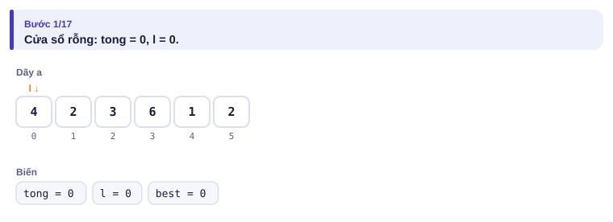

</details>

<details>
<summary><b>Bước 2</b> – Sau r = 2: cửa sổ dài bao nhiêu?</summary>

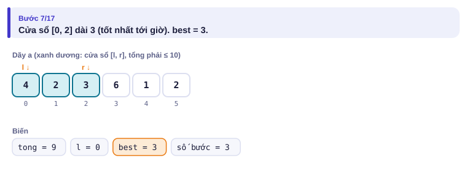

</details>

<details>
<summary><b>Bước 3</b> – r = 3, thêm 6: tổng bao nhiêu? Có phải đẩy l không?</summary>

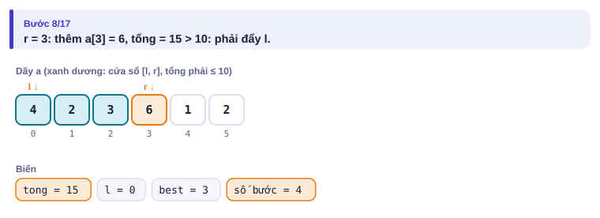

</details>

<details>
<summary><b>Bước 4</b> – Đẩy l: bỏ những phần tử nào?</summary>

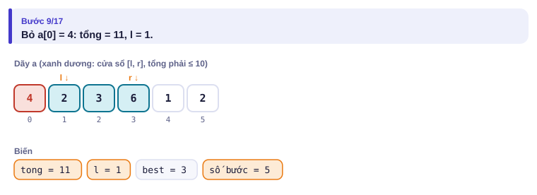
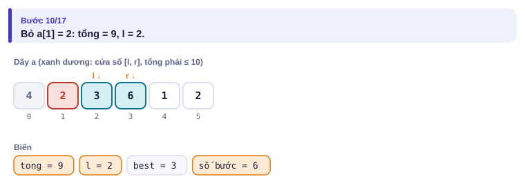

</details>

<details>
<summary><b>Bước 5</b> – Kết quả</summary>

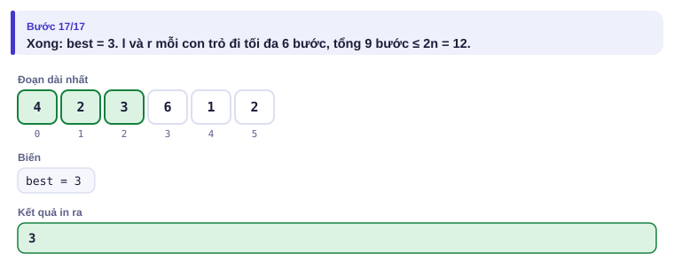

</details>

Toàn bộ dưới dạng bảng:

| r | Thêm a[r] | Tổng sau khi thêm | Đẩy l | l | Tổng | Độ dài r − l + 1 | Tốt nhất |
| :---: | :---: | :---: | --- | :---: | :---: | :---: | :---: |
| 0 | 4 | 4 | — | 0 | 4 | 1 | 1 |
| 1 | 2 | 6 | — | 0 | 6 | 2 | 2 |
| 2 | 3 | 9 | — | 0 | 9 | 3 | 3 |
| 3 | 6 | 15 | bỏ 4, bỏ 2 | 2 | 9 | 2 | 3 |
| 4 | 1 | 10 | — | 2 | 10 | 3 | 3 |
| 5 | 2 | 12 | bỏ 3 | 3 | 9 | 3 | 3 |

---

## 5. Mã giả và cài đặt

```text
tong ← 0; l ← 0; best ← 0
với r từ 0 tới n − 1:
    tong ← tong + a[r]
    trong khi tong > S: tong ← tong − a[l]; l ← l + 1
    best ← max(best, r − l + 1)
in best
```

```cpp
// file: chay_bo.cpp
#include <bits/stdc++.h>
using namespace std;
int main() {
    ios::sync_with_stdio(false);
    cin.tie(nullptr);
    int n;
    long long S;
    cin >> n >> S;
    vector<long long> a(n);
    for (auto &x : a) cin >> x;
    long long tong = 0;
    int l = 0, best = 0;
    for (int r = 0; r < n; r++) {
        tong += a[r];
        while (tong > S) tong -= a[l++];    // đẩy l tới khi cửa sổ hợp lệ
        best = max(best, r - l + 1);        // nếu a[r] > S thì l = r + 1, độ dài 0
    }
    cout << best << '\n';
}
```

```python
# file: chay_bo.py
import sys
data = sys.stdin.buffer.read().split()
n, S = int(data[0]), int(data[1])
a = list(map(int, data[2:2 + n]))
tong = l = best = 0
for r in range(n):
    tong += a[r]
    while tong > S:
        tong -= a[l]
        l += 1
    best = max(best, r - l + 1)
print(best)
```

### Đếm đoạn có tổng đúng bằng x

Cũng cửa sổ trượt, nhưng đếm số đoạn có tổng **bằng** x ([Subarray Sums I](https://cses.fi/problemset/task/1660), aᵢ ≥ 1).

| Vào | Ra |
| --- | --- |
| `5 7`<br>`2 4 1 2 7` | `3` |

Ba đoạn: `2 4 1`, `4 1 2`, `7`.

```cpp
// file: dem_doan_bang_x.cpp
#include <bits/stdc++.h>
using namespace std;
int main() {
    ios::sync_with_stdio(false);
    cin.tie(nullptr);
    int n;
    long long x;
    cin >> n >> x;
    vector<long long> a(n);
    for (auto &v : a) cin >> v;
    long long tong = 0, dem = 0;
    int l = 0;
    for (int r = 0; r < n; r++) {
        tong += a[r];
        while (tong > x) tong -= a[l++];
        if (tong == x) dem++;          // với mỗi r có tối đa một l phù hợp
    }
    cout << dem << '\n';
}
```

### Hai con trỏ từ hai đầu

Trên mảng **đã sắp xếp**, tìm hai phần tử có tổng bằng x ([Sum of Two Values](https://cses.fi/problemset/task/1640)): đặt l ở đầu, r ở cuối.

- a[l] + a[r] < x: kể cả cộng với số lớn nhất còn lại, a[l] vẫn không đủ: loại a[l], tăng l.
- a[l] + a[r] > x: kể cả cộng với số nhỏ nhất còn lại, a[r] vẫn thừa: loại a[r], giảm r.
- bằng x: tìm được.

<details>
<summary><b>Hình</b> – tìm cặp có tổng 13 trong <code>1 2 4 6 7 9 11 15</code> (mở lần lượt)</summary>

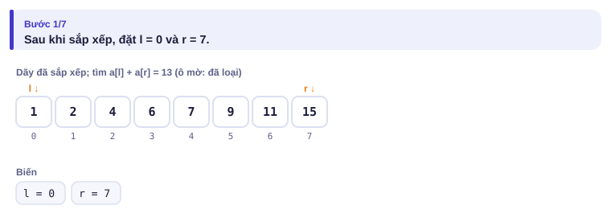
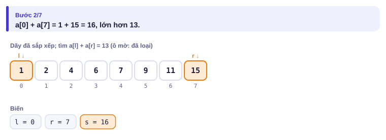
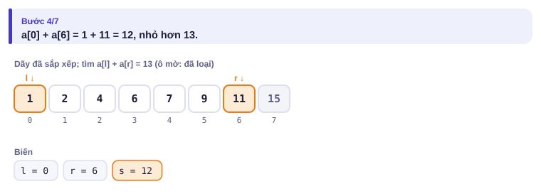
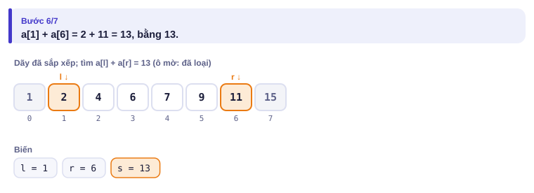
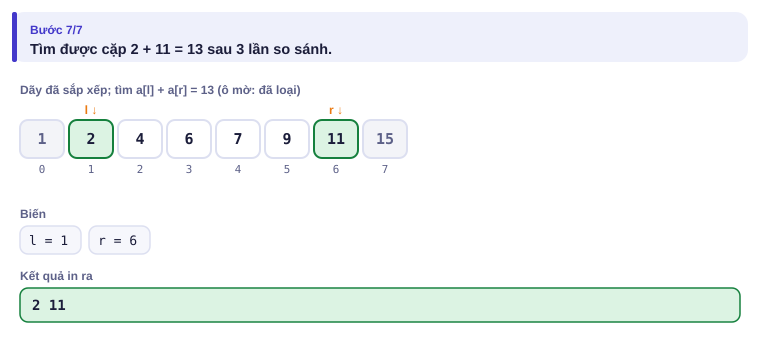

</details>

Mỗi bước loại được một phần tử, nên O(n) sau khi sắp xếp. Bài CSES yêu cầu in **vị trí ban đầu**: nhớ sắp xếp các cặp (giá trị, chỉ số) như Bẫy 3 ở bài 1.2.

---

## 6. Vì sao đúng, chạy bao lâu

- **Đúng (cửa sổ trượt):** với mỗi r, l là điểm đầu nhỏ nhất sao cho tổng [l, r] ≤ S. Vì các phần tử dương, khi r tăng thì điểm đầu nhỏ nhất đó không giảm (mục 2), nên không bỏ sót đoạn nào bằng cách không lùi l.
- **Đúng (hai đầu):** mỗi lần loại a[l] hay a[r], phần tử đó chắc chắn không ghép được với **bất kỳ** phần tử nào còn lại (xem lý do ở trên). Nếu có cặp đúng, nó không bao giờ bị loại.
- **Phân tích khấu hao:** dù có `while` trong `for`, mỗi lần `while` chạy là l tăng 1, mà l chỉ tăng tối đa n lần **trong cả chương trình**. Tổng số bước ≤ 2n: **O(n)**. Cùng kiểu lập luận với ngăn xếp đơn điệu ở bài 2.4.

---

## 7. Bẫy thường gặp

> [!WARNING]
> **Bẫy 1: dùng cửa sổ trượt khi có số âm.** Có số âm thì kéo dài đoạn có thể làm tổng **giảm**, lập luận "l không lùi" sai. Khi đó dùng tổng tiền tố (bài 1.3) kết hợp cách khác.
> *Test phá:* `3 5` / `6 -4 3`: đoạn cả dãy có tổng 5 dài 3, nhưng cửa sổ trượt bỏ 6 ngay từ đầu nên chỉ tìm được 2.

> [!WARNING]
> **Bẫy 2: phần tử đơn lẻ lớn hơn S.** Khi a[r] > S, vòng `while` đẩy l vượt qua r. Code ở trên vẫn đúng vì độ dài r − l + 1 = 0, nhưng nếu em viết khác hãy thử test này.
> *Test phá:* ví dụ "có phần tử lớn hơn S" trên trang mô phỏng.

> [!WARNING]
> **Bẫy 3: nhầm "đoạn liên tiếp" với "dãy con bất kỳ".** Hai con trỏ cửa sổ trượt dành cho đoạn liên tiếp. Chọn các phần tử bất kỳ là một bài khác hẳn.

> [!WARNING]
> **Bẫy 4: hai đầu trên mảng chưa sắp xếp.** Lập luận "loại a[l]" chỉ đúng khi a[r] là số lớn nhất còn lại.

---

## 8. Ví dụ giảm dần hỗ trợ

### Ví dụ 2 – Điền vào chỗ trống: Đếm cặp có tổng không quá x

Cho n số (2 ≤ n ≤ 2·10⁵) và x. Đếm số cặp chỉ số i < j với aᵢ + aⱼ ≤ x.

| Vào | Ra |
| --- | --- |
| `5 7`<br>`1 5 3 6 2` | `6` |

Sau khi sắp xếp, nếu a[l] + a[r] ≤ x thì a[l] ghép được với **mọi** phần tử từ l + 1 tới r.

```text
a.sort()
l, r, dem = 0, n - 1, 0
while l < r:
    if a[l] + a[r] <= x:
        dem += ____
        l += 1
    else:
        ____
print(dem)
```

<details>
<summary>Đáp án</summary>

`r - l` và `r -= 1`. Với ví dụ, dãy sắp xếp `1 2 3 5 6`: các cặp là (1,2) (1,3) (1,5) (1,6) (2,3) (2,5).

```python
# file: dem_cap_nho.py
n, x = map(int, input().split())
a = sorted(map(int, input().split()))
l, r, dem = 0, n - 1, 0
while l < r:
    if a[l] + a[r] <= x:
        dem += r - l
        l += 1
    else:
        r -= 1
print(dem)
```

```cpp
// file: dem_cap_nho.cpp
#include <bits/stdc++.h>
using namespace std;
int main() {
    int n; long long x;
    cin >> n >> x;
    vector<long long> a(n);
    for (auto &v : a) cin >> v;
    sort(a.begin(), a.end());
    int l = 0, r = n - 1;
    long long dem = 0;
    while (l < r) {
        if (a[l] + a[r] <= x) { dem += r - l; l++; }
        else r--;
    }
    cout << dem << '\n';
}
```

</details>

### Ví dụ 3 – Tự làm: Đoạn ngắn nhất đủ tiền

Cho n số dương (n ≤ 2·10⁵) và S. Tìm độ dài đoạn liên tiếp **ngắn nhất** có tổng **≥ S**; in 0 nếu không có.

| Vào | Ra |
| --- | --- |
| `6 7`<br>`2 3 1 2 4 3` | `2` |

> [!IMPORTANT]
> Tự làm trước. Gợi ý: vẫn thêm a[r] vào cửa sổ; nhưng lần này, **trong khi** tổng còn ≥ S, ghi nhận độ dài rồi thử bỏ a[l] để xem có ngắn hơn được không.

<details>
<summary>Lời giải</summary>

Đoạn `4 3` có tổng 7, dài 2.

```python
# file: ngan_nhat.py
n, S = map(int, input().split())
a = list(map(int, input().split()))
tong = l = 0
best = n + 1
for r in range(n):
    tong += a[r]
    while tong >= S:
        best = min(best, r - l + 1)
        tong -= a[l]
        l += 1
print(best if best <= n else 0)
```

```cpp
// file: ngan_nhat.cpp
#include <bits/stdc++.h>
using namespace std;
int main() {
    int n; long long S;
    cin >> n >> S;
    vector<long long> a(n);
    for (auto &x : a) cin >> x;
    long long tong = 0;
    int l = 0, best = n + 1;
    for (int r = 0; r < n; r++) {
        tong += a[r];
        while (tong >= S) { best = min(best, r - l + 1); tong -= a[l++]; }
    }
    cout << (best <= n ? best : 0) << '\n';
}
```

</details>

---

## 9. Bài tập

| Nấc | Bài | Nguồn | Ý chính |
| --- | --- | --- | --- |
| Khởi động | [Subarray Sums I](https://cses.fi/problemset/task/1660) | CSES 1660 | Đếm đoạn tổng bằng x |
| Khởi động | [Books](https://codeforces.com/problemset/problem/279/B) | CF 279B · 1400 | Đúng bài mở màn |
| Luyện | [Sum of Two Values](https://cses.fi/problemset/task/1640) | CSES 1640 | Hai đầu, giữ chỉ số |
| Luyện | [Ferris Wheel](https://cses.fi/problemset/task/1090) | CSES 1090 | Ghép nặng nhất với nhẹ nhất |
| Thử thách | [Sum of Three Values](https://cses.fi/problemset/task/1641) | CSES 1641 | Cố định một, hai con trỏ cho hai còn lại |
| Kiểu đề thi | Dãy đèn | Bài của sách, chấm theo subtask | Xem bên dưới |

### Bài kiểu đề thi: Dãy đèn

**Đề bài.** Dãy đèn trang trí đường Nguyễn Huệ có n bóng (1 ≤ n ≤ 10⁶), mô tả bằng xâu gồm `1` (sáng) và `0` (hỏng). Đội kỹ thuật được thay **tối đa k** bóng hỏng (0 ≤ k ≤ n). Sau khi thay, đoạn bóng sáng liên tiếp dài nhất có thể là bao nhiêu? Đọc từ `DAYDEN.INP` (dòng đầu n k, dòng sau là xâu), ghi ra `DAYDEN.OUT`.

Subtask: 40% có n ≤ 5000; 60% còn lại có n ≤ 10⁶.

| DAYDEN.INP | DAYDEN.OUT |
| --- | --- |
| `10 2`<br>`1101001110` | `6` |

Thay hai bóng hỏng ở vị trí 5 và 6 (đếm từ 1): đoạn `1 1 1 1 1 1` từ vị trí 4 tới 9.

<details>
<summary><b>Gợi ý 1</b> – hướng đi (đủ 40% điểm)</summary>

Thử mọi điểm đầu l, kéo dài r và đếm số bóng hỏng; dừng khi vượt k. O(n²).

</details>

<details>
<summary><b>Gợi ý 2</b> – ý then chốt</summary>

Bài toán thành: tìm đoạn dài nhất chứa **không quá k số 0**. Đúng dạng cửa sổ trượt: thêm phải, khi số 0 vượt k thì đẩy trái.

</details>

<details>
<summary><b>Gợi ý 3</b> – lời giải đầy đủ</summary>

O(n). Với n = 10⁶, Python vẫn chạy được trong khoảng 1 giây nếu đọc xâu một lần.

```python
# file: dayden.py
with open("DAYDEN.INP") as f:
    n, k = map(int, f.readline().split())
    s = f.readline().strip()
hong = l = best = 0
for r in range(n):
    if s[r] == '0':
        hong += 1
    while hong > k:
        if s[l] == '0':
            hong -= 1
        l += 1
    if r - l + 1 > best:
        best = r - l + 1
with open("DAYDEN.OUT", "w") as f:
    f.write(f"{best}\n")
```

```cpp
// file: dayden.cpp
#include <bits/stdc++.h>
using namespace std;
int main() {
    freopen("DAYDEN.INP", "r", stdin);
    freopen("DAYDEN.OUT", "w", stdout);
    int n, k;
    string s;
    cin >> n >> k >> s;
    int hong = 0, l = 0, best = 0;
    for (int r = 0; r < n; r++) {
        if (s[r] == '0') hong++;
        while (hong > k) { if (s[l] == '0') hong--; l++; }
        best = max(best, r - l + 1);
    }
    cout << best << '\n';
}
```

</details>

---

## 10. Tóm tắt, flashcard và checkpoint

**Tóm tắt trong 5 dòng.**

1. Cửa sổ trượt: thêm phải, bớt trái; dùng được khi kéo dài đoạn chỉ làm điều kiện "khó hơn" (phần tử không âm, đếm số 0…).
2. Mỗi con trỏ chỉ đi một chiều, nên O(n) dù có vòng lặp lồng nhau (khấu hao).
3. Dài nhất thỏa ≤: đẩy l khi vi phạm. Ngắn nhất thỏa ≥: đẩy l khi còn thỏa.
4. Mảng đã sắp xếp + tìm cặp: hai đầu tiến vào giữa, mỗi bước loại một phần tử.
5. Có số âm: không dùng cửa sổ trượt; nghĩ tới tiền tố.

**Flashcard.**

<details><summary>Vì sao cửa sổ trượt cần các phần tử dương?</summary>Để bỏ bớt phần tử thì tổng giảm, kéo dài thì tổng tăng; nhờ đó l không cần lùi.</details>
<details><summary>Số bước tối đa của hai con trỏ trên n phần tử?</summary>Khoảng 2n: mỗi con trỏ đi tối đa n bước.</details>
<details><summary>Hai đầu: a[l] + a[r] &lt; x thì làm gì, vì sao?</summary>Tăng l: a[l] cộng với số lớn nhất còn lại vẫn chưa đủ, nên a[l] vô dụng.</details>
<details><summary>Đếm cặp aᵢ + aⱼ ≤ x: khi a[l] + a[r] ≤ x thì cộng bao nhiêu?</summary>r − l.</details>
<details><summary>"Đoạn dài nhất có tối đa k số 0" là dạng gì?</summary>Cửa sổ trượt với biến đếm số 0 trong cửa sổ.</details>

**Ôn xoắn ốc** (kiến thức bài 1.2–1.4; mỗi bài tối đa 20 phút):

- [Factory Machines](https://cses.fi/problemset/task/1620) (CSES 1620): nhị phân trên đáp án.
- Láng nhựa (bài 1.3), viết lại không nhìn sách.
- [Distinct Numbers](https://cses.fi/problemset/task/1621) (CSES 1621): sắp xếp.

**Checkpoint – em đã sẵn sàng sang bài tiếp theo nếu:**

- [ ] Viết lại bài Chạy bộ không nhìn sách, đúng cả test có phần tử lớn hơn S.
- [ ] AC [Sum of Two Values](https://cses.fi/problemset/task/1640) và [Subarray Sums I](https://cses.fi/problemset/task/1660).
- [ ] Làm xong Ví dụ 3 (Đoạn ngắn nhất đủ tiền) mà không mở lời giải.
- [ ] Đạt trọn điểm bài Dãy đèn khi tự làm trong 25 phút.

Chưa đạt? Nếu vướng ô 1, mở trang mô phỏng cửa sổ trượt với ví dụ "có phần tử lớn hơn S". Nếu vướng ô 2, mở trang mô phỏng hai đầu với chế độ Đoán trước. Nếu vướng ô 3 hoặc 4, đọc lại dòng 3 của phần tóm tắt.
