# Bài 1.6 – Đệ quy

> **Tập 1 · Nền tảng thuật toán**
> Cần biết trước: bài 0.7 (hàm, ngăn gọi hàm).
> Thời lượng: khoảng 75 phút đọc, cộng 5 giờ thực hành trong tuần.

**Học xong bài này, em sẽ:**

- viết hàm **tự gọi chính nó** để giải bài toán lớn qua các bài toán nhỏ cùng dạng;
- xác định đúng **trường hợp cơ sở** để đệ quy dừng;
- vẽ **cây lời gọi** và theo dõi ngăn gọi hàm khi đệ quy chạy;
- lấy subtask 40% bài **Xây tường** bằng đệ quy chia đoạn.

> [!TIP]
> **Học cùng hai trang mô phỏng.** [Tháp Hà Nội](../../mo-phong/t1-thap-ha-noi.html): xem ba cọc và ngăn gọi hàm cùng lúc, thử n = 3. [Xây tường bằng đệ quy](../../mo-phong/t1-xay-tuong-de-quy.html): xem mỗi lời gọi phủ một phần rồi gọi tiếp với nền mới. Bật **Đoán trước** ở cả hai trang.

---

## 1. Bài toán mở màn: Tháp Hà Nội

Có 3 cọc. Cọc 1 có n đĩa, đĩa lớn ở dưới, nhỏ ở trên. Chuyển hết sang cọc 3; mỗi lần chuyển một đĩa trên cùng; không bao giờ đặt đĩa lớn lên đĩa nhỏ. In số lần chuyển ít nhất, rồi từng lần chuyển dạng `từ tới`. (1 ≤ n ≤ 16, bài [Tower of Hanoi](https://cses.fi/problemset/task/2165))

| Vào | Ra |
| --- | --- |
| `2` | `3`<br>`1 2`<br>`1 3`<br>`2 3` |

---

## 2. Dừng lại 10 phút

> [!IMPORTANT]
> **Dừng lại và nghĩ.**
> 1. Chơi bằng tay với n = 3 (dùng ba đồng xu cỡ khác nhau). Em cần bao nhiêu lần chuyển?
> 2. Để chuyển đĩa **lớn nhất** từ cọc 1 sang cọc 3, lúc đó n − 1 đĩa còn lại phải nằm ở đâu?
> 3. Việc "dời n − 1 đĩa" có giống bài toán ban đầu không?

<details>
<summary>Đáp án</summary>

1. 7 lần.
2. Phải nằm hết ở cọc 2 (cọc trung gian), vì đĩa lớn nhất không được đặt lên đĩa nào nhỏ hơn và phải nằm trên cùng cọc 1.
3. Giống hệt, chỉ nhỏ hơn một đĩa và đổi vai các cọc. Vậy: (1) chuyển n − 1 đĩa từ cọc 1 sang cọc 2; (2) chuyển đĩa lớn nhất từ 1 sang 3; (3) chuyển n − 1 đĩa từ cọc 2 sang cọc 3.

</details>

---

## 3. Lời giải ngây thơ và vì sao nó không đi xa được

An thử viết thẳng các lần chuyển cho n = 1, 2, 3 bằng `if`:

```python
if n == 1:
    print("1\n1 3")
elif n == 2:
    print("3\n1 2\n1 3\n2 3")
elif n == 3:
    print("7\n1 3\n1 2\n3 2\n1 3\n2 1\n2 3\n1 3")
# n = 16 cần 65 535 dòng…
```

Cách này không có quy luật, không mở rộng được, và rất dễ chép sai. Điều An bỏ lỡ: lời giải cho n = 3 **chứa** lời giải cho n = 2 hai lần (ở dòng 2–4 và 6–8, với các cọc đổi tên). Đó là dấu hiệu của **đệ quy**.

---

## 4. Ý tưởng then chốt

> [!IMPORTANT]
> **Một hàm đệ quy có ba phần: (1) trường hợp cơ sở, bài nhỏ tới mức trả lời ngay; (2) lời gọi đệ quy trên bài nhỏ hơn cùng dạng; (3) ghép kết quả.** Tin rằng lời gọi nhỏ hơn làm đúng việc của nó (như tin một người phụ việc), em chỉ cần lo phần ghép.

Với Tháp Hà Nội: cơ sở là n = 0 (không làm gì); lời gọi là hai lần chuyển n − 1 đĩa; ghép là chuyển đĩa lớn nhất ở giữa.

### Chạy từng bước

Với n = 2. Mỗi bước, đoán đĩa nào chuyển đi đâu rồi mới mở.

<details>
<summary><b>Bước 1</b> – Ban đầu</summary>

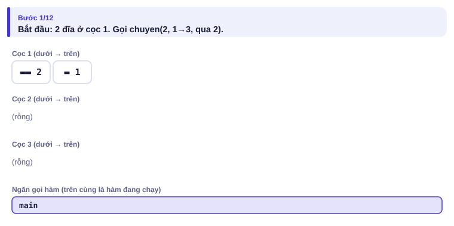

</details>

<details>
<summary><b>Bước 2</b> – chuyen(2) gọi chuyen(1) để dời đĩa nhỏ đi đâu?</summary>

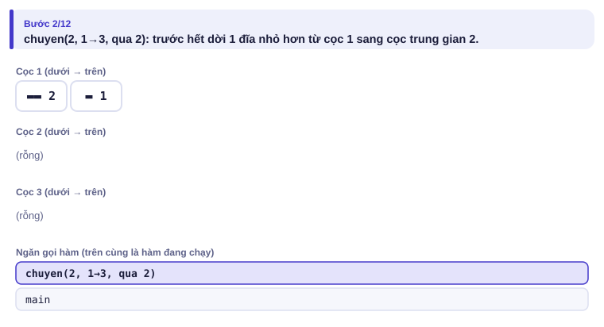
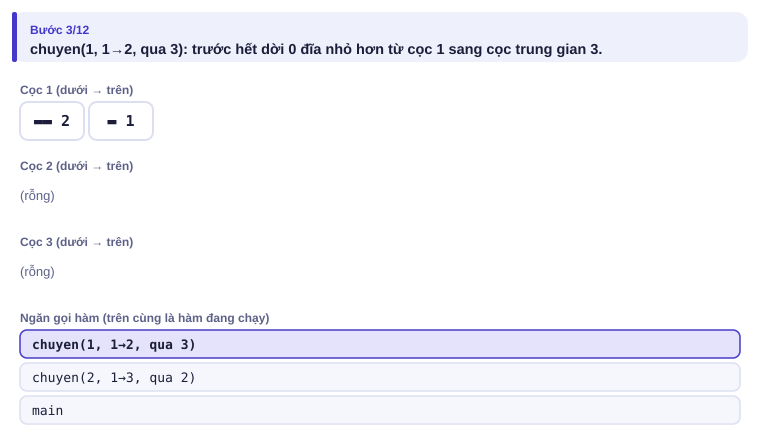

</details>

<details>
<summary><b>Bước 3</b> – Lần chuyển đầu tiên</summary>

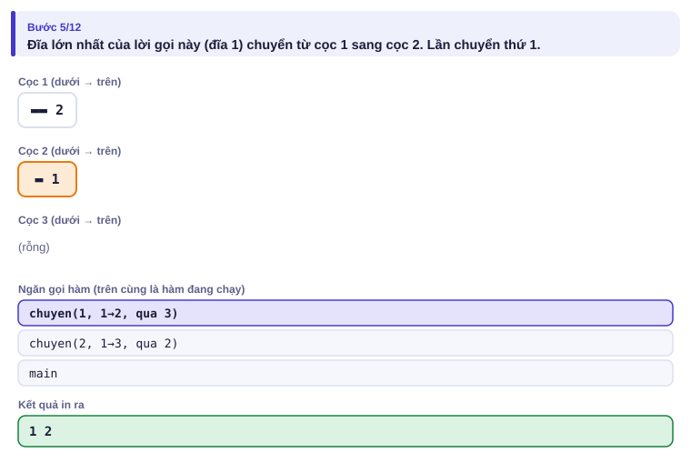

</details>

<details>
<summary><b>Bước 4</b> – Đĩa lớn nhất</summary>

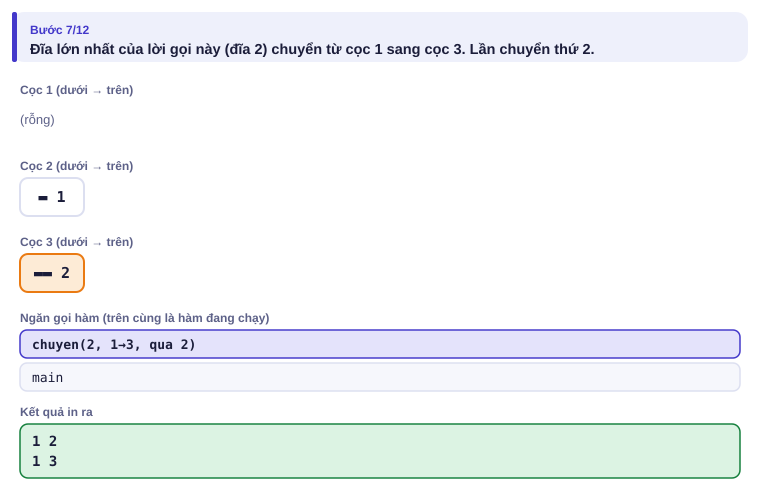

Ngăn gọi hàm chỉ còn chuyen(2): chuyen(1) đầu tiên đã xong.

</details>

<details>
<summary><b>Bước 5</b> – Đĩa nhỏ về cọc đích</summary>

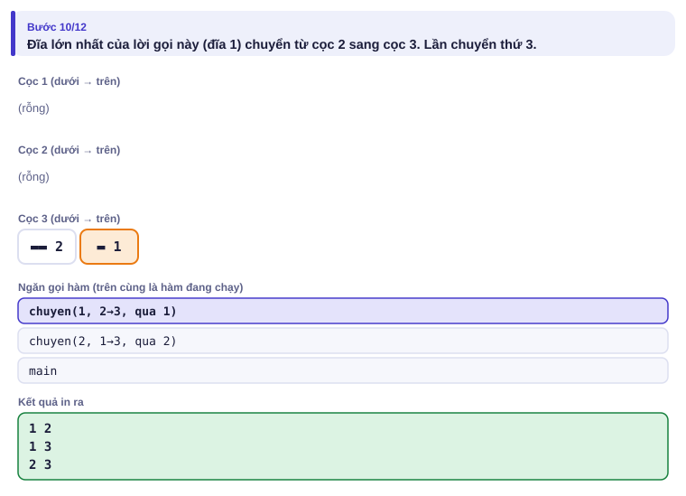
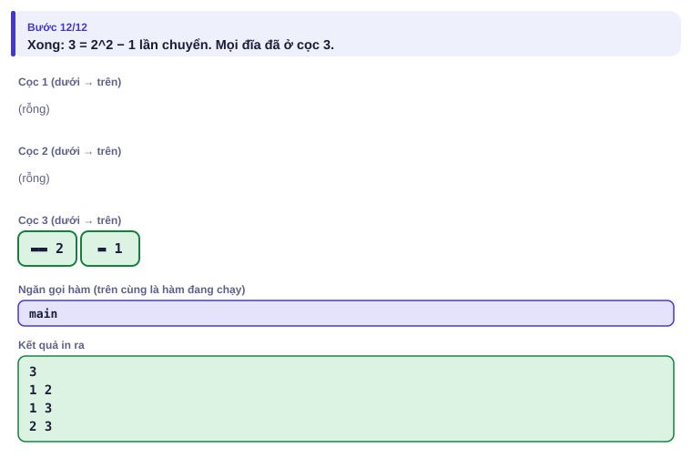

</details>

Cây lời gọi với n = 2 (đọc từ trái sang phải, các nét chuyển đĩa theo đúng thứ tự in ra):

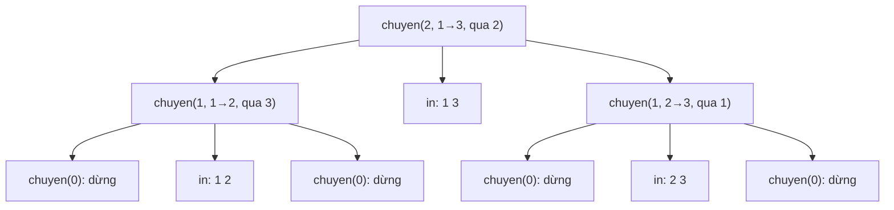

---

## 5. Mã giả và cài đặt

```text
hàm chuyen(n, tu, toi, tg):
    nếu n = 0: trở về
    chuyen(n − 1, tu, tg, toi)
    ghi lại: chuyển một đĩa từ tu sang toi
    chuyen(n − 1, tg, toi, tu)
```

```cpp
// file: thap_ha_noi.cpp
#include <bits/stdc++.h>
using namespace std;
vector<pair<int, int>> buoc;

void chuyen(int n, int tu, int toi, int tg) {   // chuyển n đĩa từ cọc tu sang cọc toi, qua cọc tg
    if (n == 0) return;                          // cơ sở
    chuyen(n - 1, tu, tg, toi);                  // n-1 đĩa sang cọc trung gian
    buoc.push_back({tu, toi});                   // đĩa lớn nhất
    chuyen(n - 1, tg, toi, tu);                  // n-1 đĩa từ trung gian sang đích
}

int main() {
    int n;
    cin >> n;
    chuyen(n, 1, 3, 2);
    cout << buoc.size() << '\n';
    for (auto [a, b] : buoc) cout << a << ' ' << b << '\n';
}
```

```python
# file: thap_ha_noi.py
n = int(input())
buoc = []

def chuyen(n, tu, toi, tg):
    if n == 0:
        return
    chuyen(n - 1, tu, tg, toi)
    buoc.append((tu, toi))
    chuyen(n - 1, tg, toi, tu)

chuyen(n, 1, 3, 2)
print(len(buoc))
print('\n'.join(f"{a} {b}" for a, b in buoc))
```

### Bài kiểu đề thi: Xây tường, subtask 40%

> Lời giải đầy đủ 100% ở [Tập 2, bài 2.4](../../tap-2-cau-truc-du-lieu/bai-2-4-ngan-xep-don-dieu/).

Công nhân xây một bức tường dài N ô, ban đầu mọi ô cao 0, ô i cần cao đúng aᵢ. Mỗi bước, cần cẩu đặt một tấm khối phủ một đoạn ô liên tiếp, dày bao nhiêu cũng được nhưng đều nhau trên cả đoạn. Để tường vững, hai tấm bất kỳ phải phủ hai đoạn rời nhau, hoặc đoạn này nằm trọn trong đoạn kia. Tìm số bước ít nhất. Subtask 40%: N ≤ 1000.

| Vào | Ra |
| --- | --- |
| `5`<br>`2 4 2 3 3` | `3` |

**Ý tưởng đệ quy.** Xét một đoạn mà mọi ô đã có sẵn `nen` viên. Các ô cao đúng `nen` đã xong và **chia** đoạn thành các phần. Trong mỗi phần, ô thấp nhất (cao m) cho biết: có thể dùng **một bước** phủ cả phần lên cao m. Sau đó phần ấy là **cùng bài toán** với nền mới là m.

<details>
<summary><b>Hình</b> – đệ quy với <code>2 4 2 3 3</code> (mở lần lượt, đoán trước độ cao mỗi tấm)</summary>

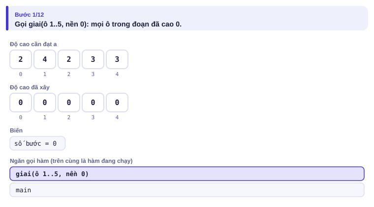
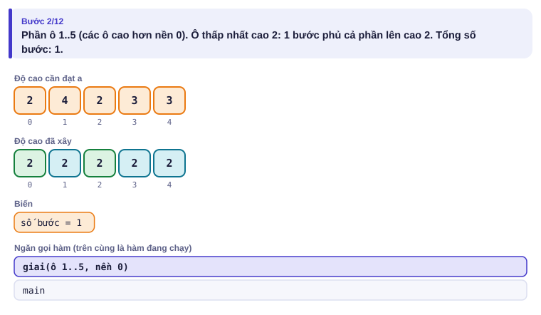
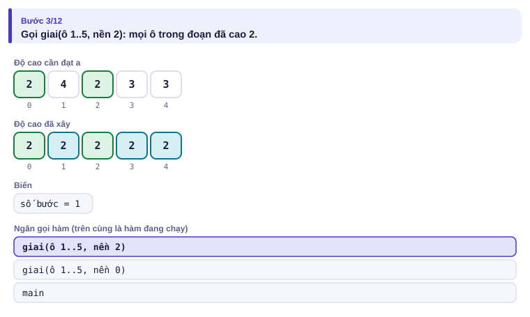
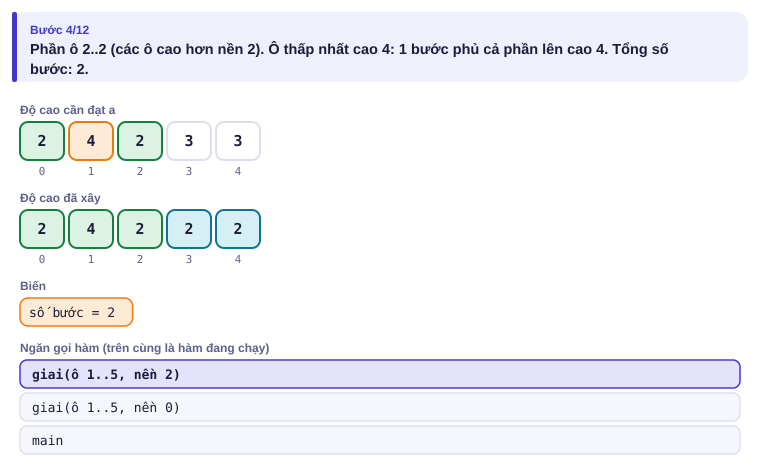
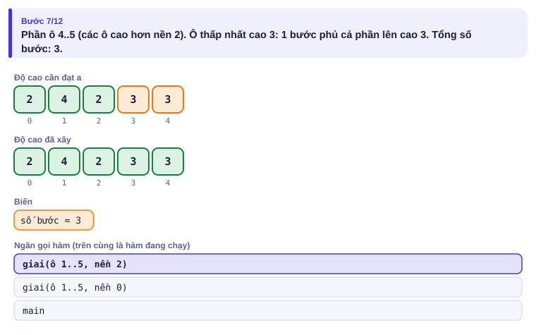
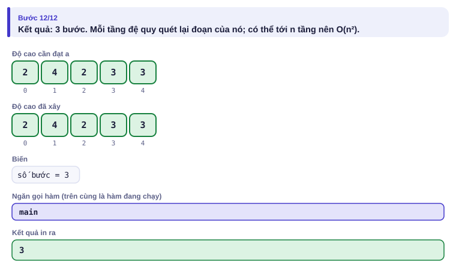

</details>

| Lời gọi | Các phần còn thiếu | Min | Kết quả |
| --- | --- | :---: | --- |
| giai(ô 1..5, nền 0) | [1..5] | 2 | 1 + giai(ô 1..5, nền 2) |
| giai(ô 1..5, nền 2) | [2..2] và [4..5] | 4 và 3 | (1 + 0) + (1 + 0) = 2 |
| **Tổng** | | | **3** |

```cpp
// file: xaytuong_de_quy.cpp
#include <bits/stdc++.h>
using namespace std;
vector<long long> a;

long long giai(int l, int r, long long nen) {     // số bước để các ô l..r từ "nen" lên đúng a[i]
    long long kq = 0;
    int i = l;
    while (i <= r) {
        if (a[i] == nen) { i++; continue; }        // ô đã xong, nó chia đoạn
        int j = i;
        long long m = a[i];
        while (j + 1 <= r && a[j + 1] > nen) { j++; m = min(m, a[j]); }
        kq += 1 + giai(i, j, m);                   // 1 bước phủ [i..j] lên cao m, rồi đệ quy
        i = j + 1;
    }
    return kq;
}

int main() {
    // Khi thi: bật hai dòng freopen cho XAYTUONG.INP / XAYTUONG.OUT
    int n;
    cin >> n;
    a.resize(n);
    for (auto &x : a) cin >> x;
    cout << giai(0, n - 1, 0) << '\n';
}
```

```python
# file: xaytuong_de_quy.py
import sys
sys.setrecursionlimit(10000)          # Python mặc định chỉ cho khoảng 1000 tầng đệ quy

def giai(l, r, nen):
    kq = 0
    i = l
    while i <= r:
        if a[i] == nen:
            i += 1
            continue
        j = i
        while j + 1 <= r and a[j + 1] > nen:
            j += 1
        m = min(a[i:j + 1])
        kq += 1 + giai(i, j, m)
        i = j + 1
    return kq

data = sys.stdin.read().split()
n = int(data[0])
a = list(map(int, data[1:n + 1]))
print(giai(0, n - 1, 0))
```

---

## 6. Vì sao đúng, chạy bao lâu

- **Tháp Hà Nội đúng** theo quy nạp: chuyen(0) đúng (không làm gì). Nếu chuyen(n − 1) đúng thì chuyen(n) dời n − 1 đĩa đi chỗ khác một cách hợp lệ, chuyển đĩa lớn nhất (lúc đó cọc đích không có đĩa nào nhỏ hơn nó, vì mọi đĩa nhỏ hơn đang ở cọc trung gian), rồi dời n − 1 đĩa lên trên nó: hợp lệ.
- **Số lần chuyển** T(n) = 2T(n − 1) + 1, T(0) = 0, nên T(n) = 2ⁿ − 1. Với n = 16 là 65 535 lần. Không thể ít hơn: đĩa lớn nhất phải di chuyển ít nhất một lần, và trước lúc đó n − 1 đĩa phải dời đi hết.
- **Xây tường:** mỗi tầng đệ quy quét lại đoạn của mình, và có thể có tới N tầng (ví dụ dãy 1 2 3 … N): O(N²). Đủ cho N ≤ 1000, tức 40% điểm. Muốn trọn điểm cần ngăn xếp đơn điệu ở Tập 2.

---

## 7. Bẫy thường gặp

> [!WARNING]
> **Bẫy 1: thiếu hoặc sai trường hợp cơ sở.** Đệ quy không dừng, chương trình tràn ngăn xếp (stack overflow): C++ dừng đột ngột, Python báo `RecursionError`.
> *Test phá:* bỏ dòng `if n == 0: return` rồi chạy với n = 1.

> [!WARNING]
> **Bẫy 2: giới hạn độ sâu của Python.** Python mặc định khoảng 1000 tầng. Đệ quy sâu hơn phải `sys.setrecursionlimit(...)`; sâu tới 10⁵ tầng thì nên viết lại bằng vòng lặp.
> *Test phá:* Xây tường với dãy 1 2 3 … 1000.

> [!WARNING]
> **Bẫy 3: đệ quy tính lại cùng một việc nhiều lần.** Fibonacci viết `f(n) = f(n-1) + f(n-2)` chạy O(2ⁿ): f(40) đã mất nhiều giây. Cách sửa (lưu lại kết quả) là quy hoạch động, học ở Tập 2.

> [!WARNING]
> **Bẫy 4: dùng biến toàn cục làm biến của lời gọi.** Biến dùng riêng cho mỗi lời gọi (như `kq`, `i`, `j` trong `giai`) phải là biến **cục bộ**; dùng chung một biến toàn cục thì lời gọi con ghi đè lên dữ liệu của lời gọi cha.

---

## 8. Ví dụ giảm dần hỗ trợ

### Ví dụ 2 – Điền vào chỗ trống: Lũy thừa nhanh

Tính aᵇ mod m với 0 ≤ a < m ≤ 10⁹ và 0 ≤ b ≤ 10¹⁸. Dùng: a^b = (a^(b/2))² nếu b chẵn, và a · a^(b−1) nếu b lẻ.

| Vào | Ra |
| --- | --- |
| `2 10 1000` | `24` |
| `3 0 7` | `1` |

```text
def luy_thua(a, b, m):
    if b == 0:
        return ____
    if b % 2 == 0:
        t = luy_thua(a, ____, m)
        return t * t % m
    return a * luy_thua(a, ____, m) % m
```

<details>
<summary>Đáp án</summary>

`1 % m`, `b // 2`, `b - 1`. Mỗi hai tầng b ít nhất giảm một nửa, nên chỉ khoảng 2·log₂b ≈ 120 tầng với b = 10¹⁸. Trả về `1 % m` thay vì `1` để đúng cả khi m = 1.

```python
# file: luy_thua.py
def luy_thua(a, b, m):
    if b == 0:
        return 1 % m
    if b % 2 == 0:
        t = luy_thua(a, b // 2, m)
        return t * t % m
    return a * luy_thua(a, b - 1, m) % m

a, b, m = map(int, input().split())
print(luy_thua(a, b, m))
```

```cpp
// file: luy_thua.cpp
#include <bits/stdc++.h>
using namespace std;
long long luy_thua(long long a, long long b, long long m) {
    if (b == 0) return 1 % m;
    if (b % 2 == 0) { long long t = luy_thua(a, b / 2, m); return t * t % m; }
    return a * luy_thua(a, b - 1, m) % m;
}
int main() {
    long long a, b, m;
    cin >> a >> b >> m;
    cout << luy_thua(a, b, m) << '\n';
}
```

</details>

### Ví dụ 3 – Tự làm: Xâu nhị phân

In mọi xâu độ dài n (1 ≤ n ≤ 12) gồm `0` và `1` **không có hai số 1 đứng cạnh nhau**, theo thứ tự từ điển, mỗi xâu một dòng.

| Vào | Ra |
| --- | --- |
| `3` | `000`<br>`001`<br>`010`<br>`100`<br>`101` |

> [!IMPORTANT]
> Tự làm trước. Gợi ý: hàm `sinh(s)` nhận phần đầu xâu đã có; nếu đủ n ký tự thì in; ngược lại thử thêm `0`, và thêm `1` nếu ký tự cuối không phải `1`. Đây là bước đệm cho quay lui ở bài 1.7.

<details>
<summary>Lời giải</summary>

```python
# file: xau_nhi_phan.py
n = int(input())
out = []

def sinh(s):
    if len(s) == n:
        out.append(s)
        return
    sinh(s + "0")
    if not s or s[-1] != "1":
        sinh(s + "1")

sinh("")
print("\n".join(out))
```

```cpp
// file: xau_nhi_phan.cpp
#include <bits/stdc++.h>
using namespace std;
int n;
void sinh(string s) {
    if ((int)s.size() == n) { cout << s << '\n'; return; }
    sinh(s + "0");
    if (s.empty() || s.back() != '1') sinh(s + "1");
}
int main() {
    cin >> n;
    sinh("");
}
```

</details>

---

## 9. Bài tập

| Nấc | Bài | Nguồn | Ý chính |
| --- | --- | --- | --- |
| Khởi động | [Tower of Hanoi](https://cses.fi/problemset/task/2165) | CSES 2165 | Đúng bài mở màn |
| Khởi động | Viết hàm đệ quy tính tổng chữ số của n, và ƯCLN theo Euclid | Tự luyện | Cơ sở + lời gọi nhỏ hơn |
| Luyện | [Gray Code](https://cses.fi/problemset/task/2205) | CSES 2205 | Dựng lời giải n từ lời giải n − 1 |
| Luyện | Xây tường: tự sinh 100 test ngẫu nhiên N ≤ 8, so `xaytuong_de_quy` với lời giải ngăn xếp ở Tập 2 | Tự luyện | Chuẩn bị cho bài 1.9 |
| Thử thách | [Exponentiation II](https://cses.fi/problemset/task/1712) | CSES 1712 | Lũy thừa nhanh hai tầng |
| Kiểu đề thi | Xây tường (40%) | Mục 5 | Đệ quy chia đoạn |

---

## 10. Tóm tắt, flashcard và checkpoint

**Tóm tắt trong 5 dòng.**

1. Đệ quy = trường hợp cơ sở + lời gọi trên bài nhỏ hơn + ghép kết quả.
2. Tin lời gọi nhỏ hơn làm đúng; chỉ lo phần ghép (lập luận quy nạp).
3. Vẽ cây lời gọi khi chưa hiểu đệ quy chạy thế nào; ngăn gọi hàm cao bằng độ sâu đệ quy.
4. Đếm số phép qua công thức truy hồi: T(n) = 2T(n − 1) + 1 cho 2ⁿ − 1.
5. Python: tăng `setrecursionlimit` khi đệ quy sâu; đệ quy tính lại cùng việc thì chậm theo cấp số mũ.

**Flashcard.**

<details><summary>Tháp Hà Nội với n = 3 cần bao nhiêu bước?</summary>2³ − 1 = 7.</details>
<details><summary>Trong bài Xây tường, vì sao luôn có thể phủ cả đoạn lên cao bằng ô thấp nhất trong một bước?</summary>Mọi ô trong đoạn đều cần ít nhất chừng đó; một bước phủ cả đoạn thỏa luật lồng nhau với mọi bước sau trong đoạn.</details>
<details><summary>Ba phần của một hàm đệ quy?</summary>Trường hợp cơ sở, lời gọi trên bài nhỏ hơn, ghép kết quả.</details>
<details><summary>Lũy thừa nhanh aᵇ cần khoảng bao nhiêu tầng đệ quy?</summary>Khoảng 2·log₂b.</details>
<details><summary>Python mặc định cho đệ quy sâu khoảng bao nhiêu tầng?</summary>Khoảng 1000.</details>

**Ôn xoắn ốc** (kiến thức bài 1.3–1.5; mỗi bài tối đa 20 phút):

- [Subarray Sums I](https://cses.fi/problemset/task/1660) (CSES 1660): cửa sổ trượt.
- Cắt gỗ (bài 1.4, Ví dụ 3), viết lại không nhìn sách.
- [Forest Queries](https://cses.fi/problemset/task/1652) (CSES 1652): tiền tố hai chiều.

**Checkpoint – em đã sẵn sàng sang bài tiếp theo nếu:**

- [ ] Viết lại Tháp Hà Nội không nhìn sách.
- [ ] Vẽ được cây lời gọi của chuyen(3) và đọc ra đúng 7 lần chuyển.
- [ ] Tự giải thích được bảng chạy tay của Xây tường với dãy `3 1 3`.
- [ ] Làm xong Ví dụ 3 (Xâu nhị phân) mà không mở lời giải.

Chưa đạt? Nếu vướng ô 1 hoặc 2, mở trang mô phỏng Tháp Hà Nội với n = 3, theo dõi ngăn gọi hàm. Nếu vướng ô 3, mở trang mô phỏng Xây tường với ví dụ "hai phần tách nhau". Nếu vướng ô 4, đọc lại mục 4 rồi làm lại Ví dụ 2.
