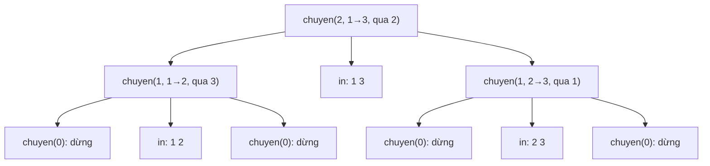

# Bài 1.6 – Đệ quy

> **Tập 1** · Cần biết trước: bài 0.7 (hàm) · Thời lượng: khoảng 75 phút đọc, 5 giờ thực hành

**Học xong bài này, em sẽ:**

- viết hàm **tự gọi chính nó** để giải bài toán lớn qua các bài toán nhỏ cùng dạng;
- xác định đúng **trường hợp cơ sở** để đệ quy dừng;
- lấy subtask 40% bài **Xây tường** bằng đệ quy.

---

## 1. Bài toán mở màn: Tháp Hà Nội

Có 3 cọc. Cọc 1 có n đĩa, đĩa lớn ở dưới, nhỏ ở trên. Chuyển hết sang cọc 3; mỗi lần chuyển một đĩa trên cùng; không bao giờ đặt đĩa lớn lên đĩa nhỏ. In số lần chuyển ít nhất, rồi từng lần chuyển dạng `từ tới`. (1 ≤ n ≤ 16, bài [Tower of Hanoi](https://cses.fi/problemset/task/2165))

| Vào | Ra |
| --- | --- |
| `2` | `3`<br>`1 2`<br>`1 3`<br>`2 3` |

> [!IMPORTANT]
> **Dừng lại và nghĩ.** Để chuyển đĩa **lớn nhất** từ cọc 1 sang cọc 3, lúc đó n − 1 đĩa còn lại phải nằm ở đâu?

<details>
<summary>Đáp án</summary>

Phải nằm hết ở cọc 2 (cọc trung gian). Vậy: (1) chuyển n − 1 đĩa từ cọc 1 sang cọc 2; (2) chuyển đĩa lớn nhất từ 1 sang 3; (3) chuyển n − 1 đĩa từ cọc 2 sang cọc 3. Bước (1) và (3) là **cùng bài toán, nhỏ hơn một đĩa**.

</details>

---

## 2. Ba phần của một hàm đệ quy

1. **Trường hợp cơ sở:** bài nhỏ tới mức trả lời ngay (n = 0 đĩa: không làm gì).
2. **Lời gọi đệ quy:** giải bài nhỏ hơn cùng dạng.
3. **Ghép kết quả:** dùng lời giải bài nhỏ để có lời giải bài lớn.

```cpp
// file: thap_ha_noi.cpp
#include <bits/stdc++.h>
using namespace std;
vector<pair<int, int>> buoc;

void chuyen(int n, int tu, int toi, int tg) {   // chuyển n đĩa từ cọc tu sang cọc toi, qua cọc tg
    if (n == 0) return;                          // cơ sở
    chuyen(n - 1, tu, tg, toi);                  // n-1 đĩa sang cọc trung gian
    buoc.push_back({tu, toi});                   // đĩa lớn nhất
    chuyen(n - 1, tg, toi, tu);                  // n-1 đĩa từ trung gian sang đích
}

int main() {
    int n;
    cin >> n;
    chuyen(n, 1, 3, 2);
    cout << buoc.size() << '\n';
    for (auto [a, b] : buoc) cout << a << ' ' << b << '\n';
}
```

```python
# file: thap_ha_noi.py
n = int(input())
buoc = []

def chuyen(n, tu, toi, tg):
    if n == 0:
        return
    chuyen(n - 1, tu, tg, toi)
    buoc.append((tu, toi))
    chuyen(n - 1, tg, toi, tu)

chuyen(n, 1, 3, 2)
print(len(buoc))
print('\n'.join(f"{a} {b}" for a, b in buoc))
```

Cây lời gọi với n = 2 (đọc từ trái sang phải, các nét chuyển đĩa theo đúng thứ tự in ra):



Số lần chuyển T(n) = 2T(n − 1) + 1, T(0) = 0, nên T(n) = 2ⁿ − 1. Với n = 16 là 65 535 lần.

---

## 3. Bài kiểu đề thi: Xây tường, subtask 40%

> Lời giải đầy đủ 100% ở [Tập 2, bài 2.4](../../tap-2-cau-truc-du-lieu/bai-2-4-ngan-xep-don-dieu/).

Công nhân xây một bức tường dài N ô, ban đầu mọi ô cao 0, ô i cần cao đúng aᵢ. Mỗi bước, cần cẩu đặt một tấm khối phủ một đoạn ô liên tiếp, dày bao nhiêu cũng được nhưng đều nhau trên cả đoạn. Để tường vững, hai tấm bất kỳ phải phủ hai đoạn rời nhau, hoặc đoạn này nằm trọn trong đoạn kia. Tìm số bước ít nhất. Subtask 40%: N ≤ 1000.

| Vào | Ra |
| --- | --- |
| `5`<br>`2 4 2 3 3` | `3` |

**Ý tưởng đệ quy.** Xét một đoạn mà mọi ô đã có sẵn `nen` viên. Ô thấp nhất trong đoạn (cao m) cho biết: có thể dùng **một bước** phủ cả đoạn lên cao m. Sau đó các ô cao đúng m đã xong, chia đoạn thành các phần còn thiếu, và mỗi phần là **cùng bài toán** với nền mới là m.

Chạy tay với `2 4 2 3 3`:

| Lời gọi | Các đoạn con còn thiếu | Min | Kết quả |
| --- | --- | :---: | --- |
| giai(ô 1..5, nền 0) | [1..5] | 2 | 1 + giai(ô 1..5, nền 2) |
| giai(ô 1..5, nền 2) | [2..2] và [4..5] | 4 và 3 | (1 + 0) + (1 + 0) = 2 |
| **Tổng** | | | **3** |

```cpp
// file: xaytuong_de_quy.cpp
#include <bits/stdc++.h>
using namespace std;
vector<long long> a;

long long giai(int l, int r, long long nen) {     // số bước để các ô l..r từ "nen" lên đúng a[i]
    long long kq = 0;
    int i = l;
    while (i <= r) {
        if (a[i] == nen) { i++; continue; }        // ô đã xong, nó chia đoạn
        int j = i;
        long long m = a[i];
        while (j + 1 <= r && a[j + 1] > nen) { j++; m = min(m, a[j]); }
        kq += 1 + giai(i, j, m);                   // 1 bước phủ [i..j] lên cao m, rồi đệ quy
        i = j + 1;
    }
    return kq;
}

int main() {
    // Khi thi: bật hai dòng freopen cho XAYTUONG.INP / XAYTUONG.OUT
    int n;
    cin >> n;
    a.resize(n);
    for (auto &x : a) cin >> x;
    cout << giai(0, n - 1, 0) << '\n';
}
```

```python
# file: xaytuong_de_quy.py
import sys
sys.setrecursionlimit(10000)          # Python mặc định chỉ cho khoảng 1000 tầng đệ quy

def giai(l, r, nen):
    kq = 0
    i = l
    while i <= r:
        if a[i] == nen:
            i += 1
            continue
        j = i
        while j + 1 <= r and a[j + 1] > nen:
            j += 1
        m = min(a[i:j + 1])
        kq += 1 + giai(i, j, m)
        i = j + 1
    return kq

data = sys.stdin.read().split()
n = int(data[0])
a = list(map(int, data[1:n + 1]))
print(giai(0, n - 1, 0))
```

Mỗi tầng đệ quy quét lại đoạn của mình, và có thể có tới N tầng: O(N²). Đủ cho N ≤ 1000, tức **2/5 điểm**. Muốn trọn điểm cần ngăn xếp đơn điệu ở Tập 2.

---

## 4. Bẫy thường gặp

> [!WARNING]
> **Bẫy 1: thiếu hoặc sai trường hợp cơ sở.** Đệ quy không dừng, chương trình tràn ngăn xếp (stack overflow): C++ dừng đột ngột, Python báo `RecursionError`.

> [!WARNING]
> **Bẫy 2: giới hạn độ sâu của Python.** Python mặc định khoảng 1000 tầng. Đệ quy sâu hơn phải `sys.setrecursionlimit(...)`; sâu tới 10⁵ tầng thì nên viết lại bằng vòng lặp.

> [!WARNING]
> **Bẫy 3: đệ quy tính lại cùng một việc nhiều lần.** Fibonacci viết `f(n) = f(n-1) + f(n-2)` chạy O(2ⁿ). Cách sửa (lưu lại kết quả) là quy hoạch động, học ở Tập 2.

---

## 5. Bài tập

| Nấc | Bài | Nguồn | Ý chính |
| --- | --- | --- | --- |
| Khởi động | [Tower of Hanoi](https://cses.fi/problemset/task/2165) | CSES 2165 | Đúng mục 2 |
| Khởi động | Viết hàm đệ quy tính tổng chữ số của n, và ƯCLN theo Euclid | Tự luyện | Cơ sở + lời gọi nhỏ hơn |
| Luyện | [Gray Code](https://cses.fi/problemset/task/2205) | CSES 2205 | Dựng lời giải n từ lời giải n − 1 |
| Luyện | Xây tường: tự sinh 100 test ngẫu nhiên N ≤ 8, so `xaytuong_de_quy` với lời giải ngăn xếp ở Tập 2 | Tự luyện | Chuẩn bị cho bài 1.9 |
| Thử thách | Lũy thừa nhanh: tính aᵇ mod m với b ≤ 10¹⁸ bằng đệ quy aᵇ = (a^(b/2))² | Tự luyện | Đệ quy chia đôi, O(log b) |

---

## 6. Tóm tắt và checkpoint

1. Đệ quy = trường hợp cơ sở + lời gọi trên bài nhỏ hơn + ghép kết quả.
2. Vẽ cây lời gọi khi chưa hiểu đệ quy chạy thế nào.
3. Python: tăng `setrecursionlimit` khi đệ quy sâu.

<details><summary>Tháp Hà Nội với n = 3 cần bao nhiêu bước?</summary>2³ − 1 = 7.</details>
<details><summary>Trong bài Xây tường, vì sao luôn có thể phủ cả đoạn lên cao bằng ô thấp nhất trong một bước?</summary>Mọi ô trong đoạn đều cần ít nhất chừng đó; một bước phủ cả đoạn thỏa luật lồng nhau với mọi bước sau trong đoạn.</details>

**Checkpoint:**

- [ ] Viết lại Tháp Hà Nội không nhìn sách.
- [ ] Tự giải thích được bảng chạy tay của Xây tường với dãy `3 1 3`.
