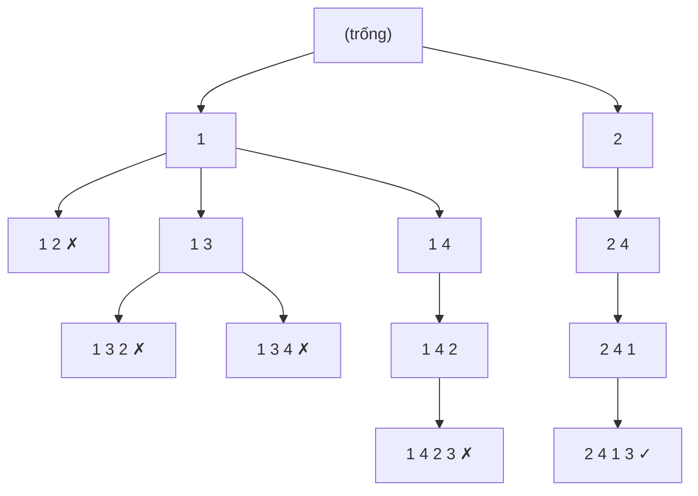

# Bài 1.7 – Vét cạn và quay lui

> **Tập 1** · Cần biết trước: bài 1.6 · Thời lượng: khoảng 90 phút đọc, 6 giờ thực hành

**Học xong bài này, em sẽ:**

- liệt kê mọi tập con, mọi hoán vị bằng **quay lui**;
- **cắt nhánh**: dừng sớm những hướng chắc chắn không dẫn tới đáp án;
- lấy subtask 60% bài **Tàu ngầm** (BOI 2019) bằng vét cạn có tổ chức.

---

## 1. Bài toán mở màn: Xếp chỗ ngồi

Cô giáo xếp n bạn (đánh số 1..n) ngồi một hàng ngang. Để lớp bớt ồn, hai bạn có số thứ tự **liền nhau** (như 3 và 4) không được ngồi cạnh nhau. Có bao nhiêu cách xếp? (1 ≤ n ≤ 10)

| Vào | Ra |
| --- | --- |
| `4` | `2` |

Hai cách: `2 4 1 3` và `3 1 4 2`.

> [!IMPORTANT]
> **Dừng lại và nghĩ.** n ≤ 10 gợi ý độ phức tạp nào (bảng ở bài 1.1)? Khi đã xếp `1 2 …` ở hai ghế đầu, có cần xếp tiếp các ghế sau không?

<details>
<summary>Đáp án</summary>

n ≤ 10 nên thử mọi hoán vị được: 10! ≈ 3,6·10⁶. Và `1 2` đã vi phạm, nên mọi cách xếp bắt đầu bằng `1 2` đều bỏ được ngay: đó là **cắt nhánh**.

</details>

---

## 2. Quay lui: thử – đi tiếp – trả lại

Xếp lần lượt từng ghế. Ở ghế thứ k, thử từng bạn **chưa ngồi**; nếu hợp lệ thì đặt vào, xếp ghế k + 1, rồi **nhấc ra** để thử bạn khác.

```text
xep(k):
    nếu k = n: đếm thêm một cách; trở về
    với mỗi bạn v từ 1 tới n:
        nếu v chưa ngồi và (k = 0 hoặc |v − ghế[k−1]| ≠ 1):
            ghế[k] ← v; đánh dấu v đã ngồi
            xep(k + 1)
            bỏ đánh dấu v                      // "quay lui": trả lại trạng thái
```

Một phần cây tìm kiếm với n = 4 (✗ là nhánh bị cắt):



```cpp
// file: xep_cho.cpp
#include <bits/stdc++.h>
using namespace std;
int n;
long long dem = 0;
vector<int> ghe;
vector<bool> da_ngoi;

void xep(int k) {
    if (k == n) { dem++; return; }
    for (int v = 1; v <= n; v++) {
        if (da_ngoi[v]) continue;
        if (k > 0 && abs(v - ghe[k - 1]) == 1) continue;   // cắt nhánh
        ghe[k] = v; da_ngoi[v] = true;
        xep(k + 1);
        da_ngoi[v] = false;                                 // quay lui
    }
}

int main() {
    cin >> n;
    ghe.assign(n, 0);
    da_ngoi.assign(n + 1, false);
    xep(0);
    cout << dem << '\n';
}
```

```python
# file: xep_cho.py
n = int(input())
ghe = [0] * n
da_ngoi = [False] * (n + 1)
dem = 0

def xep(k):
    global dem
    if k == n:
        dem += 1
        return
    for v in range(1, n + 1):
        if da_ngoi[v] or (k > 0 and abs(v - ghe[k - 1]) == 1):
            continue
        ghe[k] = v
        da_ngoi[v] = True
        xep(k + 1)
        da_ngoi[v] = False

xep(0)
print(dem)
```

---

## 3. Liệt kê tập con

Nhiều bài cần thử mọi cách **chọn hoặc không chọn** từng phần tử: 2ⁿ khả năng, dùng được khi n ≤ 20. Hai cách viết:

**Đệ quy:** ở phần tử i, rẽ hai nhánh "chọn" và "không chọn".

**Bitmask:** mỗi số từ 0 tới 2ⁿ − 1 là một tập con; bit thứ i bằng 1 nghĩa là chọn phần tử i.

| mask (thập phân) | Nhị phân (bit 2, 1, 0) | Tập con của {a₀, a₁, a₂} |
| :---: | :---: | --- |
| 0 | 000 | {} |
| 5 | 101 | {a₀, a₂} |
| 6 | 110 | {a₁, a₂} |
| 7 | 111 | {a₀, a₁, a₂} |

```cpp
for (int mask = 0; mask < (1 << n); mask++) {
    long long tong = 0;
    for (int i = 0; i < n; i++)
        if (mask >> i & 1) tong += a[i];   // phần tử i có trong tập con
    // xử lý tập con có tổng "tong"
}
```

Bài luyện tiêu biểu: [Apple Division](https://cses.fi/problemset/task/1623): chia n ≤ 20 quả táo thành hai nhóm có tổng khối lượng chênh nhau ít nhất.

---

## 4. Bài thi quốc tế: Tàu ngầm, subtask 60%

> Bài *Nautilus* của Olympic Tin học Baltic (BOI) 2019, kể lại bằng tiếng Việt.

Bản đồ biển là lưới R × C, `#` là đảo, `.` là nước. Radar ghi lại hành trình của một tàu ngầm thành xâu M ký tự: `E` (đông, sang phải), `W` (tây, sang trái), `S` (nam, xuống), `N` (bắc, lên), `?` (nhiễu, có thể là bất kỳ hướng nào). Tàu xuất phát từ một ô nước nào đó và luôn đi trong nước, không ra khỏi bản đồ. Đếm số ô tàu **có thể đang ở** sau M bước.

Subtask: 30% có R, C, M ≤ 100 và không có `?`; 60% có R, C, M ≤ 100; 100% có R, C ≤ 500, M ≤ 5000.

| Vào | Ra |
| --- | --- |
| `3 4 2`<br>`....`<br>`.#..`<br>`....`<br>`ES` | `3` |

**30%: thử mọi điểm xuất phát.** Không có `?` thì đường đi từ mỗi ô là duy nhất: thử R × C ô, mỗi ô đi M bước. O(R·C·M) = 10⁶.

**60%: có `?`.** Từ một ô, mỗi `?` rẽ 4 nhánh: thử mọi đường là 4^M, quá nhiều. Nhưng nhiều đường **gặp nhau ở cùng một ô**, và từ đó trở đi chúng giống hệt nhau. Vì vậy chỉ cần nhớ **tập các ô có thể đang đứng** sau mỗi bước:

- Ban đầu: mọi ô trống.
- Mỗi ký tự: từ mỗi ô trong tập, đi theo hướng (hoặc cả 4 hướng nếu là `?`); giữ những ô đích là ô trống.

Chạy tay ví dụ (✓ là ô thuộc tập):

```
Ban đầu (mọi ô nước)     Sau 'E' (sang phải)     Sau 'S' (xuống)
  ✓ ✓ ✓ ✓                  . ✓ ✓ ✓                 . . . .
  ✓ # ✓ ✓                  . # . ✓                 . # ✓ ✓
  ✓ ✓ ✓ ✓                  . ✓ ✓ ✓                 . . . ✓
```

Sau 'E', ô hàng 2 cột 3 bị loại vì bên trái nó là đảo. Còn 3 ô: đáp án 3.

```cpp
// file: tau_ngam.cpp
#include <bits/stdc++.h>
using namespace std;
int main() {
    // Khi thi: bật freopen cho TAUNGAM.INP / TAUNGAM.OUT
    int R, C, M;
    cin >> R >> C >> M;
    vector<string> g(R);
    for (auto &row : g) cin >> row;
    string s;
    cin >> s;
    vector<vector<char>> co(R, vector<char>(C, 0));
    for (int i = 0; i < R; i++)
        for (int j = 0; j < C; j++) co[i][j] = (g[i][j] == '.');
    string huong = "EWSN";
    int di[] = {0, 0, 1, -1}, dj[] = {1, -1, 0, 0};
    for (char ch : s) {
        vector<vector<char>> moi(R, vector<char>(C, 0));
        for (int i = 0; i < R; i++)
            for (int j = 0; j < C; j++) {
                if (!co[i][j]) continue;
                for (int h = 0; h < 4; h++) {
                    if (ch != '?' && ch != huong[h]) continue;
                    int ni = i + di[h], nj = j + dj[h];
                    if (ni >= 0 && ni < R && nj >= 0 && nj < C && g[ni][nj] == '.') moi[ni][nj] = 1;
                }
            }
        co = moi;
    }
    int dem = 0;
    for (auto &row : co)
        for (char x : row) dem += x;
    cout << dem << '\n';
}
```

```python
# file: tau_ngam.py
import sys
data = sys.stdin.read().split()
R, C, M = int(data[0]), int(data[1]), int(data[2])
g = data[3:3 + R]
s = data[3 + R] if len(data) > 3 + R else ""
co = [[g[i][j] == '.' for j in range(C)] for i in range(R)]
buoc = {'E': (0, 1), 'W': (0, -1), 'S': (1, 0), 'N': (-1, 0)}
for ch in s:
    huong = list(buoc.values()) if ch == '?' else [buoc[ch]]
    moi = [[False] * C for _ in range(R)]
    for i in range(R):
        for j in range(C):
            if co[i][j]:
                for di, dj in huong:
                    ni, nj = i + di, j + dj
                    if 0 <= ni < R and 0 <= nj < C and g[ni][nj] == '.':
                        moi[ni][nj] = True
    co = moi
print(sum(map(sum, co)))
```

Độ phức tạp O(R·C·M·4): với R, C, M ≤ 100 là 4·10⁶ phép, đủ **60% điểm**. Với R, C ≤ 500 và M ≤ 5000 là 5·10⁹: quá chậm. Mức 100% cần **bitset**, xử lý 64 ô một lúc (Tập 2).

> [!NOTE]
> Ý "gộp các đường đi gặp nhau thành một trạng thái" là mầm mống của **quy hoạch động**. Em sẽ gặp lại nó ở Tập 2.

---

## 5. Bẫy thường gặp

> [!WARNING]
> **Bẫy 1: quên quay lui.** Quên `da_ngoi[v] = false` thì sau nhánh đầu tiên, mọi bạn đều bị coi là đã ngồi, kết quả sai.

> [!WARNING]
> **Bẫy 2: ước lượng sai số khả năng.** 2²⁰ ≈ 10⁶ ổn, 2³⁰ ≈ 10⁹ thì không. 10! ≈ 3,6·10⁶ ổn, 12! ≈ 4,8·10⁸ thì sát nút, 13! thì không.

> [!WARNING]
> **Bẫy 3: cập nhật tập trạng thái tại chỗ.** Trong bài tàu ngầm, nếu ghi ô mới ngay vào mảng `co` đang duyệt, một ô vừa đến có thể bị "đi tiếp" thêm lần nữa trong cùng một bước. Luôn dùng mảng `moi` riêng.

---

## 6. Bài tập

| Nấc | Bài | Nguồn | Ý chính |
| --- | --- | --- | --- |
| Khởi động | [Apple Division](https://cses.fi/problemset/task/1623) | CSES 1623 | Mọi tập con |
| Khởi động | [Creating Strings](https://cses.fi/problemset/task/1622) | CSES 1622 | Hoán vị không trùng lặp |
| Luyện | [Chessboard and Queens](https://cses.fi/problemset/task/1624) | CSES 1624 | Quay lui có cắt nhánh |
| Luyện | Tàu ngầm, subtask 30%: viết cách "thử mọi điểm xuất phát", so với `tau_ngam` trên test không có `?` | Tự luyện | Hai lời giải đối chiếu nhau |
| Thử thách | [Grid Paths](https://cses.fi/problemset/task/1625) | CSES 1625 | Cắt nhánh tinh tế để kịp thời gian |

---

## 7. Tóm tắt và checkpoint

1. Quay lui: thử một lựa chọn → đi tiếp → **trả lại** trạng thái → thử lựa chọn khác.
2. Cắt nhánh sớm khi phần đã chọn chắc chắn vi phạm.
3. Tập con: đệ quy chọn/không chọn, hoặc bitmask 0..2ⁿ − 1.
4. Nhiều đường đi gặp nhau ở cùng trạng thái: gộp lại, chỉ nhớ tập trạng thái.

<details><summary>Có bao nhiêu cách xếp chỗ ngồi hợp lệ với n = 4?</summary>2: <code>2 4 1 3</code> và <code>3 1 4 2</code>.</details>
<details><summary>mask = 11 (nhị phân 1011) chọn những phần tử nào của {a₀, a₁, a₂, a₃}?</summary>a₀, a₁, a₃.</details>

**Checkpoint:**

- [ ] AC CSES Apple Division và Chessboard and Queens.
- [ ] Viết lại lời giải tàu ngầm 60% không nhìn sách, chạy đúng ví dụ của đề.
