# Bài 1.7 – Vét cạn và quay lui

> **Tập 1 · Nền tảng thuật toán**
> Cần biết trước: bài 1.6 (đệ quy), bài 1.1 (bảng ràng buộc → độ phức tạp).
> Thời lượng: khoảng 90 phút đọc, cộng 6 giờ thực hành trong 1,5 tuần.

**Học xong bài này, em sẽ:**

- thử **mọi khả năng** một cách có tổ chức bằng quay lui: thử – đi tiếp – trả lại;
- **cắt nhánh** sớm để vét cạn chạy nhanh hơn nhiều lần;
- liệt kê mọi tập con bằng đệ quy chọn/không chọn và bằng **bitmask**;
- **gộp các đường đi gặp nhau** thành một tập trạng thái (bài Tàu ngầm), mầm mống của quy hoạch động.

> [!TIP]
> **Học cùng hai trang mô phỏng.** [Quay lui xếp chỗ ngồi](../../mo-phong/t1-quay-lui.html): xem ngăn gọi hàm và những nhánh bị cắt, thử n = 5. [Tàu ngầm](../../mo-phong/t1-tau-ngam.html): xem tập ô ✓ thay đổi theo từng ký tự, thử ví dụ có `?`. Bật **Đoán trước** ở cả hai trang.

---

## 1. Bài toán mở màn: Xếp chỗ ngồi

Cô giáo xếp n bạn (đánh số 1..n) ngồi một hàng ngang. Để lớp bớt ồn, hai bạn có số thứ tự **liền nhau** (như 3 và 4) không được ngồi cạnh nhau. Có bao nhiêu cách xếp? (1 ≤ n ≤ 10)

| Vào | Ra |
| --- | --- |
| `4` | `2` |

Hai cách: `2 4 1 3` và `3 1 4 2`.

---

## 2. Dừng lại 10 phút

> [!IMPORTANT]
> **Dừng lại và nghĩ.**
> 1. n ≤ 10 gợi ý độ phức tạp nào (bảng ở bài 1.1)? Có bao nhiêu cách xếp nếu không có luật cấm?
> 2. Khi đã xếp `1 2 …` ở hai ghế đầu, có cần xếp tiếp các ghế sau không?
> 3. Sau khi thử xong "bạn 1 ở ghế 1", để thử "bạn 2 ở ghế 1" em phải làm gì với các ghế đã xếp?

<details>
<summary>Đáp án</summary>

1. n ≤ 10 nên thử mọi hoán vị được: 10! ≈ 3,6·10⁶.
2. Không: `1 2` đã vi phạm, nên mọi cách xếp bắt đầu bằng `1 2` đều bỏ được ngay. Đó là **cắt nhánh**.
3. Nhấc các bạn đã đặt ra để họ được xếp lại. Đó là **quay lui**: trả lại trạng thái như trước khi thử.

</details>

---

## 3. Lời giải ngây thơ và vì sao nó chưa ổn

An viết n vòng `for` lồng nhau, mỗi vòng chọn một bạn cho một ghế:

```python
for a in range(1, n + 1):
    for b in range(1, n + 1):
        for c in range(1, n + 1):
            for d in range(1, n + 1):      # chỉ đúng khi n = 4!
                if len({a, b, c, d}) == 4 and abs(a-b) != 1 and abs(b-c) != 1 and abs(c-d) != 1:
                    dem += 1
```

Hai vấn đề: số vòng lặp **phụ thuộc n**, nên không viết cố định được; và thử cả nₙ bộ (10¹⁰ với n = 10) thay vì n! hoán vị, rồi mới kiểm tra ở tận cùng. Cần một cách lặp "n tầng" với n thay đổi, và kiểm tra **ngay khi đặt** từng bạn: chính là đệ quy quay lui.

---

## 4. Ý tưởng then chốt

> [!IMPORTANT]
> **Quay lui: xếp lần lượt từng ghế. Ở ghế thứ k, thử từng bạn chưa ngồi; nếu vi phạm thì bỏ qua ngay (cắt nhánh); nếu hợp lệ thì đặt vào, xếp ghế k + 1, rồi nhấc ra để thử bạn khác.**

```text
xep(k):
    nếu k = n: đếm thêm một cách; trở về
    với mỗi bạn v từ 1 tới n:
        nếu v chưa ngồi và (k = 0 hoặc |v − ghế[k−1]| ≠ 1):
            ghế[k] ← v; đánh dấu v đã ngồi
            xep(k + 1)
            bỏ đánh dấu v                      // "quay lui": trả lại trạng thái
```

### Chạy từng bước

Với n = 4. Đoán trước có đặt được không rồi mới mở.

<details>
<summary><b>Bước 1</b> – Bắt đầu</summary>

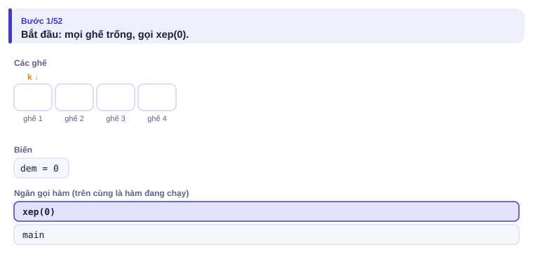

</details>

<details>
<summary><b>Bước 2</b> – Ghế 1: thử bạn 1</summary>

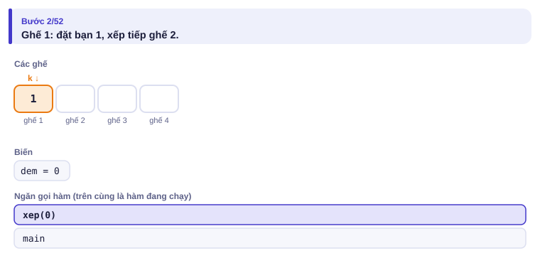

</details>

<details>
<summary><b>Bước 3</b> – Ghế 2: thử bạn 2 được không?</summary>

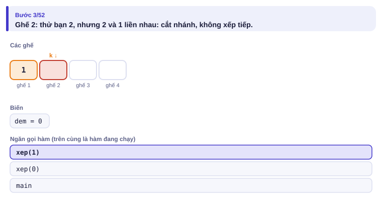

</details>

<details>
<summary><b>Bước 4</b> – Ghế 2: bạn 3</summary>

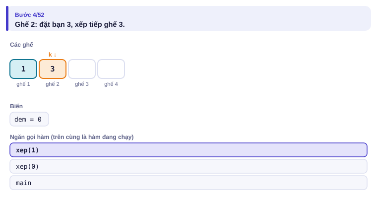

</details>

<details>
<summary><b>Bước 5</b> – Ghế 3: còn bạn 2 và 4, cả hai đều liền với 3</summary>

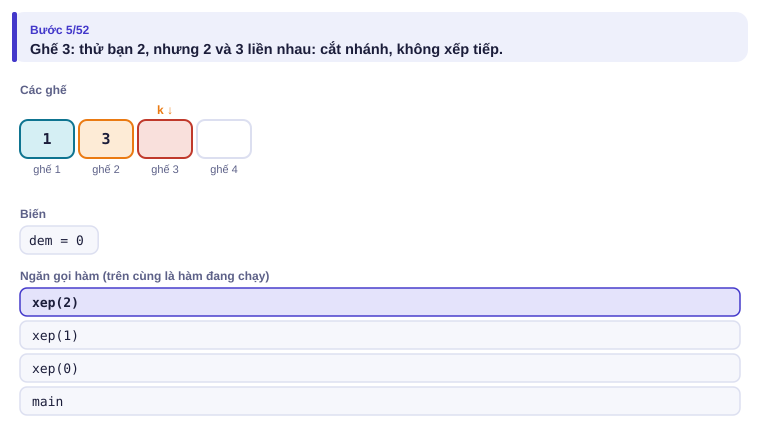


Nhánh `1 3` chết: quay lui, thử bạn 4 ở ghế 2…

</details>

<details>
<summary><b>Bước 6</b> – Cách hợp lệ đầu tiên, và tổng kết</summary>

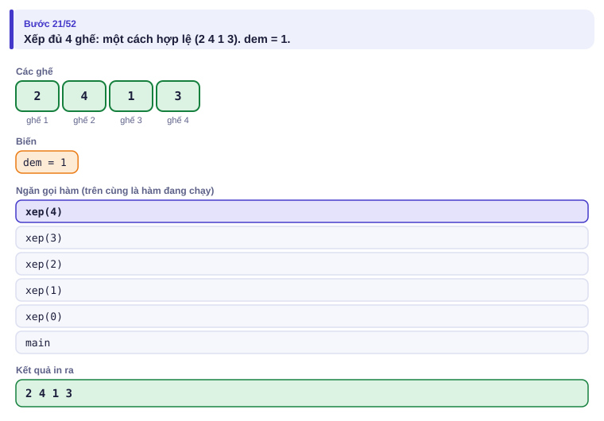
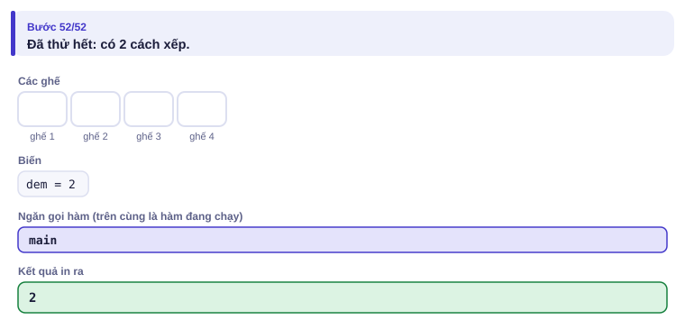

</details>

Một phần cây tìm kiếm với n = 4 (✗ là nhánh bị cắt):

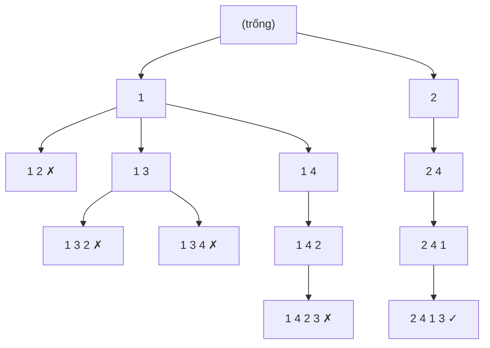

---

## 5. Mã giả và cài đặt

```cpp
// file: xep_cho.cpp
#include <bits/stdc++.h>
using namespace std;
int n;
long long dem = 0;
vector<int> ghe;
vector<bool> da_ngoi;

void xep(int k) {
    if (k == n) { dem++; return; }
    for (int v = 1; v <= n; v++) {
        if (da_ngoi[v]) continue;
        if (k > 0 && abs(v - ghe[k - 1]) == 1) continue;   // cắt nhánh
        ghe[k] = v; da_ngoi[v] = true;
        xep(k + 1);
        da_ngoi[v] = false;                                 // quay lui
    }
}

int main() {
    cin >> n;
    ghe.assign(n, 0);
    da_ngoi.assign(n + 1, false);
    xep(0);
    cout << dem << '\n';
}
```

```python
# file: xep_cho.py
n = int(input())
ghe = [0] * n
da_ngoi = [False] * (n + 1)
dem = 0

def xep(k):
    global dem
    if k == n:
        dem += 1
        return
    for v in range(1, n + 1):
        if da_ngoi[v] or (k > 0 and abs(v - ghe[k - 1]) == 1):
            continue
        ghe[k] = v
        da_ngoi[v] = True
        xep(k + 1)
        da_ngoi[v] = False

xep(0)
print(dem)
```

### Liệt kê tập con

Nhiều bài cần thử mọi cách **chọn hoặc không chọn** từng phần tử: 2ⁿ khả năng, dùng được khi n ≤ 20. Hai cách viết:

**Đệ quy:** ở phần tử i, rẽ hai nhánh "chọn" và "không chọn" (như Ví dụ 3 bài 1.6).

**Bitmask:** mỗi số từ 0 tới 2ⁿ − 1 là một tập con; bit thứ i bằng 1 nghĩa là chọn phần tử i.

| mask (thập phân) | Nhị phân (bit 2, 1, 0) | Tập con của {a₀, a₁, a₂} |
| :---: | :---: | --- |
| 0 | 000 | {} |
| 5 | 101 | {a₀, a₂} |
| 6 | 110 | {a₁, a₂} |
| 7 | 111 | {a₀, a₁, a₂} |

```cpp
for (int mask = 0; mask < (1 << n); mask++) {
    long long tong = 0;
    for (int i = 0; i < n; i++)
        if (mask >> i & 1) tong += a[i];   // phần tử i có trong tập con
    // xử lý tập con có tổng "tong"
}
```

### Bài thi quốc tế: Tàu ngầm, subtask 60%

> Bài *Nautilus* của Olympic Tin học Baltic (BOI) 2019, kể lại bằng tiếng Việt.

Bản đồ biển là lưới R × C, `#` là đảo, `.` là nước. Radar ghi lại hành trình của một tàu ngầm thành xâu M ký tự: `E` (đông, sang phải), `W` (tây, sang trái), `S` (nam, xuống), `N` (bắc, lên), `?` (nhiễu, có thể là bất kỳ hướng nào). Tàu xuất phát từ một ô nước nào đó và luôn đi trong nước, không ra khỏi bản đồ. Đếm số ô tàu **có thể đang ở** sau M bước.

Subtask: 30% có R, C, M ≤ 100 và không có `?`; 60% có R, C, M ≤ 100; 100% có R, C ≤ 500, M ≤ 5000.

| Vào | Ra |
| --- | --- |
| `3 4 2`<br>`....`<br>`.#..`<br>`....`<br>`ES` | `3` |

**30%: thử mọi điểm xuất phát.** Không có `?` thì đường đi từ mỗi ô là duy nhất: thử R × C ô, mỗi ô đi M bước. O(R·C·M) = 10⁶.

**60%: có `?`.** Từ một ô, mỗi `?` rẽ 4 nhánh: thử mọi đường là 4^M, quá nhiều. Nhưng nhiều đường **gặp nhau ở cùng một ô**, và từ đó trở đi chúng giống hệt nhau. Vì vậy chỉ cần nhớ **tập các ô có thể đang đứng** sau mỗi bước:

- Ban đầu: mọi ô trống.
- Mỗi ký tự: từ mỗi ô trong tập, đi theo hướng (hoặc cả 4 hướng nếu là `?`); giữ những ô đích là ô trống.

<details>
<summary><b>Hình</b> – tập ô ✓ sau từng ký tự của ví dụ (đoán trước số ô rồi mới mở)</summary>

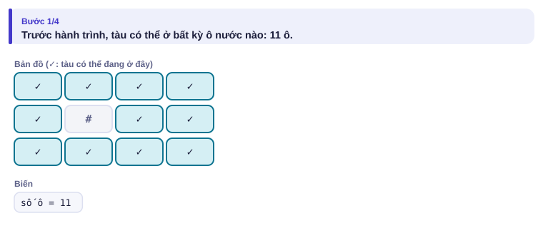
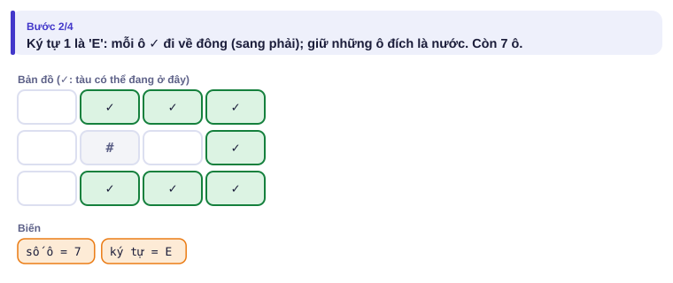
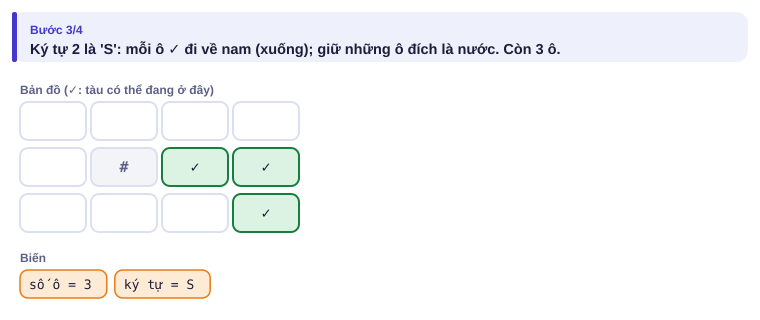
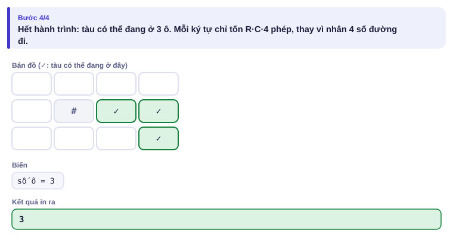

</details>

Sau 'E', ô hàng 2 cột 3 bị loại vì bên trái nó là đảo. Còn 3 ô: đáp án 3.

```cpp
// file: tau_ngam.cpp
#include <bits/stdc++.h>
using namespace std;
int main() {
    // Khi thi: bật freopen cho TAUNGAM.INP / TAUNGAM.OUT
    int R, C, M;
    cin >> R >> C >> M;
    vector<string> g(R);
    for (auto &row : g) cin >> row;
    string s;
    cin >> s;
    vector<vector<char>> co(R, vector<char>(C, 0));
    for (int i = 0; i < R; i++)
        for (int j = 0; j < C; j++) co[i][j] = (g[i][j] == '.');
    string huong = "EWSN";
    int di[] = {0, 0, 1, -1}, dj[] = {1, -1, 0, 0};
    for (char ch : s) {
        vector<vector<char>> moi(R, vector<char>(C, 0));
        for (int i = 0; i < R; i++)
            for (int j = 0; j < C; j++) {
                if (!co[i][j]) continue;
                for (int h = 0; h < 4; h++) {
                    if (ch != '?' && ch != huong[h]) continue;
                    int ni = i + di[h], nj = j + dj[h];
                    if (ni >= 0 && ni < R && nj >= 0 && nj < C && g[ni][nj] == '.') moi[ni][nj] = 1;
                }
            }
        co = moi;
    }
    int dem = 0;
    for (auto &row : co)
        for (char x : row) dem += x;
    cout << dem << '\n';
}
```

```python
# file: tau_ngam.py
import sys
data = sys.stdin.read().split()
R, C, M = int(data[0]), int(data[1]), int(data[2])
g = data[3:3 + R]
s = data[3 + R] if len(data) > 3 + R else ""
co = [[g[i][j] == '.' for j in range(C)] for i in range(R)]
buoc = {'E': (0, 1), 'W': (0, -1), 'S': (1, 0), 'N': (-1, 0)}
for ch in s:
    huong = list(buoc.values()) if ch == '?' else [buoc[ch]]
    moi = [[False] * C for _ in range(R)]
    for i in range(R):
        for j in range(C):
            if co[i][j]:
                for di, dj in huong:
                    ni, nj = i + di, j + dj
                    if 0 <= ni < R and 0 <= nj < C and g[ni][nj] == '.':
                        moi[ni][nj] = True
    co = moi
print(sum(map(sum, co)))
```

Độ phức tạp O(R·C·M·4): với R, C, M ≤ 100 là 4·10⁶ phép, đủ **60% điểm**. Với R, C ≤ 500 và M ≤ 5000 là 5·10⁹: quá chậm. Mức 100% cần **bitset**, xử lý 64 ô một lúc (Tập 2).

> [!NOTE]
> Ý "gộp các đường đi gặp nhau thành một trạng thái" là mầm mống của **quy hoạch động**. Em sẽ gặp lại nó ở Tập 2.

---

## 6. Vì sao đúng, chạy bao lâu

- **Quay lui đúng** vì nó liệt kê **mọi** hoán vị (mỗi ghế thử mọi bạn chưa ngồi), chỉ bỏ những nhánh chắc chắn vi phạm. Nhánh bị cắt không thể chứa cách hợp lệ nào, vì hai ghế đầu tiên vi phạm sẽ còn mãi trong mọi cách xếp kéo dài từ nó.
- **Chạy bao lâu:** không cắt nhánh thì n! lá; cắt nhánh làm số nút thực tế ít hơn nhiều (n = 10 chỉ có 479 306 cách hợp lệ trên 3,6 triệu hoán vị). Bảng quy mô:

| Kiểu vét cạn | Số khả năng | n tối đa (C++, 1 giây) |
| --- | --- | --- |
| Mọi hoán vị | n! | 10–11 |
| Mọi tập con | 2ⁿ (× n nếu duyệt bit) | 20–23 |
| Gộp trạng thái (Tàu ngầm) | số trạng thái × số bước | tùy bài |

---

## 7. Bẫy thường gặp

> [!WARNING]
> **Bẫy 1: quên quay lui.** Quên `da_ngoi[v] = false` thì sau nhánh đầu tiên, mọi bạn đều bị coi là đã ngồi, kết quả sai.
> *Test phá:* n = 4 (in ra 0 thay vì 2).

> [!WARNING]
> **Bẫy 2: ước lượng sai số khả năng.** 2²⁰ ≈ 10⁶ ổn, 2³⁰ ≈ 10⁹ thì không. 10! ≈ 3,6·10⁶ ổn, 12! ≈ 4,8·10⁸ thì sát nút, 13! thì không.

> [!WARNING]
> **Bẫy 3: cập nhật tập trạng thái tại chỗ.** Trong bài tàu ngầm, nếu ghi ô mới ngay vào mảng `co` đang duyệt, một ô vừa đến có thể bị "đi tiếp" thêm lần nữa trong cùng một bước. Luôn dùng mảng `moi` riêng.

> [!WARNING]
> **Bẫy 4: `1 << n` tràn với n ≥ 31.** Trong C++, `1 << 31` vượt `int`. Dùng `1LL << n` khi n lớn (dù vét cạn 2³¹ tập con thì cũng đã quá chậm).

---

## 8. Ví dụ giảm dần hỗ trợ

### Ví dụ 2 – Điền vào chỗ trống: Chia táo

Chia n quả táo (1 ≤ n ≤ 20, khối lượng ≤ 10⁹) thành hai nhóm sao cho chênh lệch tổng khối lượng **nhỏ nhất**. In chênh lệch đó. Đây là bài [Apple Division](https://cses.fi/problemset/task/1623).

| Vào | Ra |
| --- | --- |
| `5`<br>`3 2 7 4 1` | `1` |

```text
tong_ca = sum(p)
best = tong_ca
for mask in range(____):
    s = 0
    for i in range(n):
        if ____:
            s += p[i]
    best = min(best, ____)
print(best)
```

<details>
<summary>Đáp án</summary>

`1 << n`, `mask >> i & 1`, `abs(tong_ca - 2 * s)`: nhóm 1 có tổng s, nhóm 2 có tổng tong_ca − s, chênh lệch |tong_ca − 2s|. Bản Python duyệt 2²⁰ × 20 = 2·10⁷ phép, chậm (vài giây); dùng đệ quy chọn/không chọn sẽ nhanh hơn khoảng 20 lần vì không duyệt lại từng bit.

```cpp
// file: chia_tao.cpp
#include <bits/stdc++.h>
using namespace std;
int main() {
    int n;
    cin >> n;
    vector<long long> p(n);
    for (auto &x : p) cin >> x;
    long long tong_ca = accumulate(p.begin(), p.end(), 0LL), best = tong_ca;
    for (int mask = 0; mask < (1 << n); mask++) {
        long long s = 0;
        for (int i = 0; i < n; i++)
            if (mask >> i & 1) s += p[i];
        best = min(best, llabs(tong_ca - 2 * s));
    }
    cout << best << '\n';
}
```

```python
# file: chia_tao.py
import sys
sys.setrecursionlimit(100)
n = int(input())
p = list(map(int, input().split()))
tong_ca = sum(p)
best = tong_ca

def thu(i, s):                 # đã xét i quả đầu, nhóm 1 có tổng s
    global best
    if i == n:
        best = min(best, abs(tong_ca - 2 * s))
        return
    thu(i + 1, s + p[i])       # chọn quả i vào nhóm 1
    thu(i + 1, s)              # không chọn

thu(0, 0)
print(best)
```

</details>

### Ví dụ 3 – Tự làm: Tổ hợp

In mọi cách chọn k số khác nhau từ {1, …, n} (1 ≤ k ≤ n ≤ 10), mỗi cách viết các số tăng dần, các cách theo thứ tự từ điển, mỗi cách một dòng.

| Vào | Ra |
| --- | --- |
| `4 2` | `1 2`<br>`1 3`<br>`1 4`<br>`2 3`<br>`2 4`<br>`3 4` |

> [!IMPORTANT]
> Tự làm trước. Gợi ý: quay lui với hàm `chon(bat_dau, da_chon)`: thử lần lượt số v từ `bat_dau` tới n, thêm v, gọi `chon(v + 1, …)`, rồi bỏ v ra.

<details>
<summary>Lời giải</summary>

```python
# file: to_hop.py
n, k = map(int, input().split())
chon = []
out = []

def thu(bat_dau):
    if len(chon) == k:
        out.append(" ".join(map(str, chon)))
        return
    for v in range(bat_dau, n + 1):
        chon.append(v)
        thu(v + 1)
        chon.pop()             # quay lui

thu(1)
print("\n".join(out))
```

```cpp
// file: to_hop.cpp
#include <bits/stdc++.h>
using namespace std;
int n, k;
vector<int> chon;
void thu(int bat_dau) {
    if ((int)chon.size() == k) {
        for (int i = 0; i < k; i++) cout << chon[i] << (i + 1 < k ? ' ' : '\n');
        return;
    }
    for (int v = bat_dau; v <= n; v++) {
        chon.push_back(v);
        thu(v + 1);
        chon.pop_back();
    }
}
int main() {
    cin >> n >> k;
    thu(1);
}
```

</details>

---

## 9. Bài tập

| Nấc | Bài | Nguồn | Ý chính |
| --- | --- | --- | --- |
| Khởi động | [Apple Division](https://cses.fi/problemset/task/1623) | CSES 1623 | Mọi tập con |
| Khởi động | [Creating Strings](https://cses.fi/problemset/task/1622) | CSES 1622 | Hoán vị không trùng lặp |
| Luyện | [Chessboard and Queens](https://cses.fi/problemset/task/1624) | CSES 1624 | Quay lui có cắt nhánh |
| Luyện | Tàu ngầm, subtask 30%: viết cách "thử mọi điểm xuất phát", so với `tau_ngam` trên test không có `?` | Tự luyện | Hai lời giải đối chiếu nhau |
| Thử thách | [Grid Paths](https://cses.fi/problemset/task/1625) | CSES 1625 | Cắt nhánh tinh tế để kịp thời gian |
| Kiểu đề thi | Chọn quà | Bài của sách, chấm theo subtask | Xem bên dưới |

### Bài kiểu đề thi: Chọn quà

**Đề bài.** Lớp có ngân sách B đồng (1 ≤ B ≤ 10⁹) để mua quà cuối năm từ n món (1 ≤ n ≤ 20); món i giá cᵢ và được các bạn chấm điểm thích vᵢ (1 ≤ cᵢ, vᵢ ≤ 10⁹). Mỗi món mua tối đa một lần. Tổng điểm thích lớn nhất mua được là bao nhiêu? Đọc từ `CHONQUA.INP` (dòng đầu n B, n dòng sau mỗi dòng cᵢ vᵢ), ghi ra `CHONQUA.OUT`.

Subtask: 50% có n ≤ 10; 50% còn lại có n ≤ 20.

| CHONQUA.INP | CHONQUA.OUT |
| --- | --- |
| `4 10`<br>`5 10`<br>`4 40`<br>`6 30`<br>`3 50` | `90` |

Mua món 2 và 4: giá 4 + 3 = 7 ≤ 10, điểm 40 + 50 = 90.

<details>
<summary><b>Gợi ý 1</b> – hướng đi (đủ 50% điểm)</summary>

Thử mọi tập con (2¹⁰ = 1024), tính tổng giá và tổng điểm, giữ tập có tổng giá ≤ B và điểm lớn nhất.

</details>

<details>
<summary><b>Gợi ý 2</b> – ý then chốt</summary>

Với n ≤ 20 vẫn thử mọi tập con được (khoảng 10⁶). Viết đệ quy chọn/không chọn và **cắt nhánh**: không đi vào nhánh "chọn" nếu giá đã vượt B.

</details>

<details>
<summary><b>Gợi ý 3</b> – lời giải đầy đủ</summary>

Đệ quy mang theo tổng giá và tổng điểm; mỗi lá cập nhật đáp án. Tối đa 2²⁰ lá. Khi n và B lớn hơn nhiều, bài này cần quy hoạch động (bài toán cái túi, Tập 2).

```python
# file: chonqua.py
import sys
data = open("CHONQUA.INP").read().split()
n, B = int(data[0]), int(data[1])
c = [int(data[2 + 2 * i]) for i in range(n)]
v = [int(data[3 + 2 * i]) for i in range(n)]
best = 0

def thu(i, gia, diem):
    global best
    if i == n:
        if diem > best:
            best = diem
        return
    if gia + c[i] <= B:              # cắt nhánh: chỉ chọn khi còn đủ tiền
        thu(i + 1, gia + c[i], diem + v[i])
    thu(i + 1, gia, diem)

thu(0, 0, 0)
open("CHONQUA.OUT", "w").write(f"{best}\n")
```

```cpp
// file: chonqua.cpp
#include <bits/stdc++.h>
using namespace std;
int n; long long B, best = 0;
vector<long long> c, v;
void thu(int i, long long gia, long long diem) {
    if (i == n) { best = max(best, diem); return; }
    if (gia + c[i] <= B) thu(i + 1, gia + c[i], diem + v[i]);
    thu(i + 1, gia, diem);
}
int main() {
    freopen("CHONQUA.INP", "r", stdin);
    freopen("CHONQUA.OUT", "w", stdout);
    cin >> n >> B;
    c.resize(n); v.resize(n);
    for (int i = 0; i < n; i++) cin >> c[i] >> v[i];
    thu(0, 0, 0);
    cout << best << '\n';
}
```

</details>

---

## 10. Tóm tắt, flashcard và checkpoint

**Tóm tắt trong 5 dòng.**

1. Quay lui: thử một lựa chọn → đi tiếp → **trả lại** trạng thái → thử lựa chọn khác.
2. Cắt nhánh sớm khi phần đã chọn chắc chắn vi phạm.
3. Tập con: đệ quy chọn/không chọn, hoặc bitmask 0..2ⁿ − 1.
4. Nhiều đường đi gặp nhau ở cùng trạng thái: gộp lại, chỉ nhớ tập trạng thái.
5. Đọc n: ≤ 10 thử hoán vị, ≤ 20 thử tập con.

**Flashcard.**

<details><summary>Có bao nhiêu cách xếp chỗ ngồi hợp lệ với n = 4?</summary>2: <code>2 4 1 3</code> và <code>3 1 4 2</code>.</details>
<details><summary>mask = 11 (nhị phân 1011) chọn những phần tử nào của {a₀, a₁, a₂, a₃}?</summary>a₀, a₁, a₃.</details>
<details><summary>Quên dòng "bỏ đánh dấu" trong quay lui thì sao?</summary>Sau nhánh đầu tiên, mọi bạn đều bị coi là đã ngồi; đếm thiếu.</details>
<details><summary>Vì sao Tàu ngầm không thử từng đường đi?</summary>Có tới 4^M đường; nhưng chỉ có R·C ô, nên gộp các đường cùng đến một ô.</details>
<details><summary>12! xấp xỉ bao nhiêu? Có vét cạn kịp không?</summary>Khoảng 4,8·10⁸: sát nút, thường cần cắt nhánh tốt.</details>

**Ôn xoắn ốc** (kiến thức bài 1.4–1.6; mỗi bài tối đa 20 phút):

- [Tower of Hanoi](https://cses.fi/problemset/task/2165) (CSES 2165): đệ quy.
- Dãy đèn (bài 1.5), viết lại không nhìn sách.
- [Array Division](https://cses.fi/problemset/task/1085) (CSES 1085): nhị phân trên đáp án.

**Checkpoint – em đã sẵn sàng sang bài tiếp theo nếu:**

- [ ] AC [Apple Division](https://cses.fi/problemset/task/1623) và [Chessboard and Queens](https://cses.fi/problemset/task/1624).
- [ ] Viết lại lời giải tàu ngầm 60% không nhìn sách, chạy đúng ví dụ của đề.
- [ ] Làm xong Ví dụ 3 (Tổ hợp) mà không mở lời giải.
- [ ] Đạt trọn điểm bài Chọn quà khi tự làm trong 30 phút.

Chưa đạt? Nếu vướng ô 1 hoặc 4, mở trang mô phỏng quay lui và chú ý dòng "nhấc ra". Nếu vướng ô 2, mở trang mô phỏng Tàu ngầm với ví dụ có `?`. Nếu vướng ô 3, làm lại Ví dụ 3 bài 1.6 trước.
