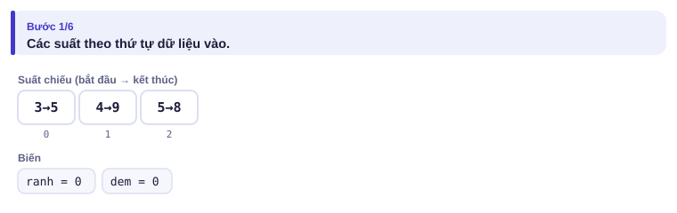
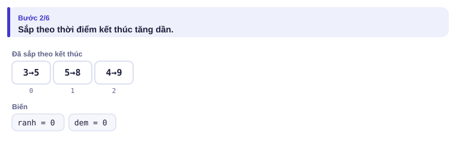
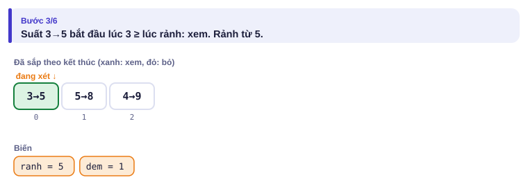
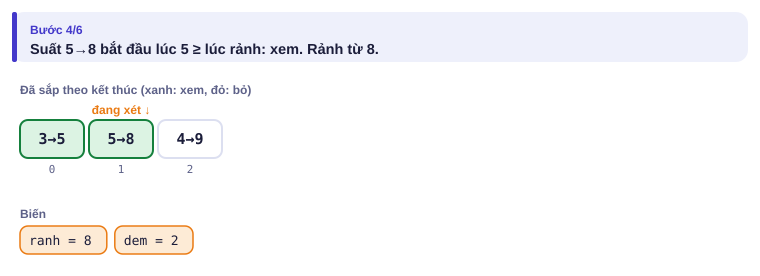
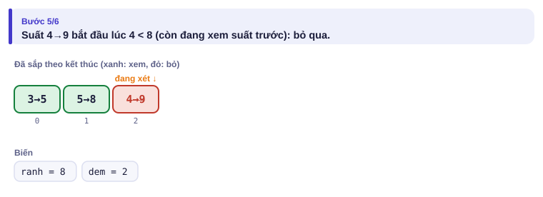
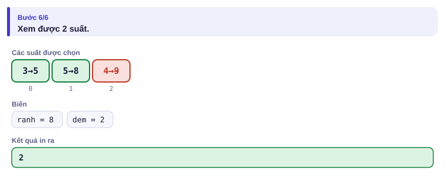
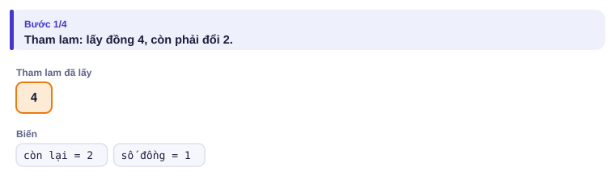
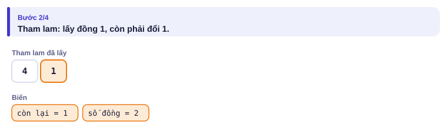
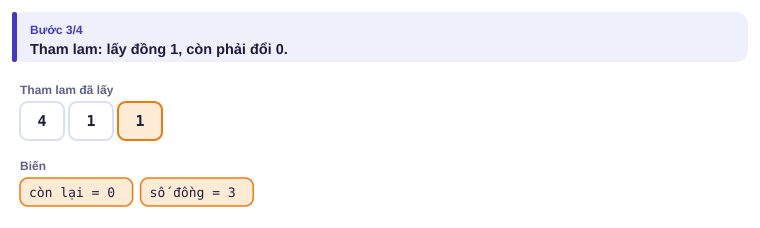
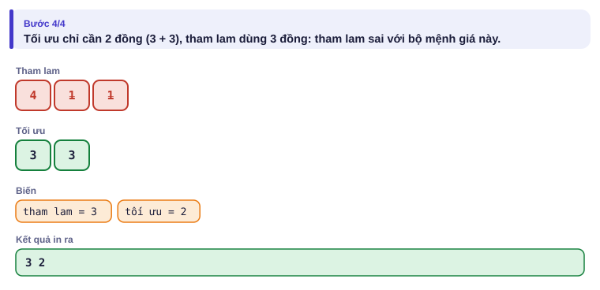

# Bài 1.8 – Tham lam

> **Tập 1 · Nền tảng thuật toán**
> Cần biết trước: bài 1.2 (sắp xếp), bài 1.7 (vét cạn, để đối chiếu).
> Thời lượng: khoảng 70 phút đọc, cộng 4–5 giờ thực hành trong tuần.

**Học xong bài này, em sẽ:**

- giải bài tối ưu bằng cách **sắp xếp theo một tiêu chí rồi chọn lần lượt**;
- **tìm phản ví dụ** để loại các ý tham lam sai trước khi code;
- chứng minh một ý tham lam bằng **lập luận hoán đổi**;
- nhận ra khi nào tham lam sai và cần cách khác (quy hoạch động ở Tập 2).

> [!TIP]
> **Học cùng hai trang mô phỏng.** [Liên hoan phim](../../mo-phong/t1-tham-lam.html): chạy cả ba ví dụ, trong đó có phản ví dụ cho cách của An và Chi. [Đổi tiền](../../mo-phong/t1-doi-tien.html): so tham lam với tối ưu ở các bộ mệnh giá khác nhau.

---

## 1. Bài toán mở màn: Liên hoan phim

Liên hoan phim có n suất chiếu, suất i bắt đầu lúc aᵢ và kết thúc lúc bᵢ. Bảo muốn xem trọn vẹn **càng nhiều suất càng tốt**; xem xong một suất có thể vào ngay suất bắt đầu đúng lúc đó. (n ≤ 2·10⁵, aᵢ < bᵢ ≤ 10⁹; bài [Movie Festival](https://cses.fi/problemset/task/1629))

| Vào | Ra |
| --- | --- |
| `3`<br>`3 5`<br>`4 9`<br>`5 8` | `2` |

---

## 2. Dừng lại 10 phút

> [!IMPORTANT]
> **Dừng lại và nghĩ.** Ba bạn đề xuất ba cách chọn "tham lam":
> - **An:** chọn suất **bắt đầu sớm nhất** trước.
> - **Chi:** chọn suất **ngắn nhất** trước.
> - **Bảo:** chọn suất **kết thúc sớm nhất** trước.
>
> Hãy tìm phản ví dụ cho từng cách. Cách nào không tìm được phản ví dụ?

<details>
<summary>Đáp án</summary>

- **An sai:** `1 100`, `2 3`, `4 5`. An chọn `1 100` rồi hết chỗ: 1 suất. Đúng là 2.
- **Chi sai:** `1 5`, `4 7`, `6 10`. Suất ngắn nhất `4 7` chặn cả hai suất còn lại: 1 suất. Đúng là 2 (`1 5`, `6 10`).
- **Bảo đúng.** Chứng minh ở mục 6.

</details>

---

## 3. Lời giải ngây thơ và vì sao nó chậm

Vét cạn mọi tập con các suất (bài 1.7), giữ tập lớn nhất không chồng nhau: 2ⁿ tập con, chỉ chạy được khi n ≤ 20. Với n = 2·10⁵ là không thể. Nhưng lời giải vét cạn **rất có ích**: nó là "trọng tài" để kiểm tra mọi ý tham lam trên test nhỏ (bài 1.9). Cách của An và Chi đều bị trọng tài này bắt lỗi chỉ sau vài test ngẫu nhiên.

---

## 4. Ý tưởng then chốt

> [!IMPORTANT]
> **Sắp các suất theo thời điểm kết thúc. Duyệt lần lượt; suất nào bắt đầu không sớm hơn lúc rảnh thì xem.** Lý do trực giác: suất kết thúc sớm nhất để lại nhiều thời gian nhất cho các suất sau.

### Chạy từng bước

Với ví dụ của đề. Đoán trước có xem hay không rồi mới mở.

<details>
<summary><b>Bước 1</b> – Các suất ban đầu</summary>



</details>

<details>
<summary><b>Bước 2</b> – Sắp theo kết thúc</summary>



</details>

<details>
<summary><b>Bước 3</b> – Suất 3→5</summary>



</details>

<details>
<summary><b>Bước 4</b> – Suất 5→8 bắt đầu đúng lúc rảnh</summary>



</details>

<details>
<summary><b>Bước 5</b> – Suất 4→9</summary>




</details>

---

## 5. Mã giả và cài đặt

```text
sắp các suất theo (kết thúc, bắt đầu)
ranh ← 0; dem ← 0
với mỗi suất (a, b) theo thứ tự: nếu a ≥ ranh thì dem ← dem + 1; ranh ← b
in dem
```

```cpp
// file: lien_hoan_phim.cpp
#include <bits/stdc++.h>
using namespace std;
int main() {
    ios::sync_with_stdio(false);
    cin.tie(nullptr);
    int n;
    cin >> n;
    vector<pair<long long, long long>> p(n);     // (kết thúc, bắt đầu) để sort theo kết thúc
    for (auto &[b, a] : p) cin >> a >> b;
    sort(p.begin(), p.end());
    long long ranh = 0;
    int dem = 0;
    for (auto [b, a] : p)
        if (a >= ranh) { dem++; ranh = b; }
    cout << dem << '\n';
}
```

```python
# file: lien_hoan_phim.py
import sys
data = sys.stdin.buffer.read().split()
n = int(data[0])
p = sorted(((int(data[2 + 2 * i]), int(data[1 + 2 * i])) for i in range(n)))   # (kết thúc, bắt đầu)
ranh = dem = 0
for b, a in p:
    if a >= ranh:
        dem += 1
        ranh = b
print(dem)
```

### Khi tham lam sai: đổi tiền

Có các đồng xu mệnh giá 1, 3, 4. Cần đổi 6 với ít đồng nhất. Tham lam "lấy đồng lớn nhất có thể": 4 + 1 + 1 = **3 đồng**. Nhưng 3 + 3 = **2 đồng**.

<details>
<summary><b>Hình</b> – tham lam và tối ưu với mệnh giá 1, 3, 4 (mở lần lượt)</summary>






</details>

Với bộ mệnh giá tiền Việt Nam (1, 2, 5, 10, …), tham lam lại đúng. Cùng một ý tưởng, đúng hay sai **phụ thuộc dữ liệu**. Bài đổi tiền với mệnh giá bất kỳ giải bằng quy hoạch động ở Tập 2.

---

## 6. Vì sao đúng, chạy bao lâu

**Lập luận hoán đổi.** Xét một lịch xem **tốt nhất** bất kỳ, gọi suất đầu tiên trong đó là X. Gọi G là suất kết thúc sớm nhất trong tất cả các suất (suất mà Bảo chọn đầu tiên).

- G kết thúc không muộn hơn X.
- Vậy **thay X bằng G**, lịch vẫn hợp lệ: mọi suất sau X bắt đầu sau khi X kết thúc, nên cũng sau khi G kết thúc.
- Số suất không đổi, nên vẫn tốt nhất.

Tức là luôn có một lịch tốt nhất bắt đầu bằng lựa chọn của Bảo. Lặp lại lập luận cho phần còn lại (các suất bắt đầu sau khi G kết thúc): mọi lựa chọn của Bảo đều "an toàn".

**Chạy bao lâu:** sắp xếp O(n log n), duyệt O(n).

> [!NOTE]
> **Khuôn chứng minh tham lam:** lấy một lời giải tốt nhất bất kỳ, chỉ ra có thể **đổi** một phần của nó thành lựa chọn tham lam mà không làm kết quả tệ đi. Nếu không chứng minh được, hãy tìm phản ví dụ bằng stress test (bài 1.9) trước khi tin.

---

## 7. Bẫy thường gặp

> [!WARNING]
> **Bẫy 1: tin trực giác.** Ý tham lam "nghe hợp lý" sai rất thường xuyên. Luôn thử tìm phản ví dụ nhỏ bằng tay, hoặc viết vét cạn để đối chiếu.

> [!WARNING]
> **Bẫy 2: sai điều kiện bằng.** Đề cho phép vào suất bắt đầu **đúng lúc** suất trước kết thúc: điều kiện là `a >= ranh`, không phải `a > ranh`. Đọc kỹ đề ở chỗ "bằng".
> *Test phá:* ví dụ của đề (suất 5→8 bắt đầu đúng lúc 3→5 kết thúc).

> [!WARNING]
> **Bẫy 3: sắp xếp sai khóa.** Sắp theo cặp (bắt đầu, kết thúc) là sắp theo **bắt đầu**, tức cách của An. Đặt kết thúc ở vị trí đầu cặp.
> *Test phá:* `1 100`, `2 3`, `4 5`.

> [!WARNING]
> **Bẫy 4: tham lam đúng ở bài này, đem sang bài "na ná" khác.** Ví dụ chọn suất để **tổng thời gian xem** lớn nhất thì "kết thúc sớm nhất" lại sai. Mỗi bài cần chứng minh riêng.

---

## 8. Ví dụ giảm dần hỗ trợ

### Ví dụ 2 – Điền vào chỗ trống: Việc và hạn chót

Có n việc (n ≤ 2·10⁵); việc i mất tᵢ ngày và có hạn dᵢ. Làm lần lượt từng việc, bắt đầu từ ngày 0. Hoàn thành việc i vào ngày f thì được dᵢ − f điểm (có thể âm). Tổng điểm lớn nhất? Đây là bài [Tasks and Deadlines](https://cses.fi/problemset/task/1630).

| Vào | Ra |
| --- | --- |
| `3`<br>`6 10`<br>`8 15`<br>`5 12` | `2` |

Tổng điểm = Σdᵢ − Σfᵢ. Σdᵢ cố định, nên cần **Σf nhỏ nhất**: làm việc ngắn trước (hoán đổi hai việc liền kề, việc dài đứng trước thì đổi chỗ chỉ làm Σf giảm).

```text
viec.sort(key=lambda v: ____)
f = 0; diem = 0
for t, d in viec:
    f += ____
    diem += ____
print(diem)
```

<details>
<summary>Đáp án</summary>

`v[0]` (sắp theo thời gian làm), `t`, `d - f`. Với ví dụ: làm 5 (xong ngày 5, +7), rồi 6 (xong ngày 11, −1), rồi 8 (xong ngày 19, −4): tổng 2.

```python
# file: han_chot.py
import sys
data = sys.stdin.buffer.read().split()
n = int(data[0])
viec = sorted((int(data[1 + 2 * i]), int(data[2 + 2 * i])) for i in range(n))
f = diem = 0
for t, d in viec:
    f += t
    diem += d - f
print(diem)
```

```cpp
// file: han_chot.cpp
#include <bits/stdc++.h>
using namespace std;
int main() {
    int n;
    cin >> n;
    vector<pair<long long, long long>> viec(n);
    for (auto &[t, d] : viec) cin >> t >> d;
    sort(viec.begin(), viec.end());
    long long f = 0, diem = 0;
    for (auto [t, d] : viec) { f += t; diem += d - f; }
    cout << diem << '\n';
}
```

</details>

### Ví dụ 3 – Tự làm: Thuyền đôi

Có n bạn (n ≤ 2·10⁵) cân nặng wᵢ, thuyền chở **tối đa 2 người** với tổng cân nặng không quá x (mọi wᵢ ≤ x). Cần ít nhất bao nhiêu thuyền? Đây là bài [Ferris Wheel](https://cses.fi/problemset/task/1090).

| Vào | Ra |
| --- | --- |
| `4 10`<br>`7 2 3 9` | `3` |

> [!IMPORTANT]
> Tự làm trước. Gợi ý: sắp xếp; bạn **nặng nhất** phải đi một thuyền nào đó. Nếu ghép được với bạn nhẹ nhất thì ghép, không thì đi một mình. Kết hợp hai con trỏ từ hai đầu (bài 1.5).

<details>
<summary>Lời giải</summary>

Lập luận hoán đổi: nếu bạn nặng nhất ghép được với ai đó thì cũng ghép được với bạn nhẹ nhất; đổi người ghép thành bạn nhẹ nhất không làm tăng số thuyền.

```python
# file: thuyen_doi.py
n, x = map(int, input().split())
w = sorted(map(int, input().split()))
l, r, thuyen = 0, n - 1, 0
while l <= r:
    if l < r and w[l] + w[r] <= x:
        l += 1
    r -= 1
    thuyen += 1
print(thuyen)
```

```cpp
// file: thuyen_doi.cpp
#include <bits/stdc++.h>
using namespace std;
int main() {
    int n; long long x;
    cin >> n >> x;
    vector<long long> w(n);
    for (auto &v : w) cin >> v;
    sort(w.begin(), w.end());
    int l = 0, r = n - 1, thuyen = 0;
    while (l <= r) {
        if (l < r && w[l] + w[r] <= x) l++;
        r--; thuyen++;
    }
    cout << thuyen << '\n';
}
```

</details>

---

## 9. Bài tập

| Nấc | Bài | Nguồn | Ý chính |
| --- | --- | --- | --- |
| Khởi động | [Movie Festival](https://cses.fi/problemset/task/1629) | CSES 1629 | Đúng bài mở màn |
| Khởi động | [Stick Lengths](https://cses.fi/problemset/task/1074) | CSES 1074 | Chọn trung vị |
| Luyện | [Tasks and Deadlines](https://cses.fi/problemset/task/1630) | CSES 1630 | Ví dụ 2 |
| Luyện | [Missing Coin Sum](https://cses.fi/problemset/task/2183) | CSES 2183 | Sắp xếp + nhận xét tham lam |
| Thử thách | [Towers](https://cses.fi/problemset/task/1073) | CSES 1073 | Tham lam + `multiset` (xem trước Tập 2) |
| Kiểu đề thi | Trạm sạc | Bài của sách, chấm theo subtask | Xem bên dưới |

### Bài kiểu đề thi: Trạm sạc

**Đề bài.** Xe điện đi trên quốc lộ từ km 0 tới km D (1 ≤ D ≤ 10⁹), xuất phát với pin đầy. Pin đầy đi được K km (1 ≤ K ≤ 10⁹). Dọc đường có n trạm sạc ở các km x₁ < x₂ < … < xₙ (0 < xᵢ < D, n ≤ 2·10⁵); sạc ở trạm nào cũng đầy pin. Cần sạc ít nhất bao nhiêu lần? In −1 nếu không tới được. Đọc từ `TRAMSAC.INP` (dòng đầu D K n, dòng sau n số), ghi ra `TRAMSAC.OUT`.

Subtask: 40% có n ≤ 15; 60% còn lại có n ≤ 2·10⁵.

| TRAMSAC.INP | TRAMSAC.OUT |
| --- | --- |
| `20 7 5`<br>`3 6 9 13 15` | `2` |

Sạc ở km 6 (đi tới km 13), rồi sạc ở km 13 (tới km 20).

<details>
<summary><b>Gợi ý 1</b> – hướng đi (đủ 40% điểm)</summary>

Thử mọi tập con các trạm (2¹⁵), kiểm tra khoảng cách giữa hai điểm dừng liên tiếp (kể cả 0 và D) đều ≤ K, lấy tập nhỏ nhất.

</details>

<details>
<summary><b>Gợi ý 2</b> – ý then chốt</summary>

Tham lam: đi **xa nhất có thể** rồi mới sạc. Ở mỗi lần sạc, chọn trạm xa nhất còn với tới được từ chỗ sạc trước. Chứng minh hoán đổi: nếu lời giải tốt nhất sạc ở một trạm gần hơn, đổi sang trạm xa hơn (vẫn tới được) không làm phần sau khó hơn.

</details>

<details>
<summary><b>Gợi ý 3</b> – lời giải đầy đủ</summary>

Duyệt các trạm theo thứ tự (thêm D làm "trạm" cuối). Giữ `cho_sac` = km lần sạc gần nhất (ban đầu 0). Gặp điểm tiếp theo xa hơn `cho_sac + K` thì phải sạc ở điểm ngay trước nó; nếu điểm ngay trước chính là `cho_sac` (không tiến được) thì in −1. O(n).

```python
# file: tramsac.py
data = open("TRAMSAC.INP").read().split()
D, K, n = int(data[0]), int(data[1]), int(data[2])
x = [0] + [int(v) for v in data[3:3 + n]] + [D]
cho_sac, lan = 0, 0
kq = None
for i in range(1, len(x)):
    if x[i] - cho_sac > K:          # không với tới x[i]: phải sạc ở điểm ngay trước
        if x[i - 1] == cho_sac or x[i] - x[i - 1] > K:
            kq = -1
            break
        cho_sac = x[i - 1]
        lan += 1
open("TRAMSAC.OUT", "w").write(f"{lan if kq is None else kq}\n")
```

```cpp
// file: tramsac.cpp
#include <bits/stdc++.h>
using namespace std;
int main() {
    freopen("TRAMSAC.INP", "r", stdin);
    freopen("TRAMSAC.OUT", "w", stdout);
    long long D, K; int n;
    cin >> D >> K >> n;
    vector<long long> x(n + 2);
    x[0] = 0;
    for (int i = 1; i <= n; i++) cin >> x[i];
    x[n + 1] = D;
    long long cho_sac = 0; int lan = 0;
    for (int i = 1; i <= n + 1; i++) {
        if (x[i] - cho_sac > K) {
            if (x[i - 1] == cho_sac || x[i] - x[i - 1] > K) { cout << -1 << '\n'; return 0; }
            cho_sac = x[i - 1];
            lan++;
        }
    }
    cout << lan << '\n';
}
```

</details>

---

## 10. Tóm tắt, flashcard và checkpoint

**Tóm tắt trong 5 dòng.**

1. Tham lam: sắp xếp theo một tiêu chí rồi chọn lần lượt.
2. Trước khi code: tìm phản ví dụ cho mọi ý tham lam đang có; vét cạn là trọng tài.
3. Chứng minh: đổi một phần lời giải tốt nhất thành lựa chọn tham lam mà không tệ đi.
4. Kết thúc sớm nhất (lịch), việc ngắn trước (tổng thời điểm xong), đi xa nhất rồi mới dừng (trạm sạc).
5. Cùng ý tưởng, đổi dữ liệu có thể sai (đổi tiền): khi đó cần quy hoạch động.

**Flashcard.**

<details><summary>Phản ví dụ cho "chọn suất ngắn nhất trước"?</summary><code>1 5</code>, <code>4 7</code>, <code>6 10</code>: chọn <code>4 7</code> chỉ được 1 suất, đúng là 2.</details>
<details><summary>Mệnh giá 1, 3, 4, đổi 6: tham lam cho mấy đồng, tối ưu mấy đồng?</summary>Tham lam 3 đồng (4+1+1), tối ưu 2 đồng (3+3).</details>
<details><summary>Khuôn chứng minh tham lam bằng hoán đổi?</summary>Lấy lời giải tốt nhất bất kỳ; đổi một phần thành lựa chọn tham lam mà không tệ đi.</details>
<details><summary>Tasks and Deadlines: làm việc theo thứ tự nào?</summary>Thời gian làm tăng dần.</details>
<details><summary>Thuyền đôi: bạn nặng nhất nên ghép với ai?</summary>Bạn nhẹ nhất, nếu tổng không quá x.</details>

**Ôn xoắn ốc** (kiến thức bài 1.4–1.7; mỗi bài tối đa 20 phút):

- [Apple Division](https://cses.fi/problemset/task/1623) (CSES 1623): vét cạn tập con.
- Chở hàng (bài 1.4), viết lại không nhìn sách.
- [Sum of Two Values](https://cses.fi/problemset/task/1640) (CSES 1640): hai con trỏ.

**Checkpoint – em đã sẵn sàng sang bài tiếp theo nếu:**

- [ ] AC [Movie Festival](https://cses.fi/problemset/task/1629) và [Tasks and Deadlines](https://cses.fi/problemset/task/1630).
- [ ] Trình bày được lập luận hoán đổi cho Liên hoan phim bằng lời.
- [ ] Làm xong Ví dụ 3 (Thuyền đôi) mà không mở lời giải.
- [ ] Đạt trọn điểm bài Trạm sạc khi tự làm trong 30 phút.

Chưa đạt? Nếu vướng ô 1, mở trang mô phỏng Liên hoan phim với chế độ Đoán trước. Nếu vướng ô 2, đọc lại mục 6. Nếu vướng ô 3 hoặc 4, đọc lại "Khuôn chứng minh tham lam" và Bẫy 4.
