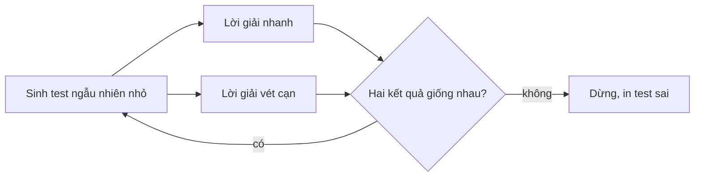
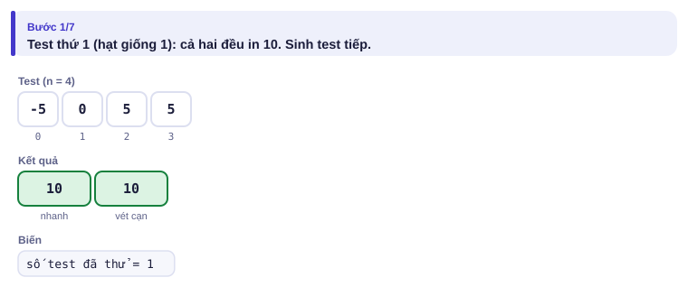
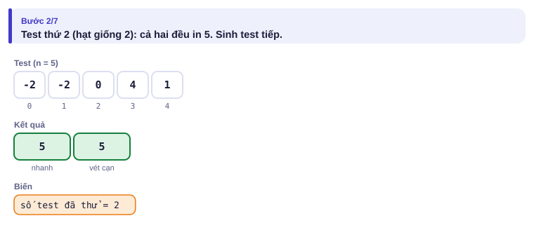
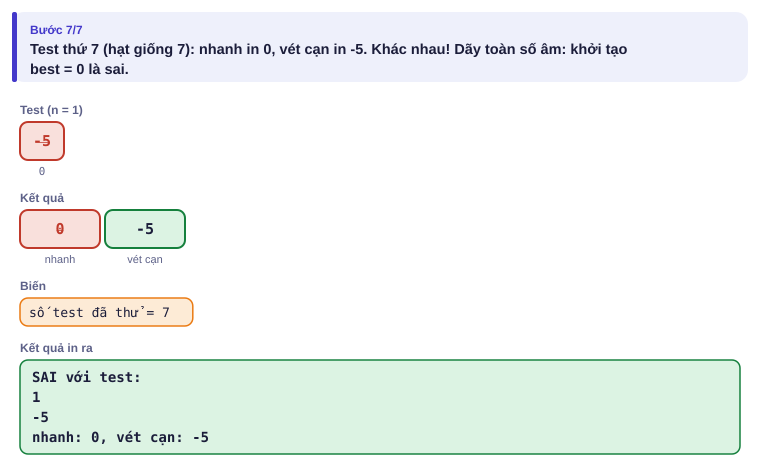

# Bài 1.9 – Stress test và gỡ lỗi

> **Tập 1 · Nền tảng thuật toán**
> Cần biết trước: bài 1.1–1.8.
> Thời lượng: khoảng 60 phút đọc, cộng 4 giờ thực hành trong tuần.

**Học xong bài này, em sẽ:**

- đọc hiểu các loại kết quả của máy chấm và biết mỗi loại thường do đâu;
- viết **stress test**: sinh test ngẫu nhiên, so lời giải nhanh với lời giải vét cạn;
- thu nhỏ test sai để tìm lỗi trong vài phút thay vì vài giờ;
- dùng stress test để **kiểm tra một ý tham lam** trước khi tin nó.

> [!TIP]
> **Học cùng trang mô phỏng.** Mở [mô phỏng stress test](../../mo-phong/t1-stress.html): máy sinh từng test nhỏ, chạy hai lời giải và dừng ở test đầu tiên khác nhau. Đổi hạt giống để thấy lỗi luôn bị bắt rất nhanh. Bật **Đoán trước** để tự đoán lời giải sai có in đúng không.

---

## 1. Bài toán mở màn: Lời giải "gần đúng"

An nộp bài Chuỗi ngày lãi nhất (bài 1.1) và qua cả ví dụ của đề, nhưng máy chấm báo **Wrong Answer** ở test 7. Đây là code của An:

```cpp
// file: kadane_sai.cpp
#include <bits/stdc++.h>
using namespace std;
int main() {
    int n;
    cin >> n;
    long long cur = 0, best = 0;
    for (int i = 0; i < n; i++) {
        long long x;
        cin >> x;
        cur = max(x, cur + x);
        best = max(best, cur);
    }
    cout << best << '\n';
}
```

---

## 2. Dừng lại 10 phút

> [!IMPORTANT]
> **Dừng lại và nghĩ.**
> 1. Máy chấm không cho xem test 7. Em sẽ làm gì để tìm ra test làm code này sai?
> 2. Trong phòng thi HSG không có máy chấm trả lời ngay. Làm sao em biết bài mình đúng trước khi nộp?
> 3. Một test sai có 10⁵ số và một test sai có 2 số: em muốn nhận test nào để gỡ lỗi?

<details>
<summary>Đáp án</summary>

1. Viết một lời giải **chắc chắn đúng** (dù chậm), sinh thật nhiều test **nhỏ** ngẫu nhiên, và so kết quả hai lời giải. Test đầu tiên khác nhau chính là manh mối.
2. Chính em phải làm máy chấm cho mình, bằng đúng cách ở câu 1.
3. Test 2 số: chạy tay được ngay. Với code trên, stress test tìm ra test kiểu `1` / `-5`: đáp án đúng là −5, code của An in 0 vì khởi tạo `best = 0`.

</details>

---

## 3. Cách gỡ lỗi ngây thơ và vì sao nó chậm

Khi bị WA, An thường làm ba việc:

| Cách | Vấn đề |
| --- | --- |
| Nhìn code thật lâu | Em đọc code theo ý em **muốn** nó làm, nên rất khó thấy lỗi của chính mình |
| Thử lại ví dụ của đề | Ví dụ của đề thường dễ; code đã qua nó rồi |
| Tự nghĩ vài test bằng tay | Nghĩ được vài test, nhưng dễ bỏ qua đúng trường hợp gây lỗi (dãy toàn âm, n = 1, phần tử bằng nhau…) |

Cả ba đều dựa vào may mắn. Máy tính sinh được **hàng nghìn** test mỗi giây và không có "điểm mù" như người viết code.

### Các loại kết quả của máy chấm

| Kết quả | Nghĩa | Nguyên nhân hay gặp |
| --- | --- | --- |
| **AC** (Accepted) | Đúng | |
| **WA** (Wrong Answer) | Sai kết quả | Thiếu trường hợp biên, tràn số, khởi tạo sai, in sai định dạng |
| **TLE** (Time Limit Exceeded) | Quá thời gian | Thuật toán quá chậm, vòng lặp vô hạn, đọc dữ liệu chậm |
| **RE** (Runtime Error) | Chương trình dừng đột ngột | Truy cập ngoài mảng, chia cho 0, đệ quy quá sâu |
| **MLE** (Memory Limit Exceeded) | Quá bộ nhớ | Mảng quá lớn, ví dụ 10⁵ × 10⁵ |
| **CE** (Compilation Error) | Không biên dịch được | Sai cú pháp, chọn sai ngôn ngữ khi nộp |

---

## 4. Ý tưởng then chốt

> [!IMPORTANT]
> **Stress test = bộ sinh test nhỏ ngẫu nhiên + lời giải vét cạn hiển nhiên đúng + chương trình so sánh. Lặp tới khi hai lời giải khác nhau; test đó là manh mối.**



### Chạy từng bước

Với hạt giống bắt đầu từ 1. Đoán trước lời giải của An đúng hay sai ở mỗi test.

<details>
<summary><b>Bước 1</b> – Test thứ nhất</summary>



</details>

<details>
<summary><b>Bước 2</b> – Test thứ hai</summary>



</details>

<details>
<summary><b>Bước 3</b> – Test thứ bảy: khác nhau!</summary>



Chỉ 7 test ngẫu nhiên là đủ lộ lỗi, và test sai chỉ có vài số: chạy tay được ngay.

</details>

---

## 5. Cài đặt

**1. Bộ sinh test**: test **nhỏ** (n từ 1 đến 6, giá trị từ −5 đến 5), để khi sai em còn chạy tay được:

```python
# file: sinh_test.py
import random, sys
random.seed(int(sys.argv[1]))           # truyền hạt giống để tái tạo được test
n = random.randint(1, 6)
print(n)
print(*[random.randint(-5, 5) for _ in range(n)])
```

**2. Lời giải vét cạn**: viết đơn giản nhất có thể, càng ít "thông minh" càng tốt:

```python
# file: vet_can.py
n = int(input())
a = list(map(int, input().split()))
print(max(sum(a[l:r + 1]) for l in range(n) for r in range(l, n)))
```

**3. Chương trình so sánh:**

```python
# file: so_sanh.py
import subprocess, sys
nhanh = sys.argv[1]                      # ví dụ: ./kadane_sai  (đã biên dịch)
for seed in range(1, 1001):
    test = subprocess.run([sys.executable, "sinh_test.py", str(seed)], capture_output=True, text=True).stdout
    a = subprocess.run([nhanh], input=test, capture_output=True, text=True).stdout.split()
    b = subprocess.run([sys.executable, "vet_can.py"], input=test, capture_output=True, text=True).stdout.split()
    if a != b:
        print("SAI với test:\n" + test + f"Lời giải nhanh: {a}, vét cạn: {b}")
        break
else:
    print("Đúng cả 1000 test")
```

Chạy:

```bash
g++ -O2 -o kadane_sai kadane_sai.cpp
python3 so_sanh.py ./kadane_sai
```

Kết quả (tùy hạt giống, nhưng sẽ rất nhanh tìm ra):

```text
SAI với test:
1
-4
Lời giải nhanh: ['0'], vét cạn: ['-4']
```

> [!TIP]
> **Vì sao test nhỏ?** Lỗi thường nằm ở trường hợp đặc biệt (dãy toàn âm, n = 1, hai số bằng nhau). Test nhỏ ngẫu nhiên gặp các trường hợp này rất thường xuyên, và khi sai em đọc được ngay.

### Những kỹ thuật gỡ lỗi khác

- **In giá trị trung gian** ra `cerr` (C++) hoặc `sys.stderr` (Python): không lẫn vào kết quả. Vẫn nên xóa trước khi nộp.
- **`assert(điều_kiện)`**: chương trình dừng ngay khi điều em tin là đúng lại sai. Ví dụ `assert(l <= r)`.
- **Biên dịch có kiểm tra** khi luyện tập: `g++ -fsanitize=address,undefined -g bai.cpp` báo ngay khi truy cập ngoài mảng hay tràn số có dấu.
- **Thu nhỏ test sai**: bỏ bớt từng phần tử, còn sai thì giữ; tới khi không bỏ được nữa. Test sai nhỏ nhất thường chỉ ra đúng chỗ lỗi.
- **Test lớn nhất tự sinh**: kiểm tra tốc độ (TLE) và tràn số; chạy với lệnh `time` để đo.

---

## 6. Vì sao hiệu quả

- Lỗi thường chỉ xuất hiện ở một **kiểu** dữ liệu đặc biệt. Với n ≤ 6 và giá trị trong [−5, 5], xác suất sinh ra dãy toàn âm khá lớn (khoảng 1/2 với n = 1), nên 1000 test gần như chắc chắn chạm phải.
- Vét cạn đúng hiển nhiên vì nó **thử hết**; lời giải nhanh phải khớp với nó trên mọi test nhỏ.
- **Chạy bao lâu:** 1000 test nhỏ, mỗi test vài mili giây: chưa tới một phút. Trong phòng thi 180 phút, dành 10–15 phút cho stress test là khoản đầu tư rất lời.

---

## 7. Bẫy thường gặp

> [!WARNING]
> **Bẫy 1: lời giải vét cạn cũng sai.** Vét cạn phải **đơn giản tới mức hiển nhiên đúng**. Đừng "tối ưu" nó.

> [!WARNING]
> **Bẫy 2: test sinh ra không hợp lệ.** Bộ sinh phải tôn trọng ràng buộc của đề (ví dụ aᵢ ≥ 1 trong bài hai con trỏ). Test sai luật có thể làm hai lời giải "khác nhau" vô nghĩa.

> [!WARNING]
> **Bẫy 3: chỉ thử test lớn.** Test lớn kiểm tra tốc độ, test nhỏ kiểm tra đúng sai. Cần cả hai, nhưng tìm lỗi thì dùng test nhỏ.

> [!WARNING]
> **Bẫy 4: so sánh khi đề có nhiều đáp án đúng.** Nếu đề cho in "một cách bất kỳ", hai lời giải đúng có thể in khác nhau. Khi đó phải viết chương trình **kiểm tra** đáp án (đúng luật không, tối ưu không) thay vì so từng ký tự.

---

## 8. Ví dụ giảm dần hỗ trợ

### Ví dụ 2 – Điền vào chỗ trống: Bộ sinh test cho bài Chạy bộ

Viết bộ sinh test cho bài Chạy bộ (bài 1.5): dòng đầu n S, dòng sau n số. Ràng buộc: aᵢ ≥ 1.

```text
import random, sys
random.seed(int(sys.argv[1]))
n = random.randint(1, 6)
S = random.randint(____, 15)
print(n, S)
print(*[random.randint(____, 6) for _ in range(n)])
```

<details>
<summary>Đáp án</summary>

S nên có thể nhỏ (kể cả 1) để có test "phần tử lớn hơn S"; aᵢ phải từ **1** (Bẫy 2). Ví dụ `random.randint(1, 15)` và `random.randint(1, 6)`. Nếu cho aᵢ = 0 hoặc âm, test vi phạm đề và lời giải cửa sổ trượt bị "bắt lỗi oan".

</details>

### Ví dụ 3 – Tự làm: Bắt quả tang ý tham lam sai

Chi tin rằng bài Liên hoan phim (bài 1.8) giải được bằng "chọn suất **ngắn nhất** trước". Hãy viết stress test để tìm một phản ví dụ **nhỏ nhất** (ít suất nhất) cho cách của Chi.

> [!IMPORTANT]
> Tự làm trước. Gợi ý: lời giải vét cạn thử mọi tập con suất chiếu (bài 1.7). Để tìm phản ví dụ nhỏ nhất, cho bộ sinh tạo n = 1 trước, rồi n = 2, n = 3, …

<details>
<summary>Lời giải</summary>

```python
import random
from itertools import combinations

def chi(p):                                   # tham lam: ngắn nhất trước
    chon = []
    for a, b in sorted(p, key=lambda x: x[1] - x[0]):
        if all(b <= c or d <= a for c, d in chon):
            chon.append((a, b))
    return len(chon)

def vet_can(p):
    for k in range(len(p), 0, -1):
        for tap in combinations(sorted(p), k):
            if all(tap[i][1] <= tap[i + 1][0] for i in range(k - 1)):
                return k
    return 0

for n in range(1, 6):
    for seed in range(2000):
        random.seed(seed)
        p = []
        for _ in range(n):
            a = random.randint(0, 10)
            p.append((a, a + random.randint(1, 5)))
        if chi(p) != vet_can(p):
            print(n, p, chi(p), vet_can(p))
            raise SystemExit
```

Phản ví dụ đầu tiên xuất hiện với **n = 3**, dạng "một suất ngắn nằm vắt ngang hai suất dài không chồng nhau", giống ví dụ `1 5`, `4 7`, `6 10` ở bài 1.8. Với n ≤ 2 cách của Chi luôn đúng, nên thử tay vài test 2 suất sẽ không bao giờ thấy lỗi.

</details>

---

## 9. Bài tập

| Nấc | Bài | Ý chính |
| --- | --- | --- |
| Khởi động | Chạy `so_sanh.py` với `kadane_sai`, rồi sửa lỗi và chạy lại tới khi đúng cả 1000 test | Làm quen quy trình |
| Luyện | Viết stress test cho bài Chạy bộ (1.5) bằng bộ sinh ở Ví dụ 2 | Bộ sinh tôn trọng ràng buộc |
| Luyện | Viết stress test so `xaytuong_de_quy` (1.6) với lời giải ngăn xếp ở Tập 2 | Hai lời giải khác hẳn nhau |
| Thử thách | Viết stress test cho bài Trạm sạc (1.8), vét cạn mọi tập con trạm | Kiểm tra lời giải tham lam của chính em |
| Kiểu đề thi | Lấy một đề thi thử bất kỳ đã làm (bài 1.10, 0.10): với mỗi bài, viết vét cạn cho subtask nhỏ rồi stress test lời giải đầy đủ | Thói quen phòng thi |

---

## 10. Tóm tắt, flashcard và checkpoint

**Tóm tắt trong 5 dòng.**

1. Máy chấm báo WA / TLE / RE: mỗi loại gợi ý một nhóm nguyên nhân.
2. Stress test = bộ sinh test nhỏ + vét cạn hiển nhiên đúng + so sánh.
3. Test sai nhỏ nhất chỉ ra lỗi nhanh nhất.
4. Bộ sinh phải tôn trọng ràng buộc của đề; dùng hạt giống để tái tạo test.
5. Stress test cũng là cách kiểm tra một ý tham lam trước khi tin.

**Flashcard.**

<details><summary>Code bị RE ở test lớn nhưng đúng ở test nhỏ: nghi ngờ gì đầu tiên?</summary>Truy cập ngoài mảng (mảng khai báo nhỏ hơn giới hạn đề), hoặc đệ quy quá sâu.</details>
<details><summary>Vì sao bộ sinh nhận "hạt giống" từ tham số?</summary>Để chạy lại đúng test đã làm sai khi cần gỡ lỗi.</details>
<details><summary>Ba thành phần của stress test?</summary>Bộ sinh test nhỏ, lời giải vét cạn, chương trình so sánh.</details>
<details><summary>Vì sao test nhỏ tốt hơn test lớn để tìm lỗi sai?</summary>Hay chạm trường hợp đặc biệt, và chạy tay được.</details>
<details><summary>TLE thường do đâu?</summary>Thuật toán quá chậm, vòng lặp vô hạn, hoặc đọc dữ liệu chậm.</details>

**Ôn xoắn ốc** (kiến thức bài 1.5–1.8; mỗi bài tối đa 20 phút):

- [Movie Festival](https://cses.fi/problemset/task/1629) (CSES 1629): tham lam.
- Tổ hợp (bài 1.7, Ví dụ 3), viết lại không nhìn sách.
- [Subarray Sums I](https://cses.fi/problemset/task/1660) (CSES 1660): cửa sổ trượt.

**Checkpoint – em đã sẵn sàng sang bài tiếp theo nếu:**

- [ ] Tự viết được đủ ba thành phần stress test cho một bài bất kỳ trong 15 phút.
- [ ] Tìm và sửa được lỗi của `kadane_sai` bằng stress test.
- [ ] Làm xong Ví dụ 3 và tìm được phản ví dụ 3 suất cho cách của Chi.
- [ ] Đã stress test ít nhất một lời giải của chính em và tìm ra (hoặc loại trừ) một lỗi.

Chưa đạt? Nếu vướng ô 1 hoặc 2, mở trang mô phỏng stress test và đọc lại mục 5. Nếu vướng ô 3, ôn bài 1.7 (vét cạn tập con) trước. Nếu vướng ô 4, chọn bài Dãy đèn (1.5) và làm theo đúng ba bước.
