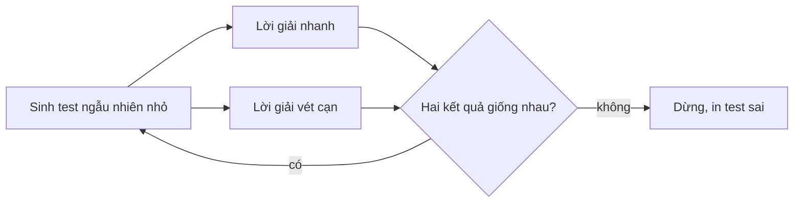

# Bài 1.9 – Stress test và gỡ lỗi

> **Tập 1** · Cần biết trước: bài 1.1–1.8 · Thời lượng: khoảng 60 phút đọc, 4 giờ thực hành

**Học xong bài này, em sẽ:**

- đọc hiểu các loại kết quả của máy chấm và biết mỗi loại thường do đâu;
- viết **stress test**: sinh test ngẫu nhiên, so lời giải nhanh với lời giải vét cạn;
- thu nhỏ test sai để tìm lỗi trong vài phút thay vì vài giờ.

---

## 1. Bài toán mở màn: Lời giải "gần đúng"

An nộp bài Chuỗi ngày lãi nhất (bài 1.1) và qua cả ví dụ của đề, nhưng máy chấm báo **Wrong Answer** ở test 7. Đây là code của An:

```cpp
// file: kadane_sai.cpp
#include <bits/stdc++.h>
using namespace std;
int main() {
    int n;
    cin >> n;
    long long cur = 0, best = 0;
    for (int i = 0; i < n; i++) {
        long long x;
        cin >> x;
        cur = max(x, cur + x);
        best = max(best, cur);
    }
    cout << best << '\n';
}
```

> [!IMPORTANT]
> **Dừng lại và nghĩ.** Máy chấm không cho xem test 7. Em sẽ làm gì để tìm ra test làm code này sai?

<details>
<summary>Đáp án</summary>

Viết một lời giải **chắc chắn đúng** (dù chậm), sinh thật nhiều test **nhỏ** ngẫu nhiên, và so kết quả hai lời giải. Test đầu tiên khác nhau chính là manh mối. Với code trên, stress test sẽ tìm ra một test như `1` / `-5`: đáp án đúng là −5, code của An in 0 vì khởi tạo `best = 0`.

</details>

---

## 2. Các loại kết quả của máy chấm

| Kết quả | Nghĩa | Nguyên nhân hay gặp |
| --- | --- | --- |
| **AC** (Accepted) | Đúng | |
| **WA** (Wrong Answer) | Sai kết quả | Thiếu trường hợp biên, tràn số, khởi tạo sai, in sai định dạng |
| **TLE** (Time Limit Exceeded) | Quá thời gian | Thuật toán quá chậm, vòng lặp vô hạn, đọc dữ liệu chậm |
| **RE** (Runtime Error) | Chương trình dừng đột ngột | Truy cập ngoài mảng, chia cho 0, đệ quy quá sâu |
| **MLE** (Memory Limit Exceeded) | Quá bộ nhớ | Mảng quá lớn, ví dụ 10⁵ × 10⁵ |
| **CE** (Compilation Error) | Không biên dịch được | Sai cú pháp, chọn sai ngôn ngữ khi nộp |

Trong phòng thi HSG không có máy chấm trả lời ngay. **Em phải tự làm máy chấm** cho chính mình: đó là stress test.

---

## 3. Stress test: ba thành phần



**1. Bộ sinh test** – test **nhỏ** (n từ 1 đến 6, giá trị từ −5 đến 5), để khi sai em còn chạy tay được:

```python
# file: sinh_test.py
import random, sys
random.seed(int(sys.argv[1]))           # truyền hạt giống để tái tạo được test
n = random.randint(1, 6)
print(n)
print(*[random.randint(-5, 5) for _ in range(n)])
```

**2. Lời giải vét cạn** – viết đơn giản nhất có thể, càng ít "thông minh" càng tốt:

```python
# file: vet_can.py
n = int(input())
a = list(map(int, input().split()))
print(max(sum(a[l:r + 1]) for l in range(n) for r in range(l, n)))
```

**3. Chương trình so sánh:**

```python
# file: so_sanh.py
import subprocess, sys
nhanh = sys.argv[1]                      # ví dụ: ./kadane_sai  (đã biên dịch)
for seed in range(1, 1001):
    test = subprocess.run([sys.executable, "sinh_test.py", str(seed)], capture_output=True, text=True).stdout
    a = subprocess.run([nhanh], input=test, capture_output=True, text=True).stdout.split()
    b = subprocess.run([sys.executable, "vet_can.py"], input=test, capture_output=True, text=True).stdout.split()
    if a != b:
        print("SAI với test:\n" + test + f"Lời giải nhanh: {a}, vét cạn: {b}")
        break
else:
    print("Đúng cả 1000 test")
```

Chạy:

```bash
g++ -O2 -o kadane_sai kadane_sai.cpp
python3 so_sanh.py ./kadane_sai
```

Kết quả (tùy hạt giống, nhưng sẽ rất nhanh tìm ra):

```text
SAI với test:
1
-4
Lời giải nhanh: ['0'], vét cạn: ['-4']
```

Test chỉ có **một số âm**: lỗi lộ rõ ngay.

> [!TIP]
> **Vì sao test nhỏ?** Lỗi thường nằm ở trường hợp đặc biệt (dãy toàn âm, n = 1, hai số bằng nhau). Test nhỏ ngẫu nhiên gặp các trường hợp này rất thường xuyên, và khi sai em đọc được ngay.

---

## 4. Những kỹ thuật gỡ lỗi khác

- **In giá trị trung gian** ra `cerr` (C++) hoặc `sys.stderr` (Python): không lẫn vào kết quả. Vẫn nên xóa trước khi nộp.
- **`assert(điều_kiện)`**: chương trình dừng ngay khi điều em tin là đúng lại sai. Ví dụ `assert(l <= r)`.
- **Biên dịch có kiểm tra** khi luyện tập: `g++ -fsanitize=address,undefined -g bai.cpp` báo ngay khi truy cập ngoài mảng hay tràn số có dấu.
- **Thu nhỏ test sai**: bỏ bớt từng phần tử, còn sai thì giữ; tới khi không bỏ được nữa. Test sai nhỏ nhất thường chỉ ra đúng chỗ lỗi.

---

## 5. Bẫy thường gặp

> [!WARNING]
> **Bẫy 1: lời giải vét cạn cũng sai.** Vét cạn phải **đơn giản tới mức hiển nhiên đúng**. Đừng "tối ưu" nó.

> [!WARNING]
> **Bẫy 2: test sinh ra không hợp lệ.** Bộ sinh phải tôn trọng ràng buộc của đề (ví dụ aᵢ ≥ 1 trong bài hai con trỏ). Test sai luật có thể làm hai lời giải "khác nhau" vô nghĩa.

> [!WARNING]
> **Bẫy 3: chỉ thử test lớn.** Test lớn kiểm tra tốc độ, test nhỏ kiểm tra đúng sai. Cần cả hai, nhưng tìm lỗi thì dùng test nhỏ.

---

## 6. Bài tập

| Nấc | Bài | Ý chính |
| --- | --- | --- |
| Khởi động | Chạy `so_sanh.py` với `kadane_sai`, rồi sửa lỗi và chạy lại tới khi đúng cả 1000 test | Làm quen quy trình |
| Luyện | Viết stress test cho bài Chạy bộ (1.5): bộ sinh phải sinh aᵢ ≥ 1 | Bộ sinh tôn trọng ràng buộc |
| Luyện | Viết stress test so `xaytuong_de_quy` (1.6) với lời giải ngăn xếp ở Tập 2 | Hai lời giải khác hẳn nhau |
| Thử thách | Viết một lời giải tham lam **sai** cho Liên hoan phim (1.8), dùng stress test để tìm phản ví dụ nhỏ nhất | Stress test để kiểm tra ý tham lam |

---

## 7. Tóm tắt và checkpoint

1. Máy chấm báo WA / TLE / RE: mỗi loại gợi ý một nhóm nguyên nhân.
2. Stress test = bộ sinh test nhỏ + vét cạn hiển nhiên đúng + so sánh.
3. Test sai nhỏ nhất chỉ ra lỗi nhanh nhất.

<details><summary>Code bị RE ở test lớn nhưng đúng ở test nhỏ: nghi ngờ gì đầu tiên?</summary>Truy cập ngoài mảng (mảng khai báo nhỏ hơn giới hạn đề), hoặc đệ quy quá sâu.</details>
<details><summary>Vì sao bộ sinh nhận "hạt giống" từ tham số?</summary>Để chạy lại đúng test đã làm sai khi cần gỡ lỗi.</details>

**Checkpoint:**

- [ ] Tự viết từ đầu một bộ stress test cho một bài bất kỳ trong Tập 1, không nhìn sách.
- [ ] Dùng stress test tìm được ít nhất một lỗi thật trong code của chính em.
