# Bài 2.1 – Ngăn xếp và hàng đợi

> **Tập 2 · Cấu trúc dữ liệu và quy hoạch động cơ bản**
> Cần biết trước: Tập 1, đặc biệt bài 1.1 (độ phức tạp) và bài 1.6 (đệ quy, ngăn gọi hàm).
> Thời lượng: khoảng 70 phút đọc, cộng 4 giờ thực hành trong tuần.

**Học xong bài này, em sẽ:**

- dùng **ngăn xếp** (vào sau, ra trước) và **hàng đợi** (vào trước, ra trước) trong C++ và Python;
- nhận ra bài nào cần cấu trúc nào: "xử lý cái **mới nhất** chưa xong" thì ngăn xếp, "xử lý theo **thứ tự đến**" thì hàng đợi;
- dùng `deque` khi cần thêm/bớt ở cả hai đầu;
- giải trọn bài kiểu đề thi **Xếp toa tàu**.

> [!TIP]
> **Học cùng hai trang mô phỏng.** [Dấu ngoặc](../../mo-phong/t2-ngoac.html): thử cả bốn ví dụ, đặc biệt `{[]}(` và `())(`. [Vòng tròn](../../mo-phong/t2-josephus.html): bật **Đoán trước** để tự đoán ai bị loại tiếp theo.

---

## 1. Bài toán mở màn: Dấu ngoặc

Trình soạn thảo của An cần kiểm tra một xâu chỉ gồm `()[]{}` có hợp lệ không: mỗi ngoặc mở có ngoặc đóng **cùng loại**, và các cặp lồng nhau đúng thứ tự (không cắt chéo). Độ dài xâu ≤ 10⁶.

| Vào | Ra |
| --- | --- |
| `([]{()})` | `YES` |
| `([)]` | `NO` |
| `((` | `NO` |

---

## 2. Dừng lại 10 phút

> [!IMPORTANT]
> **Dừng lại và nghĩ.**
> 1. Trong `([]{()})`, ngoặc đóng `)` ở vị trí 5 (đếm từ 0) phải khớp với ngoặc mở nào: ngoặc mở **đầu tiên** của xâu, hay ngoặc mở **gần nhất chưa được đóng**?
> 2. Xâu `([)]` có số ngoặc mỗi loại cân bằng. Vì sao nó vẫn sai?
> 3. Khi đã ghép xong một cặp, ví dụ `[]`, em có cần nhớ gì về cặp đó nữa không?

<details>
<summary>Đáp án</summary>

1. Ngoặc mở **gần nhất chưa đóng**: `(` ở vị trí 4.
2. Khi gặp `)`, ngoặc mở gần nhất chưa đóng là `[`, khác loại.
3. Không. Cặp đã ghép có thể "xóa" khỏi trí nhớ. Ta chỉ cần nhớ các ngoặc mở **chưa đóng**, và luôn làm việc với cái **mới nhất** trong số đó. Đó chính là **ngăn xếp**.

</details>

---

## 3. Lời giải ngây thơ và vì sao nó chậm

Bảo nghĩ ra cách rất trực quan: lặp lại việc **xóa mọi cặp kề nhau** `()`, `[]`, `{}` cho tới khi không xóa được nữa. Xâu hợp lệ khi và chỉ khi cuối cùng còn xâu rỗng.

```text
([]{()})  →  ({()})  →  ({})  →  ()  →  (rỗng)   : YES
([)]      →  không có cặp kề nhau nào            : NO
```

Cách này đúng, nhưng mỗi lượt quét tốn O(n), và với xâu `((((…))))` mỗi lượt chỉ xóa được **một** cặp ở giữa: n/2 lượt, tổng O(n²) = 2,5·10¹¹ phép với n = 10⁶. Quá chậm. Điều lãng phí: mỗi lượt lại đọc lại từ đầu những ngoặc mở mà ta đã biết chắc chưa đóng.

---

## 4. Ý tưởng then chốt

> [!IMPORTANT]
> **Đọc xâu một lần. Gặp ngoặc mở: đẩy vào ngăn xếp. Gặp ngoặc đóng: so với đỉnh ngăn xếp; cùng loại thì bỏ đỉnh, khác loại hoặc ngăn xếp rỗng thì xâu sai. Hết xâu, ngăn xếp phải rỗng.**

Ngăn xếp là chồng đĩa: chỉ đặt thêm lên **đỉnh** và chỉ lấy ra từ **đỉnh**. Cái vào sau cùng ra trước tiên (LIFO, *last in first out*).

### Chạy từng bước

Với `([]{()})`. Đoán trước rồi mới mở.

<details>
<summary><b>Bước 1</b> – Bắt đầu: ngăn xếp rỗng</summary>

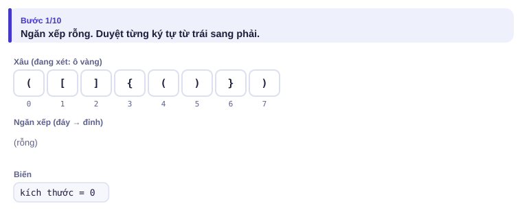

</details>

<details>
<summary><b>Bước 2</b> – Hai ký tự đầu đều là ngoặc mở: ngăn xếp có gì?</summary>

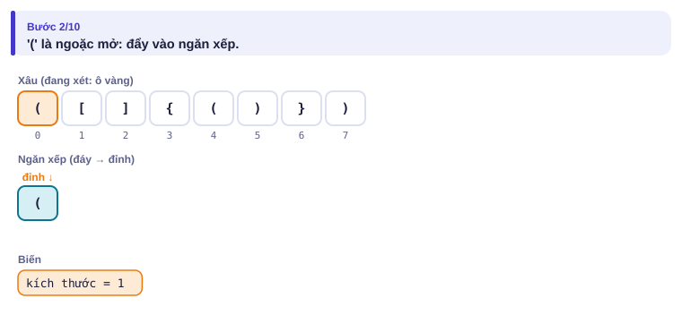
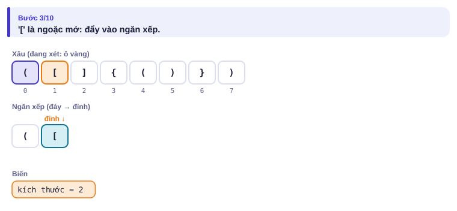

</details>

<details>
<summary><b>Bước 3</b> – Gặp <code>]</code>: so với đỉnh nào, khớp không?</summary>

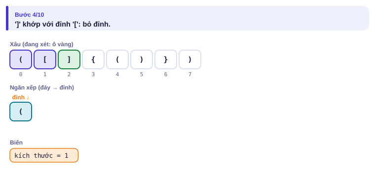

</details>

<details>
<summary><b>Bước 4</b> – Gặp <code>{</code>: kích thước ngăn xếp thành bao nhiêu?</summary>

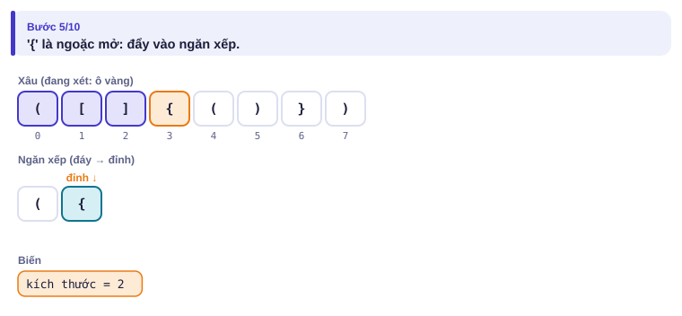

</details>

<details>
<summary><b>Bước 5</b> – Kết thúc</summary>

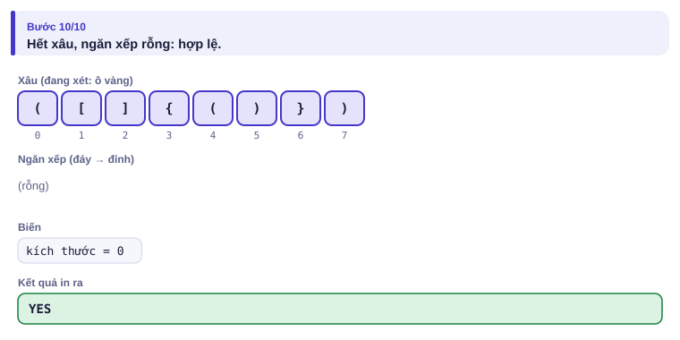

</details>

Chạy tay hai xâu sai:

| Xâu | Ký tự | Hành động | Ngăn xếp (đáy → đỉnh) |
| --- | :---: | --- | --- |
| `([)]` | `(` | đẩy | `(` |
| | `[` | đẩy | `( [` |
| | `)` | đỉnh là `[`, cần `(`: **NO** | `( [` |
| `((` | `(`, `(` | đẩy, đẩy | `( (` |
| | hết xâu | ngăn xếp còn 2 phần tử: **NO** | `( (` |

---

## 5. Mã giả và cài đặt

```text
ok ← đúng; st ← ngăn xếp rỗng
với mỗi ký tự c trong s:
    nếu c là ngoặc mở: đẩy c vào st
    ngược lại:
        nếu st rỗng hoặc đỉnh st khác loại với c: ok ← sai; dừng
        bỏ đỉnh st
nếu st còn phần tử: ok ← sai
in YES nếu ok, ngược lại NO
```

```cpp
// file: ngoac.cpp
#include <bits/stdc++.h>
using namespace std;
int main() {
    string s;
    cin >> s;
    stack<char> st;
    bool ok = true;
    for (char c : s) {
        if (c == '(' || c == '[' || c == '{') st.push(c);
        else {
            char mo = (c == ')') ? '(' : (c == ']') ? '[' : '{';
            if (st.empty() || st.top() != mo) { ok = false; break; }
            st.pop();
        }
    }
    if (!st.empty()) ok = false;          // còn ngoặc mở chưa đóng
    cout << (ok ? "YES" : "NO") << '\n';
}
```

```python
# file: ngoac.py
s = input().strip()
mo = {')': '(', ']': '[', '}': '{'}
st = []
ok = True
for c in s:
    if c in "([{":
        st.append(c)
    else:
        if not st or st[-1] != mo[c]:
            ok = False
            break
        st.pop()
if st:
    ok = False
print("YES" if ok else "NO")
```

| Thao tác | C++ `stack<T> st` | Python `st = []` |
| --- | --- | --- |
| đẩy | `st.push(x)` | `st.append(x)` |
| xem đỉnh | `st.top()` | `st[-1]` |
| bỏ đỉnh | `st.pop()` | `st.pop()` |
| rỗng? | `st.empty()` | `not st` |
| kích thước | `st.size()` | `len(st)` |

### Hàng đợi: trò chơi vòng tròn

n bạn đứng vòng tròn, đánh số 1..n. Bắt đầu từ bạn 1, cứ **bỏ qua một bạn rồi loại bạn kế tiếp**, tới khi hết người. In thứ tự bị loại. (n ≤ 2·10⁵, bài [Josephus Problem I](https://cses.fi/problemset/task/2162))

| Vào | Ra |
| --- | --- |
| `7` | `2 4 6 1 5 3 7` |

Vòng tròn có thể "duỗi thẳng" thành một **hàng đợi**: người đầu hàng được bỏ qua thì đi xuống **cuối hàng**; người đầu hàng kế tiếp bị loại. Hàng đợi là vào trước ra trước (FIFO, *first in first out*).

<details>
<summary><b>Hình</b> – hai lượt đầu với n = 7 (mở lần lượt; đoán trước ai bị loại)</summary>

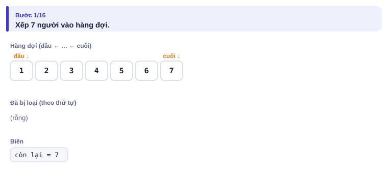
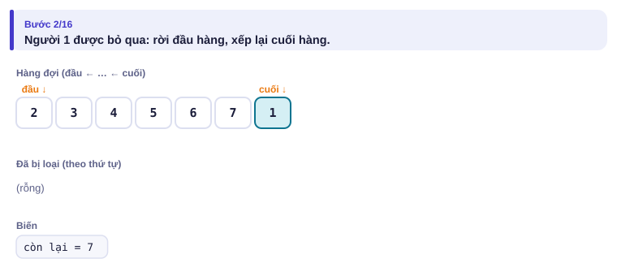
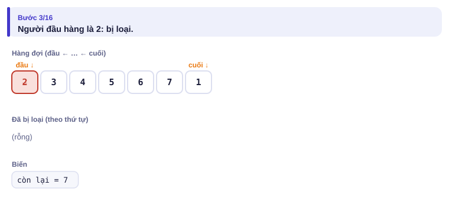
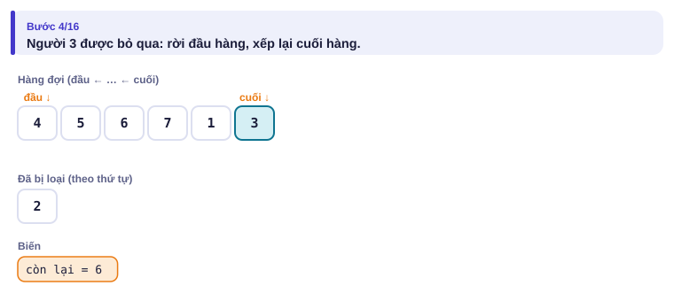
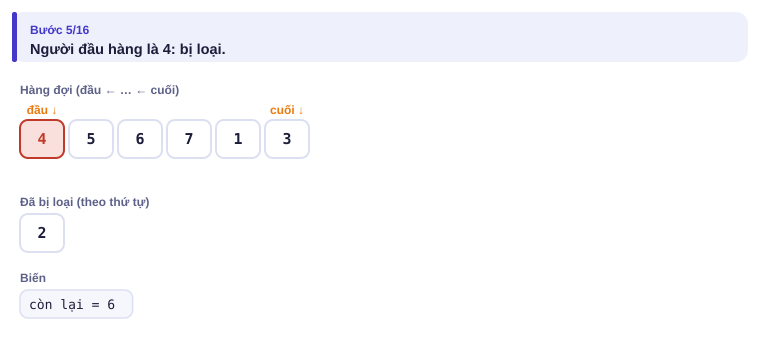
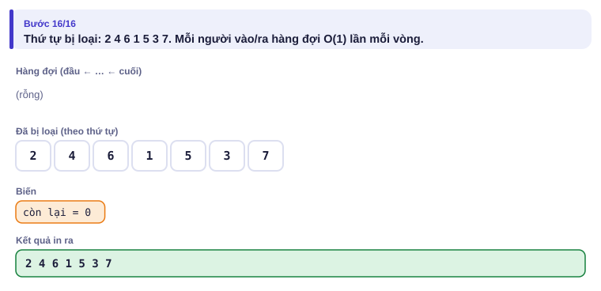

</details>

```cpp
// file: josephus.cpp
#include <bits/stdc++.h>
using namespace std;
int main() {
    int n;
    cin >> n;
    queue<int> q;
    for (int i = 1; i <= n; i++) q.push(i);
    vector<int> loai;
    while (!q.empty()) {
        q.push(q.front()); q.pop();      // bỏ qua: đưa xuống cuối hàng
        loai.push_back(q.front()); q.pop();
    }
    for (int i = 0; i < n; i++) cout << loai[i] << (i + 1 == n ? '\n' : ' ');
}
```

```python
# file: josephus.py
from collections import deque
n = int(input())
q = deque(range(1, n + 1))
loai = []
while q:
    q.append(q.popleft())      # bỏ qua: đưa xuống cuối hàng
    loai.append(q.popleft())
print(*loai)
```

| Thao tác | C++ `queue<T> q` | Python `q = deque()` |
| --- | --- | --- |
| thêm cuối | `q.push(x)` | `q.append(x)` |
| xem đầu | `q.front()` | `q[0]` |
| bỏ đầu | `q.pop()` | `q.popleft()` |

`deque` (hàng đợi hai đầu) thêm/bớt được ở **cả hai đầu** trong O(1): C++ có `push_front`, `push_back`, `pop_front`, `pop_back`; Python có `appendleft`, `append`, `popleft`, `pop`. Bài 2.6 dùng `deque` để tìm min trên cửa sổ trượt, bài 2.7 dùng hàng đợi cho BFS.

---

## 6. Vì sao đúng, chạy bao lâu

- **Đúng (dấu ngoặc):** ngăn xếp luôn chứa đúng các ngoặc mở chưa được đóng, theo thứ tự xuất hiện. Một ngoặc đóng hợp lệ phải khớp với ngoặc mở **gần nhất** chưa đóng (nếu khớp với ngoặc xa hơn thì cặp gần hơn bị cắt chéo). Ngoặc gần nhất đó chính là đỉnh.
- **Đúng (vòng tròn):** thứ tự trong hàng đợi luôn là thứ tự đi vòng quanh, bắt đầu từ người kế tiếp được xét. Đưa người bị bỏ qua xuống cuối hàng giữ nguyên thứ tự vòng.
- **Chạy bao lâu:** mỗi ký tự được đẩy và bỏ tối đa một lần, nên dấu ngoặc là O(n). Josephus: mỗi lượt loại tốn O(1), n lượt, tổng O(n).

---

## 7. Bẫy thường gặp

> [!WARNING]
> **Bẫy 1: gọi `top()`/`front()` khi rỗng.** C++ không báo lỗi rõ ràng mà cho kết quả rác hoặc chương trình dừng bất thường. Luôn kiểm tra `empty()` trước, như điều kiện `st.empty() || ...`.
> *Test phá:* `)(` (ngoặc đóng khi ngăn xếp rỗng).

> [!WARNING]
> **Bẫy 2: quên kiểm tra ngăn xếp rỗng ở cuối.** Xâu chỉ có ngoặc mở không gây lỗi nào trong vòng lặp.
> *Test phá:* `((` phải ra `NO`.

> [!WARNING]
> **Bẫy 3: chỉ đếm số ngoặc.** Đếm mở/đóng mỗi loại bằng nhau là chưa đủ.
> *Test phá:* `([)]` có đủ cặp nhưng cắt chéo.

> [!WARNING]
> **Bẫy 4: Python dùng `list.pop(0)` làm hàng đợi.** Mỗi lần lấy đầu danh sách là O(n), cả bài thành O(n²). Dùng `collections.deque` với `popleft()`.
> *Test phá:* Josephus với n = 2·10⁵.

---

## 8. Ví dụ giảm dần hỗ trợ

### Ví dụ 2 – Điền vào chỗ trống: Độ sâu lồng nhau

Cho một xâu ngoặc tròn **hợp lệ** (độ dài ≤ 10⁶). Độ sâu lồng nhau là số ngoặc mở chưa đóng lớn nhất tại một thời điểm, tức kích thước lớn nhất của ngăn xếp. Ví dụ `(()(()))` có độ sâu 3.

Vì chỉ có một loại ngoặc, ta không cần lưu ngăn xếp thật, chỉ cần đếm số phần tử của nó.

```cpp
int d = 0, best = 0;
for (char c : s) {
    if (c == '(') { d++; best = max(best, ____); }
    else ____;
}
```

<details>
<summary>Đáp án</summary>

`d` và `d--`.

```cpp
// file: do_sau.cpp
#include <bits/stdc++.h>
using namespace std;
int main() {
    string s;
    cin >> s;
    int d = 0, best = 0;
    for (char c : s) {
        if (c == '(') { d++; best = max(best, d); }
        else d--;
    }
    cout << best << '\n';
}
```

</details>

### Ví dụ 3 – Tự làm: Biểu thức hậu tố

Biểu thức hậu tố viết toán tử **sau** hai toán hạng: `3 4 + 2 *` nghĩa là (3 + 4) · 2 = 14. Cho một dòng gồm các số nguyên không âm và các toán tử `+ - *`, cách nhau bởi dấu cách (tối đa 10⁵ phần tử, biểu thức hợp lệ, kết quả và mọi giá trị trung gian vừa `long long`). Tính giá trị.

| Vào | Ra |
| --- | --- |
| `3 4 + 2 *` | `14` |
| `5 1 2 + 4 * + 3 -` | `14` |

> [!IMPORTANT]
> Tự làm trước. Gợi ý: gặp số thì đẩy vào ngăn xếp. Gặp toán tử thì lấy **hai** số trên cùng ra. Cẩn thận thứ tự với phép trừ: số lấy ra trước là toán hạng **bên phải**.

<details>
<summary>Lời giải</summary>

Với `5 1 2 + 4 * + 3 -`: ngăn xếp lần lượt là `5`, `5 1`, `5 1 2`, `5 3`, `5 3 4`, `5 12`, `17`, `17 3`, `14`.

```cpp
// file: hau_to.cpp
#include <bits/stdc++.h>
using namespace std;
int main() {
    vector<long long> st;                 // vector dùng như ngăn xếp
    string tk;
    while (cin >> tk) {
        if (tk == "+" || tk == "-" || tk == "*") {
            long long b = st.back(); st.pop_back();   // toán hạng phải
            long long a = st.back(); st.pop_back();   // toán hạng trái
            st.push_back(tk == "+" ? a + b : tk == "-" ? a - b : a * b);
        } else st.push_back(stoll(tk));
    }
    cout << st.back() << '\n';
}
```

</details>

---

## 9. Bài tập

| Nấc | Bài | Nguồn | Ý chính |
| --- | --- | --- | --- |
| Khởi động | [Josephus Problem I](https://cses.fi/problemset/task/2162) | CSES 2162 | Đúng mục 5 |
| Khởi động | [Hulk](https://codeforces.com/problemset/problem/705/A) | CF 705A · 800 | Khởi động cú pháp C++ |
| Luyện | [Plug-in](https://codeforces.com/problemset/problem/81/A) | CF 81A · 1400 | Xóa cặp ký tự kề nhau bằng ngăn xếp |
| Luyện | [Queue at the School](https://codeforces.com/problemset/problem/266/B) | CF 266B · 800 | Mô phỏng hàng |
| Thử thách | [Longest Regular Bracket Sequence](https://codeforces.com/problemset/problem/5/C) | CF 5C · 1900 | Ngăn xếp **chỉ số** thay vì ký tự |
| Kiểu đề thi | Xếp toa tàu | Bài của sách, chấm theo subtask | Xem bên dưới |

### Bài kiểu đề thi: Xếp toa tàu

**Đề bài.** Ga Sóng Thần có một **đường cụt** dùng để đảo toa. Một đoàn n toa (1 ≤ n ≤ 10⁶) đi vào ga theo thứ tự 1, 2, …, n. Mỗi lần, nhân viên được làm một trong hai thao tác:

- đưa toa đứng đầu đoàn **vào** đường cụt;
- kéo toa ở **cuối** đường cụt (toa vào sau cùng) **ra** đoàn mới.

Toa đã ra đoàn mới thì không quay lại. Cho thứ tự mong muốn p₁, p₂, …, pₙ của đoàn mới (một hoán vị của 1..n). Hỏi có làm được không? Đọc từ `TOATAU.INP` (dòng 1: n, dòng 2: hoán vị), ghi `YES` hoặc `NO` ra `TOATAU.OUT`.

Subtask: 40% có n ≤ 8; 60% còn lại có n ≤ 10⁶.

| TOATAU.INP | TOATAU.OUT |
| --- | --- |
| `5`<br>`3 2 5 4 1` | `YES` |
| `3`<br>`3 1 2` | `NO` |

Ví dụ 2: muốn toa 3 ra đầu tiên thì toa 1 và 2 phải vào đường cụt trước, toa 2 nằm ngoài cùng; khi đó không thể kéo toa 1 ra trước toa 2.

<details>
<summary><b>Gợi ý 1</b> – hướng đi (đủ 40% điểm)</summary>

Mỗi lần chỉ có hai lựa chọn (đưa vào hoặc kéo ra), tổng cộng 2n thao tác. Với n ≤ 8, quay lui (bài 1.7) thử mọi dãy thao tác: tối đa 2¹⁶ trường hợp.

</details>

<details>
<summary><b>Gợi ý 2</b> – ý then chốt</summary>

Đường cụt chính là một **ngăn xếp**. Xét lần lượt từng toa pᵢ cần ra. Nếu pᵢ đang ở **đỉnh** ngăn xếp thì kéo ra ngay. Nếu pᵢ chưa vào ga, đưa mọi toa từ toa kế tiếp tới pᵢ vào đường cụt, rồi kéo pᵢ ra. Còn nếu pᵢ đã ở trong đường cụt nhưng không ở đỉnh: thua chắc, vì các toa phía trên chặn nó.

</details>

<details>
<summary><b>Gợi ý 3</b> – lời giải đầy đủ</summary>

Biến `ke` là toa tiếp theo chưa vào ga. Mỗi toa vào và ra ngăn xếp tối đa một lần: O(n).

```cpp
// file: toatau.cpp
#include <bits/stdc++.h>
using namespace std;
int main() {
    freopen("TOATAU.INP", "r", stdin);
    freopen("TOATAU.OUT", "w", stdout);
    int n;
    scanf("%d", &n);
    vector<int> st;
    st.reserve(n);
    int ke = 1;
    bool ok = true;
    for (int i = 0; i < n; i++) {
        int p;
        scanf("%d", &p);
        if (!ok) continue;
        while (ke <= p) st.push_back(ke++);        // đưa vào tới khi gặp p
        if (st.back() != p) ok = false;            // p bị chặn bên dưới
        else st.pop_back();
    }
    puts(ok ? "YES" : "NO");
}
```

```python
# file: toatau.py
import sys
with open("TOATAU.INP") as f:
    data = f.read().split()
n = int(data[0])
p = list(map(int, data[1:1 + n]))
st = []
ke = 1
ok = True
for x in p:
    while ke <= x:
        st.append(ke)
        ke += 1
    if st[-1] != x:
        ok = False
        break
    st.pop()
with open("TOATAU.OUT", "w") as f:
    f.write("YES\n" if ok else "NO\n")
```

Vì sao `st.back()` không bao giờ được gọi khi rỗng: sau vòng `while`, toa p chắc chắn đã từng vào ngăn xếp; nếu nó đã ra rồi thì nó không thể xuất hiện lần nữa trong hoán vị, nên ngăn xếp còn ít nhất một phần tử.

</details>

---

## 10. Tóm tắt, flashcard và checkpoint

**Tóm tắt trong 5 dòng.**

1. Ngăn xếp: vào sau ra trước; dùng khi cần "cái mới nhất chưa xử lý xong" (ngoặc, biểu thức, đường cụt, đệ quy).
2. Hàng đợi: vào trước ra trước; dùng khi xử lý theo thứ tự đến (xếp hàng, vòng tròn, BFS ở bài 2.7).
3. `deque`: thêm/bớt hai đầu O(1); Python dùng `collections.deque`, không dùng `list.pop(0)`.
4. Luôn kiểm tra rỗng trước khi xem đỉnh/đầu, và kiểm tra trạng thái cuối cùng.
5. Mỗi phần tử vào/ra tối đa một lần ⇒ cả thuật toán O(n).

**Flashcard.**

<details><summary><code>{[]}(</code> có hợp lệ không? Vì sao?</summary>Không: hết xâu mà ngăn xếp còn <code>(</code>.</details>
<details><summary>Ngoặc đóng phải khớp với ngoặc mở nào?</summary>Ngoặc mở gần nhất chưa đóng, tức đỉnh ngăn xếp.</details>
<details><summary>Trong biểu thức hậu tố, gặp <code>-</code> thì lấy hai số ra theo thứ tự nào?</summary>Số lấy ra trước là b (bên phải), số lấy ra sau là a (bên trái); kết quả a − b.</details>
<details><summary>Vì sao <code>list.pop(0)</code> chậm?</summary>Python phải dời mọi phần tử còn lại lên một ô: O(n) mỗi lần.</details>
<details><summary>Bài Xếp toa tàu: khi nào chắc chắn trả lời NO?</summary>Toa cần ra đã nằm trong đường cụt nhưng không ở đỉnh.</details>

**Ôn xoắn ốc** (kiến thức Tập 1; mỗi bài tối đa 20 phút):

- Viết lại Tháp Hà Nội (bài 1.6) và chỉ ra ngăn gọi hàm đang là một ngăn xếp.
- [Ferris Wheel](https://cses.fi/problemset/task/1090) (CSES 1090): hai con trỏ (bài 1.5).
- [Missing Number](https://cses.fi/problemset/task/1083) (CSES 1083): tổng hoặc sắp xếp.

**Checkpoint – em đã sẵn sàng sang bài tiếp theo nếu:**

- [ ] Viết bài dấu ngoặc không nhìn sách, đúng cả `((`, `)(` và `([)]`.
- [ ] AC [Josephus Problem I](https://cses.fi/problemset/task/2162).
- [ ] Làm xong Ví dụ 3 (biểu thức hậu tố) mà không mở lời giải.
- [ ] Đạt trọn điểm bài Xếp toa tàu khi tự làm trong 25 phút.

Chưa đạt? Nếu vướng ô 1, chạy trang mô phỏng dấu ngoặc với bốn ví dụ có sẵn và đọc lại mục 7. Nếu vướng ô 2, bật Đoán trước trên trang vòng tròn. Nếu vướng ô 3 hoặc 4, chạy tay ngăn xếp trên giấy như bảng ở mục 4 rồi làm lại.
