# Bài 2.10 – Quy hoạch động 2: dãy con và xâu con

> **Tập 2 · Cấu trúc dữ liệu và quy hoạch động cơ bản**
> Cần biết trước: bài 2.9 (bốn bước QHĐ), bài 1.4 (`lower_bound`), bài 1.2 (sắp xếp theo nhiều khóa).
> Thời lượng: khoảng 100 phút đọc, cộng 8 giờ thực hành (1,5 tuần).

**Học xong bài này, em sẽ:**

- tìm **dãy con tăng dài nhất** (LIS) trong O(n²), rồi O(n log n);
- tìm **xâu con chung dài nhất** (LCS) và **khoảng cách sửa** của hai xâu bằng bảng QHĐ hai chiều;
- đặt trạng thái dạng "kết thúc tại i" và "i ký tự đầu của xâu này, j ký tự đầu của xâu kia";
- giải trọn bài kiểu đề thi **Xếp hộp** (LIS hai chiều).

> [!TIP]
> **Học cùng hai trang mô phỏng.** [LIS](../../mo-phong/t2-lis.html): bật **Đoán trước** để tự tìm vị trí `lower_bound`; thử ví dụ "toàn bằng nhau". [LCS](../../mo-phong/t2-lcs.html): để ý ô nào được dùng (chéo hay trên/trái) khi hai ký tự bằng hoặc khác nhau.

---

## 1. Bài toán mở màn: Bậc thang điểm số

Bảng điểm n bài kiểm tra của Bảo theo thời gian là a₁ … aₙ. Bảo muốn chọn ra **nhiều bài nhất** (giữ nguyên thứ tự thời gian) sao cho điểm **tăng ngặt**. (n ≤ 2·10⁵, aᵢ ≤ 10⁹; bài [Increasing Subsequence](https://cses.fi/problemset/task/1145))

| Vào | Ra |
| --- | --- |
| `8`<br>`7 3 5 3 6 2 9 8` | `4` |

Ví dụ `3 5 6 9` hoặc `3 5 6 8`.

---

## 2. Dừng lại 10 phút

> [!IMPORTANT]
> **Dừng lại và nghĩ.**
> 1. Thử mọi dãy con thì có bao nhiêu dãy con với n = 20? n = 2·10⁵?
> 2. Gọi f[i] là độ dài dãy tăng dài nhất **kết thúc tại** bài i. Biết f của mọi bài trước i, tính f[i] thế nào?
> 3. Có hai dãy tăng cùng dài 2 là `3 5` và `3 6`. Muốn nối thêm phần tử sau này, em giữ dãy nào thì có lợi hơn?

<details>
<summary>Đáp án</summary>

1. 2²⁰ ≈ 10⁶ (được), 2²⁰⁰⁰⁰⁰ (không thể).
2. Bài i nối được vào sau mọi bài j < i có aⱼ < aᵢ: f[i] = 1 + max(f[j]) với các j đó (bằng 1 nếu không có j nào). Đáp án là max của mọi f[i]. Đây là QHĐ O(n²).
3. `3 5`: đuôi nhỏ hơn thì nối được với nhiều số hơn (6 nối được vào `3 5` nhưng không nối được vào `3 6`). Với mỗi độ dài, chỉ cần nhớ **đuôi nhỏ nhất**.

</details>

---

## 3. Lời giải ngây thơ và vì sao nó chậm

Lời giải QHĐ ở câu 2 là bước tiến lớn so với thử mọi dãy con:

```cpp
int best = 0;
for (int i = 0; i < n; i++) {
    f[i] = 1;
    for (int j = 0; j < i; j++)
        if (a[j] < a[i]) f[i] = max(f[i], f[j] + 1);
    best = max(best, f[i]);
}
```

Nhưng O(n²) = 4·10¹⁰ với n = 2·10⁵. Lãng phí: với mỗi i, ta duyệt **mọi** j, trong khi theo câu 3, chỉ cần biết "với mỗi độ dài, đuôi nhỏ nhất là bao nhiêu".

---

## 4. Ý tưởng then chốt

> [!IMPORTANT]
> **Giữ `tails[k]` = giá trị cuối nhỏ nhất của một dãy tăng dài k + 1 đã gặp. `tails` luôn tăng dần. Với mỗi x: tìm vị trí k đầu tiên có `tails[k] ≥ x` (`lower_bound`). Không có thì thêm x vào cuối; có thì thay `tails[k] = x`. Độ dài `tails` là đáp án.**

### Chạy từng bước

Với `7 3 5 3 6 2 9 8`. Đoán vị trí `lower_bound` rồi mới mở.

<details>
<summary><b>Bước 1</b> – x = 7, rồi x = 3</summary>

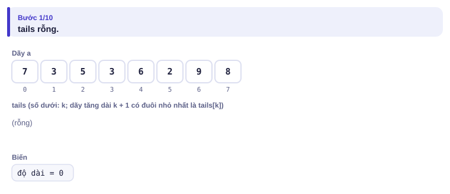
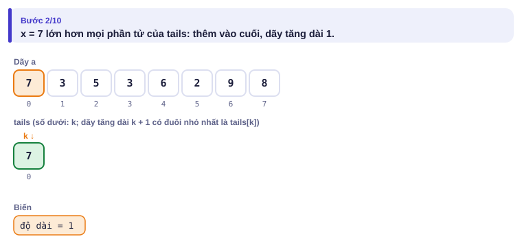
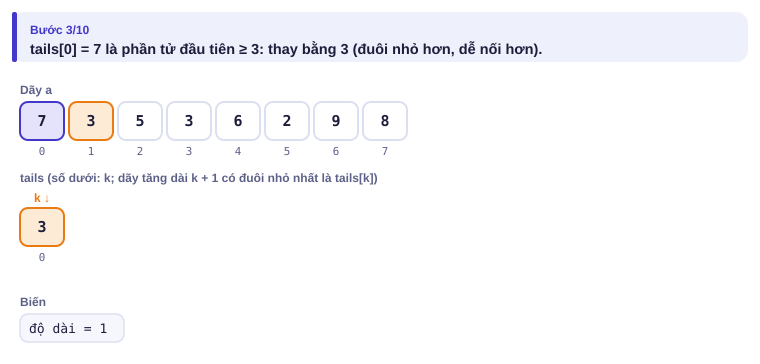

</details>

<details>
<summary><b>Bước 2</b> – x = 5, x = 3: tails thay đổi thế nào?</summary>

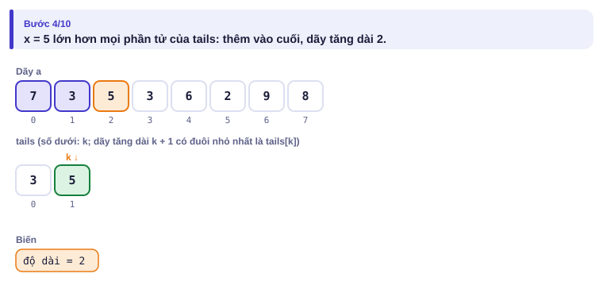
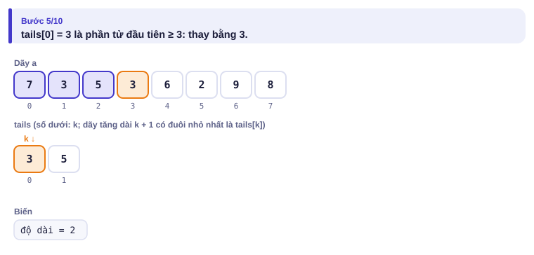

</details>

<details>
<summary><b>Bước 3</b> – x = 6, x = 2: số 2 thay vào đâu?</summary>

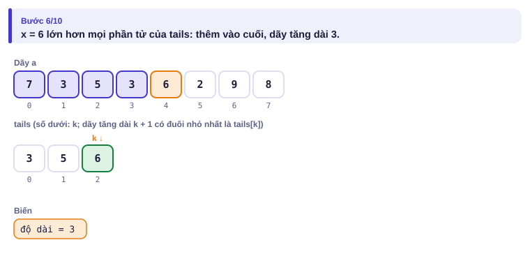
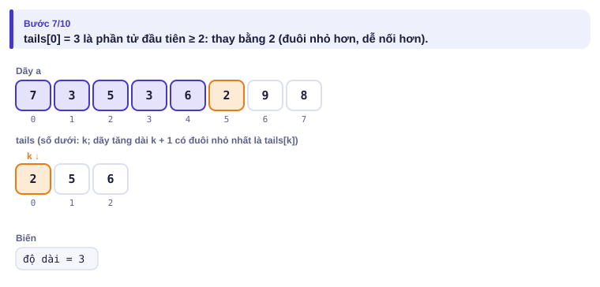

</details>

<details>
<summary><b>Bước 4</b> – x = 9, x = 8</summary>

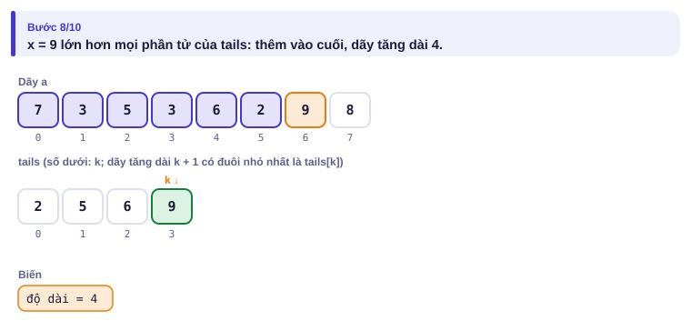
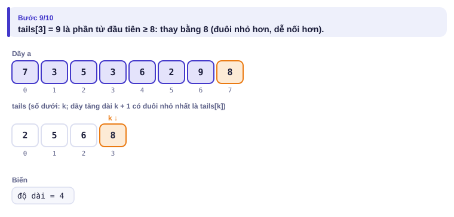

</details>

| x | Vị trí lower_bound | tails sau bước |
| :---: | :---: | --- |
| 7 | 0 (rỗng) | 7 |
| 3 | 0 | 3 |
| 5 | 1 | 3 5 |
| 3 | 0 | 3 5 |
| 6 | 2 | 3 5 6 |
| 2 | 0 | 2 5 6 |
| 9 | 3 | 2 5 6 9 |
| 8 | 3 | 2 5 6 8 |

Độ dài `tails` cuối cùng là **4**. Chú ý: `tails` không nhất thiết là một dãy con thật (2 đứng sau 5 trong dãy gốc); chỉ **độ dài** của nó là đáp án.

---

## 5. Mã giả và cài đặt

```cpp
// file: lis.cpp
#include <bits/stdc++.h>
using namespace std;
int main() {
    ios::sync_with_stdio(false);
    cin.tie(nullptr);
    int n;
    cin >> n;
    vector<long long> tails;
    for (int i = 0; i < n; i++) {
        long long x;
        cin >> x;
        auto it = lower_bound(tails.begin(), tails.end(), x);   // >= x: dãy TĂNG NGẶT
        if (it == tails.end()) tails.push_back(x);
        else *it = x;
    }
    cout << tails.size() << '\n';
}
```

```python
# file: lis.py
import sys
from bisect import bisect_left
data = sys.stdin.buffer.read().split()
n = int(data[0])
tails = []
for x in map(int, data[1:1 + n]):
    k = bisect_left(tails, x)          # vị trí đầu tiên >= x
    if k == len(tails):
        tails.append(x)
    else:
        tails[k] = x
print(len(tails))
```

Đổi `lower_bound` thành `upper_bound` (Python: `bisect_right`) thì được dãy **không giảm** (cho phép bằng nhau).

### Xâu con chung dài nhất

Cho hai xâu s và t (độ dài ≤ 5000). Tìm độ dài xâu dài nhất là **dãy con** (giữ thứ tự, không cần liền nhau) của cả hai.

| Vào | Ra |
| --- | --- |
| `SAIGON`<br>`SANGO` | `4` |

Ví dụ `SAGO`.

- **Trạng thái:** d[i][j] = LCS của i ký tự đầu của s và j ký tự đầu của t.
- **Truy hồi (hỏi về ký tự cuối):** nếu s[i] = t[j] thì d[i][j] = d[i−1][j−1] + 1; ngược lại một trong hai ký tự cuối không dùng được: d[i][j] = max(d[i−1][j], d[i][j−1]).
- **Cơ sở:** d[0][j] = d[i][0] = 0.
- **Thứ tự:** i tăng dần, trong mỗi hàng j tăng dần.

<details>
<summary><b>Hình</b> – điền bảng cho SAIGON và SANGO (mở lần lượt; đoán từng ô)</summary>

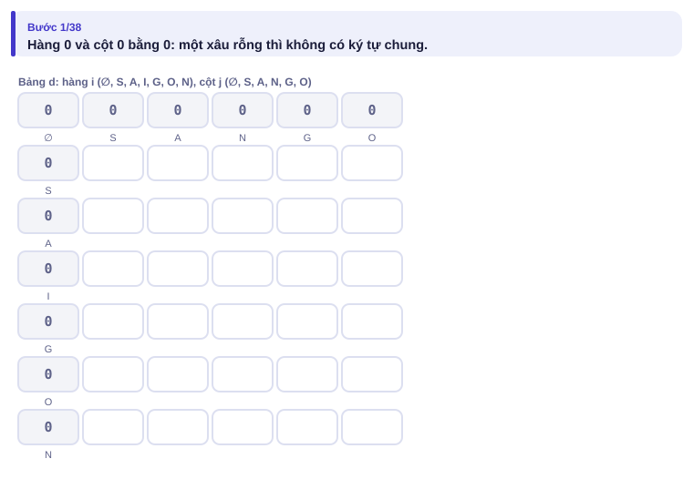
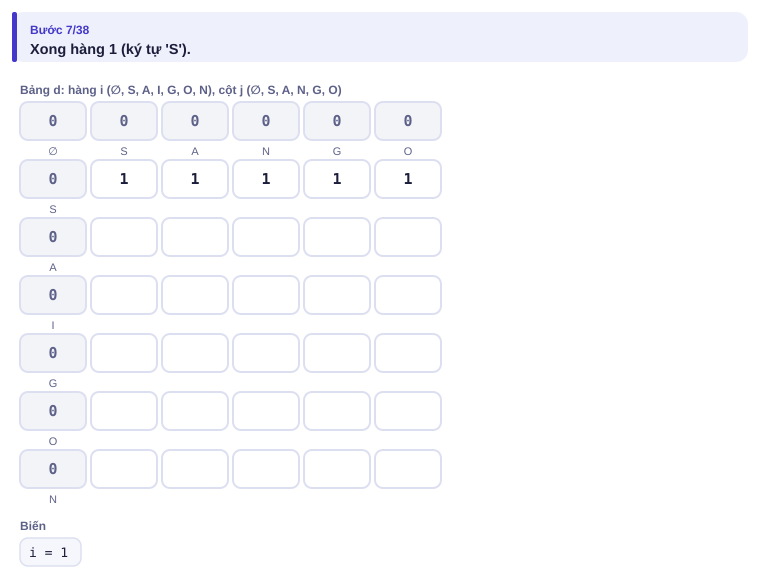
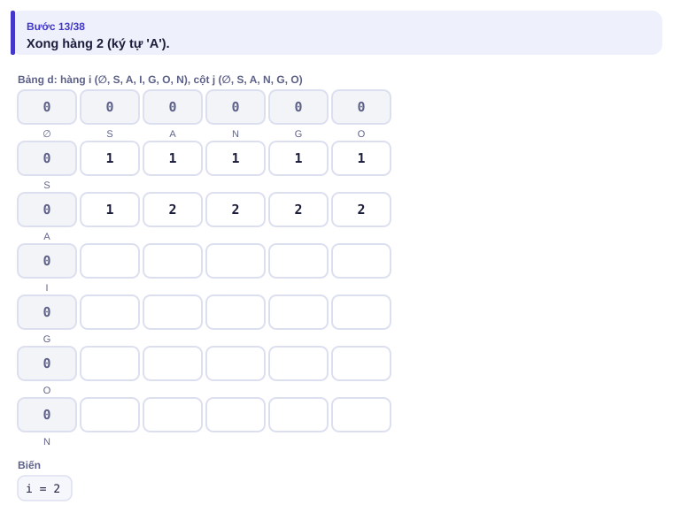
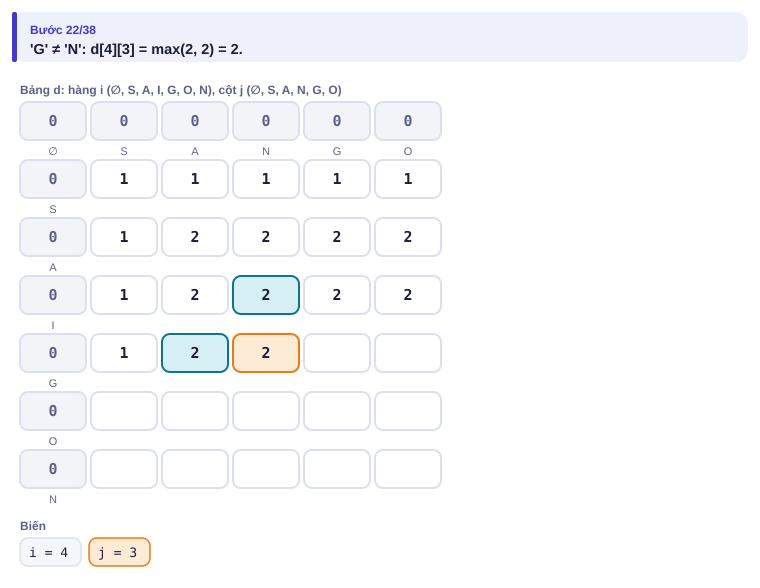
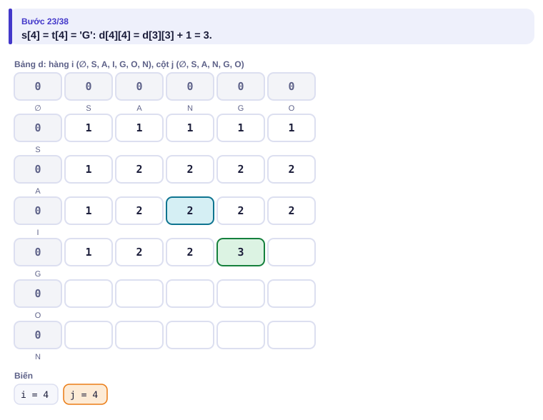
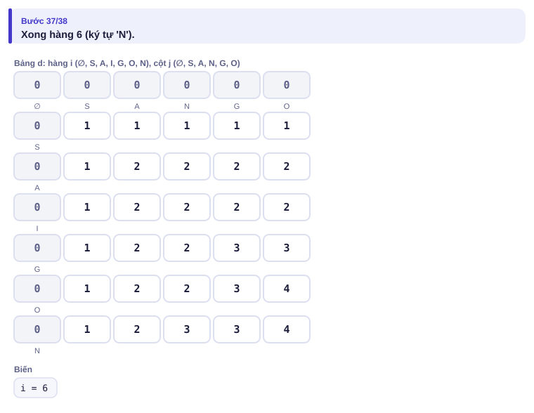

</details>

| | ∅ | S | A | N | G | O |
| --- | :---: | :---: | :---: | :---: | :---: | :---: |
| ∅ | 0 | 0 | 0 | 0 | 0 | 0 |
| S | 0 | **1** | 1 | 1 | 1 | 1 |
| A | 0 | 1 | **2** | 2 | 2 | 2 |
| I | 0 | 1 | 2 | 2 | 2 | 2 |
| G | 0 | 1 | 2 | 2 | **3** | 3 |
| O | 0 | 1 | 2 | 2 | 3 | **4** |
| N | 0 | 1 | 2 | 3 | 3 | 4 |

```cpp
// file: lcs.cpp
#include <bits/stdc++.h>
using namespace std;
int main() {
    string s, t;
    cin >> s >> t;
    int n = s.size(), m = t.size();
    vector<vector<int>> d(n + 1, vector<int>(m + 1, 0));
    for (int i = 1; i <= n; i++)
        for (int j = 1; j <= m; j++)
            d[i][j] = (s[i - 1] == t[j - 1]) ? d[i - 1][j - 1] + 1
                                              : max(d[i - 1][j], d[i][j - 1]);
    cout << d[n][m] << '\n';
}
```

O(n·m) thời gian và bộ nhớ: 2,5·10⁷ ô với n = m = 5000, khoảng 100 MB nếu dùng `int`. Mỗi hàng chỉ cần hàng ngay trên, nên có thể giữ **hai hàng** để còn O(m) bộ nhớ.

---

## 6. Vì sao đúng, chạy bao lâu

- **LIS đúng:** bất biến là "tails[k] là đuôi nhỏ nhất của dãy tăng dài k + 1 trong các phần tử đã xét". Khi xét x: x nối được vào mọi dãy có đuôi < x; dãy dài nhất như vậy dài k (với k là vị trí `lower_bound`), nên x tạo ra dãy dài k + 1 có đuôi x ≤ tails[k] cũ. Các tails khác không đổi. Vì tails tăng dần nên tìm nhị phân được.
- **LIS nhanh:** n lần tìm nhị phân trên mảng dài ≤ n: O(n log n).
- **LCS đúng:** xét ký tự cuối của hai tiền tố. Nếu bằng nhau, có một LCS tối ưu dùng cặp này (thay cặp cuối của nó bằng cặp này không làm ngắn đi). Nếu khác nhau, ít nhất một trong hai ký tự không nằm trong LCS, nên bỏ nó đi.
- **LCS:** (n + 1)(m + 1) ô, mỗi ô O(1): O(n·m).

---

## 7. Bẫy thường gặp

> [!WARNING]
> **Bẫy 1: nhầm "tăng ngặt" và "không giảm".** `lower_bound` cho tăng ngặt, `upper_bound` cho không giảm.
> *Test phá:* `3` / `2 2 2`: tăng ngặt là 1, không giảm là 3.

> [!WARNING]
> **Bẫy 2: in `tails` và tưởng đó là dãy con.** Với `7 3 5 3 6 2 9 8`, `tails` cuối là `2 5 6 8` nhưng 2 đứng sau 5 trong dãy gốc. Muốn in dãy thật, phải lưu thêm "phần tử trước" của mỗi vị trí.

> [!WARNING]
> **Bẫy 3: lệch chỉ số trong bảng hai chiều.** d có kích thước (n + 1) × (m + 1); ký tự thứ i của s là `s[i - 1]`.

> [!WARNING]
> **Bẫy 4: bộ nhớ.** Bảng 5000 × 5000 `long long` là 200 MB, vượt giới hạn thường gặp. Dùng `int`, hoặc giữ hai hàng.

---

## 8. Ví dụ giảm dần hỗ trợ

### Ví dụ 2 – Điền vào chỗ trống: LIS O(n²) để đối chiếu

Viết lại lời giải O(n²) ở mục 3 thành chương trình hoàn chỉnh. Nó chậm nhưng dễ tin là đúng: dùng làm **lời giải chậm** khi stress test (bài 1.9) lời giải `tails`.

```cpp
for (int i = 0; i < n; i++) {
    f[i] = ____;
    for (int j = 0; j < i; j++)
        if (a[j] ____ a[i]) f[i] = max(f[i], f[j] + 1);
}
cout << *max_element(f.begin(), f.end());
```

<details>
<summary>Đáp án</summary>

`1` và `<`.

```cpp
// file: lis_cham.cpp
#include <bits/stdc++.h>
using namespace std;
int main() {
    int n;
    cin >> n;
    vector<long long> a(n);
    for (auto &x : a) cin >> x;
    vector<int> f(n);
    for (int i = 0; i < n; i++) {
        f[i] = 1;
        for (int j = 0; j < i; j++)
            if (a[j] < a[i]) f[i] = max(f[i], f[j] + 1);
    }
    cout << *max_element(f.begin(), f.end()) << '\n';
}
```

</details>

### Ví dụ 3 – Tự làm: Khoảng cách sửa

Biến xâu s thành xâu t bằng các thao tác: **thêm** một ký tự, **xóa** một ký tự, **thay** một ký tự. Cần ít nhất bao nhiêu thao tác? (độ dài ≤ 5000, bài [Edit Distance](https://cses.fi/problemset/task/1639))

| Vào | Ra |
| --- | --- |
| `LOVE`<br>`MOVIE` | `2` |

Thay L thành M, thêm I: `LOVE` → `MOVE` → `MOVIE`.

> [!IMPORTANT]
> Tự làm trước. Gợi ý: trạng thái giống LCS, d[i][j] = số thao tác ít nhất biến i ký tự đầu của s thành j ký tự đầu của t. Thao tác cuối cùng là gì? Cơ sở: d[i][0] và d[0][j] bằng bao nhiêu?

<details>
<summary>Lời giải</summary>

d[i][0] = i (xóa hết), d[0][j] = j (thêm hết). Nếu s[i] = t[j] thì d[i][j] = d[i−1][j−1]; ngược lại d[i][j] = 1 + min(d[i−1][j] (xóa), d[i][j−1] (thêm), d[i−1][j−1] (thay)).

```cpp
// file: sua_xau.cpp
#include <bits/stdc++.h>
using namespace std;
int main() {
    string s, t;
    cin >> s >> t;
    int n = s.size(), m = t.size();
    vector<vector<int>> d(n + 1, vector<int>(m + 1));
    for (int i = 0; i <= n; i++) d[i][0] = i;
    for (int j = 0; j <= m; j++) d[0][j] = j;
    for (int i = 1; i <= n; i++)
        for (int j = 1; j <= m; j++)
            d[i][j] = (s[i - 1] == t[j - 1]) ? d[i - 1][j - 1]
                      : 1 + min({d[i - 1][j], d[i][j - 1], d[i - 1][j - 1]});
    cout << d[n][m] << '\n';
}
```

</details>

---

## 9. Bài tập

| Nấc | Bài | Nguồn | Ý chính |
| --- | --- | --- | --- |
| Khởi động | [Increasing Subsequence](https://cses.fi/problemset/task/1145) | CSES 1145 | Đúng mục 5 |
| Khởi động | Stress test `lis.cpp` với `lis_cham.cpp` | Tự luyện | Ví dụ 2 + bài 1.9 |
| Luyện | [Edit Distance](https://cses.fi/problemset/task/1639) | CSES 1639 | Ví dụ 3 |
| Luyện | LCS với hai hàng: O(m) bộ nhớ, in thêm một xâu con chung | Tự luyện | Truy vết từ ô cuối |
| Luyện | [Array Description](https://cses.fi/problemset/task/1746) | CSES 1746 | QHĐ hai chiều: vị trí × giá trị |
| Thử thách | [Projects](https://cses.fi/problemset/task/1140) | CSES 1140 | QHĐ + sắp xếp + tìm nhị phân |
| Kiểu đề thi | Xếp hộp | Bài của sách, chấm theo subtask | Xem bên dưới |

### Bài kiểu đề thi: Xếp hộp

**Đề bài.** Cửa hàng quà lưu niệm có n chiếc hộp (1 ≤ n ≤ 2·10⁵), hộp i có đáy hình chữ nhật rộng wᵢ, dài hᵢ (1 ≤ wᵢ, hᵢ ≤ 10⁹; không được xoay hộp). Hộp a đặt **lọt** được vào hộp b nếu wₐ < w_b **và** hₐ < h_b. Chọn nhiều hộp nhất để xếp lồng nhau thành một chuỗi (hộp này lọt trong hộp kia, hộp kia lọt trong hộp nọ…). Đọc từ `XEPHOP.INP` (dòng đầu n, mỗi dòng sau wᵢ hᵢ), ghi số hộp nhiều nhất ra `XEPHOP.OUT`.

Subtask: 40% có n ≤ 5000; 60% còn lại có n ≤ 2·10⁵.

| XEPHOP.INP | XEPHOP.OUT |
| --- | --- |
| `6`<br>`2 3`<br>`5 4`<br>`6 7`<br>`6 4`<br>`1 1`<br>`3 6` | `4` |

Chuỗi (1, 1) ⊂ (2, 3) ⊂ (5, 4) ⊂ (6, 7). Hộp (6, 4) không lọt vào (6, 7) vì chiều rộng bằng nhau.

<details>
<summary><b>Gợi ý 1</b> – hướng đi (đủ 40% điểm)</summary>

Sắp xếp theo w tăng dần. Khi đó một chuỗi lồng nhau là một dãy con theo thứ tự đã sắp. Dùng QHĐ "kết thúc tại i" như Ví dụ 2, điều kiện nối là wⱼ < wᵢ và hⱼ < hᵢ. O(n²).

</details>

<details>
<summary><b>Gợi ý 2</b> – ý then chốt</summary>

Sau khi sắp theo w tăng, bài toán gần như là LIS **tăng ngặt** trên h. Vướng mắc duy nhất: các hộp **cùng w** không được nằm chung chuỗi. Mẹo: với cùng w, sắp h **giảm dần**. Khi đó trong nhóm cùng w, dãy h giảm nên LIS tăng ngặt không thể chọn hai hộp của nhóm.

</details>

<details>
<summary><b>Gợi ý 3</b> – lời giải đầy đủ</summary>

O(n log n).

```cpp
// file: xephop.cpp
#include <bits/stdc++.h>
using namespace std;
int main() {
    freopen("XEPHOP.INP", "r", stdin);
    freopen("XEPHOP.OUT", "w", stdout);
    int n;
    scanf("%d", &n);
    vector<pair<long long, long long>> b(n);
    for (auto &[w, h] : b) scanf("%lld %lld", &w, &h);
    sort(b.begin(), b.end(), [](const auto &x, const auto &y) {
        return x.first != y.first ? x.first < y.first : x.second > y.second;   // w tăng, h giảm
    });
    vector<long long> tails;
    for (auto [w, h] : b) {
        auto it = lower_bound(tails.begin(), tails.end(), h);
        if (it == tails.end()) tails.push_back(h);
        else *it = h;
    }
    printf("%d\n", (int)tails.size());
}
```

```python
# file: xephop.py
from bisect import bisect_left
with open("XEPHOP.INP") as f:
    data = f.read().split()
n = int(data[0])
b = sorted(((int(data[1 + 2 * i]), int(data[2 + 2 * i])) for i in range(n)), key=lambda p: (p[0], -p[1]))
tails = []
for w, h in b:
    k = bisect_left(tails, h)
    if k == len(tails):
        tails.append(h)
    else:
        tails[k] = h
with open("XEPHOP.OUT", "w") as f:
    f.write(f"{len(tails)}\n")
```

</details>

---

## 10. Tóm tắt, flashcard và checkpoint

**Tóm tắt trong 5 dòng.**

1. Trạng thái "kết thúc tại i": LIS O(n²) và nhiều bài dãy con khác.
2. LIS O(n log n): `tails` đuôi nhỏ nhất + `lower_bound` (tăng ngặt) hoặc `upper_bound` (không giảm).
3. Hai xâu: trạng thái (i, j) là hai tiền tố; hỏi về **ký tự cuối** của mỗi tiền tố.
4. LCS: bằng thì đi chéo + 1; khác thì max(trên, trái). Khoảng cách sửa: thêm/xóa/thay.
5. LIS hai chiều: sắp theo chiều thứ nhất tăng, cùng giá trị thì chiều thứ hai giảm, rồi LIS chiều thứ hai.

**Flashcard.**

<details><summary>LIS tăng ngặt của <code>1 3 2 3 4</code>?</summary>4: <code>1 2 3 4</code>.</details>
<details><summary>LCS("ABC", "CBA") bằng bao nhiêu?</summary>1.</details>
<details><summary>tails có phải là một dãy con tăng thật không?</summary>Không nhất thiết; chỉ độ dài của nó là đáp án.</details>
<details><summary>Khoảng cách sửa: d[i][0] bằng bao nhiêu?</summary>i: xóa hết i ký tự.</details>
<details><summary>Xếp hộp: vì sao cùng w thì sắp h giảm dần?</summary>Để LIS tăng ngặt trên h không chọn được hai hộp cùng w.</details>

**Ôn xoắn ốc** (mỗi bài tối đa 20 phút):

- Viết lại bài Ếch nhảy (bài 2.9) không nhìn sách.
- [Factory Machines](https://cses.fi/problemset/task/1620) (CSES 1620): tìm nhị phân trên đáp án (bài 1.4).
- [Room Allocation](https://cses.fi/problemset/task/1164) (CSES 1164): hàng đợi ưu tiên (bài 2.3).

**Checkpoint – em đã sẵn sàng sang bài tiếp theo nếu:**

- [ ] Viết LIS O(n log n) không nhìn sách, AC [Increasing Subsequence](https://cses.fi/problemset/task/1145).
- [ ] Điền tay bảng LCS cho hai xâu dài 5 trong 5 phút.
- [ ] Làm xong Ví dụ 3 (Khoảng cách sửa) mà không mở lời giải, AC [Edit Distance](https://cses.fi/problemset/task/1639).
- [ ] Đạt trọn điểm bài Xếp hộp khi tự làm trong 30 phút.

Chưa đạt? Nếu vướng ô 1, chạy trang mô phỏng LIS với Đoán trước và đọc lại mục 6. Nếu vướng ô 2, chạy trang LCS với ví dụ "ví dụ kinh điển". Nếu vướng ô 3 hoặc 4, làm lại Ví dụ 2 rồi đọc lại Gợi ý 2 của bài Xếp hộp.
