# Bài 2.2 – set và map

> **Tập 2 · Cấu trúc dữ liệu và quy hoạch động cơ bản**
> Cần biết trước: bài 1.4 (tìm kiếm nhị phân, `lower_bound`), bài 1.5 (hai con trỏ), bài 2.1.
> Thời lượng: khoảng 80 phút đọc, cộng 6 giờ thực hành trong tuần.

**Học xong bài này, em sẽ:**

- dùng `map` như một "mảng đếm" khi chỉ số là số rất lớn (tới 10⁹), số âm hoặc xâu;
- dùng `set` để lưu các giá trị **khác nhau, luôn có thứ tự**, thêm/xóa/tìm trong O(log n);
- dùng `lower_bound`, `upper_bound` trên một tập **đang thay đổi**;
- phân biệt `set` và `multiset`, tránh bẫy `erase` xóa hết;
- giải trọn bài kiểu đề thi **Bãi giữ xe**.

> [!TIP]
> **Học cùng hai trang mô phỏng.** [Danh sách phát](../../mo-phong/t2-playlist.html): xem map ghi vị trí gần nhất, thử ví dụ "vị trí cũ nằm ngoài cửa sổ". [set và lower_bound](../../mo-phong/t2-set.html): bật **Đoán trước** để tự trả lời từng câu hỏi `?`.

---

## 1. Bài toán mở màn: Danh sách phát

Ứng dụng nghe nhạc của Chi có n bài liên tiếp, bài i có mã kᵢ (1 ≤ kᵢ ≤ 10⁹). Chi muốn nghe một **đoạn liên tiếp dài nhất** mà không bài nào bị lặp lại. (n ≤ 2·10⁵, bài [Playlist](https://cses.fi/problemset/task/1141))

| Vào | Ra |
| --- | --- |
| `8`<br>`1 2 1 3 2 7 4 2` | `5` |

Đoạn dài nhất là `1 3 2 7 4` (vị trí 2 tới 6, đếm từ 0).

---

## 2. Dừng lại 10 phút

> [!IMPORTANT]
> **Dừng lại và nghĩ.**
> 1. Đây có phải bài cửa sổ trượt (bài 1.5) không? Nếu đoạn [l, r] không lặp thì đoạn [l + 1, r] thì sao?
> 2. Khi thêm bài r vào cửa sổ, làm sao biết **ngay** mã của nó đã có trong cửa sổ chưa? Mảng đánh dấu `da_co[k]` có dùng được không, khi kᵢ tới 10⁹?
> 3. Nếu mã kᵣ từng xuất hiện ở vị trí p, nhưng p < l, cửa sổ có bị lặp không?

<details>
<summary>Đáp án</summary>

1. Có: bớt phần tử thì vẫn không lặp. Vậy l chỉ tiến, không lùi.
2. Mảng 10⁹ phần tử tốn 4 GB: không được. Cần một "mảng" mà chỉ số là giá trị bất kỳ, chỉ tốn bộ nhớ cho các khóa thật sự xuất hiện. Đó là `map`.
3. Không: vị trí p đã nằm ngoài cửa sổ. Chỉ khi p ≥ l mới phải đẩy l lên p + 1.

</details>

---

## 3. Lời giải ngây thơ và vì sao nó chậm

An thử mọi điểm đầu l, kéo dài r tới khi gặp bài lặp, dùng một `set` mới cho mỗi l:

```cpp
int best = 0;
for (int l = 0; l < n; l++) {
    set<long long> da_co;
    for (int r = l; r < n && !da_co.count(k[r]); r++) {
        da_co.insert(k[r]);
        best = max(best, r - l + 1);
    }
}
```

Khi mọi mã khác nhau, mỗi l chạy tới cuối dãy: khoảng n²/2 = 2·10¹⁰ thao tác, mỗi thao tác lại tốn log n. Lãng phí giống bài 1.5: khi chuyển sang l + 1, ta xây lại từ đầu một cửa sổ mà phần lớn đã biết là không lặp.

---

## 4. Ý tưởng then chốt

> [!IMPORTANT]
> **Cửa sổ trượt, cộng thêm `map gan_nhat` lưu vị trí xuất hiện gần nhất của mỗi mã. Thêm bài r: nếu `gan_nhat[k[r]] ≥ l` thì đặt `l = gan_nhat[k[r]] + 1`. Sau đó ghi `gan_nhat[k[r]] = r`.**

`map<K, V>` giống mảng nhưng chỉ số (khóa) có thể là số rất lớn, số âm hay xâu, và chỉ tốn bộ nhớ cho khóa đã dùng. Bên trong, `map` là một cây nhị phân tìm kiếm cân bằng, các khóa luôn được giữ theo thứ tự, mỗi thao tác O(log n).

### Chạy từng bước

Với `1 2 1 3 2 7 4 2`. Đoán trước rồi mới mở.

<details>
<summary><b>Bước 1</b> – Hai bài đầu: map có những khóa nào?</summary>

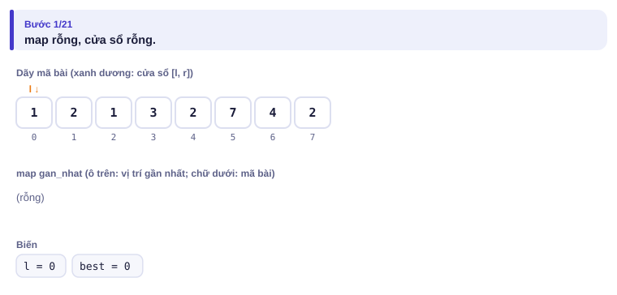
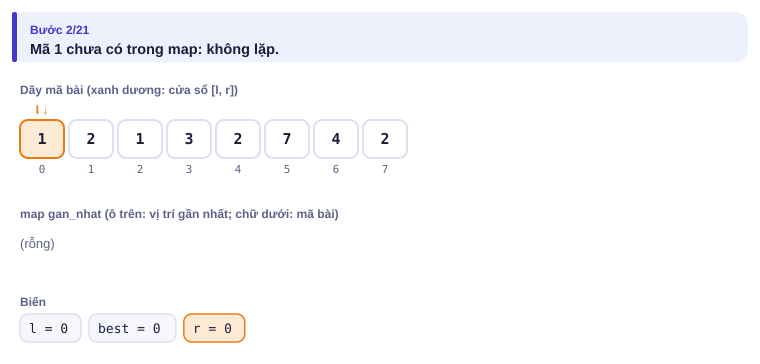
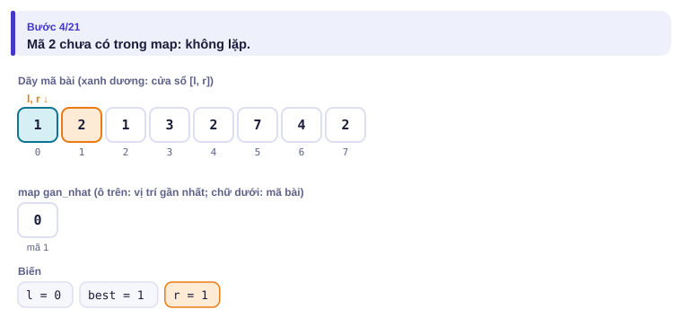

</details>

<details>
<summary><b>Bước 2</b> – r = 2, mã 1 lặp lại: l mới là bao nhiêu?</summary>

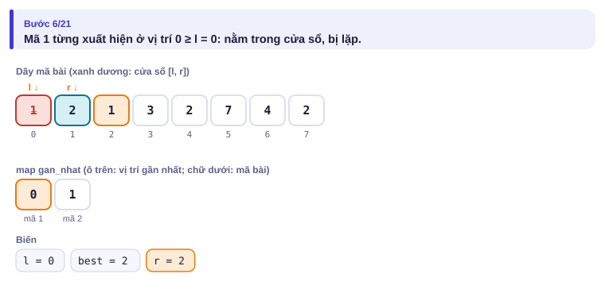
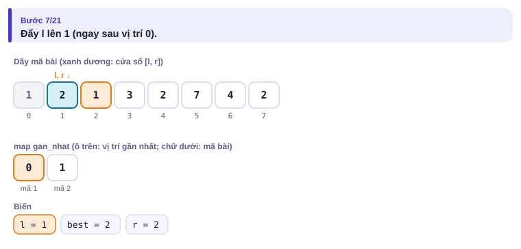

</details>

<details>
<summary><b>Bước 3</b> – r = 4, mã 2 lặp lại: l mới là bao nhiêu?</summary>

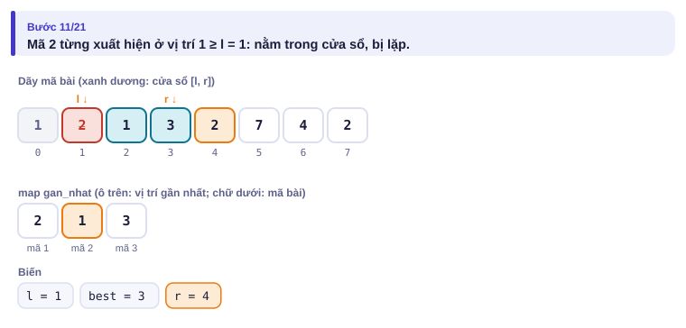
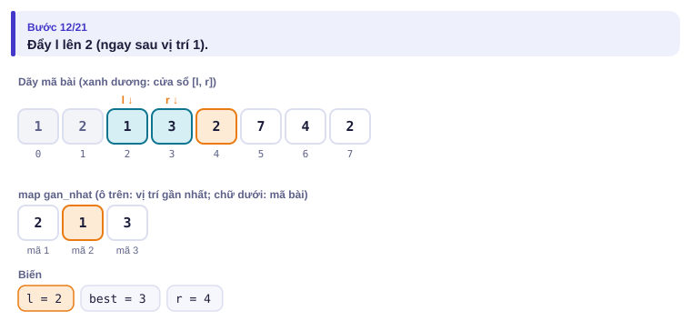

</details>

<details>
<summary><b>Bước 4</b> – r = 6: cửa sổ dài nhất</summary>

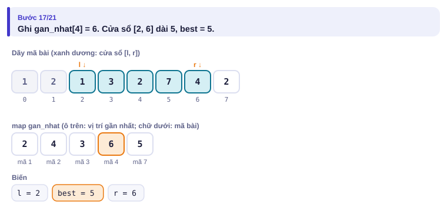

</details>

<details>
<summary><b>Bước 5</b> – Kết quả</summary>

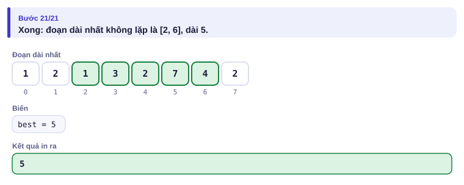

</details>

Toàn bộ dưới dạng bảng:

| r | k[r] | Vị trí gần nhất trước đó | l mới | Độ dài | Tốt nhất |
| :---: | :---: | :---: | :---: | :---: | :---: |
| 0 | 1 | — | 0 | 1 | 1 |
| 1 | 2 | — | 0 | 2 | 2 |
| 2 | 1 | 0 (≥ l) | 1 | 2 | 2 |
| 3 | 3 | — | 1 | 3 | 3 |
| 4 | 2 | 1 (≥ l) | 2 | 3 | 3 |
| 5 | 7 | — | 2 | 4 | 4 |
| 6 | 4 | — | 2 | 5 | **5** |
| 7 | 2 | 4 (≥ l) | 5 | 3 | 5 |

---

## 5. Mã giả và cài đặt

```text
gan_nhat ← map rỗng; l ← 0; best ← 0
với r từ 0 tới n − 1:
    nếu k[r] có trong gan_nhat và gan_nhat[k[r]] ≥ l: l ← gan_nhat[k[r]] + 1
    gan_nhat[k[r]] ← r
    best ← max(best, r − l + 1)
in best
```

```cpp
// file: danh_sach_phat.cpp
#include <bits/stdc++.h>
using namespace std;
int main() {
    ios::sync_with_stdio(false);
    cin.tie(nullptr);
    int n;
    cin >> n;
    map<long long, int> gan_nhat;          // mã bài -> vị trí xuất hiện gần nhất
    int l = 0, best = 0;
    for (int r = 0; r < n; r++) {
        long long k;
        cin >> k;
        auto it = gan_nhat.find(k);
        if (it != gan_nhat.end() && it->second >= l) l = it->second + 1;
        gan_nhat[k] = r;
        best = max(best, r - l + 1);
    }
    cout << best << '\n';
}
```

```python
# file: danh_sach_phat.py
import sys
data = sys.stdin.buffer.read().split()
n = int(data[0])
gan_nhat = {}                      # dict của Python: khóa bất kỳ, trung bình O(1)
l = best = 0
for r in range(n):
    k = data[1 + r]
    p = gan_nhat.get(k, -1)
    if p >= l:
        l = p + 1
    gan_nhat[k] = r
    best = max(best, r - l + 1)
print(best)
```

| Thao tác | C++ `map<K,V> m` | Python `m = {}` |
| --- | --- | --- |
| gán / sửa | `m[k] = v` | `m[k] = v` |
| có khóa k chưa? | `m.count(k)` hoặc `m.find(k) != m.end()` | `k in m` |
| đếm tần suất | `m[x]++` (khóa mới tự bắt đầu từ 0) | `m[x] = m.get(x, 0) + 1` |
| duyệt theo khóa tăng dần | `for (auto [k, v] : m)` | `for k in sorted(m)` |

`unordered_map` (C++) và `dict` (Python) dùng bảng băm: trung bình O(1) nhưng **không có thứ tự**. `map` chậm hơn một chút (O(log n)) nhưng duyệt được theo khóa tăng dần và không bao giờ bị "test chống băm" làm chậm.

### set: tập hợp có thứ tự

`set` giữ các giá trị **khác nhau, luôn sắp xếp**. Ngoài thêm/xóa/tìm, nó trả lời "giá trị nhỏ nhất ≥ x" trong O(log n) **kể cả khi tập thay đổi liên tục**. Mảng đã sắp xếp + `lower_bound` (bài 1.4) cũng tìm nhanh, nhưng mỗi lần thêm/xóa phải dời cả mảng: O(n).

Ví dụ: q thao tác trên tập ban đầu rỗng: `+ x` thêm x; `- x` xóa x (nếu có); `? x` in giá trị nhỏ nhất ≥ x trong tập, hoặc −1.

| Vào | Ra |
| --- | --- |
| `6`<br>`+ 5`<br>`+ 2`<br>`? 3`<br>`- 5`<br>`? 3`<br>`? 1` | `5`<br>`-1`<br>`2` |

<details>
<summary><b>Hình</b> – chạy ví dụ trên (mở lần lượt; đoán trước mỗi câu hỏi <code>?</code>)</summary>

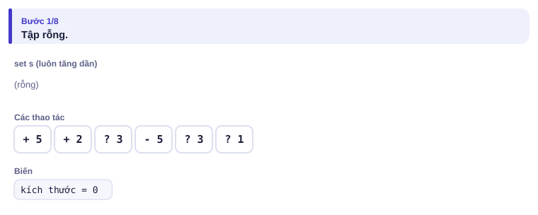
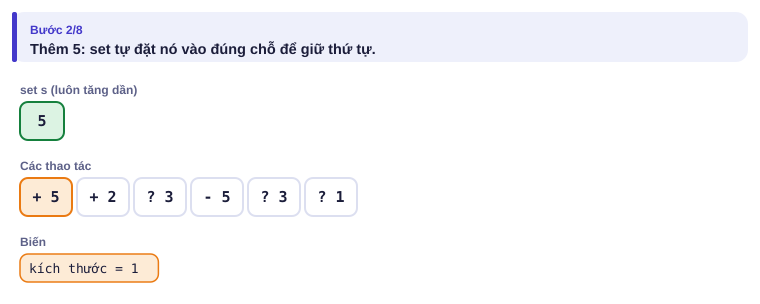
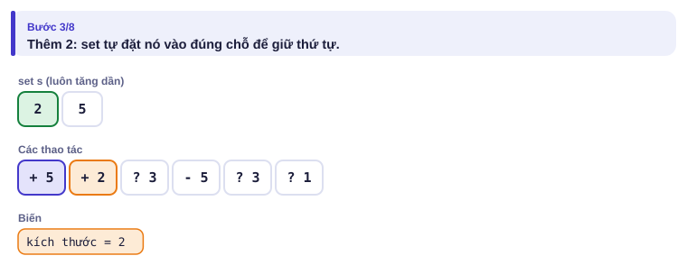
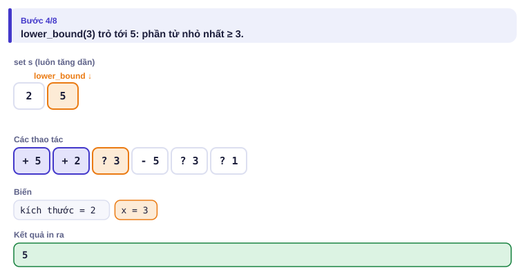
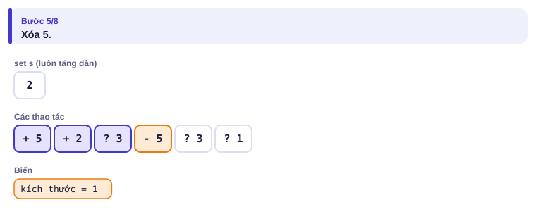
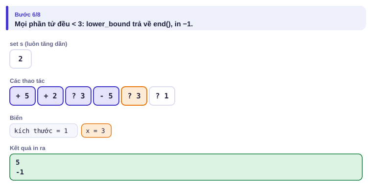
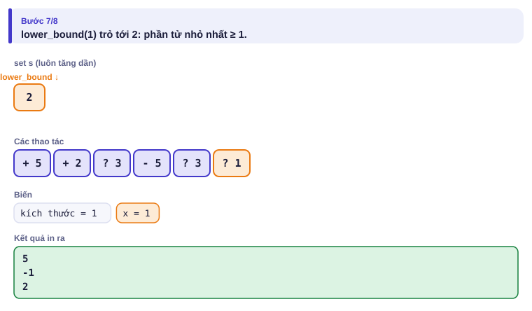

</details>

```cpp
// file: tap_hop.cpp
#include <bits/stdc++.h>
using namespace std;
int main() {
    ios::sync_with_stdio(false);
    cin.tie(nullptr);
    int q;
    cin >> q;
    set<long long> s;
    while (q--) {
        char op;
        long long x;
        cin >> op >> x;
        if (op == '+') s.insert(x);
        else if (op == '-') s.erase(x);
        else {
            auto it = s.lower_bound(x);            // phần tử đầu tiên >= x
            cout << (it == s.end() ? -1 : *it) << '\n';
        }
    }
}
```

| Câu hỏi trên `set<T> s` | Cách viết |
| --- | --- |
| nhỏ nhất ≥ x | `auto it = s.lower_bound(x);` có nghĩa khi `it != s.end()` |
| nhỏ nhất > x | `s.upper_bound(x)` |
| lớn nhất ≤ x | `auto it = s.upper_bound(x);` nếu `it != s.begin()` thì đáp án là `*prev(it)` |
| lớn nhất < x | `auto it = s.lower_bound(x);` nếu `it != s.begin()` thì `*prev(it)` |
| nhỏ nhất / lớn nhất | `*s.begin()` / `*s.rbegin()` |

`multiset` giống `set` nhưng cho phép giá trị lặp lại. Python không có `set` có thứ tự sẵn (`set` của Python là bảng băm); ở các bài cần `lower_bound` trên tập thay đổi, nên dùng C++.

---

## 6. Vì sao đúng, chạy bao lâu

- **Đúng:** sau mỗi bước, [l, r] là đoạn dài nhất kết thúc tại r không có mã lặp. Nếu kᵣ xuất hiện trong cửa sổ cũ ở vị trí p, mọi điểm đầu ≤ p đều chứa hai lần kᵣ, nên điểm đầu nhỏ nhất hợp lệ là p + 1. Vì `gan_nhat` lưu vị trí **gần nhất**, p là lần xuất hiện cuối cùng trước r, đúng là vị trí cần.
- **Chạy bao lâu:** n lần tra/ghi `map`, mỗi lần O(log n): tổng O(n log n). Với `dict` của Python là O(n) trung bình.
- **set:** mỗi thao tác O(log n) vì cây luôn cân bằng (độ cao khoảng log₂ n).

---

## 7. Bẫy thường gặp

> [!WARNING]
> **Bẫy 1: `m[k]` tự tạo khóa.** Chỉ cần **đọc** `m[k]` là khóa k được tạo với giá trị 0. `if (m[k] >= l)` với k chưa có sẽ tạo khóa và so sánh 0 ≥ l, sai khi l = 0.
> *Test phá:* `3` / `5 6 7` phải ra 3. Nếu viết `if (m[k] >= l) l = m[k] + 1;` thì ngay bài đầu l thành 1, chương trình in 2.

> [!WARNING]
> **Bẫy 2: quên điều kiện "≥ l".** Vị trí cũ nằm ngoài cửa sổ thì không làm lặp. Thiếu điều kiện này, l bị kéo **lùi**.
> *Test phá:* `4` / `1 2 2 1` phải ra 2. Khi r = 3, mã 1 từng ở vị trí 0 nhưng l đã là 2; thiếu điều kiện thì l lùi về 1 và cửa sổ `2 2 1` bị đếm là hợp lệ, in 3. Ví dụ "vị trí cũ nằm ngoài cửa sổ" trên trang mô phỏng cho thấy đúng tình huống này.

> [!WARNING]
> **Bẫy 3: `multiset::erase(x)` xóa hết.** Viết `ms.erase(x)` xóa **mọi** bản sao của x. Muốn xóa đúng một bản: `ms.erase(ms.find(x))` (và chỉ khi `find` không trả về `end()`).
> *Test phá:* multiset `{3, 3, 3}`, xóa một vé giá 3 rồi in kích thước: phải là 2.

> [!WARNING]
> **Bẫy 4: `prev(s.begin())`.** Khi tìm "lớn nhất ≤ x" mà mọi phần tử đều > x, `upper_bound` trả về `begin()`; lùi thêm một bước là lỗi. Luôn kiểm tra `it != s.begin()` trước.

---

## 8. Ví dụ giảm dần hỗ trợ

### Ví dụ 2 – Điền vào chỗ trống: Đếm cặp bằng nhau

Cho n số (n ≤ 2·10⁵, |aᵢ| ≤ 10⁹). Đếm số cặp chỉ số i < j với aᵢ = aⱼ.

| Vào | Ra |
| --- | --- |
| `6`<br>`4 -1 4 4 7 -1` | `4` |

Duyệt từ trái sang phải. Khi gặp aⱼ, số cặp mới tạo thành bằng số lần aⱼ **đã xuất hiện trước đó**.

```cpp
map<long long, long long> dem;
long long ans = 0;
for (int j = 0; j < n; j++) {
    ans += ____;
    ____;
}
```

<details>
<summary>Đáp án</summary>

`dem[a[j]]` rồi `dem[a[j]]++`. Thứ tự quan trọng: cộng **trước**, tăng **sau**, để không ghép aⱼ với chính nó. Ở đây đọc `dem[a[j]]` tạo khóa với giá trị 0 là đúng ý (Bẫy 1 lại có ích).

```cpp
// file: cap_bang.cpp
#include <bits/stdc++.h>
using namespace std;
int main() {
    ios::sync_with_stdio(false);
    cin.tie(nullptr);
    int n;
    cin >> n;
    map<long long, long long> dem;
    long long ans = 0;
    for (int j = 0; j < n; j++) {
        long long x;
        cin >> x;
        ans += dem[x];
        dem[x]++;
    }
    cout << ans << '\n';
}
```

</details>

### Ví dụ 3 – Tự làm: Vé ca nhạc

Có n vé với giá hᵢ và m khách lần lượt đến. Khách thứ j trả tối đa tⱼ đồng và sẽ mua vé **đắt nhất có giá ≤ tⱼ** còn lại; mỗi vé bán một lần. In giá vé mỗi khách mua, hoặc −1 nếu không mua được. (n, m ≤ 2·10⁵, bài [Concert Tickets](https://cses.fi/problemset/task/1091))

| Vào | Ra |
| --- | --- |
| `5 3`<br>`5 3 7 8 5`<br>`4 8 3` | `3`<br>`8`<br>`-1` |

> [!IMPORTANT]
> Tự làm trước. Gợi ý: giá vé có thể trùng nhau, nên dùng `multiset`. "Lớn nhất ≤ t" xem bảng ở mục 5. Nhớ Bẫy 3 và Bẫy 4.

<details>
<summary>Lời giải</summary>

```cpp
// file: ve_ca_nhac.cpp
#include <bits/stdc++.h>
using namespace std;
int main() {
    ios::sync_with_stdio(false);
    cin.tie(nullptr);
    int n, m;
    cin >> n >> m;
    multiset<long long> ve;
    for (int i = 0; i < n; i++) { long long h; cin >> h; ve.insert(h); }
    while (m--) {
        long long t;
        cin >> t;
        auto it = ve.upper_bound(t);              // vé đầu tiên > t
        if (it == ve.begin()) { cout << -1 << '\n'; continue; }
        --it;                                     // vé đắt nhất <= t
        cout << *it << '\n';
        ve.erase(it);                             // xóa đúng một vé (xóa theo iterator)
    }
}
```

</details>

---

## 9. Bài tập

| Nấc | Bài | Nguồn | Ý chính |
| --- | --- | --- | --- |
| Khởi động | [Playlist](https://cses.fi/problemset/task/1141) | CSES 1141 | Đúng mục 5 |
| Khởi động | [Registration system](https://codeforces.com/problemset/problem/4/C) | CF 4C · 1300 | `map<string,int>` |
| Luyện | [Concert Tickets](https://cses.fi/problemset/task/1091) | CSES 1091 | Ví dụ 3 |
| Luyện | [Subarray Sums II](https://cses.fi/problemset/task/1661) | CSES 1661 | Tiền tố (bài 1.3) + đếm bằng `map` |
| Luyện | [Towers](https://cses.fi/problemset/task/1073) | CSES 1073 | `multiset` + `upper_bound` |
| Thử thách | [Traffic Lights](https://cses.fi/problemset/task/1163) | CSES 1163 | `set` vị trí + `multiset` độ dài |
| Kiểu đề thi | Bãi giữ xe | Bài của sách, chấm theo subtask | Xem bên dưới |

### Bài kiểu đề thi: Bãi giữ xe

**Đề bài.** Bãi giữ xe trước chợ Bến Thành có n chỗ đánh số 1..n, ban đầu đều trống (1 ≤ n ≤ 2·10⁵). Có q sự kiện (1 ≤ q ≤ 2·10⁵), theo thứ tự thời gian:

- `1 s`: một xe đến, muốn đỗ ở chỗ s. Nếu chỗ s trống thì đỗ ở đó; nếu không, xe đi tiếp về phía số lớn hơn và đỗ ở **chỗ trống đầu tiên có số > s**. Nếu không còn chỗ trống nào có số ≥ s, xe bỏ đi. In số chỗ xe đỗ, hoặc −1 nếu xe bỏ đi.
- `2 p`: xe ở chỗ p rời bãi (đảm bảo chỗ p đang có xe).

Đọc từ `GIUXE.INP` (dòng đầu n q, mỗi dòng sau một sự kiện), ghi kết quả của mỗi sự kiện loại 1 ra `GIUXE.OUT`, mỗi số một dòng.

Subtask: 40% có n, q ≤ 5000; 60% còn lại có n, q ≤ 2·10⁵.

| GIUXE.INP | GIUXE.OUT |
| --- | --- |
| `5 7`<br>`1 2`<br>`1 2`<br>`1 5`<br>`1 4`<br>`2 3`<br>`1 2`<br>`1 5` | `2`<br>`3`<br>`5`<br>`4`<br>`3`<br>`-1` |

Sau 4 xe đầu, chỗ 2, 3, 4, 5 có xe. Xe ở chỗ 3 rời đi. Xe tiếp theo muốn chỗ 2 (có xe) nên đỗ ở chỗ trống đầu tiên phía sau là 3. Xe cuối muốn chỗ 5 nhưng không còn chỗ trống ≥ 5.

<details>
<summary><b>Gợi ý 1</b> – hướng đi (đủ 40% điểm)</summary>

Mảng `co_xe[1..n]`. Với mỗi xe đến, đi từ s tới n tìm chỗ trống đầu tiên. Mỗi sự kiện O(n), tổng O(n·q) = 2,5·10⁷ với subtask 1.

</details>

<details>
<summary><b>Gợi ý 2</b> – ý then chốt</summary>

Câu hỏi "chỗ trống đầu tiên có số ≥ s" là `lower_bound(s)` trên **tập các chỗ trống**. Tập này thay đổi liên tục (xe đến thì xóa, xe đi thì thêm), nên dùng `set`.

</details>

<details>
<summary><b>Gợi ý 3</b> – lời giải đầy đủ</summary>

Khởi tạo `set` với n phần tử 1..n mất O(n log n). Mỗi sự kiện O(log n).

```cpp
// file: giuxe.cpp
#include <bits/stdc++.h>
using namespace std;
int main() {
    freopen("GIUXE.INP", "r", stdin);
    freopen("GIUXE.OUT", "w", stdout);
    int n, q;
    scanf("%d %d", &n, &q);
    set<int> trong;
    for (int i = 1; i <= n; i++) trong.insert(trong.end(), i);   // chèn ở cuối: nhanh
    while (q--) {
        int t, x;
        scanf("%d %d", &t, &x);
        if (t == 1) {
            auto it = trong.lower_bound(x);       // chỗ trống đầu tiên >= x
            if (it == trong.end()) puts("-1");
            else { printf("%d\n", *it); trong.erase(it); }
        } else trong.insert(x);                   // chỗ x trống trở lại
    }
}
```

Python không có `set` có thứ tự sẵn nên bài này nên làm bằng C++. Với subtask 1, Python dùng mảng `co_xe` như Gợi ý 1 là đủ.

</details>

---

## 10. Tóm tắt, flashcard và checkpoint

**Tóm tắt trong 5 dòng.**

1. `map`: "mảng" với khóa bất kỳ (số lớn, số âm, xâu), O(log n) mỗi thao tác, duyệt được theo khóa tăng dần.
2. `set`: giá trị khác nhau, luôn sắp xếp; `lower_bound`/`upper_bound` hoạt động trên tập **đang thay đổi**.
3. `multiset`: cho phép lặp; xóa một bản bằng `erase(iterator)` hoặc `erase(find(x))`.
4. Đọc `m[k]` là tạo khóa; kiểm tra tồn tại bằng `count` hoặc `find`.
5. map + cửa sổ trượt: lưu vị trí gần nhất để biết ngay phần tử có lặp trong cửa sổ không.

**Flashcard.**

<details><summary>Tìm giá trị lớn nhất ≤ x trong <code>set s</code> thế nào?</summary><code>auto it = s.upper_bound(x);</code> nếu <code>it != s.begin()</code> thì đáp án là <code>*prev(it)</code>.</details>
<details><summary>Vì sao không dùng mảng đánh dấu cho mã bài tới 10⁹?</summary>Cần 10⁹ ô nhớ (khoảng 4 GB). <code>map</code> chỉ tốn bộ nhớ cho các khóa thật sự xuất hiện.</details>
<details><summary><code>ms.erase(5)</code> trên multiset <code>{5, 5, 7}</code> còn lại gì?</summary><code>{7}</code>: xóa mọi bản sao của 5.</details>
<details><summary>Đếm cặp bằng nhau: cộng <code>dem[x]</code> trước hay tăng trước?</summary>Cộng trước, tăng sau; nếu tăng trước sẽ ghép x với chính nó.</details>
<details><summary>Bãi giữ xe: lưu tập nào trong set?</summary>Tập các chỗ <b>trống</b>; xe đến thì <code>lower_bound(s)</code> rồi xóa, xe đi thì thêm lại.</details>

**Ôn xoắn ốc** (mỗi bài tối đa 20 phút):

- Viết lại bài dấu ngoặc (bài 2.1) không nhìn sách.
- [Apartments](https://cses.fi/problemset/task/1084) (CSES 1084): sắp xếp + hai con trỏ (bài 1.5).
- [Subarray Sums I](https://cses.fi/problemset/task/1660) (CSES 1660): rồi so sánh với Subarray Sums II ở bảng bài tập, vì sao bài II cần `map`?

**Checkpoint – em đã sẵn sàng sang bài tiếp theo nếu:**

- [ ] AC [Playlist](https://cses.fi/problemset/task/1141) và [Concert Tickets](https://cses.fi/problemset/task/1091).
- [ ] Viết được bảng 5 câu hỏi `lower_bound`/`upper_bound` ở mục 5 không nhìn sách.
- [ ] Giải thích được vì sao `if (m[k] >= l)` sai ở Bẫy 1.
- [ ] Đạt trọn điểm bài Bãi giữ xe khi tự làm trong 25 phút.

Chưa đạt? Nếu vướng ô 1, chạy lại trang mô phỏng Danh sách phát với cả ba ví dụ. Nếu vướng ô 2, bật Đoán trước trên trang set và tự viết ra mỗi câu `?` ứng với hàm nào. Nếu vướng ô 3 hoặc 4, đọc lại mục 7 rồi làm lại Ví dụ 2.
