# Bài 2.3 – Hàng đợi ưu tiên

> **Tập 2 · Cấu trúc dữ liệu và quy hoạch động cơ bản**
> Cần biết trước: bài 1.8 (tham lam, lập luận hoán đổi), bài 2.1, bài 2.2.
> Thời lượng: khoảng 70 phút đọc, cộng 5 giờ thực hành trong tuần.

**Học xong bài này, em sẽ:**

- dùng `priority_queue` (C++) và `heapq` (Python) để luôn lấy được phần tử nhỏ nhất hoặc lớn nhất trong O(log n);
- hiểu heap được lưu trong mảng thế nào, vì sao thêm/lấy chỉ tốn O(log n);
- nhận ra dạng "tham lam trên tập luôn thay đổi" và ghép tham lam với heap;
- giải trọn bài kiểu đề thi **Việc làm thêm**.

> [!TIP]
> **Học cùng hai trang mô phỏng.** [Nối dây](../../mo-phong/t2-noi-day.html): đoán trước chi phí mỗi lần nối. [Bên trong heap](../../mo-phong/t2-heap.html): xem từng lần đổi chỗ đi lên, đi xuống; bật **Đoán trước** để tự quyết định đổi với con nào.

---

## 1. Bài toán mở màn: Nối dây

Thợ điện có n đoạn dây dài a₁ … aₙ. Mỗi lần nối hai đoạn dài x và y thành một đoạn x + y, tốn **x + y** đồng. Nối tới khi còn một đoạn. Chi phí nhỏ nhất là bao nhiêu? (n ≤ 2·10⁵, aᵢ ≤ 10⁹)

| Vào | Ra |
| --- | --- |
| `4`<br>`4 3 2 6` | `29` |

---

## 2. Dừng lại 10 phút

> [!IMPORTANT]
> **Dừng lại và nghĩ.**
> 1. Thử hai cách với `4 3 2 6`: nối theo thứ tự đề cho (4+3, rồi +2, rồi +6) và nối hai đoạn ngắn nhất trước. Mỗi cách tốn bao nhiêu?
> 2. Một đoạn dây ban đầu bị "tính tiền" bao nhiêu lần? Phụ thuộc vào điều gì?
> 3. Nếu mỗi bước đều phải tìm hai đoạn ngắn nhất trong tập đang có, cách tìm đơn giản nhất tốn bao lâu mỗi bước?

<details>
<summary>Đáp án</summary>

1. Theo thứ tự đề: 7 + 9 + 15 = 31. Ngắn nhất trước: 5 + 9 + 15 = 29.
2. Mỗi lần đoạn đó (hoặc đoạn chứa nó) tham gia một lần nối, độ dài của nó lại được cộng vào chi phí. Đoạn nối càng sớm bị cộng càng nhiều lần, nên các đoạn **ngắn** nên được nối **sớm**.
3. Quét cả tập: O(n) mỗi bước, n − 1 bước: O(n²). Cần một cấu trúc lấy được phần tử nhỏ nhất nhanh, trong khi tập vẫn được thêm phần tử mới.

</details>

---

## 3. Lời giải ngây thơ và vì sao nó chậm

An viết đúng ý tham lam, nhưng mỗi bước lại sắp xếp cả mảng để lấy hai số đầu:

```cpp
long long tong = 0;
while (a.size() > 1) {
    sort(a.begin(), a.end());
    long long s = a[0] + a[1];
    tong += s;
    a.erase(a.begin(), a.begin() + 2);
    a.push_back(s);
}
```

n − 1 lần sắp xếp, mỗi lần O(n log n): tổng O(n² log n), khoảng 7·10¹¹ phép với n = 2·10⁵. Kể cả chỉ quét tìm hai số nhỏ nhất thì vẫn O(n²) = 4·10¹⁰. Ta cần lấy nhỏ nhất **và** thêm phần tử mới, cả hai đều nhanh.

---

## 4. Ý tưởng then chốt

> [!IMPORTANT]
> **Giữ các đoạn trong một hàng đợi ưu tiên (heap nhỏ nhất). Mỗi bước: lấy ra hai đoạn nhỏ nhất, cộng chi phí, đẩy đoạn mới vào. Mỗi thao tác chỉ O(log n).**

Hàng đợi ưu tiên khác hàng đợi thường ở chỗ: phần tử ra trước không phải phần tử **vào trước**, mà phần tử **ưu tiên nhất** (nhỏ nhất hoặc lớn nhất).

### Chạy từng bước

Với `4 3 2 6`. Đoán trước chi phí mỗi lần nối rồi mới mở.

<details>
<summary><b>Bước 1</b> – Ban đầu, heap có gì?</summary>

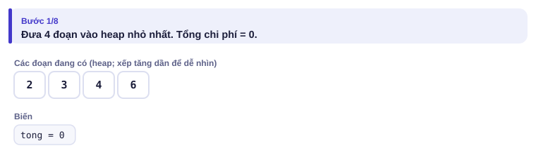

</details>

<details>
<summary><b>Bước 2</b> – Lần nối 1 tốn bao nhiêu?</summary>

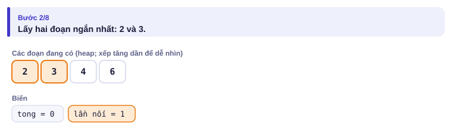
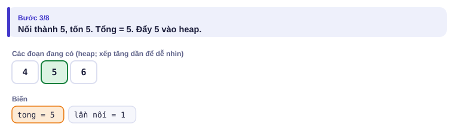

</details>

<details>
<summary><b>Bước 3</b> – Lần nối 2: lấy hai đoạn nào?</summary>

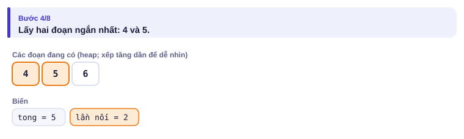
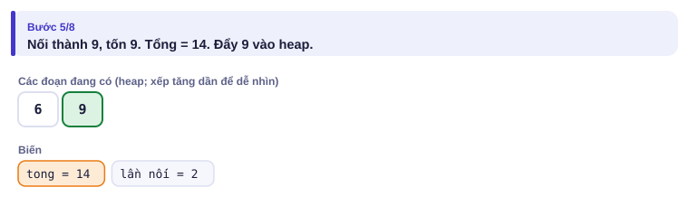

</details>

<details>
<summary><b>Bước 4</b> – Lần nối cuối và kết quả</summary>

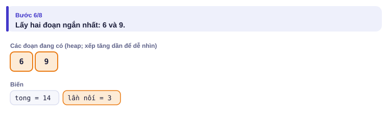
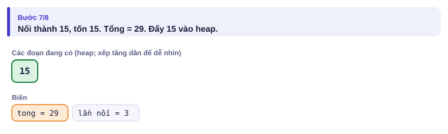
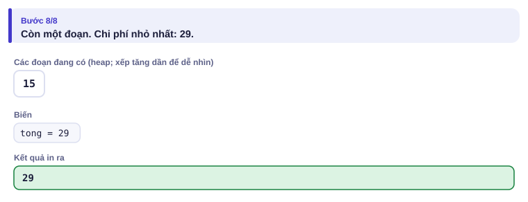

</details>

| Bước | Các đoạn hiện có | Nối | Chi phí bước | Tổng |
| :---: | --- | --- | :---: | :---: |
| 1 | 2 3 4 6 | 2 + 3 | 5 | 5 |
| 2 | 4 5 6 | 4 + 5 | 9 | 14 |
| 3 | 6 9 | 6 + 9 | 15 | **29** |

---

## 5. Mã giả và cài đặt

```text
đưa mọi aᵢ vào heap nhỏ nhất; tong ← 0
trong khi heap còn ít nhất 2 phần tử:
    x ← lấy nhỏ nhất; y ← lấy nhỏ nhất
    tong ← tong + x + y
    đẩy x + y vào heap
in tong
```

```cpp
// file: noi_day.cpp
#include <bits/stdc++.h>
using namespace std;
int main() {
    ios::sync_with_stdio(false);
    cin.tie(nullptr);
    int n;
    cin >> n;
    priority_queue<long long, vector<long long>, greater<long long>> pq;   // heap nhỏ nhất
    for (int i = 0; i < n; i++) {
        long long x;
        cin >> x;
        pq.push(x);
    }
    long long tong = 0;
    while (pq.size() > 1) {
        long long a = pq.top(); pq.pop();
        long long b = pq.top(); pq.pop();
        tong += a + b;
        pq.push(a + b);
    }
    cout << tong << '\n';
}
```

```python
# file: noi_day.py
import sys, heapq
data = sys.stdin.buffer.read().split()
n = int(data[0])
h = list(map(int, data[1:1 + n]))
heapq.heapify(h)                   # biến list thành heap trong O(n)
tong = 0
while len(h) > 1:
    x = heapq.heappop(h)
    y = heapq.heappop(h)
    tong += x + y
    heapq.heappush(h, x + y)
print(tong)
```

| Thao tác | C++ | Python `heapq` |
| --- | --- | --- |
| heap **lớn nhất** | `priority_queue<long long> pq;` | đẩy `-x`, lấy ra rồi đổi dấu |
| heap **nhỏ nhất** | `priority_queue<long long, vector<long long>, greater<long long>> pq;` | `h = []` |
| thêm | `pq.push(x)` | `heapq.heappush(h, x)` |
| xem ưu tiên nhất | `pq.top()` | `h[0]` |
| lấy ưu tiên nhất ra | `pq.pop()` (không trả về giá trị) | `heapq.heappop(h)` |
| cặp (khóa, dữ liệu) | `pair<long long,int>`: so sánh theo `first` trước | `(khoa, du_lieu)`: tuple so sánh phần đầu trước |

### Bên trong heap

Heap là một **cây nhị phân đầy đủ** lưu trong mảng: ô i có hai con là ô 2i + 1, 2i + 2 và cha là ô (i − 1)/2. Quy tắc duy nhất: **mỗi ô ≤ hai con của nó**. Vì thế gốc (ô 0) luôn nhỏ nhất, nhưng các ô khác **không** được sắp xếp.

- **Thêm x:** đặt x vào cuối mảng, rồi đổi chỗ với cha chừng nào còn nhỏ hơn cha (đi lên).
- **Lấy nhỏ nhất:** lấy gốc ra, đưa phần tử cuối lên gốc, rồi đổi chỗ với **con nhỏ hơn** chừng nào còn lớn hơn nó (đi xuống).

Cây có khoảng log₂ n tầng, mỗi thao tác đi tối đa một đường từ gốc tới lá: O(log n).

<details>
<summary><b>Hình</b> – heap đang có <code>3 8 5 9</code>; thêm 1 rồi lấy ra hai lần (mở lần lượt)</summary>

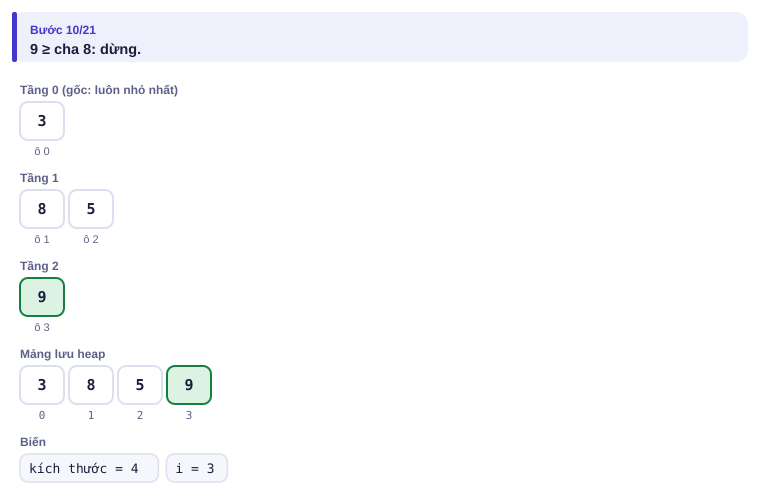
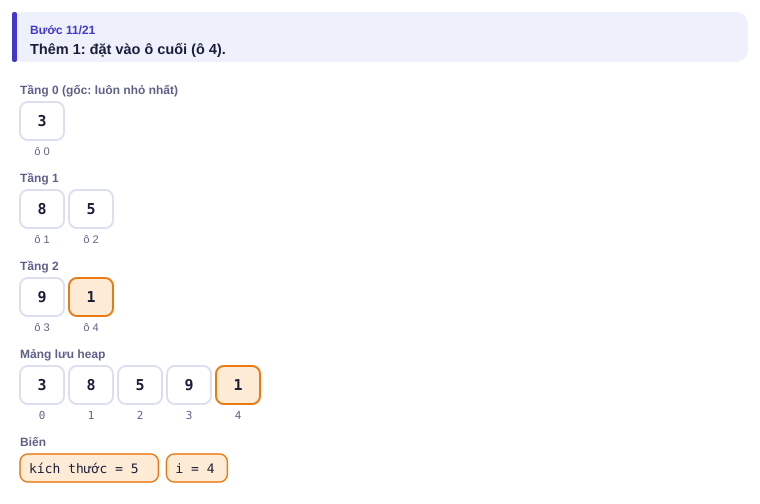
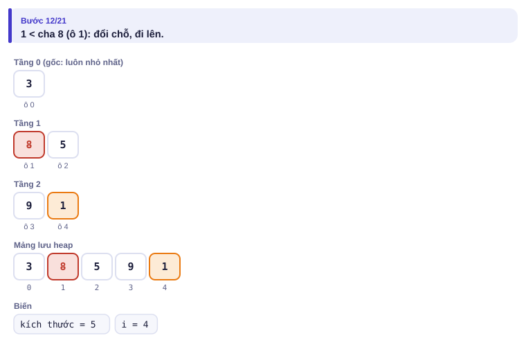
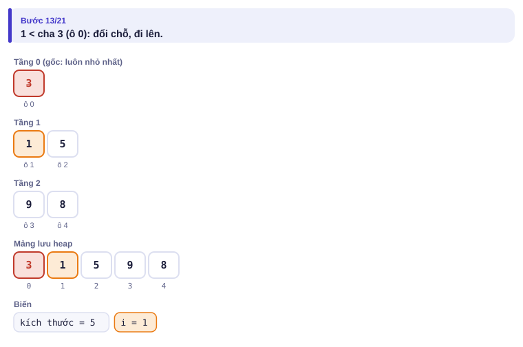
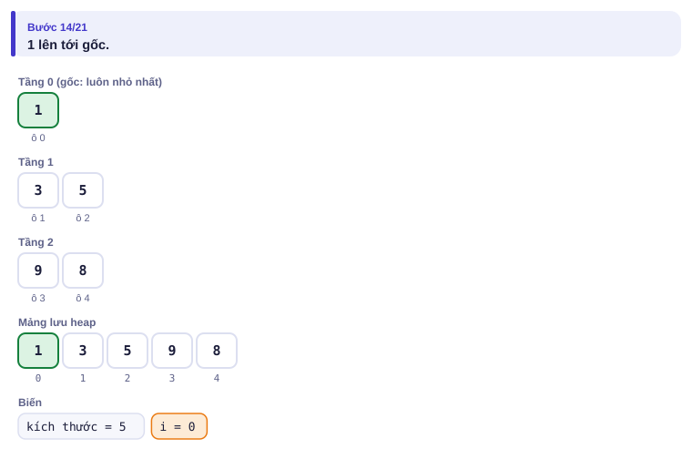
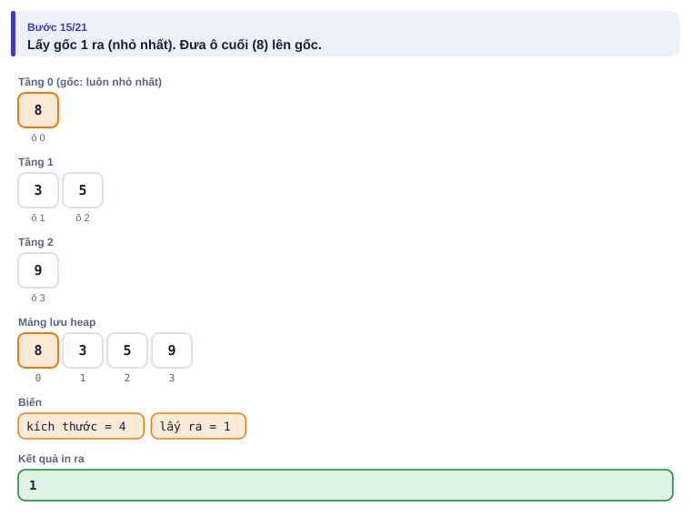
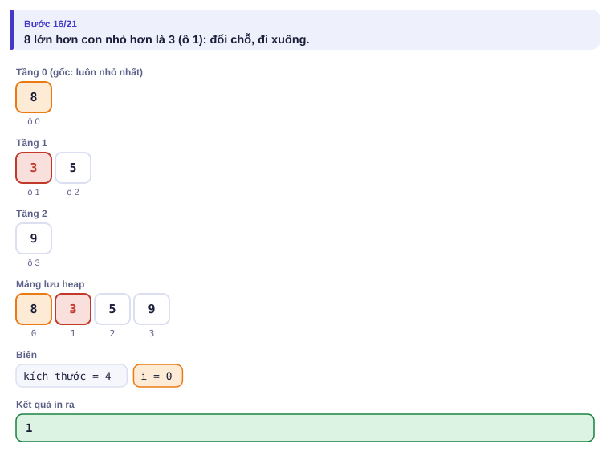
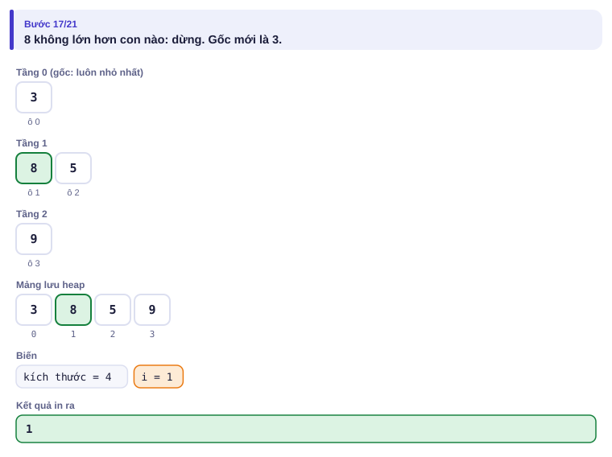
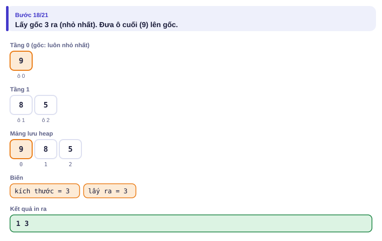
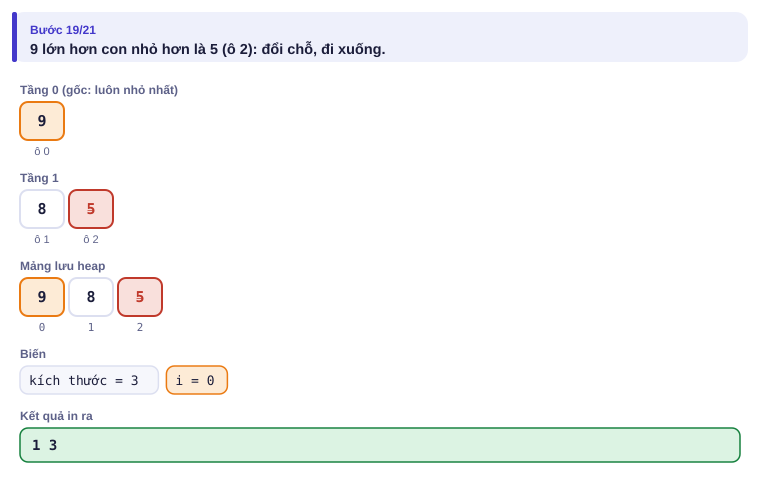
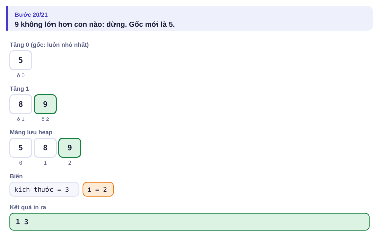

</details>

Em không cần tự cài heap khi đi thi (đã có `priority_queue`, `heapq`), nhưng hiểu nó giúp em nhớ: heap **không** cho xem phần tử thứ hai, thứ ba, không tìm hay xóa được phần tử bất kỳ. Cần những việc đó thì dùng `multiset` (bài 2.2).

---

## 6. Vì sao đúng, chạy bao lâu

- **Đúng (lập luận hoán đổi, như bài 1.8):** vẽ các lần nối thành một cây; chi phí bằng tổng (độ dài × độ sâu) của các đoạn ban đầu. Trong một cách nối tối ưu, hai đoạn ngắn nhất có thể đặt ở tầng sâu nhất làm "anh em": nếu không, đổi chỗ chúng với hai đoạn đang ở tầng sâu nhất thì chi phí không tăng. Vậy nối hai đoạn ngắn nhất trước không làm mất lời giải tối ưu; lặp lại lập luận cho bài toán còn n − 1 đoạn.
- **Chạy bao lâu:** n − 1 lần nối, mỗi lần 3 thao tác heap O(log n): **O(n log n)**.
- **Bộ nhớ:** heap chứa tối đa n phần tử: O(n).

---

## 7. Bẫy thường gặp

> [!WARNING]
> **Bẫy 1: nhầm heap lớn nhất và nhỏ nhất.** `priority_queue<long long>` không có tham số thêm trả về **lớn nhất**.
> *Test phá:* chính ví dụ của đề: dùng heap lớn nhất sẽ in 6+4, rồi +3, rồi +2: 10 + 13 + 15 = 38, không phải 29.

> [!WARNING]
> **Bẫy 2: tràn số.** Tổng chi phí có thể vượt 10¹⁴ × log n, chắc chắn vượt `int`. Dùng `long long` cho cả phần tử trong heap.
> *Test phá:* n = 2·10⁵ đoạn đều dài 10⁹.

> [!WARNING]
> **Bẫy 3: `pq.top()` khi rỗng.** Giống bài 2.1, kiểm tra `pq.empty()` (hoặc `pq.size() > 1` như ở đây) trước khi lấy.
> *Test phá:* n = 1: không cần nối, chi phí 0.

> [!WARNING]
> **Bẫy 4: Python đẩy vào số âm để làm heap lớn nhất nhưng quên đổi dấu khi lấy ra.** Viết hẳn `x = -heapq.heappop(h)`.

---

## 8. Ví dụ giảm dần hỗ trợ

### Ví dụ 2 – Điền vào chỗ trống: Điểm cao thứ k

Có n bài thi được chấm lần lượt (n ≤ 2·10⁵). Sau mỗi bài, in điểm cao **thứ k** trong các bài đã chấm, hoặc −1 nếu chưa đủ k bài.

| Vào | Ra |
| --- | --- |
| `6 3`<br>`5 9 2 7 8 1` | `-1 -1 2 5 7 7` |

Mẹo: giữ đúng k điểm cao nhất trong một heap **nhỏ nhất**. Gốc của heap đó chính là điểm cao thứ k.

```cpp
priority_queue<int, vector<int>, greater<int>> pq;
for (int i = 0; i < n; i++) {
    int x; cin >> x;
    pq.push(x);
    if (pq.size() > k) ____;
    cout << (pq.size() == k ? ____ : -1) << ' ';
}
```

<details>
<summary>Đáp án</summary>

`pq.pop()` (bỏ điểm nhỏ nhất, vì nó không còn trong top k) và `pq.top()`.

```cpp
// file: diem_thu_k.cpp
#include <bits/stdc++.h>
using namespace std;
int main() {
    int n, k;
    cin >> n >> k;
    priority_queue<int, vector<int>, greater<int>> pq;
    for (int i = 0; i < n; i++) {
        int x;
        cin >> x;
        pq.push(x);
        if ((int)pq.size() > k) pq.pop();
        cout << ((int)pq.size() == k ? pq.top() : -1) << (i + 1 == n ? '\n' : ' ');
    }
}
```

</details>

### Ví dụ 3 – Tự làm: Phòng họp

Có n cuộc họp, cuộc họp i diễn ra trong [sᵢ, eᵢ) (bắt đầu lúc sᵢ, kết thúc lúc eᵢ; một phòng vừa xong lúc t thì dùng được ngay cho cuộc họp bắt đầu lúc t). Cần ít nhất bao nhiêu phòng? (n ≤ 2·10⁵, 0 ≤ sᵢ < eᵢ ≤ 10⁹)

| Vào | Ra |
| --- | --- |
| `4`<br>`1 4`<br>`2 5`<br>`4 7`<br>`5 6` | `2` |

> [!IMPORTANT]
> Tự làm trước. Gợi ý: xét các cuộc họp theo giờ bắt đầu tăng dần. Giữ một heap nhỏ nhất các **giờ kết thúc** của những phòng đang dùng. Phòng nào trống sớm nhất?

<details>
<summary>Lời giải</summary>

Nếu phòng trống sớm nhất (gốc heap) đã xong trước hoặc đúng lúc sᵢ thì dùng lại phòng đó (lấy gốc ra); sau đó đẩy eᵢ vào. Số phòng là kích thước lớn nhất của heap.

```cpp
// file: phong_hop.cpp
#include <bits/stdc++.h>
using namespace std;
int main() {
    ios::sync_with_stdio(false);
    cin.tie(nullptr);
    int n;
    cin >> n;
    vector<pair<long long, long long>> a(n);
    for (auto &[s, e] : a) cin >> s >> e;
    sort(a.begin(), a.end());                       // theo giờ bắt đầu
    priority_queue<long long, vector<long long>, greater<long long>> ket_thuc;
    size_t best = 0;
    for (auto [s, e] : a) {
        if (!ket_thuc.empty() && ket_thuc.top() <= s) ket_thuc.pop();   // dùng lại phòng
        ket_thuc.push(e);
        best = max(best, ket_thuc.size());
    }
    cout << best << '\n';
}
```

</details>

---

## 9. Bài tập

| Nấc | Bài | Nguồn | Ý chính |
| --- | --- | --- | --- |
| Khởi động | [Stick Divisions](https://cses.fi/problemset/task/1161) | CSES 1161 | Đúng bài Nối dây, nhìn ngược |
| Luyện | [Room Allocation](https://cses.fi/problemset/task/1164) | CSES 1164 | Ví dụ 3, thêm in số phòng cho từng khách |
| Luyện | [Restaurant Customers](https://cses.fi/problemset/task/1619) | CSES 1619 | So sánh: sắp xếp sự kiện cũng giải được |
| Luyện | [Kth Largest Element in a Stream](https://leetcode.com/problems/kth-largest-element-in-a-stream/) | LeetCode 703 | Ví dụ 2 |
| Thử thách | [Sliding Median](https://cses.fi/problemset/task/1076) | CSES 1076 | Hai `multiset` (heap không xóa được phần tử bất kỳ) |
| Kiểu đề thi | Việc làm thêm | Bài của sách, chấm theo subtask | Xem bên dưới |

### Bài kiểu đề thi: Việc làm thêm

**Đề bài.** Hè này Bảo nhận được n lời mời làm thêm (1 ≤ n ≤ 2·10⁵). Việc thứ i cần **đúng một ngày** để làm, phải xong **không muộn hơn ngày dᵢ** (1 ≤ dᵢ ≤ 10⁹), và trả pᵢ nghìn đồng (1 ≤ pᵢ ≤ 10⁹). Mỗi ngày (ngày 1, 2, 3, …) Bảo làm được tối đa một việc. Hỏi Bảo kiếm được nhiều nhất bao nhiêu? Đọc từ `VIECLAM.INP` (dòng đầu n, mỗi dòng sau dᵢ pᵢ), ghi ra `VIECLAM.OUT`.

Subtask: 30% có n ≤ 20; 30% có n ≤ 2000 và dᵢ ≤ 2000; 40% còn lại không có ràng buộc thêm.

| VIECLAM.INP | VIECLAM.OUT |
| --- | --- |
| `5`<br>`2 50`<br>`1 30`<br>`2 40`<br>`3 10`<br>`1 60` | `120` |

Làm việc trả 60 (hạn 1) ngày 1, việc trả 50 (hạn 2) ngày 2, việc trả 10 (hạn 3) ngày 3: 60 + 50 + 10 = 120.

<details>
<summary><b>Gợi ý 1</b> – hướng đi (30% rồi 60% điểm)</summary>

n ≤ 20: thử mọi tập con (2²⁰). Một tập làm được khi sắp theo hạn tăng dần, việc thứ j (đếm từ 1) có hạn ≥ j.

n, d ≤ 2000: tham lam theo lương giảm dần; mỗi việc đặt vào **ngày trống muộn nhất** không vượt hạn của nó (tìm bằng vòng lặp lùi). O(n · d).

</details>

<details>
<summary><b>Gợi ý 2</b> – ý then chốt</summary>

Xét các việc theo hạn **tăng dần**, và giữ tập việc đang nhận trong một heap **nhỏ nhất theo lương**. Nhận việc mới vào heap. Nếu số việc trong heap vượt hạn hiện tại (không đủ ngày), bỏ đi việc **lương thấp nhất**: đó chính là gốc heap.

</details>

<details>
<summary><b>Gợi ý 3</b> – lời giải đầy đủ</summary>

Vì sao đúng: sau khi xét các việc có hạn ≤ d, heap là tập tốt nhất gồm tối đa d việc trong số đó. Khi bị thừa một việc, bỏ việc lương thấp nhất là lựa chọn tốt nhất (lập luận hoán đổi). O(n log n).

```cpp
// file: vieclam.cpp
#include <bits/stdc++.h>
using namespace std;
int main() {
    freopen("VIECLAM.INP", "r", stdin);
    freopen("VIECLAM.OUT", "w", stdout);
    int n;
    scanf("%d", &n);
    vector<pair<long long, long long>> v(n);          // (hạn, lương)
    for (auto &[d, p] : v) scanf("%lld %lld", &d, &p);
    sort(v.begin(), v.end());
    priority_queue<long long, vector<long long>, greater<long long>> nhan;   // lương các việc đang nhận
    long long tong = 0;
    for (auto [d, p] : v) {
        nhan.push(p); tong += p;
        if ((long long)nhan.size() > d) { tong -= nhan.top(); nhan.pop(); }   // thừa việc: bỏ việc rẻ nhất
    }
    printf("%lld\n", tong);
}
```

```python
# file: vieclam.py
import heapq
with open("VIECLAM.INP") as f:
    data = f.read().split()
n = int(data[0])
v = sorted((int(data[1 + 2 * i]), int(data[2 + 2 * i])) for i in range(n))
nhan = []
tong = 0
for d, p in v:
    heapq.heappush(nhan, p)
    tong += p
    if len(nhan) > d:
        tong -= heapq.heappop(nhan)
with open("VIECLAM.OUT", "w") as f:
    f.write(f"{tong}\n")
```

</details>

---

## 10. Tóm tắt, flashcard và checkpoint

**Tóm tắt trong 5 dòng.**

1. Hàng đợi ưu tiên: thêm và lấy phần tử ưu tiên nhất trong O(log n); xem nó trong O(1).
2. C++ mặc định heap **lớn nhất**; thêm `greater<>` để có heap nhỏ nhất. Python `heapq` luôn là heap nhỏ nhất.
3. Heap là cây nhị phân đầy đủ trong mảng; mỗi ô ≤ hai con; thêm thì đi lên, lấy thì đi xuống.
4. Tham lam "luôn chọn nhỏ nhất/lớn nhất hiện tại" trên tập thay đổi: nghĩ tới heap.
5. Heap không tìm/xóa được phần tử bất kỳ; cần thế thì dùng `multiset`.

**Flashcard.**

<details><summary>Nối dây với <code>1 1 1 1</code> tốn bao nhiêu?</summary>1+1=2, 1+1=2, 2+2=4: tổng 8.</details>
<details><summary>Trong heap lưu bằng mảng, con của ô 3 là ô nào?</summary>Ô 7 và ô 8.</details>
<details><summary>Giữ k số lớn nhất của một dòng dữ liệu bằng heap nào?</summary>Heap nhỏ nhất kích thước k; gốc là số lớn thứ k.</details>
<details><summary>Phòng họp: vì sao xét cuộc họp theo giờ bắt đầu?</summary>Để mỗi lúc chỉ cần biết phòng nào trống sớm nhất, chính là gốc heap giờ kết thúc.</details>
<details><summary>Việc làm thêm: khi số việc vượt hạn d, bỏ việc nào?</summary>Việc lương thấp nhất, tức gốc của heap nhỏ nhất.</details>

**Ôn xoắn ốc** (mỗi bài tối đa 20 phút):

- Viết lại bài Xếp toa tàu (bài 2.1) không nhìn sách.
- [Movie Festival](https://cses.fi/problemset/task/1629) (CSES 1629): tham lam (bài 1.8).
- [Towers](https://cses.fi/problemset/task/1073) (CSES 1073): `multiset` (bài 2.2).

**Checkpoint – em đã sẵn sàng sang bài tiếp theo nếu:**

- [ ] AC [Stick Divisions](https://cses.fi/problemset/task/1161) và [Room Allocation](https://cses.fi/problemset/task/1164).
- [ ] Tự vẽ được heap sau khi thêm lần lượt `5 8 3 9 1`, và sau một lần lấy ra.
- [ ] Làm xong Ví dụ 3 (Phòng họp) mà không mở lời giải.
- [ ] Đạt trọn điểm bài Việc làm thêm khi tự làm trong 30 phút.

Chưa đạt? Nếu vướng ô 1, chạy trang mô phỏng Nối dây với ví dụ của em. Nếu vướng ô 2, chạy trang Bên trong heap với ví dụ "thêm 5 số, lấy 2 lần" và Đoán trước từng lần đổi chỗ. Nếu vướng ô 3 hoặc 4, đọc lại mục 6 rồi làm lại Ví dụ 2.
