# Bài 2.4 – Ngăn xếp đơn điệu

> **Tập 2 · Cấu trúc dữ liệu và quy hoạch động cơ bản**
> Cần biết trước: vòng lặp, mảng, độ phức tạp, `vector` (C++) hoặc `list` (Python).
> Thời lượng: khoảng 75 phút đọc, cộng 4–6 giờ làm bài tập trong tuần.

**Học xong bài này, em sẽ:**

- nhận ra dạng bài "với mỗi phần tử, tìm phần tử gần nhất lớn hơn/nhỏ hơn nó";
- giải dạng bài đó trong O(n) bằng ngăn xếp đơn điệu, bằng C++ hoặc Python;
- giải thích được vì sao thuật toán đúng và vì sao chạy O(n), dù có vòng `while` lồng trong vòng `for`;
- lấy trọn điểm bài **Xây tường**, một bài kiểu đề HSG cấp tỉnh/thành phố.

> [!TIP]
> **Học cùng trang mô phỏng.** Mở [trang mô phỏng ngăn xếp đơn điệu](../../mo-phong/ngan-xep-don-dieu.html), nhập dãy của riêng em rồi bấm **Bước tiếp** (phím →). Bật **Đoán trước** để tự chọn đáp án trước khi máy ghi. Nếu em đang đọc trên github.com, hãy mở trang qua địa chỉ GitHub Pages của kho này (xem README ở thư mục gốc).

Ba bạn đồng hành xuyên suốt bộ sách: **An** thích code ngay, **Bảo** thích tìm quy luật, **Chi** cẩn thận và hay bắt lỗi.

---

## 1. Bài toán mở màn: Ngắm pháo hoa

Giao thừa năm nay, pháo hoa được bắn ở phía cực tây của một dãy nhà cao tầng ven sông Sài Gòn. Dãy có **n** tòa nhà xếp thành một hàng thẳng, đánh số từ 1 (gần pháo hoa nhất) tới n. Tòa thứ i cao **hᵢ** mét.

Người trên sân thượng tòa i nhìn về phía pháo hoa, tức về bên trái. Tầm nhìn bị chắn bởi **tòa gần nhất bên trái cao hơn hẳn tòa i**. Với mỗi tòa, hãy cho biết tòa nào đang chắn tầm nhìn của nó.

- **Dữ liệu:** dòng đầu là n (1 ≤ n ≤ 2·10⁵). Dòng thứ hai gồm n số nguyên h₁ … hₙ (1 ≤ hᵢ ≤ 10⁹).
- **Kết quả:** n số. Số thứ i là chỉ số tòa chắn tầm nhìn của tòa i, hoặc 0 nếu tòa i nhìn thấy pháo hoa.

| Ví dụ vào | Ví dụ ra |
| --- | --- |
| `6`<br>`5 3 4 1 6 2` | `0 1 1 3 0 5` |

Tòa 3 (cao 4) không bị tòa 2 (cao 3) chắn, nhưng bị tòa 1 (cao 5) chắn. Tòa 5 cao hơn mọi tòa bên trái nên nhìn thấy pháo hoa.

---

## 2. Dừng lại 10 phút

> [!IMPORTANT]
> **Dừng lại và nghĩ.** Đừng đọc tiếp. Lấy giấy bút, dành 10 phút cho ba câu hỏi dưới đây. Không trả lời được cũng không sao: câu hỏi em tự đặt ra sẽ giúp em hiểu lời giải nhanh hơn nhiều.

1. Tự tính bằng tay đáp án cho dãy `2 7 3 3 5 1 8`. Em đã nhìn vào những tòa nào để tìm ra đáp án?
2. Với n = 2·10⁵, cách "đứng ở tòa i, nhìn dần sang trái" cần khoảng bao nhiêu phép so sánh trong trường hợp xấu nhất? Dãy nào là trường hợp xấu nhất?
3. Trong ví dụ `5 3 4 1 6 2`, sau khi đã xét tới tòa 3 (cao 4), có tòa nào bên trái **không bao giờ** còn chắn được tòa nào ở phía sau nữa không?

<details>
<summary>Đáp án câu 1</summary>

`0 0 2 2 2 5 0`. Câu 2 và 3 được trả lời trong hai mục tiếp theo.

</details>

---

## 3. Lời giải ngây thơ và vì sao nó chậm

An viết ngay cách tự nhiên nhất: với mỗi tòa i, đi ngược sang trái tới khi gặp tòa cao hơn hẳn.

```cpp
for (int i = 1; i <= n; i++) {
    int ans = 0;
    for (int j = i - 1; j >= 1; j--)
        if (h[j] > h[i]) { ans = j; break; }
    cout << ans << ' ';
}
```

Code này đúng. Chi hỏi: "Trường hợp xấu nhất thì sao?"

Với dãy tăng dần `1 2 3 … n`, không tòa nào bị chắn, nên vòng trong lần nào cũng chạy hết về đầu dãy. Tổng số phép so sánh là 0 + 1 + … + (n − 1) ≈ n²/2. Với n = 2·10⁵, con số đó là 2·10¹⁰. Máy chấm làm khoảng 10⁸ phép mỗi giây, vậy mất cỡ **200 giây**, trong khi giới hạn thường là 1 giây.

> [!NOTE]
> **Mẹo thi.** Đừng vứt lời giải này đi. Trong phòng thi, nó vẫn lấy được subtask n nhỏ. Về sau nó còn là lời giải kiểm tra khi stress test lời giải nhanh ([`code/phao_hoa_vet_can.py`](code/phao_hoa_vet_can.py)).

---

## 4. Ý tưởng then chốt

Bảo không code ngay mà nhìn lại câu hỏi 3. Khi đã tới tòa 3 (cao 4), tòa 2 (cao 3) trở nên vô dụng. Với mọi tòa đứng sau, nếu tòa 2 chắn được thì tòa 3 cũng chắn được, mà tòa 3 lại gần hơn.

> [!IMPORTANT]
> **Ý tưởng then chốt.** Nếu j đứng trước k và hⱼ ≤ hₖ, thì từ sau k trở đi, tòa j không bao giờ còn là đáp án. Ta có thể **xóa j vĩnh viễn**.

Sau khi xóa hết những tòa vô dụng, các tòa còn lại có chiều cao **giảm ngặt** từ trái sang phải. Tòa mới luôn thêm vào cuối, và cũng chỉ xóa ở cuối: đó chính là một **ngăn xếp**. Các giá trị trong nó luôn đơn điệu, nên gọi là **ngăn xếp đơn điệu**.

Thuật toán cho mỗi tòa i, theo thứ tự từ trái sang phải:

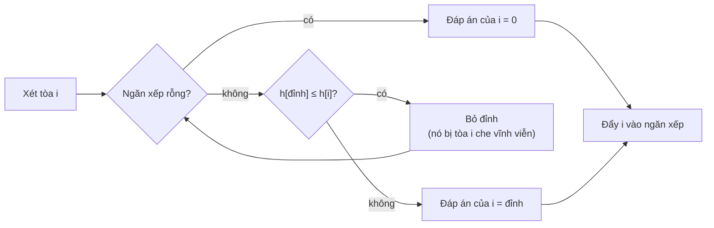

### Chạy từng bước

Trước khi mở mỗi bước, hãy **tự đoán**: tòa nào sẽ bị bỏ, và đáp án là gì? Rồi mới bấm để xem.

<details>
<summary><b>Bước 1</b> – xét tòa 1 (cao 5)</summary>

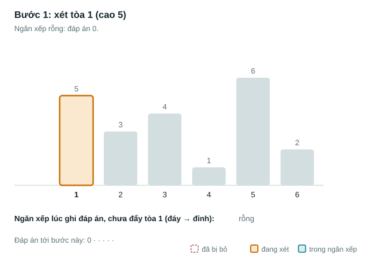

</details>

<details>
<summary><b>Bước 2</b> – xét tòa 2 (cao 3)</summary>

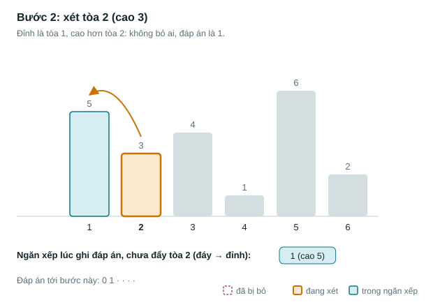

</details>

<details>
<summary><b>Bước 3</b> – xét tòa 3 (cao 4): lần đầu tiên có tòa bị bỏ</summary>

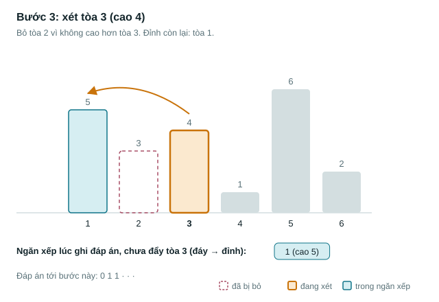

</details>

<details>
<summary><b>Bước 4</b> – xét tòa 4 (cao 1)</summary>

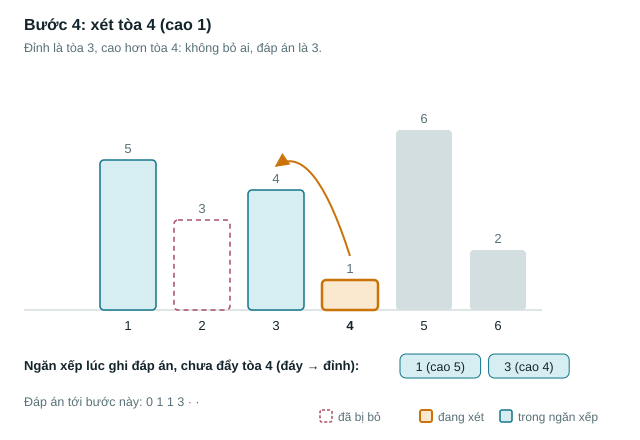

</details>

<details>
<summary><b>Bước 5</b> – xét tòa 5 (cao 6): bỏ liền 3 tòa</summary>

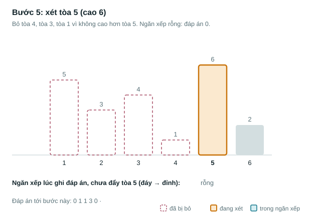

</details>

<details>
<summary><b>Bước 6</b> – xét tòa 6 (cao 2)</summary>

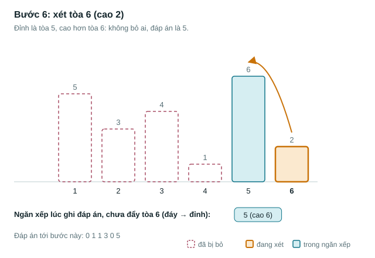

</details>

Tóm tắt cả 6 bước (ngăn xếp ghi "chỉ số (chiều cao)"):

| Bước i | hᵢ | Bỏ khỏi ngăn xếp | Đáp án | Ngăn xếp sau bước (đáy → đỉnh) |
| :---: | :---: | :---: | :---: | --- |
| 1 | 5 | — | 0 | 1(5) |
| 2 | 3 | — | 1 | 1(5), 2(3) |
| 3 | 4 | 2 | 1 | 1(5), 3(4) |
| 4 | 1 | — | 3 | 1(5), 3(4), 4(1) |
| 5 | 6 | 4, 3, 1 | 0 | 5(6) |
| 6 | 2 | — | 5 | 5(6), 6(2) |

> [!IMPORTANT]
> **Dừng lại và nghĩ.** Ở bước 5, một lần bỏ tới 3 tòa. Vậy có bước nào tốn tới n lần bỏ không? Nếu có, thuật toán có bị chậm lại thành O(n²) không? (Trả lời ở mục 6.)

---

## 5. Mã giả và cài đặt

```text
ngăn_xếp ← rỗng                 // chứa CHỈ SỐ các tòa còn "hữu ích"
với i từ 1 đến n:
    trong khi ngăn_xếp khác rỗng và h[đỉnh] ≤ h[i]:
        bỏ đỉnh                    // tòa đó bị tòa i che vĩnh viễn
    đáp_án[i] ← (rỗng ? 0 : đỉnh)
    đẩy i vào ngăn xếp
```

<details open>
<summary><b>C++</b> (<a href="code/phao_hoa.cpp">code/phao_hoa.cpp</a>)</summary>

```cpp
#include <bits/stdc++.h>
using namespace std;
int main() {
    ios::sync_with_stdio(false);
    cin.tie(nullptr);
    int n;
    cin >> n;
    vector<long long> h(n + 1);
    for (int i = 1; i <= n; i++) cin >> h[i];
    vector<int> st;               // ngăn xếp chứa CHỈ SỐ các tòa còn "hữu ích"
    for (int i = 1; i <= n; i++) {
        // Loại các tòa không cao hơn tòa i: chúng không bao giờ chắn được ai nữa
        while (!st.empty() && h[st.back()] <= h[i]) st.pop_back();
        int ans = st.empty() ? 0 : st.back();
        cout << ans << (i == n ? '\n' : ' ');
        st.push_back(i);
    }
}
```

</details>

<details>
<summary><b>Python</b> (<a href="code/phao_hoa.py">code/phao_hoa.py</a>)</summary>

```python
import sys

def main():
    data = sys.stdin.buffer.read().split()   # đọc một lần cho nhanh
    n = int(data[0])
    h = [0] + list(map(int, data[1:n + 1]))
    st = []                                  # ngăn xếp chứa chỉ số
    res = []
    for i in range(1, n + 1):
        while st and h[st[-1]] <= h[i]:
            st.pop()
        res.append(st[-1] if st else 0)
        st.append(i)
    print(' '.join(map(str, res)))

main()
```

</details>

Với n = 2·10⁵, bản C++ chạy khoảng 0,02 giây, bản Python khoảng 0,08 giây (đo trên máy thường).

> [!NOTE]
> **Định nghĩa.** **Ngăn xếp đơn điệu** là ngăn xếp mà giá trị các phần tử luôn tăng dần (hoặc giảm dần) từ đáy lên đỉnh. Trước khi đẩy phần tử mới, ta bỏ khỏi đỉnh mọi phần tử làm hỏng thứ tự đó.

---

## 6. Vì sao đúng, chạy bao lâu

**Vì sao đúng.** Gọi j là đáp án thật của tòa i, tức tòa gần nhất bên trái có hⱼ > hᵢ. Ta cần hai điều:

1. **j còn trong ngăn xếp khi xét tòa i.** Giả sử j đã bị bỏ. Khi đó có một tòa k nằm giữa j và i với hₖ ≥ hⱼ > hᵢ. Vậy k cũng cao hơn hẳn tòa i và gần i hơn j, trái với việc j là tòa gần nhất.
2. **Khi dừng vòng `while`, đỉnh chính là j.** Mọi tòa bị bỏ trong lượt này đều có h ≤ hᵢ, nên không tòa nào trong số đó là đáp án. Các tòa trong ngăn xếp xếp theo thứ tự chỉ số, đỉnh là tòa gần i nhất. Vậy tòa đầu tiên có h > hᵢ gặp ở đỉnh chính là tòa gần nhất cao hơn hẳn i.

**Chạy bao lâu.** Nhìn code, em có thể nghĩ: vòng `while` nằm trong vòng `for`, vậy là O(n²)? Bảo gợi ý đếm theo cách khác: **đếm theo từng tòa, không đếm theo vòng lặp**.

- Mỗi tòa được đẩy vào ngăn xếp đúng 1 lần.
- Mỗi tòa bị bỏ ra nhiều nhất 1 lần, vì đã ra thì không vào lại.
- Do đó toàn bộ các lượt `while` cộng lại chỉ bỏ tối đa n lần. Tổng thời gian là **O(n)**, bộ nhớ O(n).

Cách đếm này gọi là **phân tích khấu hao**. Em sẽ gặp lại nó ở hai con trỏ (Tập 1) và DSU (cũng thuộc Tập 2). Trên trang mô phỏng, ô **Đếm thao tác** cho em thấy tổng số lần đẩy và bỏ không bao giờ vượt quá 2n.

---

## 7. Bẫy thường gặp

> [!WARNING]
> **Bẫy 1: dùng `<` thay cho `<=`.** Đề yêu cầu tòa "cao hơn hẳn". Nếu chỉ bỏ khi `h[đỉnh] < h[i]`, tòa cao bằng tòa i vẫn còn trong ngăn xếp và bị in ra như đáp án.
>
> **Test phá:** `2` / `3 3`. Đáp án đúng là `0 0`, code sai in `0 1`. Hãy thử trên trang mô phỏng: chọn "lớn hơn hoặc bằng" để thấy kết quả khác đi thế nào.

Chi đúc kết quy tắc chọn dấu: **bỏ khỏi ngăn xếp mọi phần tử KHÔNG thỏa điều kiện cần tìm.** Cần tìm "> hᵢ" thì bỏ những phần tử "≤ hᵢ".

| Tìm phần tử gần nhất… | Duyệt theo chiều | Bỏ đỉnh khi |
| --- | --- | --- |
| bên trái, lớn hơn hẳn | trái → phải | h[đỉnh] ≤ h[i] |
| bên trái, nhỏ hơn hẳn | trái → phải | h[đỉnh] ≥ h[i] |
| bên phải, lớn hơn hẳn | phải → trái | h[đỉnh] ≤ h[i] |
| bên phải, nhỏ hơn hẳn | phải → trái | h[đỉnh] ≥ h[i] |

Cần "lớn hơn hoặc bằng" thay vì "lớn hơn hẳn" thì đổi ≤ thành <, và ngược lại.

> [!WARNING]
> **Bẫy 2: lưu giá trị thay vì chỉ số.** Lưu chỉ số thì vẫn biết giá trị qua `h[đỉnh]`. Lưu giá trị thì mất vị trí, trong khi đề hỏi vị trí hoặc khoảng cách. Quy tắc: **luôn lưu chỉ số**.

> [!WARNING]
> **Bẫy 3: đọc đỉnh khi ngăn xếp rỗng.** Trong C++, `st.back()` trên vector rỗng không báo lỗi rõ ràng mà cho kết quả rác hoặc làm chương trình dừng đột ngột. Luôn kiểm tra `!st.empty()` trước, hoặc đặt sẵn "lính canh" ở đáy như bài Xây tường ở mục 9.

> [!WARNING]
> **Bẫy 4: đọc dữ liệu chậm.** Với hàng trăm nghìn số, `cin` chưa tắt đồng bộ hoặc `input()` gọi từng dòng có thể chậm hơn cả thuật toán. Luôn dùng `ios::sync_with_stdio(false); cin.tie(nullptr);` trong C++, hoặc `sys.stdin.buffer.read()` trong Python.

---

## 8. Ví dụ giảm dần hỗ trợ

Ví dụ 1 là bài Ngắm pháo hoa, đã giải trọn vẹn ở trên. Ví dụ 2 để trống vài chỗ cho em điền. Ví dụ 3 em tự làm từ đầu.

### Ví dụ 2 – Điền vào chỗ trống: Tòa thấp hơn gần nhất bên phải

Với mỗi tòa i, tìm tòa gần nhất **bên phải** có chiều cao **thấp hơn hẳn** tòa i; in 0 nếu không có. Dùng bảng quy tắc ở mục 7 để điền ba chỗ trống:

```cpp
for (int i = ____(A)____) {                // duyệt theo chiều nào?
    while (!st.empty() && h[st.back()] ____(B)____ h[i]) st.pop_back();
    ans[i] = st.empty() ? 0 : ____(C)____;
    st.push_back(i);
}
```

Với dãy `5 3 4 1 6 2`, đáp án phải là `2 4 4 0 6 0`. Kiểm tra trên trang mô phỏng bằng cách chọn "bên phải" và "nhỏ hơn hẳn".

<details>
<summary>Đáp án</summary>

- (A) `int i = n; i >= 1; i--`: duyệt từ phải sang trái.
- (B) `>=`: bỏ những tòa không thấp hơn hẳn.
- (C) `st.back()`.

</details>

### Ví dụ 3 – Tự làm: Chờ ngày nóng hơn

Bản tin thời tiết TP.HCM ghi nhiệt độ cao nhất của n ngày liên tiếp. Với mỗi ngày, hỏi phải chờ **bao nhiêu ngày nữa** mới có ngày nóng hơn hẳn; in 0 nếu không có ngày nào như vậy. Giới hạn n ≤ 2·10⁵.

| Vào | Ra |
| --- | --- |
| `5`<br>`30 32 31 29 33` | `1 3 2 1 0` |

> [!IMPORTANT]
> **Dừng lại và nghĩ.** Bài này khác Ví dụ 1 ở hai điểm. Đó là hai điểm nào? Em sẽ sửa những dòng nào trong code?

<details>
<summary>Gợi ý</summary>

Hướng tìm (phải hay trái?) và thứ cần in (chỉ số hay khoảng cách?).

</details>

---

## 9. Bài tập

Mục tiêu tối thiểu: làm hết nấc Khởi động và Luyện. Nấc Thử thách dành cho em nhắm giải cao. Bài kiểu đề thi làm sau cùng, có bấm giờ.

| Nấc | Bài | Nguồn / độ khó | Ý chính |
| --- | --- | --- | --- |
| Khởi động | [Nearest Smaller Values](https://cses.fi/problemset/task/1645) | CSES 1645 · ★ | Đúng khuôn, đổi chiều so sánh |
| Khởi động | Chờ ngày nóng hơn (Ví dụ 3) | Judge của sách · ★ | Duyệt phải sang trái, in khoảng cách |
| Luyện | [Advertisement](https://cses.fi/problemset/task/1142) | CSES 1142 · ★★ | Hình chữ nhật lớn nhất trong biểu đồ cột |
| Luyện | [Mike and Feet](https://codeforces.com/problemset/problem/547/B) | Codeforces 547B · 1900 | Mỗi phần tử là min của đoạn dài bao nhiêu |
| Thử thách | [Maximum Building I](https://cses.fi/problemset/task/1147) | CSES 1147 · ★★★ | Đưa bài lưới về bài Advertisement trên từng hàng |
| Thử thách | [Discrete Centrifugal Jumps](https://codeforces.com/problemset/problem/1407/D) | Codeforces 1407D · 2200 | Bốn ngăn xếp đơn điệu kết hợp QHĐ |
| Kiểu đề thi | Xây tường | Bài của sách, chấm theo subtask | Xem bên dưới |

### Bài kiểu đề thi: Xây tường

**Đề bài.** Công nhân xây một bức tường dài N ô, ban đầu mọi ô cao 0, ô i cần cao đúng aᵢ. Mỗi bước, cần cẩu đặt một tấm khối phủ một đoạn ô liên tiếp, dày bao nhiêu cũng được nhưng đều nhau trên cả đoạn. Để tường vững, hai tấm bất kỳ phải phủ hai đoạn rời nhau, hoặc đoạn này nằm trọn trong đoạn kia. Tìm số bước ít nhất. Giới hạn N ≤ 10⁶, aᵢ ≤ 10⁹. Đọc từ `XAYTUONG.INP`, ghi ra `XAYTUONG.OUT`.

Subtask: 40% có N ≤ 1 000; 30% khác có N ≤ 10⁵.

| XAYTUONG.INP | XAYTUONG.OUT |
| --- | --- |
| `5`<br>`2 4 2 3 3` | `3` |

Một cách 3 bước: phủ ô 1..5 dày 2; thêm 2 ở ô 2; thêm 1 ở ô 4..5.

> [!TIP]
> Trang mô phỏng có chế độ **Xây tường**: mỗi bước hiện thành một tấm khối màu, em thấy rõ các đoạn lồng nhau ra sao. Hãy tự làm ít nhất 20 phút trước khi mở gợi ý.

<details>
<summary><b>Gợi ý 1</b> – hướng đi (đủ 40% điểm)</summary>

Vì các đoạn lồng nhau hoặc rời nhau, đoạn phủ cả vùng có thể xếp trước. Trong vùng đó, ô thấp nhất quyết định lớp đầu tiên dày bao nhiêu. Chia đoạn tại ô thấp nhất rồi đệ quy ([`code/xaytuong_subtask40.py`](code/xaytuong_subtask40.py)).

</details>

<details>
<summary><b>Gợi ý 2</b> – ý then chốt</summary>

Hình dung lời giải đệ quy như những "nấc thang". Quét từ trái sang phải: mỗi khi gặp một ô cao hơn mọi nấc đang mở, ta phải mở thêm một nấc (thêm 1 bước). Khi gặp ô thấp hơn thì những nấc nào kết thúc? Nếu ô mới cao đúng bằng một nấc còn mở thì sao?

</details>

<details>
<summary><b>Gợi ý 3</b> – lời giải đầy đủ</summary>

Giữ một ngăn xếp các độ cao đang mở, tăng ngặt từ đáy lên, đáy là mặt đất 0 (lính canh). Với mỗi ô cao x:

- bỏ mọi nấc cao hơn x, vì chúng kết thúc tại đây;
- nếu đỉnh thấp hơn x thì mở nấc mới và cộng 1 vào đáp án;
- nếu đỉnh bằng x thì nấc đó kéo dài tới đây, không tốn bước mới.

Độ phức tạp O(N), nhưng phải đọc nhanh 1 triệu số.

Chạy từng ô với `2 4 2 3 3`:

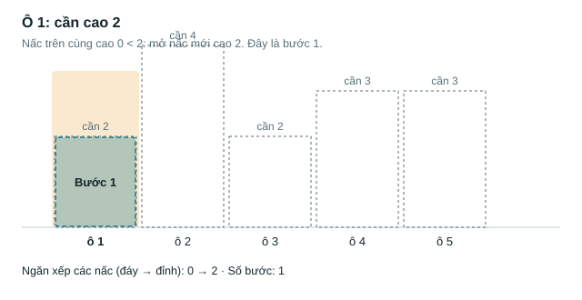
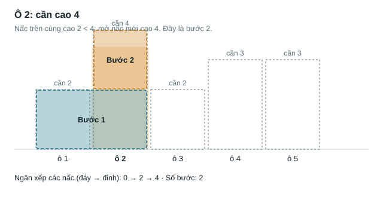
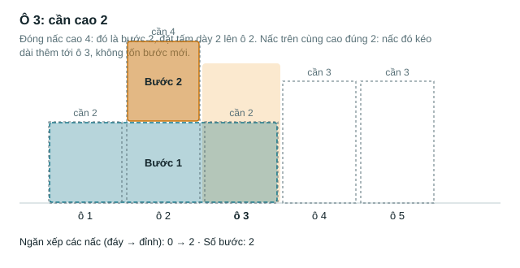
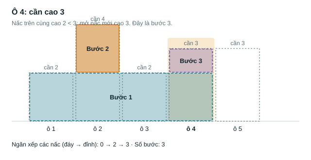
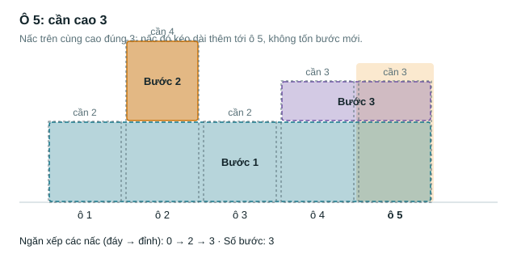
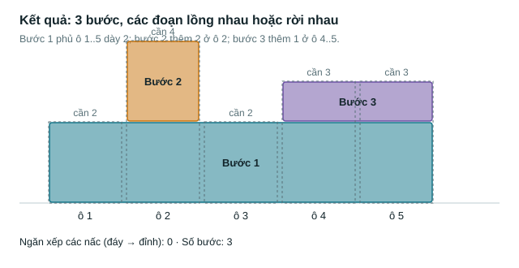

```cpp
#include <bits/stdc++.h>
using namespace std;
int main() {
    freopen("XAYTUONG.INP", "r", stdin);
    freopen("XAYTUONG.OUT", "w", stdout);
    ios::sync_with_stdio(false);
    cin.tie(nullptr);
    int n;
    cin >> n;
    vector<long long> st = {0};   // ngăn xếp các "nấc độ cao", đáy là mặt đất 0
    long long ans = 0;
    for (int i = 0; i < n; i++) {
        long long x;
        cin >> x;
        while (st.back() > x) st.pop_back();            // các nấc cao hơn x đã kết thúc
        if (st.back() < x) { st.push_back(x); ans++; }  // mở một nấc mới
    }
    cout << ans << '\n';
}
```

```python
import sys

def main():
    with open("XAYTUONG.INP", "rb") as f:
        data = f.read().split()
    n = int(data[0])
    st = [0]
    ans = 0
    for x in map(int, data[1:n + 1]):
        while st[-1] > x:
            st.pop()
        if st[-1] < x:
            st.append(x)
            ans += 1
    with open("XAYTUONG.OUT", "w") as f:
        f.write(str(ans) + "\n")

main()
```

Đã kiểm chứng: cả hai bản khớp với lời giải vét cạn trên 300 test nhỏ và với lời giải đệ quy trên 300 test vừa. Với N = 10⁶, bản C++ chạy khoảng 0,06 giây, bản Python khoảng 0,27 giây.

> [!NOTE]
> **Mẹo thi.** Ở đây ngăn xếp lưu **giá trị**, không lưu chỉ số, vì đề không hỏi vị trí. Đây là ngoại lệ có lý do của Bẫy 2. Trước khi nộp, kiểm tra lại tên tệp `XAYTUONG.INP`/`XAYTUONG.OUT` và thư mục bài làm theo quy chế.

</details>

---

## 10. Tóm tắt, flashcard và checkpoint

**Tóm tắt trong 5 dòng.**

1. Dấu hiệu nhận biết: "với mỗi phần tử, tìm phần tử gần nhất bên trái/phải lớn hơn/nhỏ hơn", với n lớn.
2. Ý then chốt: phần tử bị một phần tử mới hơn và "mạnh hơn" che thì vĩnh viễn vô dụng. Bỏ nó đi.
3. Ngăn xếp lưu chỉ số. Bỏ đỉnh khi nó KHÔNG thỏa điều kiện cần tìm; đỉnh còn lại chính là đáp án.
4. Mỗi phần tử vào một lần, ra tối đa một lần, nên tổng là O(n) (phân tích khấu hao).
5. Ba bẫy: nhầm `<` với `<=`, lưu giá trị thay vì chỉ số, đọc đỉnh khi ngăn xếp rỗng.

**Flashcard.** Đọc mặt trước, tự trả lời thành tiếng, rồi mới mở mặt sau. Ôn lại sau 1, 3, 7 và 21 ngày.

<details><summary>Tìm lớn hơn hẳn gần nhất bên trái: bỏ đỉnh khi nào?</summary>Khi h[đỉnh] ≤ h[i].</details>
<details><summary>Tìm nhỏ hơn hẳn gần nhất bên phải: duyệt chiều nào, bỏ khi nào?</summary>Phải → trái; bỏ khi h[đỉnh] ≥ h[i].</details>
<details><summary>Vì sao <code>while</code> trong <code>for</code> mà vẫn O(n)?</summary>Mỗi phần tử bị bỏ tối đa 1 lần, nên tổng số lần bỏ ≤ n.</details>
<details><summary>Ngăn xếp nên lưu gì? Vì sao?</summary>Chỉ số; từ chỉ số lấy được cả giá trị lẫn vị trí.</details>
<details><summary>Test phá lỗi nhầm <code>&lt;</code> với <code>&lt;=</code>?</summary>Hai phần tử bằng nhau, ví dụ <code>3 3</code>.</details>
<details><summary>"Lính canh" ở đáy ngăn xếp dùng để làm gì?</summary>Ngăn xếp không bao giờ rỗng, khỏi kiểm tra <code>empty()</code>.</details>

**Ôn xoắn ốc** (kiến thức Tập 1, trộn không báo dạng; mỗi bài tối đa 30 phút):

- [Static Range Sum Queries](https://cses.fi/problemset/task/1646) (CSES 1646)
- [Subarray Sums I](https://cses.fi/problemset/task/1660) (CSES 1660)
- [Factory Machines](https://cses.fi/problemset/task/1620) (CSES 1620)

**Checkpoint – em đã sẵn sàng sang bài tiếp theo nếu:**

- [ ] Viết lại lời giải Ngắm pháo hoa từ đầu, không nhìn sách, trong dưới 10 phút.
- [ ] Giải thích bằng lời cho một bạn khác vì sao thuật toán chạy O(n).
- [ ] AC cả 2 bài Khởi động và ít nhất 1 trong 2 bài Luyện, mỗi bài dưới 45 phút.
- [ ] Đạt ít nhất 60% điểm bài Xây tường khi tự làm trong 40 phút.

Chưa đạt? Nếu vướng ô 1 hoặc 2, đọc lại mục 4 và 6, rồi dùng trang mô phỏng chạy từng bước với dãy `2 7 3 3 5 1 8`. Nếu vướng ô 3 hoặc 4, làm lại Ví dụ 2 và 3, rồi đối chiếu bảng quy tắc ở mục 7.

---

<sub>Mọi đoạn code trong bài đã được chạy và đối chiếu với lời giải vét cạn trên vài trăm test ngẫu nhiên. Các hình trong thư mục <code>hinh/</code> được sinh tự động bằng <code>mo-phong/src/make_svgs.js</code>, dùng chung bộ máy với trang mô phỏng.</sub>
