# Bài 2.5 – Bit và bitset

> **Tập 2 · Cấu trúc dữ liệu và quy hoạch động cơ bản**
> Cần biết trước: bài 1.7 (bitmask, gộp trạng thái Tàu ngầm), bài 0.2 (hệ nhị phân).
> Thời lượng: khoảng 90 phút đọc, cộng 5 giờ thực hành trong tuần.

**Học xong bài này, em sẽ:**

- dùng các phép toán bit `& | ^ ~ << >>` và các mẹo bit hay gặp;
- dùng XOR để giải các bài "triệt tiêu cặp" với O(1) bộ nhớ;
- dùng **bitset** để xử lý 64 phần tử trong **một** phép tính, trong C++ và bằng số nguyên lớn của Python;
- lấy **trọn điểm** bài Tàu ngầm (BOI 2019) và bài kiểu đề thi **Sở thích chung**.

> [!TIP]
> **Học cùng hai trang mô phỏng.** [XOR](../../mo-phong/t2-xor.html): xem từng cột bit bị lật. [Tàu ngầm bằng bitset](../../mo-phong/t2-tau-bitset.html): so sánh với trang [gộp trạng thái](../../mo-phong/t1-tau-ngam.html) ở bài 1.7; lần này cả hàng được cập nhật bằng một phép dịch.

---

## 1. Bài toán mở màn: Số lẻ loi

Trong dãy n số (n ≤ 10⁶, n lẻ, 0 ≤ aᵢ ≤ 10¹⁸), mọi giá trị xuất hiện đúng hai lần, trừ **một** giá trị xuất hiện một lần. Tìm giá trị đó, chỉ dùng **O(1) bộ nhớ** ngoài biến đọc vào.

| Vào | Ra |
| --- | --- |
| `5`<br>`7 3 7 9 3` | `9` |

---

## 2. Dừng lại 10 phút

> [!IMPORTANT]
> **Dừng lại và nghĩ.**
> 1. Nếu được dùng nhiều bộ nhớ, em giải thế nào? (Gợi ý: bài 2.2.)
> 2. Phép cộng có "triệt tiêu" hai số giống nhau không? Phép toán nào biến x ∘ x thành 0 và x ∘ 0 thành x?
> 3. Viết 7, 3, 9 ở hệ nhị phân. Nhìn riêng **cột bit 1** (giá trị 2) của cả năm số `7 3 7 9 3`: có bao nhiêu bit 1? Chẵn hay lẻ?

<details>
<summary>Đáp án</summary>

1. Đếm bằng `map` (bài 2.2) hoặc sắp xếp rồi so sánh cặp kề nhau: O(n) bộ nhớ.
2. Cộng thì không (x + x = 2x). Phép **XOR** (`^`) làm được: x ^ x = 0, x ^ 0 = x, và có tính giao hoán, kết hợp.
3. 7 = `0111`, 3 = `0011`, 9 = `1001`. Cột giá trị 2 có bit 1 ở 7, 3, 7, 3: bốn bit, chẵn. Số lẻ loi 9 có bit này bằng 0. Mỗi cột của đáp án chính là "số bit 1 trong cột là lẻ hay chẵn".

</details>

---

## 3. Lời giải ngây thơ và vì sao nó không đạt

An dùng `map` đếm tần suất (bài 2.2) rồi in giá trị có số lần lẻ. Đúng, chạy O(n log n), nhưng với n = 10⁶ phải lưu tới 5·10⁵ khóa: hàng chục MB, vi phạm yêu cầu O(1) bộ nhớ. Sắp xếp cũng phải lưu cả dãy. Bài này kiểm tra xem em có biết "mẹo" nằm ở tầng bit.

---

## 4. Ý tưởng then chốt

> [!IMPORTANT]
> **XOR cả dãy. Mỗi cặp số giống nhau lật cùng các bit hai lần, nên tự triệt tiêu, bất kể chúng nằm ở đâu trong dãy. Kết quả còn lại là số lẻ loi.**

Mỗi số nguyên là một dãy bit. Với a = 12 (`1100`) và b = 10 (`1010`):

| Phép | Ý nghĩa | a ? b | Kết quả |
| --- | --- | --- | --- |
| `a & b` | AND: 1 khi cả hai bit là 1 | `1100 & 1010` | `1000` = 8 |
| `a \| b` | OR: 1 khi ít nhất một bit là 1 | `1100 \| 1010` | `1110` = 14 |
| `a ^ b` | XOR: 1 khi hai bit khác nhau | `1100 ^ 1010` | `0110` = 6 |
| `a << 1` | dịch trái = nhân 2 | `1100 << 1` | `11000` = 24 |
| `a >> 2` | dịch phải = chia 4 (lấy phần nguyên) | `1100 >> 2` | `11` = 3 |

### Chạy từng bước

Với `7 3 7 9 3`. Đoán trước giá trị x rồi mới mở.

<details>
<summary><b>Bước 1</b> – x = 0</summary>

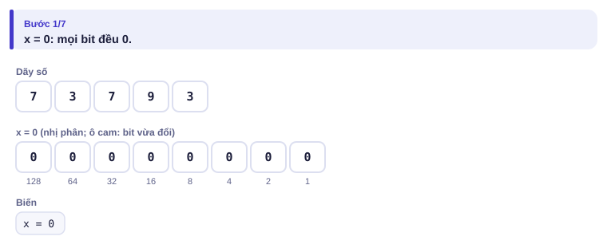

</details>

<details>
<summary><b>Bước 2</b> – 0 ^ 7 bằng bao nhiêu?</summary>

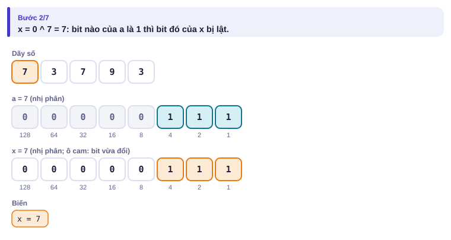

</details>

<details>
<summary><b>Bước 3</b> – 7 ^ 3: bit nào bị lật?</summary>

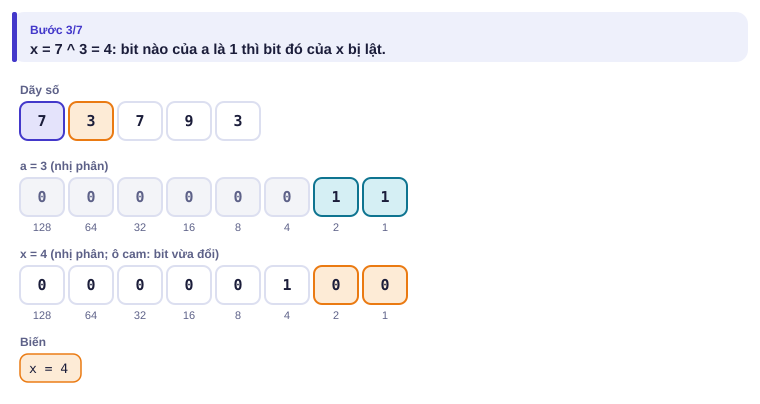

</details>

<details>
<summary><b>Bước 4</b> – lại gặp 7, rồi gặp 9</summary>

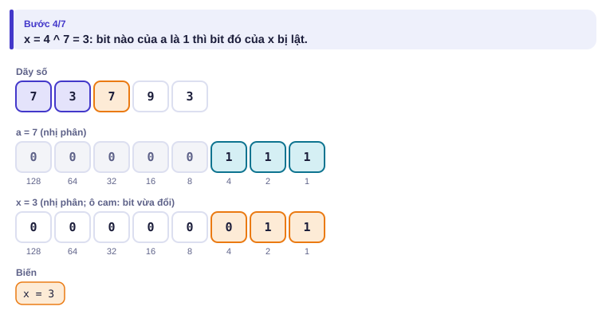
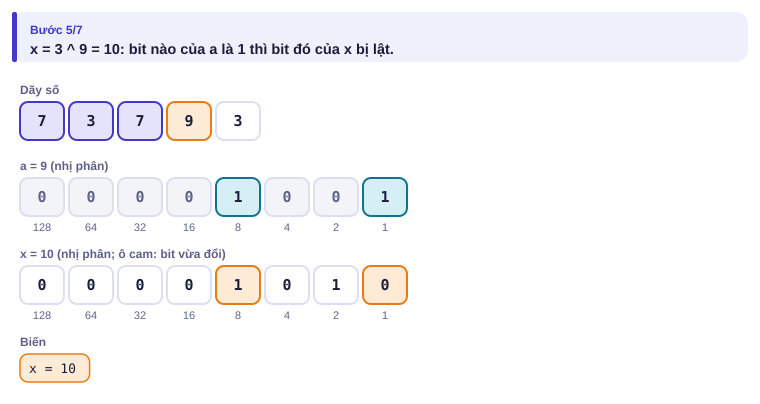

</details>

<details>
<summary><b>Bước 5</b> – kết quả</summary>

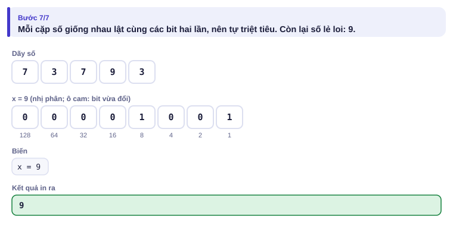

</details>

| Số đọc vào | x trước | x sau (nhị phân) | x sau |
| :---: | :---: | :---: | :---: |
| 7 | 0 | `0111` | 7 |
| 3 | 7 | `0100` | 4 |
| 7 | 4 | `0011` | 3 |
| 9 | 3 | `1010` | 10 |
| 3 | 10 | `1001` | **9** |

---

## 5. Mã giả và cài đặt

```cpp
// file: so_le_loi.cpp
#include <bits/stdc++.h>
using namespace std;
int main() {
    ios::sync_with_stdio(false);
    cin.tie(nullptr);
    int n;
    cin >> n;
    long long x = 0;
    for (int i = 0; i < n; i++) {
        long long a;
        cin >> a;
        x ^= a;
    }
    cout << x << '\n';
}
```

```python
# file: so_le_loi.py
import sys
x = 0
it = iter(sys.stdin.buffer.read().split())
n = int(next(it))
for _ in range(n):
    x ^= int(next(it))
print(x)
```

Mẹo bit hay dùng:

| Muốn | Viết |
| --- | --- |
| bit thứ i của x là 1? | `x >> i & 1` |
| bật / tắt / lật bit thứ i | `x \| (1LL << i)` / `x & ~(1LL << i)` / `x ^ (1LL << i)` |
| bit 1 thấp nhất | `x & -x` (ví dụ 12 & −12 = 4) |
| số bit 1 | `__builtin_popcountll(x)` (C++), `x.bit_count()` hoặc `bin(x).count('1')` (Python) |
| x là lũy thừa của 2? | `x > 0 && (x & (x - 1)) == 0` |
| duyệt mọi tập con của n phần tử | `for (int m = 0; m < (1 << n); m++)` (bài 1.7) |

### Bitset: 64 ô một lúc

Máy tính làm AND/OR/dịch trên một số 64 bit **trong một phép**. `bitset<N>` của C++ ghép nhiều số 64 bit lại, nên một phép `&` trên `bitset<512>` chỉ tốn khoảng 8 phép máy, thay vì 512 phép nếu xử lý từng ô.

Nhắc lại bài Tàu ngầm (bài 1.7): bản đồ R × C, tàu đi theo xâu M ký tự `E W S N ?`; đếm số ô tàu có thể đang ở. Lời giải gộp trạng thái duyệt từng ô cho mỗi ký tự: O(R·C·M) = 500 × 500 × 5000 = 1,25·10⁹ phép: quá chậm cho giới hạn đầy đủ.

Ý mới: mỗi **hàng** của tập là một bitset, bit j bật nếu ô (i, j) có thể chứa tàu. Một ký tự biến cả hàng bằng vài phép bit:

| Ký tự | Hàng i mới | Vì sao |
| --- | --- | --- |
| `E` (sang phải) | `(cu[i] << 1) & trong[i]` | bit j sang j + 1 |
| `W` (sang trái) | `(cu[i] >> 1) & trong[i]` | bit j sang j − 1 |
| `S` (xuống) | `cu[i-1] & trong[i]` | hàng trên rơi xuống hàng i |
| `N` (lên) | `cu[i+1] & trong[i]` | hàng dưới lên hàng i |
| `?` | OR của cả bốn dòng trên | đi được hướng nào cũng tính |

`trong[i]` là bitset các ô nước của hàng i: phép `&` loại cả ô đá lẫn các bit bị dịch ra ngoài bản đồ (bit ở cột ≥ C luôn là 0 trong `trong[i]`).

<details>
<summary><b>Hình</b> – ví dụ <code>....</code> / <code>.#..</code> / <code>....</code> với hành trình <code>ES</code> (mở lần lượt; đoán số bit 1 sau mỗi phép &)</summary>

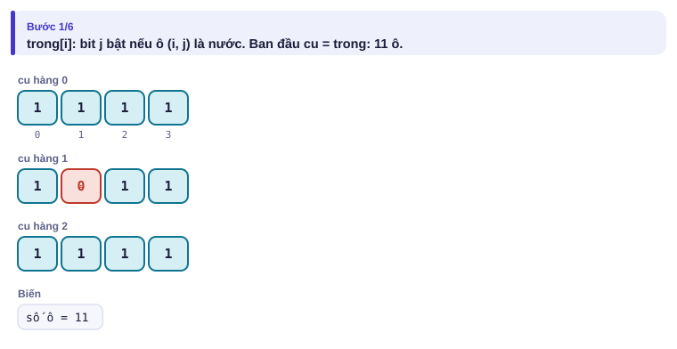
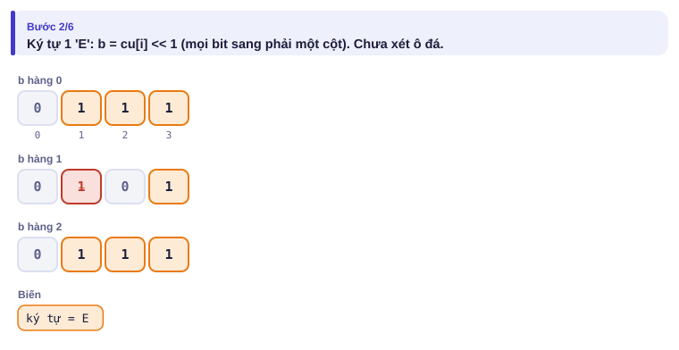
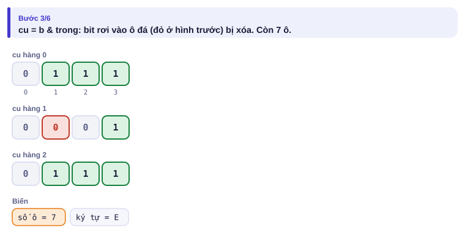
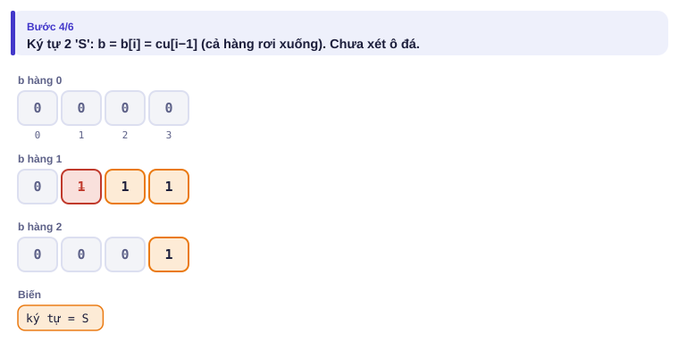
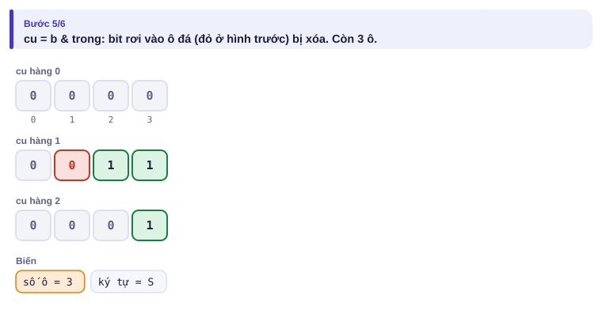
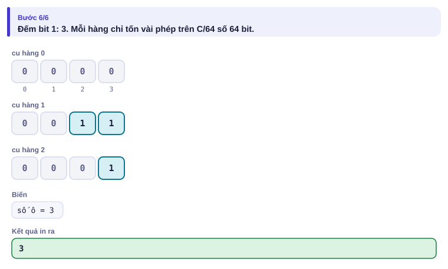

</details>

Độ phức tạp: M × R × (C / 64) ≈ 5000 × 500 × 8 = 2·10⁷ phép: dưới 0,1 giây.

```cpp
// file: tau_ngam_bitset.cpp
#include <bits/stdc++.h>
using namespace std;
const int MAXC = 512;
int main() {
    ios::sync_with_stdio(false);
    cin.tie(nullptr);
    int R, C, M;
    cin >> R >> C >> M;
    vector<bitset<MAXC>> trong(R), cu(R);
    for (int i = 0; i < R; i++) {
        string row;
        cin >> row;
        for (int j = 0; j < C; j++)
            if (row[j] == '.') trong[i][j] = 1;
        cu[i] = trong[i];                      // ban đầu: mọi ô nước
    }
    string s;
    cin >> s;
    vector<bitset<MAXC>> moi(R);
    for (char ch : s) {
        for (int i = 0; i < R; i++) {
            bitset<MAXC> b;
            if (ch == 'E' || ch == '?') b |= cu[i] << 1;
            if (ch == 'W' || ch == '?') b |= cu[i] >> 1;
            if ((ch == 'S' || ch == '?') && i > 0) b |= cu[i - 1];
            if ((ch == 'N' || ch == '?') && i + 1 < R) b |= cu[i + 1];
            moi[i] = b & trong[i];
        }
        swap(cu, moi);
    }
    long long dem = 0;
    for (int i = 0; i < R; i++) dem += cu[i].count();
    cout << dem << '\n';
}
```

**Python:** số nguyên của Python dài tùy ý và các phép bit trên nó chạy bằng mã C rất nhanh. Ghép **cả bản đồ** vào một số nguyên: ô (i, j) là bit i·W + j với W = C + 1. Cột thừa thứ C luôn là 0 trong `trong`, làm "vách ngăn" để dịch trái/phải không tràn sang hàng bên cạnh. Khi đó đi xuống một hàng là dịch W bit.

```python
# file: tau_ngam_bitset.py
import sys
data = sys.stdin.read().split()
R, C, M = int(data[0]), int(data[1]), int(data[2])
g = data[3:3 + R]
s = data[3 + R] if len(data) > 3 + R else ""
W = C + 1                                   # thêm một cột "vách ngăn" luôn bằng 0
trong = 0
for i in range(R):
    for j in range(C):
        if g[i][j] == '.':
            trong |= 1 << (i * W + j)
cu = trong
for ch in s:
    if ch == 'E':   b = cu << 1
    elif ch == 'W': b = cu >> 1
    elif ch == 'S': b = cu << W
    elif ch == 'N': b = cu >> W
    else:           b = (cu << 1) | (cu >> 1) | (cu << W) | (cu >> W)
    cu = b & trong
print(bin(cu).count('1'))
```

Mỗi bước chỉ 1–7 phép trên một số khoảng 250 000 bit. Đo trên máy thường với bản đồ 500 × 500 và M = 5000: bản Python chạy khoảng 0,5 giây, bản C++ khoảng 0,06 giây.

> [!NOTE]
> Bản đồ 500 × 500 và M = 5000 là giới hạn của BOI 2019. Học sinh dùng Python vẫn lấy được trọn điểm, **nếu biết mẹo số nguyên lớn**.

---

## 6. Vì sao đúng, chạy bao lâu

- **XOR:** phép XOR giao hoán và kết hợp, nên có thể sắp lại dãy để các cặp giống nhau đứng cạnh nhau: (a ^ a) ^ (b ^ b) ^ … ^ x = 0 ^ 0 ^ … ^ x = x. Chạy O(n), bộ nhớ O(1).
- **Bitset:** mỗi phép dịch/AND/OR trên bitset cho đúng kết quả như làm từng bit; nó chỉ làm 64 bit cùng lúc. Lời giải vì thế giống hệt lời giải gộp trạng thái ở bài 1.7, chỉ nhanh hơn khoảng 64 lần: O(M·R·C/64).
- **Python:** một phép bit trên số nguyên k bit tốn O(k/30) (Python lưu số theo khối 30 bit), cũng nhanh tương tự.

---

## 7. Bẫy thường gặp

> [!WARNING]
> **Bẫy 1: `1 << 40`.** Hằng `1` là `int` (32 bit), dịch quá 31 bit là sai (kết quả không xác định). Viết `1LL << 40`.
> *Test phá:* in `(1 << 40)` và `(1LL << 40)` rồi so sánh.

> [!WARNING]
> **Bẫy 2: thứ tự ưu tiên.** `x & 1 == 0` được hiểu là `x & (1 == 0)` vì `==` ưu tiên hơn `&`. Luôn thêm ngoặc: `(x & 1) == 0`.
> *Test phá:* x = 2: biểu thức sai cho kết quả 0 (false) dù x chẵn.

> [!WARNING]
> **Bẫy 3: chiều dịch của bitset khi in.** `<<` đưa bit j lên **j + 1** (chỉ số lớn hơn). Nhưng `cout << b` in bit 0 ở **bên phải**, nên trông như bit "đi sang trái". Đừng bị lừa khi gỡ lỗi.

> [!WARNING]
> **Bẫy 4: cập nhật tại chỗ.** Hướng `S` dùng `cu[i-1]`: nếu ghi đè `cu[i-1]` trước khi tính hàng i, kết quả sai. Luôn ghi vào mảng `moi` riêng (như bài 1.7).
> *Test phá:* bản đồ 3 × 1 toàn nước, hành trình `S`: đáp án 2; cập nhật tại chỗ từ hàng 0 xuống cho 0.

> [!WARNING]
> **Bẫy 5: thiếu cột vách ngăn trong bản Python.** Không có cột thừa, dịch sang phải ở cuối hàng i sẽ sang đầu hàng i + 1.

---

## 8. Ví dụ giảm dần hỗ trợ

### Ví dụ 2 – Điền vào chỗ trống: Tổng tập con bằng bitset

Có n đồng xu (n ≤ 1000) mệnh giá aᵢ (1 ≤ aᵢ ≤ 1000). Có chọn được một số đồng (mỗi đồng dùng tối đa một lần) có tổng đúng bằng S (S ≤ 10⁶) không?

| Vào | Ra |
| --- | --- |
| `4 9`<br>`2 4 5 8` | `YES` |
| `3 4`<br>`3 3 5` | `NO` |

Gọi `duoc` là bitset với bit t bật nếu tổng t tạo được. Ban đầu chỉ có tổng 0. Thêm đồng a: mọi tổng t cũ sinh thêm tổng t + a, tức là cả bitset dịch đi a bit.

```cpp
bitset<1000001> duoc;
duoc[0] = 1;
for (int a : xu) duoc ____ (duoc << a);
cout << (duoc[____] ? "YES" : "NO");
```

<details>
<summary>Đáp án</summary>

`|=` và `S`. Mỗi đồng xu tốn 10⁶/64 ≈ 1,6·10⁴ phép, n = 1000 đồng: 1,6·10⁷ phép. Cách duyệt từng tổng (quy hoạch động ở bài 2.9) tốn 10⁹.

```cpp
// file: tong_tap_con.cpp
#include <bits/stdc++.h>
using namespace std;
bitset<1000001> duoc;
int main() {
    int n, S;
    cin >> n >> S;
    duoc[0] = 1;
    for (int i = 0; i < n; i++) {
        int a;
        cin >> a;
        duoc |= duoc << a;
    }
    cout << (duoc[S] ? "YES" : "NO") << '\n';
}
```

</details>

### Ví dụ 3 – Tự làm: Hai số lẻ loi

Trong dãy n số (n ≤ 10⁶, 0 ≤ aᵢ ≤ 10¹⁸), mọi giá trị xuất hiện đúng hai lần, trừ **hai** giá trị khác nhau, mỗi giá trị xuất hiện một lần. In hai giá trị đó theo thứ tự tăng dần, chỉ dùng O(1) bộ nhớ.

| Vào | Ra |
| --- | --- |
| `6`<br>`4 1 2 1 2 6` | `4 6` |

> [!IMPORTANT]
> Tự làm trước. Gợi ý: XOR cả dãy được x = p ^ q (p, q là hai số cần tìm), x ≠ 0. Một bit 1 của x là bit mà p và q **khác nhau**. Dùng bit đó chia dãy làm hai nhóm. Đọc dữ liệu hai lần thì cần lưu dãy; hãy nghĩ cách chỉ đọc một lần.

<details>
<summary>Lời giải</summary>

Gọi b là bit 1 thấp nhất của x (`x & -x`). Các cặp giống nhau luôn rơi vào cùng một nhóm; p và q rơi vào hai nhóm khác nhau. Vậy XOR riêng nhóm "có bit b" cho ra một trong hai số. Để đọc một lần, ta tính XOR cho **mọi** bit cùng lúc: `nhom[k]` là XOR các số có bit k bật (64 biến: vẫn O(1)).

```cpp
// file: hai_so_le.cpp
#include <bits/stdc++.h>
using namespace std;
int main() {
    ios::sync_with_stdio(false);
    cin.tie(nullptr);
    int n;
    cin >> n;
    long long x = 0, nhom[63] = {0};
    for (int i = 0; i < n; i++) {
        long long a;
        cin >> a;
        x ^= a;
        for (int k = 0; k < 63; k++)
            if (a >> k & 1) nhom[k] ^= a;
    }
    int k = __builtin_ctzll(x);              // vị trí bit 1 thấp nhất của x
    long long p = nhom[k], q = x ^ p;
    if (p > q) swap(p, q);
    cout << p << ' ' << q << '\n';
}
```

</details>

---

## 9. Bài tập

| Nấc | Bài | Nguồn | Ý chính |
| --- | --- | --- | --- |
| Khởi động | [Bit Strings](https://cses.fi/problemset/task/1617) | CSES 1617 | 2ⁿ mod 10⁹+7 |
| Khởi động | [Gray Code](https://cses.fi/problemset/task/2205) | CSES 2205 | i ^ (i >> 1) |
| Luyện | [Money Sums](https://cses.fi/problemset/task/1745) | CSES 1745 | Ví dụ 2, in mọi tổng |
| Luyện | [Nautilus](https://oj.uz/problem/view/BOI19_nautilus) | BOI 2019 (oj.uz) | Nộp bài Tàu ngầm lên judge quốc tế |
| Thử thách | [Counting Bits](https://cses.fi/problemset/task/1146) | CSES 1146 | Đếm bit 1 từ 1 tới n theo từng cột bit |
| Kiểu đề thi | Sở thích chung | Bài của sách, chấm theo subtask | Xem bên dưới |

### Bài kiểu đề thi: Sở thích chung

**Đề bài.** Câu lạc bộ có n bạn (2 ≤ n ≤ 2000) và m hoạt động (1 ≤ m ≤ 2000). Bạn i mô tả sở thích bằng một xâu nhị phân dài m: ký tự thứ j là `1` nếu bạn thích hoạt động j. Hai bạn có thể ghép đôi nếu có **ít nhất một** hoạt động cả hai cùng thích. Đếm số cặp (i, j), i < j, ghép đôi được. Đọc từ `SOTHICH.INP` (dòng đầu n m, n dòng sau là các xâu), ghi ra `SOTHICH.OUT`.

Subtask: 40% có n, m ≤ 300; 60% còn lại có n, m ≤ 2000.

| SOTHICH.INP | SOTHICH.OUT |
| --- | --- |
| `4 5`<br>`10010`<br>`01100`<br>`00011`<br>`01001` | `3` |

Ba cặp ghép được: bạn 1 và bạn 3 (cùng thích hoạt động 4), bạn 2 và bạn 4 (hoạt động 2), bạn 3 và bạn 4 (hoạt động 5).

<details>
<summary><b>Gợi ý 1</b> – hướng đi (đủ 40% điểm)</summary>

Duyệt mọi cặp (i, j), với mỗi cặp duyệt m hoạt động xem có vị trí nào cả hai là `1`. O(n²·m) = 2,7·10⁷ với subtask 1, nhưng 8·10⁹ với n = m = 2000.

</details>

<details>
<summary><b>Gợi ý 2</b> – ý then chốt</summary>

Lưu sở thích của mỗi bạn thành một bitset m bit. Hai bạn có hoạt động chung khi và chỉ khi `(s[i] & s[j]).any()`. Mỗi phép `&` chỉ tốn m/64 ≈ 32 phép máy: tổng n²/2 · m/64 ≈ 6,4·10⁷.

</details>

<details>
<summary><b>Gợi ý 3</b> – lời giải đầy đủ</summary>

```cpp
// file: sothich.cpp
#include <bits/stdc++.h>
using namespace std;
const int MAXM = 2000;
int main() {
    freopen("SOTHICH.INP", "r", stdin);
    freopen("SOTHICH.OUT", "w", stdout);
    int n, m;
    cin >> n >> m;
    vector<bitset<MAXM>> s(n);
    for (int i = 0; i < n; i++) {
        string t;
        cin >> t;
        for (int j = 0; j < m; j++)
            if (t[j] == '1') s[i][j] = 1;
    }
    long long dem = 0;
    for (int i = 0; i < n; i++)
        for (int j = i + 1; j < n; j++)
            if ((s[i] & s[j]).any()) dem++;
    cout << dem << '\n';
}
```

Python: `int(t, 2)` biến xâu nhị phân thành số nguyên; hai bạn ghép được khi `a[i] & a[j]` khác 0. Khoảng 2·10⁶ cặp, mỗi cặp một phép `&` trên số 2000 bit: chạy được trong 1–2 giây.

```python
# file: sothich.py
with open("SOTHICH.INP") as f:
    data = f.read().split()
n, m = int(data[0]), int(data[1])
a = [int(t, 2) for t in data[2:2 + n]]
dem = 0
for i in range(n):
    x = a[i]
    for j in range(i + 1, n):
        if x & a[j]:
            dem += 1
with open("SOTHICH.OUT", "w") as f:
    f.write(f"{dem}\n")
```

</details>

---

## 10. Tóm tắt, flashcard và checkpoint

**Tóm tắt trong 5 dòng.**

1. XOR triệt tiêu cặp giống nhau, không phụ thuộc thứ tự: giải bài "lẻ loi" với O(1) bộ nhớ.
2. `x >> i & 1` đọc bit i; `x & -x` là bit 1 thấp nhất; dùng `1LL << i` khi i ≥ 31; luôn thêm ngoặc quanh phép bit.
3. Bitset xử lý 64 phần tử trong một phép: `&` để giao, `|` để hợp, `<<`/`>>` để dịch cả tập.
4. Tập ô trên lưới: mỗi hàng một bitset; tập tổng đạt được: `duoc |= duoc << a`.
5. Python: một số nguyên lớn làm bitset; thêm cột vách ngăn khi ghép cả lưới.

**Flashcard.**

<details><summary>6 ^ 5 bằng bao nhiêu?</summary><code>110 ^ 101 = 011</code> = 3.</details>
<details><summary>Trong bản Python của Tàu ngầm, đi lên (<code>N</code>) là dịch bit thế nào?</summary>Dịch phải W = C + 1 bit.</details>
<details><summary>Vì sao cần <code>& trong[i]</code> sau mỗi phép dịch?</summary>Để xóa các bit rơi vào ô đá hoặc lọt ra ngoài cột C − 1.</details>
<details><summary>12 &amp; −12 bằng bao nhiêu?</summary>4: bit 1 thấp nhất của 12 = <code>1100</code>.</details>
<details><summary>Thêm đồng xu a vào bitset tổng <code>duoc</code> thế nào?</summary><code>duoc |= duoc &lt;&lt; a</code>.</details>

**Ôn xoắn ốc** (mỗi bài tối đa 20 phút):

- Viết lại bài Việc làm thêm (bài 2.3) không nhìn sách.
- [Apple Division](https://cses.fi/problemset/task/1623) (CSES 1623): duyệt tập con bằng bitmask (bài 1.7).
- [Playlist](https://cses.fi/problemset/task/1141) (CSES 1141): `map` + cửa sổ trượt (bài 2.2).

**Checkpoint – em đã sẵn sàng sang bài tiếp theo nếu:**

- [ ] Tự tính được 12 & 10, 12 | 10, 12 ^ 10, 12 << 1, 12 >> 2 không cần máy.
- [ ] AC [Nautilus](https://oj.uz/problem/view/BOI19_nautilus) trên oj.uz bằng ngôn ngữ em chọn.
- [ ] Làm xong Ví dụ 3 (Hai số lẻ loi) mà không mở lời giải.
- [ ] Đạt trọn điểm bài Sở thích chung khi tự làm trong 25 phút.

Chưa đạt? Nếu vướng ô 1, chạy trang mô phỏng XOR với các số của em và đọc lại bảng ở mục 4. Nếu vướng ô 2, chạy trang Tàu ngầm bằng bitset với ví dụ "có ký tự ?" và đọc lại Bẫy 3, Bẫy 4. Nếu vướng ô 3 hoặc 4, làm lại Ví dụ 2 rồi đọc mục 6.
