# Bài 2.6 – Min trên đoạn

> **Tập 2 · Cấu trúc dữ liệu và quy hoạch động cơ bản**
> Cần biết trước: bài 1.3 (tổng tiền tố), bài 1.5 (hai con trỏ), bài 2.1 (`deque`), bài 2.4 (ngăn xếp đơn điệu).
> Thời lượng: khoảng 80 phút đọc, cộng 5 giờ thực hành trong tuần.

**Học xong bài này, em sẽ:**

- tìm min (hoặc max) của **mọi cửa sổ dài k** trong O(n) bằng **hàng đợi đơn điệu**;
- trả lời min của **đoạn bất kỳ** trong O(1) sau O(n log n) chuẩn bị, bằng **sparse table**;
- giải thích vì sao tổng tiền tố không dùng được cho min, và sparse table chỉ dùng được cho những phép nào;
- giải trọn bài kiểu đề thi **Kỳ hạn gửi tiền**.

> [!TIP]
> **Học cùng hai trang mô phỏng.** [Hàng đợi đơn điệu](../../mo-phong/t2-min-deque.html): thử cả ba ví dụ, đặc biệt "dãy tăng" (phần tử hết hạn bị bỏ ở đầu). [Sparse table](../../mo-phong/t2-sparse.html): bật **Đoán trước** để tự tính k cho mỗi câu hỏi.

---

## 1. Bài toán mở màn: Ngày lạnh nhất trong tuần

Đài khí tượng có nhiệt độ n ngày. Với **mỗi** cửa sổ k ngày liên tiếp, in nhiệt độ thấp nhất. (1 ≤ k ≤ n ≤ 10⁶, |aᵢ| ≤ 10⁹)

| Vào | Ra |
| --- | --- |
| `8 3`<br>`1 3 -1 -3 5 3 6 7` | `-1 -3 -3 -3 3 3` |

---

## 2. Dừng lại 10 phút

> [!IMPORTANT]
> **Dừng lại và nghĩ.**
> 1. Với tổng, ta có p[r] − p[l − 1] (bài 1.3). Có "phép trừ" nào cho min không? Biết min(a₁..a₅) và min(a₁..a₂), có suy ra min(a₃..a₅) không?
> 2. Trong cửa sổ `3 -1 -3`, khi trượt tiếp sang phải, phần tử 3 và −1 có bao giờ còn là min nữa không? Vì sao?
> 3. Ngược lại, trong cửa sổ `-3 5 3`, phần tử 5 và 3 có thể trở thành min sau này không?

<details>
<summary>Đáp án</summary>

1. Không. Ví dụ min(1, 9, 5) = 1 và min(1) = 1 nhưng min(9, 5) = 5: không suy ra được. Min không có phép ngược.
2. Không bao giờ: −3 đứng **sau** chúng (ở lại cửa sổ lâu hơn) và **nhỏ hơn**. Một phần tử bị "đè" bởi phần tử nhỏ hơn hoặc bằng đứng sau nó là vô dụng mãi mãi. Giống hệt ý của ngăn xếp đơn điệu (bài 2.4).
3. Có: khi −3 ra khỏi cửa sổ, 3 sẽ là min. Vậy cần giữ lại những phần tử chưa bị đè, theo thứ tự, và **bỏ cả ở đầu** khi chúng hết hạn.

</details>

---

## 3. Lời giải ngây thơ và vì sao nó chậm

Với mỗi cửa sổ, quét k phần tử tìm min:

```cpp
for (int i = 0; i + k <= n; i++) {
    long long m = a[i];
    for (int j = i + 1; j < i + k; j++) m = min(m, a[j]);
    cout << m << ' ';
}
```

O((n − k + 1) · k). Tệ nhất khi k = n/2: khoảng n²/4 = 2,5·10¹¹ phép với n = 10⁶. Lãng phí: hai cửa sổ liền nhau chung k − 1 phần tử, mà ta quét lại từ đầu.

---

## 4. Ý tưởng then chốt

> [!IMPORTANT]
> **Giữ một `deque` các chỉ số, giá trị tăng dần từ đầu tới cuối. Thêm i: bỏ ở cuối mọi chỉ số có giá trị ≥ a[i]. Bỏ ở đầu chỉ số đã ra khỏi cửa sổ. Đầu deque luôn là chỉ số của min.**

Đây là **hàng đợi đơn điệu**: phần "bỏ ở cuối" giống ngăn xếp đơn điệu của bài 2.4, phần "bỏ ở đầu" là việc của hàng đợi. `deque` (bài 2.1) làm được cả hai trong O(1).

### Chạy từng bước

Với `1 3 -1 -3 5 3 6 7`, k = 3. Đoán trước rồi mới mở.

<details>
<summary><b>Bước 1</b> – Hai phần tử đầu: deque có gì?</summary>

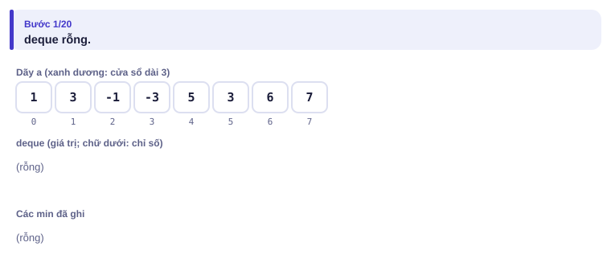
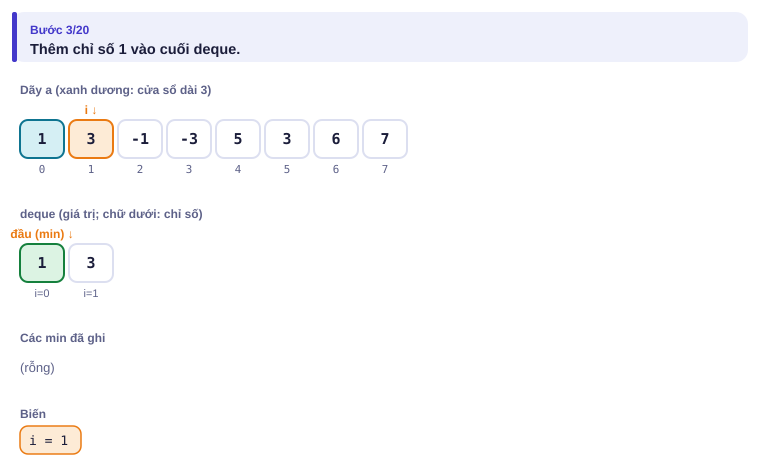

</details>

<details>
<summary><b>Bước 2</b> – Thêm −1: bỏ ở cuối những phần tử nào? Min cửa sổ đầu tiên?</summary>

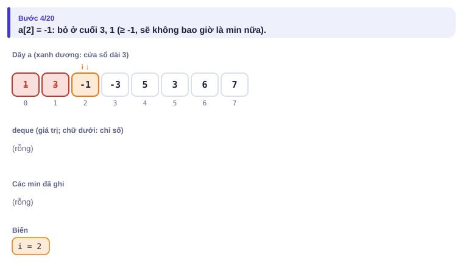
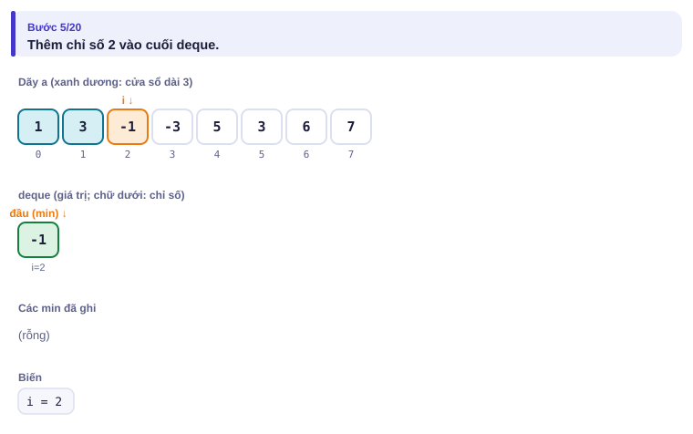
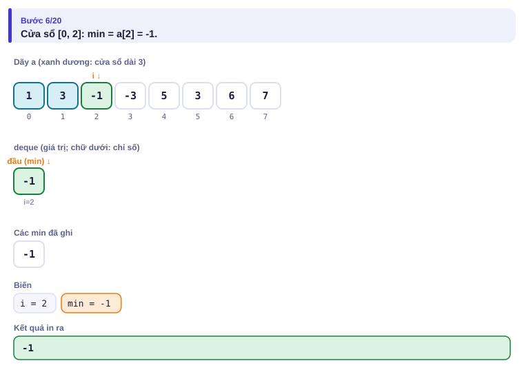

</details>

<details>
<summary><b>Bước 3</b> – Thêm −3 và 5</summary>

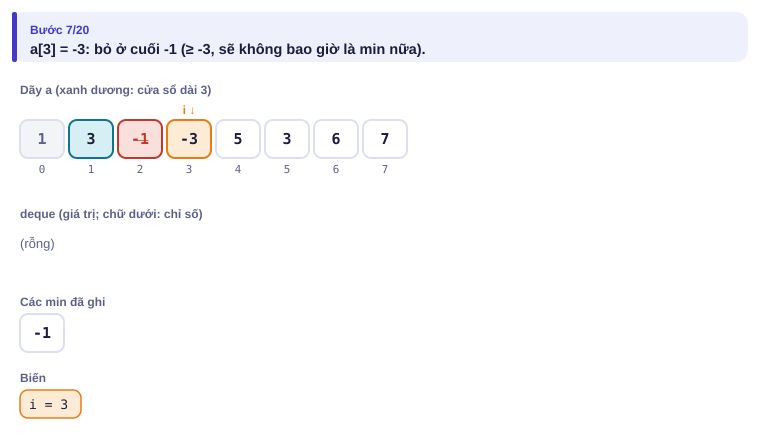
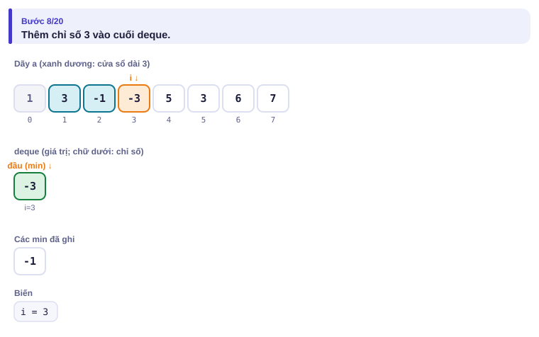
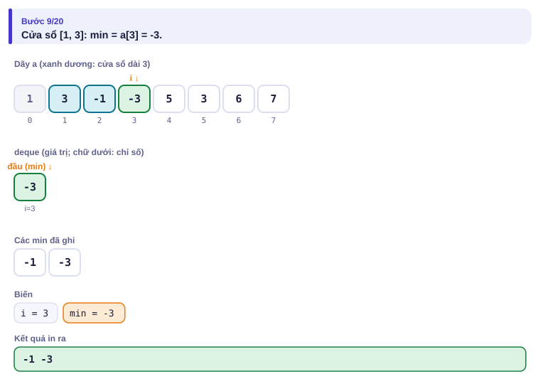
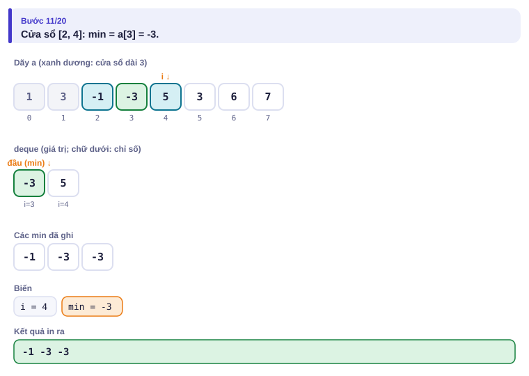

</details>

<details>
<summary><b>Bước 4</b> – Thêm 3: bỏ 5 ở cuối</summary>

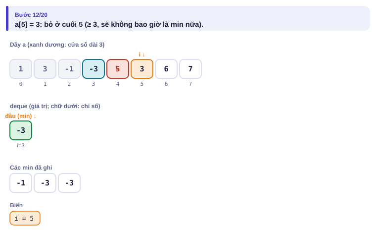
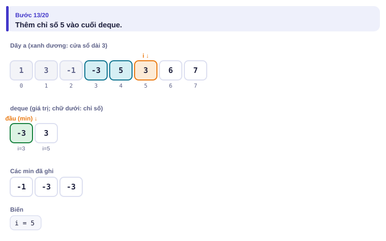
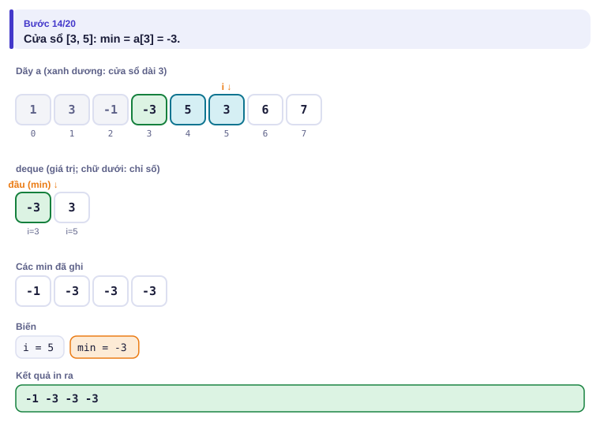

</details>

<details>
<summary><b>Bước 5</b> – Thêm 6: −3 hết hạn, bị bỏ ở đầu. Min mới là bao nhiêu?</summary>

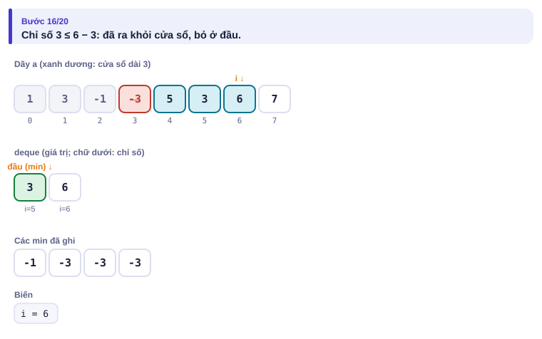
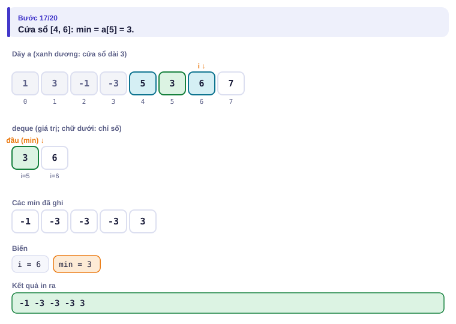

</details>

| i | a[i] | Bỏ cuối | Bỏ đầu (hết hạn) | deque (giá trị) | Min |
| :---: | :---: | --- | --- | --- | :---: |
| 0 | 1 | — | — | 1 | |
| 1 | 3 | — | — | 1 3 | |
| 2 | −1 | 3, 1 | — | −1 | −1 |
| 3 | −3 | −1 | — | −3 | −3 |
| 4 | 5 | — | — | −3 5 | −3 |
| 5 | 3 | 5 | — | −3 3 | −3 |
| 6 | 6 | — | −3 (chỉ số 3 ≤ 6 − 3) | 3 6 | 3 |
| 7 | 7 | — | — | 3 6 7 | 3 |

---

## 5. Mã giả và cài đặt

```text
dq ← deque rỗng (lưu chỉ số)
với i từ 0 tới n − 1:
    trong khi dq khác rỗng và a[cuối dq] ≥ a[i]: bỏ cuối dq
    thêm i vào cuối dq
    nếu đầu dq ≤ i − k: bỏ đầu dq
    nếu i ≥ k − 1: ghi a[đầu dq]
```

```cpp
// file: min_cua_so.cpp
#include <bits/stdc++.h>
using namespace std;
int main() {
    ios::sync_with_stdio(false);
    cin.tie(nullptr);
    int n, k;
    cin >> n >> k;
    vector<long long> a(n);
    for (auto &x : a) cin >> x;
    deque<int> dq;                                   // chỉ số, giá trị tăng dần
    vector<long long> kq;
    for (int i = 0; i < n; i++) {
        while (!dq.empty() && a[dq.back()] >= a[i]) dq.pop_back();
        dq.push_back(i);
        if (dq.front() <= i - k) dq.pop_front();     // ra khỏi cửa sổ [i-k+1, i]
        if (i >= k - 1) kq.push_back(a[dq.front()]);
    }
    for (size_t i = 0; i < kq.size(); i++) cout << kq[i] << (i + 1 == kq.size() ? '\n' : ' ');
}
```

```python
# file: min_cua_so.py
import sys
from collections import deque
data = sys.stdin.buffer.read().split()
n, k = int(data[0]), int(data[1])
a = list(map(int, data[2:2 + n]))
dq = deque()
kq = []
for i in range(n):
    while dq and a[dq[-1]] >= a[i]:
        dq.pop()
    dq.append(i)
    if dq[0] <= i - k:
        dq.popleft()
    if i >= k - 1:
        kq.append(a[dq[0]])
print(*kq)
```

### Sparse table: min của đoạn bất kỳ

Bài [Static Range Minimum Queries](https://cses.fi/problemset/task/1647): n ≤ 2·10⁵, q ≤ 2·10⁵ câu hỏi min(a[l..r]) với l, r **bất kỳ** (không trượt đều như cửa sổ), mảng không đổi.

| Vào | Ra |
| --- | --- |
| `8 4`<br>`3 2 4 5 1 1 5 3`<br>`2 4`<br>`5 6`<br>`1 8`<br>`3 3` | `2`<br>`1`<br>`1`<br>`4` |

Ý tưởng: tính sẵn min của mọi đoạn có độ dài là **lũy thừa của 2**. `sp[j][i]` là min của 2ʲ phần tử bắt đầu tại i:

- sp[0][i] = a[i];
- sp[j][i] = min(sp[j−1][i], sp[j−1][i + 2ʲ⁻¹]): đoạn dài 2ʲ là hai nửa dài 2ʲ⁻¹.

Trả lời [l, r]: gọi k là số lớn nhất với 2ᵏ ≤ độ dài. Hai đoạn dài 2ᵏ, một bắt đầu ở l, một kết thúc ở r, **phủ kín** [l, r]. Chúng có thể chồng lên nhau, không sao vì min(x, x) = x.

```
l                               r
|<----- 2^k ----->|
             |<----- 2^k ----->|
```

<details>
<summary><b>Hình</b> – xây bảng và trả lời hai câu hỏi (mở lần lượt; đoán k trước)</summary>

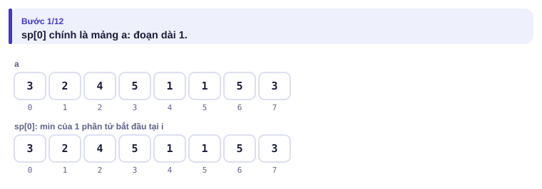
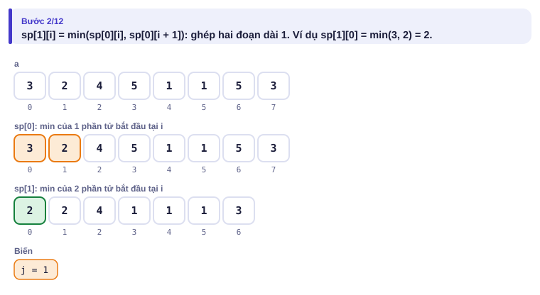
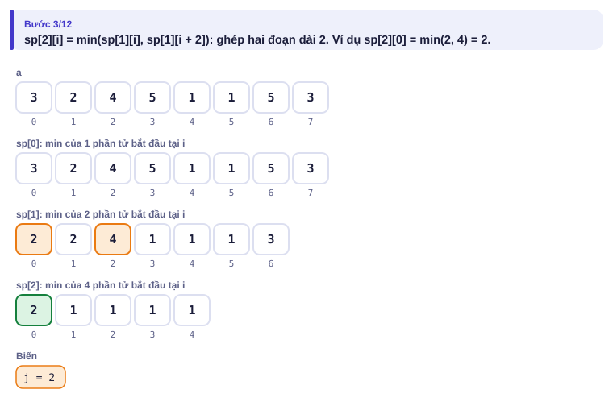
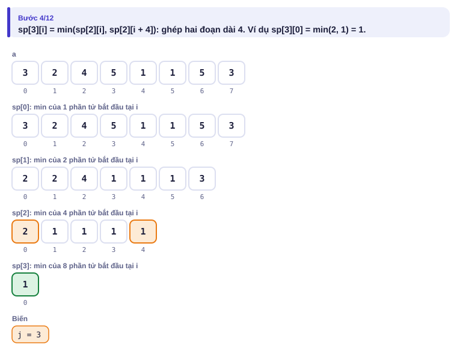
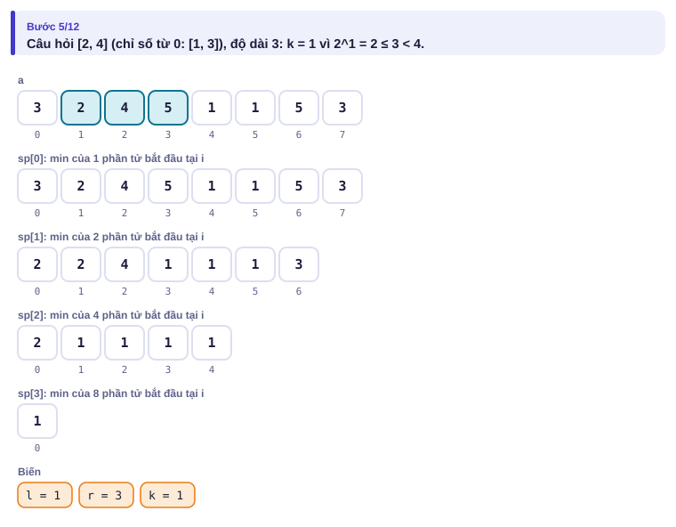
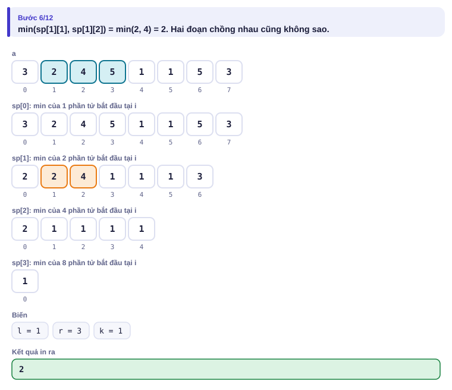
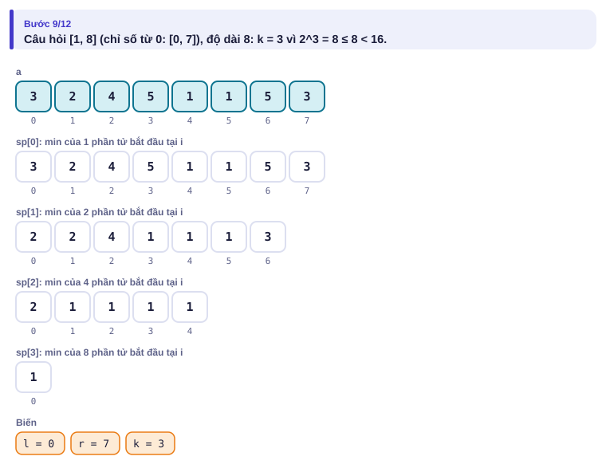
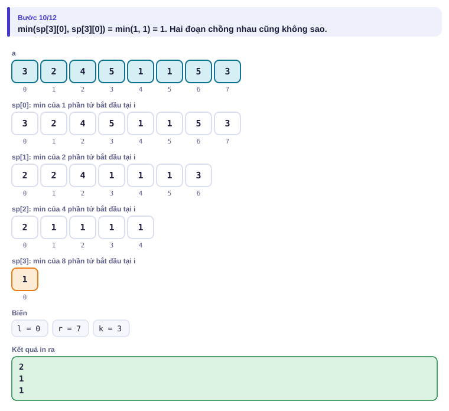

</details>

```cpp
// file: rmq.cpp
#include <bits/stdc++.h>
using namespace std;
int main() {
    ios::sync_with_stdio(false);
    cin.tie(nullptr);
    int n, q;
    cin >> n >> q;
    int LOG = 1;
    while ((1 << LOG) <= n) LOG++;
    vector<vector<long long>> sp(LOG, vector<long long>(n));
    for (auto &x : sp[0]) cin >> x;
    for (int j = 1; j < LOG; j++)
        for (int i = 0; i + (1 << j) <= n; i++)
            sp[j][i] = min(sp[j - 1][i], sp[j - 1][i + (1 << (j - 1))]);
    while (q--) {
        int l, r;
        cin >> l >> r;
        l--; r--;                                   // về chỉ số từ 0
        int k = __lg(r - l + 1);                    // 2^k <= độ dài
        cout << min(sp[k][l], sp[k][r - (1 << k) + 1]) << '\n';
    }
}
```

```python
# file: rmq.py
import sys
data = sys.stdin.buffer.read().split()
n, q = int(data[0]), int(data[1])
sp = [list(map(int, data[2:2 + n]))]
j = 1
while (1 << j) <= n:
    prev, h = sp[-1], 1 << (j - 1)
    sp.append([min(prev[i], prev[i + h]) for i in range(n - (1 << j) + 1)])
    j += 1
out = []
pos = 2 + n
for _ in range(q):
    l, r = int(data[pos]) - 1, int(data[pos + 1]) - 1
    pos += 2
    k = (r - l + 1).bit_length() - 1             # 2^k <= độ dài
    row = sp[k]
    out.append(min(row[l], row[r - (1 << k) + 1]))
print("\n".join(map(str, out)))
```

> [!NOTE]
> **Xây tường 60%.** Lời giải đệ quy ở bài 1.6 tìm min của đoạn bằng cách quét lại: O(N²). Thay bằng sparse table thì mỗi lần tìm min là O(1). Lời giải 100% vẫn là ngăn xếp đơn điệu ở bài 2.4.

---

## 6. Vì sao đúng, chạy bao lâu

- **Hàng đợi đơn điệu đúng:** một chỉ số bị bỏ ở cuối vì có phần tử nhỏ hơn hoặc bằng đứng sau nó; phần tử sau đó ở lại cửa sổ ít nhất lâu bằng, nên chỉ số bị bỏ không bao giờ là min duy nhất. Các chỉ số còn lại tăng dần theo giá trị, nên đầu deque (sau khi bỏ chỉ số hết hạn) là min.
- **Hàng đợi đơn điệu nhanh:** mỗi chỉ số vào deque một lần và ra tối đa một lần (ở cuối hoặc ở đầu): tổng O(n), dù có `while` trong `for` (khấu hao, như bài 1.5 và 2.4).
- **Sparse table:** chuẩn bị log₂ n tầng, mỗi tầng O(n): O(n log n) thời gian và bộ nhớ. Mỗi câu hỏi hai lần tra bảng: O(1). Với n = 2·10⁵, bảng có 18 tầng, khoảng 3,6·10⁶ số.

---

## 7. Bẫy thường gặp

> [!WARNING]
> **Bẫy 1: deque lưu giá trị thay vì chỉ số.** Khi đó không biết phần tử nào đã ra khỏi cửa sổ (nhất là khi có giá trị trùng). Luôn lưu chỉ số.
> *Test phá:* ví dụ "dãy tăng" trên trang mô phỏng: phần tử đầu deque phải bị bỏ vì hết hạn.

> [!WARNING]
> **Bẫy 2: bỏ đầu bằng `if` khi cửa sổ có thể trượt nhiều hơn một ô.** Ở đây mỗi bước i tăng 1 nên `if` là đủ. Trong các bài "cửa sổ co giãn" (Ví dụ 3), phải dùng `while`.

> [!WARNING]
> **Bẫy 3: sparse table trên mảng thay đổi.** Sparse table chỉ dùng được khi mảng **không đổi**. Có cập nhật thì cần cây phân đoạn (Tập 3).

> [!WARNING]
> **Bẫy 4: dùng sparse table O(1) cho tổng.** Hai đoạn chồng nhau làm phần giữa bị cộng hai lần. Kiểu trả lời O(1) này chỉ đúng cho phép mà chồng đoạn không sao: min, max, ƯCLN, AND, OR. Tổng thì dùng tiền tố.
> *Test phá:* `1 1 1`, hỏi tổng [1, 3]: hai đoạn dài 2 cho 2 + 2 = 4 thay vì 3.

---

## 8. Ví dụ giảm dần hỗ trợ

### Ví dụ 2 – Điền vào chỗ trống: Max trên cửa sổ

In **max** của mọi cửa sổ k phần tử.

| Vào | Ra |
| --- | --- |
| `8 3`<br>`4 2 12 3 5 1 6 7` | `12 12 12 5 6 7` |

```cpp
for (int i = 0; i < n; i++) {
    while (!dq.empty() && a[dq.back()] ____ a[i]) dq.pop_back();
    dq.push_back(i);
    if (dq.front() ____ i - k) dq.pop_front();
    if (i >= k - 1) cout << a[dq.front()] << ' ';
}
```

<details>
<summary>Đáp án</summary>

`<=` (giá trị trong deque giờ **giảm** dần; phần tử nhỏ hơn hoặc bằng đứng trước bị đè) và `<=` (điều kiện hết hạn không đổi).

```cpp
// file: max_cua_so.cpp
#include <bits/stdc++.h>
using namespace std;
int main() {
    ios::sync_with_stdio(false);
    cin.tie(nullptr);
    int n, k;
    cin >> n >> k;
    vector<long long> a(n);
    for (auto &x : a) cin >> x;
    deque<int> dq;
    for (int i = 0; i < n; i++) {
        while (!dq.empty() && a[dq.back()] <= a[i]) dq.pop_back();
        dq.push_back(i);
        if (dq.front() <= i - k) dq.pop_front();
        if (i >= k - 1) cout << a[dq.front()] << (i + 1 == n ? '\n' : ' ');
    }
}
```

</details>

### Ví dụ 3 – Tự làm: Đoạn ổn định dài nhất

Cho n số (n ≤ 2·10⁵) và k ≥ 0. Tìm độ dài đoạn liên tiếp dài nhất có **max − min ≤ k**.

| Vào | Ra |
| --- | --- |
| `8 2`<br>`5 3 4 6 9 8 7 10` | `3` |

Đoạn `9 8 7` có max − min = 2.

> [!IMPORTANT]
> Tự làm trước. Gợi ý: hai con trỏ (bài 1.5): thêm phải, khi max − min > k thì đẩy trái. Cần biết max và min của cửa sổ **co giãn**: dùng **hai** hàng đợi đơn điệu, một cho max, một cho min. Đẩy l thì bỏ ở đầu các chỉ số < l (Bẫy 2).

<details>
<summary>Lời giải</summary>

Mỗi chỉ số vào/ra mỗi deque tối đa một lần, l và r chỉ tiến: O(n).

```cpp
// file: doan_on_dinh.cpp
#include <bits/stdc++.h>
using namespace std;
int main() {
    ios::sync_with_stdio(false);
    cin.tie(nullptr);
    int n;
    long long k;
    cin >> n >> k;
    vector<long long> a(n);
    for (auto &x : a) cin >> x;
    deque<int> mx, mn;                 // mx: giá trị giảm dần, mn: tăng dần
    int l = 0, best = 0;
    for (int r = 0; r < n; r++) {
        while (!mx.empty() && a[mx.back()] <= a[r]) mx.pop_back();
        while (!mn.empty() && a[mn.back()] >= a[r]) mn.pop_back();
        mx.push_back(r); mn.push_back(r);
        while (a[mx.front()] - a[mn.front()] > k) {
            l++;
            while (mx.front() < l) mx.pop_front();
            while (mn.front() < l) mn.pop_front();
        }
        best = max(best, r - l + 1);
    }
    cout << best << '\n';
}
```

</details>

---

## 9. Bài tập

| Nấc | Bài | Nguồn | Ý chính |
| --- | --- | --- | --- |
| Khởi động | [Static Range Minimum Queries](https://cses.fi/problemset/task/1647) | CSES 1647 | Đúng mục 5 |
| Khởi động | [Sliding Window Maximum](https://leetcode.com/problems/sliding-window-maximum/) | LeetCode 239 | Ví dụ 2 |
| Luyện | Xây tường 60%: ghép lời giải đệ quy bài 1.6 với sparse table, so với lời giải 100% bằng stress test (bài 1.9) | Tự luyện | Lắp ghép kiến thức |
| Luyện | [Longest Continuous Subarray With Absolute Diff ≤ Limit](https://leetcode.com/problems/longest-continuous-subarray-with-absolute-diff-less-than-or-equal-to-limit/) | LeetCode 1438 | Ví dụ 3 |
| Thử thách | [Maximum Subarray Sum II](https://cses.fi/problemset/task/1644) | CSES 1644 | Giống bài Kỳ hạn bên dưới |
| Kiểu đề thi | Kỳ hạn gửi tiền | Bài của sách, chấm theo subtask | Xem bên dưới |

### Bài kiểu đề thi: Kỳ hạn gửi tiền

**Đề bài.** Quỹ khuyến học của trường ghi lãi/lỗ của n tháng liên tiếp: tháng i là aᵢ (có thể âm, |aᵢ| ≤ 10⁹, n ≤ 2·10⁵). Quỹ muốn chọn một **kỳ hạn** là một đoạn tháng liên tiếp có độ dài từ A tới B tháng (1 ≤ A ≤ B ≤ n) sao cho tổng lãi lớn nhất. In tổng lãi đó. Đọc từ `KYHAN.INP` (dòng đầu n A B, dòng sau n số), ghi ra `KYHAN.OUT`.

Subtask: 40% có n ≤ 5000; 60% còn lại có n ≤ 2·10⁵.

| KYHAN.INP | KYHAN.OUT |
| --- | --- |
| `8 2 4`<br>`4 -6 3 -1 5 -9 2 7` | `9` |

Đoạn `2 7` (tháng 7, 8) dài 2 có tổng 9. Đoạn `3 -1 5` có tổng 7.

<details>
<summary><b>Gợi ý 1</b> – hướng đi (đủ 40% điểm)</summary>

Tổng tiền tố p (bài 1.3): tổng đoạn (j, r] là p[r] − p[j]. Thử mọi cặp (j, r) với A ≤ r − j ≤ B: O(n · (B − A)), tệ nhất O(n²) = 2,5·10⁷ với n = 5000.

</details>

<details>
<summary><b>Gợi ý 2</b> – ý then chốt</summary>

Cố định r. Ta cần p[r] − min{p[j] : r − B ≤ j ≤ r − A}. Khi r tăng 1, đoạn chỉ số j được phép cũng trượt sang phải 1: đó là **min trên cửa sổ trượt** của dãy p. Mỗi bước, thêm j = r − A vào deque, bỏ ở đầu các j < r − B.

</details>

<details>
<summary><b>Gợi ý 3</b> – lời giải đầy đủ</summary>

O(n). Đáp án có thể âm (mọi tháng đều lỗ), nên khởi tạo `best` bằng giá trị rất nhỏ.

```cpp
// file: kyhan.cpp
#include <bits/stdc++.h>
using namespace std;
int main() {
    freopen("KYHAN.INP", "r", stdin);
    freopen("KYHAN.OUT", "w", stdout);
    int n, A, B;
    scanf("%d %d %d", &n, &A, &B);
    vector<long long> p(n + 1, 0);
    for (int i = 1; i <= n; i++) { long long x; scanf("%lld", &x); p[i] = p[i - 1] + x; }
    deque<int> dq;                                   // chỉ số j, p[j] tăng dần
    long long best = LLONG_MIN;
    for (int r = A; r <= n; r++) {
        int j = r - A;                               // chỉ số mới được phép
        while (!dq.empty() && p[dq.back()] >= p[j]) dq.pop_back();
        dq.push_back(j);
        if (dq.front() < r - B) dq.pop_front();      // quá xa: đoạn dài hơn B
        best = max(best, p[r] - p[dq.front()]);
    }
    printf("%lld\n", best);
}
```

```python
# file: kyhan.py
from collections import deque
with open("KYHAN.INP") as f:
    data = f.read().split()
n, A, B = int(data[0]), int(data[1]), int(data[2])
p = [0] * (n + 1)
for i in range(1, n + 1):
    p[i] = p[i - 1] + int(data[2 + i])
dq = deque()
best = None
for r in range(A, n + 1):
    j = r - A
    while dq and p[dq[-1]] >= p[j]:
        dq.pop()
    dq.append(j)
    if dq[0] < r - B:
        dq.popleft()
    v = p[r] - p[dq[0]]
    if best is None or v > best:
        best = v
with open("KYHAN.OUT", "w") as f:
    f.write(f"{best}\n")
```

</details>

---

## 10. Tóm tắt, flashcard và checkpoint

**Tóm tắt trong 5 dòng.**

1. Min không có phép ngược, nên tiền tố không dùng được cho min.
2. Min trên cửa sổ trượt: deque chỉ số, giá trị tăng dần; bỏ cuối khi bị đè, bỏ đầu khi hết hạn; O(n).
3. Max: đảo chiều so sánh. Cửa sổ co giãn: bỏ đầu bằng `while`.
4. Min đoạn bất kỳ trên mảng không đổi: sparse table, chuẩn bị O(n log n), mỗi câu hỏi O(1).
5. Sparse table O(1) chỉ cho phép "chồng đoạn không sao": min, max, ƯCLN, AND, OR.

**Flashcard.**

<details><summary>Độ dài đoạn là 13 thì dùng hai đoạn con dài bao nhiêu?</summary>2³ = 8.</details>
<details><summary>Vì sao deque lưu chỉ số chứ không lưu giá trị?</summary>Để biết phần tử nào đã ra khỏi cửa sổ.</details>
<details><summary>Khi thêm a[i], bỏ ở cuối những chỉ số nào (bài min)?</summary>Những chỉ số có giá trị ≥ a[i].</details>
<details><summary>sp[j][i] tính từ đâu?</summary>min(sp[j−1][i], sp[j−1][i + 2^(j−1)]).</details>
<details><summary>Kỳ hạn gửi tiền: với mỗi r, cần min của p[j] trên đoạn nào?</summary>j từ r − B tới r − A.</details>

**Ôn xoắn ốc** (mỗi bài tối đa 20 phút):

- Viết lại bài Ngắm pháo hoa (bài 2.4) không nhìn sách, rồi so sánh với hàng đợi đơn điệu.
- [Sum of Two Values](https://cses.fi/problemset/task/1640) (CSES 1640): hai con trỏ (bài 1.5).
- Viết lại Ví dụ 2 của bài 2.5 (tổng tập con bằng bitset).

**Checkpoint – em đã sẵn sàng sang bài tiếp theo nếu:**

- [ ] Viết hàng đợi đơn điệu không nhìn sách, đúng cả ba ví dụ trên trang mô phỏng.
- [ ] AC [Static Range Minimum Queries](https://cses.fi/problemset/task/1647).
- [ ] Làm xong Ví dụ 3 (Đoạn ổn định dài nhất) mà không mở lời giải.
- [ ] Đạt trọn điểm bài Kỳ hạn gửi tiền khi tự làm trong 30 phút.

Chưa đạt? Nếu vướng ô 1, chạy trang mô phỏng hàng đợi đơn điệu với Đoán trước và đọc lại mục 6. Nếu vướng ô 2, chạy trang Sparse table với các câu hỏi của em. Nếu vướng ô 3 hoặc 4, làm lại Ví dụ 2 rồi đọc lại Bẫy 2.
