# Bài 2.7 – Đồ thị: BFS và DFS

> **Tập 2 · Cấu trúc dữ liệu và quy hoạch động cơ bản**
> Cần biết trước: bài 2.1 (hàng đợi, ngăn xếp), bài 1.6 (đệ quy), bài 1.7 (gộp trạng thái trên lưới).
> Thời lượng: khoảng 2 giờ đọc, cộng 10 giờ thực hành (2 tuần).

**Học xong bài này, em sẽ:**

- biểu diễn đồ thị bằng **danh sách kề**, và nhìn lưới ô vuông như một đồ thị;
- tìm **đường đi ngắn nhất** (ít cạnh nhất) bằng **BFS**, cả từ một nguồn lẫn từ nhiều nguồn;
- đếm **thành phần liên thông** bằng **DFS** không đệ quy;
- chọn đúng BFS hay DFS cho từng bài;
- giải trọn bài kiểu đề thi **Lan tin**.

> [!TIP]
> **Học cùng hai trang mô phỏng.** [BFS trên lưới](../../mo-phong/t2-bfs-luoi.html): xem các con số lan theo từng lớp; thử ví dụ "không tới được". [DFS đếm thành phần](../../mo-phong/t2-dfs.html): thử ví dụ "có chu trình" và bật **Đoán trước**.

---

## 1. Bài toán mở màn: Mê cung

Bản đồ R × C gồm `#` (tường), `.` (đường), `A` (xuất phát), `B` (đích). Mỗi bước đi sang một ô kề cạnh. Ít nhất bao nhiêu bước để từ A tới B? In −1 nếu không tới được. (R, C ≤ 1000)

| Vào | Ra |
| --- | --- |
| `5 8`<br>`########`<br>`#.A#...#`<br>`#.##.#B#`<br>`#......#`<br>`########` | `9` |

---

## 2. Dừng lại 10 phút

> [!IMPORTANT]
> **Dừng lại và nghĩ.**
> 1. Hãy tô số lên các ô của ví dụ: ô A là 0, các ô đi tới được sau 1 bước ghi 1, sau 2 bước ghi 2… Em tô theo thứ tự nào để mỗi ô được ghi đúng số bước **ít nhất**?
> 2. Một ô đã được ghi số rồi, có bao giờ cần sửa thành số nhỏ hơn không, nếu em tô theo thứ tự ở câu 1?
> 3. Thứ tự "ô phát hiện trước thì xử lý trước" giống cấu trúc dữ liệu nào ở bài 2.1?

<details>
<summary>Đáp án</summary>

1. Tô theo **từng lớp**: xong mọi ô số 0, rồi mọi ô số 1, rồi số 2… Từ mỗi ô số k, ghi k + 1 vào các ô kề chưa có số.
2. Không: khi tới lớp k + 1 thì mọi ô gần hơn đã có số rồi. Mỗi ô chỉ cần ghi **một lần**.
3. Hàng đợi (vào trước ra trước). Đây là **BFS**: tìm kiếm theo chiều rộng (*breadth-first search*).

</details>

---

## 3. Lời giải ngây thơ và vì sao nó chậm

An dùng quay lui (bài 1.7): từ A thử đi mọi hướng, đánh dấu ô đang đi qua, tới B thì cập nhật kết quả nhỏ nhất, rồi lùi lại. Đúng, nhưng số **đường đi** trong lưới trống tăng theo hàm mũ: lưới 6 × 6 đã có hàng triệu đường đi đơn từ góc này sang góc kia. Lãng phí: cùng một ô bị đi tới qua rất nhiều đường khác nhau, mà ta chỉ cần biết đường **ngắn nhất** tới nó. Giống bài Tàu ngầm (bài 1.7): đừng theo dõi từng đường, hãy theo dõi từng **ô**.

---

## 4. Ý tưởng then chốt

> [!IMPORTANT]
> **BFS: đặt d[A] = 0, đưa A vào hàng đợi. Lặp: lấy ô u ở đầu hàng; với mỗi ô kề v chưa có d, ghi d[v] = d[u] + 1 và đưa v vào cuối hàng. Mỗi ô vào hàng đợi đúng một lần, nên O(R·C).**

**Đồ thị** gồm **đỉnh** và **cạnh** nối hai đỉnh. Lưới là một đồ thị "ngầm": mỗi ô không phải tường là một đỉnh, hai ô kề cạnh có cạnh nối. Ta không cần lưu cạnh, chỉ cần thử 4 hướng.

### Chạy từng bước

Với mê cung ví dụ. Đoán trước các con số rồi mới mở.

<details>
<summary><b>Bước 1</b> – Ô A</summary>

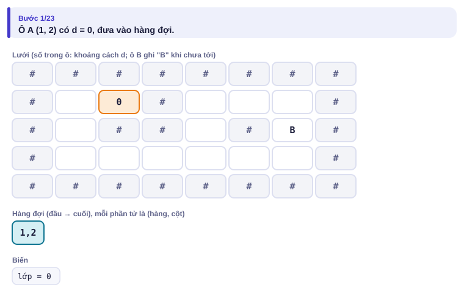

</details>

<details>
<summary><b>Bước 2</b> – Lớp 1 và lớp 2: những ô nào?</summary>

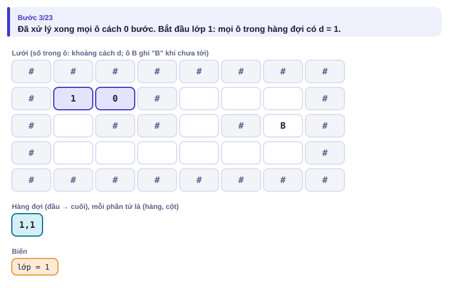
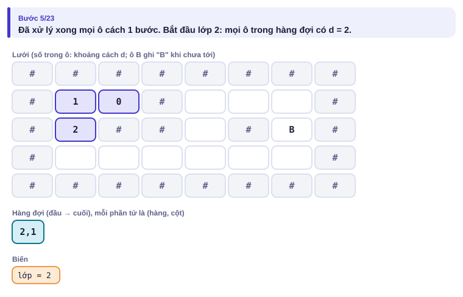

</details>

<details>
<summary><b>Bước 3</b> – Lớp 3 rồi lớp 6: các con số lan tới đâu?</summary>

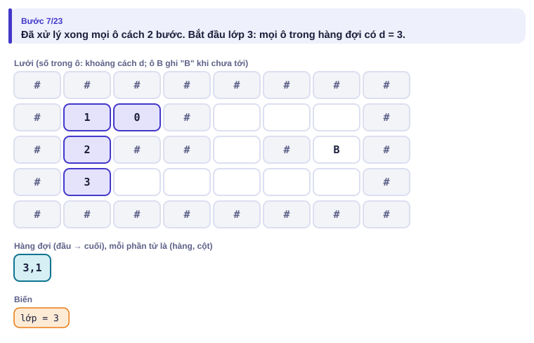
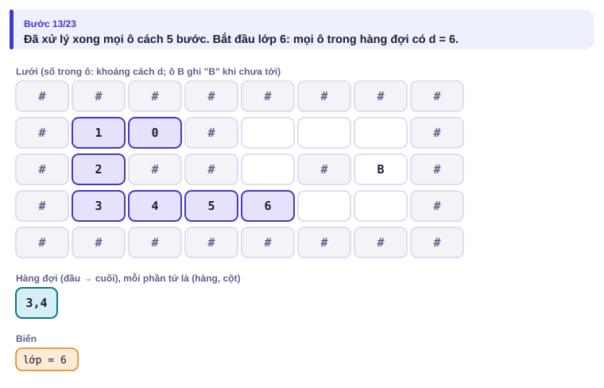

</details>

<details>
<summary><b>Bước 4</b> – Lớp 9: ô B đã có số chưa?</summary>

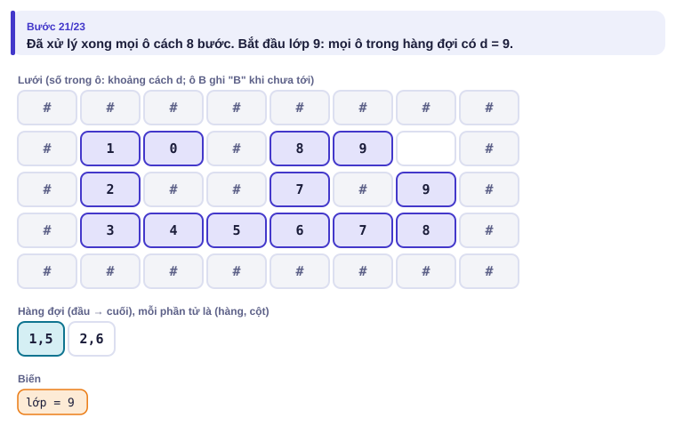
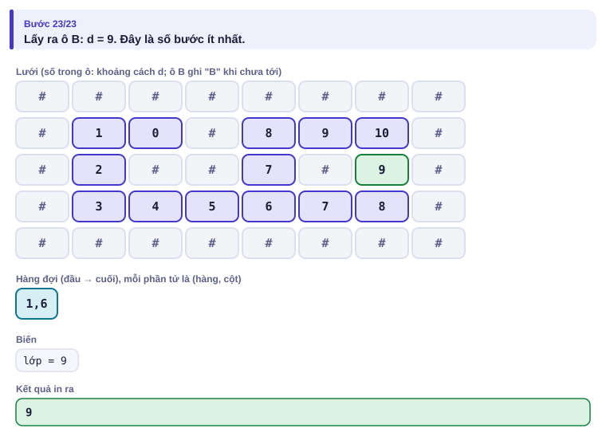

</details>

Các con số BFS ghi lên mê cung (A ở hàng 1, cột 2, đếm từ 0):

```
 #  #  #  #  #  #  #  #
 #  1  0  #  8  9 10  #
 #  2  #  #  7  #  9  #      ← ô B: d = 9
 #  3  4  5  6  7  8  #
 #  #  #  #  #  #  #  #
```

---

## 5. Mã giả và cài đặt

```text
d[mọi ô] ← −1; d[A] ← 0; đưa A vào hàng đợi
trong khi hàng đợi không rỗng:
    lấy u ở đầu hàng
    nếu u là B: in d[u]; dừng
    với mỗi ô v kề u, trong lưới, không phải tường, d[v] = −1:
        d[v] ← d[u] + 1; đưa v vào cuối hàng
in −1
```

```cpp
// file: me_cung.cpp
#include <bits/stdc++.h>
using namespace std;
int main() {
    int R, C;
    cin >> R >> C;
    vector<string> g(R);
    for (auto &row : g) cin >> row;
    vector<vector<int>> d(R, vector<int>(C, -1));
    queue<pair<int, int>> q;
    for (int i = 0; i < R; i++)
        for (int j = 0; j < C; j++)
            if (g[i][j] == 'A') { d[i][j] = 0; q.push({i, j}); }
    int di[] = {1, -1, 0, 0}, dj[] = {0, 0, 1, -1};
    while (!q.empty()) {
        auto [i, j] = q.front(); q.pop();
        if (g[i][j] == 'B') { cout << d[i][j] << '\n'; return 0; }
        for (int h = 0; h < 4; h++) {
            int ni = i + di[h], nj = j + dj[h];
            if (ni < 0 || ni >= R || nj < 0 || nj >= C) continue;
            if (g[ni][nj] == '#' || d[ni][nj] != -1) continue;
            d[ni][nj] = d[i][j] + 1;            // đánh dấu ngay khi đưa vào
            q.push({ni, nj});
        }
    }
    cout << -1 << '\n';
}
```

```python
# file: me_cung.py
import sys
from collections import deque
data = sys.stdin.read().split()
R, C = int(data[0]), int(data[1])
g = data[2:2 + R]
d = [[-1] * C for _ in range(R)]
q = deque()
for i in range(R):
    j = g[i].find('A')
    if j >= 0:
        d[i][j] = 0
        q.append((i, j))
ans = -1
while q:
    i, j = q.popleft()
    if g[i][j] == 'B':
        ans = d[i][j]
        break
    for ni, nj in ((i + 1, j), (i - 1, j), (i, j + 1), (i, j - 1)):
        if 0 <= ni < R and 0 <= nj < C and g[ni][nj] != '#' and d[ni][nj] == -1:
            d[ni][nj] = d[i][j] + 1
            q.append((ni, nj))
print(ans)
```

### Đồ thị cho bằng danh sách cạnh

Nhiều bài cho đồ thị dạng n đỉnh, m cạnh (u, v). Lưu bằng **danh sách kề**: `adj[u]` chứa mọi đỉnh nối với u. Bộ nhớ O(n + m); duyệt hàng xóm của u tốn O(số hàng xóm).

```cpp
vector<vector<int>> adj(n + 1);
for (int i = 0; i < m; i++) {
    int u, v;
    cin >> u >> v;
    adj[u].push_back(v);
    adj[v].push_back(u);      // đồ thị vô hướng: thêm cả hai chiều
}
```

| | C++ | Python |
| --- | --- | --- |
| khai báo | `vector<vector<int>> adj(n + 1);` | `adj = [[] for _ in range(n + 1)]` |
| thêm cạnh | `adj[u].push_back(v);` | `adj[u].append(v)` |
| duyệt hàng xóm | `for (int v : adj[u])` | `for v in adj[u]:` |

### DFS: đếm thành phần liên thông

Thành phố có n nút giao (1..n) và m con đường hai chiều. Một **thành phần liên thông** là một nhóm nút đi lại được với nhau. Đếm số thành phần. (n, m ≤ 2·10⁵)

| Vào | Ra |
| --- | --- |
| `5 3`<br>`1 2`<br>`2 3`<br>`4 5` | `2` |

**DFS** (tìm kiếm theo chiều sâu, *depth-first search*): từ một đỉnh chưa thăm, đi sâu hết mức, đánh dấu mọi đỉnh gặp được. Mỗi lần bắt đầu DFS từ một đỉnh chưa thăm là gặp **một thành phần mới**. Ở đây ta dùng ngăn xếp tự quản thay cho đệ quy (Bẫy 2).

<details>
<summary><b>Hình</b> – DFS trên ví dụ (mở lần lượt)</summary>

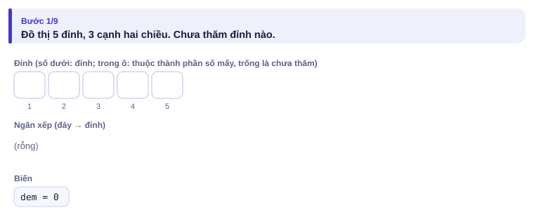
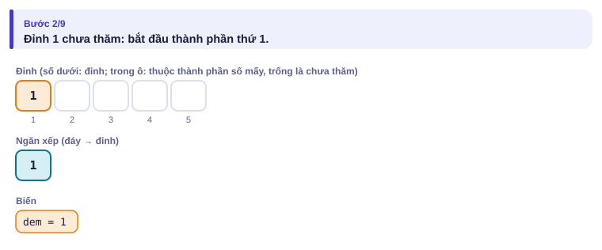
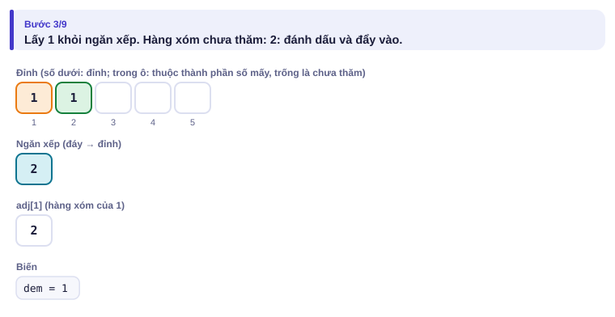
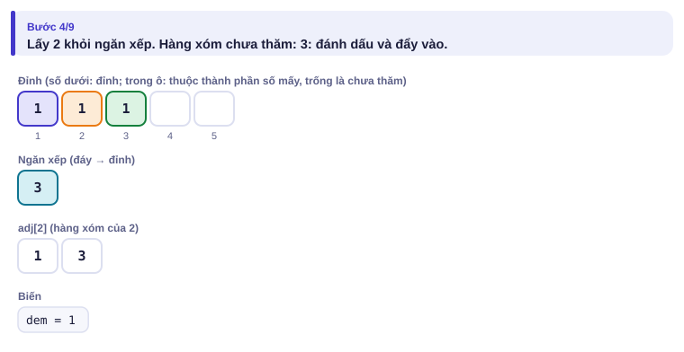
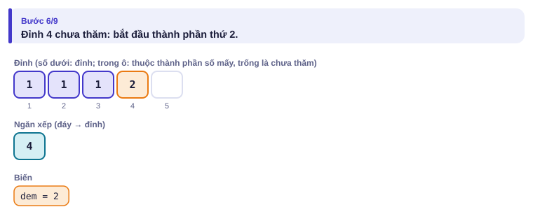
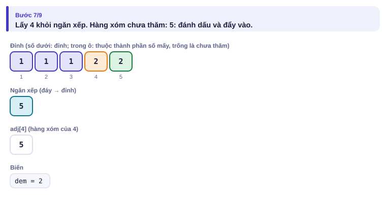
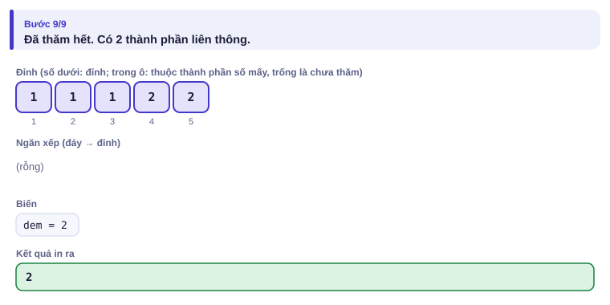

</details>

```cpp
// file: dem_tplt.cpp
#include <bits/stdc++.h>
using namespace std;
int main() {
    ios::sync_with_stdio(false);
    cin.tie(nullptr);
    int n, m;
    cin >> n >> m;
    vector<vector<int>> adj(n + 1);
    for (int i = 0; i < m; i++) {
        int u, v;
        cin >> u >> v;
        adj[u].push_back(v);
        adj[v].push_back(u);
    }
    vector<bool> tham(n + 1, false);
    int dem = 0;
    for (int s = 1; s <= n; s++) {
        if (tham[s]) continue;
        dem++;                                  // thành phần mới
        stack<int> st;                          // DFS bằng ngăn xếp, tránh đệ quy quá sâu
        st.push(s);
        tham[s] = true;
        while (!st.empty()) {
            int u = st.top(); st.pop();
            for (int v : adj[u])
                if (!tham[v]) { tham[v] = true; st.push(v); }
        }
    }
    cout << dem << '\n';
}
```

```python
# file: dem_tplt.py
import sys
data = sys.stdin.buffer.read().split()
n, m = int(data[0]), int(data[1])
adj = [[] for _ in range(n + 1)]
for i in range(m):
    u, v = int(data[2 + 2 * i]), int(data[3 + 2 * i])
    adj[u].append(v)
    adj[v].append(u)
tham = [False] * (n + 1)
dem = 0
for s in range(1, n + 1):
    if tham[s]:
        continue
    dem += 1
    tham[s] = True
    st = [s]
    while st:
        u = st.pop()
        for v in adj[u]:
            if not tham[v]:
                tham[v] = True
                st.append(v)
print(dem)
```

> [!NOTE]
> **BFS hay DFS?** Cần **khoảng cách ngắn nhất** theo số cạnh: BFS. Chỉ cần biết **đi tới được không**, đếm thành phần, tô màu: cả hai đều được; DFS viết ngắn hơn. Đường có độ dài khác nhau (cạnh có trọng số) cần Dijkstra ở Tập 3.

---

## 6. Vì sao đúng, chạy bao lâu

- **BFS đúng:** hàng đợi luôn có dạng "vài ô có d = k, rồi vài ô có d = k + 1". Vì vậy mọi ô cách k bước được lấy ra trước mọi ô cách k + 1 bước. Một ô v được ghi số lần đầu từ ô u có d[u] nhỏ nhất trong các hàng xóm của v, nên d[v] = d[u] + 1 là ngắn nhất.
- **DFS đúng:** từ s, mọi đỉnh đi tới được đều sẽ được đẩy vào ngăn xếp (qua một đường đi từ s), và không có đỉnh nào ngoài thành phần của s được đẩy vào.
- **Chạy bao lâu:** mỗi đỉnh vào hàng đợi/ngăn xếp một lần; mỗi cạnh được xét hai lần (từ hai đầu). Tổng **O(n + m)**; trên lưới là O(R·C).

---

## 7. Bẫy thường gặp

> [!WARNING]
> **Bẫy 1: đánh dấu khi lấy ra thay vì khi đưa vào.** Nếu chỉ đánh dấu lúc lấy khỏi hàng đợi, một ô có thể bị đưa vào nhiều lần (từ nhiều hàng xóm), chậm đi rất nhiều và có thể tràn bộ nhớ.
> *Test phá:* lưới 1000 × 1000 không có tường.

> [!WARNING]
> **Bẫy 2: DFS đệ quy trên đồ thị lớn.** Đường đi dài 10⁵ đỉnh làm đệ quy sâu 10⁵ tầng: Python báo lỗi `RecursionError`, C++ có thể tràn ngăn xếp gọi hàm (bài 1.6). Dùng ngăn xếp tự quản.
> *Test phá:* đồ thị đường thẳng 1–2–3–…–200000.

> [!WARNING]
> **Bẫy 3: quên cạnh hai chiều.** Đường hai chiều phải thêm vào cả `adj[u]` và `adj[v]`.
> *Test phá:* `3 1` / `3 1`: nếu chỉ thêm `adj[3]`, DFS từ đỉnh 1 không thấy đỉnh 3, kết quả 3 thay vì 2.

> [!WARNING]
> **Bẫy 4: thứ tự kiểm tra biên.** Phải kiểm tra `ni`, `nj` nằm trong lưới **trước** khi đọc `g[ni][nj]`. C++ đọc ngoài mảng không báo lỗi mà cho rác.

---

## 8. Ví dụ giảm dần hỗ trợ

### Ví dụ 2 – Điền vào chỗ trống: Đường truyền tin

Mạng có n máy (2 ≤ n ≤ 10⁵) và m dây nối hai chiều. Tin nhắn đi từ máy 1 tới máy n qua ít dây nhất là bao nhiêu? In −1 nếu không tới được.

| Vào | Ra |
| --- | --- |
| `5 5`<br>`1 2`<br>`1 3`<br>`1 4`<br>`2 3`<br>`5 4` | `2` |

```cpp
vector<int> d(n + 1, -1);
queue<int> q;
d[1] = 0; q.push(1);
while (!q.empty()) {
    int u = q.front(); q.pop();
    for (int v : adj[u])
        if (d[v] == -1) { d[v] = ____; q.push(____); }
}
cout << d[n];
```

<details>
<summary>Đáp án</summary>

`d[u] + 1` và `v`. Đường ngắn nhất: 1 → 4 → 5.

```cpp
// file: truyen_tin.cpp
#include <bits/stdc++.h>
using namespace std;
int main() {
    ios::sync_with_stdio(false);
    cin.tie(nullptr);
    int n, m;
    cin >> n >> m;
    vector<vector<int>> adj(n + 1);
    for (int i = 0; i < m; i++) {
        int u, v;
        cin >> u >> v;
        adj[u].push_back(v);
        adj[v].push_back(u);
    }
    vector<int> d(n + 1, -1);
    queue<int> q;
    d[1] = 0; q.push(1);
    while (!q.empty()) {
        int u = q.front(); q.pop();
        for (int v : adj[u])
            if (d[v] == -1) { d[v] = d[u] + 1; q.push(v); }
    }
    cout << d[n] << '\n';
}
```

</details>

### Ví dụ 3 – Tự làm: Chia hai đội

Lớp có n bạn (n ≤ 10⁵) và m cặp bạn **không** muốn chung đội. Có chia được cả lớp thành hai đội sao cho mỗi cặp đó nằm ở hai đội khác nhau không? In `YES` hoặc `NO`.

| Vào | Ra |
| --- | --- |
| `5 3`<br>`1 2`<br>`1 3`<br>`4 5` | `YES` |
| `3 3`<br>`1 2`<br>`2 3`<br>`3 1` | `NO` |

> [!IMPORTANT]
> Tự làm trước. Gợi ý: tô màu đồ thị bằng BFS hoặc DFS. Đỉnh đầu mỗi thành phần tô màu 0; hàng xóm của một đỉnh màu c phải tô màu 1 − c. Gặp hàng xóm **đã tô cùng màu** là thua. Nhớ đồ thị có thể có nhiều thành phần.

<details>
<summary>Lời giải</summary>

```cpp
// file: hai_doi.cpp
#include <bits/stdc++.h>
using namespace std;
int main() {
    ios::sync_with_stdio(false);
    cin.tie(nullptr);
    int n, m;
    cin >> n >> m;
    vector<vector<int>> adj(n + 1);
    for (int i = 0; i < m; i++) {
        int u, v;
        cin >> u >> v;
        adj[u].push_back(v);
        adj[v].push_back(u);
    }
    vector<int> mau(n + 1, -1);
    bool ok = true;
    for (int s = 1; s <= n && ok; s++) {
        if (mau[s] != -1) continue;
        mau[s] = 0;
        queue<int> q;
        q.push(s);
        while (!q.empty() && ok) {
            int u = q.front(); q.pop();
            for (int v : adj[u]) {
                if (mau[v] == -1) { mau[v] = 1 - mau[u]; q.push(v); }
                else if (mau[v] == mau[u]) { ok = false; break; }
            }
        }
    }
    cout << (ok ? "YES" : "NO") << '\n';
}
```

Đồ thị chia được thành hai phía như vậy gọi là **đồ thị hai phía**; nó không có chu trình độ dài lẻ (ví dụ 2 là tam giác).

</details>

---

## 9. Bài tập

| Nấc | Bài | Nguồn | Ý chính |
| --- | --- | --- | --- |
| Khởi động | [Counting Rooms](https://cses.fi/problemset/task/1192) | CSES 1192 | Thành phần liên thông trên lưới |
| Khởi động | [Building Roads](https://cses.fi/problemset/task/1666) | CSES 1666 | Đếm thành phần, nối chúng lại |
| Luyện | [Labyrinth](https://cses.fi/problemset/task/1193) | CSES 1193 | BFS + in đường đi (lưu ô cha) |
| Luyện | [Message Route](https://cses.fi/problemset/task/1667) | CSES 1667 | Ví dụ 2, thêm in đường đi |
| Luyện | [Building Teams](https://cses.fi/problemset/task/1668) | CSES 1668 | Ví dụ 3, in màu từng bạn |
| Thử thách | [Monsters](https://cses.fi/problemset/task/1194) | CSES 1194 | BFS nhiều nguồn, như bài Lan tin |
| Kiểu đề thi | Lan tin | Bài của sách, chấm theo subtask | Xem bên dưới |

### Bài kiểu đề thi: Lan tin

**Đề bài.** Khu tập thể được vẽ thành lưới R × C (1 ≤ R, C ≤ 1000). Ô `*` là nhà đã biết tin vui (có ít nhất một ô `*`), ô `.` là nhà chưa biết, ô `#` là bức tường. Mỗi phút, mọi nhà đã biết tin báo cho các nhà kề cạnh (không qua tường). Sau ít nhất bao nhiêu phút thì **mọi** nhà đều biết tin? In −1 nếu có nhà không bao giờ biết. Nếu không có ô `.` nào, in 0. Đọc từ `LANTIN.INP` (dòng đầu R C, sau đó R dòng), ghi ra `LANTIN.OUT`.

Subtask: 40% có đúng một ô `*`; 60% còn lại có thể có tới R·C ô `*`.

| LANTIN.INP | LANTIN.OUT |
| --- | --- |
| `4 5`<br>`*...#`<br>`.##..`<br>`....#`<br>`#..*.` | `3` |

Ô ở hàng 1, cột 4 (đếm từ 0) biết tin muộn nhất, sau 3 phút.

<details>
<summary><b>Gợi ý 1</b> – hướng đi (đủ 40% điểm)</summary>

Một nguồn: chạy BFS từ ô `*`, đáp án là d lớn nhất trên các ô `.`; nếu còn ô `.` có d = −1 thì in −1.

Nhiều nguồn mà chạy BFS từ **từng** ô `*` rồi lấy min sẽ tốn O(số ô `*` · R·C): tới 10¹² phép.

</details>

<details>
<summary><b>Gợi ý 2</b> – ý then chốt</summary>

**BFS nhiều nguồn:** đưa **mọi** ô `*` vào hàng đợi ngay từ đầu với d = 0, rồi chạy BFS một lần như thường. Hàng đợi vẫn đi theo lớp, nên d của mỗi ô là khoảng cách tới ô `*` **gần nhất**. Hình dung: có một "siêu nguồn" nối với mọi ô `*`.

</details>

<details>
<summary><b>Gợi ý 3</b> – lời giải đầy đủ</summary>

O(R·C). Với Python, lưới 1000 × 1000 có 10⁶ ô: dùng mảng một chiều chỉ số i·C + j để chạy nhanh hơn.

```cpp
// file: lantin.cpp
#include <bits/stdc++.h>
using namespace std;
int main() {
    freopen("LANTIN.INP", "r", stdin);
    freopen("LANTIN.OUT", "w", stdout);
    int R, C;
    cin >> R >> C;
    vector<string> g(R);
    for (auto &row : g) cin >> row;
    vector<vector<int>> d(R, vector<int>(C, -1));
    queue<pair<int, int>> q;
    for (int i = 0; i < R; i++)
        for (int j = 0; j < C; j++)
            if (g[i][j] == '*') { d[i][j] = 0; q.push({i, j}); }   // mọi nguồn cùng lúc
    int di[] = {1, -1, 0, 0}, dj[] = {0, 0, 1, -1};
    while (!q.empty()) {
        auto [i, j] = q.front(); q.pop();
        for (int h = 0; h < 4; h++) {
            int ni = i + di[h], nj = j + dj[h];
            if (ni < 0 || ni >= R || nj < 0 || nj >= C) continue;
            if (g[ni][nj] == '#' || d[ni][nj] != -1) continue;
            d[ni][nj] = d[i][j] + 1;
            q.push({ni, nj});
        }
    }
    int ans = 0;
    for (int i = 0; i < R; i++)
        for (int j = 0; j < C; j++)
            if (g[i][j] == '.') {
                if (d[i][j] == -1) { cout << -1 << '\n'; return 0; }
                ans = max(ans, d[i][j]);
            }
    cout << ans << '\n';
}
```

```python
# file: lantin.py
from collections import deque
with open("LANTIN.INP") as f:
    data = f.read().split()
R, C = int(data[0]), int(data[1])
g = "".join(data[2:2 + R])                  # lưới thành một xâu: ô (i, j) là g[i*C + j]
d = [-1] * (R * C)
q = deque()
for k, ch in enumerate(g):
    if ch == '*':
        d[k] = 0
        q.append(k)
while q:
    k = q.popleft()
    i, j = divmod(k, C)
    for nk, ok in ((k - C, i > 0), (k + C, i < R - 1), (k - 1, j > 0), (k + 1, j < C - 1)):
        if ok and g[nk] != '#' and d[nk] == -1:
            d[nk] = d[k] + 1
            q.append(nk)
ans = 0
for k, ch in enumerate(g):
    if ch == '.':
        if d[k] == -1:
            ans = -1
            break
        ans = max(ans, d[k])
with open("LANTIN.OUT", "w") as f:
    f.write(f"{ans}\n")
```

</details>

---

## 10. Tóm tắt, flashcard và checkpoint

**Tóm tắt trong 5 dòng.**

1. Đồ thị lưu bằng danh sách kề; lưới là đồ thị ngầm, chỉ cần thử 4 hướng.
2. BFS + hàng đợi: lan theo lớp, cho khoảng cách ngắn nhất theo số cạnh; O(n + m).
3. BFS nhiều nguồn: đưa mọi nguồn vào hàng đợi từ đầu, chạy một lần.
4. DFS + ngăn xếp tự quản: đánh dấu mọi đỉnh tới được; đếm thành phần, tô hai màu.
5. Đánh dấu ngay khi đưa vào; kiểm tra biên trước khi đọc ô.

**Flashcard.**

<details><summary>Vì sao ô được BFS ghi số đầu tiên có khoảng cách ngắn nhất?</summary>BFS xử lý hết các ô cách k bước trước mọi ô cách k + 1 bước.</details>
<details><summary>Vì sao nên DFS bằng ngăn xếp thay vì đệ quy?</summary>Đồ thị đường thẳng dài làm đệ quy quá sâu, tràn ngăn xếp gọi hàm.</details>
<details><summary>Có nhiều điểm xuất phát, cần khoảng cách tới điểm gần nhất: làm sao?</summary>BFS nhiều nguồn: đưa tất cả vào hàng đợi với d = 0.</details>
<details><summary>Khi nào đồ thị không chia được thành hai đội?</summary>Khi có chu trình độ dài lẻ; khi tô màu sẽ gặp hai đỉnh kề cùng màu.</details>
<details><summary>BFS trên lưới R × C chạy bao lâu?</summary>O(R·C): mỗi ô vào hàng đợi một lần, xét 4 hàng xóm.</details>

**Ôn xoắn ốc** (mỗi bài tối đa 20 phút):

- Viết lại bài Tàu ngầm bằng bitset (bài 2.5) và so sánh với BFS: giống và khác nhau ở đâu?
- [Josephus Problem I](https://cses.fi/problemset/task/2162) (CSES 2162): hàng đợi (bài 2.1).
- [Static Range Minimum Queries](https://cses.fi/problemset/task/1647) (CSES 1647): sparse table (bài 2.6).

**Checkpoint – em đã sẵn sàng sang bài tiếp theo nếu:**

- [ ] Viết BFS trên lưới không nhìn sách trong 10 phút.
- [ ] AC [Labyrinth](https://cses.fi/problemset/task/1193) (có in đường đi) và [Building Roads](https://cses.fi/problemset/task/1666).
- [ ] Làm xong Ví dụ 3 (Chia hai đội) mà không mở lời giải.
- [ ] Đạt trọn điểm bài Lan tin khi tự làm trong 30 phút.

Chưa đạt? Nếu vướng ô 1, chạy trang mô phỏng BFS với lưới của em và đọc lại mục 6. Nếu vướng ô 2, xem Bẫy 1 và Bẫy 2, rồi thêm mảng "ô cha" vào lời giải mê cung. Nếu vướng ô 3 hoặc 4, chạy trang DFS với ví dụ "có chu trình" rồi làm lại Ví dụ 2.
