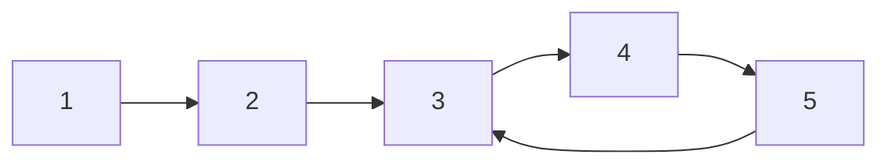

# Bài 2.8 – DSU và đồ thị hàm

> **Tập 2** · Cần biết trước: bài 2.7 · Thời lượng: khoảng 75 phút đọc, 5 giờ thực hành

**Học xong bài này, em sẽ:**

- dùng **DSU** (cấu trúc các tập rời nhau) để gộp nhóm và hỏi "cùng nhóm không?" gần như O(1);
- nhận ra **đồ thị hàm** (mỗi đỉnh đúng một cung ra) và cách nó luôn rơi vào một chu trình;
- nhìn lại bài Tranh điều khiển TV (Tập 0) bằng ngôn ngữ đồ thị.

---

## 1. Bài toán mở màn: Nhóm bạn

Lớp có n bạn, ban đầu ai cũng ở nhóm riêng. Có q thao tác:

- `1 u v`: u và v kết bạn, hai nhóm của họ **gộp lại**;
- `2 u v`: hỏi u và v có cùng nhóm không (`YES`/`NO`);
- `3 u`: hỏi nhóm của u có bao nhiêu người.

(n, q ≤ 2·10⁵)

| Vào | Ra |
| --- | --- |
| `5 6`<br>`1 1 2`<br>`2 1 3`<br>`1 2 3`<br>`2 1 3`<br>`3 3`<br>`3 5` | `NO`<br>`YES`<br>`3`<br>`1` |

> [!IMPORTANT]
> **Dừng lại và nghĩ.** Có thể chạy BFS mỗi lần hỏi (bài 2.7), nhưng q lần BFS là quá chậm. Nếu mỗi nhóm cử ra một **trưởng nhóm**, thì câu hỏi "cùng nhóm không" trở thành câu hỏi gì?

<details>
<summary>Đáp án</summary>

"Hai người có cùng trưởng nhóm không?" Gộp hai nhóm thì chỉ cần cho trưởng nhóm này **báo cáo** cho trưởng nhóm kia.

</details>

---

## 2. DSU

Mỗi người lưu `cha[u]`: người u báo cáo lên. Trưởng nhóm là người có `cha[u] = u`. Tìm trưởng nhóm: đi theo `cha` tới khi gặp người tự báo cáo cho chính mình.

Hai cải tiến làm mọi thao tác **gần như O(1)**:

1. **Nén đường:** sau khi tìm được trưởng nhóm, cho mọi người trên đường đi báo cáo **thẳng** lên trưởng nhóm.
2. **Gộp theo kích thước:** nhóm nhỏ nhập vào nhóm lớn, để cây không cao.

| Thao tác | cha[1..5] sau thao tác | Kích thước nhóm của trưởng |
| --- | --- | --- |
| ban đầu | 1 2 3 4 5 | mỗi nhóm 1 |
| `1 1 2` | 1 **1** 3 4 5 | nhóm 1: 2 |
| `1 2 3` | 1 1 **1** 4 5 | nhóm 1: 3 (nhóm 3 nhỏ hơn nhập vào nhóm 1) |

```cpp
// file: nhom_ban.cpp
#include <bits/stdc++.h>
using namespace std;
vector<int> cha, sz;

int tim(int u) {                               // trưởng nhóm của u, có nén đường
    while (cha[u] != u) {
        cha[u] = cha[cha[u]];                  // nhảy cóc: rút ngắn đường đi
        u = cha[u];
    }
    return u;
}

void gop(int u, int v) {
    u = tim(u); v = tim(v);
    if (u == v) return;
    if (sz[u] < sz[v]) swap(u, v);             // nhóm nhỏ nhập vào nhóm lớn
    cha[v] = u;
    sz[u] += sz[v];
}

int main() {
    ios::sync_with_stdio(false);
    cin.tie(nullptr);
    int n, q;
    cin >> n >> q;
    cha.resize(n + 1); sz.assign(n + 1, 1);
    iota(cha.begin(), cha.end(), 0);           // cha[u] = u
    while (q--) {
        int t, u, v;
        cin >> t >> u;
        if (t == 1) { cin >> v; gop(u, v); }
        else if (t == 2) { cin >> v; cout << (tim(u) == tim(v) ? "YES" : "NO") << '\n'; }
        else cout << sz[tim(u)] << '\n';
    }
}
```

> [!NOTE]
> DSU chỉ **gộp**, không **tách** được. Bài có "hủy kết bạn" cần kỹ thuật khác (Tập 4). Bài 2.7 BFS/DFS cũng đếm được thành phần, nhưng DSU trả lời được khi cạnh **thêm dần** xen kẽ với câu hỏi.

---

## 3. Đồ thị hàm

Trong bài Tranh điều khiển TV (Tập 0, bài 0.9), mỗi kênh x có **tối đa một** kênh kế tiếp `sau[x]`. Vẽ mỗi kênh là một đỉnh và cung x → sau[x], ta được **đồ thị hàm**: mỗi đỉnh có (tối đa) một cung đi ra.

Tính chất quan trọng: đi từ một đỉnh bất kỳ theo các cung, sau tối đa n bước, hoặc dừng ở đỉnh không có cung ra, hoặc **rơi vào một chu trình** và quay vòng mãi. Hình dạng giống chữ ρ (rho): một "đuôi" dẫn vào một "vòng".



Từ 1: đuôi 1 → 2, rồi vòng 3 → 4 → 5 → 3. Cách phát hiện vòng đơn giản nhất là **mảng đánh dấu** như bài 0.9: gặp lại đỉnh đã thăm thì đã vào vòng. Muốn biết **độ dài vòng**, lưu thêm bước thứ mấy đã thăm mỗi đỉnh: độ dài vòng = bước hiện tại − bước lần đầu gặp đỉnh đó.

Nhiều bài khó hơn trên đồ thị hàm (đi k bước với k tới 10⁹) cần kỹ thuật **nhảy nhị phân** ở Tập 3.

---

## 4. Bẫy thường gặp

> [!WARNING]
> **Bẫy 1: gộp hai người thay vì hai trưởng nhóm.** `cha[v] = u` với u, v chưa qua `tim` làm hỏng cấu trúc. Luôn gộp **trưởng nhóm**.

> [!WARNING]
> **Bẫy 2: cập nhật kích thước sai chỗ.** Kích thước chỉ đúng ở **trưởng nhóm**: hỏi `sz[tim(u)]`, không hỏi `sz[u]`.

> [!WARNING]
> **Bẫy 3: gộp hai người đã cùng nhóm.** Thiếu dòng `if (u == v) return;` thì kích thước bị cộng gấp đôi.

---

## 5. Bài tập

| Nấc | Bài | Nguồn | Ý chính |
| --- | --- | --- | --- |
| Khởi động | [Road Construction](https://cses.fi/problemset/task/1676) | CSES 1676 | DSU: số nhóm và nhóm lớn nhất |
| Khởi động | [Building Roads](https://cses.fi/problemset/task/1666) | CSES 1666 | Giải lại bằng DSU |
| Luyện | [Planets Cycles](https://cses.fi/problemset/task/1751) | CSES 1751 | Đồ thị hàm: độ dài đuôi + vòng |
| Luyện | Tranh điều khiển TV: in thêm độ dài vòng khi đáp án là −1 | Tự luyện | Lưu bước thăm |
| Thử thách | [Road Reparation](https://cses.fi/problemset/task/1675) | CSES 1675 | DSU + sắp xếp cạnh (xem trước cây khung, Tập 3) |

---

## 6. Tóm tắt và checkpoint

1. DSU: `tim` có nén đường, `gop` theo kích thước; hai thao tác gần như O(1).
2. Hỏi cùng nhóm: so trưởng nhóm. Kích thước: đọc tại trưởng nhóm.
3. Đồ thị hàm: đi mãi sẽ dừng hoặc rơi vào vòng; phát hiện bằng mảng đánh dấu.

<details><summary>Sau <code>1 1 2</code>, <code>1 3 4</code>, <code>1 2 4</code>, nhóm của 3 có mấy người?</summary>4.</details>

**Checkpoint:**

- [ ] Viết DSU không nhìn sách trong 5 phút.
- [ ] AC Road Construction.
