# Bài 2.8 – DSU và đồ thị hàm

> **Tập 2 · Cấu trúc dữ liệu và quy hoạch động cơ bản**
> Cần biết trước: bài 2.7 (thành phần liên thông), bài 0.9 (Tranh điều khiển TV).
> Thời lượng: khoảng 80 phút đọc, cộng 5 giờ thực hành trong tuần.

**Học xong bài này, em sẽ:**

- dùng **DSU** (cấu trúc các tập rời nhau) để gộp nhóm và hỏi "cùng nhóm không?" gần như O(1);
- giải thích hai cải tiến **nén đường** và **gộp theo kích thước**;
- nhận ra **đồ thị hàm** (mỗi đỉnh đúng một cung ra), tìm độ dài "đuôi" và "vòng" của nó;
- nhìn lại bài Tranh điều khiển TV (bài 0.9) bằng ngôn ngữ đồ thị;
- giải trọn bài kiểu đề thi **Chuyền thư**.

> [!TIP]
> **Học cùng hai trang mô phỏng.** [DSU](../../mo-phong/t2-dsu.html): thử ví dụ "hai nhóm lớn gộp lại" để thấy nén đường; bật **Đoán trước** để đoán trưởng nhóm mới. [Đồ thị hàm](../../mo-phong/t2-do-thi-ham.html): đoán độ dài vòng trước khi máy chạy xong.

---

## 1. Bài toán mở màn: Nhóm bạn

Lớp có n bạn, ban đầu ai cũng ở nhóm riêng. Có q thao tác:

- `1 u v`: u và v kết bạn, hai nhóm của họ **gộp lại**;
- `2 u v`: hỏi u và v có cùng nhóm không (`YES`/`NO`);
- `3 u`: hỏi nhóm của u có bao nhiêu người.

(n, q ≤ 2·10⁵)

| Vào | Ra |
| --- | --- |
| `5 6`<br>`1 1 2`<br>`2 1 3`<br>`1 2 3`<br>`2 1 3`<br>`3 3`<br>`3 5` | `NO`<br>`YES`<br>`3`<br>`1` |

---

## 2. Dừng lại 10 phút

> [!IMPORTANT]
> **Dừng lại và nghĩ.**
> 1. Bài 2.7 đếm được thành phần bằng DFS. Nếu sau **mỗi** câu hỏi ta chạy lại DFS thì tốn bao lâu với n = q = 2·10⁵?
> 2. Nếu mỗi nhóm cử ra một **trưởng nhóm**, câu hỏi "u và v cùng nhóm không" trở thành câu hỏi gì?
> 3. Khi gộp hai nhóm, có cần báo cho **từng** thành viên biết trưởng nhóm mới là ai không? Có cách nào chỉ sửa **một** chỗ?

<details>
<summary>Đáp án</summary>

1. Mỗi lần O(n + q), q lần: khoảng 8·10¹⁰ phép. Quá chậm.
2. "u và v có cùng trưởng nhóm không?"
3. Không cần. Chỉ cần trưởng nhóm này **báo cáo** cho trưởng nhóm kia. Ai muốn biết trưởng nhóm của mình thì đi ngược lên theo chuỗi báo cáo. Đó là **DSU** (*disjoint set union*).

</details>

---

## 3. Lời giải ngây thơ và vì sao nó chậm

Bảo lưu `nhom[u]` là số hiệu nhóm của u. Hỏi cùng nhóm: so `nhom[u]` và `nhom[v]`, O(1). Nhưng gộp nhóm b vào nhóm a thì phải duyệt cả lớp sửa mọi `nhom[x] == b` thành a: O(n) mỗi lần gộp, tổng O(n·q) = 4·10¹⁰. Lãng phí: sửa từng thành viên trong khi chỉ cần sửa "người đứng đầu".

---

## 4. Ý tưởng then chốt

> [!IMPORTANT]
> **Mỗi người lưu `cha[u]`, người mà u báo cáo lên; trưởng nhóm có `cha[u] = u`. `tim(u)` đi theo `cha` tới trưởng nhóm. `gop(u, v)` cho trưởng nhóm nhỏ hơn báo cáo cho trưởng nhóm lớn hơn. Thêm "nén đường" khi tìm, mọi thao tác gần như O(1).**

Hai cải tiến làm cây luôn thấp:

1. **Nén đường:** trên đường đi lên, cho mỗi người báo cáo cho "ông" của mình (`cha[u] = cha[cha[u]]`), đường đi ngắn dần sau mỗi lần tìm.
2. **Gộp theo kích thước:** nhóm nhỏ nhập vào nhóm lớn. Mỗi lần một người bị "đẩy xuống một tầng", nhóm của họ ít nhất gấp đôi, nên không ai sâu quá log₂ n tầng.

### Chạy từng bước

Với ví dụ của đề. Đoán trước rồi mới mở.

<details>
<summary><b>Bước 1</b> – Ban đầu</summary>

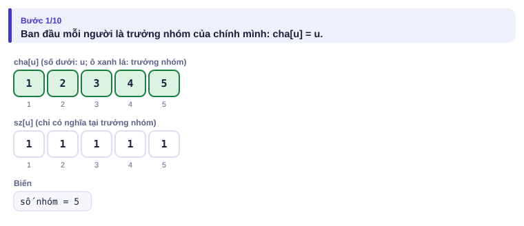

</details>

<details>
<summary><b>Bước 2</b> – Gộp 1 và 2: ai làm trưởng nhóm?</summary>

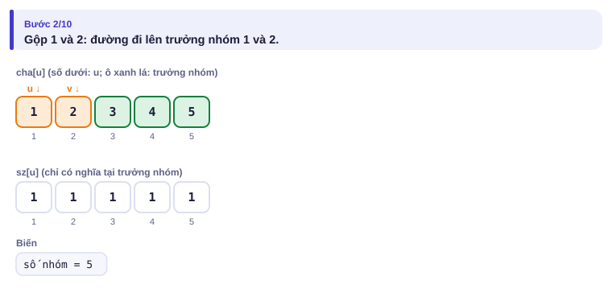
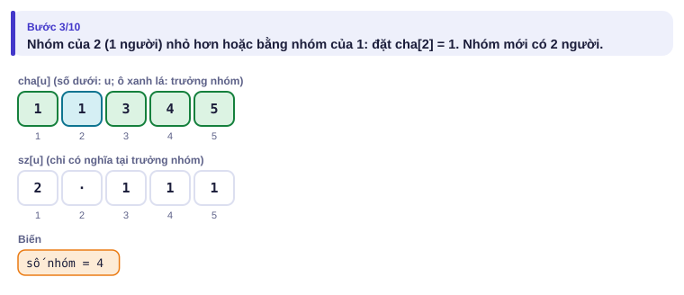

</details>

<details>
<summary><b>Bước 3</b> – Hỏi 1 và 3: YES hay NO?</summary>

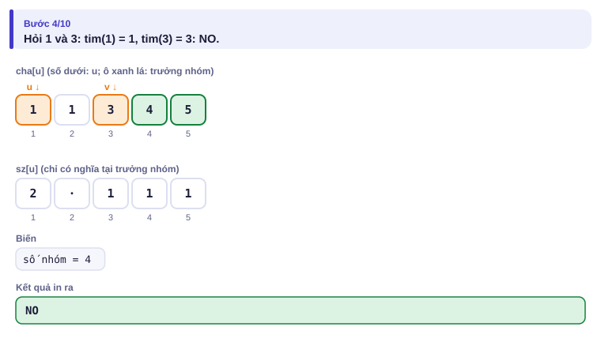

</details>

<details>
<summary><b>Bước 4</b> – Gộp 2 và 3: tim(2) đi qua những ai?</summary>

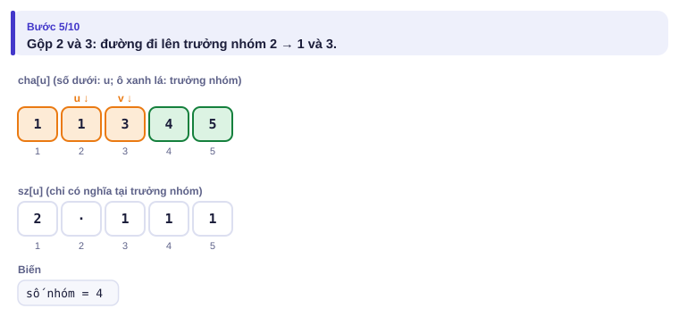
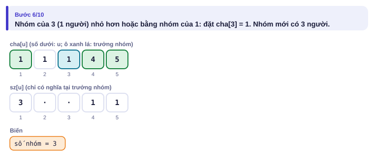

</details>

<details>
<summary><b>Bước 5</b> – Ba câu hỏi cuối</summary>

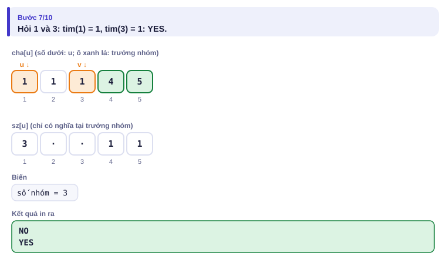
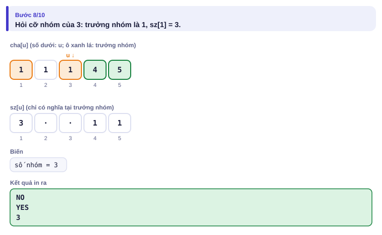
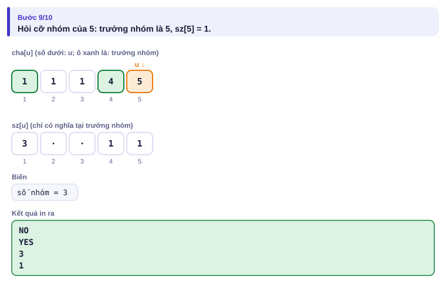

</details>

| Thao tác | cha[1..5] sau thao tác | Ghi chú |
| --- | --- | --- |
| ban đầu | 1 2 3 4 5 | mỗi người một nhóm |
| `1 1 2` | 1 **1** 3 4 5 | sz[1] = 2 |
| `2 1 3` | không đổi | tim(1) = 1 ≠ tim(3) = 3: NO |
| `1 2 3` | 1 1 **1** 4 5 | tim(2) = 1; nhóm 3 nhỏ hơn nhập vào nhóm 1; sz[1] = 3 |
| `2 1 3` | không đổi | YES |
| `3 3`, `3 5` | không đổi | sz[tim(3)] = 3, sz[tim(5)] = 1 |

---

## 5. Mã giả và cài đặt

```cpp
// file: nhom_ban.cpp
#include <bits/stdc++.h>
using namespace std;
vector<int> cha, sz;

int tim(int u) {                               // trưởng nhóm của u, có nén đường
    while (cha[u] != u) {
        cha[u] = cha[cha[u]];                  // nhảy cóc: rút ngắn đường đi
        u = cha[u];
    }
    return u;
}

void gop(int u, int v) {
    u = tim(u); v = tim(v);
    if (u == v) return;
    if (sz[u] < sz[v]) swap(u, v);             // nhóm nhỏ nhập vào nhóm lớn
    cha[v] = u;
    sz[u] += sz[v];
}

int main() {
    ios::sync_with_stdio(false);
    cin.tie(nullptr);
    int n, q;
    cin >> n >> q;
    cha.resize(n + 1); sz.assign(n + 1, 1);
    iota(cha.begin(), cha.end(), 0);           // cha[u] = u
    while (q--) {
        int t, u, v;
        cin >> t >> u;
        if (t == 1) { cin >> v; gop(u, v); }
        else if (t == 2) { cin >> v; cout << (tim(u) == tim(v) ? "YES" : "NO") << '\n'; }
        else cout << sz[tim(u)] << '\n';
    }
}
```

```python
# file: nhom_ban.py
import sys
data = sys.stdin.buffer.read().split()
n, q = int(data[0]), int(data[1])
cha = list(range(n + 1))
sz = [1] * (n + 1)

def tim(u):
    while cha[u] != u:
        cha[u] = cha[cha[u]]
        u = cha[u]
    return u

out = []
p = 2
for _ in range(q):
    t, u = int(data[p]), int(data[p + 1])
    if t == 3:
        out.append(str(sz[tim(u)]))
        p += 2
        continue
    v = int(data[p + 2])
    p += 3
    a, b = tim(u), tim(v)
    if t == 2:
        out.append("YES" if a == b else "NO")
    elif a != b:
        if sz[a] < sz[b]:
            a, b = b, a
        cha[b] = a
        sz[a] += sz[b]
print("\n".join(out))
```

> [!NOTE]
> DSU chỉ **gộp**, không **tách** được. Bài có "hủy kết bạn" cần kỹ thuật khác (Tập 4). Bài 2.7 BFS/DFS cũng đếm được thành phần, nhưng DSU trả lời được khi cạnh **thêm dần** xen kẽ với câu hỏi.

### Đồ thị hàm

Trong bài Tranh điều khiển TV (bài 0.9), mỗi kênh có **tối đa một** kênh kế tiếp. Vẽ mỗi kênh là một đỉnh và cung x → sau[x], ta được **đồ thị hàm**: mỗi đỉnh có đúng một cung đi ra.

Tính chất quan trọng: đi từ một đỉnh bất kỳ theo các cung, sau tối đa n bước chắc chắn gặp lại một đỉnh đã đi qua (chỉ có n đỉnh), rồi quay vòng mãi. Hình dạng giống chữ ρ (rho): một "đuôi" dẫn vào một "vòng".

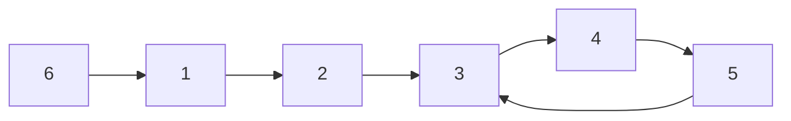

Từ 1: đuôi 1 → 2 (dài 2), rồi vòng 3 → 4 → 5 → 3 (dài 3). Ghi lại **bước thứ mấy** đã thăm mỗi đỉnh; khi gặp lại đỉnh x đã thăm ở bước b trong lúc đang ở bước t, đuôi dài b và vòng dài t − b.

Bài: cho n, đỉnh xuất phát s và sau[1..n]. In độ dài đuôi và độ dài vòng.

| Vào | Ra |
| --- | --- |
| `6 1`<br>`2 3 4 5 3 1` | `2 3` |

<details>
<summary><b>Hình</b> – đi từ đỉnh 1 (mở lần lượt; đoán đỉnh kế tiếp)</summary>

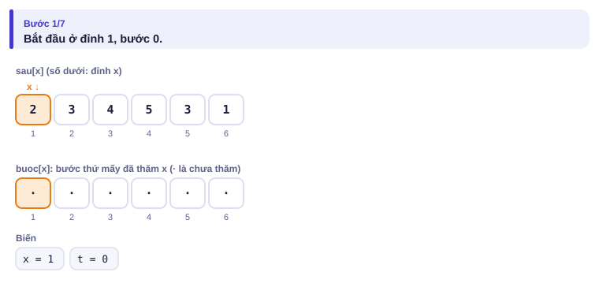
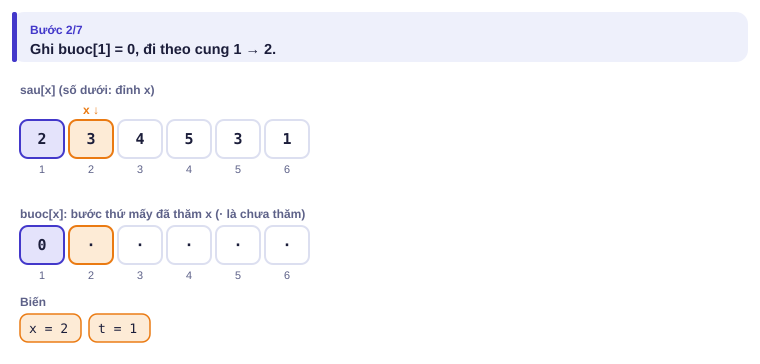
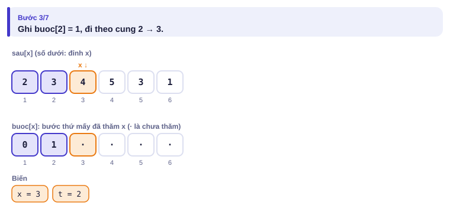
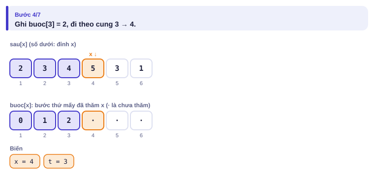
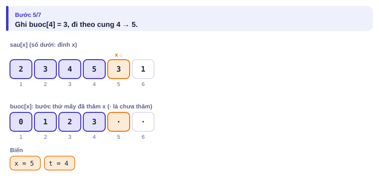
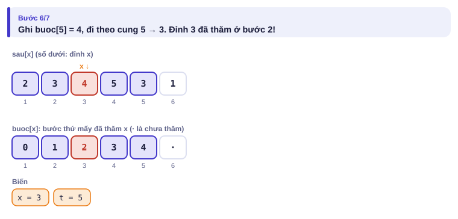
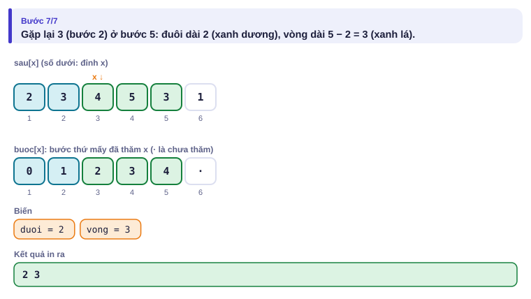

</details>

```cpp
// file: duoi_vong.cpp
#include <bits/stdc++.h>
using namespace std;
int main() {
    int n, s;
    cin >> n >> s;
    vector<int> sau(n + 1);
    for (int i = 1; i <= n; i++) cin >> sau[i];
    vector<int> buoc(n + 1, -1);
    int x = s, t = 0;
    while (buoc[x] == -1) { buoc[x] = t; x = sau[x]; t++; }
    cout << buoc[x] << ' ' << t - buoc[x] << '\n';
}
```

Nhiều bài khó hơn trên đồ thị hàm (đi đúng k bước với k tới 10⁹) cần **nhảy nhị phân** ở Tập 3.

---

## 6. Vì sao đúng, chạy bao lâu

- **DSU đúng:** mỗi nhóm là một cây, gốc là trưởng nhóm. `tim` luôn dừng ở gốc vì đi lên theo `cha` không bao giờ tạo vòng (ta chỉ nối gốc vào gốc khác). Nén đường chỉ đổi cha của u thành một tổ tiên của u, vẫn trong cùng cây.
- **DSU nhanh:** chỉ gộp theo kích thước thì cây cao tối đa log₂ n: mỗi thao tác O(log n). Thêm nén đường thì trung bình gần như hằng số (cụ thể là O(α(n)), với α tăng chậm tới mức α(n) ≤ 4 cho mọi n thực tế).
- **Đồ thị hàm:** mỗi đỉnh được ghi `buoc` tối đa một lần, nên vòng `while` chạy tối đa n lần: O(n).

---

## 7. Bẫy thường gặp

> [!WARNING]
> **Bẫy 1: gộp hai người thay vì hai trưởng nhóm.** Viết `cha[v] = u` khi u, v chưa qua `tim` sẽ cắt v khỏi nhóm cũ của nó.
> *Test phá:* `1 1 2`, `1 2 3`, `1 3 4`, rồi `2 1 4`: phải là YES.

> [!WARNING]
> **Bẫy 2: đọc kích thước sai chỗ.** Kích thước chỉ đúng ở **trưởng nhóm**: hỏi `sz[tim(u)]`, không hỏi `sz[u]`.
> *Test phá:* ví dụ của đề, câu `3 3`: `sz[3]` vẫn là 1, đáp án đúng là 3.

> [!WARNING]
> **Bẫy 3: gộp hai người đã cùng nhóm.** Thiếu dòng `if (u == v) return;` thì kích thước bị cộng gấp đôi.
> *Test phá:* ví dụ "gộp hai người đã cùng nhóm" trên trang mô phỏng: `1 1 2`, `1 2 1`, `3 1` phải ra 2.

> [!WARNING]
> **Bẫy 4: đồ thị hàm, quên rằng s có thể nằm ngay trên vòng.** Khi đó đuôi dài 0. Code ở trên xử lý đúng, nhưng nếu em viết kiểu "tìm đỉnh đầu tiên lặp lại" bằng cách khác, hãy thử.
> *Test phá:* `3 1` / `2 3 1`: phải in `0 3`.

---

## 8. Ví dụ giảm dần hỗ trợ

### Ví dụ 2 – Điền vào chỗ trống: Xây đường

Có n thành phố, ban đầu không có đường. Lần lượt xây m con đường hai chiều. Sau **mỗi** con đường, in số nhóm thành phố liên thông và số thành phố của nhóm lớn nhất. (n, m ≤ 10⁵, bài [Road Construction](https://cses.fi/problemset/task/1676))

| Vào | Ra |
| --- | --- |
| `5 3`<br>`1 2`<br>`1 3`<br>`4 5` | `4 2`<br>`3 3`<br>`2 3` |

```cpp
int so_nhom = n, lon_nhat = 1;
// với mỗi đường (u, v):
u = tim(u); v = tim(v);
if (u != v) {
    if (sz[u] < sz[v]) swap(u, v);
    cha[v] = u; sz[u] += sz[v];
    so_nhom____;
    lon_nhat = max(lon_nhat, ____);
}
cout << so_nhom << ' ' << lon_nhat << '\n';
```

<details>
<summary>Đáp án</summary>

`--` và `sz[u]`. Nhóm lớn nhất không bao giờ nhỏ đi (DSU không tách), nên chỉ cần so với nhóm vừa gộp.

```cpp
// file: xay_duong.cpp
#include <bits/stdc++.h>
using namespace std;
vector<int> cha, sz;
int tim(int u) { while (cha[u] != u) { cha[u] = cha[cha[u]]; u = cha[u]; } return u; }
int main() {
    ios::sync_with_stdio(false);
    cin.tie(nullptr);
    int n, m;
    cin >> n >> m;
    cha.resize(n + 1); sz.assign(n + 1, 1);
    iota(cha.begin(), cha.end(), 0);
    int so_nhom = n, lon_nhat = 1;
    while (m--) {
        int u, v;
        cin >> u >> v;
        u = tim(u); v = tim(v);
        if (u != v) {
            if (sz[u] < sz[v]) swap(u, v);
            cha[v] = u; sz[u] += sz[v];
            so_nhom--;
            lon_nhat = max(lon_nhat, sz[u]);
        }
        cout << so_nhom << ' ' << lon_nhat << '\n';
    }
}
```

</details>

### Ví dụ 3 – Tự làm: Đường dây thừa

Thợ điện lần lượt kéo m đường dây giữa n trạm (n, m ≤ 2·10⁵). Một đường dây là **thừa** nếu hai trạm của nó đã thông với nhau qua các dây kéo trước đó. In số thứ tự (từ 1) của đường dây thừa **đầu tiên**, hoặc 0 nếu không có.

| Vào | Ra |
| --- | --- |
| `4 5`<br>`1 2`<br>`3 4`<br>`2 3`<br>`4 1`<br>`1 3` | `4` |

> [!IMPORTANT]
> Tự làm trước. Gợi ý: trước khi gộp, kiểm tra `tim(u) == tim(v)`.

<details>
<summary>Lời giải</summary>

Dây thứ 4 nối 4 và 1, mà 1–2–3–4 đã thông nhau qua dây 1, 3, 2. Dây thừa chính là dây tạo **chu trình**.

```cpp
// file: day_thua.cpp
#include <bits/stdc++.h>
using namespace std;
vector<int> cha;
int tim(int u) { while (cha[u] != u) { cha[u] = cha[cha[u]]; u = cha[u]; } return u; }
int main() {
    ios::sync_with_stdio(false);
    cin.tie(nullptr);
    int n, m;
    cin >> n >> m;
    cha.resize(n + 1);
    iota(cha.begin(), cha.end(), 0);
    int dau = 0;
    for (int i = 1; i <= m; i++) {
        int u, v;
        cin >> u >> v;
        u = tim(u); v = tim(v);
        if (u == v) { if (!dau) dau = i; }
        else cha[u] = v;            // ở đây chỉ cần nén đường là đủ nhanh
    }
    cout << dau << '\n';
}
```

</details>

---

## 9. Bài tập

| Nấc | Bài | Nguồn | Ý chính |
| --- | --- | --- | --- |
| Khởi động | [Road Construction](https://cses.fi/problemset/task/1676) | CSES 1676 | Ví dụ 2 |
| Khởi động | [Building Roads](https://cses.fi/problemset/task/1666) | CSES 1666 | Giải lại bằng DSU |
| Luyện | Tranh điều khiển TV (bài 0.9): in thêm độ dài vòng khi đáp án là −1 | Tự luyện | Lưu bước thăm |
| Luyện | [Planets and Kingdoms](https://cses.fi/problemset/task/1683) | CSES 1683 | Đọc trước, giải ở Tập 3; thử nghĩ vì sao DSU không đủ |
| Thử thách | [Road Reparation](https://cses.fi/problemset/task/1675) | CSES 1675 | DSU + sắp xếp cạnh (xem trước cây khung, Tập 3) |
| Kiểu đề thi | Chuyền thư | Bài của sách, chấm theo subtask | Xem bên dưới; giống [Planets Cycles](https://cses.fi/problemset/task/1751) |

### Bài kiểu đề thi: Chuyền thư

**Đề bài.** Lớp có n bạn (1 ≤ n ≤ 2·10⁵). Bạn i nhận được thư thì luôn chuyền cho bạn pᵢ (1 ≤ pᵢ ≤ n, có thể pᵢ = i). Nếu lá thư bắt đầu ở bạn i, nó sẽ đi qua bao nhiêu bạn **khác nhau** (tính cả bạn i)? In n số, số thứ i ứng với lá thư bắt đầu ở bạn i. Đọc từ `CHUYENTHU.INP` (dòng đầu n, dòng sau p₁ … pₙ), ghi ra `CHUYENTHU.OUT` trên một dòng.

Subtask: 40% có n ≤ 5000; 60% còn lại có n ≤ 2·10⁵.

| CHUYENTHU.INP | CHUYENTHU.OUT |
| --- | --- |
| `5`<br>`2 3 1 3 4` | `3 3 3 4 5` |

Từ bạn 5: 5 → 4 → 3 → 1 → 2 → 3 (lặp lại), qua 5 bạn khác nhau.

<details>
<summary><b>Gợi ý 1</b> – hướng đi (đủ 40% điểm)</summary>

Với mỗi i, đi theo p và đánh dấu, dừng khi gặp bạn đã đánh dấu (như bài đuôi–vòng). Mỗi i tốn O(n): tổng O(n²) = 2,5·10⁷ với n = 5000.

</details>

<details>
<summary><b>Gợi ý 2</b> – ý then chốt</summary>

Đáp án của i là (độ dài đuôi từ i) + (độ dài vòng mà i rơi vào). Mọi bạn **trên vòng** có đáp án bằng độ dài vòng. Bạn x **ngoài vòng** có đáp án bằng đáp án của pₓ cộng 1. Vậy chỉ cần đi mỗi đỉnh một lần, rồi điền đáp án **ngược** lại dọc theo đường vừa đi.

</details>

<details>
<summary><b>Gợi ý 3</b> – lời giải đầy đủ</summary>

Với mỗi bạn chưa có đáp án, đi theo p và lưu đường đi, cho tới khi gặp bạn **đã có đáp án** hoặc bạn **đang nằm trên đường đi hiện tại** (vừa phát hiện vòng). Trường hợp sau: các bạn từ vị trí đó tới cuối đường là vòng, đáp án bằng độ dài vòng. Sau đó điền các bạn còn lại từ cuối đường về đầu: `kq[x] = kq[p[x]] + 1`. Mỗi bạn được đi qua và điền một lần: O(n).

```cpp
// file: chuyenthu.cpp
#include <bits/stdc++.h>
using namespace std;
int main() {
    freopen("CHUYENTHU.INP", "r", stdin);
    freopen("CHUYENTHU.OUT", "w", stdout);
    int n;
    scanf("%d", &n);
    vector<int> p(n + 1), kq(n + 1, 0), vitri(n + 1, -1);   // vitri: chỉ số trên đường đi hiện tại
    for (int i = 1; i <= n; i++) scanf("%d", &p[i]);
    vector<int> duong;
    for (int s = 1; s <= n; s++) {
        if (kq[s]) continue;
        duong.clear();
        int x = s;
        while (!kq[x] && vitri[x] == -1) { vitri[x] = duong.size(); duong.push_back(x); x = p[x]; }
        int het = duong.size();
        if (!kq[x]) {                                       // x nằm trên đường hiện tại: tìm thấy vòng
            int dau = vitri[x], dai = het - dau;
            for (int k = dau; k < het; k++) kq[duong[k]] = dai;
            het = dau;
        }
        for (int k = het - 1; k >= 0; k--) kq[duong[k]] = kq[p[duong[k]]] + 1;
        for (int y : duong) vitri[y] = -1;
    }
    for (int i = 1; i <= n; i++) printf("%d%c", kq[i], i == n ? '\n' : ' ');
}
```

```python
# file: chuyenthu.py
with open("CHUYENTHU.INP") as f:
    data = f.read().split()
n = int(data[0])
p = [0] + [int(x) for x in data[1:1 + n]]
kq = [0] * (n + 1)
vitri = [-1] * (n + 1)
for s in range(1, n + 1):
    if kq[s]:
        continue
    duong = []
    x = s
    while not kq[x] and vitri[x] == -1:
        vitri[x] = len(duong)
        duong.append(x)
        x = p[x]
    het = len(duong)
    if not kq[x]:
        dau = vitri[x]
        for k in range(dau, het):
            kq[duong[k]] = het - dau
        het = dau
    for k in range(het - 1, -1, -1):
        kq[duong[k]] = kq[p[duong[k]]] + 1
    for y in duong:
        vitri[y] = -1
with open("CHUYENTHU.OUT", "w") as f:
    f.write(" ".join(map(str, kq[1:])) + "\n")
```

</details>

---

## 10. Tóm tắt, flashcard và checkpoint

**Tóm tắt trong 5 dòng.**

1. DSU: mỗi nhóm là một cây, gốc là trưởng nhóm; `tim` đi lên gốc, `gop` nối gốc vào gốc.
2. Nén đường + gộp theo kích thước: mọi thao tác gần như O(1).
3. Hỏi cùng nhóm: so trưởng nhóm. Kích thước: đọc tại trưởng nhóm. Thêm cạnh mà hai đầu đã cùng nhóm: cạnh đó tạo chu trình.
4. Đồ thị hàm: mỗi đỉnh một cung ra; đi mãi sẽ rơi vào vòng (hình chữ ρ).
5. Đuôi và vòng: ghi bước thăm; gặp lại đỉnh thăm ở bước b khi đang ở bước t: đuôi b, vòng t − b.

**Flashcard.**

<details><summary>Sau <code>1 1 2</code>, <code>1 3 4</code>, <code>1 2 4</code>, nhóm của 3 có mấy người?</summary>4.</details>
<details><summary>Vì sao gộp nhóm nhỏ vào nhóm lớn làm cây thấp?</summary>Mỗi lần một người bị đẩy sâu thêm một tầng, nhóm của người đó ít nhất gấp đôi; chỉ gấp đôi được log₂ n lần.</details>
<details><summary>DSU có tách nhóm được không?</summary>Không, chỉ gộp.</details>
<details><summary>Đồ thị hàm <code>sau = 2 3 1</code>, xuất phát từ 1: đuôi và vòng?</summary>Đuôi 0, vòng 3.</details>
<details><summary>Chuyền thư: bạn x ngoài vòng có đáp án bao nhiêu?</summary>kq[p[x]] + 1.</details>

**Ôn xoắn ốc** (mỗi bài tối đa 20 phút):

- Viết lại BFS trên lưới (bài 2.7) không nhìn sách.
- [Concert Tickets](https://cses.fi/problemset/task/1091) (CSES 1091): `multiset` (bài 2.2).
- Viết lại bài Tranh điều khiển TV (bài 0.9) và chỉ ra đâu là đồ thị hàm.

**Checkpoint – em đã sẵn sàng sang bài tiếp theo nếu:**

- [ ] Viết DSU (`tim` có nén đường, `gop` theo kích thước) không nhìn sách trong 5 phút.
- [ ] AC [Road Construction](https://cses.fi/problemset/task/1676).
- [ ] Làm xong Ví dụ 3 (Đường dây thừa) mà không mở lời giải.
- [ ] Đạt trọn điểm bài Chuyền thư khi tự làm trong 35 phút.

Chưa đạt? Nếu vướng ô 1 hoặc 2, chạy trang mô phỏng DSU với ví dụ "hai nhóm lớn gộp lại" và đọc lại mục 7. Nếu vướng ô 3, đọc lại dòng 3 của phần tóm tắt. Nếu vướng ô 4, chạy trang Đồ thị hàm với dữ liệu của bài Chuyền thư, mỗi lần một đỉnh xuất phát.
