# Bài 2.9 – Quy hoạch động 1: trạng thái và công thức truy hồi

> **Tập 2 · Cấu trúc dữ liệu và quy hoạch động cơ bản**
> Cần biết trước: bài 1.6 (đệ quy, Fibonacci tính lại nhiều lần), bài 1.8 (tham lam sai ở bài đổi tiền).
> Thời lượng: khoảng 2 giờ đọc, cộng 8 giờ thực hành (1,5 tuần).

**Học xong bài này, em sẽ:**

- giải bài tối ưu và bài đếm bằng cách **lưu lời giải các bài con** thay vì tính lại;
- tự đặt **trạng thái**, **công thức truy hồi**, **cơ sở** và **thứ tự tính** (bốn bước của quy hoạch động);
- giải hai bài kinh điển: đổi tiền và cái túi 0/1, và giải thích vì sao cái túi 0/1 phải duyệt giảm dần;
- giải trọn bài kiểu đề thi **Ếch nhảy**.

> [!TIP]
> **Học cùng hai trang mô phỏng.** [Đổi tiền](../../mo-phong/t2-doi-tien-qhd.html): bật **Đoán trước** và tự tính từng ô dp. [Cái túi 0/1](../../mo-phong/t2-cai-tui.html): để ý ô xanh dương j − h luôn là giá trị **chưa** mua cuốn đang xét.

---

## 1. Bài toán mở màn: Đổi tiền (lần nữa)

Ở bài 1.8, tham lam sai với mệnh giá {1, 3, 4} và số tiền 6 (tham lam lấy 4 + 1 + 1, trong khi 3 + 3 chỉ cần 2 đồng). Giờ giải cho đúng: có n mệnh giá c₁ … cₙ, mỗi loại dùng không giới hạn. Đổi x đồng với **ít đồng xu nhất**; in −1 nếu không đổi được. (n ≤ 100, x ≤ 10⁶; bài [Minimizing Coins](https://cses.fi/problemset/task/1634))

| Vào | Ra |
| --- | --- |
| `3 6`<br>`1 3 4` | `2` |

---

## 2. Dừng lại 10 phút

> [!IMPORTANT]
> **Dừng lại và nghĩ.**
> 1. Đồng xu **cuối cùng** em dùng để đổi 6 đồng có thể là 1, 3 hoặc 4. Nếu đồng cuối là 3, phần còn lại là bài toán gì?
> 2. Viết công thức: "cách tốt nhất cho 6" bằng gì, theo "cách tốt nhất" cho các số nhỏ hơn?
> 3. Nếu viết công thức đó thành hàm đệ quy, f(2) bị gọi bao nhiêu lần khi tính f(6)?

<details>
<summary>Đáp án</summary>

1. Đổi 6 − 3 = 3 đồng với ít đồng nhất: **cùng bài toán, số nhỏ hơn**.
2. f(6) = 1 + min(f(5), f(3), f(2)).
3. Rất nhiều lần: f(6) gọi f(5), f(3), f(2); f(5) lại gọi f(4), f(2), f(1)… Giống Fibonacci ở bài 1.6, số lần gọi tăng theo hàm mũ. Cách chữa: tính mỗi f(s) **một lần** rồi **lưu** lại.

</details>

---

## 3. Lời giải ngây thơ và vì sao nó chậm

An viết đúng công thức ở câu 2 thành đệ quy:

```cpp
int f(int s) {
    if (s == 0) return 0;
    int best = 1e9;
    for (int c : coins)
        if (c <= s) best = min(best, f(s - c) + 1);
    return best;
}
```

Với mệnh giá {1, 2} và x = 50, số lần gọi f bằng số Fibonacci thứ 50, khoảng 2·10¹⁰. Nhưng chỉ có **51** giá trị f khác nhau (f(0) … f(50)). Lãng phí là tính lại cùng một bài con hàng tỉ lần.

---

## 4. Ý tưởng then chốt

> [!IMPORTANT]
> **Quy hoạch động (QHĐ): đặt dp[s] là đáp án của bài con s, tính các dp theo thứ tự sao cho khi tính dp[s] thì mọi bài con nó cần đã có sẵn. Mỗi bài con tính một lần.**

Bốn bước của quy hoạch động:

1. **Trạng thái:** dp[s] = số đồng ít nhất để đổi s đồng.
2. **Công thức truy hồi:** dp[s] = min(dp[s − c] + 1) với mọi mệnh giá c ≤ s. (Hỏi: "bước cuối cùng là gì?")
3. **Cơ sở:** dp[0] = 0. Số tiền chưa đổi được ghi là "vô cùng".
4. **Thứ tự tính:** s tăng dần, vì dp[s] cần các dp nhỏ hơn.

### Chạy từng bước

Với mệnh giá {1, 3, 4}, x = 6. Đoán trước từng ô rồi mới mở.

<details>
<summary><b>Bước 1</b> – Cơ sở</summary>

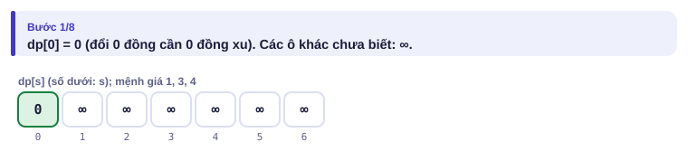

</details>

<details>
<summary><b>Bước 2</b> – dp[1], dp[2]</summary>

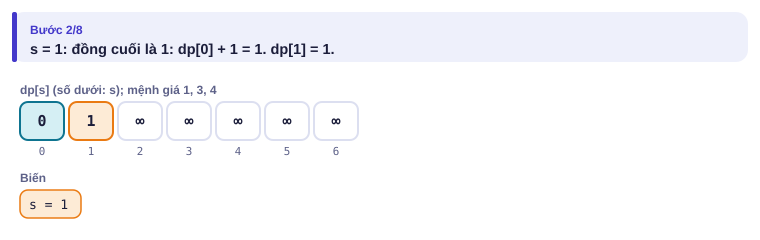
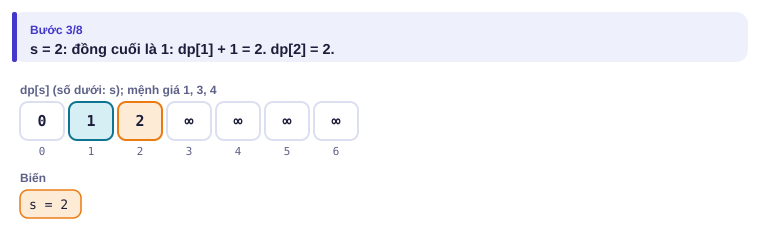

</details>

<details>
<summary><b>Bước 3</b> – dp[3], dp[4]: lần đầu có nhiều lựa chọn</summary>

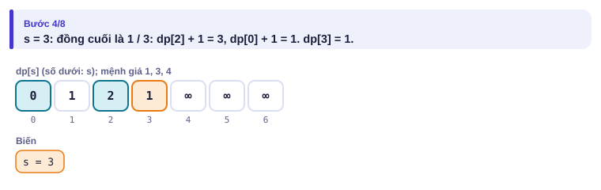
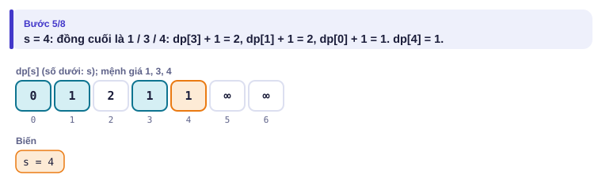

</details>

<details>
<summary><b>Bước 4</b> – dp[5], dp[6]: chỗ tham lam sai</summary>

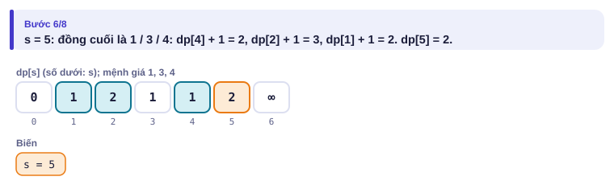
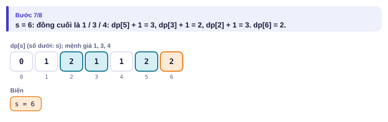
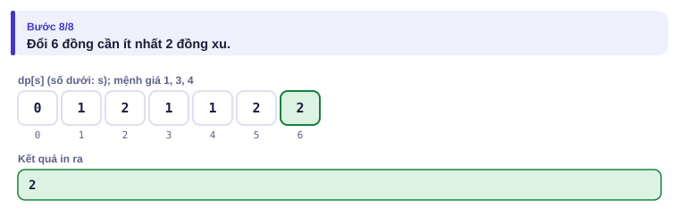

</details>

| s | 0 | 1 | 2 | 3 | 4 | 5 | 6 |
| --- | :---: | :---: | :---: | :---: | :---: | :---: | :---: |
| từ dp[s−1] + 1 | | 1 | 2 | 3 | 2 | 2 | 3 |
| từ dp[s−3] + 1 | | | | 1 | 2 | 3 | **2** |
| từ dp[s−4] + 1 | | | | | 1 | 2 | 3 |
| **dp[s]** | 0 | 1 | 2 | 1 | 1 | 2 | **2** |

---

## 5. Mã giả và cài đặt

```cpp
// file: doi_tien.cpp
#include <bits/stdc++.h>
using namespace std;
int main() {
    int n, x;
    cin >> n >> x;
    vector<int> c(n);
    for (auto &v : c) cin >> v;
    const int VC = 1e9;                         // "vô cùng": chưa đổi được
    vector<int> dp(x + 1, VC);
    dp[0] = 0;
    for (int s = 1; s <= x; s++)
        for (int v : c)
            if (v <= s && dp[s - v] != VC) dp[s] = min(dp[s], dp[s - v] + 1);
    cout << (dp[x] == VC ? -1 : dp[x]) << '\n';
}
```

```python
# file: doi_tien.py
n, x = map(int, input().split())
c = list(map(int, input().split()))
VC = 10**9
dp = [VC] * (x + 1)
dp[0] = 0
for s in range(1, x + 1):
    best = VC
    for v in c:
        if v <= s and dp[s - v] + 1 < best:
            best = dp[s - v] + 1
    dp[s] = best
print(-1 if dp[x] >= VC else dp[x])
```

Độ phức tạp O(n·x) = 10⁸ với giới hạn lớn nhất: vừa kịp với C++. Bản Python chỉ nên dùng cho x khoảng 10⁵ trở xuống.

> [!NOTE]
> **Hai cách viết QHĐ.** Đệ quy có lưu (**ghi nhớ**): giữ hàm f như của An, thêm mảng lưu kết quả, gọi lại thì trả luôn. Vòng lặp từ nhỏ tới lớn (như trên): không lo đệ quy sâu, thường nhanh hơn. Trong thi đấu nên quen cách vòng lặp; cách ghi nhớ hữu ích khi khó xác định thứ tự tính.

### Cái túi 0/1: Hiệu sách

Có n cuốn sách, cuốn i giá hᵢ và có sᵢ trang. Có x đồng, **mỗi cuốn mua tối đa một lần**. Tối đa tổng số trang? (n ≤ 1000, x ≤ 10⁵; bài [Book Shop](https://cses.fi/problemset/task/1158))

| Vào | Ra |
| --- | --- |
| `4 10`<br>`4 8 5 3`<br>`5 12 8 1` | `13` |

Mua cuốn 1 (4 đồng, 5 trang) và cuốn 3 (5 đồng, 8 trang): 9 đồng, 13 trang.

- **Trạng thái:** dp[j] = số trang nhiều nhất với tổng giá **không quá** j, chỉ dùng các cuốn đã xét.
- **Truy hồi khi xét cuốn i:** không mua thì giữ dp[j]; mua thì dp[j − hᵢ] + sᵢ. Lấy lớn hơn.
- **Thứ tự:** với mỗi cuốn, duyệt j **giảm dần** từ x xuống hᵢ.

Vì sao giảm dần? dp[j − hᵢ] phải là giá trị **trước khi** xét cuốn i. Duyệt tăng dần thì dp[j − hᵢ] có thể đã "mua cuốn i" rồi, và cuốn i bị mua hai lần.

<details>
<summary><b>Hình</b> – xét lần lượt các cuốn (mở lần lượt; đoán dp[j] mới khi xét cuốn 3)</summary>

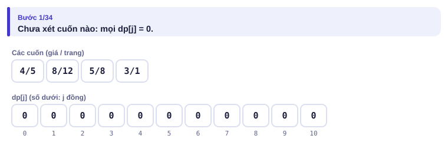
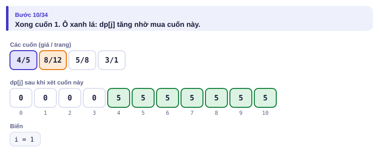
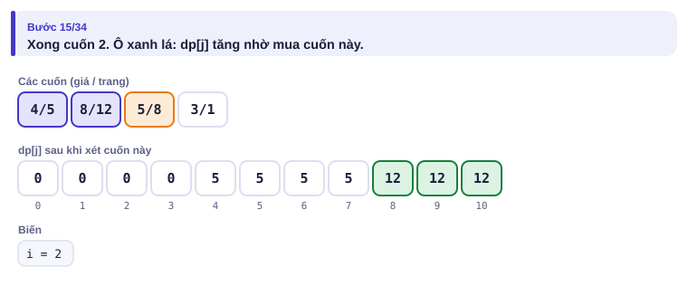
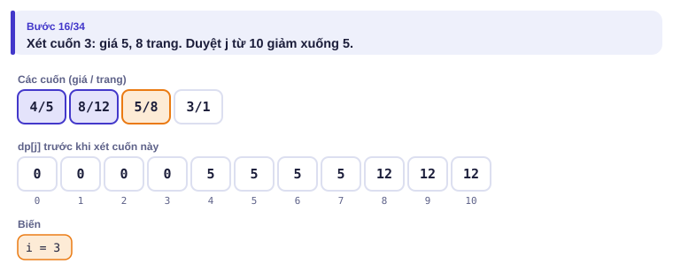
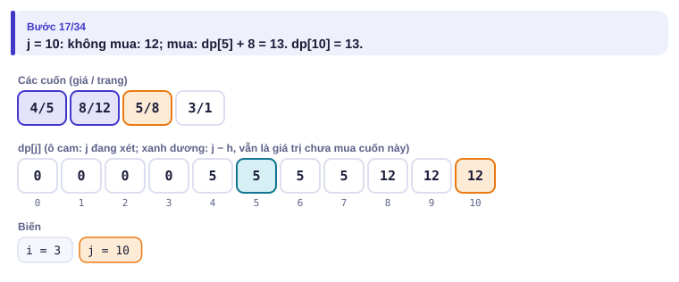
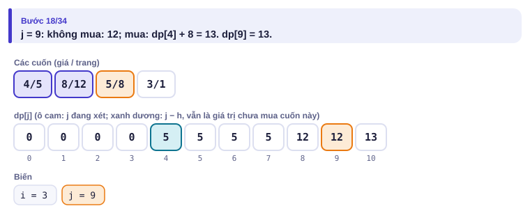
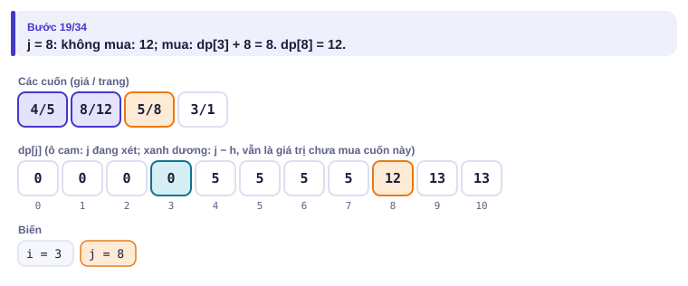
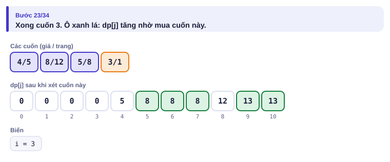
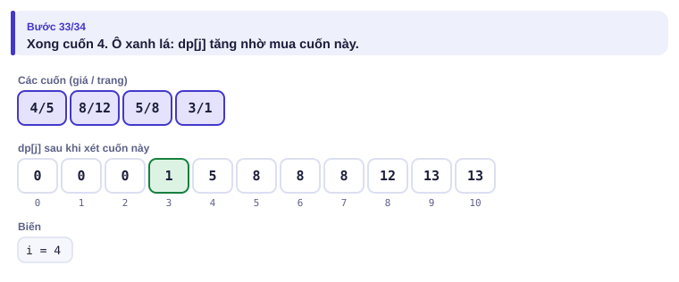

</details>

```cpp
// file: hieu_sach.cpp
#include <bits/stdc++.h>
using namespace std;
int main() {
    int n, x;
    cin >> n >> x;
    vector<int> h(n), s(n);
    for (auto &v : h) cin >> v;
    for (auto &v : s) cin >> v;
    vector<int> dp(x + 1, 0);
    for (int i = 0; i < n; i++)
        for (int j = x; j >= h[i]; j--)             // giảm dần: mỗi cuốn dùng tối đa một lần
            dp[j] = max(dp[j], dp[j - h[i]] + s[i]);
    cout << dp[x] << '\n';
}
```

| Biến thể | Khác ở đâu |
| --- | --- |
| Mỗi món dùng **không giới hạn** | Duyệt j **tăng dần** |
| Đếm **số cách** thay vì tối ưu | Thay `max`/`min` bằng cộng, lấy dư theo đề |
| Đếm cách **có thứ tự** (1+3 khác 3+1) | Vòng ngoài là tổng tiền, vòng trong là mệnh giá |
| Đếm cách **không thứ tự** | Vòng ngoài là mệnh giá, vòng trong là tổng tiền |

---

## 6. Vì sao đúng, chạy bao lâu

- **Đổi tiền đúng:** một cách đổi tối ưu cho s đồng có đồng cuối c; phần còn lại phải là cách tối ưu cho s − c (nếu không, thay bằng cách tốt hơn sẽ được cách tốt hơn cho s, mâu thuẫn). Công thức thử mọi c nên không bỏ sót. Đây gọi là **cấu trúc con tối ưu**.
- **Cái túi đúng:** sau khi xét i cuốn, dp[j] là tốt nhất trong mọi cách chọn từ i cuốn đầu với giá ≤ j: hoặc không có cuốn i (giữ giá trị cũ), hoặc có cuốn i (giá trị cũ ở j − hᵢ cộng sᵢ). Duyệt giảm dần đảm bảo "giá trị cũ" thật sự cũ.
- **Chạy bao lâu:** số trạng thái × số lựa chọn mỗi trạng thái. Đổi tiền: x trạng thái × n lựa chọn = O(n·x). Cái túi: n cuốn × x mức tiền = O(n·x). Bộ nhớ O(x) vì chỉ giữ một mảng.

---

## 7. Bẫy thường gặp

> [!WARNING]
> **Bẫy 1: "vô cùng" cộng 1 bị tràn.** Nếu VC = `INT_MAX` thì VC + 1 tràn thành số âm, trở thành "tốt nhất". Dùng 10⁹ và kiểm tra `!= VC` trước khi cộng.
> *Test phá:* `1 3` / `2`: không đổi được, phải in −1.

> [!WARNING]
> **Bẫy 2: sai chiều duyệt ở cái túi.** Tăng dần biến 0/1 thành không giới hạn. Đây là lỗi phổ biến nhất của bài này.
> *Test phá:* `1 10` / `5` / `7`: chỉ một cuốn giá 5 có 7 trang, đáp án 7; duyệt tăng dần in 14.

> [!WARNING]
> **Bẫy 3: trạng thái thiếu thông tin.** Nếu công thức cần biết điều gì mà trạng thái không lưu (ví dụ "đã mua cuốn nào"), phải thêm chiều cho trạng thái hoặc đổi cách đặt. Tự hỏi: "biết dp các trạng thái nhỏ hơn có **đủ** để tính trạng thái này không?"

> [!WARNING]
> **Bẫy 4: quên lấy dư ở bài đếm.** Số cách tăng rất nhanh; lấy dư 10⁹ + 7 **sau mỗi phép cộng**, không đợi tới cuối.

---

## 8. Ví dụ giảm dần hỗ trợ

### Ví dụ 2 – Điền vào chỗ trống: Gieo xúc xắc

Đếm số cách tạo tổng n bằng cách gieo xúc xắc (mặt 1–6) một hoặc nhiều lần; thứ tự khác nhau tính là khác nhau. In kết quả chia dư 10⁹ + 7. (n ≤ 10⁶, bài [Dice Combinations](https://cses.fi/problemset/task/1633))

| Vào | Ra |
| --- | --- |
| `3` | `4` |

Bốn cách: 1+1+1, 1+2, 2+1, 3. Lần gieo **cuối** ra mặt k thì trước đó là một cách tạo tổng n − k.

```cpp
dp[0] = ____;
for (int s = 1; s <= n; s++)
    for (int k = 1; k <= 6 && k <= s; k++)
        dp[s] = (dp[s] + ____) % MOD;
```

<details>
<summary>Đáp án</summary>

`1` (tổng 0: một cách là không gieo gì) và `dp[s - k]`.

```cpp
// file: xuc_xac.cpp
#include <bits/stdc++.h>
using namespace std;
int main() {
    const long long MOD = 1e9 + 7;
    int n;
    cin >> n;
    vector<long long> dp(n + 1, 0);
    dp[0] = 1;
    for (int s = 1; s <= n; s++)
        for (int k = 1; k <= 6 && k <= s; k++)
            dp[s] = (dp[s] + dp[s - k]) % MOD;
    cout << dp[n] << '\n';
}
```

</details>

### Ví dụ 3 – Tự làm: Đường đi trên lưới

Lưới n × n (n ≤ 1000), ô `.` đi được, ô `*` có bẫy. Đi từ ô trên trái tới ô dưới phải, mỗi bước sang **phải** hoặc **xuống**. Đếm số đường đi chia dư 10⁹ + 7. (bài [Grid Paths](https://cses.fi/problemset/task/1638))

| Vào | Ra |
| --- | --- |
| `4`<br>`....`<br>`.*..`<br>`...*`<br>`*...` | `3` |

> [!IMPORTANT]
> Tự làm trước. Gợi ý: trạng thái dp[i][j] = số đường từ ô (0, 0) tới ô (i, j). Bước cuối tới (i, j) đến từ đâu? Ô bẫy có dp bằng bao nhiêu? Đừng quên trường hợp ô xuất phát có bẫy.

<details>
<summary>Lời giải</summary>

dp[i][j] = dp[i − 1][j] + dp[i][j − 1] nếu ô (i, j) không có bẫy, ngược lại bằng 0. Tính theo hàng từ trên xuống, trong mỗi hàng từ trái sang phải.

```cpp
// file: duong_luoi.cpp
#include <bits/stdc++.h>
using namespace std;
int main() {
    const long long MOD = 1e9 + 7;
    int n;
    cin >> n;
    vector<string> g(n);
    for (auto &r : g) cin >> r;
    vector<vector<long long>> dp(n, vector<long long>(n, 0));
    for (int i = 0; i < n; i++)
        for (int j = 0; j < n; j++) {
            if (g[i][j] == '*') { dp[i][j] = 0; continue; }
            if (i == 0 && j == 0) { dp[i][j] = 1; continue; }
            long long v = 0;
            if (i > 0) v += dp[i - 1][j];
            if (j > 0) v += dp[i][j - 1];
            dp[i][j] = v % MOD;
        }
    cout << dp[n - 1][n - 1] << '\n';
}
```

</details>

---

## 9. Bài tập

| Nấc | Bài | Nguồn | Ý chính |
| --- | --- | --- | --- |
| Khởi động | [Dice Combinations](https://cses.fi/problemset/task/1633) | CSES 1633 | Ví dụ 2 |
| Khởi động | [Minimizing Coins](https://cses.fi/problemset/task/1634) | CSES 1634 | Đúng mục 5 |
| Luyện | [Coin Combinations I](https://cses.fi/problemset/task/1635) | CSES 1635 | Đếm cách có thứ tự |
| Luyện | [Coin Combinations II](https://cses.fi/problemset/task/1636) | CSES 1636 | Đếm cách không thứ tự: đổi thứ tự hai vòng lặp |
| Luyện | [Grid Paths](https://cses.fi/problemset/task/1638) | CSES 1638 | Ví dụ 3 |
| Luyện | [Book Shop](https://cses.fi/problemset/task/1158) | CSES 1158 | Đúng mục 5 |
| Thử thách | [Removing Digits](https://cses.fi/problemset/task/1637) | CSES 1637 | Tự đặt trạng thái |
| Kiểu đề thi | Ếch nhảy | Bài của sách, chấm theo subtask | Xem bên dưới |

### Bài kiểu đề thi: Ếch nhảy

**Đề bài.** Có n hòn đá xếp thành hàng trên suối, hòn i cao hᵢ (1 ≤ hᵢ ≤ 10⁴). Chú ếch đứng ở hòn 1, muốn tới hòn n (2 ≤ n ≤ 10⁵). Từ hòn i, ếch nhảy được tới một trong các hòn i + 1, i + 2, …, i + K (1 ≤ K ≤ 100), tốn |hᵢ − hⱼ| sức khi nhảy từ i tới j. Tổng sức ít nhất là bao nhiêu? Đọc từ `ECHNHAY.INP` (dòng đầu n K, dòng sau n số), ghi ra `ECHNHAY.OUT`.

Subtask: 30% có n ≤ 15; 30% có K = 2; 40% còn lại không có ràng buộc thêm.

| ECHNHAY.INP | ECHNHAY.OUT |
| --- | --- |
| `6 3`<br>`3 8 2 6 1 5` | `4` |

Đường đi 1 → 3 → 6 (độ cao 3 → 2 → 5) tốn |3 − 2| + |2 − 5| = 4. Đường 1 → 4 → 6 (3 → 6 → 5) cũng tốn 3 + 1 = 4.

<details>
<summary><b>Gợi ý 1</b> – hướng đi (30% điểm)</summary>

n ≤ 15: quay lui thử mọi đường đi (bài 1.7), mỗi bước chọn nhảy 1..K ô.

</details>

<details>
<summary><b>Gợi ý 2</b> – ý then chốt</summary>

Trạng thái dp[i] = sức ít nhất để tới hòn i. **Bước nhảy cuối** tới i xuất phát từ một hòn j với i − K ≤ j < i:
dp[i] = min(dp[j] + |hᵢ − hⱼ|). Cơ sở dp[1] = 0. Tính i tăng dần. O(n·K) = 10⁷.

</details>

<details>
<summary><b>Gợi ý 3</b> – lời giải đầy đủ</summary>

```cpp
// file: echnhay.cpp
#include <bits/stdc++.h>
using namespace std;
int main() {
    freopen("ECHNHAY.INP", "r", stdin);
    freopen("ECHNHAY.OUT", "w", stdout);
    int n, K;
    scanf("%d %d", &n, &K);
    vector<long long> h(n);
    for (auto &v : h) scanf("%lld", &v);
    vector<long long> dp(n, LLONG_MAX);
    dp[0] = 0;
    for (int i = 1; i < n; i++)
        for (int j = max(0, i - K); j < i; j++)
            dp[i] = min(dp[i], dp[j] + llabs(h[i] - h[j]));
    printf("%lld\n", dp[n - 1]);
}
```

```python
# file: echnhay.py
with open("ECHNHAY.INP") as f:
    data = f.read().split()
n, K = int(data[0]), int(data[1])
h = list(map(int, data[2:2 + n]))
dp = [0] * n
for i in range(1, n):
    hi = h[i]
    dp[i] = min(dp[j] + abs(hi - h[j]) for j in range(max(0, i - K), i))
with open("ECHNHAY.OUT", "w") as f:
    f.write(f"{dp[n - 1]}\n")
```

Bản Python O(n·K) = 10⁷ phép, chạy khoảng 2–3 giây: đủ cho hai subtask đầu; subtask cuối nên dùng C++.

</details>

---

## 10. Tóm tắt, flashcard và checkpoint

**Tóm tắt trong 5 dòng.**

1. QHĐ = trạng thái + công thức truy hồi + cơ sở + thứ tự tính; mỗi bài con tính một lần.
2. Tìm công thức bằng câu hỏi "**bước cuối cùng** là gì?".
3. Độ phức tạp = số trạng thái × số lựa chọn mỗi trạng thái.
4. Cái túi 0/1: duyệt tiền giảm dần; không giới hạn: tăng dần.
5. Bài đếm: cộng thay cho min/max, lấy dư sau mỗi phép cộng.

**Flashcard.**

<details><summary>dp[7] của bài đổi tiền {1, 3, 4} bằng bao nhiêu?</summary>2 (3 + 4).</details>
<details><summary>Coin Combinations I và II khác nhau ở đâu trong code?</summary>I: vòng ngoài là tổng tiền (thứ tự khác nhau tính là khác). II: vòng ngoài là mệnh giá (mỗi tổ hợp đếm một lần).</details>
<details><summary>Vì sao cái túi 0/1 duyệt j giảm dần?</summary>Để dp[j − h] vẫn là giá trị chưa mua cuốn đang xét; tăng dần thì một cuốn có thể bị mua nhiều lần.</details>
<details><summary>Gieo xúc xắc: dp[0] bằng bao nhiêu, vì sao?</summary>1: có đúng một cách tạo tổng 0 là không gieo.</details>
<details><summary>Ếch nhảy chạy bao lâu?</summary>O(n·K): n trạng thái, mỗi trạng thái K lựa chọn.</details>

**Ôn xoắn ốc** (mỗi bài tối đa 20 phút):

- Viết lại DSU (bài 2.8) không nhìn sách.
- [Movie Festival](https://cses.fi/problemset/task/1629) (CSES 1629): tham lam (bài 1.8); vì sao bài này tham lam đúng còn đổi tiền thì không?
- [Labyrinth](https://cses.fi/problemset/task/1193) (CSES 1193): BFS (bài 2.7). Để ý: BFS trên lưới cũng là "tính khoảng cách theo thứ tự đúng".

**Checkpoint – em đã sẵn sàng sang bài tiếp theo nếu:**

- [ ] Nêu được bốn bước QHĐ cho bài Đổi tiền và bài Hiệu sách không nhìn sách.
- [ ] AC [Minimizing Coins](https://cses.fi/problemset/task/1634), [Coin Combinations II](https://cses.fi/problemset/task/1636) và [Book Shop](https://cses.fi/problemset/task/1158).
- [ ] Làm xong Ví dụ 3 (Đường đi trên lưới) mà không mở lời giải.
- [ ] Đạt trọn điểm bài Ếch nhảy khi tự làm trong 25 phút.

Chưa đạt? Nếu vướng ô 1, chạy trang mô phỏng Đổi tiền với Đoán trước và tự điền bảng ở mục 4. Nếu vướng ô 2, chạy trang Cái túi và đọc lại Bẫy 2. Nếu vướng ô 3 hoặc 4, làm lại Ví dụ 2 và tự trả lời câu hỏi "bước cuối cùng là gì?".
