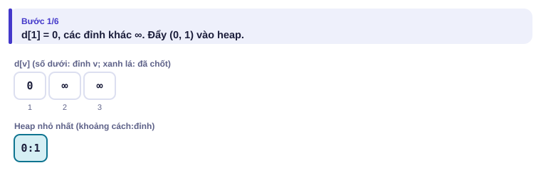
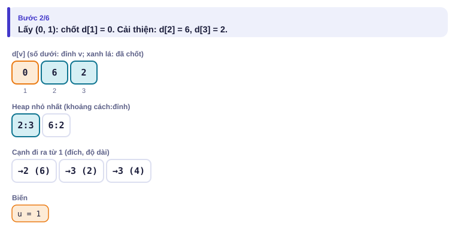
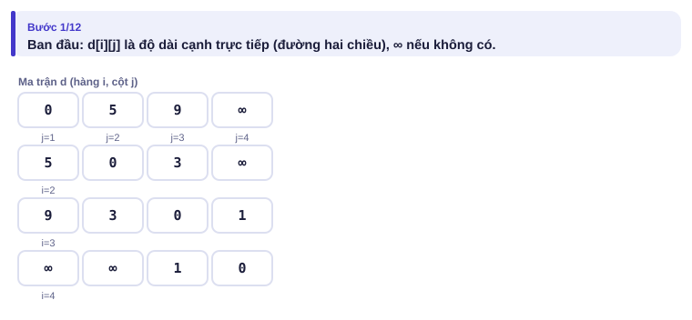

# Bài 3.1 – Đường đi ngắn nhất

> **Tập 3 · Đồ thị và quy hoạch động nâng cao**
> Cần biết trước: bài 2.3 (hàng đợi ưu tiên), bài 2.7 (BFS), bài 2.9 (quy hoạch động).
> Thời lượng: khoảng 100 phút đọc, cộng 8 giờ thực hành (1,5 tuần).

**Học xong bài này, em sẽ:**

- tìm đường đi ngắn nhất từ một đỉnh khi cạnh có **độ dài khác nhau** (không âm) bằng **Dijkstra**, O((n + m) log n);
- tìm đường đi ngắn nhất giữa **mọi cặp** đỉnh bằng **Floyd–Warshall**, O(n³);
- biết khi nào hai thuật toán này **sai** và cần Bellman–Ford;
- chạy Dijkstra trên **đồ thị trạng thái** (đỉnh + thông tin thêm);
- giải trọn bài kiểu đề thi **Hẹn gặp**.

> [!TIP]
> **Học cùng hai trang mô phỏng.** [Dijkstra](../../mo-phong/t3-dijkstra.html): bật **Đoán trước** để đoán đỉnh nào được chốt tiếp theo; để ý các "bản cũ" bị bỏ qua. [Floyd–Warshall](../../mo-phong/t3-floyd.html): xem hàng k và cột k được dùng thế nào.

---

## 1. Bài toán mở màn: Xe buýt nhanh nhất

Thành phố có n trạm và m tuyến xe **một chiều**; tuyến từ a tới b mất c phút. Từ trạm 1, đi tới mỗi trạm mất ít nhất bao nhiêu phút? In −1 cho trạm không tới được. (n ≤ 10⁵, m ≤ 2·10⁵, c ≤ 10⁹; bài [Shortest Routes I](https://cses.fi/problemset/task/1671))

| Vào | Ra |
| --- | --- |
| `3 4`<br>`1 2 6`<br>`1 3 2`<br>`3 2 3`<br>`1 3 4` | `0 5 2` |

---

## 2. Dừng lại 10 phút

> [!IMPORTANT]
> **Dừng lại và nghĩ.**
> 1. BFS (bài 2.7) có cho đáp án đúng ở ví dụ không? Vì sao?
> 2. Trong ví dụ, sau khi biết d[1] = 0, d[2] ≤ 6 và d[3] ≤ 2: trạm nào em **chắc chắn** đã biết khoảng cách đúng? Vì sao không thể có đường ngắn hơn tới nó?
> 3. Nếu có một tuyến dài **−10 phút** (máy thời gian!), lập luận ở câu 2 còn đúng không?

<details>
<summary>Đáp án</summary>

1. Không. BFS đếm số **cạnh**: đi thẳng 1 → 2 chỉ một cạnh nhưng mất 6 phút, còn 1 → 3 → 2 hai cạnh mà chỉ mất 5 phút.
2. Trạm 3, có khoảng cách tạm **nhỏ nhất**. Mọi đường khác tới trạm 3 phải đi qua một trạm chưa chốt có khoảng cách tạm ≥ 2, rồi cộng thêm cạnh **không âm**: không thể dưới 2. Đây là ý của **Dijkstra**.
3. Không. Cạnh âm có thể làm một đường "đi vòng xa" lại ngắn hơn. Dijkstra sai với cạnh âm.

</details>

---

## 3. Lời giải ngây thơ và vì sao nó chậm

An nghĩ: "cứ thử cải thiện mọi cạnh, lặp tới khi không còn gì thay đổi":

```cpp
d[1] = 0;   // các d khác là VC
for (int lan = 1; lan < n; lan++)              // n − 1 lượt là đủ
    for (auto [a, b, c] : canh)
        if (d[a] != VC && d[a] + c < d[b]) d[b] = d[a] + c;
```

Đây chính là **Bellman–Ford**: đúng (kể cả có cạnh âm), vì một đường ngắn nhất có tối đa n − 1 cạnh và mỗi lượt "kéo dài" thêm ít nhất một cạnh đúng. Nhưng O(n·m) = 10⁵ × 2·10⁵ = 2·10¹⁰: quá chậm. Lãng phí: mỗi lượt thử lại cả những cạnh xuất phát từ trạm mà khoảng cách không đổi.

---

## 4. Ý tưởng then chốt

> [!IMPORTANT]
> **Dijkstra: luôn lấy đỉnh có khoảng cách tạm nhỏ nhất chưa chốt (bằng heap nhỏ nhất), chốt nó, rồi chỉ thử cải thiện các cạnh đi ra từ nó. Mỗi đỉnh được xử lý một lần, mỗi cạnh được thử một lần.**

Heap có thể chứa nhiều cặp cho cùng một đỉnh (mỗi lần d[v] giảm lại đẩy cặp mới). Cặp có khoảng cách lớn hơn d[v] hiện tại là **bản cũ**: lấy ra thì bỏ qua.

### Chạy từng bước

Với ví dụ mở màn. Đoán đỉnh được chốt tiếp theo rồi mới mở.

<details>
<summary><b>Bước 1</b> – Khởi tạo</summary>



</details>

<details>
<summary><b>Bước 2</b> – Chốt đỉnh 1: cải thiện được những đỉnh nào?</summary>



</details>

<details>
<summary><b>Bước 3</b> – Đỉnh nào được chốt tiếp: 2 (6) hay 3 (2)?</summary>


</details>

<details>
<summary><b>Bước 4</b> – Heap còn (5, 2) và (6, 2)</summary>


</details>

| Bước | Lấy ra | Cập nhật | d[1] d[2] d[3] |
| :---: | --- | --- | --- |
| 0 | | | 0 ∞ ∞ |
| 1 | (0, 1) | d[2] = 6, d[3] = 2 (cạnh 1→3 dài 4 không tốt hơn) | 0 6 2 |
| 2 | (2, 3) | d[2] = 2 + 3 = 5 | 0 5 2 |
| 3 | (5, 2) | | 0 5 2 |
| 4 | (6, 2) | bản cũ, bỏ qua | |

---

## 5. Mã giả và cài đặt

```text
d[1] ← 0, mọi d khác ← ∞; đưa (0, 1) vào heap nhỏ nhất
trong khi heap không rỗng:
    lấy (du, u) nhỏ nhất ra
    nếu du > d[u]: bỏ qua (bản cũ)
    với mỗi cạnh u → v dài w:
        nếu d[u] + w < d[v]: d[v] ← d[u] + w; đưa (d[v], v) vào heap
```

```cpp
// file: dijkstra.cpp
#include <bits/stdc++.h>
using namespace std;
int main() {
    ios::sync_with_stdio(false);
    cin.tie(nullptr);
    int n, m;
    cin >> n >> m;
    vector<vector<pair<int, long long>>> adj(n + 1);
    for (int i = 0; i < m; i++) {
        int a, b; long long c;
        cin >> a >> b >> c;
        adj[a].push_back({b, c});
    }
    const long long VC = LLONG_MAX;
    vector<long long> d(n + 1, VC);
    priority_queue<pair<long long, int>, vector<pair<long long, int>>, greater<>> pq;
    d[1] = 0;
    pq.push({0, 1});
    while (!pq.empty()) {
        auto [du, u] = pq.top(); pq.pop();
        if (du > d[u]) continue;                       // bản cũ
        for (auto [v, w] : adj[u])
            if (d[u] + w < d[v]) { d[v] = d[u] + w; pq.push({d[v], v}); }
    }
    for (int i = 1; i <= n; i++) cout << (d[i] == VC ? -1 : d[i]) << (i == n ? '\n' : ' ');
}
```

```python
# file: dijkstra.py
import sys, heapq
data = sys.stdin.buffer.read().split()
n, m = int(data[0]), int(data[1])
adj = [[] for _ in range(n + 1)]
for i in range(m):
    a, b, c = int(data[2 + 3 * i]), int(data[3 + 3 * i]), int(data[4 + 3 * i])
    adj[a].append((b, c))
VC = float('inf')
d = [VC] * (n + 1)
d[1] = 0
pq = [(0, 1)]
while pq:
    du, u = heapq.heappop(pq)
    if du > d[u]:
        continue                                   # bản cũ
    for v, w in adj[u]:
        nd = du + w
        if nd < d[v]:
            d[v] = nd
            heapq.heappush(pq, (nd, v))
print(" ".join(str(x) if x < VC else "-1" for x in d[1:]))
```

### Floyd–Warshall: mọi cặp đỉnh

Khi n nhỏ (≤ 500) và có nhiều câu hỏi "từ a tới b ngắn nhất bao nhiêu", tính sẵn cho **mọi cặp**. d[i][j] lúc đầu là độ dài cạnh trực tiếp. Lần lượt cho phép đi qua đỉnh trung gian k = 1, 2, …, n:

**d[i][j] = min(d[i][j], d[i][k] + d[k][j])**

Đây là quy hoạch động: sau bước k, d[i][j] là đường ngắn nhất chỉ dùng các đỉnh trung gian trong {1..k}.

Bài [Shortest Routes II](https://cses.fi/problemset/task/1672): n đỉnh, m đường **hai chiều**, q câu hỏi.

| Vào | Ra |
| --- | --- |
| `4 3 5`<br>`1 2 5`<br>`1 3 9`<br>`2 3 3`<br>`1 2`<br>`2 1`<br>`1 3`<br>`1 4`<br>`3 2` | `5`<br>`5`<br>`8`<br>`-1`<br>`3` |

<details>
<summary><b>Hình</b> – Floyd trên đồ thị 4 đỉnh (thêm đường 3–4 dài 1; mở lần lượt)</summary>




</details>

```cpp
// file: floyd.cpp
#include <bits/stdc++.h>
using namespace std;
int main() {
    ios::sync_with_stdio(false);
    cin.tie(nullptr);
    int n, m, q;
    cin >> n >> m >> q;
    const long long VC = LLONG_MAX / 4;              // đủ lớn, cộng hai lần không tràn
    vector<vector<long long>> d(n + 1, vector<long long>(n + 1, VC));
    for (int i = 1; i <= n; i++) d[i][i] = 0;
    for (int i = 0; i < m; i++) {
        int a, b; long long c;
        cin >> a >> b >> c;
        d[a][b] = min(d[a][b], c);                   // có thể có nhiều đường giữa a, b
        d[b][a] = min(d[b][a], c);
    }
    for (int k = 1; k <= n; k++)                     // k PHẢI là vòng ngoài cùng
        for (int i = 1; i <= n; i++)
            for (int j = 1; j <= n; j++)
                d[i][j] = min(d[i][j], d[i][k] + d[k][j]);
    while (q--) {
        int a, b;
        cin >> a >> b;
        cout << (d[a][b] >= VC ? -1 : d[a][b]) << '\n';
    }
}
```

### Chọn thuật toán nào?

| Tình huống | Thuật toán | Độ phức tạp |
| --- | --- | --- |
| Mọi cạnh dài bằng nhau | BFS (bài 2.7) | O(n + m) |
| Cạnh không âm, một đỉnh nguồn | Dijkstra | O((n + m) log n) |
| n ≤ 500, nhiều cặp | Floyd–Warshall | O(n³) |
| Có cạnh **âm** | Bellman–Ford (mục 3); lượt thứ n vẫn cải thiện được nghĩa là có **chu trình âm** | O(n·m) |

---

## 6. Vì sao đúng, chạy bao lâu

- **Dijkstra đúng:** khi đỉnh u có khoảng cách tạm nhỏ nhất trong các đỉnh chưa chốt, mọi đường khác tới u phải rời tập "đã chốt" qua một đỉnh chưa chốt x có d[x] ≥ d[u], rồi đi thêm các cạnh không âm: tổng ≥ d[u]. Nên d[u] đã đúng.
- **Dijkstra nhanh:** mỗi lần d[v] giảm là một lần đẩy vào heap; mỗi cạnh gây tối đa một lần giảm. Heap có tối đa m phần tử: O((n + m) log m).
- **Floyd đúng:** đường ngắn nhất từ i tới j chỉ qua đỉnh trong {1..k} hoặc không qua k (giá trị ở bước k − 1), hoặc qua k đúng một lần (ghép hai đoạn i→k và k→j, mỗi đoạn chỉ qua {1..k−1}).
- **Floyd:** n³ = 1,25·10⁸ phép với n = 500: khoảng 0,2 giây C++.

---

## 7. Bẫy thường gặp

> [!WARNING]
> **Bẫy 1: Dijkstra với cạnh âm.** Lập luận "đỉnh nhỏ nhất đã chốt" sai khi có cạnh âm. Bản Dijkstra dùng mảng "đã chốt" (không xử lý lại đỉnh đã chốt) cho kết quả sai mà không báo lỗi; bản "bỏ bản cũ" ở mục 5 tình cờ vẫn ra đúng nhưng có thể chạy lâu theo hàm mũ. Có cạnh âm thì dùng Bellman–Ford.
> *Test phá:* `3 3` / `1 2 2` / `1 3 5` / `3 2 -4`: đáp án d[2] = 1, nhưng bản có mảng "đã chốt" in 2 vì trạm 2 bị chốt trước khi xét trạm 3.

> [!WARNING]
> **Bẫy 2: thiếu dòng "bản cũ".** Không có `if (du > d[u]) continue;` thì vẫn đúng, nhưng một đỉnh có thể duyệt lại danh sách kề nhiều lần: chậm tới mức quá thời gian trên đồ thị dày.

> [!WARNING]
> **Bẫy 3: Floyd đặt k ở vòng trong.** Thứ tự vòng lặp sai cho kết quả sai. k luôn ở **ngoài cùng**.
> *Test phá:* ví dụ "đường vòng ngắn hơn" trên trang mô phỏng.

> [!WARNING]
> **Bẫy 4: "vô cùng" tràn số.** `LLONG_MAX + w` tràn thành số âm. Trong Dijkstra chỉ cộng từ đỉnh đã có d hữu hạn (đỉnh lấy từ heap luôn hữu hạn); trong Floyd dùng `LLONG_MAX / 4`.

> [!WARNING]
> **Bẫy 5: `int` cho khoảng cách.** 10⁵ cạnh dài 10⁹ cho tổng 10¹⁴: dùng `long long`.

---

## 8. Ví dụ giảm dần hỗ trợ

### Ví dụ 2 – Điền vào chỗ trống: Đếm đường đi ngắn nhất

Đồ thị có hướng như mục 1 (n ≤ 10⁵, m ≤ 2·10⁵). In độ dài đường ngắn nhất từ 1 tới n và **số đường đi** đạt độ dài đó (chia dư 10⁹ + 7). Đảm bảo n tới được từ 1.

| Vào | Ra |
| --- | --- |
| `4 5`<br>`1 2 1`<br>`1 3 2`<br>`2 4 2`<br>`3 4 1`<br>`2 3 1` | `3 3` |

Ba đường dài 3: 1→2→4, 1→3→4, 1→2→3→4.

```cpp
if (d[u] + w < d[v]) {            // tìm được đường ngắn hơn hẳn
    d[v] = d[u] + w;
    cnt[v] = ____;
    pq.push({d[v], v});
} else if (d[u] + w == d[v]) {    // thêm một cách đạt cùng độ dài
    cnt[v] = (cnt[v] + ____) % MOD;
}
```

<details>
<summary>Đáp án</summary>

`cnt[u]` và `cnt[u]`. Đúng vì khi u được lấy ra (không phải bản cũ), cnt[u] đã đủ: mọi đỉnh đứng trước u trên một đường ngắn nhất có d nhỏ hơn (cạnh dương) nên đã được xử lý.

```cpp
// file: dem_duong.cpp
#include <bits/stdc++.h>
using namespace std;
int main() {
    ios::sync_with_stdio(false);
    cin.tie(nullptr);
    const long long MOD = 1e9 + 7, VC = LLONG_MAX;
    int n, m;
    cin >> n >> m;
    vector<vector<pair<int, long long>>> adj(n + 1);
    for (int i = 0; i < m; i++) {
        int a, b; long long c;
        cin >> a >> b >> c;
        adj[a].push_back({b, c});
    }
    vector<long long> d(n + 1, VC), cnt(n + 1, 0);
    priority_queue<pair<long long, int>, vector<pair<long long, int>>, greater<>> pq;
    d[1] = 0; cnt[1] = 1;
    pq.push({0, 1});
    while (!pq.empty()) {
        auto [du, u] = pq.top(); pq.pop();
        if (du > d[u]) continue;
        for (auto [v, w] : adj[u]) {
            if (d[u] + w < d[v]) { d[v] = d[u] + w; cnt[v] = cnt[u]; pq.push({d[v], v}); }
            else if (d[u] + w == d[v]) cnt[v] = (cnt[v] + cnt[u]) % MOD;
        }
    }
    cout << d[n] << ' ' << cnt[n] << '\n';
}
```

</details>

### Ví dụ 3 – Tự làm: Phiếu giảm giá

Có n thành phố và m chuyến bay một chiều (n ≤ 10⁵, m ≤ 2·10⁵, giá ≤ 10⁹). Em có **một** phiếu giảm giá: dùng cho một chuyến bay, giá chuyến đó còn ⌊c/2⌋. Bay từ 1 tới n rẻ nhất bao nhiêu? (đảm bảo tới được; bài [Flight Discount](https://cses.fi/problemset/task/1195))

| Vào | Ra |
| --- | --- |
| `3 4`<br>`1 2 3`<br>`2 3 1`<br>`1 3 7`<br>`2 1 5` | `2` |

Dùng phiếu cho chuyến 1 → 2 (còn 1), rồi 2 → 3 (1): tổng 2.

> [!IMPORTANT]
> Tự làm trước. Gợi ý: một trạm chưa đủ để mô tả tình trạng của em, cần biết thêm "đã dùng phiếu chưa". Mỗi thành phố tách làm **hai đỉnh** (u, 0) và (u, 1). Từ (u, 0) có thể đi tới (v, 0) giá c, hoặc tới (v, 1) giá ⌊c/2⌋. Chạy Dijkstra trên đồ thị 2n đỉnh này.

<details>
<summary>Lời giải</summary>

Đáp án là min(d[n][0], d[n][1]). Kỹ thuật "đỉnh = (vị trí, thông tin thêm)" gọi là **đồ thị trạng thái**, rất hay gặp trong đề thi.

```cpp
// file: giam_gia.cpp
#include <bits/stdc++.h>
using namespace std;
int main() {
    ios::sync_with_stdio(false);
    cin.tie(nullptr);
    int n, m;
    cin >> n >> m;
    vector<vector<pair<int, long long>>> adj(n + 1);
    for (int i = 0; i < m; i++) {
        int a, b; long long c;
        cin >> a >> b >> c;
        adj[a].push_back({b, c});
    }
    const long long VC = LLONG_MAX;
    vector<array<long long, 2>> d(n + 1, {VC, VC});
    priority_queue<tuple<long long, int, int>, vector<tuple<long long, int, int>>, greater<>> pq;
    d[1][0] = 0;
    pq.push({0, 1, 0});
    while (!pq.empty()) {
        auto [du, u, k] = pq.top(); pq.pop();
        if (du > d[u][k]) continue;
        for (auto [v, w] : adj[u]) {
            if (du + w < d[v][k]) { d[v][k] = du + w; pq.push({d[v][k], v, k}); }
            if (k == 0 && du + w / 2 < d[v][1]) { d[v][1] = du + w / 2; pq.push({d[v][1], v, 1}); }
        }
    }
    cout << min(d[n][0], d[n][1]) << '\n';
}
```

</details>

---

## 9. Bài tập

| Nấc | Bài | Nguồn | Ý chính |
| --- | --- | --- | --- |
| Khởi động | [Shortest Routes I](https://cses.fi/problemset/task/1671) | CSES 1671 | Đúng mục 5 |
| Khởi động | [Shortest Routes II](https://cses.fi/problemset/task/1672) | CSES 1672 | Floyd |
| Luyện | [Flight Discount](https://cses.fi/problemset/task/1195) | CSES 1195 | Ví dụ 3 |
| Luyện | [Investigation](https://cses.fi/problemset/task/1202) | CSES 1202 | Ví dụ 2, thêm số chuyến ít nhất/nhiều nhất |
| Luyện | [High Score](https://cses.fi/problemset/task/1673) | CSES 1673 | Bellman–Ford, chu trình dương |
| Thử thách | [Flight Routes](https://cses.fi/problemset/task/1196) | CSES 1196 | k đường ngắn nhất: mỗi đỉnh được lấy ra tối đa k lần |
| Kiểu đề thi | Hẹn gặp | Bài của sách, chấm theo subtask | Xem bên dưới |

### Bài kiểu đề thi: Hẹn gặp

**Đề bài.** Thành phố có n giao lộ (2 ≤ n ≤ 10⁵) và m con đường **hai chiều** (m ≤ 2·10⁵), đường thứ i nối aᵢ, bᵢ, đi mất cᵢ phút (1 ≤ cᵢ ≤ 10⁹). An ở giao lộ 1, Bình ở giao lộ n. Hai bạn cùng xuất phát và muốn hẹn gặp ở **một giao lộ** v nào đó; người tới trước sẽ đứng chờ. Chọn v để thời điểm **cả hai** cùng có mặt là sớm nhất. In thời điểm đó, hoặc −1 nếu hai bạn không thể gặp nhau. Đọc từ `HENGAP.INP` (dòng đầu n m, mỗi dòng sau aᵢ bᵢ cᵢ), ghi ra `HENGAP.OUT`.

Subtask: 40% có n ≤ 300; 60% còn lại có n ≤ 10⁵.

| HENGAP.INP | HENGAP.OUT |
| --- | --- |
| `5 5`<br>`1 2 4`<br>`2 5 4`<br>`1 3 1`<br>`3 4 2`<br>`4 5 6` | `4` |

Gặp ở giao lộ 2: An tới sau 4 phút, Bình cũng tới sau 4 phút. Gặp ở giao lộ 4 thì An tới sau 3 phút nhưng Bình phải mất 6 phút.

<details>
<summary><b>Gợi ý 1</b> – hướng đi (đủ 40% điểm)</summary>

Floyd–Warshall tính mọi d[i][j], O(n³) = 2,7·10⁷ với n = 300. Đáp án là min theo v của max(d[1][v], d[n][v]).

</details>

<details>
<summary><b>Gợi ý 2</b> – ý then chốt</summary>

Chỉ cần khoảng cách từ **hai** đỉnh: 1 và n. Chạy Dijkstra **hai lần**, được dA[v] và dB[v]. Đáp án là min theo v của max(dA[v], dB[v]) (bỏ các v mà một trong hai không tới được).

</details>

<details>
<summary><b>Gợi ý 3</b> – lời giải đầy đủ</summary>

Hai lần Dijkstra: O((n + m) log m). Viết Dijkstra thành hàm nhận đỉnh nguồn để dùng lại.

```cpp
// file: hengap.cpp
#include <bits/stdc++.h>
using namespace std;
const long long VC = LLONG_MAX;
int n, m;
vector<vector<pair<int, long long>>> adj;

vector<long long> dijkstra(int s) {
    vector<long long> d(n + 1, VC);
    priority_queue<pair<long long, int>, vector<pair<long long, int>>, greater<>> pq;
    d[s] = 0;
    pq.push({0, s});
    while (!pq.empty()) {
        auto [du, u] = pq.top(); pq.pop();
        if (du > d[u]) continue;
        for (auto [v, w] : adj[u])
            if (du + w < d[v]) { d[v] = du + w; pq.push({d[v], v}); }
    }
    return d;
}

int main() {
    freopen("HENGAP.INP", "r", stdin);
    freopen("HENGAP.OUT", "w", stdout);
    scanf("%d %d", &n, &m);
    adj.assign(n + 1, {});
    for (int i = 0; i < m; i++) {
        int a, b; long long c;
        scanf("%d %d %lld", &a, &b, &c);
        adj[a].push_back({b, c});
        adj[b].push_back({a, c});
    }
    vector<long long> dA = dijkstra(1), dB = dijkstra(n);
    long long best = VC;
    for (int v = 1; v <= n; v++)
        if (dA[v] != VC && dB[v] != VC) best = min(best, max(dA[v], dB[v]));
    printf("%lld\n", best == VC ? -1LL : best);
}
```

```python
# file: hengap.py
import heapq
with open("HENGAP.INP") as f:
    data = f.read().split()
n, m = int(data[0]), int(data[1])
adj = [[] for _ in range(n + 1)]
for i in range(m):
    a, b, c = int(data[2 + 3 * i]), int(data[3 + 3 * i]), int(data[4 + 3 * i])
    adj[a].append((b, c))
    adj[b].append((a, c))
VC = float('inf')

def dijkstra(s):
    d = [VC] * (n + 1)
    d[s] = 0
    pq = [(0, s)]
    while pq:
        du, u = heapq.heappop(pq)
        if du > d[u]:
            continue
        for v, w in adj[u]:
            if du + w < d[v]:
                d[v] = du + w
                heapq.heappush(pq, (d[v], v))
    return d

dA, dB = dijkstra(1), dijkstra(n)
best = min(max(dA[v], dB[v]) for v in range(1, n + 1))
with open("HENGAP.OUT", "w") as f:
    f.write(f"{best if best < VC else -1}\n")
```

</details>

---

## 10. Tóm tắt, flashcard và checkpoint

**Tóm tắt trong 5 dòng.**

1. Dijkstra: heap nhỏ nhất, bỏ bản cũ, chỉ dùng khi cạnh không âm; O((n + m) log m).
2. Floyd: ba vòng lặp, k ngoài cùng; n ≤ 500; mọi cặp đỉnh.
3. Cạnh âm: Bellman–Ford O(n·m), phát hiện được chu trình âm.
4. Cần thêm thông tin (đã dùng phiếu chưa…): đỉnh mới = (vị trí, trạng thái), chạy Dijkstra trên đó.
5. Cần khoảng cách từ vài đỉnh cố định: chạy Dijkstra vài lần, không cần Floyd.

**Flashcard.**

<details><summary>Ở ví dụ mở màn, vì sao trạm 2 bị lấy ra khỏi heap hai lần?</summary>Nó được đẩy vào với 6 rồi với 5; lần lấy ra với 6 là bản cũ.</details>
<details><summary>Vì sao Floyd phải để k ở vòng ngoài cùng?</summary>Bước k cần mọi d[i][k], d[k][j] đã tối ưu với trung gian {1..k−1}.</details>
<details><summary>Bellman–Ford cần bao nhiêu lượt, và lượt thứ n cho biết gì?</summary>n − 1 lượt; lượt thứ n vẫn cải thiện được nghĩa là có chu trình âm.</details>
<details><summary>Phiếu giảm giá: đồ thị trạng thái có bao nhiêu đỉnh?</summary>2n: mỗi thành phố × {chưa dùng, đã dùng}.</details>
<details><summary>Hẹn gặp: đáp án là gì theo dA, dB?</summary>min theo v của max(dA[v], dB[v]).</details>

**Ôn xoắn ốc** (mỗi bài tối đa 20 phút):

- Viết lại BFS nhiều nguồn (bài Lan tin, bài 2.7) không nhìn sách.
- [Stick Divisions](https://cses.fi/problemset/task/1161) (CSES 1161): hàng đợi ưu tiên (bài 2.3).
- [Book Shop](https://cses.fi/problemset/task/1158) (CSES 1158): cái túi 0/1 (bài 2.9).

**Checkpoint – em đã sẵn sàng sang bài tiếp theo nếu:**

- [ ] Viết Dijkstra không nhìn sách trong 5 phút; AC [Shortest Routes I](https://cses.fi/problemset/task/1671).
- [ ] AC [Shortest Routes II](https://cses.fi/problemset/task/1672) bằng Floyd.
- [ ] Làm xong Ví dụ 3 (Phiếu giảm giá) mà không mở lời giải.
- [ ] Đạt trọn điểm bài Hẹn gặp khi tự làm trong 30 phút.

Chưa đạt? Nếu vướng ô 1, chạy trang mô phỏng Dijkstra với Đoán trước và đọc lại mục 6. Nếu vướng ô 2, chạy trang Floyd với ví dụ "đường vòng ngắn hơn". Nếu vướng ô 3 hoặc 4, làm lại Ví dụ 2 rồi đọc lại phần "đồ thị trạng thái" ở Ví dụ 3.
