# Bài 3.10 – Xâu: KMP và băm xâu

> **Tập 3 · Đồ thị và quy hoạch động nâng cao**
> Cần biết trước: bài 0.6 (xâu), bài 1.3 (tiền tố), bài 1.4 (tìm nhị phân trên đáp án), bài 3.6 (modulo).
> Thời lượng: khoảng 100 phút đọc, cộng 6 giờ thực hành trong tuần.

**Học xong bài này, em sẽ:**

- đếm số lần xuất hiện của mẫu p trong văn bản t trong O(|p| + |t|) bằng **hàm tiền tố** (KMP);
- tìm mọi "biên" (vừa là đầu vừa là đuôi) và mọi chu kỳ của một xâu;
- so sánh hai đoạn con bất kỳ của một xâu trong O(1) bằng **băm xâu**, và biết rủi ro **va chạm**;
- kết hợp băm với tìm nhị phân trên đáp án cho bài kiểu đề thi **Đoạn lặp dài nhất**.

> [!TIP]
> **Học cùng hai trang mô phỏng.** [Hàm tiền tố](../../mo-phong/t3-ham-tien-to.html): bật **Đoán trước** để đoán π[i]; thử ví dụ "lùi nhiều bước" và "tìm mẫu". [Băm xâu](../../mo-phong/t3-bam-xau.html): chạy ví dụ "M quá nhỏ: va chạm" để thấy băm có thể sai.

---

## 1. Bài toán mở màn: Tìm từ khóa

Cho văn bản t và từ khóa p (độ dài tới 10⁶). Từ khóa xuất hiện bao nhiêu lần (được chồng lên nhau)? (bài [String Matching](https://cses.fi/problemset/task/1753))

| Vào | Ra |
| --- | --- |
| `saippuakauppias`<br>`pp` | `2` |

---

## 2. Dừng lại 10 phút

> [!IMPORTANT]
> **Dừng lại và nghĩ.**
> 1. So khớp ngây thơ: thử mọi vị trí bắt đầu, so từng ký tự. Với t = `aaaa…a` (10⁶ chữ) và p = `aaa…ab` (5·10⁵ chữ), cách này tốn bao nhiêu phép?
> 2. Khi đã khớp 10 ký tự đầu của p rồi mới sai, ta **đã biết** 10 ký tự đó của t. Có cần quay lại so từ đầu không?
> 3. Với p = `abacaba`, nếu đã khớp `abacab` rồi gặp ký tự sai, phần nào của `abacab` vẫn có thể là phần đầu của một lần khớp mới?

<details>
<summary>Đáp án</summary>

1. Cỡ 10⁶ × 5·10⁵ = 5·10¹¹ phép: quá chậm.
2. Không. Nếu phần **cuối** của đoạn đã khớp trùng với phần **đầu** của p, ta tiếp tục từ đó mà không lùi trong t.
3. `ab`: vừa là hậu tố của `abacab`, vừa là tiền tố của p. Độ dài đoạn "vừa đầu vừa đuôi" dài nhất này chính là **hàm tiền tố**.

</details>

---

## 3. Lời giải ngây thơ và vì sao nó chậm

```cpp
int dem = 0;
for (int i = 0; i + m <= n; i++) {
    int j = 0;
    while (j < m && t[i + j] == p[j]) j++;
    if (j == m) dem++;
}
```

O(n·m) ở trường hợp xấu (câu 1). Lãng phí: sau khi khớp gần hết rồi sai, ta dịch sang vị trí i + 1 và **so lại** những ký tự đã biết.

---

## 4. Ý tưởng then chốt

> [!IMPORTANT]
> **π[i] = độ dài tiền tố dài nhất (khác cả đoạn) cũng là hậu tố của s[0..i]. Tính π[i] từ k = π[i−1]: nếu s[i] khớp s[k] thì π[i] = k + 1; không thì lùi k = π[k−1] (đoạn khớp ngắn hơn) và thử lại. Tìm mẫu: tính π của `p + '#' + t`; mỗi vị trí có π = |p| là một lần xuất hiện.**

Với s = `abacaba`:

| i | 0 | 1 | 2 | 3 | 4 | 5 | 6 |
| --- | :---: | :---: | :---: | :---: | :---: | :---: | :---: |
| s[i] | a | b | a | c | a | b | a |
| π[i] | 0 | 0 | 1 | 0 | 1 | 2 | 3 |

π[6] = 3: `aba` vừa là đầu vừa là đuôi của `abacaba`.

### Chạy từng bước

Với `abacaba`. Đoán π[i] rồi mới mở.

<details>
<summary><b>Bước 1</b> – π[0], π[1], π[2]</summary>

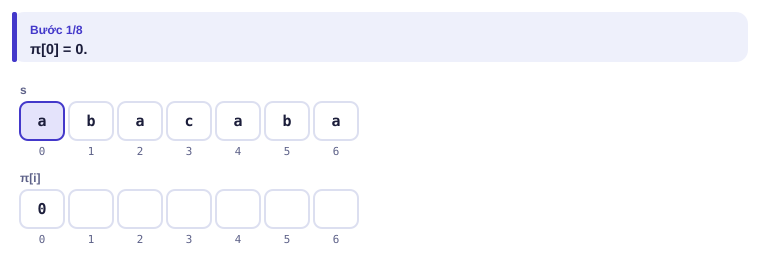
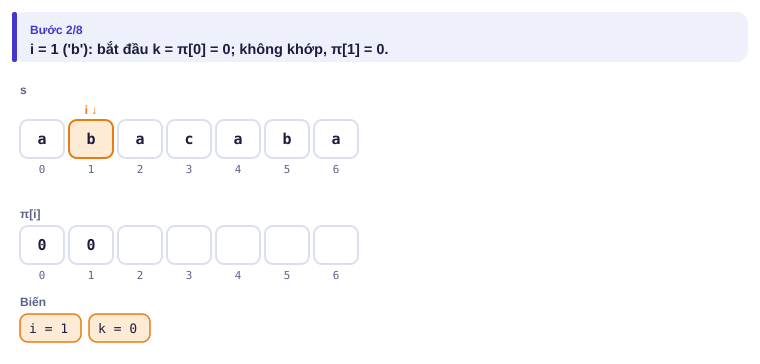
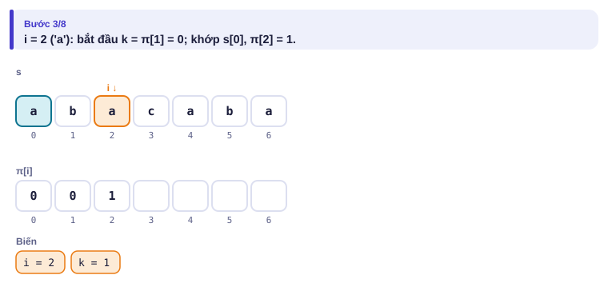

</details>

<details>
<summary><b>Bước 2</b> – i = 3 ('c'): phải lùi</summary>

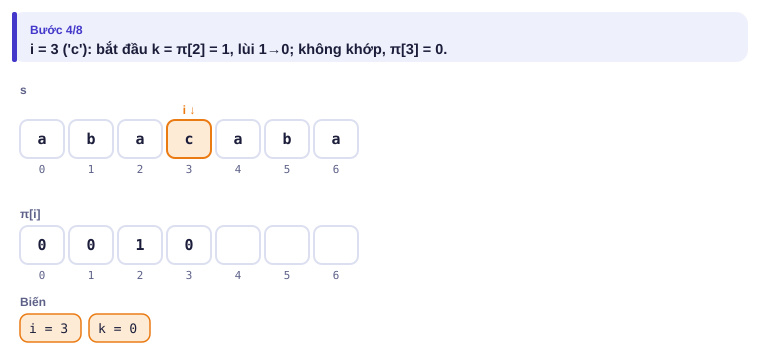

</details>

<details>
<summary><b>Bước 3</b> – i = 4, 5, 6: kéo dài liên tiếp</summary>

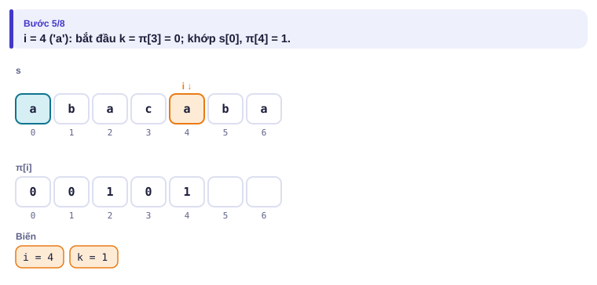
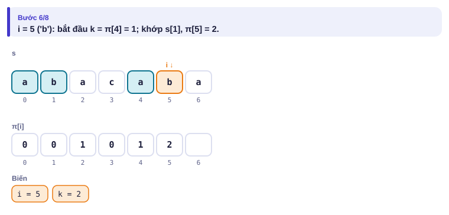
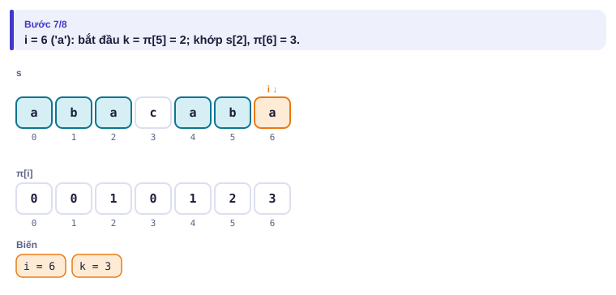

</details>

<details>
<summary><b>Bước 4</b> – Kết quả</summary>

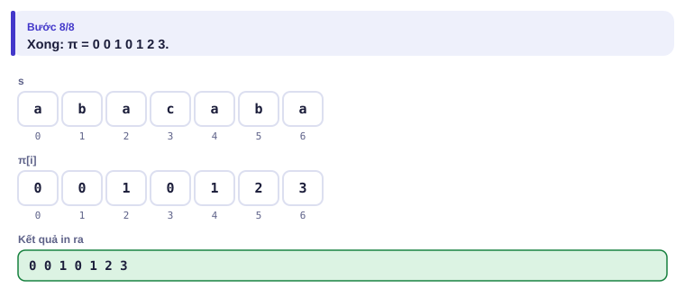

</details>

---

## 5. Mã giả và cài đặt

```cpp
// file: kmp.cpp
#include <bits/stdc++.h>
using namespace std;
int main() {
    string t, p;
    cin >> t >> p;
    string s = p + '#' + t;
    int n = s.size(), m = p.size();
    vector<int> pi(n, 0);
    int dem = 0;
    for (int i = 1; i < n; i++) {
        int k = pi[i - 1];
        while (k > 0 && s[i] != s[k]) k = pi[k - 1];   // lùi về đoạn khớp ngắn hơn
        if (s[i] == s[k]) k++;
        pi[i] = k;
        if (k == m) dem++;
    }
    cout << dem << '\n';
}
```

```python
# file: kmp.py
t = input().strip()
p = input().strip()
s = p + '#' + t
n, m = len(s), len(p)
pi = [0] * n
dem = 0
for i in range(1, n):
    k = pi[i - 1]
    while k > 0 and s[i] != s[k]:
        k = pi[k - 1]
    if s[i] == s[k]:
        k += 1
    pi[i] = k
    if k == m:
        dem += 1
print(dem)
```

### Băm xâu

Đổi mỗi đoạn con thành một **số** (mã băm) sao cho hai đoạn bằng nhau thì cùng mã. Dùng tiền tố như bài 1.3:

h[i] = (h[i−1]·B + s[i−1]) mod M, với cơ số B và modulo M lớn.

Mã của đoạn s[l..r−1] = (h[r] − h[l]·B^(r−l)) mod M: tính O(1) sau O(n) chuẩn bị.

Bài: cho xâu s và q câu hỏi (a, b, c, d): đoạn s[a..b] có **bằng** đoạn s[c..d] không (chỉ số từ 1)?

| Vào | Ra |
| --- | --- |
| `abcabcab`<br>`3`<br>`1 3 4 6`<br>`1 2 7 8`<br>`2 4 3 5` | `YES`<br>`YES`<br>`NO` |

<details>
<summary><b>Hình</b> – mã băm các đoạn (B = 31, M = 1 000 003; mở lần lượt)</summary>

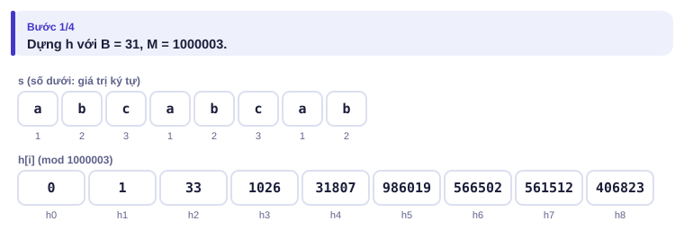
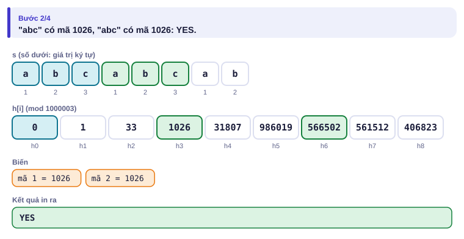
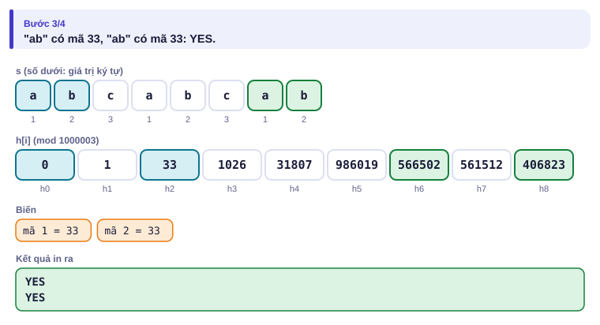
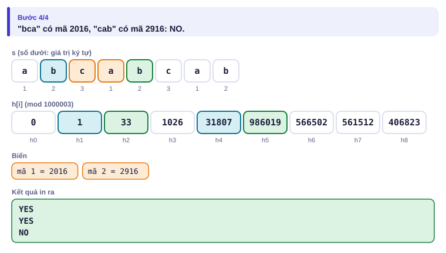

</details>

```cpp
// file: bam_xau.cpp
#include <bits/stdc++.h>
using namespace std;
const long long M1 = 1000000007, M2 = 998244353, B = 131;
int main() {
    ios::sync_with_stdio(false);
    cin.tie(nullptr);
    string s;
    int q;
    cin >> s >> q;
    int n = s.size();
    vector<long long> h1(n + 1, 0), h2(n + 1, 0), p1(n + 1, 1), p2(n + 1, 1);
    for (int i = 0; i < n; i++) {
        h1[i + 1] = (h1[i] * B + s[i]) % M1;
        h2[i + 1] = (h2[i] * B + s[i]) % M2;
        p1[i + 1] = p1[i] * B % M1;
        p2[i + 1] = p2[i] * B % M2;
    }
    auto ma = [&](int l, int r) {                      // mã của s[l..r-1], dùng HAI modulo
        long long x = ((h1[r] - h1[l] * p1[r - l]) % M1 + M1) % M1;
        long long y = ((h2[r] - h2[l] * p2[r - l]) % M2 + M2) % M2;
        return make_pair(x, y);
    };
    while (q--) {
        int a, b, c, d;
        cin >> a >> b >> c >> d;
        bool bang = (b - a == d - c) && ma(a - 1, b) == ma(c - 1, d);
        cout << (bang ? "YES" : "NO") << '\n';
    }
}
```

> [!WARNING]
> **Va chạm.** Hai đoạn **khác** nhau có thể trùng mã. Trên trang mô phỏng, ví dụ "M quá nhỏ: va chạm" dùng B = 2, M = 7: đoạn `ba` và `ac` của `abacbcab` cùng mã 5, chương trình in YES sai. Với một modulo cỡ 10⁹ và 10⁶ câu hỏi, xác suất va chạm không còn nhỏ; người ra đề còn có thể cố ý tạo test làm hỏng một modulo quen thuộc. Dùng **hai** modulo (như trên) hoặc modulo 2⁶¹ − 1, và chọn B ngẫu nhiên khi cần an toàn.

---

## 6. Vì sao đúng, chạy bao lâu

- **Hàm tiền tố đúng:** mọi biên của s[0..i] (trừ biên rỗng) có dạng "một biên của s[0..i−1], kéo dài thêm s[i]". Các biên của s[0..i−1] theo thứ tự giảm dần là π[i−1], π[π[i−1]−1], …: chính là dãy k khi lùi. Ta thử chúng từ dài tới ngắn, lấy cái đầu tiên kéo dài được.
- **Hàm tiền tố nhanh:** k tăng tối đa 1 mỗi bước i, và mỗi lần lùi k giảm ít nhất 1; tổng số lần lùi không vượt tổng số lần tăng: O(n). Tìm mẫu O(|p| + |t|).
- **Ký tự `#`:** không xuất hiện trong p và t, nên π không bao giờ vượt |p|.
- **Băm:** h[r] = h[l]·B^(r−l) + (mã đoạn [l, r)), giống tổng tiền tố có trọng số. Bằng nhau thì chắc chắn cùng mã; cùng mã thì **rất có thể** bằng nhau (xác suất sai khoảng (số lần so) / M cho mỗi modulo).

---

## 7. Bẫy thường gặp

> [!WARNING]
> **Bẫy 1: thiếu ký tự ngăn cách.** Không có `#` giữa p và t thì π có thể vượt |p| và đếm sai.
> *Test phá:* t = `aaa`, p = `aa`: phải ra 2.

> [!WARNING]
> **Bẫy 2: trừ modulo ra số âm.** Cộng thêm M rồi lấy dư lần nữa, như trong hàm `ma`.

> [!WARNING]
> **Bẫy 3: so mã mà quên so độ dài.** Hai đoạn khác độ dài không thể bằng nhau; kiểm tra độ dài trước.

> [!WARNING]
> **Bẫy 4: một modulo nhỏ hoặc cơ số quá nhỏ.** B phải lớn hơn mọi mã ký tự; M phải lớn và tốt nhất là hai modulo.

---

## 8. Ví dụ giảm dần hỗ trợ

### Ví dụ 2 – Điền vào chỗ trống: Biên của xâu

**Biên** của s là xâu vừa là tiền tố vừa là hậu tố của s (khác s). In độ dài mọi biên theo thứ tự tăng dần. (|s| ≤ 10⁶; bài [Finding Borders](https://cses.fi/problemset/task/1732))

| Vào | Ra |
| --- | --- |
| `abcababcab` | `2 5` |

Các biên của s theo độ dài giảm dần là π[n−1], π[π[n−1] − 1], …

```cpp
vector<int> ds;
for (int k = pi[n - 1]; k > 0; k = ____) ds.push_back(k);
reverse(ds.begin(), ds.end());
```

<details>
<summary>Đáp án</summary>

`pi[k - 1]`.

```cpp
// file: bien.cpp
#include <bits/stdc++.h>
using namespace std;
int main() {
    string s;
    cin >> s;
    int n = s.size();
    vector<int> pi(n, 0);
    for (int i = 1; i < n; i++) {
        int k = pi[i - 1];
        while (k > 0 && s[i] != s[k]) k = pi[k - 1];
        if (s[i] == s[k]) k++;
        pi[i] = k;
    }
    vector<int> ds;
    for (int k = pi[n - 1]; k > 0; k = pi[k - 1]) ds.push_back(k);
    reverse(ds.begin(), ds.end());
    for (size_t i = 0; i < ds.size(); i++) cout << ds[i] << (i + 1 == ds.size() ? "" : " ");
    cout << '\n';
}
```

</details>

### Ví dụ 3 – Tự làm: Chu kỳ của xâu

Số p là một **chu kỳ** của s nếu s[i] = s[i + p] với mọi i hợp lệ (s là phần đầu của một xâu lặp lại s[0..p−1] nhiều lần). In mọi chu kỳ theo thứ tự tăng dần (luôn có chu kỳ n). (|s| ≤ 10⁶; bài [Finding Periods](https://cses.fi/problemset/task/1733))

| Vào | Ra |
| --- | --- |
| `abcabca` | `3 6 7` |

> [!IMPORTANT]
> Tự làm trước. Gợi ý: p là chu kỳ khi và chỉ khi s có một biên dài n − p.

<details>
<summary>Lời giải</summary>

Biên dài b ⇔ s[0..b−1] = s[n−b..n−1] ⇔ s[i] = s[i + (n − b)] với mọi i < b ⇔ n − b là chu kỳ. Biên của `abcabca` dài 4 (`abca`) và 1 (`a`): chu kỳ 3 và 6, thêm 7.

```cpp
// file: chu_ky.cpp
#include <bits/stdc++.h>
using namespace std;
int main() {
    string s;
    cin >> s;
    int n = s.size();
    vector<int> pi(n, 0);
    for (int i = 1; i < n; i++) {
        int k = pi[i - 1];
        while (k > 0 && s[i] != s[k]) k = pi[k - 1];
        if (s[i] == s[k]) k++;
        pi[i] = k;
    }
    vector<int> ck;
    for (int k = pi[n - 1]; k > 0; k = pi[k - 1]) ck.push_back(n - k);   // tăng dần vì k giảm dần
    ck.push_back(n);
    for (size_t i = 0; i < ck.size(); i++) cout << ck[i] << (i + 1 == ck.size() ? '\n' : ' ');
}
```

</details>

---

## 9. Bài tập

| Nấc | Bài | Nguồn | Ý chính |
| --- | --- | --- | --- |
| Khởi động | [String Matching](https://cses.fi/problemset/task/1753) | CSES 1753 | Đúng mục 5 |
| Khởi động | [Finding Borders](https://cses.fi/problemset/task/1732) | CSES 1732 | Ví dụ 2 |
| Luyện | [Finding Periods](https://cses.fi/problemset/task/1733) | CSES 1733 | Ví dụ 3 |
| Luyện | [Palindrome Queries](https://cses.fi/problemset/task/2420) | CSES 2420 | Băm + Fenwick/cây phân đoạn (bài 3.4, 3.5) |
| Thử thách | [Longest Palindrome](https://cses.fi/problemset/task/1111) | CSES 1111 | Băm + tìm nhị phân, hoặc Manacher |
| Kiểu đề thi | Đoạn lặp dài nhất | Bài của sách, chấm theo subtask | Xem bên dưới |

### Bài kiểu đề thi: Đoạn lặp dài nhất

**Đề bài.** Nhóm nghiên cứu gen có một chuỗi s gồm chữ cái thường (1 ≤ |s| ≤ 2·10⁵). Tìm độ dài đoạn con dài nhất xuất hiện **ít nhất hai lần** trong s (hai lần xuất hiện được phép chồng lên nhau). In 0 nếu không có. Đọc từ `LAPDAI.INP` (một dòng s), ghi ra `LAPDAI.OUT`.

Subtask: 40% có |s| ≤ 2000; 60% còn lại có |s| ≤ 2·10⁵.

| LAPDAI.INP | LAPDAI.OUT |
| --- | --- |
| `banana` | `3` |
| `abcd` | `0` |

`ana` xuất hiện ở vị trí 2 và 4 (chồng lên nhau).

<details>
<summary><b>Gợi ý 1</b> – hướng đi (đủ 40% điểm)</summary>

QHĐ: L[i][j] = độ dài đoạn chung dài nhất kết thúc tại i và tại j (i < j): L[i][j] = L[i−1][j−1] + 1 nếu s[i] = s[j]. Đáp án là max. O(n²) thời gian; giữ hai hàng để O(n) bộ nhớ.

</details>

<details>
<summary><b>Gợi ý 2</b> – ý then chốt</summary>

Nếu có đoạn dài L lặp lại thì cũng có đoạn dài L − 1 lặp lại (bỏ ký tự cuối). Tính chất đơn điệu: **tìm nhị phân trên L** (bài 1.4). Với một L cố định, kiểm tra "có đoạn dài L lặp lại" bằng cách băm mọi đoạn dài L (O(1) mỗi đoạn) rồi xem có hai mã trùng nhau không (sắp xếp hoặc dùng `set`): O(n log n) mỗi lần kiểm tra.

</details>

<details>
<summary><b>Gợi ý 3</b> – lời giải đầy đủ</summary>

O(n log² n). Dùng hai modulo ghép thành một số 64 bit để so nhanh.

```cpp
// file: lapdai.cpp
#include <bits/stdc++.h>
using namespace std;
const long long M1 = 1000000007, M2 = 998244353, B = 131;
int n;
string s;
vector<long long> h1, h2, p1, p2;
unsigned long long ma(int l, int r) {
    long long x = ((h1[r] - h1[l] * p1[r - l]) % M1 + M1) % M1;
    long long y = ((h2[r] - h2[l] * p2[r - l]) % M2 + M2) % M2;
    return (unsigned long long)x << 32 | (unsigned long long)y;
}
bool co_lap(int L) {                                     // có đoạn dài L xuất hiện >= 2 lần?
    vector<unsigned long long> v;
    v.reserve(n - L + 1);
    for (int i = 0; i + L <= n; i++) v.push_back(ma(i, i + L));
    sort(v.begin(), v.end());
    for (size_t i = 1; i < v.size(); i++) if (v[i] == v[i - 1]) return true;
    return false;
}
int main() {
    freopen("LAPDAI.INP", "r", stdin);
    freopen("LAPDAI.OUT", "w", stdout);
    cin >> s;
    n = s.size();
    h1.assign(n + 1, 0); h2.assign(n + 1, 0); p1.assign(n + 1, 1); p2.assign(n + 1, 1);
    for (int i = 0; i < n; i++) {
        h1[i + 1] = (h1[i] * B + s[i]) % M1;
        h2[i + 1] = (h2[i] * B + s[i]) % M2;
        p1[i + 1] = p1[i] * B % M1;
        p2[i + 1] = p2[i] * B % M2;
    }
    int lo = 0, hi = n - 1;                              // đáp án trong [0, n-1]
    while (lo < hi) {
        int mid = (lo + hi + 1) / 2;
        if (co_lap(mid)) lo = mid; else hi = mid - 1;
    }
    printf("%d\n", lo);
}
```

```python
# file: lapdai.py
import random
with open("LAPDAI.INP") as f:
    s = f.read().split()[0]
n = len(s)
M = (1 << 61) - 1                                       # một modulo rất lớn, Python tính số lớn được
B = random.randrange(10**5, 10**6)
h = [0] * (n + 1)
p = [1] * (n + 1)
for i, ch in enumerate(s):
    h[i + 1] = (h[i] * B + ord(ch)) % M
    p[i + 1] = p[i] * B % M

def co_lap(L):
    da_thay = set()
    pL = p[L]
    for i in range(n - L + 1):
        x = (h[i + L] - h[i] * pL) % M
        if x in da_thay:
            return True
        da_thay.add(x)
    return False

lo, hi = 0, n - 1
while lo < hi:
    mid = (lo + hi + 1) // 2
    if co_lap(mid):
        lo = mid
    else:
        hi = mid - 1
with open("LAPDAI.OUT", "w") as f:
    f.write(f"{lo}\n")
```

</details>

---

## 10. Tóm tắt, flashcard và checkpoint

**Tóm tắt trong 5 dòng.**

1. Hàm tiền tố: đoạn khớp đầu–đuôi dài nhất; tính bằng "kéo dài hoặc lùi"; O(n).
2. Tìm mẫu: π của `p + '#' + t`; mỗi π = |p| là một lần xuất hiện.
3. Các biên: π[n−1], π[π[n−1]−1], …; chu kỳ = n − biên.
4. Băm: mã tiền tố như tổng tiền tố, so đoạn con O(1); luôn dùng hai modulo (hoặc 2⁶¹ − 1).
5. "Đoạn dài nhất thỏa tính chất đơn điệu": tìm nhị phân trên độ dài + băm để kiểm tra.

**Flashcard.**

<details><summary>Hàm tiền tố của <code>aaaa</code>?</summary>0 1 2 3.</details>
<details><summary>Vì sao tổng số lần lùi trong KMP là O(n)?</summary>k tăng tối đa 1 mỗi bước và mỗi lần lùi giảm ít nhất 1.</details>
<details><summary>Chu kỳ nhỏ nhất của <code>abcabca</code>?</summary>3 = 7 − π[6] = 7 − 4.</details>
<details><summary>Mã của đoạn s[l..r−1] tính từ mảng h thế nào?</summary>(h[r] − h[l]·B^(r−l)) mod M.</details>
<details><summary>Vì sao bài Đoạn lặp dài nhất tìm nhị phân được?</summary>Có đoạn dài L lặp lại thì có đoạn dài L − 1 lặp lại.</details>

**Ôn xoắn ốc** (mỗi bài tối đa 20 phút):

- Viết lại QHĐ chữ số Số lộc (bài 3.9) không nhìn sách.
- [Factory Machines](https://cses.fi/problemset/task/1620) (CSES 1620): tìm nhị phân trên đáp án (bài 1.4).
- [Exponentiation](https://cses.fi/problemset/task/1095) (CSES 1095): lũy thừa nhanh (bài 3.6), cần cho B^k trong băm.

**Checkpoint – em đã sẵn sàng sang đề thi thử nếu:**

- [ ] Viết hàm tiền tố không nhìn sách, AC [String Matching](https://cses.fi/problemset/task/1753) và [Finding Borders](https://cses.fi/problemset/task/1732).
- [ ] Giải thích được vì sao băm có thể sai và cách giảm rủi ro.
- [ ] Làm xong Ví dụ 3 (Chu kỳ của xâu) mà không mở lời giải.
- [ ] Đạt trọn điểm bài Đoạn lặp dài nhất khi tự làm trong 40 phút.

Chưa đạt? Nếu vướng ô 1, chạy trang mô phỏng Hàm tiền tố với Đoán trước, đặc biệt ví dụ "lùi nhiều bước". Nếu vướng ô 2, chạy trang Băm xâu với ví dụ va chạm. Nếu vướng ô 3 hoặc 4, đọc lại mục 6 và Gợi ý 2.
