# Bài 3.2 – Cây khung nhỏ nhất và thứ tự tô-pô

> **Tập 3 · Đồ thị và quy hoạch động nâng cao**
> Cần biết trước: bài 2.8 (DSU), bài 2.3 (hàng đợi ưu tiên), bài 1.8 (lập luận hoán đổi), bài 2.9 (QHĐ).
> Thời lượng: khoảng 90 phút đọc, cộng 6 giờ thực hành trong tuần.

**Học xong bài này, em sẽ:**

- nối mọi đỉnh với **tổng chi phí nhỏ nhất** bằng thuật toán **Kruskal**;
- xếp các việc có ràng buộc "việc a phải làm trước việc b" bằng **sắp xếp tô-pô**, và phát hiện ràng buộc mâu thuẫn;
- làm **quy hoạch động trên đồ thị có hướng không chu trình** (DAG) theo thứ tự tô-pô;
- giải trọn bài kiểu đề thi **Lịch thi công**.

> [!TIP]
> **Học cùng hai trang mô phỏng.** [Kruskal](../../mo-phong/t3-kruskal.html): bật **Đoán trước** để quyết định nhận hay bỏ từng cạnh. [Tô-pô](../../mo-phong/t3-topo.html): thử ví dụ "có chu trình" để thấy thuật toán dừng giữa chừng.

---

## 1. Bài toán mở màn: Sửa đường sau lũ

Sau mưa lũ, n xã bị cắt đứt. Có m con đường có thể sửa, sửa đường nối a và b tốn c triệu đồng. Hãy sửa sao cho mọi xã đi lại được với nhau, tốn ít tiền nhất; in `IMPOSSIBLE` nếu không thể. (n ≤ 10⁵, m ≤ 2·10⁵; bài [Road Reparation](https://cses.fi/problemset/task/1675))

| Vào | Ra |
| --- | --- |
| `5 6`<br>`1 2 3`<br>`2 3 5`<br>`2 4 2`<br>`3 4 8`<br>`5 1 7`<br>`5 4 4` | `14` |

---

## 2. Dừng lại 10 phút

> [!IMPORTANT]
> **Dừng lại và nghĩ.**
> 1. Một cách sửa tốt nhất có chứa **vòng** không? (Vòng: đi từ một xã, qua các đường đã sửa, quay về chính nó.)
> 2. Vậy cần sửa đúng bao nhiêu con đường?
> 3. Thử tham lam: xét các con đường từ **rẻ nhất**. Khi nào thì nên **bỏ qua** một con đường dù nó rẻ?

<details>
<summary>Đáp án</summary>

1. Không: bỏ một đường bất kỳ trên vòng thì mọi xã vẫn thông nhau, lại rẻ hơn.
2. n − 1 đường: các đường được sửa tạo thành một **cây khung** (cây nối mọi đỉnh).
3. Bỏ qua khi hai đầu **đã thông nhau**: sửa nó chỉ tạo vòng. Đây là **Kruskal**; kiểm tra "đã thông nhau" bằng DSU (bài 2.8).

</details>

---

## 3. Lời giải ngây thơ và vì sao nó chậm

Thử mọi tập n − 1 con đường, kiểm tra có nối hết không, lấy tập rẻ nhất: C(m, n − 1) tập, với m = 20, n = 10 đã là 167 960 tập; với m = 2·10⁵ thì không tưởng tượng nổi. Một cách "nửa thông minh" là mỗi bước chọn đường rẻ nhất rồi chạy BFS (bài 2.7) kiểm tra có tạo vòng không: O(m·(n + m)) = 6·10¹⁰. Thứ ta cần là kiểm tra "hai xã đã thông nhau chưa" trong O(1) khi các đường được thêm dần: DSU.

---

## 4. Ý tưởng then chốt

> [!IMPORTANT]
> **Kruskal: sắp các cạnh theo chi phí tăng dần; với mỗi cạnh, nếu hai đầu đang ở hai nhóm khác nhau thì nhận cạnh và gộp hai nhóm (DSU), ngược lại bỏ qua. Nhận đủ n − 1 cạnh là xong; không đủ thì đồ thị không liên thông.**

### Chạy từng bước

Với ví dụ mở màn. Đoán nhận hay bỏ rồi mới mở.

<details>
<summary><b>Bước 1</b> – Sắp xếp các cạnh</summary>

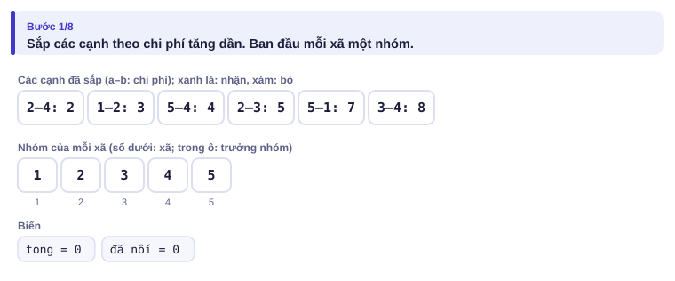

</details>

<details>
<summary><b>Bước 2</b> – Ba cạnh rẻ nhất: 2–4, 1–2, 5–4</summary>

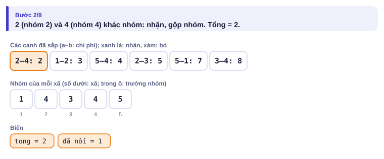
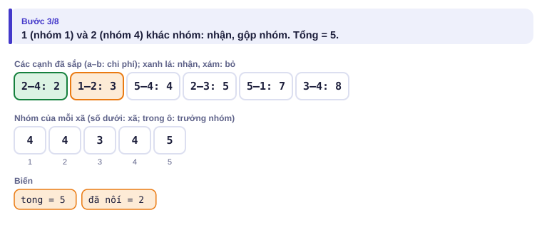
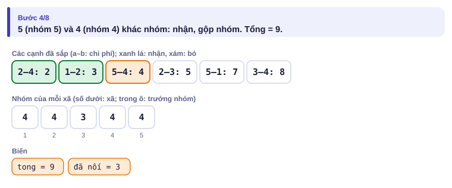

</details>

<details>
<summary><b>Bước 3</b> – Cạnh 2–3 (5): nhận hay bỏ?</summary>

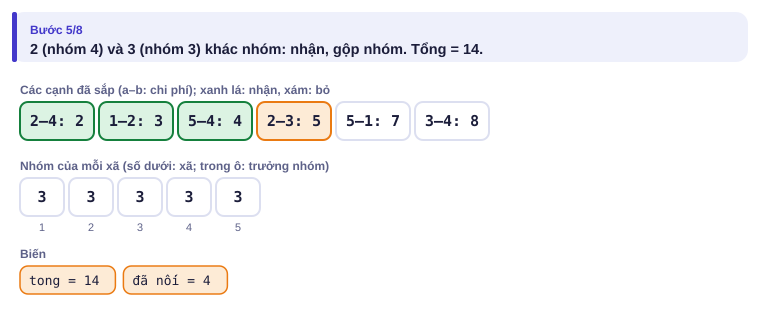

</details>

<details>
<summary><b>Bước 4</b> – Cạnh 5–1 (7) và 3–4 (8): nhận hay bỏ?</summary>

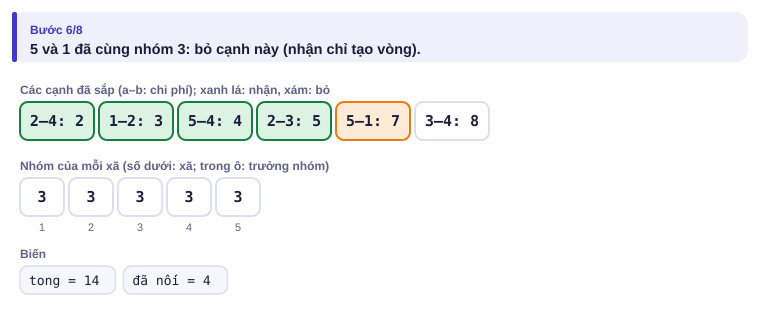
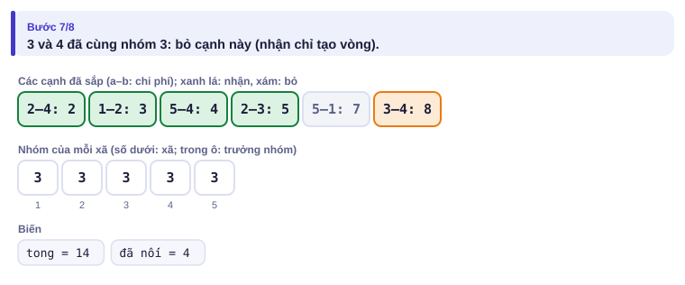

</details>

| Đường (theo chi phí) | Hai đầu cùng nhóm? | Sửa? | Tổng |
| --- | :---: | :---: | :---: |
| 2–4 (2) | không | có | 2 |
| 1–2 (3) | không | có | 5 |
| 5–4 (4) | không | có | 9 |
| 2–3 (5) | không | có | **14** |
| 5–1 (7) | có (5–4–2–1) | không | |
| 3–4 (8) | có | không | |

---

## 5. Mã giả và cài đặt

```cpp
// file: kruskal.cpp
#include <bits/stdc++.h>
using namespace std;
vector<int> cha;
int tim(int u) { while (cha[u] != u) u = cha[u] = cha[cha[u]]; return u; }
int main() {
    ios::sync_with_stdio(false);
    cin.tie(nullptr);
    int n, m;
    cin >> n >> m;
    vector<array<long long, 3>> e(m);               // {chi phí, a, b}
    for (auto &[c, a, b] : e) cin >> a >> b >> c;
    sort(e.begin(), e.end());
    cha.resize(n + 1);
    iota(cha.begin(), cha.end(), 0);
    long long tong = 0;
    int da_noi = 0;
    for (auto [c, a, b] : e) {
        int x = tim(a), y = tim(b);
        if (x == y) continue;                       // đã thông nhau: bỏ
        cha[x] = y;
        tong += c;
        da_noi++;
    }
    if (da_noi == n - 1) cout << tong << '\n';
    else cout << "IMPOSSIBLE\n";
}
```

```python
# file: kruskal.py
import sys
data = sys.stdin.buffer.read().split()
n, m = int(data[0]), int(data[1])
e = sorted((int(data[4 + 3 * i]), int(data[2 + 3 * i]), int(data[3 + 3 * i])) for i in range(m))
cha = list(range(n + 1))

def tim(u):
    while cha[u] != u:
        cha[u] = cha[cha[u]]
        u = cha[u]
    return u

tong = da_noi = 0
for c, a, b in e:
    x, y = tim(a), tim(b)
    if x != y:
        cha[x] = y
        tong += c
        da_noi += 1
print(tong if da_noi == n - 1 else "IMPOSSIBLE")
```

### Sắp xếp tô-pô

Có n môn học và m ràng buộc "phải học môn a **trước** môn b". In một thứ tự học hợp lệ; nếu có nhiều, in thứ tự **nhỏ nhất theo từ điển**; nếu ràng buộc mâu thuẫn, in `IMPOSSIBLE`.

| Vào | Ra |
| --- | --- |
| `5 3`<br>`1 2`<br>`3 1`<br>`4 5` | `3 1 2 4 5` |

Ý tưởng (thuật toán Kahn): môn **không còn môn nào phải học trước** (bậc vào bằng 0) thì học được ngay. Học xong thì "gỡ" các ràng buộc đi ra từ nó. Muốn thứ tự nhỏ nhất, luôn chọn môn có số nhỏ nhất trong các môn học được: dùng heap nhỏ nhất.

<details>
<summary><b>Hình</b> – tô-pô trên ví dụ (mở lần lượt; đoán môn học tiếp theo)</summary>

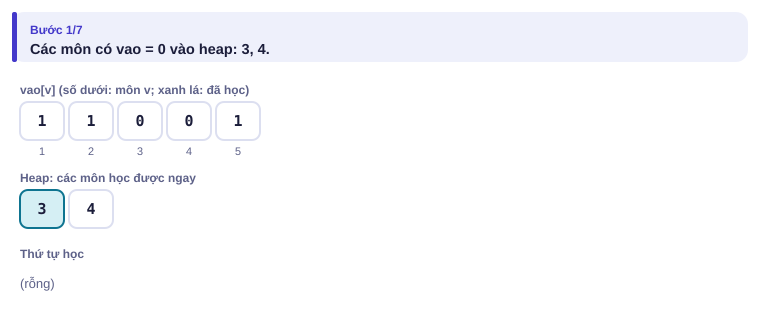
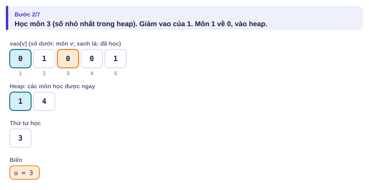
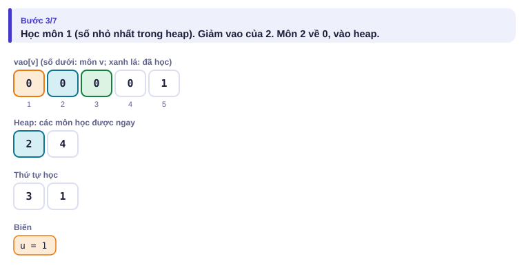
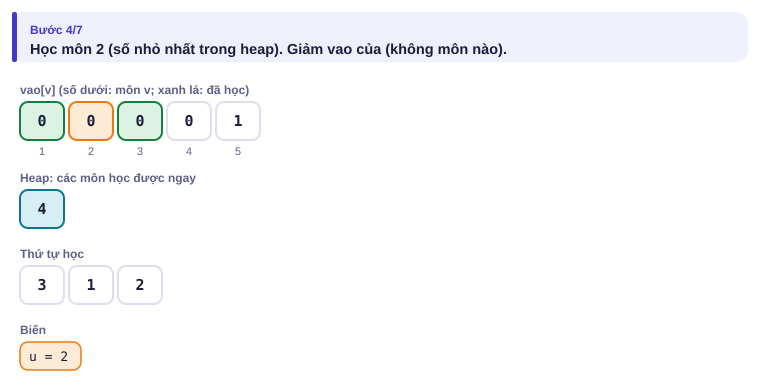
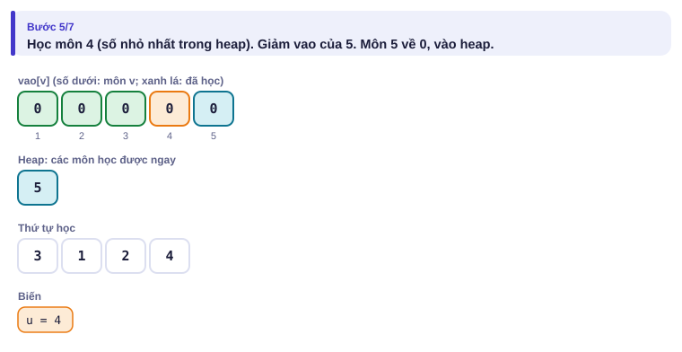
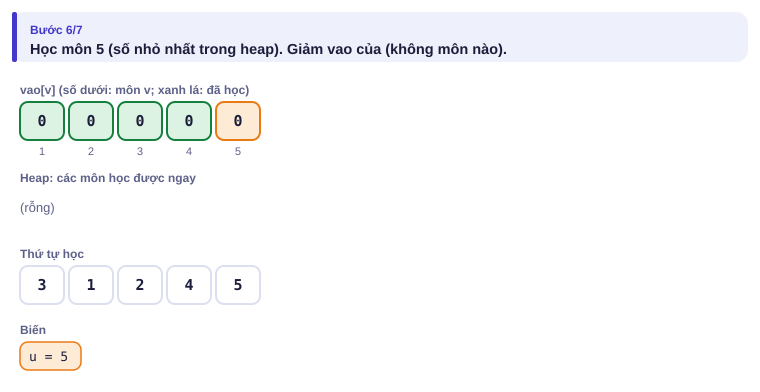

</details>

```cpp
// file: topo.cpp
#include <bits/stdc++.h>
using namespace std;
int main() {
    int n, m;
    cin >> n >> m;
    vector<vector<int>> adj(n + 1);
    vector<int> vao(n + 1, 0);                     // số môn phải học trước
    for (int i = 0; i < m; i++) {
        int a, b;
        cin >> a >> b;
        adj[a].push_back(b);
        vao[b]++;
    }
    priority_queue<int, vector<int>, greater<int>> pq;
    for (int i = 1; i <= n; i++) if (vao[i] == 0) pq.push(i);
    vector<int> thu_tu;
    while (!pq.empty()) {
        int u = pq.top(); pq.pop();
        thu_tu.push_back(u);
        for (int v : adj[u]) if (--vao[v] == 0) pq.push(v);
    }
    if ((int)thu_tu.size() < n) { cout << "IMPOSSIBLE\n"; return 0; }   // còn môn kẹt trong chu trình
    for (int i = 0; i < n; i++) cout << thu_tu[i] << (i + 1 == n ? '\n' : ' ');
}
```

> [!NOTE]
> **QHĐ trên DAG.** Thứ tự tô-pô cho ta "thứ tự tính" của QHĐ (bài 2.9): xét các đỉnh theo thứ tự tô-pô thì mọi đỉnh đi trước đã được tính xong. Ví dụ 2, Ví dụ 3 và bài Lịch thi công đều dùng đúng ý này. Nếu không cần thứ tự nhỏ nhất theo từ điển, dùng hàng đợi thường thay cho heap: O(n + m).

---

## 6. Vì sao đúng, chạy bao lâu

- **Kruskal đúng (lập luận hoán đổi):** giả sử có cây tối ưu T không chứa cạnh e đầu tiên Kruskal chọn khác T. Thêm e vào T tạo một vòng; trên vòng có cạnh f không thuộc cây của Kruskal, và f không rẻ hơn e (nếu rẻ hơn, Kruskal đã xét f trước và f nối hai nhóm khác nhau nên đã được nhận). Đổi f thành e: vẫn là cây khung, tổng không tăng. Lặp lại tới khi T trùng cây Kruskal.
- **Kruskal nhanh:** sắp xếp O(m log m), DSU gần O(1) mỗi cạnh.
- **Tô-pô đúng:** một môn chỉ vào heap khi mọi môn phải học trước đã được học. Nếu có chu trình, không môn nào trên chu trình có bậc vào về 0, nên thứ tự thiếu môn. Ngược lại, đồ thị không chu trình luôn có đỉnh bậc vào 0, nên thuật toán xếp đủ n môn.
- **Tô-pô:** mỗi đỉnh vào/ra heap một lần, mỗi cạnh giảm bậc một lần: O((n + m) log n), hoặc O(n + m) với hàng đợi thường.

---

## 7. Bẫy thường gặp

> [!WARNING]
> **Bẫy 1: Kruskal không kiểm tra liên thông.** Đồ thị không liên thông thì không có cây khung; đếm số cạnh đã chọn, phải đủ n − 1.
> *Test phá:* `4 2` / `1 2 1` / `3 4 1`: phải in `IMPOSSIBLE`, không phải 2.

> [!WARNING]
> **Bẫy 2: tô-pô "thiếu đỉnh" là có chu trình.** Sau thuật toán chưa xếp đủ n môn thì các môn còn lại nằm trong một vòng chờ nhau.
> *Test phá:* ví dụ "có chu trình" trên trang mô phỏng.

> [!WARNING]
> **Bẫy 3: tổng chi phí tràn số.** 10⁵ cạnh × 10⁹: `long long`.

> [!WARNING]
> **Bẫy 4: QHĐ trên DAG nhưng duyệt theo số hiệu đỉnh.** Đỉnh 5 có thể phải tính trước đỉnh 2. Luôn duyệt theo thứ tự tô-pô.
> *Test phá:* Ví dụ 2 với cạnh `3 2`: đỉnh 2 phải tính sau đỉnh 3.

---

## 8. Ví dụ giảm dần hỗ trợ

### Ví dụ 2 – Điền vào chỗ trống: Đếm lộ trình trên DAG

Trò chơi có n màn và m lối đi một chiều, không có vòng. Có bao nhiêu lộ trình từ màn 1 tới màn n? In chia dư 10⁹ + 7. (n ≤ 10⁵, m ≤ 2·10⁵; bài [Game Routes](https://cses.fi/problemset/task/1681))

| Vào | Ra |
| --- | --- |
| `4 5`<br>`1 2`<br>`2 4`<br>`1 3`<br>`3 4`<br>`1 4` | `3` |

f[v] = số lộ trình từ 1 tới v. Duyệt các màn theo thứ tự tô-pô; từ màn u, mọi lộ trình tới u kéo dài thêm cạnh u → v.

```cpp
f[1] = ____;
for (int u : thu_tu)                 // thứ tự tô-pô
    for (int v : adj[u])
        f[v] = (f[v] + ____) % MOD;
```

<details>
<summary>Đáp án</summary>

`1` và `f[u]`.

```cpp
// file: dem_lo_trinh.cpp
#include <bits/stdc++.h>
using namespace std;
int main() {
    ios::sync_with_stdio(false);
    cin.tie(nullptr);
    const long long MOD = 1e9 + 7;
    int n, m;
    cin >> n >> m;
    vector<vector<int>> adj(n + 1);
    vector<int> vao(n + 1, 0);
    for (int i = 0; i < m; i++) {
        int a, b;
        cin >> a >> b;
        adj[a].push_back(b);
        vao[b]++;
    }
    queue<int> q;
    for (int i = 1; i <= n; i++) if (vao[i] == 0) q.push(i);
    vector<long long> f(n + 1, 0);
    f[1] = 1;
    while (!q.empty()) {
        int u = q.front(); q.pop();
        for (int v : adj[u]) {
            f[v] = (f[v] + f[u]) % MOD;
            if (--vao[v] == 0) q.push(v);
        }
    }
    cout << f[n] << '\n';
}
```

</details>

### Ví dụ 3 – Tự làm: Chuyến bay qua nhiều thành phố nhất

n thành phố, m chuyến bay một chiều, không có vòng. Bay từ 1 tới n qua **nhiều thành phố nhất** (tính cả 1 và n) là bao nhiêu? In `IMPOSSIBLE` nếu không tới được. (n ≤ 10⁵, m ≤ 2·10⁵; giống [Longest Flight Route](https://cses.fi/problemset/task/1680) nhưng chỉ in số thành phố)

| Vào | Ra |
| --- | --- |
| `5 5`<br>`1 2`<br>`2 5`<br>`1 3`<br>`3 4`<br>`4 5` | `4` |

> [!IMPORTANT]
> Tự làm trước. Gợi ý: g[v] = số thành phố nhiều nhất trên một đường từ 1 tới v, hoặc −∞ nếu chưa tới được. Đừng quên các thành phố không tới được từ 1 vẫn phải đi qua thuật toán tô-pô để "gỡ" ràng buộc.

<details>
<summary>Lời giải</summary>

```cpp
// file: bay_xa.cpp
#include <bits/stdc++.h>
using namespace std;
int main() {
    ios::sync_with_stdio(false);
    cin.tie(nullptr);
    int n, m;
    cin >> n >> m;
    vector<vector<int>> adj(n + 1);
    vector<int> vao(n + 1, 0);
    for (int i = 0; i < m; i++) {
        int a, b;
        cin >> a >> b;
        adj[a].push_back(b);
        vao[b]++;
    }
    const int AM = INT_MIN;                       // chưa tới được
    vector<int> g(n + 1, AM);
    g[1] = 1;
    queue<int> q;
    for (int i = 1; i <= n; i++) if (vao[i] == 0) q.push(i);
    while (!q.empty()) {
        int u = q.front(); q.pop();
        for (int v : adj[u]) {
            if (g[u] != AM) g[v] = max(g[v], g[u] + 1);
            if (--vao[v] == 0) q.push(v);
        }
    }
    if (g[n] == AM) cout << "IMPOSSIBLE\n";
    else cout << g[n] << '\n';
}
```

</details>

---

## 9. Bài tập

| Nấc | Bài | Nguồn | Ý chính |
| --- | --- | --- | --- |
| Khởi động | [Road Reparation](https://cses.fi/problemset/task/1675) | CSES 1675 | Đúng mục 5 |
| Khởi động | [Course Schedule](https://cses.fi/problemset/task/1679) | CSES 1679 | Tô-pô (in thứ tự bất kỳ) |
| Luyện | [Game Routes](https://cses.fi/problemset/task/1681) | CSES 1681 | Ví dụ 2 |
| Luyện | [Longest Flight Route](https://cses.fi/problemset/task/1680) | CSES 1680 | Ví dụ 3 + in đường đi (lưu đỉnh trước) |
| Luyện | [Road Construction](https://cses.fi/problemset/task/1676) | CSES 1676 | DSU (bài 2.8), nền của Kruskal |
| Thử thách | [Course Schedule II](https://cses.fi/problemset/task/1757) | CSES 1757 | Tô-pô trên đồ thị ngược + heap lớn nhất |
| Kiểu đề thi | Lịch thi công | Bài của sách, chấm theo subtask | Xem bên dưới |

### Bài kiểu đề thi: Lịch thi công

**Đề bài.** Công trình nhà văn hóa gồm n hạng mục (1 ≤ n ≤ 10⁵); hạng mục i cần tᵢ ngày (1 ≤ tᵢ ≤ 10⁴). Có m ràng buộc (m ≤ 2·10⁵) dạng "hạng mục a phải **xong** thì hạng mục b mới được bắt đầu". Các hạng mục không ràng buộc nhau có thể làm **song song** (đội thi công đủ đông). Công trình xong sớm nhất sau bao nhiêu ngày? In −1 nếu ràng buộc mâu thuẫn. Đọc từ `THICONG.INP` (dòng đầu n m, dòng hai t₁ … tₙ, m dòng sau là a b), ghi ra `THICONG.OUT`.

Subtask: 30% có m = n − 1 và ràng buộc thứ i là "i trước i + 1"; 30% có n ≤ 1000; 40% còn lại không có ràng buộc thêm.

| THICONG.INP | THICONG.OUT |
| --- | --- |
| `5 4`<br>`3 2 4 1 2`<br>`1 3`<br>`2 3`<br>`3 5`<br>`4 5` | `9` |

Hạng mục 3 bắt đầu khi 1 (xong ngày 3) và 2 (xong ngày 2) đều xong, tức sau ngày 3; nó xong ngày 7. Hạng mục 5 xong ngày 7 + 2 = 9.

<details>
<summary><b>Gợi ý 1</b> – hướng đi (30% rồi 60% điểm)</summary>

Subtask 1 là một dây chuyền: đáp án là tổng mọi tᵢ.

n ≤ 1000: gọi xong[i] là ngày hạng mục i xong sớm nhất. Lặp n lượt, mỗi lượt cập nhật xong[b] = max(xong[b], xong[a] + t_b) cho mọi ràng buộc (giống Bellman–Ford, bài 3.1). Nếu lượt thứ n + 1 vẫn thay đổi thì có chu trình. O(n·m).

</details>

<details>
<summary><b>Gợi ý 2</b> – ý then chốt</summary>

xong[b] = t_b + max(xong[a]) với mọi a phải làm trước b (bằng t_b nếu không có). Đây là QHĐ trên DAG: tính theo **thứ tự tô-pô**. Đáp án là max mọi xong[i]. Tô-pô thiếu hạng mục thì in −1.

</details>

<details>
<summary><b>Gợi ý 3</b> – lời giải đầy đủ</summary>

O(n + m). Chuỗi hạng mục quyết định đáp án gọi là **đường găng** (critical path).

```cpp
// file: thicong.cpp
#include <bits/stdc++.h>
using namespace std;
int main() {
    freopen("THICONG.INP", "r", stdin);
    freopen("THICONG.OUT", "w", stdout);
    int n, m;
    scanf("%d %d", &n, &m);
    vector<long long> t(n + 1), bat_dau(n + 1, 0);   // bat_dau[i]: sớm nhất được bắt đầu
    for (int i = 1; i <= n; i++) scanf("%lld", &t[i]);
    vector<vector<int>> adj(n + 1);
    vector<int> vao(n + 1, 0);
    for (int i = 0; i < m; i++) {
        int a, b;
        scanf("%d %d", &a, &b);
        adj[a].push_back(b);
        vao[b]++;
    }
    queue<int> q;
    for (int i = 1; i <= n; i++) if (vao[i] == 0) q.push(i);
    int da_xep = 0;
    long long ans = 0;
    while (!q.empty()) {
        int u = q.front(); q.pop();
        da_xep++;
        long long xong = bat_dau[u] + t[u];
        ans = max(ans, xong);
        for (int v : adj[u]) {
            bat_dau[v] = max(bat_dau[v], xong);
            if (--vao[v] == 0) q.push(v);
        }
    }
    printf("%lld\n", da_xep == n ? ans : -1LL);
}
```

```python
# file: thicong.py
from collections import deque
with open("THICONG.INP") as f:
    data = f.read().split()
n, m = int(data[0]), int(data[1])
t = [0] + [int(x) for x in data[2:2 + n]]
adj = [[] for _ in range(n + 1)]
vao = [0] * (n + 1)
p = 2 + n
for _ in range(m):
    a, b = int(data[p]), int(data[p + 1])
    p += 2
    adj[a].append(b)
    vao[b] += 1
bat_dau = [0] * (n + 1)
q = deque(i for i in range(1, n + 1) if vao[i] == 0)
da_xep = ans = 0
while q:
    u = q.popleft()
    da_xep += 1
    xong = bat_dau[u] + t[u]
    ans = max(ans, xong)
    for v in adj[u]:
        if xong > bat_dau[v]:
            bat_dau[v] = xong
        vao[v] -= 1
        if vao[v] == 0:
            q.append(v)
with open("THICONG.OUT", "w") as f:
    f.write(f"{ans if da_xep == n else -1}\n")
```

</details>

---

## 10. Tóm tắt, flashcard và checkpoint

**Tóm tắt trong 5 dòng.**

1. Cây khung nhỏ nhất: n − 1 cạnh, không vòng; Kruskal = sắp cạnh tăng dần + DSU.
2. Kruskal phải đếm số cạnh nhận được để phát hiện đồ thị không liên thông.
3. Tô-pô (Kahn): lấy dần đỉnh bậc vào 0; heap nếu cần thứ tự nhỏ nhất; thiếu đỉnh nghĩa là có chu trình.
4. Thứ tự tô-pô là thứ tự tính cho QHĐ trên DAG: đếm đường, đường dài nhất, đường găng.
5. Mọi thao tác: O(m log m) cho Kruskal, O(n + m) cho tô-pô với hàng đợi thường.

**Flashcard.**

<details><summary>Cây khung của n đỉnh có bao nhiêu cạnh?</summary>n − 1.</details>
<details><summary>Kruskal bỏ một cạnh khi nào?</summary>Khi hai đầu đã cùng nhóm trong DSU.</details>
<details><summary>Làm sao biết ràng buộc học trước có mâu thuẫn?</summary>Thuật toán tô-pô không xếp đủ n đỉnh.</details>
<details><summary>Đếm lộ trình trên DAG: f[v] tính từ đâu?</summary>Tổng f[u] với mọi cạnh u → v, duyệt u theo thứ tự tô-pô.</details>
<details><summary>Lịch thi công: hạng mục b bắt đầu sớm nhất khi nào?</summary>Khi mọi hạng mục phải làm trước nó đã xong: max ngày xong của chúng.</details>

**Ôn xoắn ốc** (mỗi bài tối đa 20 phút):

- Viết lại Dijkstra (bài 3.1) không nhìn sách.
- [Road Construction](https://cses.fi/problemset/task/1676) (CSES 1676): DSU (bài 2.8).
- [Room Allocation](https://cses.fi/problemset/task/1164) (CSES 1164): heap (bài 2.3).

**Checkpoint – em đã sẵn sàng sang bài tiếp theo nếu:**

- [ ] AC [Road Reparation](https://cses.fi/problemset/task/1675) và [Course Schedule](https://cses.fi/problemset/task/1679).
- [ ] Giải thích được bằng lời lập luận hoán đổi cho Kruskal.
- [ ] Làm xong Ví dụ 3 (Chuyến bay qua nhiều thành phố nhất) mà không mở lời giải.
- [ ] Đạt trọn điểm bài Lịch thi công khi tự làm trong 30 phút.

Chưa đạt? Nếu vướng ô 1, chạy trang mô phỏng Kruskal và Tô-pô với Đoán trước. Nếu vướng ô 2, đọc lại mục 6 và bài 1.8. Nếu vướng ô 3 hoặc 4, làm lại Ví dụ 2 rồi đọc lại Bẫy 4.
