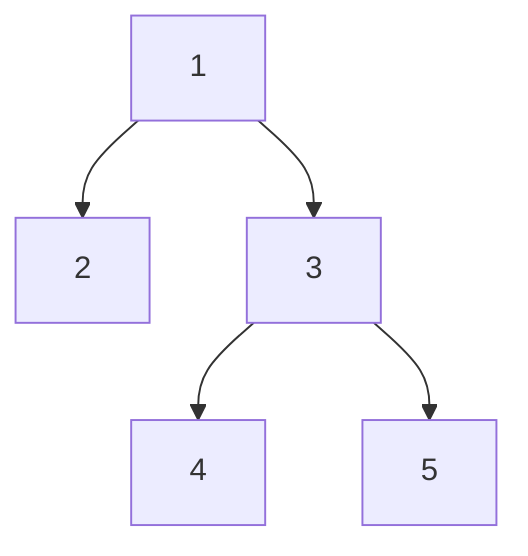

# Bài 3.3 – Cây và tổ tiên chung gần nhất (LCA)

> **Tập 3** · Cần biết trước: bài 2.7, 2.8 (đồ thị hàm) · Thời lượng: khoảng 90 phút đọc, 6 giờ thực hành

**Học xong bài này, em sẽ:**

- duyệt cây có gốc, tính độ sâu và cha của mỗi đỉnh;
- **nhảy nhị phân**: đi lên k bước trong O(log k) thay vì k bước;
- tìm **tổ tiên chung gần nhất** (LCA) của hai đỉnh trong O(log n).

---

## 1. Bài toán mở màn: Sếp chung

Công ty có n nhân viên; nhân viên 1 là giám đốc, mỗi người khác có đúng một sếp trực tiếp. Có q câu hỏi: với hai nhân viên a và b, ai là **sếp chung cấp thấp nhất** của họ (một người được coi là sếp của chính mình)? (n, q ≤ 2·10⁵; bài [Company Queries II](https://cses.fi/problemset/task/1688))

| Vào | Ra |
| --- | --- |
| `5 3`<br>`1 1 3 3`<br>`4 5`<br>`2 5`<br>`1 4` | `3`<br>`1`<br>`1` |

Dòng thứ hai là sếp của nhân viên 2, 3, 4, 5.



> [!IMPORTANT]
> **Dừng lại và nghĩ.** Cách thẳng: đưa a và b về **cùng độ sâu**, rồi cùng đi lên từng bước tới khi gặp nhau. Cây là một đường thẳng dài 2·10⁵ thì mỗi câu hỏi tốn bao nhiêu bước?

<details>
<summary>Đáp án</summary>

Tới 2·10⁵ bước mỗi câu, q câu là 4·10¹⁰: quá chậm. Cần đi lên nhiều bước một lúc.

</details>

---

## 2. Nhảy nhị phân

Lưu `up[j][v]` = tổ tiên cách v đúng **2ʲ** bước (0 nếu vượt quá gốc).

- `up[0][v]` = cha của v.
- `up[j][v] = up[j−1][ up[j−1][v] ]`: nhảy 2ʲ = nhảy 2ʲ⁻¹ hai lần.

Muốn đi lên k bước: viết k ở dạng nhị phân, bit j bật thì nhảy `up[j]`. Ví dụ k = 13 = 8 + 4 + 1: ba lần nhảy thay vì 13 bước.

## 3. LCA bằng nhảy nhị phân

1. Đưa đỉnh sâu hơn lên **bằng độ sâu** đỉnh kia (nhảy đúng hiệu độ sâu).
2. Nếu đã trùng nhau: đó là LCA.
3. Ngược lại, với j từ lớn tới nhỏ: nếu `up[j][a] != up[j][b]` thì cùng nhảy lên (vẫn chưa gặp nhau). Cuối cùng a, b là hai con khác nhau của LCA: đáp án là `up[0][a]`.

Với câu hỏi (4, 5): cùng độ sâu 2; `up[0][4] = up[0][5] = 3` nên không nhảy; đáp án `up[0][4] = 3`.

```cpp
// file: lca.cpp
#include <bits/stdc++.h>
using namespace std;
const int LOG = 18;                                  // 2^18 > 2·10^5
int main() {
    ios::sync_with_stdio(false);
    cin.tie(nullptr);
    int n, q;
    cin >> n >> q;
    vector<vector<int>> con(n + 1);
    vector<vector<int>> up(LOG, vector<int>(n + 1, 0));
    for (int v = 2; v <= n; v++) {
        cin >> up[0][v];
        con[up[0][v]].push_back(v);
    }
    vector<int> sau(n + 1, 0);                       // độ sâu, tính bằng BFS từ gốc
    queue<int> bq;
    bq.push(1);
    while (!bq.empty()) {
        int u = bq.front(); bq.pop();
        for (int v : con[u]) { sau[v] = sau[u] + 1; bq.push(v); }
    }
    for (int j = 1; j < LOG; j++)
        for (int v = 1; v <= n; v++) up[j][v] = up[j - 1][up[j - 1][v]];
    while (q--) {
        int a, b;
        cin >> a >> b;
        if (sau[a] < sau[b]) swap(a, b);
        int k = sau[a] - sau[b];
        for (int j = 0; j < LOG; j++) if (k >> j & 1) a = up[j][a];   // đưa về cùng độ sâu
        if (a != b) {
            for (int j = LOG - 1; j >= 0; j--)
                if (up[j][a] != up[j][b]) { a = up[j][a]; b = up[j][b]; }
            a = up[0][a];
        }
        cout << a << '\n';
    }
}
```

Chuẩn bị O(n log n), mỗi câu hỏi O(log n). Đỉnh 0 làm "đỉnh ảo trên gốc": `up[j][1] = 0` và `up[j][0] = 0`.

> [!NOTE]
> **Khoảng cách trên cây** giữa a và b = sau[a] + sau[b] − 2·sau[LCA(a, b)]. Nhảy nhị phân cũng giải được bài "đi k bước trên đồ thị hàm" nhắc ở bài 2.8 ([Planets Queries I](https://cses.fi/problemset/task/1750)).

---

## 4. Bẫy thường gặp

> [!WARNING]
> **Bẫy 1: LOG quá nhỏ.** Cây sâu tới n − 1; cần 2^LOG > n. Với n = 2·10⁵, LOG = 18 là đủ.

> [!WARNING]
> **Bẫy 2: DFS đệ quy để tính độ sâu.** Cây dạng đường thẳng sâu 2·10⁵: đệ quy có thể tràn ngăn xếp. Dùng BFS hoặc ngăn xếp tự quản.

> [!WARNING]
> **Bẫy 3: quên trường hợp một đỉnh là tổ tiên của đỉnh kia.** Sau bước 1 mà a = b thì trả về ngay, không làm bước 3.

---

## 5. Bài tập

| Nấc | Bài | Nguồn | Ý chính |
| --- | --- | --- | --- |
| Khởi động | [Subordinates](https://cses.fi/problemset/task/1674) | CSES 1674 | Kích thước cây con |
| Khởi động | [Company Queries I](https://cses.fi/problemset/task/1687) | CSES 1687 | Đi lên k bước |
| Luyện | [Company Queries II](https://cses.fi/problemset/task/1688) | CSES 1688 | Đúng mục 3 |
| Luyện | [Tree Diameter](https://cses.fi/problemset/task/1131) | CSES 1131 | Hai lần BFS |
| Luyện | [Distance Queries](https://cses.fi/problemset/task/1135) | CSES 1135 | Khoảng cách qua LCA |
| Thử thách | [Planets Queries I](https://cses.fi/problemset/task/1750) | CSES 1750 | Nhảy nhị phân trên đồ thị hàm |

---

## 6. Tóm tắt và checkpoint

1. `up[j][v]` = tổ tiên cách 2ʲ bước; tính bằng hai lần nhảy 2ʲ⁻¹.
2. LCA: đưa về cùng độ sâu, rồi nhảy từ bước lớn tới nhỏ khi tổ tiên còn khác nhau.
3. Khoảng cách = sau[a] + sau[b] − 2·sau[LCA].

<details><summary>Đi lên 10 bước bằng nhảy nhị phân gồm những bước nhảy nào?</summary>10 = 8 + 2: nhảy <code>up[3]</code> và <code>up[1]</code>.</details>

**Checkpoint:**

- [ ] Viết LCA không nhìn sách, AC Company Queries II.
- [ ] AC Distance Queries.
