# Bài 3.3 – Cây và tổ tiên chung gần nhất (LCA)

> **Tập 3 · Đồ thị và quy hoạch động nâng cao**
> Cần biết trước: bài 2.7 (BFS), bài 2.8 (đồ thị hàm), bài 2.5 (bit).
> Thời lượng: khoảng 100 phút đọc, cộng 6 giờ thực hành trong tuần.

**Học xong bài này, em sẽ:**

- duyệt cây có gốc, tính độ sâu và cha của mỗi đỉnh mà không cần đệ quy;
- tìm **đường kính** cây bằng hai lần BFS;
- **nhảy nhị phân**: đi lên k bước trong O(log k) thay vì k bước;
- tìm **tổ tiên chung gần nhất** (LCA) của hai đỉnh trong O(log n), và tính khoảng cách trên cây;
- giải trọn bài kiểu đề thi **Họp nhóm**.

> [!TIP]
> **Học cùng hai trang mô phỏng.** [Nhảy nhị phân và LCA](../../mo-phong/t3-lca.html): bật **Đoán trước** để quyết định "cùng nhảy hay không" ở mỗi j. [Đường kính cây](../../mo-phong/t3-duong-kinh.html): thử ví dụ "hình sao" và "gốc lệch".

---

## 1. Bài toán mở màn: Sếp chung

Công ty có n nhân viên; nhân viên 1 là giám đốc, mỗi người khác có đúng một sếp trực tiếp. Có q câu hỏi: với hai nhân viên a và b, ai là **sếp chung cấp thấp nhất** của họ (một người được coi là sếp của chính mình)? (n, q ≤ 2·10⁵; bài [Company Queries II](https://cses.fi/problemset/task/1688))

| Vào | Ra |
| --- | --- |
| `12 3`<br>`1 2 3 4 5 6 2 8 9 10 4`<br>`7 11`<br>`12 7`<br>`10 6` | `2`<br>`4`<br>`2` |

Dòng thứ hai là sếp của nhân viên 2, 3, …, 12.

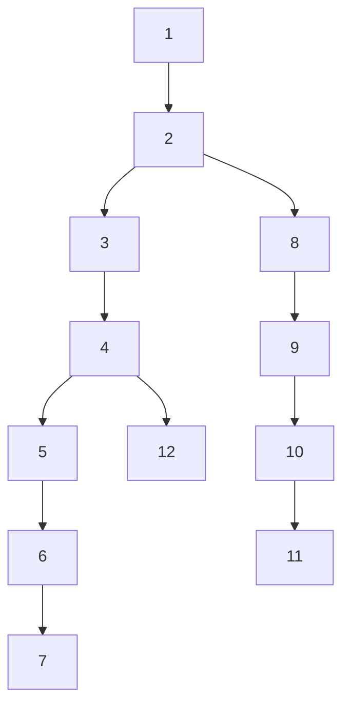

---

## 2. Dừng lại 10 phút

> [!IMPORTANT]
> **Dừng lại và nghĩ.**
> 1. Cách thẳng: đưa a và b về **cùng độ sâu**, rồi cùng đi lên từng bước tới khi gặp nhau. Với câu (7, 11), mỗi người đi bao nhiêu bước?
> 2. Cây là một đường thẳng dài 2·10⁵ thì mỗi câu hỏi tốn tới bao nhiêu bước? q câu?
> 3. Em đã thấy ở bài 2.5 rằng mọi số k viết được thành tổng các lũy thừa của 2 khác nhau. Nếu biết sẵn "tổ tiên cách 1, 2, 4, 8… bước", đi lên 13 bước cần mấy lần nhảy?

<details>
<summary>Đáp án</summary>

1. 7 ở độ sâu 6, 11 ở độ sâu 5: 7 đi lên 1 bước tới 6; rồi cả hai cùng đi lên 4 bước: 6 → 5 → 4 → 3 → 2 và 11 → 10 → 9 → 8 → 2.
2. Tới 2·10⁵ bước mỗi câu, 4·10¹⁰ cho q câu: quá chậm.
3. 13 = 8 + 4 + 1: ba lần nhảy. Đó là **nhảy nhị phân**.

</details>

---

## 3. Lời giải ngây thơ và vì sao nó chậm

```cpp
if (sau[a] < sau[b]) swap(a, b);
while (sau[a] > sau[b]) a = cha[a];          // đưa về cùng độ sâu
while (a != b) { a = cha[a]; b = cha[b]; }   // cùng đi lên
```

Đúng, nhưng mỗi câu O(độ sâu) = O(n) với cây dạng đường thẳng: O(n·q) = 4·10¹⁰. Lãng phí: đi từng bước một, trong khi đường đi lên của mỗi đỉnh là cố định và có thể chuẩn bị trước.

---

## 4. Ý tưởng then chốt

> [!IMPORTANT]
> **Lưu `up[j][v]` = tổ tiên cách v đúng 2ʲ bước, tính bằng `up[j][v] = up[j−1][up[j−1][v]]`. Đi lên k bước: nhảy `up[j]` với mỗi bit j bật của k. LCA: đưa về cùng độ sâu, rồi với j từ lớn tới nhỏ, cùng nhảy khi `up[j][a] ≠ up[j][b]`; đáp án là cha của a.**

Vì sao "khác nhau thì nhảy": nếu tổ tiên cách 2ʲ của a và b vẫn khác nhau thì LCA còn ở cao hơn, nhảy không bỏ lỡ nó. Nếu trùng nhau, có thể đã nhảy **qua** LCA, nên không nhảy. Cuối cùng a và b là hai con khác nhau của LCA.

### Chạy từng bước

Với câu hỏi (7, 11). Đoán trước "cùng nhảy hay không" ở mỗi j rồi mới mở.

<details>
<summary><b>Bước 1</b> – Bảng up[0] và up[1]</summary>

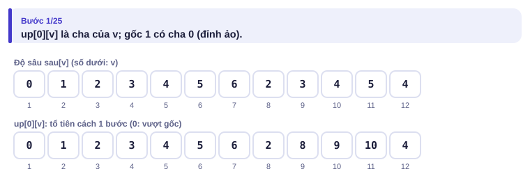
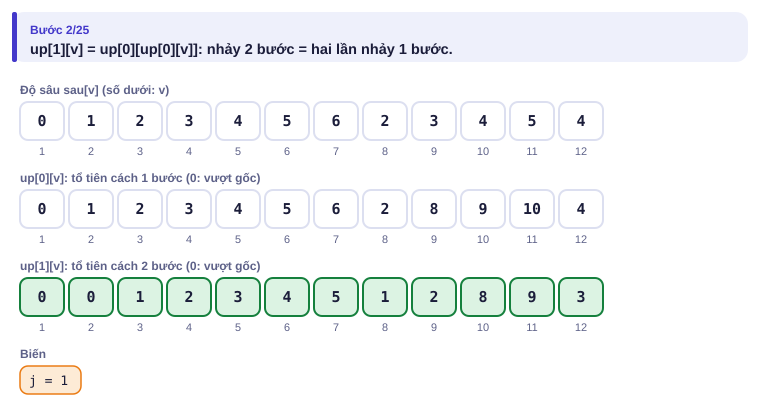

</details>

<details>
<summary><b>Bước 2</b> – Đưa 7 lên cùng độ sâu với 11</summary>

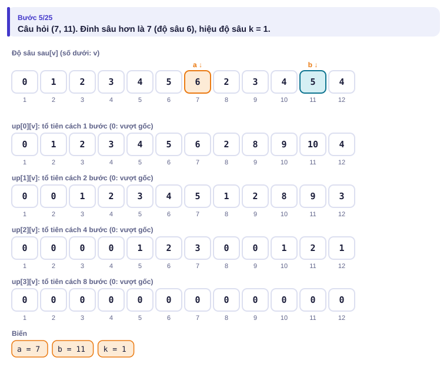
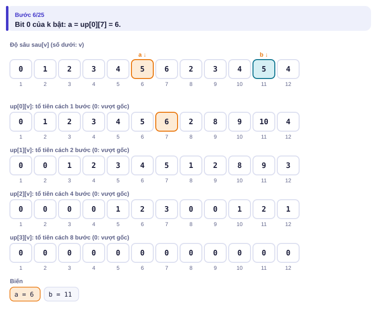

</details>

<details>
<summary><b>Bước 3</b> – j = 3 và j = 2: nhảy hay không?</summary>

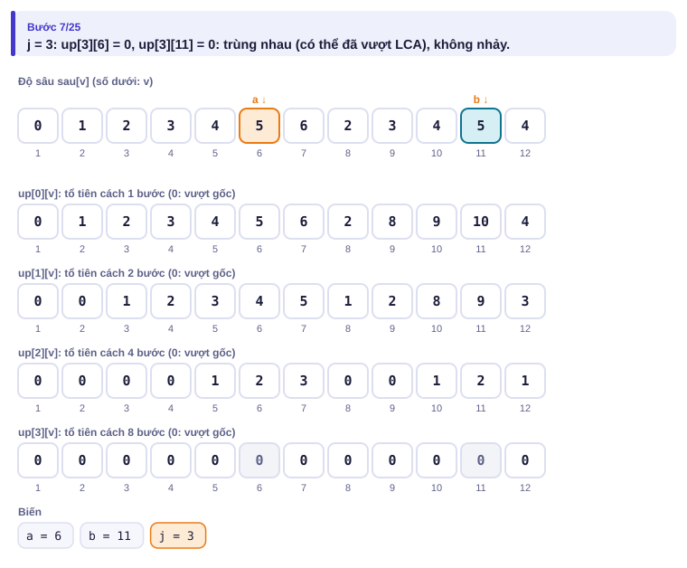
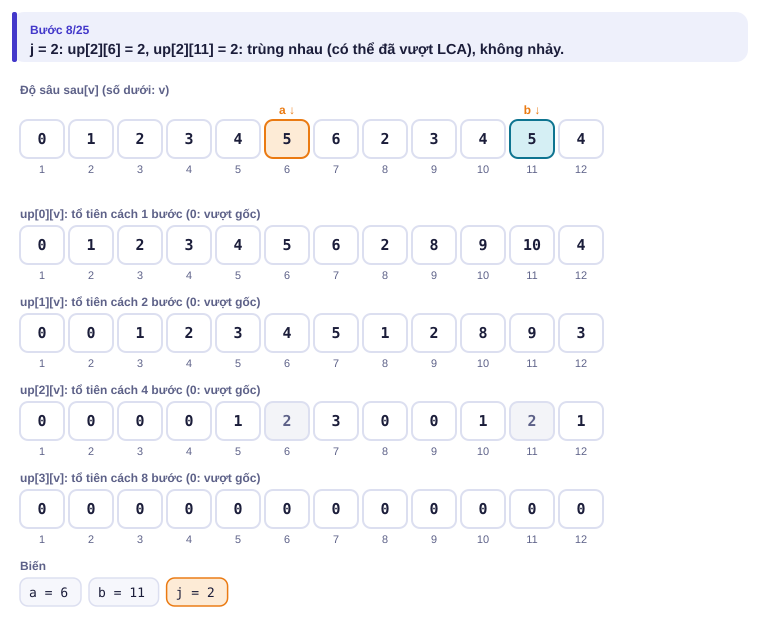

</details>

<details>
<summary><b>Bước 4</b> – j = 1 và j = 0</summary>

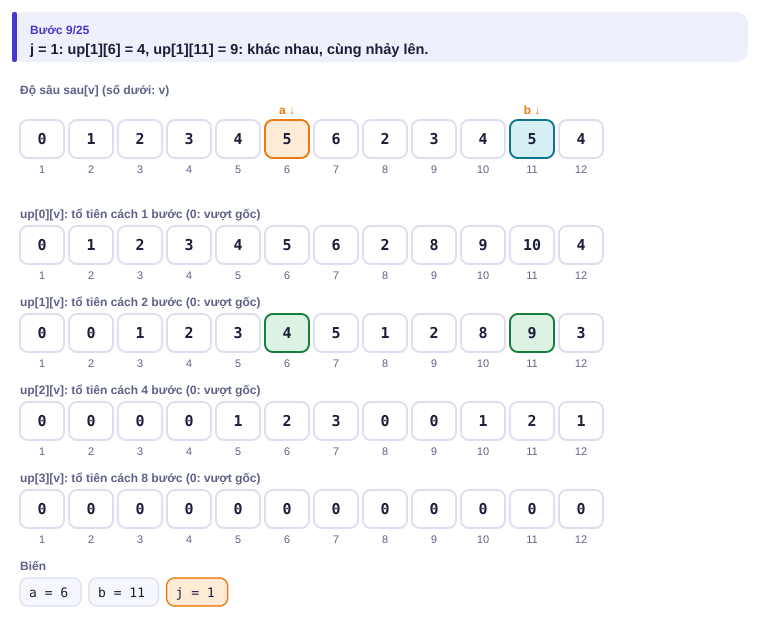
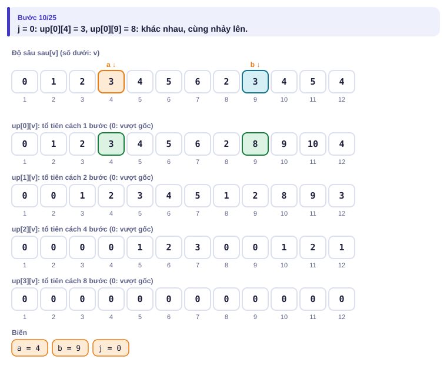

</details>

<details>
<summary><b>Bước 5</b> – Kết quả</summary>

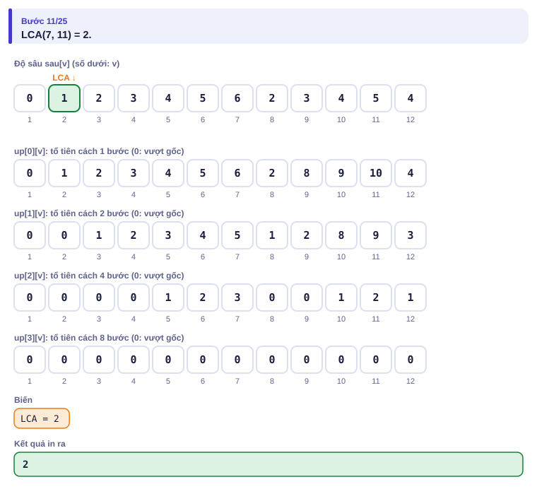

</details>

| Bước | a | b | Ghi chú |
| --- | :---: | :---: | --- |
| bắt đầu | 7 (sâu 6) | 11 (sâu 5) | k = 1 |
| bit 0 | 6 | 11 | cùng độ sâu 5 |
| j = 3 | 6 | 11 | up[3] đều là 0: không nhảy |
| j = 2 | 6 | 11 | up[2] đều là 2: không nhảy (có thể đã vượt) |
| j = 1 | 4 | 9 | up[1] khác nhau: cùng nhảy |
| j = 0 | 3 | 8 | up[0] khác nhau: cùng nhảy |
| kết thúc | | | LCA = up[0][3] = **2** |

---

## 5. Mã giả và cài đặt

```cpp
// file: lca.cpp
#include <bits/stdc++.h>
using namespace std;
const int LOG = 18;                                  // 2^18 > 2·10^5
int main() {
    ios::sync_with_stdio(false);
    cin.tie(nullptr);
    int n, q;
    cin >> n >> q;
    vector<vector<int>> con(n + 1);
    vector<vector<int>> up(LOG, vector<int>(n + 1, 0));
    for (int v = 2; v <= n; v++) {
        cin >> up[0][v];
        con[up[0][v]].push_back(v);
    }
    vector<int> sau(n + 1, 0);                       // độ sâu, tính bằng BFS từ gốc
    queue<int> bq;
    bq.push(1);
    while (!bq.empty()) {
        int u = bq.front(); bq.pop();
        for (int v : con[u]) { sau[v] = sau[u] + 1; bq.push(v); }
    }
    for (int j = 1; j < LOG; j++)
        for (int v = 1; v <= n; v++) up[j][v] = up[j - 1][up[j - 1][v]];
    while (q--) {
        int a, b;
        cin >> a >> b;
        if (sau[a] < sau[b]) swap(a, b);
        int k = sau[a] - sau[b];
        for (int j = 0; j < LOG; j++) if (k >> j & 1) a = up[j][a];   // đưa về cùng độ sâu
        if (a != b) {
            for (int j = LOG - 1; j >= 0; j--)
                if (up[j][a] != up[j][b]) { a = up[j][a]; b = up[j][b]; }
            a = up[0][a];
        }
        cout << a << '\n';
    }
}
```

Đỉnh 0 làm "đỉnh ảo trên gốc": `up[j][1] = 0` và `up[j][0] = 0`, nên nhảy quá gốc luôn ra 0.

> [!NOTE]
> **Khoảng cách trên cây** giữa a và b = sau[a] + sau[b] − 2·sau[LCA(a, b)]: đi từ a lên LCA rồi xuống b. Nhảy nhị phân cũng giải bài "đi k bước trên đồ thị hàm" nhắc ở bài 2.8 ([Planets Queries I](https://cses.fi/problemset/task/1750)).

### Đường kính cây

**Đường kính** là đường đi dài nhất giữa hai đỉnh của cây. Cách làm gọn: BFS (bài 2.7) từ một đỉnh bất kỳ, lấy đỉnh xa nhất u; BFS lần hai từ u, đỉnh xa nhất v; đường u–v là đường kính. (bài [Tree Diameter](https://cses.fi/problemset/task/1131))

| Vào | Ra |
| --- | --- |
| `8`<br>`1 2`<br>`1 3`<br>`3 4`<br>`3 5`<br>`5 6`<br>`2 7`<br>`7 8` | `6` |

<details>
<summary><b>Hình</b> – hai lần BFS (mở lần lượt)</summary>

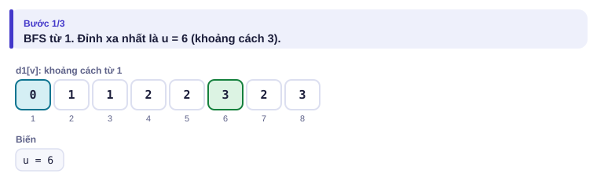
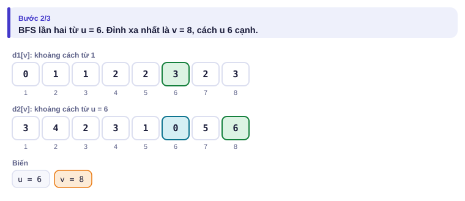
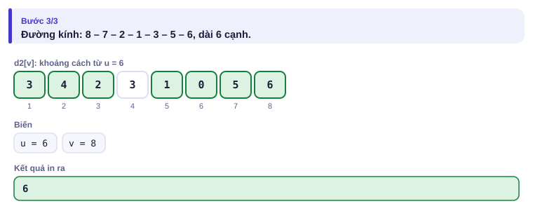

</details>

```cpp
// file: duong_kinh.cpp
#include <bits/stdc++.h>
using namespace std;
int n;
vector<vector<int>> adj;
vector<int> bfs(int s) {
    vector<int> d(n + 1, -1);
    queue<int> q;
    d[s] = 0; q.push(s);
    while (!q.empty()) {
        int u = q.front(); q.pop();
        for (int v : adj[u]) if (d[v] < 0) { d[v] = d[u] + 1; q.push(v); }
    }
    return d;
}
int main() {
    cin >> n;
    adj.assign(n + 1, {});
    for (int i = 0; i < n - 1; i++) {
        int a, b;
        cin >> a >> b;
        adj[a].push_back(b);
        adj[b].push_back(a);
    }
    vector<int> d1 = bfs(1);
    int u = max_element(d1.begin(), d1.end()) - d1.begin();
    vector<int> d2 = bfs(u);
    cout << *max_element(d2.begin(), d2.end()) << '\n';
}
```

---

## 6. Vì sao đúng, chạy bao lâu

- **Bảng up đúng:** đi 2ʲ bước là đi 2ʲ⁻¹ bước rồi thêm 2ʲ⁻¹ bước nữa; bảng tầng j − 1 đã có sẵn khi tính tầng j.
- **LCA đúng:** gọi L là LCA. Sau khi cùng độ sâu, "up[j][a] ≠ up[j][b]" đúng khi và chỉ khi 2ʲ < (khoảng cách từ a lên L). Duyệt j giảm dần và nhảy khi điều kiện đúng chính là viết (khoảng cách − 1) ở dạng nhị phân; cuối cùng a, b cách L đúng một bước.
- **Đường kính đúng:** đỉnh u xa nhất từ một đỉnh bất kỳ luôn là một đầu của một đường kính (lập luận bằng cách so sánh độ dài các đường đi, xem tài liệu CSES Handbook mục 14.2).
- **Chạy bao lâu:** bảng up có LOG × n ô: O(n log n) thời gian và bộ nhớ. Mỗi câu hỏi O(log n). Đường kính: hai lần BFS O(n).

---

## 7. Bẫy thường gặp

> [!WARNING]
> **Bẫy 1: LOG quá nhỏ.** Cây sâu tới n − 1; cần 2^LOG > n. Với n = 2·10⁵, LOG = 18 là đủ.
> *Test phá:* cây đường thẳng 2·10⁵ đỉnh, hỏi (1, 200000).

> [!WARNING]
> **Bẫy 2: DFS đệ quy để tính độ sâu.** Cây dạng đường thẳng sâu 2·10⁵: đệ quy có thể tràn ngăn xếp. Dùng BFS hoặc ngăn xếp tự quản.

> [!WARNING]
> **Bẫy 3: quên trường hợp một đỉnh là tổ tiên của đỉnh kia.** Sau khi đưa về cùng độ sâu mà a = b thì trả về ngay, không làm bước nhảy cùng nhau (nếu làm, `up[0][a]` sẽ là cha của đáp án).
> *Test phá:* câu (12, 4) trên cây ví dụ: đáp án 4, không phải 3.

> [!WARNING]
> **Bẫy 4: duyệt j tăng dần khi nhảy cùng nhau.** Bước đưa về cùng độ sâu duyệt thứ tự nào cũng được (cộng các bit), nhưng bước "cùng nhảy khi khác nhau" **phải** duyệt j giảm dần.

---

## 8. Ví dụ giảm dần hỗ trợ

### Ví dụ 2 – Điền vào chỗ trống: Sếp cấp k

Cùng công ty như mục 1. Mỗi câu hỏi (x, k): ai là sếp cách x đúng k cấp? In −1 nếu không có. (bài [Company Queries I](https://cses.fi/problemset/task/1687))

| Vào | Ra |
| --- | --- |
| `5 3`<br>`1 1 3 3`<br>`4 1`<br>`4 2`<br>`4 3` | `3`<br>`1`<br>`-1` |

```cpp
for (int j = 0; j < LOG && x != 0; j++)
    if (k >> j & 1) x = ____;
cout << (x == 0 ? ____ : x) << '\n';
```

<details>
<summary>Đáp án</summary>

`up[j][x]` và `-1`. Nhảy quá gốc thì rơi vào đỉnh ảo 0. Chú ý k có thể tới n, lớn hơn mọi độ sâu.

```cpp
// file: sep_cap_k.cpp
#include <bits/stdc++.h>
using namespace std;
const int LOG = 18;
int main() {
    ios::sync_with_stdio(false);
    cin.tie(nullptr);
    int n, q;
    cin >> n >> q;
    vector<vector<int>> up(LOG, vector<int>(n + 1, 0));
    for (int v = 2; v <= n; v++) cin >> up[0][v];
    for (int j = 1; j < LOG; j++)
        for (int v = 1; v <= n; v++) up[j][v] = up[j - 1][up[j - 1][v]];
    while (q--) {
        int x, k;
        cin >> x >> k;
        for (int j = 0; j < LOG && x != 0; j++)
            if (k >> j & 1) x = up[j][x];
        cout << (x == 0 ? -1 : x) << '\n';
    }
}
```

Chú ý: thứ tự tính `up[j][v]` theo v tăng dần chỉ đúng vì ta tính **xong cả tầng j − 1** trước khi sang tầng j.

</details>

### Ví dụ 3 – Tự làm: Khoảng cách trên cây

Cây n đỉnh cho bằng n − 1 cạnh (không cho sẵn cha). Mỗi câu hỏi (a, b): khoảng cách (số cạnh) giữa a và b. (n, q ≤ 2·10⁵; bài [Distance Queries](https://cses.fi/problemset/task/1135))

| Vào | Ra |
| --- | --- |
| `5 3`<br>`1 2`<br>`1 3`<br>`3 4`<br>`3 5`<br>`1 3`<br>`2 5`<br>`1 4` | `1`<br>`3`<br>`2` |

> [!IMPORTANT]
> Tự làm trước. Gợi ý: chọn đỉnh 1 làm gốc, BFS để tìm cha và độ sâu (cha của v là đỉnh đã đưa v vào hàng đợi). Sau đó dùng LCA và công thức ở mục 5.

<details>
<summary>Lời giải</summary>

```cpp
// file: khoang_cach_cay.cpp
#include <bits/stdc++.h>
using namespace std;
const int LOG = 18;
int main() {
    ios::sync_with_stdio(false);
    cin.tie(nullptr);
    int n, q;
    cin >> n >> q;
    vector<vector<int>> adj(n + 1);
    for (int i = 0; i < n - 1; i++) {
        int a, b;
        cin >> a >> b;
        adj[a].push_back(b);
        adj[b].push_back(a);
    }
    vector<vector<int>> up(LOG, vector<int>(n + 1, 0));
    vector<int> sau(n + 1, -1);
    queue<int> bq;
    sau[1] = 0; bq.push(1);
    while (!bq.empty()) {
        int u = bq.front(); bq.pop();
        for (int v : adj[u]) if (sau[v] < 0) { sau[v] = sau[u] + 1; up[0][v] = u; bq.push(v); }
    }
    for (int j = 1; j < LOG; j++)
        for (int v = 1; v <= n; v++) up[j][v] = up[j - 1][up[j - 1][v]];
    auto lca = [&](int a, int b) {
        if (sau[a] < sau[b]) swap(a, b);
        int k = sau[a] - sau[b];
        for (int j = 0; j < LOG; j++) if (k >> j & 1) a = up[j][a];
        if (a == b) return a;
        for (int j = LOG - 1; j >= 0; j--)
            if (up[j][a] != up[j][b]) { a = up[j][a]; b = up[j][b]; }
        return up[0][a];
    };
    while (q--) {
        int a, b;
        cin >> a >> b;
        cout << sau[a] + sau[b] - 2 * sau[lca(a, b)] << '\n';
    }
}
```

</details>

---

## 9. Bài tập

| Nấc | Bài | Nguồn | Ý chính |
| --- | --- | --- | --- |
| Khởi động | [Subordinates](https://cses.fi/problemset/task/1674) | CSES 1674 | Kích thước cây con (duyệt ngược thứ tự BFS) |
| Khởi động | [Company Queries I](https://cses.fi/problemset/task/1687) | CSES 1687 | Ví dụ 2 |
| Luyện | [Company Queries II](https://cses.fi/problemset/task/1688) | CSES 1688 | Đúng mục 5 |
| Luyện | [Tree Diameter](https://cses.fi/problemset/task/1131) | CSES 1131 | Hai lần BFS |
| Luyện | [Distance Queries](https://cses.fi/problemset/task/1135) | CSES 1135 | Ví dụ 3 |
| Thử thách | [Planets Queries I](https://cses.fi/problemset/task/1750) | CSES 1750 | Nhảy nhị phân trên đồ thị hàm (bài 2.8) |
| Kiểu đề thi | Họp nhóm | Bài của sách, chấm theo subtask | Xem bên dưới |

### Bài kiểu đề thi: Họp nhóm

**Đề bài.** Khu dân cư có n ngôi nhà nối với nhau bằng n − 1 con hẻm sao cho giữa hai nhà bất kỳ có đúng một đường đi (một cây; 1 ≤ n ≤ 2·10⁵). Đi qua một con hẻm mất 1 phút. Có q câu hỏi (q ≤ 2·10⁵): ba bạn ở ba nhà a, b, c muốn họp nhóm tại **một** nhà nào đó; tổng số phút ba bạn phải đi ít nhất là bao nhiêu? Đọc từ `HOPNHOM.INP` (dòng đầu n q, n − 1 dòng cạnh, q dòng a b c), ghi mỗi đáp án một dòng ra `HOPNHOM.OUT`.

Subtask: 40% có n, q ≤ 1000; 60% còn lại có n, q ≤ 2·10⁵.

| HOPNHOM.INP | HOPNHOM.OUT |
| --- | --- |
| `7 3`<br>`1 2`<br>`1 3`<br>`2 4`<br>`2 5`<br>`3 6`<br>`3 7`<br>`4 5 6`<br>`4 4 7`<br>`6 7 1` | `5`<br>`4`<br>`3` |

Câu 1: họp ở nhà 2, ba bạn đi 1 + 1 + 3 = 5 phút.

<details>
<summary><b>Gợi ý 1</b> – hướng đi (đủ 40% điểm)</summary>

Với mỗi câu hỏi, BFS từ a, b, c (ba lần, mỗi lần O(n)), rồi thử mọi nhà làm điểm họp: O(q·n) = 10⁶.

</details>

<details>
<summary><b>Gợi ý 2</b> – ý then chốt</summary>

Vẽ ba đường a–b, b–c, c–a: mỗi con hẻm thuộc "cây nhỏ nối a, b, c" nằm trên đúng **hai** trong ba đường đó. Vì vậy tổng nhỏ nhất (bằng số cạnh của cây nhỏ nối ba điểm) là **(d(a, b) + d(b, c) + d(c, a)) / 2**. Mỗi khoảng cách tính bằng LCA như Ví dụ 3. Điểm họp tốt nhất là một trong ba LCA(a, b), LCA(b, c), LCA(c, a): đỉnh sâu nhất trong ba.

</details>

<details>
<summary><b>Gợi ý 3</b> – lời giải đầy đủ</summary>

O((n + q) log n).

```cpp
// file: hopnhom.cpp
#include <bits/stdc++.h>
using namespace std;
const int LOG = 18;
int n, q;
vector<vector<int>> up;
vector<int> sau;

int lca(int a, int b) {
    if (sau[a] < sau[b]) swap(a, b);
    int k = sau[a] - sau[b];
    for (int j = 0; j < LOG; j++) if (k >> j & 1) a = up[j][a];
    if (a == b) return a;
    for (int j = LOG - 1; j >= 0; j--)
        if (up[j][a] != up[j][b]) { a = up[j][a]; b = up[j][b]; }
    return up[0][a];
}
long long kc(int a, int b) { return sau[a] + sau[b] - 2 * sau[lca(a, b)]; }

int main() {
    freopen("HOPNHOM.INP", "r", stdin);
    freopen("HOPNHOM.OUT", "w", stdout);
    scanf("%d %d", &n, &q);
    vector<vector<int>> adj(n + 1);
    for (int i = 0; i < n - 1; i++) {
        int a, b;
        scanf("%d %d", &a, &b);
        adj[a].push_back(b);
        adj[b].push_back(a);
    }
    up.assign(LOG, vector<int>(n + 1, 0));
    sau.assign(n + 1, -1);
    queue<int> bq;
    sau[1] = 0; bq.push(1);
    while (!bq.empty()) {
        int u = bq.front(); bq.pop();
        for (int v : adj[u]) if (sau[v] < 0) { sau[v] = sau[u] + 1; up[0][v] = u; bq.push(v); }
    }
    for (int j = 1; j < LOG; j++)
        for (int v = 1; v <= n; v++) up[j][v] = up[j - 1][up[j - 1][v]];
    while (q--) {
        int a, b, c;
        scanf("%d %d %d", &a, &b, &c);
        printf("%lld\n", (kc(a, b) + kc(b, c) + kc(c, a)) / 2);
    }
}
```

```python
# file: hopnhom.py
from collections import deque
with open("HOPNHOM.INP") as f:
    data = f.read().split()
n, q = int(data[0]), int(data[1])
adj = [[] for _ in range(n + 1)]
p = 2
for _ in range(n - 1):
    a, b = int(data[p]), int(data[p + 1])
    p += 2
    adj[a].append(b)
    adj[b].append(a)
LOG = max(1, n.bit_length())
sau = [-1] * (n + 1)
cha = [0] * (n + 1)
sau[1] = 0
dq = deque([1])
while dq:
    u = dq.popleft()
    for v in adj[u]:
        if sau[v] < 0:
            sau[v] = sau[u] + 1
            cha[v] = u
            dq.append(v)
up = [cha]
for j in range(1, LOG):
    prev = up[-1]
    up.append([prev[prev[v]] for v in range(n + 1)])

def lca(a, b):
    if sau[a] < sau[b]:
        a, b = b, a
    k = sau[a] - sau[b]
    j = 0
    while k:
        if k & 1:
            a = up[j][a]
        k >>= 1
        j += 1
    if a == b:
        return a
    for j in range(LOG - 1, -1, -1):
        if up[j][a] != up[j][b]:
            a, b = up[j][a], up[j][b]
    return up[0][a]

def kc(a, b):
    return sau[a] + sau[b] - 2 * sau[lca(a, b)]

out = []
for _ in range(q):
    a, b, c = int(data[p]), int(data[p + 1]), int(data[p + 2])
    p += 3
    out.append((kc(a, b) + kc(b, c) + kc(c, a)) // 2)
with open("HOPNHOM.OUT", "w") as f:
    f.write("\n".join(map(str, out)) + "\n")
```

Bản Python mỗi câu hỏi gọi LCA ba lần, khoảng 3 × 2 × 18 bước: với q = 2·10⁵ chạy khoảng 3–4 giây. Đủ cho subtask 1; subtask 2 nên dùng C++.

</details>

---

## 10. Tóm tắt, flashcard và checkpoint

**Tóm tắt trong 5 dòng.**

1. Cây có gốc: BFS từ gốc cho cha và độ sâu, không cần đệ quy.
2. `up[j][v]` = tổ tiên cách 2ʲ bước; tính bằng hai lần nhảy 2ʲ⁻¹; đi k bước theo các bit của k.
3. LCA: đưa về cùng độ sâu; trùng thì xong; không thì nhảy từ j lớn tới nhỏ khi tổ tiên còn khác; đáp án là cha.
4. Khoảng cách = sau[a] + sau[b] − 2·sau[LCA]; ba điểm: nửa tổng ba khoảng cách đôi một.
5. Đường kính: BFS từ đỉnh bất kỳ, rồi BFS từ đỉnh xa nhất.

**Flashcard.**

<details><summary>Đi lên 10 bước bằng nhảy nhị phân gồm những bước nhảy nào?</summary>10 = 8 + 2: nhảy <code>up[3]</code> và <code>up[1]</code>.</details>
<details><summary>Khi cùng nhảy, vì sao chỉ nhảy khi up[j][a] ≠ up[j][b]?</summary>Nếu trùng thì có thể đã vượt quá LCA; khác nhau thì chắc chắn LCA còn cao hơn.</details>
<details><summary>Khoảng cách 7 và 11 trên cây ví dụ?</summary>6 + 5 − 2·1 = 9 (LCA là 2, độ sâu 1).</details>
<details><summary>Đường kính cây hình sao 6 đỉnh?</summary>2.</details>
<details><summary>Ba điểm a, b, c họp nhau: tổng đường đi ít nhất?</summary>(d(a,b) + d(b,c) + d(c,a)) / 2.</details>

**Ôn xoắn ốc** (mỗi bài tối đa 20 phút):

- Viết lại Kruskal (bài 3.2) không nhìn sách.
- [Planets Cycles](https://cses.fi/problemset/task/1751) (CSES 1751): bài Chuyền thư (bài 2.8).
- [Static Range Minimum Queries](https://cses.fi/problemset/task/1647) (CSES 1647): sparse table (bài 2.6) cũng là "bảng 2ʲ".

**Checkpoint – em đã sẵn sàng sang bài tiếp theo nếu:**

- [ ] Viết LCA không nhìn sách, AC [Company Queries II](https://cses.fi/problemset/task/1688).
- [ ] AC [Tree Diameter](https://cses.fi/problemset/task/1131).
- [ ] Làm xong Ví dụ 3 (Khoảng cách trên cây) mà không mở lời giải.
- [ ] Đạt trọn điểm bài Họp nhóm khi tự làm trong 35 phút.

Chưa đạt? Nếu vướng ô 1, chạy trang mô phỏng LCA với Đoán trước, đặc biệt các bước j có "trùng nhau". Nếu vướng ô 2, chạy trang Đường kính với ví dụ "gốc lệch". Nếu vướng ô 3 hoặc 4, làm lại Ví dụ 2 rồi đọc lại mục 6.
