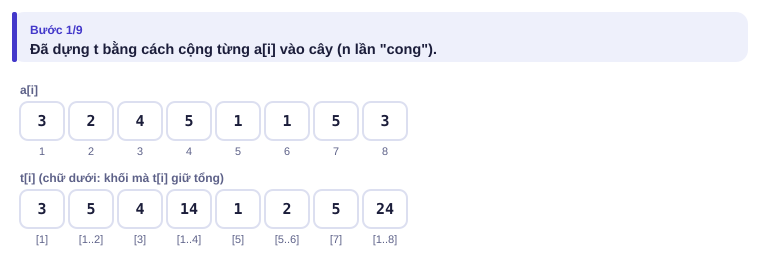
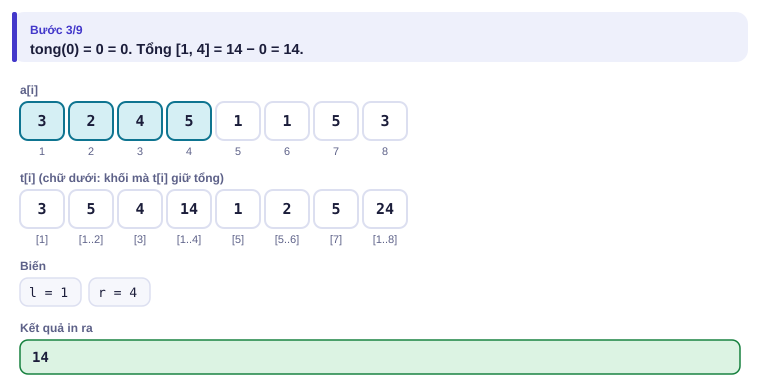
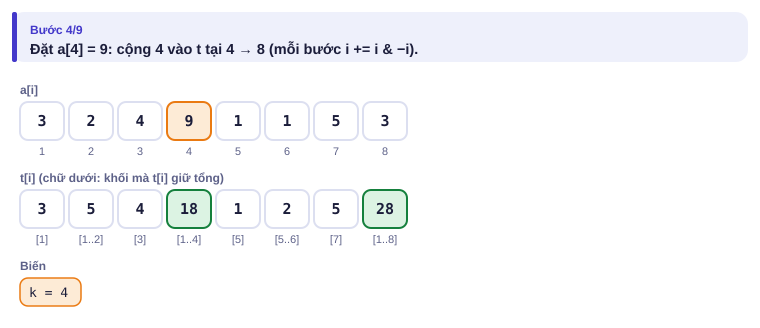
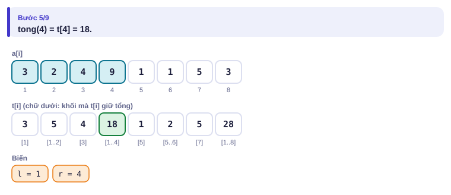
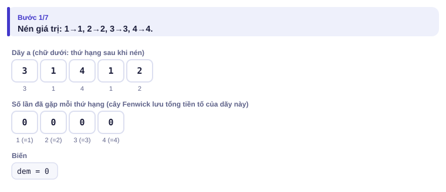
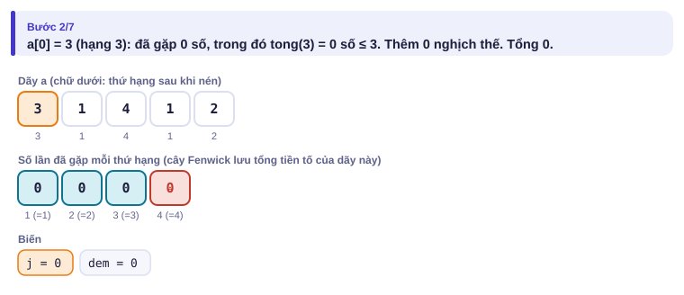
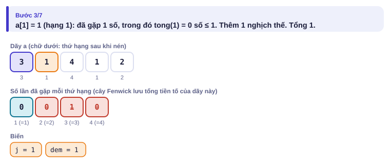
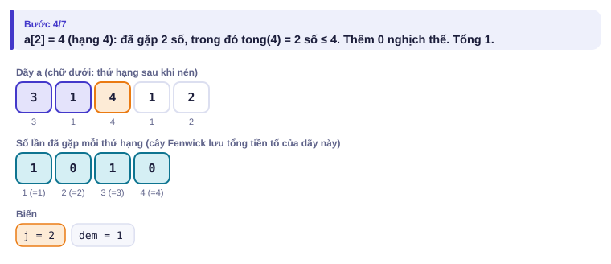
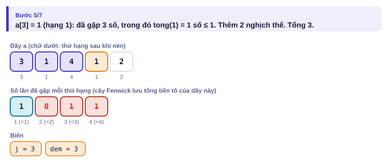
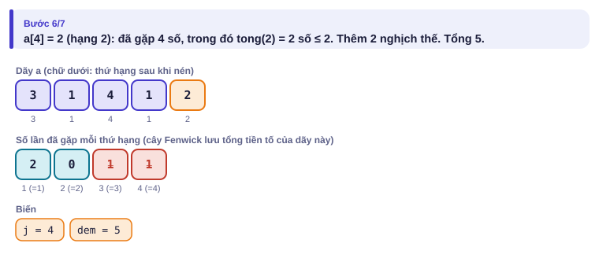

# Bài 3.4 – Cây Fenwick

> **Tập 3 · Đồ thị và quy hoạch động nâng cao**
> Cần biết trước: bài 1.3 (tổng tiền tố, mảng hiệu), bài 2.5 (bit, `x & -x`), bài 1.4 (`lower_bound`).
> Thời lượng: khoảng 90 phút đọc, cộng 6 giờ thực hành trong tuần.

**Học xong bài này, em sẽ:**

- vừa **sửa một phần tử** vừa hỏi **tổng đoạn**, mỗi việc O(log n), bằng cây Fenwick (còn gọi là BIT);
- hiểu vì sao cây Fenwick chỉ cần hai vòng lặp ngắn với `i & -i`;
- **nén giá trị** và đếm **cặp nghịch thế** trong O(n log n);
- dùng Fenwick trên mảng hiệu, tìm phần tử thứ k, và **quét offline** cho bài kiểu đề thi **Đếm điểm**.

> [!TIP]
> **Học cùng hai trang mô phỏng.** [Cây Fenwick](../../mo-phong/t3-fenwick.html): bật **Đoán trước** để đoán mỗi thao tác chạm bao nhiêu ô t. [Đếm nghịch thế](../../mo-phong/t3-nghich-the.html): thử ví dụ "giá trị lớn" để thấy vì sao cần nén.

---

## 1. Bài toán mở màn: Bảng doanh thu sống

Bảng doanh thu n ngày liên tục được **sửa lại** (kế toán nhập nhầm). Có q thao tác: `1 k u` đặt doanh thu ngày k thành u; `2 a b` hỏi tổng các ngày từ a tới b. (n, q ≤ 2·10⁵; bài [Dynamic Range Sum Queries](https://cses.fi/problemset/task/1648))

| Vào | Ra |
| --- | --- |
| `8 4`<br>`3 2 4 5 1 1 5 3`<br>`2 1 4`<br>`1 4 9`<br>`2 1 4`<br>`2 3 5` | `14`<br>`18`<br>`14` |

---

## 2. Dừng lại 10 phút

> [!IMPORTANT]
> **Dừng lại và nghĩ.**
> 1. Tổng tiền tố (bài 1.3) trả lời tổng đoạn O(1). Sửa một phần tử thì phải sửa lại bao nhiêu ô tiền tố?
> 2. Không dùng tiền tố thì sửa O(1), còn hỏi tổng tốn bao lâu?
> 3. Có cách nào để mỗi ô lưu tổng của một **khối** (không phải cả tiền tố, cũng không phải một phần tử), sao cho cả hai việc đều chỉ chạm ít ô?

<details>
<summary>Đáp án</summary>

1. Sửa aₖ làm đổi p[k], p[k+1], …, p[n]: O(n).
2. O(n): cộng từng phần tử.
3. Có: chia theo lũy thừa của 2, giống bảng 2ʲ ở bài 2.6 và 3.3. Mỗi tiền tố ghép từ ≤ log₂ n khối, mỗi phần tử nằm trong ≤ log₂ n khối. Đó là **cây Fenwick**.

</details>

---

## 3. Lời giải ngây thơ và vì sao nó chậm

Cả hai cách ở câu 1 và câu 2 đều có một thao tác O(n). Đề có thể cho toàn thao tác chậm: q = 2·10⁵ thao tác × n = 2·10⁵ = 4·10¹⁰. Ta cần cân bằng: chấp nhận cả hai việc đều tốn một chút (log n) thay vì một việc O(1), một việc O(n).

---

## 4. Ý tưởng then chốt

> [!IMPORTANT]
> **Ô `t[i]` giữ tổng của khối kết thúc tại i, dài đúng `i & -i` (bit 1 thấp nhất của i). Hỏi tổng 1..i: cộng t[i] rồi `i -= i & -i`. Cộng v vào aᵢ: cộng v vào t[i] rồi `i += i & -i`. Mỗi bước xóa hoặc đẩy một bit, nên tối đa log₂ n bước.**

| i | Nhị phân | i & −i | t[i] giữ tổng |
| :---: | :---: | :---: | --- |
| 1 | 0001 | 1 | a₁ |
| 2 | 0010 | 2 | a₁..a₂ |
| 3 | 0011 | 1 | a₃ |
| 4 | 0100 | 4 | a₁..a₄ |
| 5 | 0101 | 1 | a₅ |
| 6 | 0110 | 2 | a₅..a₆ |
| 7 | 0111 | 1 | a₇ |
| 8 | 1000 | 8 | a₁..a₈ |

Tổng 1..7 = t[7] + t[6] + t[4] (7 → 6 → 4 → 0). Sửa a₃ thì sửa t[3], t[4], t[8] (3 → 4 → 8).

### Chạy từng bước

Với ví dụ mở màn. Đoán số ô t bị chạm rồi mới mở.

<details>
<summary><b>Bước 1</b> – Cây sau khi dựng</summary>



</details>

<details>
<summary><b>Bước 2</b> – Hỏi tổng [1, 4]</summary>




</details>

<details>
<summary><b>Bước 3</b> – Đặt a[4] = 9: sửa những ô nào?</summary>



</details>

<details>
<summary><b>Bước 4</b> – Hỏi lại tổng [1, 4]</summary>



</details>

---

## 5. Mã giả và cài đặt

```cpp
// file: fenwick.cpp
#include <bits/stdc++.h>
using namespace std;
int n;
vector<long long> t;
void cong(int i, long long v) { for (; i <= n; i += i & -i) t[i] += v; }
long long tong(int i) { long long s = 0; for (; i > 0; i -= i & -i) s += t[i]; return s; }

int main() {
    ios::sync_with_stdio(false);
    cin.tie(nullptr);
    int q;
    cin >> n >> q;
    t.assign(n + 1, 0);
    vector<long long> a(n + 1);
    for (int i = 1; i <= n; i++) { cin >> a[i]; cong(i, a[i]); }
    while (q--) {
        int loai;
        cin >> loai;
        if (loai == 1) {
            int k; long long u;
            cin >> k >> u;
            cong(k, u - a[k]);                     // đặt giá trị = cộng thêm phần chênh lệch
            a[k] = u;
        } else {
            int l, r;
            cin >> l >> r;
            cout << tong(r) - tong(l - 1) << '\n';
        }
    }
}
```

```python
# file: fenwick.py
import sys
data = sys.stdin.buffer.read().split()
n, q = int(data[0]), int(data[1])
a = [0] + [int(x) for x in data[2:2 + n]]
t = [0] * (n + 1)
for i in range(1, n + 1):                  # dựng trong O(n): đẩy giá trị lên ô cha
    t[i] += a[i]
    j = i + (i & -i)
    if j <= n:
        t[j] += t[i]

def cong(i, v):
    while i <= n:
        t[i] += v
        i += i & -i

def tong(i):
    s = 0
    while i > 0:
        s += t[i]
        i -= i & -i
    return s

out = []
p = 2 + n
for _ in range(q):
    loai, x, y = int(data[p]), int(data[p + 1]), int(data[p + 2])
    p += 3
    if loai == 1:
        cong(x, y - a[x])
        a[x] = y
    else:
        out.append(tong(y) - tong(x - 1))
print("\n".join(map(str, out)))
```

### Đếm nghịch thế

Cặp (i, j) là **nghịch thế** nếu i < j và aᵢ > aⱼ. Đếm số cặp nghịch thế (n ≤ 2·10⁵, aᵢ ≤ 10⁹). Đây cũng là số lần đổi chỗ của sắp xếp nổi bọt.

| Vào | Ra |
| --- | --- |
| `5`<br>`3 1 4 1 2` | `5` |

Duyệt từ trái sang phải. Với aⱼ, số nghịch thế mà j là phần tử thứ hai = số phần tử **đã gặp** lớn hơn aⱼ. Lưu số lần gặp mỗi giá trị trong cây Fenwick; giá trị tới 10⁹ nên trước tiên **nén giá trị**: thay mỗi số bằng thứ hạng của nó trong dãy đã sắp xếp và bỏ trùng (bài 1.2, 1.4).

<details>
<summary><b>Hình</b> – đếm nghịch thế cho <code>3 1 4 1 2</code> (mở lần lượt; đoán số nghịch thế thêm vào)</summary>








</details>

```cpp
// file: nghich_the.cpp
#include <bits/stdc++.h>
using namespace std;
int n;
vector<long long> t;
void cong(int i, long long v) { for (; i <= n; i += i & -i) t[i] += v; }
long long tong(int i) { long long s = 0; for (; i > 0; i -= i & -i) s += t[i]; return s; }

int main() {
    ios::sync_with_stdio(false);
    cin.tie(nullptr);
    cin >> n;
    vector<long long> a(n);
    for (auto &x : a) cin >> x;
    vector<long long> b = a;                       // nén giá trị về 1..n
    sort(b.begin(), b.end());
    b.erase(unique(b.begin(), b.end()), b.end());
    t.assign(n + 1, 0);
    long long dem = 0;
    for (int j = 0; j < n; j++) {
        int r = lower_bound(b.begin(), b.end(), a[j]) - b.begin() + 1;
        dem += j - tong(r);                        // đã gặp j số, trừ đi số <= a[j]
        cong(r, 1);
    }
    cout << dem << '\n';
}
```

---

## 6. Vì sao đúng, chạy bao lâu

- **Hỏi tổng đúng:** các khối t[i], t[i − (i & −i)], … nối liền nhau từ i về 1 và không chồng lên nhau: khối của t[i] là (i − (i & −i), i], khối kế tiếp kết thúc ngay tại i − (i & −i).
- **Cộng đúng:** các ô có khối chứa vị trí i chính là i, i + (i & −i), …: mỗi bước "đẩy" bit thấp nhất lên, tạo ra khối lớn hơn chứa khối cũ.
- **Chạy bao lâu:** mỗi bước xóa (hoặc đẩy lên) một bit 1, nên tối đa ⌈log₂ n⌉ + 1 bước. Dựng bằng n lần `cong` là O(n log n); bản Python dựng O(n).
- **Nghịch thế:** sắp xếp để nén O(n log n), mỗi phần tử một `tong` và một `cong`: tổng O(n log n).

---

## 7. Bẫy thường gặp

> [!WARNING]
> **Bẫy 1: chỉ số từ 0.** Với i = 0, `i & -i` = 0 và vòng `cong` chạy mãi. Cây Fenwick luôn đánh số **từ 1**.

> [!WARNING]
> **Bẫy 2: "đặt giá trị" khác "cộng thêm".** Thao tác `1 k u` là **gán**; phải cộng phần chênh lệch `u - a[k]` và nhớ cập nhật `a[k]`.
> *Test phá:* đặt a[4] = 9 hai lần liên tiếp rồi hỏi tổng [1, 4]: vẫn phải là 18.

> [!WARNING]
> **Bẫy 3: số nghịch thế tràn `int`.** Tới n²/2 = 2·10¹⁰: dùng `long long`.

> [!WARNING]
> **Bẫy 4: nén giá trị quên bỏ trùng hoặc lệch 1.** Thứ hạng phải bắt đầu từ 1 (`+ 1` sau `lower_bound`), và cây phải đủ lớn cho số giá trị khác nhau.
> *Test phá:* `3` / `5 5 5`: không có nghịch thế nào.

---

## 8. Ví dụ giảm dần hỗ trợ

### Ví dụ 2 – Điền vào chỗ trống: Cộng cả đoạn, hỏi một điểm

q thao tác trên dãy a: `1 l r u` cộng u vào mọi aᵢ với l ≤ i ≤ r; `2 k` in aₖ hiện tại. (n, q ≤ 2·10⁵; bài [Range Update Queries](https://cses.fi/problemset/task/1651))

| Vào | Ra |
| --- | --- |
| `8 3`<br>`3 2 4 5 1 1 5 3`<br>`2 4`<br>`1 2 5 1`<br>`2 4` | `5`<br>`6` |

Mảng hiệu (bài 1.3): cộng u vào đoạn [l, r] là cộng u vào d[l] và trừ u ở d[r + 1]; aₖ = a ban đầu + (d[1] + … + d[k]). Tổng tiền tố của d lấy bằng Fenwick.

```cpp
if (loai == 1) { cong(l, u); cong(____, ____); }
else cout << a[k] + ____ << '\n';
```

<details>
<summary>Đáp án</summary>

`cong(r + 1, -u)` và `tong(k)`. Nếu r + 1 > n thì vòng `cong` không chạy, không sao.

```cpp
// file: cong_doan.cpp
#include <bits/stdc++.h>
using namespace std;
int n;
vector<long long> t;
void cong(int i, long long v) { for (; i <= n; i += i & -i) t[i] += v; }
long long tong(int i) { long long s = 0; for (; i > 0; i -= i & -i) s += t[i]; return s; }
int main() {
    ios::sync_with_stdio(false);
    cin.tie(nullptr);
    int q;
    cin >> n >> q;
    vector<long long> a(n + 1);
    for (int i = 1; i <= n; i++) cin >> a[i];
    t.assign(n + 1, 0);
    while (q--) {
        int loai;
        cin >> loai;
        if (loai == 1) {
            int l, r; long long u;
            cin >> l >> r >> u;
            cong(l, u); cong(r + 1, -u);
        } else {
            int k;
            cin >> k;
            cout << a[k] + tong(k) << '\n';
        }
    }
}
```

</details>

### Ví dụ 3 – Tự làm: Rút thăm

Danh sách có n phần tử. Lần lượt n lần, rút ra phần tử ở **vị trí thứ pᵢ** của danh sách **hiện tại** (sau khi rút, các phần tử sau dồn lên). In các phần tử bị rút theo thứ tự. (n ≤ 2·10⁵; bài [List Removals](https://cses.fi/problemset/task/1749))

| Vào | Ra |
| --- | --- |
| `5`<br>`2 6 1 4 5`<br>`3 1 3 1 1` | `1 2 5 6 4` |

> [!IMPORTANT]
> Tự làm trước. Gợi ý: cây Fenwick lưu 1 ở mỗi vị trí còn phần tử. Vị trí gốc của phần tử thứ p hiện tại là chỉ số i nhỏ nhất có `tong(i) = p`. Tìm nhị phân trên i (bài 1.4) là O(log² n); có cách O(log n) bằng cách "nhảy" từ bit lớn tới bit nhỏ trên chính mảng t.

<details>
<summary>Lời giải</summary>

Nhảy từ bit lớn tới bit nhỏ: giữ `vt` (vị trí đã đi qua, tổng t trên đường đi đều < p). Thử thêm 2ʲ: nếu `vt + 2ʲ ≤ n` và `t[vt + 2ʲ] < p` thì nhảy và trừ p đi `t[vt + 2ʲ]`. Cuối cùng đáp án là `vt + 1`. Đúng vì t[vt + 2ʲ] chính là tổng khối (vt, vt + 2ʲ] khi vt chỉ có các bit lớn hơn j.

```cpp
// file: rut_tham.cpp
#include <bits/stdc++.h>
using namespace std;
int n, LOG;
vector<int> t;
void cong(int i, int v) { for (; i <= n; i += i & -i) t[i] += v; }
int thu_k(int p) {                                  // chỉ số nhỏ nhất có tong = p
    int vt = 0;
    for (int j = LOG; j >= 0; j--) {
        int nx = vt + (1 << j);
        if (nx <= n && t[nx] < p) { vt = nx; p -= t[nx]; }
    }
    return vt + 1;
}
int main() {
    ios::sync_with_stdio(false);
    cin.tie(nullptr);
    cin >> n;
    LOG = __lg(n);
    vector<long long> a(n + 1);
    for (int i = 1; i <= n; i++) cin >> a[i];
    t.assign(n + 1, 0);
    for (int i = 1; i <= n; i++) cong(i, 1);
    for (int k = 0; k < n; k++) {
        int p;
        cin >> p;
        int i = thu_k(p);
        cout << a[i] << (k + 1 == n ? '\n' : ' ');
        cong(i, -1);
    }
}
```

</details>

---

## 9. Bài tập

| Nấc | Bài | Nguồn | Ý chính |
| --- | --- | --- | --- |
| Khởi động | [Dynamic Range Sum Queries](https://cses.fi/problemset/task/1648) | CSES 1648 | Đúng mục 5 |
| Khởi động | [Range Update Queries](https://cses.fi/problemset/task/1651) | CSES 1651 | Ví dụ 2 |
| Luyện | Đếm nghịch thế, so với lời giải O(n²) bằng stress test | Tự luyện | Mục 5 + bài 1.9 |
| Luyện | [List Removals](https://cses.fi/problemset/task/1749) | CSES 1749 | Ví dụ 3 |
| Luyện | [Forest Queries](https://cses.fi/problemset/task/1652) | CSES 1652 | Tiền tố hai chiều (bài 1.3) |
| Thử thách | [Salary Queries](https://cses.fi/problemset/task/1144) | CSES 1144 | Nén giá trị cả các câu hỏi |
| Kiểu đề thi | Đếm điểm | Bài của sách, chấm theo subtask | Xem bên dưới |

### Bài kiểu đề thi: Đếm điểm

**Đề bài.** Bản đồ có n cột đèn, cột thứ i ở điểm (xᵢ, yᵢ) với tọa độ nguyên 1 ≤ xᵢ, yᵢ ≤ 10⁹ (n ≤ 2·10⁵, có thể trùng điểm). Có q câu hỏi (q ≤ 2·10⁵): với (X, Y), đếm số cột đèn có x ≤ X **và** y ≤ Y. Đọc từ `DEMDIEM.INP` (dòng đầu n q, n dòng điểm, q dòng câu hỏi), ghi mỗi đáp án một dòng ra `DEMDIEM.OUT` theo thứ tự câu hỏi.

Subtask: 40% có n, q ≤ 2000; 60% còn lại có n, q ≤ 2·10⁵.

| DEMDIEM.INP | DEMDIEM.OUT |
| --- | --- |
| `5 4`<br>`1 1`<br>`2 3`<br>`3 2`<br>`4 4`<br>`5 1`<br>`3 2`<br>`5 5`<br>`2 4`<br>`4 1` | `2`<br>`5`<br>`2`<br>`1` |

<details>
<summary><b>Gợi ý 1</b> – hướng đi (đủ 40% điểm)</summary>

Mỗi câu hỏi duyệt mọi điểm: O(n·q) = 4·10⁶.

</details>

<details>
<summary><b>Gợi ý 2</b> – ý then chốt</summary>

**Quét offline:** không cần trả lời câu hỏi ngay khi đọc. Sắp các điểm theo x tăng dần, các câu hỏi theo X tăng dần. Quét X từ nhỏ tới lớn: trước khi trả lời câu hỏi (X, Y), đưa mọi điểm có x ≤ X vào một cây Fenwick theo y. Khi đó đáp án là `tong(Y)`. Nén y (cả của điểm lẫn câu hỏi) để dùng làm chỉ số Fenwick.

</details>

<details>
<summary><b>Gợi ý 3</b> – lời giải đầy đủ</summary>

O((n + q) log(n + q)). Nén chỉ cần y của các điểm: thứ hạng của Y là số y điểm ≤ Y (`upper_bound`).

```cpp
// file: demdiem.cpp
#include <bits/stdc++.h>
using namespace std;
int m;
vector<int> t;
void cong(int i) { for (; i <= m; i += i & -i) t[i]++; }
int tong(int i) { int s = 0; for (; i > 0; i -= i & -i) s += t[i]; return s; }
int main() {
    freopen("DEMDIEM.INP", "r", stdin);
    freopen("DEMDIEM.OUT", "w", stdout);
    int n, q;
    scanf("%d %d", &n, &q);
    vector<pair<long long, long long>> p(n);
    for (auto &[x, y] : p) scanf("%lld %lld", &x, &y);
    vector<array<long long, 3>> hoi(q);             // {X, Y, số thứ tự}
    for (int i = 0; i < q; i++) { scanf("%lld %lld", &hoi[i][0], &hoi[i][1]); hoi[i][2] = i; }
    vector<long long> ys;
    for (auto &[x, y] : p) ys.push_back(y);
    sort(ys.begin(), ys.end());
    ys.erase(unique(ys.begin(), ys.end()), ys.end());
    m = ys.size();
    t.assign(m + 1, 0);
    sort(p.begin(), p.end());
    sort(hoi.begin(), hoi.end());
    vector<int> kq(q);
    int k = 0;
    for (auto [X, Y, id] : hoi) {
        while (k < n && p[k].first <= X) {
            cong(lower_bound(ys.begin(), ys.end(), p[k].second) - ys.begin() + 1);
            k++;
        }
        kq[id] = tong(upper_bound(ys.begin(), ys.end(), Y) - ys.begin());   // số y <= Y
    }
    for (int i = 0; i < q; i++) printf("%d\n", kq[i]);
}
```

```python
# file: demdiem.py
from bisect import bisect_left, bisect_right
with open("DEMDIEM.INP") as f:
    data = f.read().split()
n, q = int(data[0]), int(data[1])
p = sorted((int(data[2 + 2 * i]), int(data[3 + 2 * i])) for i in range(n))
base = 2 + 2 * n
hoi = sorted((int(data[base + 2 * i]), int(data[base + 2 * i + 1]), i) for i in range(q))
ys = sorted(set(y for _, y in p))
m = len(ys)
t = [0] * (m + 1)
kq = [0] * q
k = 0
for X, Y, idx in hoi:
    while k < n and p[k][0] <= X:
        i = bisect_left(ys, p[k][1]) + 1
        while i <= m:
            t[i] += 1
            i += i & -i
        k += 1
    i = bisect_right(ys, Y)
    s = 0
    while i > 0:
        s += t[i]
        i -= i & -i
    kq[idx] = s
with open("DEMDIEM.OUT", "w") as f:
    f.write("\n".join(map(str, kq)) + "\n")
```

</details>

---

## 10. Tóm tắt, flashcard và checkpoint

**Tóm tắt trong 5 dòng.**

1. t[i] giữ tổng khối dài `i & -i` kết thúc tại i; đánh số từ 1.
2. Hỏi tiền tố: `i -= i & -i`; cộng: `i += i & -i`; cả hai O(log n).
3. Giá trị lớn: nén về thứ hạng 1..m (sắp xếp, bỏ trùng, `lower_bound` + 1).
4. Cộng đoạn, hỏi điểm: Fenwick trên mảng hiệu. Tìm phần tử thứ k: nhảy bit trên mảng t.
5. Câu hỏi hai chiều (x ≤ X, y ≤ Y): quét offline theo một chiều, Fenwick theo chiều kia.

**Flashcard.**

<details><summary>Tổng 1..6 cộng những ô nào?</summary>t[6] + t[4].</details>
<details><summary>Sửa a[5] (n = 8) chạm những ô nào?</summary>t[5], t[6], t[8].</details>
<details><summary>Nghịch thế của <code>3 1 4 1 2</code>?</summary>5: (3,1), (3,1), (3,2), (4,1), (4,2).</details>
<details><summary>Cộng u vào đoạn [l, r] bằng Fenwick trên mảng hiệu?</summary><code>cong(l, u); cong(r + 1, -u);</code></details>
<details><summary>"Quét offline" nghĩa là gì?</summary>Đọc hết câu hỏi, sắp xếp lại cho tiện xử lý, rồi in đáp án theo thứ tự ban đầu.</details>

**Ôn xoắn ốc** (mỗi bài tối đa 20 phút):

- Viết lại LCA (bài 3.3) không nhìn sách.
- [Subarray Sums II](https://cses.fi/problemset/task/1661) (CSES 1661): tiền tố + `map` (bài 2.2).
- [Increasing Subsequence](https://cses.fi/problemset/task/1145) (CSES 1145): LIS (bài 2.10). Thử viết lại bằng Fenwick lưu max thay cho tổng.

**Checkpoint – em đã sẵn sàng sang bài tiếp theo nếu:**

- [ ] Viết Fenwick không nhìn sách trong 3 phút; AC [Dynamic Range Sum Queries](https://cses.fi/problemset/task/1648).
- [ ] AC [Range Update Queries](https://cses.fi/problemset/task/1651).
- [ ] Làm xong Ví dụ 3 (Rút thăm) mà không mở lời giải.
- [ ] Đạt trọn điểm bài Đếm điểm khi tự làm trong 35 phút.

Chưa đạt? Nếu vướng ô 1, chạy trang mô phỏng Fenwick với Đoán trước và tự viết bảng i, i & −i ở mục 4. Nếu vướng ô 2, đọc lại mảng hiệu ở bài 1.3. Nếu vướng ô 3 hoặc 4, chạy trang Đếm nghịch thế rồi đọc lại Gợi ý 2.
