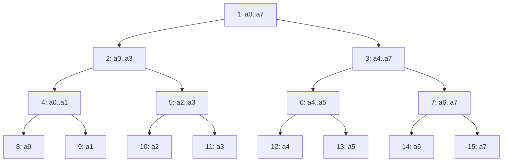
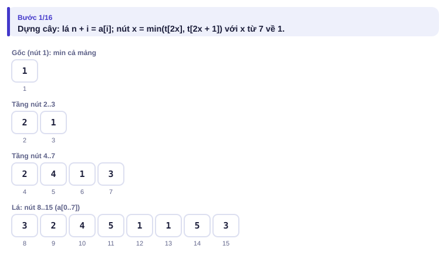
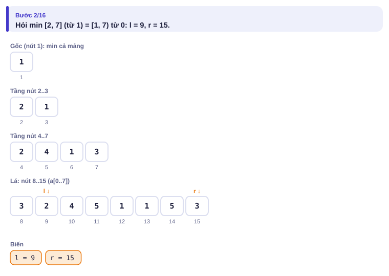
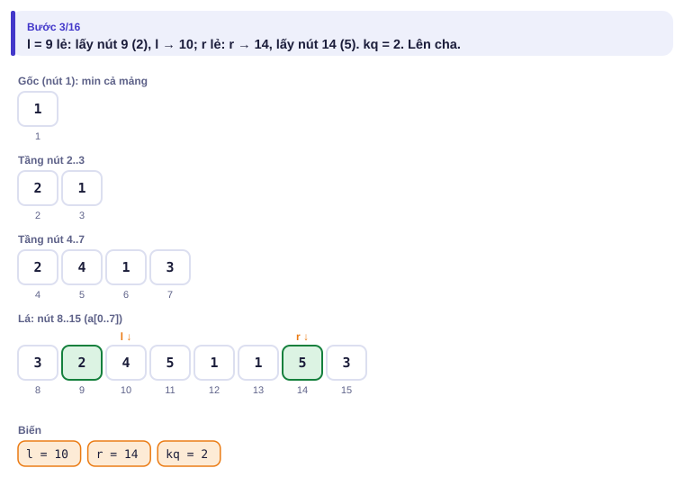
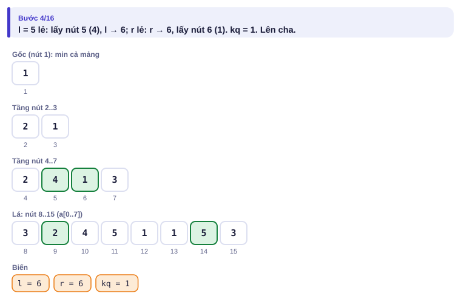
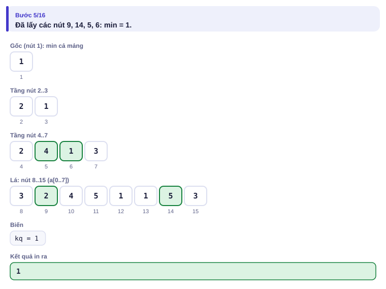
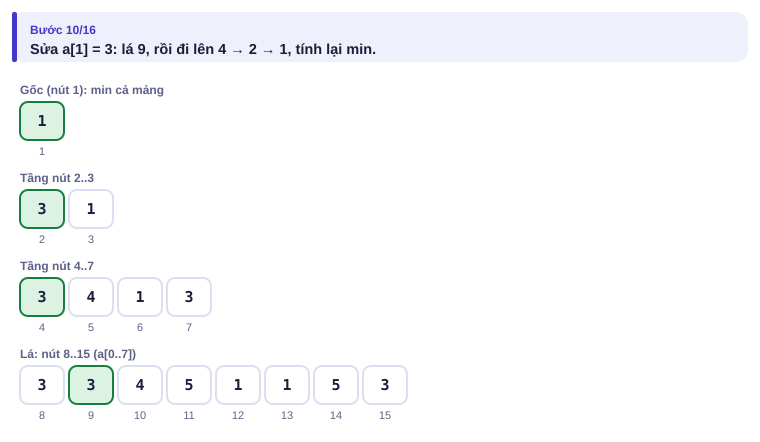

# Bài 3.5 – Cây phân đoạn

> **Tập 3 · Đồ thị và quy hoạch động nâng cao**
> Cần biết trước: bài 3.4 (Fenwick), bài 2.6 (sparse table), bài 1.1 (Kadane).
> Thời lượng: khoảng 100 phút đọc, cộng 8 giờ thực hành (1,5 tuần).

**Học xong bài này, em sẽ:**

- trả lời min/max/tổng/ƯCLN trên đoạn **khi mảng thay đổi**, mỗi thao tác O(log n);
- viết cây phân đoạn dạng vòng lặp (ngắn, nhanh) và đi xuống cây để **tìm vị trí** thỏa điều kiện;
- thiết kế nút giữ **nhiều giá trị** (tổng, tiền tố, hậu tố, tốt nhất) khi phép gộp phức tạp;
- biết khi nào dùng Fenwick, sparse table hay cây phân đoạn;
- giải trọn bài kiểu đề thi **Tổng lớn nhất có sửa**.

> [!TIP]
> **Học cùng hai trang mô phỏng.** [Cây phân đoạn](../../mo-phong/t3-segtree.html): xem l và r thu hẹp từ hai đầu; thử ví dụ "mười sáu phần tử". [Tìm vị trí đầu tiên ≥ x](../../mo-phong/t3-khach-san.html): bật **Đoán trước** để đoán khách sạn của từng đoàn.

---

## 1. Bài toán mở màn: Giá thấp nhất

Siêu thị theo dõi giá một mặt hàng ở n cửa hàng. Có q thao tác: `1 k u` đổi giá ở cửa hàng k thành u; `2 a b` hỏi giá thấp nhất trong các cửa hàng a..b. (n, q ≤ 2·10⁵; bài [Dynamic Range Minimum Queries](https://cses.fi/problemset/task/1649))

| Vào | Ra |
| --- | --- |
| `8 4`<br>`3 2 4 5 1 1 5 3`<br>`2 2 7`<br>`2 5 6`<br>`1 2 3`<br>`2 1 4` | `1`<br>`1`<br>`3` |

---

## 2. Dừng lại 10 phút

> [!IMPORTANT]
> **Dừng lại và nghĩ.**
> 1. Fenwick (bài 3.4) dùng "tổng 1..r trừ tổng 1..l−1". Min có làm được phép trừ như vậy không?
> 2. Sparse table (bài 2.6) trả lời min O(1). Sửa một phần tử thì bao nhiêu ô của bảng phải tính lại?
> 3. Nếu chia mảng thành các khối **lồng nhau** theo kiểu "nửa trái, nửa phải, rồi chia đôi tiếp", mỗi phần tử thuộc bao nhiêu khối? Một đoạn [l, r] bất kỳ ghép từ khoảng bao nhiêu khối?

<details>
<summary>Đáp án</summary>

1. Không: min không có phép ngược (bài 2.6).
2. Mọi ô có khối chứa phần tử đó: khoảng n ô ở tầng thấp, tổng O(n). Sparse table chỉ hợp với mảng không đổi.
3. Mỗi phần tử thuộc log₂ n khối (một khối mỗi tầng); một đoạn ghép từ tối đa khoảng 2 log₂ n khối. Đó là **cây phân đoạn**.

</details>

---

## 3. Lời giải ngây thơ và vì sao nó chậm

Sửa O(1), hỏi bằng vòng lặp O(n): q câu hỏi đoạn dài là O(n·q) = 4·10¹⁰. Hoặc tính lại sparse table sau mỗi lần sửa: O(n log n) mỗi lần sửa, còn tệ hơn. Cần một cấu trúc mà cả sửa lẫn hỏi chỉ chạm O(log n) ô.

---

## 4. Ý tưởng then chốt

> [!IMPORTANT]
> **Mỗi nút giữ min của một đoạn; lá là từng phần tử, nút cha giữ min của hai con. Đánh số gốc là 1, con của nút x là 2x và 2x + 1, lá thứ i ở nút n + i. Sửa: đặt lá rồi đi lên cha, tính lại. Hỏi [l, r): l += n, r += n; khi l < r: l lẻ thì lấy nút l và tăng l; r lẻ thì giảm r và lấy nút r; rồi cả hai lên cha.**

Với n = 8:



Vì sao "l lẻ thì lấy": nút l lẻ là **con phải**; cha của nó còn chứa con trái nằm ngoài đoạn, nên phải lấy riêng nút l rồi dịch l sang phải. Tương tự với r.

### Chạy từng bước

Hỏi min [2, 7] (đếm từ 1), tức [1, 7) đếm từ 0. Đoán trước những nút được lấy rồi mới mở.

<details>
<summary><b>Bước 1</b> – Cây sau khi dựng</summary>



</details>

<details>
<summary><b>Bước 2</b> – l = 9, r = 15: lấy những nút nào ở tầng lá?</summary>




</details>

<details>
<summary><b>Bước 3</b> – Lên một tầng: l = 5, r = 7</summary>




</details>

<details>
<summary><b>Bước 4</b> – Sửa a[1] = 3: đi lên những nút nào?</summary>



</details>

Bốn nút 9, 14, 5, 6 phủ đúng các vị trí 1, 6, 2–3, 4–5.

---

## 5. Mã giả và cài đặt

```cpp
// file: cay_phan_doan.cpp
#include <bits/stdc++.h>
using namespace std;
int n;
vector<long long> t;

void sua(int i, long long v) {                     // a[i] = v, i từ 0
    for (t[i += n] = v; i > 1; i /= 2) t[i / 2] = min(t[i], t[i ^ 1]);
}
long long hoi(int l, int r) {                      // min trên [l, r), i từ 0
    long long kq = LLONG_MAX;
    for (l += n, r += n; l < r; l /= 2, r /= 2) {
        if (l & 1) kq = min(kq, t[l++]);
        if (r & 1) kq = min(kq, t[--r]);
    }
    return kq;
}

int main() {
    ios::sync_with_stdio(false);
    cin.tie(nullptr);
    int q;
    cin >> n >> q;
    t.assign(2 * n, LLONG_MAX);
    for (int i = 0; i < n; i++) cin >> t[n + i];
    for (int i = n - 1; i >= 1; i--) t[i] = min(t[2 * i], t[2 * i + 1]);   // dựng cây
    while (q--) {
        int loai, a;
        long long b;
        cin >> loai >> a >> b;
        if (loai == 1) sua(a - 1, b);
        else cout << hoi(a - 1, b) << '\n';        // [a, b] từ 1 → [a-1, b) từ 0
    }
}
```

```python
# file: cay_phan_doan.py
import sys
data = sys.stdin.buffer.read().split()
n, q = int(data[0]), int(data[1])
INF = float('inf')
t = [INF] * n + [int(x) for x in data[2:2 + n]]
for i in range(n - 1, 0, -1):
    t[i] = min(t[2 * i], t[2 * i + 1])
out = []
p = 2 + n
for _ in range(q):
    loai, a, b = int(data[p]), int(data[p + 1]), int(data[p + 2])
    p += 3
    if loai == 1:
        i = a - 1 + n
        t[i] = b
        while i > 1:
            i >>= 1
            t[i] = min(t[2 * i], t[2 * i + 1])
    else:
        l, r, kq = a - 1 + n, b + n, INF
        while l < r:
            if l & 1:
                kq = min(kq, t[l]); l += 1
            if r & 1:
                r -= 1; kq = min(kq, t[r])
            l >>= 1; r >>= 1
        out.append(kq)
print("\n".join(map(str, out)))
```

`t[i ^ 1]` là nút anh em của i (đổi bit cuối). Đổi `min` thành `+`, `max` hay `gcd` là được cây cho phép đó: phép cần có tính **kết hợp** và một **phần tử trung tính** (với min là +∞, với tổng là 0). Cách viết vòng lặp này đúng với **mọi** n, không cần n là lũy thừa của 2 (khi đó cây không còn hình đẹp như hình vẽ, nhưng các bước vẫn đúng).

### Chọn cấu trúc nào?

| Cần | Mảng không đổi | Mảng có sửa điểm |
| --- | --- | --- |
| Tổng đoạn | Tiền tố (bài 1.3) | Fenwick (bài 3.4) hoặc cây phân đoạn |
| Min/max/ƯCLN đoạn | Sparse table (bài 2.6) | Cây phân đoạn |
| Tìm vị trí đầu tiên thỏa điều kiện | Tìm nhị phân trên tiền tố | Đi xuống cây phân đoạn (Ví dụ 3) |
| Cộng cả đoạn **và** hỏi tổng/min đoạn | | Cây phân đoạn **lười** (Tập 4) |

---

## 6. Vì sao đúng, chạy bao lâu

- **Sửa đúng:** chỉ các nút trên đường từ lá lên gốc có đoạn chứa vị trí i, nên chỉ chúng cần tính lại.
- **Hỏi đúng:** bất biến là "các vị trí trong [l, r) ở tầng hiện tại chưa được tính, mọi vị trí ngoài nó trong đoạn ban đầu đã được tính đúng một lần". Lấy nút l khi l lẻ (con phải) và nút r − 1 khi r lẻ giữ bất biến, rồi lên tầng trên đoạn [l, r) vẫn được phủ chính xác bởi các nút cha.
- **Chạy bao lâu:** mỗi tầng lấy tối đa 2 nút, có log₂ n tầng: hỏi O(log n); sửa đi qua log₂ n nút. Dựng O(n). Bộ nhớ 2n ô.

---

## 7. Bẫy thường gặp

> [!WARNING]
> **Bẫy 1: lẫn đoạn đóng và nửa mở.** Hàm `hoi` nhận [l, r), chỉ số từ 0. Đề cho [a, b] từ 1 thì gọi `hoi(a - 1, b)`.
> *Test phá:* hỏi [3, 3] (một phần tử) phải trả về chính a₃.

> [!WARNING]
> **Bẫy 2: phần tử trung tính sai.** Với min dùng giá trị rất lớn; với tổng dùng 0; với max dùng rất nhỏ. Khởi tạo `kq = 0` cho min trên mảng toàn số dương sẽ luôn in 0.

> [!WARNING]
> **Bẫy 3: mảng cây quá nhỏ.** Cách viết vòng lặp cần 2n ô; cách viết đệ quy truyền thống cần 4n ô.

> [!WARNING]
> **Bẫy 4: đi xuống cây khi n không phải lũy thừa của 2.** Thao tác "đi xuống từ gốc" (Ví dụ 3) dựa vào hình cây chuẩn; hãy **làm tròn** kích thước lên lũy thừa của 2 và điền phần thừa bằng phần tử trung tính.

---

## 8. Ví dụ giảm dần hỗ trợ

### Ví dụ 2 – Điền vào chỗ trống: Cây tổng

Giải lại bài Bảng doanh thu sống (bài 3.4) bằng cây phân đoạn **tổng**.

| Vào | Ra |
| --- | --- |
| `8 4`<br>`3 2 4 5 1 1 5 3`<br>`2 1 4`<br>`1 4 9`<br>`2 1 4`<br>`2 3 5` | `14`<br>`18`<br>`14` |

```cpp
void sua(int i, long long v) {
    for (t[i += n] = v; i > 1; i /= 2) t[i / 2] = ____;
}
long long hoi(int l, int r) {
    long long kq = ____;
    for (l += n, r += n; l < r; l /= 2, r /= 2) {
        if (l & 1) kq += t[l++];
        if (r & 1) kq += t[--r];
    }
    return kq;
}
```

<details>
<summary>Đáp án</summary>

`t[i] + t[i ^ 1]` và `0`.

```cpp
// file: cay_tong.cpp
#include <bits/stdc++.h>
using namespace std;
int n;
vector<long long> t;
void sua(int i, long long v) {
    for (t[i += n] = v; i > 1; i /= 2) t[i / 2] = t[i] + t[i ^ 1];
}
long long hoi(int l, int r) {
    long long kq = 0;
    for (l += n, r += n; l < r; l /= 2, r /= 2) {
        if (l & 1) kq += t[l++];
        if (r & 1) kq += t[--r];
    }
    return kq;
}
int main() {
    ios::sync_with_stdio(false);
    cin.tie(nullptr);
    int q;
    cin >> n >> q;
    t.assign(2 * n, 0);
    for (int i = 0; i < n; i++) cin >> t[n + i];
    for (int i = n - 1; i >= 1; i--) t[i] = t[2 * i] + t[2 * i + 1];
    while (q--) {
        int loai, a; long long b;
        cin >> loai >> a >> b;
        if (loai == 1) sua(a - 1, b);
        else cout << hoi(a - 1, b) << '\n';
    }
}
```

</details>

### Ví dụ 3 – Tự làm: Khách sạn

Có n khách sạn xếp theo thứ tự, khách sạn i còn hᵢ phòng trống. Lần lượt m đoàn khách tới; đoàn j cần rⱼ phòng và vào khách sạn **đầu tiên** còn đủ phòng (cả đoàn ở cùng một khách sạn). In số thứ tự khách sạn của mỗi đoàn, hoặc 0 nếu không có. (n, m ≤ 2·10⁵; bài [Hotel Queries](https://cses.fi/problemset/task/1143))

| Vào | Ra |
| --- | --- |
| `8 5`<br>`3 2 4 1 5 5 2 6`<br>`4 4 7 1 1` | `3 5 0 1 1` |

> [!IMPORTANT]
> Tự làm trước. Gợi ý: cây **max**. Nếu max ở gốc nhỏ hơn r thì in 0. Ngược lại đi từ gốc xuống: con trái có max ≥ r thì sang trái, không thì sang phải. Tới lá thì trừ r phòng và sửa ngược lên. Đọc Bẫy 4.

<details>
<summary>Lời giải</summary>

```cpp
// file: khach_san.cpp
#include <bits/stdc++.h>
using namespace std;
int main() {
    ios::sync_with_stdio(false);
    cin.tie(nullptr);
    int n, m;
    cin >> n >> m;
    int N = 1;
    while (N < n) N *= 2;                          // làm tròn lên lũy thừa của 2
    vector<long long> t(2 * N, 0);                 // phần thừa có 0 phòng
    for (int i = 0; i < n; i++) cin >> t[N + i];
    for (int i = N - 1; i >= 1; i--) t[i] = max(t[2 * i], t[2 * i + 1]);
    for (int j = 0; j < m; j++) {
        long long r;
        cin >> r;
        int kq = 0;
        if (t[1] >= r) {
            int x = 1;
            while (x < N) x = (t[2 * x] >= r) ? 2 * x : 2 * x + 1;   // ưu tiên bên trái
            kq = x - N + 1;
            t[x] -= r;
            for (x /= 2; x >= 1; x /= 2) t[x] = max(t[2 * x], t[2 * x + 1]);
        }
        cout << kq << (j + 1 == m ? '\n' : ' ');
    }
}
```

</details>

---

## 9. Bài tập

| Nấc | Bài | Nguồn | Ý chính |
| --- | --- | --- | --- |
| Khởi động | [Dynamic Range Minimum Queries](https://cses.fi/problemset/task/1649) | CSES 1649 | Đúng mục 5 |
| Khởi động | [Range Xor Queries](https://cses.fi/problemset/task/1650) | CSES 1650 | Đổi phép thành XOR |
| Luyện | [Hotel Queries](https://cses.fi/problemset/task/1143) | CSES 1143 | Ví dụ 3 |
| Luyện | [Pizzeria Queries](https://cses.fi/problemset/task/2206) | CSES 2206 | Tách \|a − b\| thành hai cây |
| Luyện | [Prefix Sum Queries](https://cses.fi/problemset/task/2166) | CSES 2166 | Nút giữ (tổng, tiền tố lớn nhất) |
| Thử thách | [Subarray Sum Queries](https://cses.fi/problemset/task/1190) | CSES 1190 | Giống bài Tổng lớn nhất có sửa |
| Kiểu đề thi | Tổng lớn nhất có sửa | Bài của sách, chấm theo subtask | Xem bên dưới |

### Bài kiểu đề thi: Tổng lớn nhất có sửa

**Đề bài.** Bảng lãi/lỗ của n tháng là a₁ … aₙ (|aᵢ| ≤ 10⁹, n ≤ 2·10⁵). Có q lần sửa (q ≤ 2·10⁵), lần sửa thứ j đặt a_k = x. Sau **mỗi** lần sửa, in tổng lớn nhất của một đoạn tháng liên tiếp (được chọn đoạn rỗng, khi đó tổng là 0). Đọc từ `TONGMAX.INP` (dòng đầu n q, dòng hai là dãy, q dòng sau là k x), ghi mỗi đáp án một dòng ra `TONGMAX.OUT`.

Subtask: 40% có n, q ≤ 2000; 60% còn lại có n, q ≤ 2·10⁵.

| TONGMAX.INP | TONGMAX.OUT |
| --- | --- |
| `5 3`<br>`4 -3 2 -6 3`<br>`2 5`<br>`4 1`<br>`1 -10` | `11`<br>`15`<br>`11` |

<details>
<summary><b>Gợi ý 1</b> – hướng đi (đủ 40% điểm)</summary>

Sau mỗi lần sửa chạy lại Kadane (bài 1.1): O(n) mỗi lần, O(n·q) = 4·10⁶.

</details>

<details>
<summary><b>Gợi ý 2</b> – ý then chốt</summary>

Mỗi nút của cây phân đoạn giữ **bốn** số cho đoạn của nó: `tong` (tổng cả đoạn), `tien` (tổng tiền tố lớn nhất), `hau` (tổng hậu tố lớn nhất), `tot` (đoạn con tốt nhất); tất cả tính với đoạn rỗng là 0. Gộp con trái L và con phải R:

- tong = L.tong + R.tong
- tien = max(L.tien, L.tong + R.tien)
- hau = max(R.hau, R.tong + L.hau)
- tot = max(L.tot, R.tot, L.hau + R.tien)

Đáp án sau mỗi lần sửa là `tot` của gốc.

</details>

<details>
<summary><b>Gợi ý 3</b> – lời giải đầy đủ</summary>

Phép gộp **không giao hoán** (trái khác phải), nên dựng cây đúng hình (làm tròn N lên lũy thừa của 2, phần thừa là nút rỗng {0, 0, 0, 0}) và luôn gộp `t[2x]` trước `t[2x+1]`.

```cpp
// file: tongmax.cpp
#include <bits/stdc++.h>
using namespace std;
struct Nut { long long tong, tien, hau, tot; };
Nut gop(const Nut &L, const Nut &R) {
    return {L.tong + R.tong,
            max(L.tien, L.tong + R.tien),
            max(R.hau, R.tong + L.hau),
            max({L.tot, R.tot, L.hau + R.tien})};
}
Nut la(long long x) { long long d = max(0LL, x); return {x, d, d, d}; }
int main() {
    freopen("TONGMAX.INP", "r", stdin);
    freopen("TONGMAX.OUT", "w", stdout);
    int n, q;
    scanf("%d %d", &n, &q);
    int N = 1;
    while (N < n) N *= 2;
    vector<Nut> t(2 * N, {0, 0, 0, 0});
    for (int i = 0; i < n; i++) { long long x; scanf("%lld", &x); t[N + i] = la(x); }
    for (int i = N - 1; i >= 1; i--) t[i] = gop(t[2 * i], t[2 * i + 1]);
    while (q--) {
        int k; long long x;
        scanf("%d %lld", &k, &x);
        int i = N + k - 1;
        t[i] = la(x);
        for (i /= 2; i >= 1; i /= 2) t[i] = gop(t[2 * i], t[2 * i + 1]);
        printf("%lld\n", t[1].tot);
    }
}
```

```python
# file: tongmax.py
with open("TONGMAX.INP") as f:
    data = f.read().split()
n, q = int(data[0]), int(data[1])
N = 1
while N < n:
    N *= 2
tong = [0] * (2 * N); tien = [0] * (2 * N); hau = [0] * (2 * N); tot = [0] * (2 * N)

def dat_la(i, x):
    d = x if x > 0 else 0
    tong[i] = x; tien[i] = hau[i] = tot[i] = d

def gop(i):
    l, r = 2 * i, 2 * i + 1
    tong[i] = tong[l] + tong[r]
    tien[i] = max(tien[l], tong[l] + tien[r])
    hau[i] = max(hau[r], tong[r] + hau[l])
    tot[i] = max(tot[l], tot[r], hau[l] + tien[r])

for i in range(n):
    dat_la(N + i, int(data[2 + i]))
for i in range(N - 1, 0, -1):
    gop(i)
out = []
p = 2 + n
for _ in range(q):
    k, x = int(data[p]), int(data[p + 1])
    p += 2
    i = N + k - 1
    dat_la(i, x)
    i //= 2
    while i:
        gop(i)
        i //= 2
    out.append(tot[1])
with open("TONGMAX.OUT", "w") as f:
    f.write("\n".join(map(str, out)) + "\n")
```

</details>

---

## 10. Tóm tắt, flashcard và checkpoint

**Tóm tắt trong 5 dòng.**

1. Lá ở n + i; cha giữ phép gộp của hai con; sửa đi lên, hỏi thu hẹp [l, r) từ hai đầu.
2. Phép gộp cần tính kết hợp và phần tử trung tính; không giao hoán thì giữ đúng thứ tự trái–phải.
3. Tìm vị trí đầu tiên thỏa điều kiện: đi xuống từ gốc, ưu tiên con trái; làm tròn n lên lũy thừa của 2.
4. Nút có thể giữ nhiều giá trị (tổng, tiền tố, hậu tố, tốt nhất) miễn gộp được từ hai con.
5. Mảng không đổi → tiền tố/sparse table; có sửa → Fenwick (tổng) hoặc cây phân đoạn (mọi phép).

**Flashcard.**

<details><summary>Với n = 8, phần tử i = 5 (từ 0) nằm ở nút nào, và sửa nó thì đi qua những nút nào?</summary>Nút 13; rồi 6, 3, 1.</details>
<details><summary>Hỏi [1, 7) với n = 8 lấy những nút nào?</summary>9, 14, 5, 6.</details>
<details><summary>Phần tử trung tính của max là gì?</summary>Số rất nhỏ (−∞).</details>
<details><summary>Vì sao khi đi xuống tìm khách sạn lại ưu tiên con trái?</summary>Đề yêu cầu khách sạn đầu tiên (chỉ số nhỏ nhất) đủ phòng.</details>
<details><summary>Gộp hai nút: tot = ?</summary>max(L.tot, R.tot, L.hau + R.tien).</details>

**Ôn xoắn ốc** (mỗi bài tối đa 20 phút):

- Viết lại Fenwick (bài 3.4) không nhìn sách.
- [Maximum Subarray Sum](https://cses.fi/problemset/task/1643) (CSES 1643): Kadane (bài 1.1), nền của bài Tổng lớn nhất có sửa.
- [Static Range Minimum Queries](https://cses.fi/problemset/task/1647) (CSES 1647): sparse table (bài 2.6), so sánh với cây phân đoạn.

**Checkpoint – em đã sẵn sàng sang bài tiếp theo nếu:**

- [ ] Viết cây phân đoạn không nhìn sách trong 5 phút; AC [Dynamic Range Minimum Queries](https://cses.fi/problemset/task/1649).
- [ ] Tự liệt kê được các nút mà câu hỏi [2, 6) (n = 8) lấy.
- [ ] Làm xong Ví dụ 3 (Khách sạn) mà không mở lời giải.
- [ ] Đạt trọn điểm bài Tổng lớn nhất có sửa khi tự làm trong 40 phút.

Chưa đạt? Nếu vướng ô 1 hoặc 2, chạy trang mô phỏng Cây phân đoạn với vài đoạn của em và đọc lại mục 6. Nếu vướng ô 3, chạy trang Tìm vị trí đầu tiên ≥ x và đọc Bẫy 4. Nếu vướng ô 4, làm lại Ví dụ 2 rồi tự kiểm tra công thức gộp trên đoạn hai phần tử.
