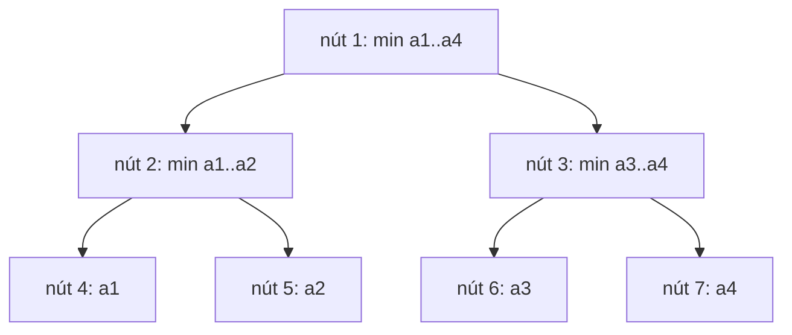

# Bài 3.5 – Cây phân đoạn

> **Tập 3** · Cần biết trước: bài 3.4, 2.6 (sparse table) · Thời lượng: khoảng 90 phút đọc, 8 giờ thực hành

**Học xong bài này, em sẽ:**

- trả lời min/max/tổng/ƯCLN trên đoạn **khi mảng thay đổi**, mỗi thao tác O(log n);
- viết cây phân đoạn dạng vòng lặp (ngắn, nhanh);
- biết khi nào dùng Fenwick, sparse table hay cây phân đoạn.

---

## 1. Bài toán mở màn: Giá thấp nhất

Siêu thị theo dõi giá một mặt hàng ở n cửa hàng. Có q thao tác: `1 k u` đổi giá ở cửa hàng k thành u; `2 a b` hỏi giá thấp nhất trong các cửa hàng a..b. (n, q ≤ 2·10⁵; bài [Dynamic Range Minimum Queries](https://cses.fi/problemset/task/1649))

| Vào | Ra |
| --- | --- |
| `8 4`<br>`3 2 4 5 1 1 5 3`<br>`2 1 4`<br>`2 5 6`<br>`1 2 3`<br>`2 1 4` | `2`<br>`1`<br>`3` |

> [!IMPORTANT]
> **Dừng lại và nghĩ.** Fenwick (bài 3.4) dùng "tổng 1..r trừ tổng 1..l−1". Min có làm được phép trừ như vậy không? Sparse table (bài 2.6) trả lời min nhanh, nhưng sửa một phần tử thì sao?

<details>
<summary>Đáp án</summary>

Min không có phép trừ, nên mẹo tiền tố của Fenwick không dùng được. Sparse table phải tính lại nhiều ô khi sửa. Cần một cấu trúc chia mảng thành các khối **lồng nhau** mà mỗi phần tử chỉ thuộc log n khối.

</details>

---

## 2. Cây phân đoạn

Mỗi nút giữ min của một đoạn. Lá là từng phần tử; nút cha giữ min của hai con. Với n = 4:



Đánh số như trên (gốc 1, con của nút x là 2x và 2x + 1), lá thứ i nằm ở nút **n + i** (đánh i từ 0). Cách viết vòng lặp:

- **Sửa phần tử i:** sửa lá n + i, rồi đi lên cha (`x /= 2`), tính lại min hai con.
- **Hỏi [l, r):** đặt l += n, r += n; khi l < r: nếu l lẻ thì lấy nút l và tăng l; nếu r lẻ thì giảm r và lấy nút r; rồi cả hai lên cha.

Mỗi thao tác đi qua tối đa khoảng 2 log₂ n nút.

```cpp
// file: cay_phan_doan.cpp
#include <bits/stdc++.h>
using namespace std;
int n;
vector<long long> t;

void sua(int i, long long v) {                     // a[i] = v, i từ 0
    for (t[i += n] = v; i > 1; i /= 2) t[i / 2] = min(t[i], t[i ^ 1]);
}
long long hoi(int l, int r) {                      // min trên [l, r), i từ 0
    long long kq = LLONG_MAX;
    for (l += n, r += n; l < r; l /= 2, r /= 2) {
        if (l & 1) kq = min(kq, t[l++]);
        if (r & 1) kq = min(kq, t[--r]);
    }
    return kq;
}

int main() {
    ios::sync_with_stdio(false);
    cin.tie(nullptr);
    int q;
    cin >> n >> q;
    t.assign(2 * n, LLONG_MAX);
    for (int i = 0; i < n; i++) cin >> t[n + i];
    for (int i = n - 1; i >= 1; i--) t[i] = min(t[2 * i], t[2 * i + 1]);   // dựng cây
    while (q--) {
        int loai, a;
        long long b;
        cin >> loai >> a >> b;
        if (loai == 1) sua(a - 1, b);
        else cout << hoi(a - 1, b) << '\n';        // [a, b] từ 1 → [a-1, b) từ 0
    }
}
```

`t[i ^ 1]` là nút anh em của i (đổi bit cuối). Đổi `min` thành `+`, `max` hay `gcd` là được cây cho phép đó: phép cần có tính **kết hợp**.

---

## 3. Chọn cấu trúc nào?

| Cần | Mảng không đổi | Mảng có sửa điểm |
| --- | --- | --- |
| Tổng đoạn | Tiền tố (bài 1.3) | Fenwick (bài 3.4) hoặc cây phân đoạn |
| Min/max/ƯCLN đoạn | Sparse table (bài 2.6) | Cây phân đoạn |
| Cộng cả đoạn **và** hỏi tổng/min đoạn | | Cây phân đoạn **lười** (Tập 4) |

---

## 4. Bẫy thường gặp

> [!WARNING]
> **Bẫy 1: lẫn đoạn đóng và nửa mở.** Hàm `hoi` nhận [l, r), chỉ số từ 0. Đề cho [a, b] từ 1 thì gọi `hoi(a - 1, b)`.

> [!WARNING]
> **Bẫy 2: phần tử trung tính sai.** Với min dùng giá trị rất lớn; với tổng dùng 0; với max dùng rất nhỏ. Sai phần tử trung tính cho kết quả sai ở các đoạn biên.

> [!WARNING]
> **Bẫy 3: mảng cây quá nhỏ.** Cách viết vòng lặp cần 2n ô; cách viết đệ quy truyền thống cần 4n ô.

---

## 5. Bài tập

| Nấc | Bài | Nguồn | Ý chính |
| --- | --- | --- | --- |
| Khởi động | [Dynamic Range Minimum Queries](https://cses.fi/problemset/task/1649) | CSES 1649 | Đúng mục 2 |
| Khởi động | [Range Xor Queries](https://cses.fi/problemset/task/1650) | CSES 1650 | Đổi phép thành XOR |
| Luyện | [Hotel Queries](https://cses.fi/problemset/task/1143) | CSES 1143 | Cây max + tìm vị trí đầu tiên ≥ x |
| Luyện | [Pizzeria Queries](https://cses.fi/problemset/task/2206) | CSES 2206 | Tách |a − b| thành hai cây |
| Thử thách | [Subarray Sum Queries](https://cses.fi/problemset/task/1190) | CSES 1190 | Mỗi nút giữ 4 giá trị |

---

## 6. Tóm tắt và checkpoint

1. Lá ở n + i; cha giữ phép gộp của hai con; sửa đi lên, hỏi thu hẹp từ hai đầu.
2. Phép gộp cần tính kết hợp và có phần tử trung tính.
3. Mảng không đổi → tiền tố/sparse table; có sửa → Fenwick/cây phân đoạn.

<details><summary>Với n = 8, phần tử i = 5 (từ 0) nằm ở nút nào, và sửa nó thì đi qua những nút nào?</summary>Nút 13; rồi 6, 3, 1.</details>

**Checkpoint:**

- [ ] Viết cây phân đoạn không nhìn sách trong 5 phút.
- [ ] AC Hotel Queries.
