# Bài 3.6 – Số học modulo và tổ hợp

> **Tập 3 · Đồ thị và quy hoạch động nâng cao**
> Cần biết trước: bài 0.8 (ước, số nguyên tố), bài 1.6 (đệ quy), bài 2.5 (bit), bài 2.9 (đếm bằng QHĐ).
> Thời lượng: khoảng 100 phút đọc, cộng 6 giờ thực hành trong tuần.

**Học xong bài này, em sẽ:**

- làm phép cộng, trừ, nhân **theo modulo** mà không tràn số;
- tính aᵇ mod m trong O(log b) bằng **lũy thừa nhanh**;
- "chia" theo modulo nguyên tố bằng **nghịch đảo modulo**, và tính C(n, k) mod p cho nhiều câu hỏi trong O(1);
- dùng tam giác Pascal khi modulo không nguyên tố;
- đếm đường đi trên lưới có vật cản bằng tổ hợp + **bao hàm–loại trừ** (bài kiểu đề thi **Đường đi tránh bẫy**).

> [!TIP]
> **Học cùng hai trang mô phỏng.** [Lũy thừa nhanh](../../mo-phong/t3-luy-thua.html): bật **Đoán trước** để quyết định có nhân ở từng bit không. [Tam giác Pascal](../../mo-phong/t3-pascal.html): thử ví dụ "modulo không nguyên tố".

---

## 1. Bài toán mở màn: Chọn đội tuyển

Trường có a bạn giỏi Tin, cần chọn b bạn vào đội. Có bao nhiêu cách chọn? Có n câu hỏi như vậy; vì đáp án rất lớn, in phần dư khi chia cho p = 10⁹ + 7. (n ≤ 10⁵, 0 ≤ b ≤ a ≤ 10⁶; bài [Binomial Coefficients](https://cses.fi/problemset/task/1079))

| Vào | Ra |
| --- | --- |
| `3`<br>`5 3`<br>`2 1`<br>`10 7` | `10`<br>`2`<br>`120` |

---

## 2. Dừng lại 10 phút

> [!IMPORTANT]
> **Dừng lại và nghĩ.**
> 1. C(a, b) = a! / (b! · (a − b)!). 20! đã vượt `long long`. Có thể tính a! mod p không tràn số không?
> 2. **Chia** theo modulo thì sao? Với p = 7: 12 / 4 = 3, nhưng (12 mod 7) / (4 mod 7) = 5 / 4 không phải số nguyên.
> 3. Theo modulo 7, số y nào thỏa 4 · y ≡ 1? Nhân 5 với y thì được gì?

<details>
<summary>Đáp án</summary>

1. Có: nhân dần và lấy dư sau **mỗi** phép nhân; mọi số luôn < p nên tích hai số < p² ≈ 10¹⁸, vừa `long long`.
2. Không chia trực tiếp được.
3. y = 2 (4 · 2 = 8 ≡ 1). 5 · 2 = 10 ≡ 3 (mod 7): đúng bằng 12 / 4 = 3. "Chia cho x" thay bằng "nhân với **nghịch đảo** của x". Với p nguyên tố, nghịch đảo của x là x^(p−2) mod p (định lý Fermat nhỏ).

</details>

---

## 3. Lời giải ngây thơ và vì sao nó chậm

Dùng tam giác Pascal (bài 2.9): C(i, j) = C(i−1, j−1) + C(i−1, j), chỉ cần phép cộng. Nhưng bảng tới a = 10⁶ có 5·10¹¹ ô: không đủ bộ nhớ lẫn thời gian. Cách khác: với mỗi câu hỏi nhân b số rồi chia b số (bằng nghịch đảo, mỗi lần O(log p)): O(n · b · log p) = 10⁵ × 10⁶ × 30: quá chậm. Cần **tính sẵn** giai thừa và nghịch đảo giai thừa một lần.

---

## 4. Ý tưởng then chốt

> [!IMPORTANT]
> **Tính sẵn `gt[i] = i! mod p` và `ngd[i] = (i!)⁻¹ mod p`. Khi đó C(a, b) = gt[a] · ngd[b] · ngd[a − b] mod p, O(1) mỗi câu. Chỉ cần một lần lũy thừa nhanh: ngd[N] = gt[N]^(p−2), rồi đi lùi ngd[i−1] = ngd[i] · i.**

Quy tắc modulo:

| Phép | Viết | Ghi chú |
| --- | --- | --- |
| Cộng | `(a + b) % p` | |
| Trừ | `((a - b) % p + p) % p` | C++: `%` của số âm cho số âm |
| Nhân | `a * b % p` | a, b < p ≈ 10⁹ thì tích < 10¹⁸: vừa `long long` |
| Chia cho x | `a * luy_thua(x, p - 2) % p` | chỉ khi p nguyên tố và x không chia hết cho p |

**Lũy thừa nhanh:** aᵇ = (a^(b/2))² nếu b chẵn, nhân thêm a nếu b lẻ. Viết bằng vòng lặp theo các bit của b: a lần lượt là a¹, a², a⁴, a⁸…; bit nào của b bật thì nhân vào kết quả.

### Chạy từng bước

Tính 3¹³ (13 = 1101₂). Đoán "có nhân không" ở từng bit rồi mới mở.

<details>
<summary><b>Bước 1</b> – Khởi tạo</summary>

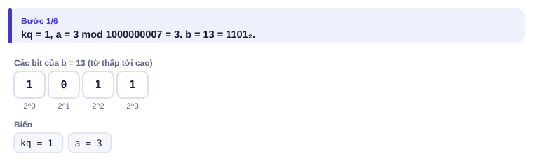

</details>

<details>
<summary><b>Bước 2</b> – Bit 0 và bit 1</summary>

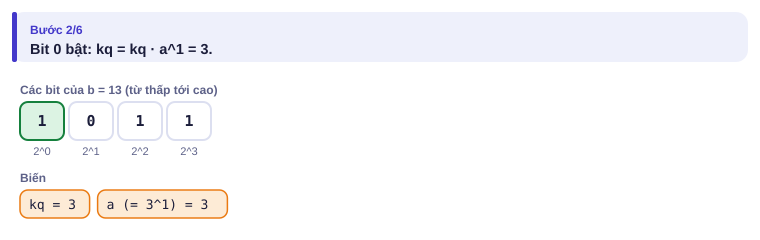
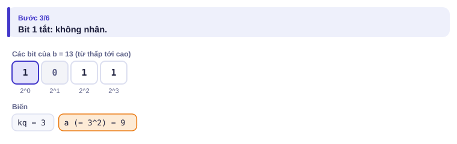

</details>

<details>
<summary><b>Bước 3</b> – Bit 2 và bit 3</summary>

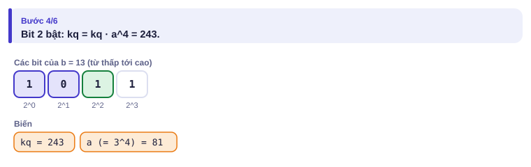
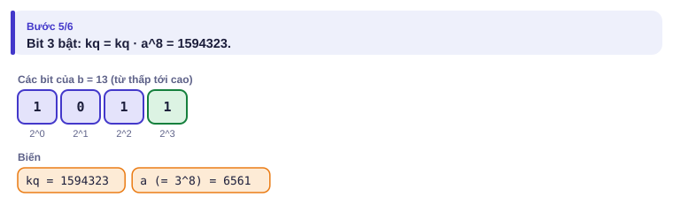

</details>

<details>
<summary><b>Bước 4</b> – Kết quả</summary>

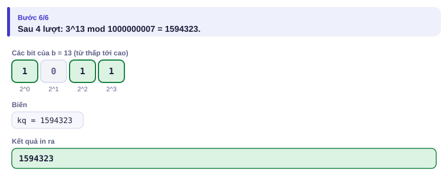

</details>

| Bit của b (từ thấp) | 1 | 0 | 1 | 1 |
| --- | :---: | :---: | :---: | :---: |
| a hiện tại | 3 | 9 | 81 | 6561 |
| Nhân vào kết quả? | có | không | có | có |
| Kết quả | 3 | 3 | 243 | 1 594 323 |

3¹³ = 1 594 323 sau 4 lượt thay vì 12 phép nhân.

---

## 5. Mã giả và cài đặt

```cpp
// file: to_hop.cpp
#include <bits/stdc++.h>
using namespace std;
const long long P = 1000000007;
const int N = 1000000;
long long luy_thua(long long a, long long b) {
    long long kq = 1;
    a %= P;
    while (b > 0) {
        if (b & 1) kq = kq * a % P;
        a = a * a % P;
        b >>= 1;
    }
    return kq;
}
int main() {
    ios::sync_with_stdio(false);
    cin.tie(nullptr);
    vector<long long> gt(N + 1), ngd(N + 1);
    gt[0] = 1;
    for (int i = 1; i <= N; i++) gt[i] = gt[i - 1] * i % P;
    ngd[N] = luy_thua(gt[N], P - 2);                  // Fermat: x^(p-2) là nghịch đảo của x
    for (int i = N; i >= 1; i--) ngd[i - 1] = ngd[i] * i % P;
    int q;
    cin >> q;
    while (q--) {
        int a, b;
        cin >> a >> b;
        cout << gt[a] * ngd[b] % P * ngd[a - b] % P << '\n';
    }
}
```

```python
# file: to_hop.py
import sys
P = 10**9 + 7
data = sys.stdin.buffer.read().split()
q = int(data[0])
qs = [(int(data[1 + 2 * i]), int(data[2 + 2 * i])) for i in range(q)]
N = max(a for a, _ in qs)
gt = [1] * (N + 1)
for i in range(1, N + 1):
    gt[i] = gt[i - 1] * i % P
ngd = [1] * (N + 1)
ngd[N] = pow(gt[N], P - 2, P)              # pow(x, e, m) của Python là lũy thừa nhanh
for i in range(N, 0, -1):
    ngd[i - 1] = ngd[i] * i % P
print("\n".join(str(gt[a] * ngd[b] % P * ngd[a - b] % P) for a, b in qs))
```

### Tam giác Pascal: khi modulo không nguyên tố

C(n, k) = C(n−1, k−1) + C(n−1, k): chọn k người từ n người, người cuối hoặc được chọn hoặc không. Chỉ cần phép cộng, không cần p nguyên tố, nhưng tốn O(n²): dùng khi n ≤ 5000, hoặc khi modulo **không** nguyên tố (ví dụ 10⁹ hay 2⁶⁴).

<details>
<summary><b>Hình</b> – tam giác Pascal tới hàng 5 (mở lần lượt; đoán ô được tô)</summary>

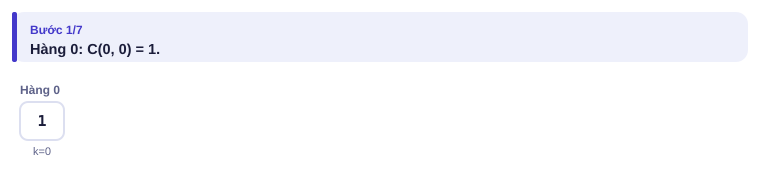
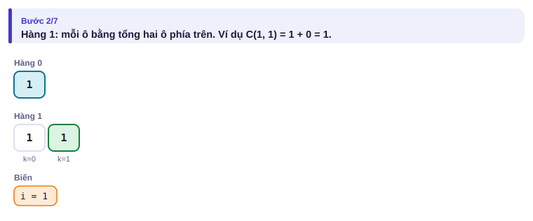
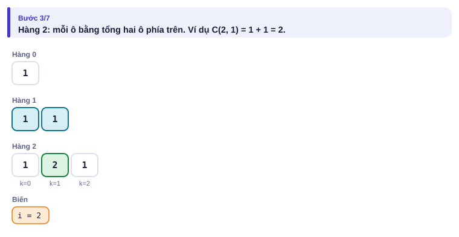
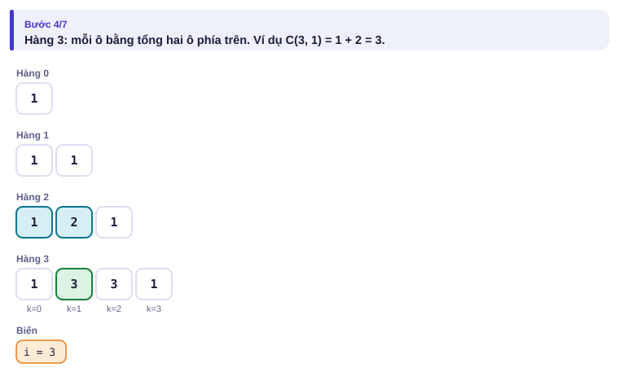
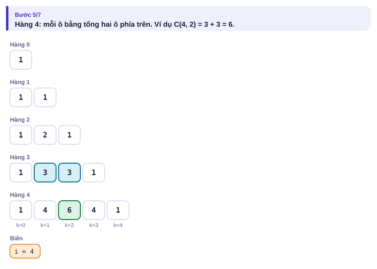
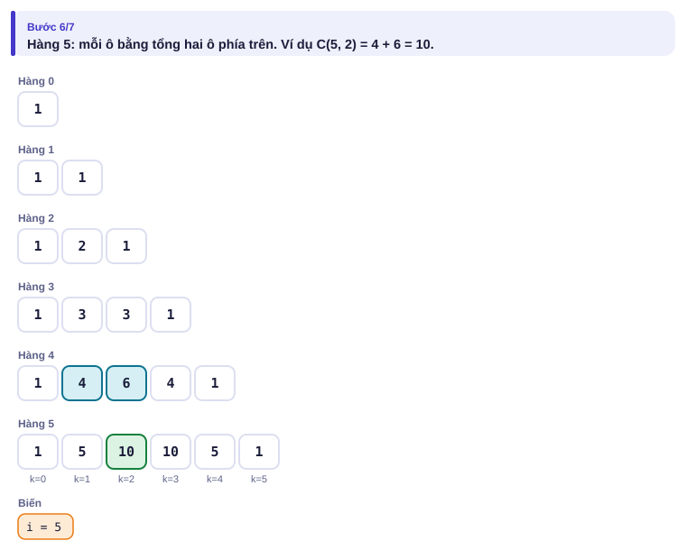
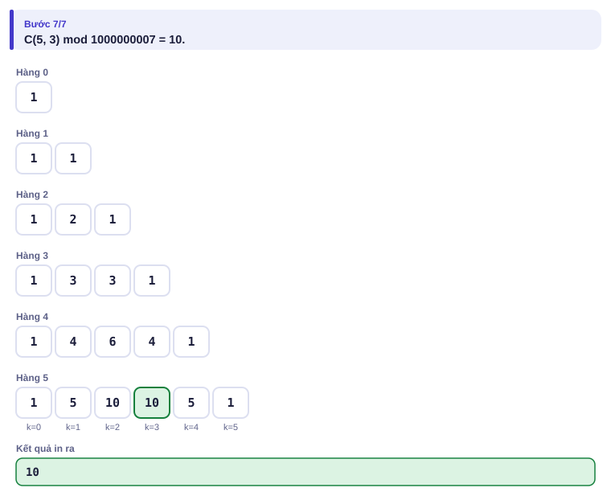

</details>

---

## 6. Vì sao đúng, chạy bao lâu

- **Lấy dư từng bước đúng:** (a + b) mod p và (a · b) mod p chỉ phụ thuộc a mod p và b mod p.
- **Fermat nhỏ:** với p nguyên tố và x không chia hết cho p, x^(p−1) ≡ 1 (mod p), nên x · x^(p−2) ≡ 1: x^(p−2) là nghịch đảo.
- **Đi lùi nghịch đảo giai thừa:** (i − 1)! = i! / i, nên ((i − 1)!)⁻¹ = (i!)⁻¹ · i.
- **Lũy thừa nhanh:** b = Σ 2ʲ trên các bit bật, nên aᵇ = Π a^(2ʲ); mỗi lượt bình phương a để có a^(2ʲ⁺¹). log₂ b lượt.
- **Chạy bao lâu:** chuẩn bị O(N + log p), mỗi câu O(1). Pascal: O(n²).

---

## 7. Bẫy thường gặp

> [!WARNING]
> **Bẫy 1: nhân ba số rồi mới lấy dư.** `gt[a] * ngd[b] * ngd[a-b] % P` tràn số: tích hai số đầu đã gần 10¹⁸. Lấy dư **sau mỗi phép nhân**.

> [!WARNING]
> **Bẫy 2: trừ ra số âm.** `(a - b) % P` có thể âm trong C++. Cộng thêm P. Bài Đường đi tránh bẫy có nhiều phép trừ.
> *Test phá:* tính (3 − 5) mod 7: phải là 5, C++ `(3 - 5) % 7` cho −2.

> [!WARNING]
> **Bẫy 3: nghịch đảo khi p không nguyên tố.** Công thức x^(p−2) chỉ đúng khi p nguyên tố. Modulo 10⁹ + 7 hay 998 244 353 là nguyên tố; modulo 10⁹ thì không.
> *Test phá:* p = 6, x = 5: 5⁴ mod 6 = 1, không phải nghịch đảo của 5 (nghịch đảo đúng là 5).

> [!WARNING]
> **Bẫy 4: số mũ khổng lồ.** Tính a^(b^c) mà lấy b^c mod p sẽ sai. Theo Fermat, số mũ phải lấy dư theo **p − 1** (Ví dụ 2).

---

## 8. Ví dụ giảm dần hỗ trợ

### Ví dụ 2 – Điền vào chỗ trống: Lũy thừa tầng

Tính a^(b^c) mod 10⁹ + 7 cho n bộ (a, b, c) (0 ≤ a, b, c ≤ 10⁹; bài [Exponentiation II](https://cses.fi/problemset/task/1712)).

| Vào | Ra |
| --- | --- |
| `3`<br>`3 7 1`<br>`15 2 2`<br>`3 4 5` | `2187`<br>`50625`<br>`763327764` |

```cpp
long long mu = luy_thua(b, c, ____);       // số mũ b^c, lấy dư theo bao nhiêu?
cout << luy_thua(a, mu, ____) << '\n';
```

<details>
<summary>Đáp án</summary>

`P - 1` và `P`. Theo Fermat, a^(P−1) ≡ 1 khi a không chia hết cho P, nên số mũ chỉ quan trọng theo modulo P − 1. Trường hợp a = 0 vẫn đúng với giới hạn của đề, vì b ≤ 10⁹ thì b^c không thể chia hết cho P − 1 = 2 · 500000003 trừ khi b = 0.

```cpp
// file: luy_thua_tang.cpp
#include <bits/stdc++.h>
using namespace std;
const long long P = 1000000007;
long long luy_thua(long long a, long long b, long long m) {
    long long kq = 1 % m;
    a %= m;
    while (b > 0) {
        if (b & 1) kq = kq * a % m;
        a = a * a % m;
        b >>= 1;
    }
    return kq;
}
int main() {
    int n;
    cin >> n;
    while (n--) {
        long long a, b, c;
        cin >> a >> b >> c;
        long long mu = luy_thua(b, c, P - 1);
        cout << luy_thua(a, mu, P) << '\n';
    }
}
```

</details>

### Ví dụ 3 – Tự làm: Chia kẹo

Chia m viên kẹo giống nhau cho n bạn (bạn có thể không được viên nào). Có bao nhiêu cách? In chia dư 10⁹ + 7. (n, m ≤ 10⁶; bài [Distributing Apples](https://cses.fi/problemset/task/1716))

| Vào | Ra |
| --- | --- |
| `3 2` | `6` |

> [!IMPORTANT]
> Tự làm trước. Gợi ý: xếp m viên kẹo và n − 1 "vách ngăn" thành một hàng dài m + n − 1. Mỗi cách chia ứng với một cách chọn vị trí cho các vách ngăn.

<details>
<summary>Lời giải</summary>

Đáp án C(m + n − 1, n − 1) (phương pháp "chia kẹo Euler", hay "sao và vạch").

```cpp
// file: chia_keo.cpp
#include <bits/stdc++.h>
using namespace std;
const long long P = 1000000007;
long long luy_thua(long long a, long long b) {
    long long kq = 1; a %= P;
    while (b > 0) { if (b & 1) kq = kq * a % P; a = a * a % P; b >>= 1; }
    return kq;
}
int main() {
    long long n, m;
    cin >> n >> m;
    int N = n + m;
    vector<long long> gt(N + 1);
    gt[0] = 1;
    for (int i = 1; i <= N; i++) gt[i] = gt[i - 1] * i % P;
    long long a = m + n - 1, b = n - 1;
    cout << gt[a] * luy_thua(gt[b], P - 2) % P * luy_thua(gt[a - b], P - 2) % P << '\n';
}
```

</details>

---

## 9. Bài tập

| Nấc | Bài | Nguồn | Ý chính |
| --- | --- | --- | --- |
| Khởi động | [Exponentiation](https://cses.fi/problemset/task/1095) | CSES 1095 | Lũy thừa nhanh |
| Khởi động | [Binomial Coefficients](https://cses.fi/problemset/task/1079) | CSES 1079 | Đúng mục 5 |
| Luyện | [Exponentiation II](https://cses.fi/problemset/task/1712) | CSES 1712 | Ví dụ 2 |
| Luyện | [Distributing Apples](https://cses.fi/problemset/task/1716) | CSES 1716 | Ví dụ 3 |
| Luyện | [Creating Strings II](https://cses.fi/problemset/task/1715) | CSES 1715 | Hoán vị lặp: n! / (c₁!·c₂!·…) |
| Thử thách | [Christmas Party](https://cses.fi/problemset/task/1717) | CSES 1717 | Hoán vị không điểm cố định |
| Kiểu đề thi | Đường đi tránh bẫy | Bài của sách, chấm theo subtask | Xem bên dưới; giống [Grid Paths II](https://cses.fi/problemset/task/1078) |

### Bài kiểu đề thi: Đường đi tránh bẫy

**Đề bài.** Robot đứng ở ô (1, 1) của lưới n × n (2 ≤ n ≤ 10⁶), cần tới ô (n, n), mỗi bước đi sang **phải** hoặc **xuống**. Có m ô bẫy (0 ≤ m ≤ 1000, khác nhau, không trùng ô đầu và ô cuối) robot không được đi vào. Đếm số đường đi, chia dư 10⁹ + 7. Đọc từ `DUONGDI.INP` (dòng đầu n m, m dòng sau là hàng cột của bẫy), ghi ra `DUONGDI.OUT`.

Subtask: 40% có n ≤ 1000; 60% còn lại có n ≤ 10⁶, m ≤ 1000.

| DUONGDI.INP | DUONGDI.OUT |
| --- | --- |
| `4 2`<br>`2 2`<br>`3 3` | `4` |

Không có bẫy thì có C(6, 3) = 20 đường. 12 đường qua (2, 2), 12 đường qua (3, 3), 8 đường qua cả hai: 20 − 12 − 12 + 8 = 4.

<details>
<summary><b>Gợi ý 1</b> – hướng đi (đủ 40% điểm)</summary>

Giống Ví dụ 3 của bài 2.9: dp[i][j] = dp[i − 1][j] + dp[i][j − 1], ô bẫy bằng 0. O(n²) = 10⁶ với n = 1000.

</details>

<details>
<summary><b>Gợi ý 2</b> – ý then chốt</summary>

Số đường từ (r₁, c₁) tới (r₂, c₂) (r₂ ≥ r₁, c₂ ≥ c₁) là C((r₂ − r₁) + (c₂ − c₁), r₂ − r₁). Sắp các bẫy theo (hàng, cột) và coi ô (n, n) là "bẫy cuối". Gọi f[i] = số đường từ (1, 1) tới bẫy i mà **không đi qua bẫy nào khác trước đó**. Khi đó

f[i] = (số đường từ (1, 1) tới bẫy i) − Σ f[j] · (số đường từ bẫy j tới bẫy i), với mọi bẫy j đứng trước i (hàng ≤, cột ≤).

Mỗi đường "xấu" tới i được trừ đúng một lần, theo bẫy **đầu tiên** nó đi qua. Đáp án là f của ô (n, n). O(m²).

</details>

<details>
<summary><b>Gợi ý 3</b> – lời giải đầy đủ</summary>

Cần giai thừa tới 2n.

```cpp
// file: duongdi.cpp
#include <bits/stdc++.h>
using namespace std;
const long long P = 1000000007;
vector<long long> gt, ngd;
long long luy_thua(long long a, long long b) {
    long long kq = 1; a %= P;
    while (b > 0) { if (b & 1) kq = kq * a % P; a = a * a % P; b >>= 1; }
    return kq;
}
long long C(int n, int k) { return (k < 0 || k > n) ? 0 : gt[n] * ngd[k] % P * ngd[n - k] % P; }
long long duong(int r1, int c1, int r2, int c2) {           // số đường đi phải/xuống
    if (r2 < r1 || c2 < c1) return 0;
    return C((r2 - r1) + (c2 - c1), r2 - r1);
}
int main() {
    freopen("DUONGDI.INP", "r", stdin);
    freopen("DUONGDI.OUT", "w", stdout);
    int n, m;
    scanf("%d %d", &n, &m);
    int N = 2 * n;
    gt.assign(N + 1, 1); ngd.assign(N + 1, 1);
    for (int i = 1; i <= N; i++) gt[i] = gt[i - 1] * i % P;
    ngd[N] = luy_thua(gt[N], P - 2);
    for (int i = N; i >= 1; i--) ngd[i - 1] = ngd[i] * i % P;
    vector<pair<int, int>> b(m);
    for (auto &[r, c] : b) scanf("%d %d", &r, &c);
    sort(b.begin(), b.end());
    b.push_back({n, n});                                     // "bẫy" cuối là đích
    vector<long long> f(b.size());
    for (size_t i = 0; i < b.size(); i++) {
        f[i] = duong(1, 1, b[i].first, b[i].second);
        for (size_t j = 0; j < i; j++)
            f[i] = (f[i] - f[j] * duong(b[j].first, b[j].second, b[i].first, b[i].second) % P + P) % P;
    }
    printf("%lld\n", f.back());
}
```

```python
# file: duongdi.py
P = 10**9 + 7
with open("DUONGDI.INP") as fi:
    data = fi.read().split()
n, m = int(data[0]), int(data[1])
b = sorted((int(data[2 + 2 * i]), int(data[3 + 2 * i])) for i in range(m))
b.append((n, n))
N = 2 * n
gt = [1] * (N + 1)
for i in range(1, N + 1):
    gt[i] = gt[i - 1] * i % P
ngd = [1] * (N + 1)
ngd[N] = pow(gt[N], P - 2, P)
for i in range(N, 0, -1):
    ngd[i - 1] = ngd[i] * i % P

def duong(r1, c1, r2, c2):
    if r2 < r1 or c2 < c1:
        return 0
    a, k = (r2 - r1) + (c2 - c1), r2 - r1
    return gt[a] * ngd[k] % P * ngd[a - k] % P

f = []
for i, (r, c) in enumerate(b):
    v = duong(1, 1, r, c)
    for j in range(i):
        v -= f[j] * duong(b[j][0], b[j][1], r, c)
    f.append(v % P)
with open("DUONGDI.OUT", "w") as fo:
    fo.write(f"{f[-1]}\n")
```

</details>

---

## 10. Tóm tắt, flashcard và checkpoint

**Tóm tắt trong 5 dòng.**

1. Lấy dư sau **mỗi** phép tính; trừ thì cộng thêm p.
2. Lũy thừa nhanh: duyệt bit của số mũ, O(log b).
3. p nguyên tố: x⁻¹ = x^(p−2); C(n, k) = n! · (k!)⁻¹ · ((n−k)!)⁻¹, tính sẵn giai thừa và nghịch đảo.
4. Modulo không nguyên tố, n nhỏ: tam giác Pascal.
5. Đếm "tránh vật cản": f[i] = tổng số cách − Σ f[j] · cách(j → i), theo vật cản đầu tiên chạm phải.

**Flashcard.**

<details><summary>Nghịch đảo của 2 theo modulo 7?</summary>4, vì 2 × 4 = 8 ≡ 1 (mod 7).</details>
<details><summary>Tính 2¹⁰ bằng lũy thừa nhanh cần mấy lượt?</summary>4 lượt (10 = 1010₂ có 4 bit).</details>
<details><summary>Số đường đi phải/xuống từ (1, 1) tới (3, 4)?</summary>C(2 + 3, 2) = 10.</details>
<details><summary>a^(b^c) mod p: số mũ lấy dư theo gì?</summary>p − 1.</details>
<details><summary>Chia m kẹo cho n bạn có bao nhiêu cách?</summary>C(m + n − 1, n − 1).</details>

**Ôn xoắn ốc** (mỗi bài tối đa 20 phút):

- Viết lại cây phân đoạn (bài 3.5) không nhìn sách.
- [Grid Paths](https://cses.fi/problemset/task/1638) (CSES 1638): QHĐ trên lưới (bài 2.9).
- [Counting Divisors](https://cses.fi/problemset/task/1713) (CSES 1713): ước số (bài 0.8).

**Checkpoint – em đã sẵn sàng sang bài tiếp theo nếu:**

- [ ] Viết lũy thừa nhanh và bảng giai thừa nghịch đảo không nhìn sách.
- [ ] AC [Binomial Coefficients](https://cses.fi/problemset/task/1079) và [Exponentiation II](https://cses.fi/problemset/task/1712).
- [ ] Làm xong Ví dụ 3 (Chia kẹo) mà không mở lời giải.
- [ ] Đạt trọn điểm bài Đường đi tránh bẫy khi tự làm trong 40 phút.

Chưa đạt? Nếu vướng ô 1, chạy trang mô phỏng lũy thừa nhanh với số mũ của em. Nếu vướng ô 2, đọc lại mục 6 và Bẫy 4. Nếu vướng ô 3 hoặc 4, chạy trang Tam giác Pascal để thấy số đường đi trên lưới chính là các số trong tam giác.
