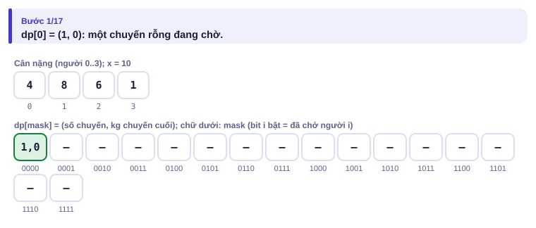
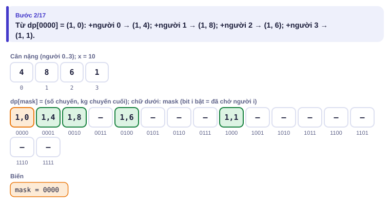
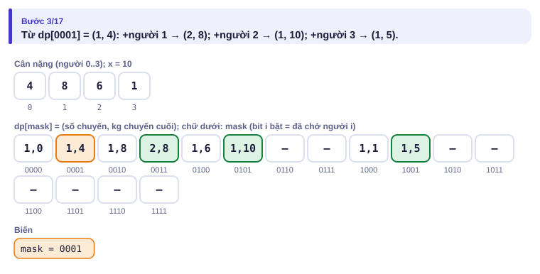
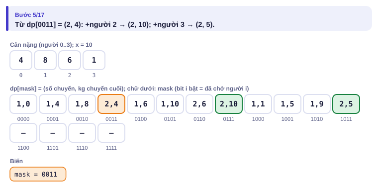
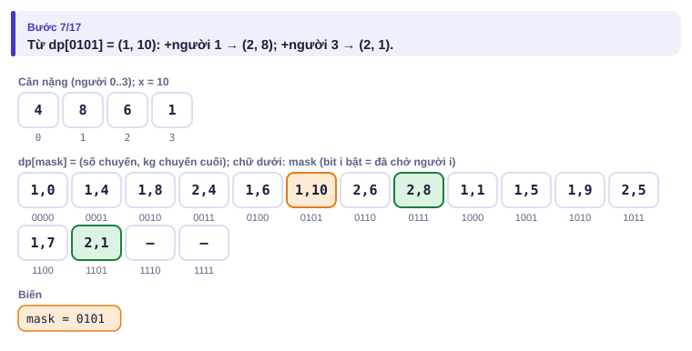
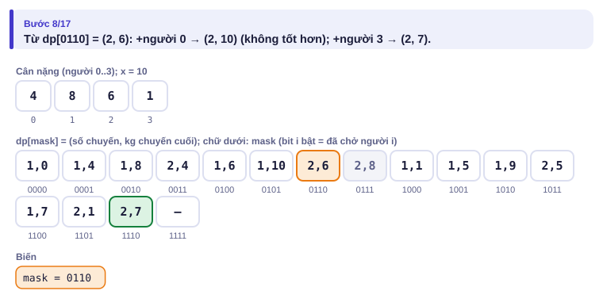
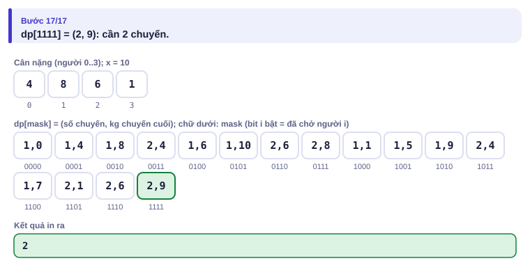

# Bài 3.7 – QHĐ trên tập con (bitmask)

> **Tập 3 · Đồ thị và quy hoạch động nâng cao**
> Cần biết trước: bài 1.7 (bitmask, vét cạn), bài 2.5 (phép toán bit), bài 2.9 (QHĐ).
> Thời lượng: khoảng 100 phút đọc, cộng 6 giờ thực hành trong tuần.

**Học xong bài này, em sẽ:**

- dùng **tập con** (biểu diễn bằng bitmask) làm trạng thái QHĐ khi n ≤ 20;
- thiết kế trạng thái gồm **nhiều thông tin** (cặp giá trị) và giữ trạng thái **trội**;
- nhận ra dấu hiệu "n ≤ 20 mà vét cạn n! quá chậm";
- giải các dạng phân công, đường đi qua mọi đỉnh, và bài kiểu đề thi **Ghép đôi**.

> [!TIP]
> **Học cùng hai trang mô phỏng.** [Thang máy](../../mo-phong/t3-thang-may.html): xem bảng dp theo từng mask (chữ dưới mỗi ô là tập người đã chở). [Phân công việc](../../mo-phong/t3-phan-cong.html): bật **Đoán trước** để đoán dp của mỗi mask khi nó được lấy ra.

---

## 1. Bài toán mở màn: Thang máy

n bạn (n ≤ 20) cân nặng w₁ … wₙ cần lên tầng thượng bằng một thang máy chở tối đa x kg mỗi chuyến. Ít nhất bao nhiêu chuyến? (wᵢ ≤ x ≤ 10⁹; bài [Elevator Rides](https://cses.fi/problemset/task/1653))

| Vào | Ra |
| --- | --- |
| `4 10`<br>`4 8 6 1` | `2` |

Ví dụ: chuyến 1 chở {4, 6}, chuyến 2 chở {8, 1}.

---

## 2. Dừng lại 10 phút

> [!IMPORTANT]
> **Dừng lại và nghĩ.**
> 1. Tham lam "xếp người nặng trước, chất vào chuyến hiện tại tới khi không vừa thì mở chuyến mới" có luôn đúng không? Thử với x = 12 và cân nặng 6 5 4 4 3 2.
> 2. Thử mọi thứ tự xếp người (rồi chất lần lượt vào thang) tốn bao nhiêu với n = 20?
> 3. Sau khi đã chở xong một **nhóm** người, thứ tự trong nhóm còn quan trọng không? Thông tin nào về quá khứ là đủ để đi tiếp?

<details>
<summary>Đáp án</summary>

1. Không. Tham lam chất 6 + 5, rồi 4 + 4 + 3, rồi 2: 3 chuyến. Nhưng 6 + 4 + 2 và 5 + 4 + 3 chỉ cần 2 chuyến. Bài này không có tham lam đơn giản.
2. 20! ≈ 2,4·10¹⁸ thứ tự: không thể.
3. Không. Chỉ cần biết **tập** người đã chở, số chuyến đã dùng, và chuyến cuối đã chất bao nhiêu kg. Có 2²⁰ ≈ 10⁶ tập: QHĐ được.

</details>

---

## 3. Lời giải ngây thơ và vì sao nó chậm

Quay lui (bài 1.7) thử mọi hoán vị, chất lần lượt và mở chuyến mới khi đầy: O(n! · n). Với n = 10 là 3,6·10⁷, với n = 20 không thể. Lãng phí: hai thứ tự khác nhau nhưng cùng chở xong **cùng một tập** người với cùng số chuyến và cùng kg chuyến cuối thì phần tiếp theo giống hệt nhau, ta lại giải hai lần.

---

## 4. Ý tưởng then chốt

> [!IMPORTANT]
> **dp[mask] = cặp (số chuyến, kg chuyến cuối) tốt nhất để chở xong đúng tập `mask`. Từ dp[mask] thêm người i chưa có: vừa thì chất vào chuyến cuối, không vừa thì mở chuyến mới. Duyệt mask tăng dần; giữ cặp nhỏ hơn (ít chuyến trước, nhẹ hơn sau).**

- **Trạng thái:** bit i của mask bật nghĩa là người i đã được chở.
- **Cơ sở:** dp[0] = (1, 0): một chuyến rỗng đang chờ.
- **Chuyển:** từ (k, w) thêm người i: nếu w + wᵢ ≤ x thì (k, w + wᵢ), ngược lại (k + 1, wᵢ).
- **Thứ tự:** thêm người làm mask **lớn hơn**, nên duyệt mask tăng dần là đúng.

Vì sao chỉ cần giữ cặp tốt nhất: với cùng tập đã chở, ít chuyến hơn luôn không tệ hơn (cùng lắm mở thêm một chuyến là bằng); cùng số chuyến thì chuyến cuối nhẹ hơn tốt hơn. Đây là lập luận **trạng thái trội**.

### Chạy từng bước

Với ví dụ mở màn (người 0..3 nặng 4, 8, 6, 1). Đoán cặp mới rồi mới mở.

<details>
<summary><b>Bước 1</b> – dp[0000]</summary>



</details>

<details>
<summary><b>Bước 2</b> – Từ tập rỗng, rồi từ tập {người 0}</summary>




</details>

<details>
<summary><b>Bước 3</b> – Từ {0, 1}: người 1 nặng 8 làm chuyến đầy</summary>



</details>

<details>
<summary><b>Bước 4</b> – Từ {0, 2} và {1, 2}</summary>




</details>

<details>
<summary><b>Bước 5</b> – Kết quả</summary>



</details>

---

## 5. Mã giả và cài đặt

```cpp
// file: thang_may.cpp
#include <bits/stdc++.h>
using namespace std;
int main() {
    int n;
    long long x;
    cin >> n >> x;
    vector<long long> w(n);
    for (auto &v : w) cin >> v;
    int full = 1 << n;
    vector<pair<int, long long>> dp(full, {INT_MAX, 0});   // (số chuyến, kg chuyến cuối)
    dp[0] = {1, 0};
    for (int mask = 0; mask < full; mask++) {
        if (dp[mask].first == INT_MAX) continue;
        auto [k, cur] = dp[mask];
        for (int i = 0; i < n; i++) {
            if (mask >> i & 1) continue;
            pair<int, long long> moi = (cur + w[i] <= x) ? make_pair(k, cur + w[i])
                                                         : make_pair(k + 1, w[i]);
            dp[mask | 1 << i] = min(dp[mask | 1 << i], moi);   // so cặp: chuyến trước, kg sau
        }
    }
    cout << dp[full - 1].first << '\n';
}
```

Độ phức tạp O(2ⁿ · n) = 2·10⁷ với n = 20. Bộ nhớ 2²⁰ cặp ≈ 16 MB. Python cần khoảng 20 giây cho n = 20: bài này nên dùng C++.

### Các dạng QHĐ bitmask hay gặp

| Dạng | Trạng thái | Ví dụ |
| --- | --- | --- |
| Chia tập thành nhóm | dp[mask] (có thể là cặp) | Thang máy |
| Phân công n việc cho n người | dp[mask], người thứ popcount(mask) | Ví dụ 2 |
| Đường đi qua mọi đỉnh (người du lịch) | dp[mask][đỉnh cuối] | Ví dụ 3 |
| Ghép đôi cả tập | dp[mask], luôn ghép phần tử nhỏ nhất chưa ghép | Ghép đôi |
| Lát gạch lưới hẹp | dp[cột][mask hàng đã lấp] | [Counting Tilings](https://cses.fi/problemset/task/2181) |

---

## 6. Vì sao đúng, chạy bao lâu

- **Đúng:** mọi cách chở tương ứng với một thứ tự người; QHĐ xét mọi cách thêm từng người một nên phủ hết các thứ tự, chỉ gộp những thứ tự cho cùng tập. Lập luận trạng thái trội đảm bảo giữ một cặp không làm mất lời giải tối ưu.
- **Chạy bao lâu:** 2ⁿ trạng thái × n cách thêm: O(2ⁿ · n). Dấu hiệu nhận biết trong đề: n ≤ 20 (đôi khi ≤ 23); với n ≤ 10 thì vét cạn n! cũng được.

---

## 7. Bẫy thường gặp

> [!WARNING]
> **Bẫy 1: n quá lớn.** 2ⁿ·n với n = 25 là 8·10⁸; với n = 30 là quá chậm và quá bộ nhớ.

> [!WARNING]
> **Bẫy 2: độ ưu tiên toán tử.** `mask | 1 << i` đúng vì `<<` làm trước `|`; nhưng `mask & 1 << i == 0` thì sai vì `==` làm trước `&`. Luôn thêm ngoặc khi không chắc (bài 2.5).

> [!WARNING]
> **Bẫy 3: thiếu thông tin trong trạng thái.** Chỉ lưu số chuyến mà quên kg chuyến cuối thì không biết người tiếp theo có vừa không.
> *Test phá:* x = 10, cân nặng 6 6 6: phải ra 3.

> [!WARNING]
> **Bẫy 4: đường đi qua mọi đỉnh mà quên "đỉnh cuối".** dp[mask] không đủ cho bài người du lịch: cần biết đang đứng ở đâu.

---

## 8. Ví dụ giảm dần hỗ trợ

### Ví dụ 2 – Điền vào chỗ trống: Phân công việc

n người, n việc (n ≤ 20); người i làm việc j tốn cᵢⱼ. Mỗi người làm đúng một việc, mỗi việc đúng một người. Tổng chi phí nhỏ nhất?

| Vào | Ra |
| --- | --- |
| `3`<br>`4 2 8`<br>`4 3 7`<br>`3 1 6` | `12` |

dp[mask] = chi phí nhỏ nhất khi đã giao các việc trong mask cho những người **đầu tiên**. Người tiếp theo nhận việc là người thứ popcount(mask).

```cpp
dp[0] = 0;
for (int mask = 0; mask < (1 << n); mask++) {
    int i = ____;                                 // người tiếp theo
    for (int j = 0; j < n; j++)
        if (!(mask >> j & 1))
            dp[mask | 1 << j] = min(dp[mask | 1 << j], ____);
}
```

<details>
<summary>Đáp án</summary>

`__builtin_popcount(mask)` và `dp[mask] + c[i][j]`. Không cần dp[mask][i] vì i suy ra được từ mask: ý quan trọng giúp giảm trạng thái.

```cpp
// file: phan_cong.cpp
#include <bits/stdc++.h>
using namespace std;
int main() {
    int n;
    cin >> n;
    vector<vector<long long>> c(n, vector<long long>(n));
    for (auto &r : c) for (auto &v : r) cin >> v;
    vector<long long> dp(1 << n, LLONG_MAX);
    dp[0] = 0;
    for (int mask = 0; mask < (1 << n); mask++) {
        if (dp[mask] == LLONG_MAX) continue;
        int i = __builtin_popcount(mask);
        if (i == n) continue;
        for (int j = 0; j < n; j++)
            if (!(mask >> j & 1))
                dp[mask | 1 << j] = min(dp[mask | 1 << j], dp[mask] + c[i][j]);
    }
    cout << dp[(1 << n) - 1] << '\n';
}
```

</details>

### Ví dụ 3 – Tự làm: Hành trình qua mọi thành phố

n thành phố (2 ≤ n ≤ 20), m chuyến bay một chiều. Đếm số hành trình từ thành phố 1 tới thành phố n đi qua **mỗi thành phố đúng một lần**, chia dư 10⁹ + 7. (bài [Hamiltonian Flights](https://cses.fi/problemset/task/1690))

| Vào | Ra |
| --- | --- |
| `4 6`<br>`1 2`<br>`1 3`<br>`2 3`<br>`3 2`<br>`2 4`<br>`3 4` | `2` |

> [!IMPORTANT]
> Tự làm trước. Gợi ý: dp[mask][v] = số đường bắt đầu ở 1, đi qua đúng các thành phố trong mask, đang đứng ở v. Mở rộng bằng một chuyến bay v → u với u chưa có trong mask. Chỉ xét mask chứa thành phố 1; thành phố n chỉ được thăm **cuối cùng**.

<details>
<summary>Lời giải</summary>

1 → 2 → 3 → 4 và 1 → 3 → 2 → 4. Duyệt danh sách cạnh **vào** để vòng trong ngắn. O(2ⁿ · m), khoảng 10⁸ phép nhẹ.

```cpp
// file: hanh_trinh.cpp
#include <bits/stdc++.h>
using namespace std;
const int MOD = 1e9 + 7;
int main() {
    int n, m;
    cin >> n >> m;
    vector<vector<int>> vao(n);                    // vao[u]: các v có chuyến bay v -> u
    for (int i = 0; i < m; i++) {
        int a, b;
        cin >> a >> b;
        vao[b - 1].push_back(a - 1);
    }
    vector<vector<int>> dp(1 << n, vector<int>(n, 0));
    dp[1][0] = 1;                                      // chỉ mới ở thành phố 1
    for (int mask = 3; mask < (1 << n); mask++) {
        if (!(mask & 1)) continue;                     // phải chứa thành phố 1
        if ((mask >> (n - 1) & 1) && mask != (1 << n) - 1) continue;   // n chỉ ở cuối
        for (int u = 1; u < n; u++) {
            if (!(mask >> u & 1)) continue;
            int truoc = mask ^ (1 << u);               // tập trước khi tới u
            long long s = 0;
            for (int v : vao[u]) if (truoc >> v & 1) s += dp[truoc][v];
            dp[mask][u] = s % MOD;
        }
    }
    cout << dp[(1 << n) - 1][n - 1] << '\n';
}
```

</details>

---

## 9. Bài tập

| Nấc | Bài | Nguồn | Ý chính |
| --- | --- | --- | --- |
| Khởi động | [Elevator Rides](https://cses.fi/problemset/task/1653) | CSES 1653 | Đúng mục 5 |
| Luyện | Phân công việc, so với vét cạn n! bằng stress test | Tự luyện | Ví dụ 2 + bài 1.9 |
| Luyện | [Hamiltonian Flights](https://cses.fi/problemset/task/1690) | CSES 1690 | Ví dụ 3 |
| Luyện | [Apple Division](https://cses.fi/problemset/task/1623) | CSES 1623 | Ôn lại vét cạn bitmask (bài 1.7) |
| Thử thách | [Counting Tilings](https://cses.fi/problemset/task/2181) | CSES 2181 | QHĐ theo cột, mask hàng |
| Kiểu đề thi | Ghép đôi | Bài của sách, chấm theo subtask | Xem bên dưới |

### Bài kiểu đề thi: Ghép đôi

**Đề bài.** Đội tuyển có N bạn (N chẵn, 2 ≤ N ≤ 20) cần chia thành N/2 cặp luyện tập. Mức ăn ý của bạn i và bạn j là s[i][j] (0 ≤ s[i][j] = s[j][i] ≤ 1000, s[i][i] = 0). Chia cặp sao cho **tổng** mức ăn ý của các cặp lớn nhất. Đọc từ `GHEPDOI.INP` (dòng đầu N, N dòng sau là ma trận s), ghi tổng lớn nhất ra `GHEPDOI.OUT`.

Subtask: 40% có N ≤ 10; 60% còn lại có N ≤ 20.

| GHEPDOI.INP | GHEPDOI.OUT |
| --- | --- |
| `4`<br>`0 5 1 2`<br>`5 0 3 4`<br>`1 3 0 6`<br>`2 4 6 0` | `11` |

Cặp (1, 2) và (3, 4): 5 + 6 = 11.

<details>
<summary><b>Gợi ý 1</b> – hướng đi (đủ 40% điểm)</summary>

Quay lui: lấy bạn nhỏ nhất chưa có cặp, thử ghép với từng bạn còn lại. Số cách chia cặp là 9 × 7 × 5 × 3 × 1 = 945 với N = 10; nhưng với N = 20 là 19 × 17 × … × 1 ≈ 6,5·10⁸, cộng thêm chi phí, quá chậm.

</details>

<details>
<summary><b>Gợi ý 2</b> – ý then chốt</summary>

dp[mask] = tổng lớn nhất khi đã ghép xong đúng tập mask. Mẹo giảm chuyển trạng thái: từ mask, chỉ cần xét bạn **nhỏ nhất** chưa có cặp (gọi là i); bạn i bắt buộc phải được ghép với ai đó, thử mọi j. Mỗi trạng thái chỉ có tối đa N chuyển: O(2ᴺ · N).

</details>

<details>
<summary><b>Gợi ý 3</b> – lời giải đầy đủ</summary>

`__builtin_ctz(~mask)` cho vị trí bit 0 thấp nhất của mask, tức bạn nhỏ nhất chưa có cặp.

```cpp
// file: ghepdoi.cpp
#include <bits/stdc++.h>
using namespace std;
int main() {
    freopen("GHEPDOI.INP", "r", stdin);
    freopen("GHEPDOI.OUT", "w", stdout);
    int N;
    scanf("%d", &N);
    vector<vector<int>> s(N, vector<int>(N));
    for (auto &r : s) for (auto &v : r) scanf("%d", &v);
    int full = (1 << N) - 1;
    vector<int> dp(1 << N, -1);
    dp[0] = 0;
    for (int mask = 0; mask < full; mask++) {
        if (dp[mask] < 0) continue;
        int i = __builtin_ctz(~mask);                     // bạn nhỏ nhất chưa có cặp
        for (int j = i + 1; j < N; j++) {
            if (mask >> j & 1) continue;
            int t = mask | 1 << i | 1 << j;
            dp[t] = max(dp[t], dp[mask] + s[i][j]);
        }
    }
    printf("%d\n", dp[full]);
}
```

Trong bài này, chỉ những mask "đã ghép xong một số bạn nhỏ nhất theo cách hợp lệ" mới có dp ≥ 0; các mask khác bị bỏ qua nhanh bằng `continue`. Python vẫn chậm với N = 20 (khoảng 10⁷ bước), dùng Python cho subtask 1.

</details>

---

## 10. Tóm tắt, flashcard và checkpoint

**Tóm tắt trong 5 dòng.**

1. n ≤ 20 và cần "tập đã chọn": trạng thái là bitmask, 2ⁿ trạng thái.
2. Thêm phần tử làm mask tăng: duyệt mask tăng dần.
3. Trạng thái có thể là một cặp; giữ cặp **trội** nhất.
4. Thông tin suy ra được từ mask (người thứ popcount(mask), phần tử nhỏ nhất chưa xét) không cần đưa vào trạng thái.
5. Đường đi qua mọi đỉnh cần dp[mask][đỉnh cuối]: O(2ⁿ · n²) hoặc O(2ⁿ · m).

**Flashcard.**

<details><summary>Thang máy với x = 10 và cân nặng 6 6 6: bao nhiêu chuyến?</summary>3.</details>
<details><summary>Phân công: từ dp[mask], người nào nhận việc tiếp theo?</summary>Người thứ popcount(mask) (đếm từ 0).</details>
<details><summary>So sánh hai cặp (2, 8) và (1, 10) cho Thang máy: cặp nào tốt hơn?</summary>(1, 10): ít chuyến hơn.</details>
<details><summary>Ghép đôi: vì sao chỉ xét bạn nhỏ nhất chưa có cặp?</summary>Bạn đó kiểu gì cũng phải được ghép; cố định thứ tự ghép tránh đếm một cách chia nhiều lần.</details>
<details><summary>Dấu hiệu đề cho thấy nên dùng QHĐ bitmask?</summary>n ≤ 20 và trạng thái cần biết "những phần tử nào đã dùng".</details>

**Ôn xoắn ốc** (mỗi bài tối đa 20 phút):

- Viết lại tổ hợp với giai thừa nghịch đảo (bài 3.6) không nhìn sách.
- [Apple Division](https://cses.fi/problemset/task/1623) (CSES 1623): bitmask vét cạn (bài 1.7).
- [Book Shop](https://cses.fi/problemset/task/1158) (CSES 1158): cái túi (bài 2.9).

**Checkpoint – em đã sẵn sàng sang bài tiếp theo nếu:**

- [ ] AC [Elevator Rides](https://cses.fi/problemset/task/1653).
- [ ] Viết Ví dụ 2 (Phân công) không nhìn sách và stress test với vét cạn.
- [ ] Làm xong Ví dụ 3 (Hành trình) mà không mở lời giải; AC [Hamiltonian Flights](https://cses.fi/problemset/task/1690).
- [ ] Đạt trọn điểm bài Ghép đôi khi tự làm trong 30 phút.

Chưa đạt? Nếu vướng ô 1, chạy trang mô phỏng Thang máy và đọc lại lập luận trạng thái trội ở mục 4. Nếu vướng ô 2, chạy trang Phân công với Đoán trước. Nếu vướng ô 3 hoặc 4, đọc lại bảng "Các dạng QHĐ bitmask" và Bẫy 4.
