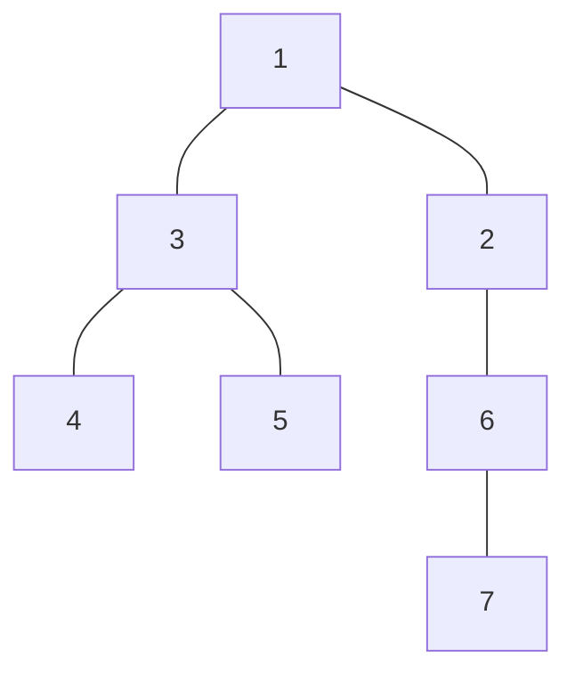
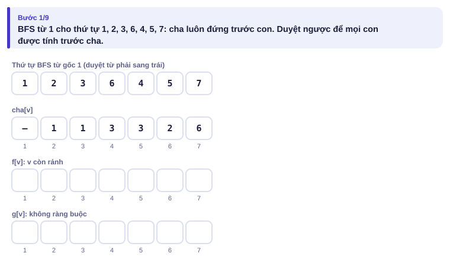
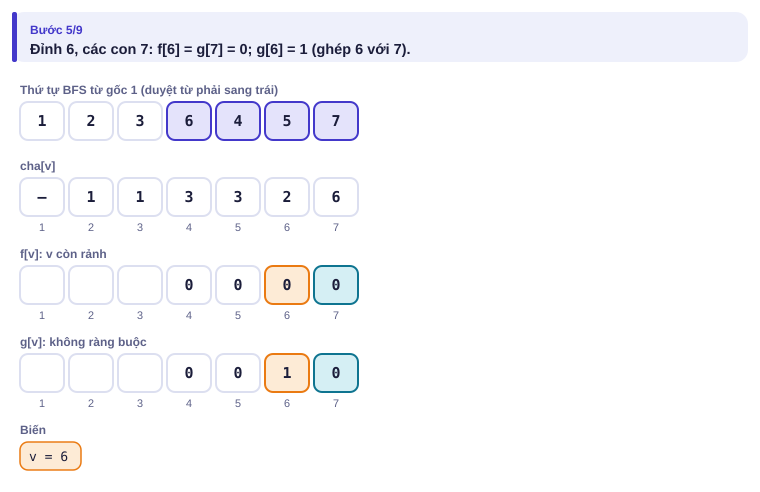
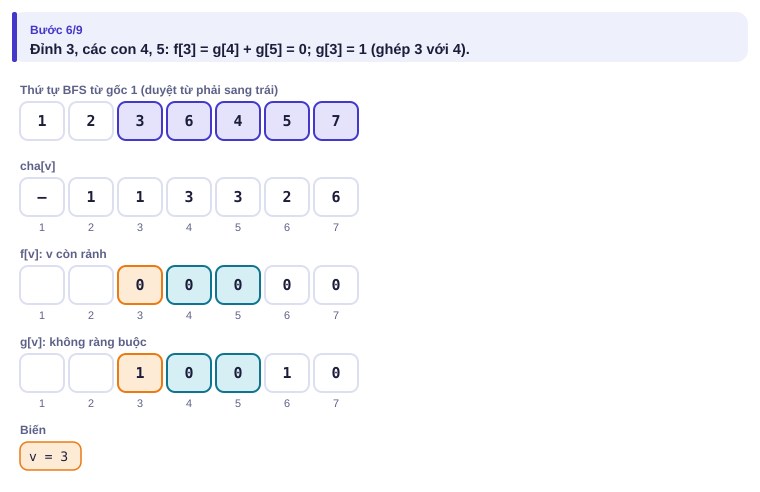
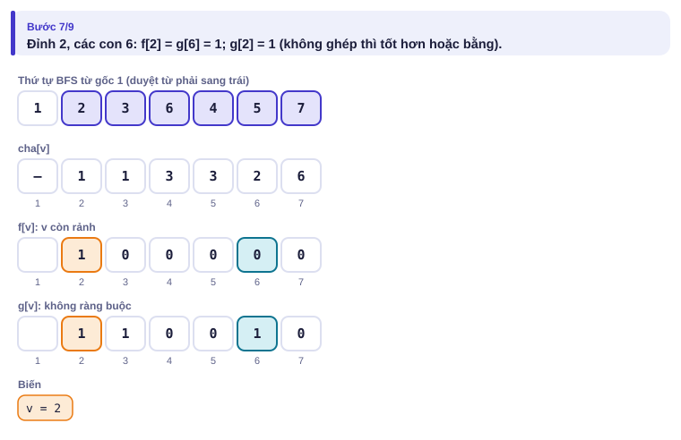
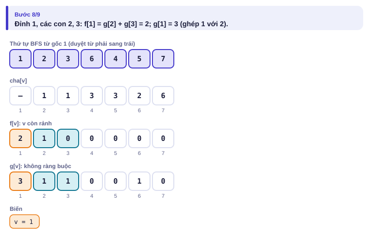
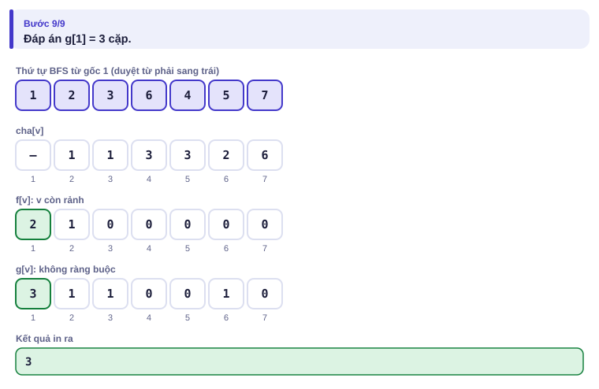

# Bài 3.8 – QHĐ trên cây

> **Tập 3 · Đồ thị và quy hoạch động nâng cao**
> Cần biết trước: bài 3.3 (cây có gốc, thứ tự BFS), bài 2.9 (bốn bước QHĐ).
> Thời lượng: khoảng 90 phút đọc, cộng 6 giờ thực hành trong tuần.

**Học xong bài này, em sẽ:**

- đặt trạng thái QHĐ gắn với **cây con** của mỗi đỉnh;
- thêm một chiều trạng thái để ghi "đỉnh này đang ở tình trạng nào" (rảnh/đã ghép, chọn/không chọn…);
- tính QHĐ từ **lá lên gốc** bằng thứ tự BFS ngược, không dùng đệ quy sâu;
- giải trọn bài kiểu đề thi **Lắp đèn** (ba trạng thái).

> [!TIP]
> **Học cùng hai trang mô phỏng.** [Ghép cặp trên cây](../../mo-phong/t3-ghep-cap.html): xem f, g được điền từ lá lên gốc; thử ví dụ "hình sao". [Tập độc lập](../../mo-phong/t3-doc-lap.html): bật **Đoán trước** để tự tính khong[v].

---

## 1. Bài toán mở màn: Ghép cặp học nhóm

Lớp có n bạn, quan hệ "là bạn thân" tạo thành một **cây** (n − 1 cặp, ai cũng nối được với ai). Cô giáo muốn ghép càng nhiều **cặp học nhóm** càng tốt; mỗi cặp là hai bạn thân, mỗi bạn ở tối đa một cặp. (n ≤ 2·10⁵; bài [Tree Matching](https://cses.fi/problemset/task/1130))

| Vào | Ra |
| --- | --- |
| `7`<br>`1 2`<br>`1 3`<br>`3 4`<br>`3 5`<br>`2 6`<br>`6 7` | `3` |

Ví dụ: cặp (1, 2), (3, 4), (6, 7).



---

## 2. Dừng lại 10 phút

> [!IMPORTANT]
> **Dừng lại và nghĩ.**
> 1. Thử tham lam "ghép gốc với một con bất kỳ trước". Ghép (1, 3) thì còn ghép được bao nhiêu cặp nữa?
> 2. Treo cây từ đỉnh 1. Khi đã biết lời giải tốt nhất cho cây con của mỗi đứa con của v, để tính cho cây con của v em cần biết **thêm** điều gì về mỗi đứa con?
> 3. Thứ tự tính nào đảm bảo mọi con được tính trước cha?

<details>
<summary>Đáp án</summary>

1. Ghép (1, 3) thì còn (6, 7) và… 2 không còn ai (6 đã ghép với 7, 1 đã ghép): tổng 2 cặp. Kém hơn đáp án 3.
2. Đứa con đó **còn rảnh** hay **đã có cặp** trong lời giải của nó: v chỉ ghép được với một đứa con còn rảnh. Mỗi đỉnh cần hai trạng thái.
3. Từ lá lên gốc. Trong thứ tự BFS từ gốc, cha luôn đứng trước con; duyệt **ngược** thứ tự đó là xong.

</details>

---

## 3. Lời giải ngây thơ và vì sao nó chậm

Thử mọi tập cạnh, kiểm tra không có hai cạnh chung đỉnh, lấy tập lớn nhất: 2ⁿ⁻¹ tập. Với n = 30 đã là 5·10⁸. Lãng phí: hai cách ghép khác nhau ở cây con của v nhưng cùng số cặp và cùng "v rảnh hay không" thì với phần còn lại của cây là như nhau.

---

## 4. Ý tưởng then chốt

> [!IMPORTANT]
> **Với mỗi đỉnh v, tính hai giá trị cho cây con của v: f[v] khi v còn rảnh, g[v] khi không ràng buộc. f[v] = Σ g[c]; g[v] = max(f[v], f[v] − g[c] + f[c] + 1) với mỗi con c (ghép v với c thì c phải rảnh). Tính từ lá lên gốc; đáp án g[1].**

- **Trạng thái:** cây con của v × tình trạng của v (rảnh / tùy ý).
- **Cơ sở:** lá có f = g = 0.
- **Thứ tự:** duyệt ngược thứ tự BFS từ gốc.

### Chạy từng bước

Với ví dụ mở màn. Đoán g[v] rồi mới mở.

<details>
<summary><b>Bước 1</b> – Thứ tự BFS</summary>



</details>

<details>
<summary><b>Bước 2</b> – Đỉnh 6 (con 7) và đỉnh 3 (con 4, 5)</summary>




</details>

<details>
<summary><b>Bước 3</b> – Đỉnh 2: ghép 2 với 6 có lợi không?</summary>



</details>

<details>
<summary><b>Bước 4</b> – Gốc 1</summary>




</details>

| Đỉnh (từ lá lên) | Con | f | g | Giải thích |
| :---: | --- | :---: | :---: | --- |
| 7, 4, 5 | — | 0 | 0 | lá |
| 6 | 7 | 0 | 1 | ghép 6 với 7 |
| 3 | 4, 5 | 0 | 1 | ghép 3 với 4 |
| 2 | 6 | 1 | 1 | ghép 2 với 6: 1 − 1 + 0 + 1 = 1, không hơn |
| 1 | 2, 3 | 2 | **3** | ghép 1 với 2: 2 − 1 + 1 + 1 = 3 |

---

## 5. Mã giả và cài đặt

```cpp
// file: ghep_cap.cpp
#include <bits/stdc++.h>
using namespace std;
int main() {
    ios::sync_with_stdio(false);
    cin.tie(nullptr);
    int n;
    cin >> n;
    vector<vector<int>> adj(n + 1);
    for (int i = 0; i < n - 1; i++) {
        int a, b;
        cin >> a >> b;
        adj[a].push_back(b);
        adj[b].push_back(a);
    }
    vector<int> cha(n + 1, 0), thu_tu;               // thứ tự BFS từ gốc 1
    thu_tu.reserve(n);
    thu_tu.push_back(1);
    cha[1] = -1;
    for (int k = 0; k < (int)thu_tu.size(); k++) {
        int u = thu_tu[k];
        for (int v : adj[u]) if (v != cha[u]) { cha[v] = u; thu_tu.push_back(v); }
    }
    vector<long long> f(n + 1, 0), g(n + 1, 0);
    for (int k = n - 1; k >= 0; k--) {               // duyệt ngược: con trước cha
        int v = thu_tu[k];
        for (int c : adj[v]) if (c != cha[v]) f[v] += g[c];
        g[v] = f[v];
        for (int c : adj[v]) if (c != cha[v]) g[v] = max(g[v], f[v] - g[c] + f[c] + 1);
    }
    cout << g[1] << '\n';
}
```

```python
# file: ghep_cap.py
import sys
data = sys.stdin.buffer.read().split()
n = int(data[0])
adj = [[] for _ in range(n + 1)]
for i in range(n - 1):
    a, b = int(data[1 + 2 * i]), int(data[2 + 2 * i])
    adj[a].append(b)
    adj[b].append(a)
cha = [0] * (n + 1)
cha[1] = -1
thu_tu = [1]
for u in thu_tu:                                   # list lớn dần trong khi duyệt: chính là BFS
    for v in adj[u]:
        if v != cha[u]:
            cha[v] = u
            thu_tu.append(v)
f = [0] * (n + 1)
g = [0] * (n + 1)
for v in reversed(thu_tu):                         # con trước cha
    con = [c for c in adj[v] if c != cha[v]]
    f[v] = sum(g[c] for c in con)
    g[v] = f[v]
    for c in con:
        g[v] = max(g[v], f[v] - g[c] + f[c] + 1)
print(g[1])
```

> [!TIP]
> **Mẹo "thứ tự BFS ngược".** Trong thứ tự BFS từ gốc, cha luôn đứng trước con. Duyệt ngược thì mọi con được tính trước cha: thay cho DFS đệ quy, không sợ tràn ngăn xếp khi cây là một đường thẳng dài 2·10⁵.

---

## 6. Vì sao đúng, chạy bao lâu

- **Đúng:** trong một cách ghép tối ưu cho cây con của v, hoặc v không ghép (khi đó mỗi cây con của con c được tối ưu độc lập: Σ g[c]), hoặc v ghép với đúng một con c (khi đó c phải rảnh trong cây con của nó: f[c], cộng 1 cặp (v, c), các con khác vẫn tự do: g). Công thức xét đủ mọi trường hợp.
- **Chạy bao lâu:** mỗi đỉnh duyệt danh sách kề của nó hai lần; tổng độ dài các danh sách kề là 2(n − 1): **O(n)**.

---

## 7. Bẫy thường gặp

> [!WARNING]
> **Bẫy 1: tham lam ghép ngẫu nhiên.** Ghép gốc với một con bất kỳ có thể làm hỏng một cặp tốt hơn ở dưới (câu 1 mục 2). Có một tham lam đúng là "ghép mỗi lá với cha của nó, từ dưới lên", nhưng phải chứng minh được; QHĐ an toàn hơn.

> [!WARNING]
> **Bẫy 2: quên loại cha khỏi danh sách kề.** Cây lưu hai chiều; khi duyệt con phải bỏ qua `cha[v]`.

> [!WARNING]
> **Bẫy 3: đệ quy sâu.** Cây đường thẳng làm DFS đệ quy sâu n tầng. Dùng thứ tự BFS ngược.
> *Test phá:* đường thẳng 1–2–…–200000.

> [!WARNING]
> **Bẫy 4: thiếu trạng thái.** Chỉ lưu "số cặp tốt nhất" (một giá trị) thì không biết v còn rảnh để ghép với cha hay không. Ở bài Lắp đèn còn cần tới **ba** trạng thái.

---

## 8. Ví dụ giảm dần hỗ trợ

### Ví dụ 2 – Điền vào chỗ trống: Số cấp dưới

Công ty có n nhân viên, nhân viên 1 là giám đốc; dòng thứ hai cho sếp trực tiếp của nhân viên 2..n. Với mỗi nhân viên, in số người **dưới quyền** (trực tiếp hoặc gián tiếp). (n ≤ 2·10⁵; bài [Subordinates](https://cses.fi/problemset/task/1674))

| Vào | Ra |
| --- | --- |
| `5`<br>`1 1 2 3` | `4 1 1 0 0` |

sz[v] = kích thước cây con của v = 1 + Σ sz[con]. Duyệt ngược thứ tự BFS, mỗi đỉnh đẩy sz của nó lên cha.

```cpp
for (int k = n - 1; k >= 1; k--) {        // bỏ qua gốc (k = 0)
    int v = thu_tu[k];
    sz[cha[v]] += ____;
}
// in sz[v] - ____
```

<details>
<summary>Đáp án</summary>

`sz[v]` (khởi tạo sz = 1 cho mọi đỉnh) và `1` (bỏ chính nhân viên đó).

```cpp
// file: cap_duoi.cpp
#include <bits/stdc++.h>
using namespace std;
int main() {
    ios::sync_with_stdio(false);
    cin.tie(nullptr);
    int n;
    cin >> n;
    vector<int> cha(n + 1, 0);
    vector<vector<int>> con(n + 1);
    for (int v = 2; v <= n; v++) { cin >> cha[v]; con[cha[v]].push_back(v); }
    vector<int> thu_tu = {1};
    for (int k = 0; k < (int)thu_tu.size(); k++)
        for (int c : con[thu_tu[k]]) thu_tu.push_back(c);
    vector<int> sz(n + 1, 1);
    for (int k = n - 1; k >= 1; k--) {
        int v = thu_tu[k];
        sz[cha[v]] += sz[v];
    }
    for (int v = 1; v <= n; v++) cout << sz[v] - 1 << (v == n ? '\n' : ' ');
}
```

</details>

### Ví dụ 3 – Tự làm: Tập độc lập lớn nhất

Cây n đỉnh (n ≤ 2·10⁵), đỉnh v có trọng số wᵥ (1 ≤ wᵥ ≤ 10⁹). Chọn một tập đỉnh, **không có hai đỉnh kề nhau**, tổng trọng số lớn nhất. Dòng hai là w₁ … wₙ, sau đó n − 1 cạnh.

| Vào | Ra |
| --- | --- |
| `6`<br>`3 5 1 4 2 6`<br>`1 2`<br>`1 3`<br>`2 4`<br>`2 5`<br>`3 6` | `15` |

Chọn {1, 4, 5, 6}: 3 + 4 + 2 + 6 = 15.

> [!IMPORTANT]
> Tự làm trước. Gợi ý: hai trạng thái chon[v] (v được chọn) và khong[v] (v không được chọn). Nếu v được chọn thì các con thế nào? Nếu v không được chọn thì sao?

<details>
<summary>Lời giải</summary>

chon[v] = wᵥ + Σ khong[c]; khong[v] = Σ max(chon[c], khong[c]). Đáp án max(chon[1], khong[1]).

```cpp
// file: doc_lap.cpp
#include <bits/stdc++.h>
using namespace std;
int main() {
    ios::sync_with_stdio(false);
    cin.tie(nullptr);
    int n;
    cin >> n;
    vector<long long> w(n + 1);
    for (int v = 1; v <= n; v++) cin >> w[v];
    vector<vector<int>> adj(n + 1);
    for (int i = 0; i < n - 1; i++) {
        int a, b;
        cin >> a >> b;
        adj[a].push_back(b);
        adj[b].push_back(a);
    }
    vector<int> cha(n + 1, 0), thu_tu = {1};
    cha[1] = -1;
    for (int k = 0; k < (int)thu_tu.size(); k++) {
        int u = thu_tu[k];
        for (int v : adj[u]) if (v != cha[u]) { cha[v] = u; thu_tu.push_back(v); }
    }
    vector<long long> chon(n + 1, 0), khong(n + 1, 0);
    for (int k = n - 1; k >= 0; k--) {
        int v = thu_tu[k];
        chon[v] += w[v];
        if (cha[v] > 0) {
            chon[cha[v]] += khong[v];
            khong[cha[v]] += max(chon[v], khong[v]);
        }
    }
    cout << max(chon[1], khong[1]) << '\n';
}
```

Ở đây mỗi đỉnh **đẩy** kết quả lên cha thay vì cha **kéo** từ các con: cùng kết quả, code gọn hơn.

</details>

---

## 9. Bài tập

| Nấc | Bài | Nguồn | Ý chính |
| --- | --- | --- | --- |
| Khởi động | [Subordinates](https://cses.fi/problemset/task/1674) | CSES 1674 | Ví dụ 2 |
| Khởi động | [Tree Matching](https://cses.fi/problemset/task/1130) | CSES 1130 | Đúng mục 5 |
| Luyện | Tập độc lập lớn nhất, so với vét cạn bằng stress test | Tự luyện | Ví dụ 3 + bài 1.9 |
| Luyện | [Tree Distances I](https://cses.fi/problemset/task/1132) | CSES 1132 | Hai lần duyệt: xuống và lên |
| Thử thách | [Tree Distances II](https://cses.fi/problemset/task/1133) | CSES 1133 | Đổi gốc (rerooting) |
| Kiểu đề thi | Lắp đèn | Bài của sách, chấm theo subtask | Xem bên dưới |

### Bài kiểu đề thi: Lắp đèn

**Đề bài.** Công viên có n khu (1 ≤ n ≤ 2·10⁵) nối với nhau bằng n − 1 lối đi tạo thành một cây. Một chiếc đèn đặt ở khu v chiếu sáng khu v và **mọi khu kề** với v. Cần ít nhất bao nhiêu đèn để mọi khu đều được chiếu sáng? Đọc từ `LAPDEN.INP` (dòng đầu n, n − 1 dòng cạnh), ghi ra `LAPDEN.OUT`.

Subtask: 30% có n ≤ 20; 30% có cây là một đường thẳng; 40% còn lại không có ràng buộc thêm.

| LAPDEN.INP | LAPDEN.OUT |
| --- | --- |
| `8`<br>`1 2`<br>`1 3`<br>`2 4`<br>`2 5`<br>`3 6`<br>`3 7`<br>`7 8` | `3` |

Ví dụ: đèn ở 2, 3, 7 (hoặc 2, 3, 8).

<details>
<summary><b>Gợi ý 1</b> – hướng đi (30% rồi 60% điểm)</summary>

n ≤ 20: thử mọi tập đèn (2²⁰), kiểm tra chiếu sáng hết. Đường thẳng n khu: mỗi đèn chiếu 3 khu liên tiếp, đáp án ⌈n/3⌉.

</details>

<details>
<summary><b>Gợi ý 2</b> – ý then chốt</summary>

Ba trạng thái cho cây con của v (mọi khu trong cây con, **trừ có thể v**, đã sáng):

- a[v]: có đèn ở v. a[v] = 1 + Σ min(a[c], b[c], c[c]).
- b[v]: không đèn ở v, v đã sáng nhờ **ít nhất một con có đèn**. b[v] = Σ min(a[c], b[c]), nhưng phải có ít nhất một con chọn a; nếu không con nào chọn a thì cộng thêm min theo c của (a[c] − b[c]). Lá: b = ∞.
- c[v]: không đèn ở v, v **chưa** sáng (sẽ nhờ cha). Khi đó không con nào có đèn, và mỗi con phải tự sáng: c[v] = Σ b[c].

Đáp án min(a[1], b[1]) (gốc không có cha để nhờ).

</details>

<details>
<summary><b>Gợi ý 3</b> – lời giải đầy đủ</summary>

O(n) với thứ tự BFS ngược.

```cpp
// file: lapden.cpp
#include <bits/stdc++.h>
using namespace std;
int main() {
    freopen("LAPDEN.INP", "r", stdin);
    freopen("LAPDEN.OUT", "w", stdout);
    int n;
    scanf("%d", &n);
    vector<vector<int>> adj(n + 1);
    for (int i = 0; i < n - 1; i++) {
        int x, y;
        scanf("%d %d", &x, &y);
        adj[x].push_back(y);
        adj[y].push_back(x);
    }
    vector<int> cha(n + 1, 0), thu_tu = {1};
    cha[1] = -1;
    for (int k = 0; k < (int)thu_tu.size(); k++) {
        int u = thu_tu[k];
        for (int v : adj[u]) if (v != cha[u]) { cha[v] = u; thu_tu.push_back(v); }
    }
    const long long VC = 1e9;
    vector<long long> a(n + 1), b(n + 1), c(n + 1);
    for (int k = n - 1; k >= 0; k--) {
        int v = thu_tu[k];
        long long sa = 1, sb = 0, sc = 0, them = VC;
        bool co_den = false;
        for (int u : adj[v]) {
            if (u == cha[v]) continue;
            sa += min({a[u], b[u], c[u]});
            sb += min(a[u], b[u]);
            if (a[u] <= b[u]) co_den = true;
            else them = min(them, a[u] - b[u]);
            sc += b[u];
        }
        a[v] = sa;
        b[v] = co_den ? sb : (them >= VC ? VC : sb + them);   // lá: không có con nào để nhờ
        c[v] = min(sc, VC);
    }
    printf("%lld\n", min(a[1], b[1]));
}
```

```python
# file: lapden.py
with open("LAPDEN.INP") as fi:
    data = fi.read().split()
n = int(data[0])
adj = [[] for _ in range(n + 1)]
for i in range(n - 1):
    x, y = int(data[1 + 2 * i]), int(data[2 + 2 * i])
    adj[x].append(y)
    adj[y].append(x)
cha = [0] * (n + 1)
cha[1] = -1
thu_tu = [1]
for u in thu_tu:
    for v in adj[u]:
        if v != cha[u]:
            cha[v] = u
            thu_tu.append(v)
VC = 10**9
a = [0] * (n + 1); b = [0] * (n + 1); c = [0] * (n + 1)
for v in reversed(thu_tu):
    sa, sb, sc, them, co_den = 1, 0, 0, VC, False
    for u in adj[v]:
        if u == cha[v]:
            continue
        sa += min(a[u], b[u], c[u])
        sb += min(a[u], b[u])
        if a[u] <= b[u]:
            co_den = True
        else:
            them = min(them, a[u] - b[u])
        sc += b[u]
    a[v] = sa
    b[v] = sb if co_den else (VC if them >= VC else sb + them)
    c[v] = min(sc, VC)
with open("LAPDEN.OUT", "w") as fo:
    fo.write(f"{min(a[1], b[1])}\n")
```

</details>

---

## 10. Tóm tắt, flashcard và checkpoint

**Tóm tắt trong 5 dòng.**

1. Trạng thái QHĐ trên cây gắn với cây con của v, thêm chiều "tình trạng của v".
2. Tính từ lá lên gốc: thứ tự BFS ngược, không đệ quy.
3. Ghép v với con c: bỏ đóng góp g[c], thay bằng f[c] + 1.
4. Chọn/không chọn: chọn v thì con không được chọn; không chọn v thì con tùy ý.
5. "Phải có ít nhất một con…": tính tổng tối ưu, nếu chưa có thì cộng thêm chi phí đổi rẻ nhất.

**Flashcard.**

<details><summary>Cây hình sao với gốc nối tới 5 lá: ghép được tối đa mấy cặp?</summary>1.</details>
<details><summary>Vì sao duyệt ngược thứ tự BFS thì con được tính trước cha?</summary>Trong thứ tự BFS từ gốc, cha luôn xuất hiện trước con.</details>
<details><summary>Tập độc lập: khong[v] = ?</summary>Σ max(chon[c], khong[c]) theo các con c.</details>
<details><summary>Lắp đèn: vì sao đáp án không xét c[1]?</summary>c[1] nghĩa là gốc chưa sáng và chờ cha, nhưng gốc không có cha.</details>
<details><summary>Lắp đèn trên đường thẳng 7 khu cần mấy đèn?</summary>⌈7/3⌉ = 3.</details>

**Ôn xoắn ốc** (mỗi bài tối đa 20 phút):

- Viết lại QHĐ bitmask Thang máy (bài 3.7) không nhìn sách.
- [Tree Diameter](https://cses.fi/problemset/task/1131) (CSES 1131): thử giải lại bằng QHĐ trên cây (độ sâu lớn nhất của hai nhánh).
- [Company Queries II](https://cses.fi/problemset/task/1688) (CSES 1688): LCA (bài 3.3).

**Checkpoint – em đã sẵn sàng sang bài tiếp theo nếu:**

- [ ] AC [Tree Matching](https://cses.fi/problemset/task/1130) và [Subordinates](https://cses.fi/problemset/task/1674).
- [ ] Viết thứ tự BFS ngược không nhìn sách, chạy đúng với đường thẳng 2·10⁵ đỉnh.
- [ ] Làm xong Ví dụ 3 (Tập độc lập) mà không mở lời giải.
- [ ] Đạt trọn điểm bài Lắp đèn khi tự làm trong 40 phút.

Chưa đạt? Nếu vướng ô 1, chạy trang mô phỏng Ghép cặp và tự điền bảng ở mục 4. Nếu vướng ô 2, đọc lại mẹo "thứ tự BFS ngược". Nếu vướng ô 3 hoặc 4, chạy trang Tập độc lập với Đoán trước rồi đọc lại Gợi ý 2.
