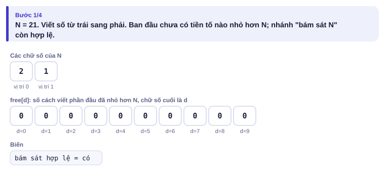
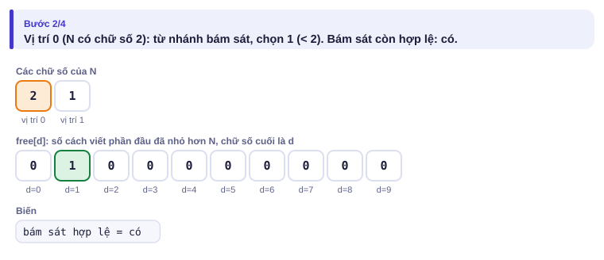
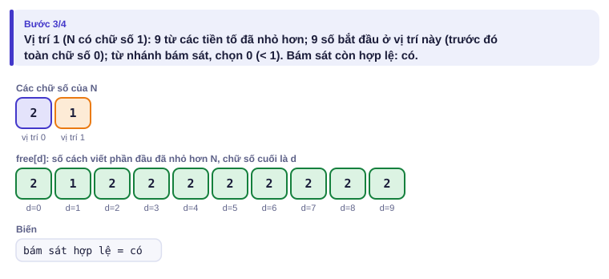
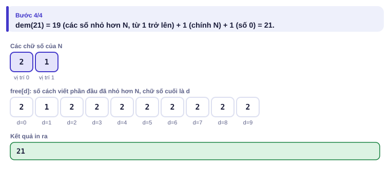

# Bài 3.9 – QHĐ chữ số

> **Tập 3 · Đồ thị và quy hoạch động nâng cao**
> Cần biết trước: bài 2.9 (QHĐ), bài 1.6 (đệ quy), bài 1.3 (ý tưởng "đoạn = tiền tố trừ tiền tố").
> Thời lượng: khoảng 90 phút đọc, cộng 5 giờ thực hành trong tuần.

**Học xong bài này, em sẽ:**

- đếm các số trong đoạn [a, b] (tới 10¹⁸) thỏa một tính chất về **chữ số**;
- đưa bài [a, b] về hai bài [0, N] bằng phép trừ;
- dùng cờ **"đang bám sát N"** và **"đã bắt đầu"** để xây số từng chữ số một, có ghi nhớ;
- trả về **cặp (số lượng, tổng)** khi cần tính tổng thay vì đếm;
- giải trọn bài kiểu đề thi **Số lộc**.

> [!TIP]
> **Học cùng hai trang mô phỏng.** [Đếm số đẹp](../../mo-phong/t3-chu-so.html): xem bảng "chữ số cuối" được điền qua từng vị trí; bật **Đoán trước**. [Chữ số không giảm](../../mo-phong/t3-khong-giam.html): cùng khuôn, chỉ đổi điều kiện.

---

## 1. Bài toán mở màn: Biển số đẹp

Một số gọi là **đẹp** nếu không có hai chữ số **liền nhau** bằng nhau (ví dụ 121 đẹp, 112 không đẹp). Đếm số đẹp trong [a, b]. (0 ≤ a ≤ b ≤ 10¹⁸; bài [Counting Numbers](https://cses.fi/problemset/task/2220))

| Vào | Ra |
| --- | --- |
| `123 321` | `171` |
| `0 21` | `21` |

---

## 2. Dừng lại 10 phút

> [!IMPORTANT]
> **Dừng lại và nghĩ.**
> 1. Đếm trong [a, b] có thể đưa về đếm trong [0, N] thế nào? (Gợi ý: tổng tiền tố, bài 1.3.)
> 2. Khi em viết một số từ trái sang phải, để biết chữ số tiếp theo được chọn những giá trị nào, em cần nhớ những gì về phần đã viết?
> 3. Hai phần đầu `1 3` và `2 3` (của số 4 chữ số, N = 5000) có tương lai giống nhau không?

<details>
<summary>Đáp án</summary>

1. dem(b) − dem(a − 1), với dem(N) là số số đẹp trong [0, N].
2. Ba điều: **chữ số vừa viết** (để không lặp); phần đã viết có **đang bằng đúng** phần đầu của N không (nếu có thì chữ số tiếp theo không được vượt chữ số tương ứng của N); đã **bắt đầu** viết số chưa (các số 0 đứng đầu không tính).
3. Giống hệt: cả hai đã nhỏ hơn "50", cùng kết thúc bằng 3. Vì vậy ta chỉ cần **đếm** bao nhiêu phần đầu ở mỗi trạng thái, không cần nhớ từng phần đầu. Đó là QHĐ chữ số.

</details>

---

## 3. Lời giải ngây thơ và vì sao nó chậm

Duyệt từng số trong [a, b] và kiểm tra: O((b − a) · 19). Với b = 10¹⁸ không thể. Nhưng số lượng "trạng thái" thật sự rất ít: 19 vị trí × 11 khả năng chữ số trước × vài cờ. Mọi số dài 18 chữ số bị gộp vào vài trăm trạng thái.

---

## 4. Ý tưởng then chốt

> [!IMPORTANT]
> **dem(N): xây số từ chữ số đầu tiên. Trạng thái: vị trí i, thông tin cần cho tính chất (ở đây là chữ số trước), cờ `bam` (đang bằng đúng phần đầu của N), cờ `bat_dau` (đã viết chữ số khác 0). Khi `bam` sai, chữ số tiếp theo tự do 0..9 và kết quả chỉ phụ thuộc (i, chữ số trước): ghi nhớ được. Đáp án dem(b) − dem(a − 1).**

| Thành phần | Ý nghĩa |
| --- | --- |
| `i` | đang chọn chữ số thứ i (từ trái) |
| `truoc` | chữ số vừa chọn (10 nếu chưa bắt đầu) |
| `bam` | phần đã chọn đang **bằng** phần đầu của N |
| `bat_dau` | đã viết chữ số khác 0 đầu tiên chưa |

### Chạy từng bước

Trang mô phỏng chạy cùng ý tưởng theo chiều "từ trái sang phải": sau mỗi vị trí, `free[d]` là số cách viết phần đầu **đã nhỏ hơn** N và kết thúc bằng d. Với N = 21, đoán tổng free rồi mới mở.

<details>
<summary><b>Bước 1</b> – Khởi tạo</summary>



</details>

<details>
<summary><b>Bước 2</b> – Vị trí 0 (chữ số 2 của N)</summary>



</details>

<details>
<summary><b>Bước 3</b> – Vị trí 1 (chữ số 1 của N)</summary>



</details>

<details>
<summary><b>Bước 4</b> – Kết quả</summary>



</details>

Kiểm tra tay: các số đẹp trong [0, 21] là 0..9 (10 số), 10, 12..19 (9 số), 20, 21: tổng **21**; chỉ có 11 bị loại.

---

## 5. Mã giả và cài đặt

```cpp
// file: so_dep.cpp
#include <bits/stdc++.h>
using namespace std;
string s;
long long nho[20][11];                              // nho[i][truoc] khi bam = false, bat_dau = true
long long dem_tu(int i, int truoc, bool bam, bool bat_dau) {
    if (i == (int)s.size()) return 1;               // đã viết xong một số hợp lệ (kể cả số 0)
    if (!bam && bat_dau && nho[i][truoc] != -1) return nho[i][truoc];
    int gioi_han = bam ? s[i] - '0' : 9;
    long long kq = 0;
    for (int d = 0; d <= gioi_han; d++) {
        if (bat_dau && d == truoc) continue;         // hai chữ số liền nhau bằng nhau
        bool bd = bat_dau || d != 0;
        kq += dem_tu(i + 1, bd ? d : 10, bam && d == gioi_han, bd);
    }
    if (!bam && bat_dau) nho[i][truoc] = kq;
    return kq;
}
long long dem(long long N) {                        // số số đẹp trong [0, N]
    if (N < 0) return 0;
    s = to_string(N);
    memset(nho, -1, sizeof nho);
    return dem_tu(0, 10, true, false);
}
int main() {
    long long a, b;
    cin >> a >> b;
    cout << dem(b) - dem(a - 1) << '\n';
}
```

```python
# file: so_dep.py
from functools import lru_cache

def dem(N):
    if N < 0:
        return 0
    s = str(N)

    @lru_cache(None)
    def tu(i, truoc, bam, bat_dau):
        if i == len(s):
            return 1
        gh = int(s[i]) if bam else 9
        kq = 0
        for d in range(gh + 1):
            if bat_dau and d == truoc:
                continue
            bd = bat_dau or d != 0
            kq += tu(i + 1, d if bd else 10, bam and d == gh, bd)
        return kq

    return tu(0, 10, True, False)

a, b = map(int, input().split())
print(dem(b) - dem(a - 1))
```

Ở bản Python, `lru_cache` ghi nhớ **mọi** trạng thái (kể cả khi bám), vẫn đúng vì mỗi lần gọi `dem` dùng một hàm mới; số trạng thái chỉ vài nghìn.

> [!NOTE]
> **Khuôn chung của QHĐ chữ số:** đổi tính chất cần đếm thì chỉ đổi phần "trạng thái thêm" (chữ số trước, tổng chữ số mod k, số chữ số 6 đã dùng…). Phần `bam`, `bat_dau` và phép trừ dem(b) − dem(a − 1) giữ nguyên.

---

## 6. Vì sao đúng, chạy bao lâu

- **Đúng:** mỗi số x trong [0, N] viết thành đúng L chữ số (thêm số 0 ở đầu) và tương ứng đúng một đường đi trong cây lựa chọn; `bam` đảm bảo không vượt N; `bat_dau` đảm bảo các số 0 đứng đầu không bị coi là "hai chữ số 0 liền nhau".
- **Ghi nhớ đúng:** khi `bam` sai và đã bắt đầu, phần còn lại là "mọi dãy chữ số tự do dài L − i với chữ số trước cho sẵn": chỉ phụ thuộc (i, truoc), không phụ thuộc N.
- **Chạy bao lâu:** 19 vị trí × 11 chữ số trước = 209 trạng thái được ghi nhớ, mỗi trạng thái thử 10 chữ số: vài nghìn phép. Nhánh `bam = true` chỉ có một mỗi vị trí.

---

## 7. Bẫy thường gặp

> [!WARNING]
> **Bẫy 1: a = 0.** dem(a − 1) = dem(−1) phải bằng 0.
> *Test phá:* `0 0` phải ra 1.

> [!WARNING]
> **Bẫy 2: số 0 đứng đầu.** Số 7 viết là "07" khi N = 21; chữ số 0 đầu không được coi là "bằng 0 liền kề". Cờ `bat_dau` lo việc này.
> *Test phá:* `0 9` phải ra 10.

> [!WARNING]
> **Bẫy 3: ghi nhớ cả khi đang bám (bản C++).** Trạng thái `bam = true` phụ thuộc N; nếu dùng chung bảng `nho` với `bam = false`, kết quả sai. Và nhớ **xóa bảng** giữa hai lần gọi dem(b), dem(a − 1) nếu bảng phụ thuộc N.

> [!WARNING]
> **Bẫy 4: tràn số khi tính tổng.** Tổng các số tới 10¹⁸ vượt `long long`; đề thường cho lấy dư hoặc giới hạn nhỏ hơn.

---

## 8. Ví dụ giảm dần hỗ trợ

### Ví dụ 2 – Điền vào chỗ trống: Chữ số không giảm

Đếm số trong [a, b] (0 ≤ a ≤ b ≤ 10¹⁸) mà các chữ số **không giảm** từ trái sang phải (ví dụ 1229, 7, 0; không tính 21).

| Vào | Ra |
| --- | --- |
| `1 100` | `54` |

Chữ số trước cần nhớ; ở đây số 0 đứng đầu không gây hại (0 ≤ mọi chữ số), nên có thể bỏ cờ `bat_dau` và coi "chữ số trước" ban đầu là 0.

```cpp
long long dem_tu(int i, int truoc, bool bam) {
    if (i == (int)s.size()) return 1;
    if (!bam && nho[i][truoc] != -1) return nho[i][truoc];
    int gioi_han = bam ? s[i] - '0' : 9;
    long long kq = 0;
    for (int d = ____; d <= gioi_han; d++)
        kq += dem_tu(i + 1, d, bam && ____);
    if (!bam) nho[i][truoc] = kq;
    return kq;
}
```

<details>
<summary>Đáp án</summary>

`truoc` (chữ số mới không nhỏ hơn chữ số trước) và `d == gioi_han`.

```cpp
// file: khong_giam.cpp
#include <bits/stdc++.h>
using namespace std;
string s;
long long nho[20][10];
long long dem_tu(int i, int truoc, bool bam) {
    if (i == (int)s.size()) return 1;
    if (!bam && nho[i][truoc] != -1) return nho[i][truoc];
    int gioi_han = bam ? s[i] - '0' : 9;
    long long kq = 0;
    for (int d = truoc; d <= gioi_han; d++)
        kq += dem_tu(i + 1, d, bam && d == gioi_han);
    if (!bam) nho[i][truoc] = kq;
    return kq;
}
long long dem(long long N) {
    if (N < 0) return 0;
    s = to_string(N);
    memset(nho, -1, sizeof nho);
    return dem_tu(0, 0, true);
}
int main() {
    long long a, b;
    cin >> a >> b;
    cout << dem(b) - dem(a - 1) << '\n';
}
```

</details>

### Ví dụ 3 – Tự làm: Tổng chữ số

Tính tổng các chữ số của **mọi** số trong [a, b] (0 ≤ a ≤ b ≤ 10¹⁵). Ví dụ tổng chữ số của 10, 11, 12 là 1 + 2 + 3 = 6.

| Vào | Ra |
| --- | --- |
| `1 12` | `51` |

> [!IMPORTANT]
> Tự làm trước. Gợi ý: hàm đệ quy trả về **cặp** (số lượng số, tổng chữ số của chúng) cho phần còn lại. Khi chọn chữ số d ở vị trí i và phần sau trả về (c, t), thì đóng góp vào tổng là d · c + t.

<details>
<summary>Lời giải</summary>

Không cần `bat_dau`: số 0 đứng đầu đóng góp 0 vào tổng. Kết quả tối đa khoảng 10¹⁵ × 135: vừa `long long`.

```cpp
// file: tong_chu_so.cpp
#include <bits/stdc++.h>
using namespace std;
string s;
pair<long long, long long> nho[20];
bool co[20];
pair<long long, long long> tu(int i, bool bam) {   // (số lượng, tổng chữ số)
    if (i == (int)s.size()) return {1, 0};
    if (!bam && co[i]) return nho[i];
    int gh = bam ? s[i] - '0' : 9;
    long long c = 0, t = 0;
    for (int d = 0; d <= gh; d++) {
        auto [c2, t2] = tu(i + 1, bam && d == gh);
        c += c2;
        t += d * c2 + t2;
    }
    if (!bam) { co[i] = true; nho[i] = {c, t}; }
    return {c, t};
}
long long tong(long long N) {
    if (N < 0) return 0;
    s = to_string(N);
    memset(co, 0, sizeof co);
    return tu(0, true).second;
}
int main() {
    long long a, b;
    cin >> a >> b;
    cout << tong(b) - tong(a - 1) << '\n';
}
```

</details>

---

## 9. Bài tập

| Nấc | Bài | Nguồn | Ý chính |
| --- | --- | --- | --- |
| Khởi động | [Counting Numbers](https://cses.fi/problemset/task/2220) | CSES 2220 | Đúng mục 5 |
| Luyện | Chữ số không giảm, đối chiếu với vét cạn cho b ≤ 10⁵ | Tự luyện | Ví dụ 2 + bài 1.9 |
| Luyện | Tổng chữ số trên [a, b] | Tự luyện | Ví dụ 3 |
| Luyện | [Digit Queries](https://cses.fi/problemset/task/2431) | CSES 2431 | Đếm chữ số theo nhóm độ dài |
| Thử thách | Tính **tổng** (không phải số lượng) các số đẹp trong [a, b], mod 10⁹ + 7 | Tự luyện | Trả về cặp (số lượng, tổng) |
| Kiểu đề thi | Số lộc | Bài của sách, chấm theo subtask | Xem bên dưới |

### Bài kiểu đề thi: Số lộc

**Đề bài.** Ông Tư sưu tầm tờ tiền có số sê-ri "lộc": số sê-ri chứa **đúng K chữ số 6** và **không chứa chữ số 4**. Đếm số số lộc trong [a, b] (0 ≤ a ≤ b ≤ 10¹⁸, 0 ≤ K ≤ 19). Đọc từ `SOLOC.INP` (một dòng a b K), ghi ra `SOLOC.OUT`.

Subtask: 40% có b ≤ 10⁶; 60% còn lại có b ≤ 10¹⁸.

| SOLOC.INP | SOLOC.OUT |
| --- | --- |
| `1 100 1` | `16` |

Số 6; mười số 60..69 trừ 64 và 66 (8 số); các số x6 với x ∈ {1, 2, 3, 5, 7, 8, 9} (7 số): 1 + 8 + 7 = 16.

<details>
<summary><b>Gợi ý 1</b> – hướng đi (đủ 40% điểm)</summary>

Duyệt từng số, đếm chữ số 6 và kiểm tra chữ số 4: O(b · 7).

</details>

<details>
<summary><b>Gợi ý 2</b> – ý then chốt</summary>

Trạng thái (i, số chữ số 6 đã dùng, bam). Chữ số 4 bị bỏ qua; số 0 đứng đầu không phải 6 cũng không phải 4, nên không cần cờ `bat_dau`. Đã dùng quá K chữ số 6 thì dừng sớm.

</details>

<details>
<summary><b>Gợi ý 3</b> – lời giải đầy đủ</summary>

Ghi nhớ nho[i][dem6] khi không bám. Khoảng 20 × 20 trạng thái.

```cpp
// file: soloc.cpp
#include <bits/stdc++.h>
using namespace std;
string s;
int K;
long long nho[20][21];
long long tu(int i, int dem6, bool bam) {
    if (dem6 > K) return 0;
    if (i == (int)s.size()) return dem6 == K;
    if (!bam && nho[i][dem6] != -1) return nho[i][dem6];
    int gh = bam ? s[i] - '0' : 9;
    long long kq = 0;
    for (int d = 0; d <= gh; d++) {
        if (d == 4) continue;
        kq += tu(i + 1, dem6 + (d == 6), bam && d == gh);
    }
    if (!bam) nho[i][dem6] = kq;
    return kq;
}
long long dem(long long N) {
    if (N < 0) return 0;
    s = to_string(N);
    memset(nho, -1, sizeof nho);
    return tu(0, 0, true);
}
int main() {
    freopen("SOLOC.INP", "r", stdin);
    freopen("SOLOC.OUT", "w", stdout);
    long long a, b;
    scanf("%lld %lld %d", &a, &b, &K);
    printf("%lld\n", dem(b) - dem(a - 1));
}
```

```python
# file: soloc.py
from functools import lru_cache
with open("SOLOC.INP") as f:
    a, b, K = map(int, f.read().split())

def dem(N):
    if N < 0:
        return 0
    s = str(N)

    @lru_cache(None)
    def tu(i, dem6, bam):
        if dem6 > K:
            return 0
        if i == len(s):
            return 1 if dem6 == K else 0
        gh = int(s[i]) if bam else 9
        return sum(tu(i + 1, dem6 + (d == 6), bam and d == gh) for d in range(gh + 1) if d != 4)

    return tu(0, 0, True)

with open("SOLOC.OUT", "w") as f:
    f.write(f"{dem(b) - dem(a - 1)}\n")
```

</details>

---

## 10. Tóm tắt, flashcard và checkpoint

**Tóm tắt trong 5 dòng.**

1. [a, b] → dem(b) − dem(a − 1); nhớ dem(−1) = 0.
2. Xây số từ trái; trạng thái: vị trí, thông tin cần cho tính chất, `bam`, (`bat_dau` nếu số 0 đứng đầu gây ảnh hưởng).
3. Chỉ ghi nhớ khi không bám (và đã bắt đầu, tùy bài).
4. Cần tổng thay vì số lượng: trả về cặp (số lượng, tổng); đóng góp của chữ số d là d · số_lượng_phía_sau.
5. Độ phức tạp ≈ số vị trí × số trạng thái thêm × 10.

**Flashcard.**

<details><summary>Có bao nhiêu số đẹp có đúng 2 chữ số?</summary>9 × 9 = 81.</details>
<details><summary>Vì sao bài chữ số không giảm không cần cờ <code>bat_dau</code>?</summary>Coi chữ số trước ban đầu là 0; số 0 đứng đầu không làm vi phạm "không giảm".</details>
<details><summary>Khi nào được ghi nhớ trạng thái?</summary>Khi không còn bám sát N: phần còn lại không phụ thuộc N.</details>
<details><summary>Tổng chữ số của 0..9 là bao nhiêu?</summary>45.</details>
<details><summary>Số lộc: trạng thái thêm là gì?</summary>Số chữ số 6 đã dùng.</details>

**Ôn xoắn ốc** (mỗi bài tối đa 20 phút):

- Viết lại Tập độc lập trên cây (bài 3.8) không nhìn sách.
- [Coin Combinations II](https://cses.fi/problemset/task/1636) (CSES 1636): QHĐ đếm (bài 2.9).
- [Exponentiation](https://cses.fi/problemset/task/1095) (CSES 1095): lũy thừa nhanh (bài 3.6).

**Checkpoint – em đã sẵn sàng sang bài tiếp theo nếu:**

- [ ] AC [Counting Numbers](https://cses.fi/problemset/task/2220).
- [ ] Viết Ví dụ 2 không nhìn sách và stress test với vét cạn.
- [ ] Làm xong Ví dụ 3 (Tổng chữ số) mà không mở lời giải.
- [ ] Đạt trọn điểm bài Số lộc khi tự làm trong 30 phút.

Chưa đạt? Nếu vướng ô 1, chạy trang mô phỏng Đếm số đẹp với N của em và đọc lại mục 6. Nếu vướng ô 2, chạy trang Chữ số không giảm. Nếu vướng ô 3 hoặc 4, đọc lại "khuôn chung" ở mục 5 rồi đổi đúng phần trạng thái thêm.
