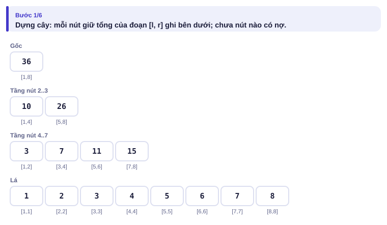
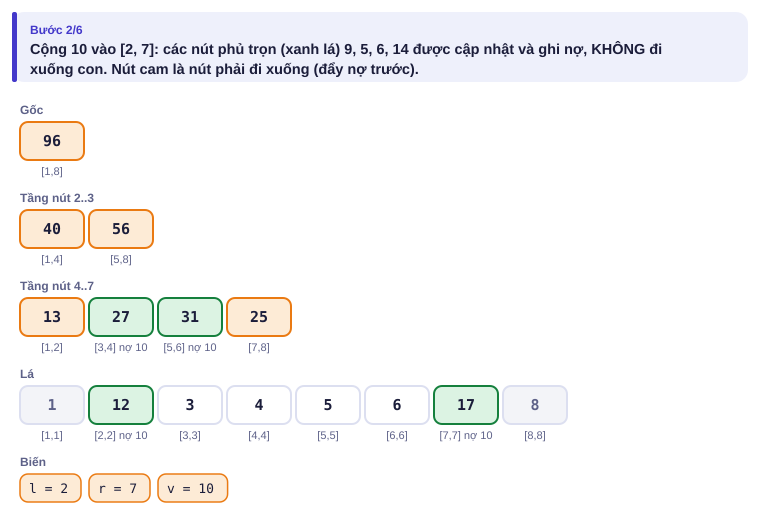
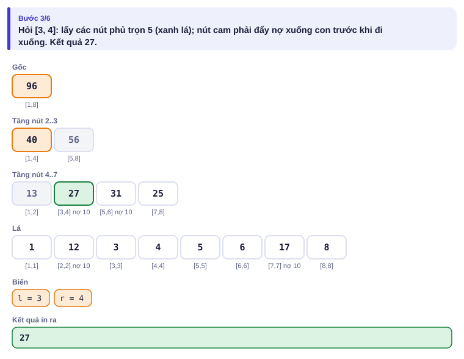
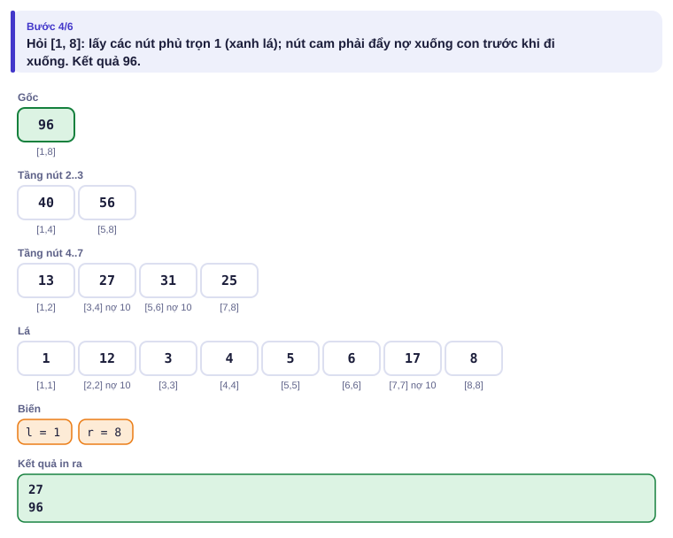

# Bài 4.1 – Cây phân đoạn lười

> **Tập 4 · Chuyên đề nâng cao**
> Cần biết trước: bài 3.5 (cây phân đoạn), bài 1.3 (mảng hiệu), bài 3.4 (Fenwick).
> Thời lượng: khoảng 100 phút đọc, cộng 8 giờ thực hành (1,5 tuần).

**Học xong bài này, em sẽ:**

- cộng một giá trị vào **cả đoạn** và hỏi tổng/min/max **đoạn**, mỗi việc O(log n), bằng kỹ thuật **hoãn việc** (lazy propagation);
- viết cây phân đoạn đệ quy với hai hàm `ap` (áp một thao tác lên cả nút) và `day` (đẩy nợ xuống con);
- đổi loại "nợ" (cộng, lật bit…) chỉ bằng cách viết lại `ap`;
- giải trọn bài kiểu đề thi **Đặt phòng**.

**Dấu hiệu nhận biết:** đề có cả "cập nhật đoạn" lẫn "hỏi đoạn", xen kẽ nhau, n và q tới 2·10⁵.

> [!TIP]
> **Học cùng hai trang mô phỏng.** [Cây lười cộng–tổng](../../mo-phong/t4-lazy.html): xem nút nào được ghi nợ, nút nào phải đẩy nợ; bật **Đoán trước**. [Cây lười cộng–max](../../mo-phong/t4-lazy-max.html): cùng khuôn, phép gộp khác, dùng cho bài Đặt phòng.

---

## 1. Bài toán mở màn: Tưới cây

Con đường có n cây, cây i cao aᵢ cm. Có q thao tác: `1 l r v` các cây l..r cùng cao thêm v cm; `2 l r` hỏi tổng chiều cao các cây l..r. (n, q ≤ 2·10⁵, aᵢ, v ≤ 10⁹)

| Vào | Ra |
| --- | --- |
| `8 4`<br>`1 2 3 4 5 6 7 8`<br>`1 2 7 10`<br>`2 3 4`<br>`2 1 8`<br>`1 5 8 1` | `27`<br>`96` |

---

## 2. Dừng lại 10 phút

> [!IMPORTANT]
> **Dừng lại và nghĩ.**
> 1. Mảng hiệu (bài 1.3) cộng đoạn O(1) nhưng hỏi tổng đoạn thì sao? Fenwick (bài 3.4) với mảng hiệu cho "cộng đoạn, hỏi **điểm**". Ở đây cần hỏi **đoạn**.
> 2. Với cây phân đoạn thường (bài 3.5), cộng v vào đoạn dài k phải sửa bao nhiêu lá?
> 3. Nếu một nút **phủ trọn** đoạn cần cộng, tổng của nút đó tăng bao nhiêu? Có cần đi xuống các con của nó **ngay** không?

<details>
<summary>Đáp án</summary>

1. Hỏi tổng đoạn trên mảng hiệu là tổng của tổng tiền tố: không còn O(1). (Có mẹo hai cây Fenwick, nhưng không mở rộng được cho min/max.)
2. k lá, cộng log n nút trên mỗi đường: O(k log n), tệ nhất O(n log n) mỗi thao tác.
3. Tăng v × (độ dài đoạn của nút). Không cần đi xuống ngay: chỉ cần **ghi chú** "các con còn nợ +v". Khi nào thật sự phải đi xuống nút con thì mới "trả nợ". Mỗi thao tác chỉ chạm O(log n) nút.

</details>

---

## 3. Lời giải ngây thơ và vì sao nó chậm

Cộng từng phần tử và cộng tổng bằng vòng lặp: O(n) mỗi thao tác, O(n·q) = 4·10¹⁰. Cây phân đoạn thường với "sửa từng lá" cũng tệ: cộng đoạn dài n là n lần sửa lá. Cả hai đều làm việc **ngay** cho những phần tử có thể không bao giờ bị hỏi riêng lẻ.

---

## 4. Ý tưởng then chốt

> [!IMPORTANT]
> **Mỗi nút giữ `tong` (đã tính mọi lần cộng) và `no` (lượng cộng chưa đẩy xuống hai con). Cập nhật/hỏi gặp nút phủ trọn đoạn thì xử lý ngay ở nút đó và dừng; phải đi xuống thì gọi `day` đẩy nợ xuống hai con trước. Sau khi sửa hai con, tính lại nút cha.**

- `ap(x, v)`: cộng v vào cả đoạn của nút x: `tong[x] += v × độ dài`, `no[x] += v`.
- `day(x)`: nếu `no[x] ≠ 0` thì `ap` nó lên hai con rồi đặt `no[x] = 0`.

### Chạy từng bước

Với ví dụ mở màn. Đoán số nút được ghi nợ rồi mới mở.

<details>
<summary><b>Bước 1</b> – Cây ban đầu</summary>



</details>

<details>
<summary><b>Bước 2</b> – Cộng 10 vào [2, 7]: những nút nào phủ trọn?</summary>



</details>

<details>
<summary><b>Bước 3</b> – Hỏi [3, 4]: nút [3,4] đang có nợ, có cần đẩy không?</summary>



</details>

<details>
<summary><b>Bước 4</b> – Hỏi [1, 8]</summary>



</details>

Ở bước 2, chỉ 4 nút [2,2], [3,4], [5,6], [7,7] được ghi nợ; bốn lá 3, 4, 5, 6 **không** bị chạm tới. Ở bước 3, nút [3,4] phủ trọn câu hỏi nên trả luôn tổng (đã tính nợ): 27, vẫn không cần đẩy nợ.

---

## 5. Mã giả và cài đặt

```cpp
// file: tuoi_cay.cpp
#include <bits/stdc++.h>
using namespace std;
int n;
vector<long long> tong, no;

void ap(int x, int l, int r, long long v) {         // cộng v vào cả đoạn của nút x
    tong[x] += v * (r - l + 1);
    no[x] += v;
}
void day(int x, int l, int r) {                     // đẩy nợ xuống hai con
    if (no[x] == 0) return;
    int m = (l + r) / 2;
    ap(2 * x, l, m, no[x]);
    ap(2 * x + 1, m + 1, r, no[x]);
    no[x] = 0;
}
void cong(int x, int l, int r, int ql, int qr, long long v) {
    if (qr < l || r < ql) return;
    if (ql <= l && r <= qr) { ap(x, l, r, v); return; }   // phủ trọn: ghi nợ, dừng
    day(x, l, r);
    int m = (l + r) / 2;
    cong(2 * x, l, m, ql, qr, v);
    cong(2 * x + 1, m + 1, r, ql, qr, v);
    tong[x] = tong[2 * x] + tong[2 * x + 1];
}
long long hoi(int x, int l, int r, int ql, int qr) {
    if (qr < l || r < ql) return 0;
    if (ql <= l && r <= qr) return tong[x];
    day(x, l, r);
    int m = (l + r) / 2;
    return hoi(2 * x, l, m, ql, qr) + hoi(2 * x + 1, m + 1, r, ql, qr);
}

int main() {
    ios::sync_with_stdio(false);
    cin.tie(nullptr);
    int q;
    cin >> n >> q;
    tong.assign(4 * n, 0); no.assign(4 * n, 0);
    for (int i = 1; i <= n; i++) { long long a; cin >> a; cong(1, 1, n, i, i, a); }
    while (q--) {
        int t, l, r;
        cin >> t >> l >> r;
        if (t == 1) { long long v; cin >> v; cong(1, 1, n, l, r, v); }
        else cout << hoi(1, 1, n, l, r) << '\n';
    }
}
```

Đệ quy ở đây chỉ sâu log₂ n ≈ 18 tầng: an toàn. Cây cần **4n** nút. Với Python, cây lười đệ quy chạy khoảng 10–20 giây cho n = q = 2·10⁵: các bài này nên dùng C++.

**Mở rộng.** Đổi "cộng" thành "gán", "lật bit"…, chỉ cần viết lại `ap` (một thao tác ảnh hưởng thế nào lên giá trị của nút) và cách **gộp hai lần nợ** chồng lên nhau (cộng rồi cộng là cộng tổng; gán rồi cộng thì khác cộng rồi gán).

---

## 6. Vì sao đúng, chạy bao lâu

- **Bất biến:** `tong[x]` luôn đúng bằng tổng thật của đoạn x **sau** khi áp mọi thao tác đã ghi ở x và các tổ tiên của x… trừ những phần nợ còn nằm ở tổ tiên. Vì ta luôn `day` từ trên xuống trước khi chạm vào con, khi đọc một nút thì mọi nợ của tổ tiên đã được đẩy tới nó: giá trị đọc được là đúng.
- **Chạy bao lâu:** giống câu hỏi trên cây phân đoạn thường, mỗi tầng chỉ có tối đa 4 nút được thăm (2 nút "đi xuống", 2 nút phủ trọn hoặc nằm ngoài): O(log n) mỗi thao tác.

---

## 7. Bẫy thường gặp

> [!WARNING]
> **Bẫy 1: quên `day` trước khi đi xuống.** Con đọc giá trị cũ, chưa cộng phần nợ.
> *Test phá:* `8 3` / `1 1 1 1 1 1 1 1` / `1 1 8 5` / `1 3 3 1` / `2 3 3`: phải ra 7.

> [!WARNING]
> **Bẫy 2: quên tính lại `tong[x]` sau khi sửa con.** Nút cha giữ tổng sai từ đó về sau.

> [!WARNING]
> **Bẫy 3: nợ nhân độ dài tràn số.** v × độ dài tới 10⁹ × 2·10⁵: `long long`.

> [!WARNING]
> **Bẫy 4: cây max/min mà nhân với độ dài.** Cộng v vào cả đoạn thì max tăng đúng **v**, không phải v × độ dài.

---

## 8. Ví dụ giảm dần hỗ trợ

### Ví dụ 2 – Điền vào chỗ trống: Cộng đoạn, min đoạn

Cùng thao tác như mục 1, nhưng `2 l r` hỏi **giá trị nhỏ nhất** trên [l, r].

| Vào | Ra |
| --- | --- |
| `5 4`<br>`5 2 7 1 6`<br>`2 1 5`<br>`1 3 5 -2`<br>`2 3 5`<br>`2 1 2` | `1`<br>`-1`<br>`2` |

```cpp
void ap(int x, int l, int r, long long v) { mn[x] += ____; no[x] += v; }
long long hoi(int x, int l, int r, int ql, int qr) {
    if (qr < l || r < ql) return ____;
    ...
}
```

<details>
<summary>Đáp án</summary>

`v` và `LLONG_MAX` (phần tử trung tính của min).

```cpp
// file: min_luoi.cpp
#include <bits/stdc++.h>
using namespace std;
int n;
vector<long long> mn, no;
void ap(int x, long long v) { mn[x] += v; no[x] += v; }
void day(int x) { if (no[x]) { ap(2 * x, no[x]); ap(2 * x + 1, no[x]); no[x] = 0; } }
void dung(int x, int l, int r, const vector<long long> &a) {
    if (l == r) { mn[x] = a[l]; return; }
    int m = (l + r) / 2;
    dung(2 * x, l, m, a); dung(2 * x + 1, m + 1, r, a);
    mn[x] = min(mn[2 * x], mn[2 * x + 1]);
}
void cong(int x, int l, int r, int ql, int qr, long long v) {
    if (qr < l || r < ql) return;
    if (ql <= l && r <= qr) { ap(x, v); return; }
    day(x);
    int m = (l + r) / 2;
    cong(2 * x, l, m, ql, qr, v); cong(2 * x + 1, m + 1, r, ql, qr, v);
    mn[x] = min(mn[2 * x], mn[2 * x + 1]);
}
long long hoi(int x, int l, int r, int ql, int qr) {
    if (qr < l || r < ql) return LLONG_MAX;
    if (ql <= l && r <= qr) return mn[x];
    day(x);
    int m = (l + r) / 2;
    return min(hoi(2 * x, l, m, ql, qr), hoi(2 * x + 1, m + 1, r, ql, qr));
}
int main() {
    ios::sync_with_stdio(false);
    cin.tie(nullptr);
    int q;
    cin >> n >> q;
    vector<long long> a(n + 1);
    for (int i = 1; i <= n; i++) cin >> a[i];
    mn.assign(4 * n, 0); no.assign(4 * n, 0);
    dung(1, 1, n, a);
    while (q--) {
        int t, l, r;
        cin >> t >> l >> r;
        if (t == 1) { long long v; cin >> v; cong(1, 1, n, l, r, v); }
        else cout << hoi(1, 1, n, l, r) << '\n';
    }
}
```

Hàm `dung` dựng cây trong O(n), thay cho n lần cộng điểm.

</details>

### Ví dụ 3 – Tự làm: Bật tắt đèn

Dãy n bóng đèn ban đầu đều **tắt**. Thao tác `1 l r`: đảo trạng thái mọi bóng từ l tới r (bật thành tắt, tắt thành bật). Thao tác `2 l r`: có bao nhiêu bóng đang bật trong [l, r]? (n, q ≤ 2·10⁵)

| Vào | Ra |
| --- | --- |
| `6 5`<br>`1 2 5`<br>`2 1 6`<br>`1 4 6`<br>`2 1 6`<br>`2 3 4` | `4`<br>`3`<br>`1` |

> [!IMPORTANT]
> Tự làm trước. Gợi ý: mỗi nút giữ số bóng bật `dem`; nợ là một bit "cần lật". Lật cả đoạn thì `dem` thành (độ dài − dem). Hai lần lật chồng lên nhau thì sao?

<details>
<summary>Lời giải</summary>

Hai lần lật triệt tiêu nhau, nên nợ gộp bằng XOR (bài 2.5).

```cpp
// file: bat_tat.cpp
#include <bits/stdc++.h>
using namespace std;
int n;
vector<int> dem, lat;
void ap(int x, int l, int r) { dem[x] = (r - l + 1) - dem[x]; lat[x] ^= 1; }
void day(int x, int l, int r) {
    if (!lat[x]) return;
    int m = (l + r) / 2;
    ap(2 * x, l, m); ap(2 * x + 1, m + 1, r);
    lat[x] = 0;
}
void dao(int x, int l, int r, int ql, int qr) {
    if (qr < l || r < ql) return;
    if (ql <= l && r <= qr) { ap(x, l, r); return; }
    day(x, l, r);
    int m = (l + r) / 2;
    dao(2 * x, l, m, ql, qr); dao(2 * x + 1, m + 1, r, ql, qr);
    dem[x] = dem[2 * x] + dem[2 * x + 1];
}
int hoi(int x, int l, int r, int ql, int qr) {
    if (qr < l || r < ql) return 0;
    if (ql <= l && r <= qr) return dem[x];
    day(x, l, r);
    int m = (l + r) / 2;
    return hoi(2 * x, l, m, ql, qr) + hoi(2 * x + 1, m + 1, r, ql, qr);
}
int main() {
    ios::sync_with_stdio(false);
    cin.tie(nullptr);
    int q;
    cin >> n >> q;
    dem.assign(4 * n, 0); lat.assign(4 * n, 0);
    while (q--) {
        int t, l, r;
        cin >> t >> l >> r;
        if (t == 1) dao(1, 1, n, l, r);
        else cout << hoi(1, 1, n, l, r) << '\n';
    }
}
```

</details>

---

## 9. Bài tập

| Nấc | Bài | Nguồn | Ý chính |
| --- | --- | --- | --- |
| Khởi động | [Range Update Queries](https://cses.fi/problemset/task/1651) | CSES 1651 | Giải lại bằng cây lười |
| Luyện | [Range Updates and Sums](https://cses.fi/problemset/task/1735) | CSES 1735 | Hai loại nợ: cộng và gán |
| Luyện | Ví dụ 3, đối chiếu với vét cạn bằng stress test | Tự luyện | Nợ dạng XOR |
| Luyện | [Polynomial Queries](https://cses.fi/problemset/task/1736) | CSES 1736 | Nợ là cấp số cộng |
| Thử thách | [Prefix Sum Queries](https://cses.fi/problemset/task/2166) | CSES 2166 | Nút giữ (tổng, tiền tố lớn nhất) |
| Kiểu đề thi | Đặt phòng | Bài của sách, chấm theo subtask | Xem bên dưới |

### Bài kiểu đề thi: Đặt phòng

**Đề bài.** Nhà nghỉ ở Đà Lạt có C phòng, nhận đặt trước cho n đêm liên tiếp (đánh số 1..n; n ≤ 2·10⁵, C ≤ 10⁹). Ban đầu chưa có phòng nào được đặt. Có q yêu cầu đến lần lượt (q ≤ 2·10⁵); yêu cầu (l, r, k) muốn đặt k phòng cho **mọi** đêm từ l tới r. Nhà nghỉ nhận yêu cầu nếu mọi đêm trong [l, r] vẫn còn ít nhất k phòng trống, khi đó ghi nhận đặt phòng; ngược lại từ chối. In `YES` hoặc `NO` cho mỗi yêu cầu. Đọc từ `DATPHONG.INP` (dòng đầu n C q, q dòng sau là l r k), ghi ra `DATPHONG.OUT`.

Subtask: 40% có n, q ≤ 5000; 60% còn lại có n, q ≤ 2·10⁵.

| DATPHONG.INP | DATPHONG.OUT |
| --- | --- |
| `5 3 4`<br>`1 3 2`<br>`2 5 1`<br>`3 4 1`<br>`4 5 2` | `YES`<br>`YES`<br>`NO`<br>`YES` |

Sau hai yêu cầu đầu, số phòng đã đặt mỗi đêm là 2 3 3 1 1. Yêu cầu 3 cần thêm 1 phòng cho đêm 3 (đã đủ 3): từ chối. Yêu cầu 4: đêm 4, 5 đang có 1, thêm 2 thành 3 ≤ 3: nhận.

<details>
<summary><b>Gợi ý 1</b> – hướng đi (đủ 40% điểm)</summary>

Mảng `da_dat[1..n]`; mỗi yêu cầu duyệt [l, r] tìm max, nếu max + k ≤ C thì cộng k vào cả đoạn. O(n·q) = 2,5·10⁷.

</details>

<details>
<summary><b>Gợi ý 2</b> – ý then chốt</summary>

Cần "max trên đoạn" và "cộng cả đoạn", xen kẽ nhau: cây lười **cộng–max** (trang mô phỏng thứ hai). Mỗi yêu cầu: hỏi max [l, r]; nếu max + k ≤ C thì cộng k vào [l, r].

</details>

<details>
<summary><b>Gợi ý 3</b> – lời giải đầy đủ</summary>

O(q log n).

```cpp
// file: datphong.cpp
#include <bits/stdc++.h>
using namespace std;
int n;
vector<long long> mx, no;
void ap(int x, long long v) { mx[x] += v; no[x] += v; }
void day(int x) { if (no[x]) { ap(2 * x, no[x]); ap(2 * x + 1, no[x]); no[x] = 0; } }
void cong(int x, int l, int r, int ql, int qr, long long v) {
    if (qr < l || r < ql) return;
    if (ql <= l && r <= qr) { ap(x, v); return; }
    day(x);
    int m = (l + r) / 2;
    cong(2 * x, l, m, ql, qr, v); cong(2 * x + 1, m + 1, r, ql, qr, v);
    mx[x] = max(mx[2 * x], mx[2 * x + 1]);
}
long long hoi(int x, int l, int r, int ql, int qr) {
    if (qr < l || r < ql) return LLONG_MIN;
    if (ql <= l && r <= qr) return mx[x];
    day(x);
    int m = (l + r) / 2;
    return max(hoi(2 * x, l, m, ql, qr), hoi(2 * x + 1, m + 1, r, ql, qr));
}
int main() {
    freopen("DATPHONG.INP", "r", stdin);
    freopen("DATPHONG.OUT", "w", stdout);
    long long C;
    int q;
    scanf("%d %lld %d", &n, &C, &q);
    mx.assign(4 * n, 0); no.assign(4 * n, 0);
    while (q--) {
        int l, r; long long k;
        scanf("%d %d %lld", &l, &r, &k);
        if (hoi(1, 1, n, l, r) + k <= C) { cong(1, 1, n, l, r, k); puts("YES"); }
        else puts("NO");
    }
}
```

</details>

---

## 10. Tóm tắt, flashcard và checkpoint

**Tóm tắt trong 5 dòng.**

1. Cập nhật đoạn + hỏi đoạn xen kẽ: cây phân đoạn lười.
2. Mỗi nút: giá trị (đã tính mọi thao tác ghi ở nút) + nợ (chưa đẩy xuống con).
3. Phủ trọn thì `ap` và dừng; phải đi xuống thì `day` trước; sửa xong hai con thì tính lại cha.
4. Đổi loại thao tác: viết lại `ap` và cách gộp hai lần nợ (cộng: cộng; lật: XOR; gán: ghi đè).
5. Tổng nhân độ dài, max/min thì không; luôn dùng `long long`.

**Flashcard.**

<details><summary>Cộng v vào nút có đoạn dài 4 thì tổng của nút tăng bao nhiêu? Max tăng bao nhiêu?</summary>Tổng tăng 4v; max tăng v.</details>
<details><summary>Khi nào gọi <code>day(x)</code>?</summary>Ngay trước khi đi xuống hai con của x.</details>
<details><summary>Hai lần "lật bit" chồng nhau gộp thành gì?</summary>Không lật (XOR hai lần bằng 0).</details>
<details><summary>Cây lười đệ quy cần mảng bao nhiêu ô?</summary>4n.</details>
<details><summary>Đặt phòng: cần cây gì?</summary>Cây lười cộng đoạn, max đoạn.</details>

**Ôn xoắn ốc** (mỗi bài tối đa 20 phút):

- Viết lại cây phân đoạn vòng lặp (bài 3.5) không nhìn sách.
- [Dynamic Range Sum Queries](https://cses.fi/problemset/task/1648) (CSES 1648): Fenwick (bài 3.4).
- [Subarray Sum Queries](https://cses.fi/problemset/task/1190) (CSES 1190): nút nhiều giá trị (bài 3.5).

**Checkpoint – em đã sẵn sàng sang bài tiếp theo nếu:**

- [ ] Viết cây lười cộng–tổng không nhìn sách trong 10 phút.
- [ ] AC [Range Updates and Sums](https://cses.fi/problemset/task/1735).
- [ ] Làm xong Ví dụ 3 (Bật tắt đèn) mà không mở lời giải.
- [ ] Đạt trọn điểm bài Đặt phòng khi tự làm trong 30 phút.

Chưa đạt? Nếu vướng ô 1, chạy trang mô phỏng cây lười với Đoán trước và đọc lại mục 6. Nếu vướng ô 2, viết riêng hàm gộp hai lần nợ "gán rồi cộng" trên giấy trước khi code. Nếu vướng ô 3 hoặc 4, làm lại Ví dụ 2 rồi đọc lại Bẫy 4.
