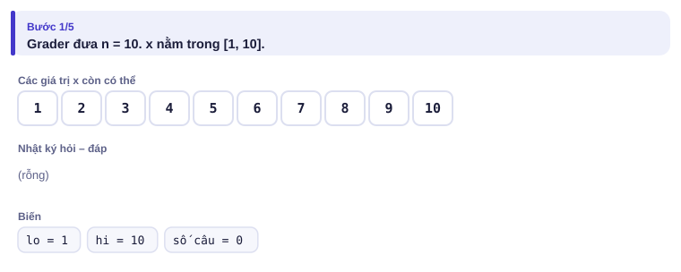
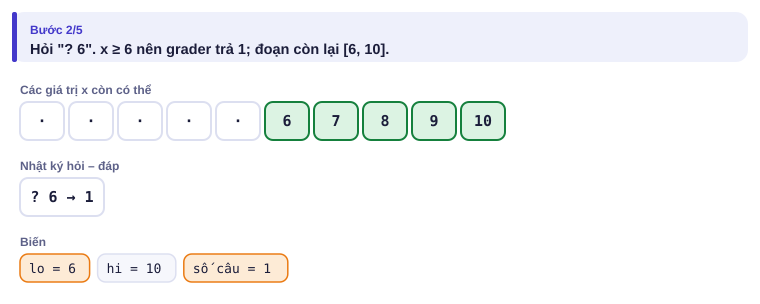
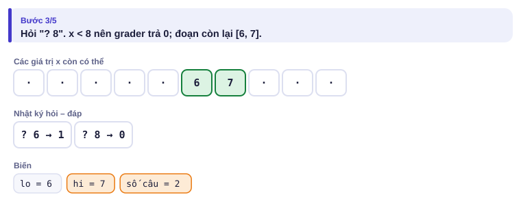
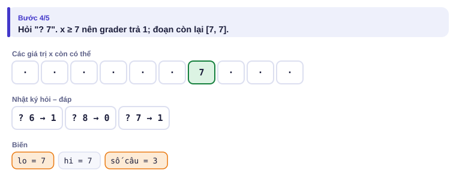
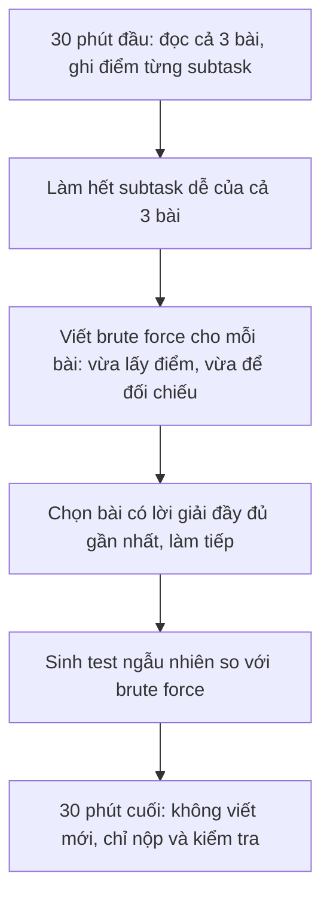

# Bài 4.10 – Làm quen đề kiểu IOI

> **Tập 4 · Chuyên đề nâng cao**
> Cần biết trước: bài 1.4 (tìm kiếm nhị phân), bài 1.9 (stress test).
> Thời lượng: khoảng 1,5 giờ đọc, cộng 6 giờ thực hành (1 tuần).

**Học xong bài này, em sẽ:**

- làm được **bài tương tác** (hỏi – đáp với chương trình chấm) và không quên **flush**;
- tự viết **grader** để thử bài tương tác ở nhà;
- biết cách nộp bài dạng **hàm** do grader gọi;
- có chiến lược **ăn điểm subtask** trong kỳ thi 5 giờ như VOI, chọn đội tuyển và IOI.

> [!TIP]
> **Học cùng hai trang mô phỏng.** [Đoán số tương tác](../../mo-phong/t4-doan-so.html): thử ví dụ n = 10⁹ và đếm số câu hỏi. [Tìm kiếm nhị phân](../../mo-phong/t1-nhi-phan.html) (bài 1.4) để ôn lại bất biến lo ≤ x ≤ hi.

---

## 1. Đề kiểu IOI khác gì?

| | HSG cấp tỉnh/thành phố | VOI / chọn đội / IOI |
| --- | --- | --- |
| Thời gian | 180 phút, 3 bài | 5 giờ, 3 bài mỗi ngày |
| Dạng nộp | Chương trình đọc file `.INP`, ghi `.OUT` | Có thể là **hàm** do grader gọi, hoặc tương tác |
| Chấm | Theo test | Theo **nhóm test** (subtask): sai một test mất cả nhóm |
| Kết quả | Biết sau kỳ thi | IOI: thấy điểm ngay khi nộp |

---

## 2. Bài toán mở màn: Đoán số

Chi nghĩ một số bí mật x trong đoạn [1, n] (n ≤ 10⁹). Chương trình của An được hỏi tối đa **30 lần**, mỗi lần in `? y` và nhận về `1` nếu x ≥ y, `0` nếu x < y. Cuối cùng in `! x`.

Một phiên mẫu với n = 10, x = 7:

| Chương trình in | Grader trả |
| --- | --- |
| `10` (grader đưa n trước) | |
| `? 6` | `1` (x ∈ [6, 10]) |
| `? 8` | `0` (x ∈ [6, 7]) |
| `? 7` | `1` (x = 7) |
| `! 7` | |

> [!IMPORTANT]
> **Dừng lại và nghĩ.**
> 1. Vì sao 30 lần hỏi là đủ với n = 10⁹?
> 2. Điều gì xảy ra nếu chương trình quên **flush** sau mỗi lần in?
> 3. Vì sao ở đây `mid` phải làm tròn **lên** ((lo + hi + 1) / 2)? Thử lo = 6, hi = 7 với cách làm tròn xuống.

<details>
<summary>Đáp án</summary>

1. 2³⁰ ≈ 1,07·10⁹ ≥ n, nên tìm kiếm nhị phân cần không quá 30 câu hỏi.
2. Câu hỏi nằm trong bộ đệm, grader không nhận được và cả hai bên **chờ nhau mãi**: kết quả là "Time Limit Exceeded" hoặc "Idleness".
3. Làm tròn xuống: mid = 6, nếu trả 1 thì lo = 6, đoạn [6, 7] không đổi: lặp vô hạn. Câu hỏi "x ≥ mid?" đi với `lo = mid` cần làm tròn lên.

</details>

### Chạy từng bước

Phiên mẫu n = 10, x = 7. Đoán grader trả gì trước khi mở.

<details>
<summary><b>Bước 1</b> – Bắt đầu: x ∈ [1, 10]</summary>



</details>

<details>
<summary><b>Bước 2</b> – Hỏi 6</summary>



</details>

<details>
<summary><b>Bước 3</b> – Hỏi 8</summary>



</details>

<details>
<summary><b>Bước 4</b> – Hỏi 7: còn đúng một giá trị</summary>



</details>

```cpp
// file: doan_so.cpp
#include <bits/stdc++.h>
using namespace std;
int main() {
    long long n; cin >> n;
    long long lo = 1, hi = n;                    // bất biến: lo <= x <= hi
    while (lo < hi) {
        long long mid = (lo + hi + 1) / 2;       // làm tròn lên để hỏi "x >= mid?"
        cout << "? " << mid << endl;             // endl = xuống dòng + flush
        int r; cin >> r;
        if (r == 1) lo = mid; else hi = mid - 1;
    }
    cout << "! " << lo << endl;
}
```

> [!WARNING]
> **Bẫy: dùng `'\n'` thay vì `endl`** mà không gọi `cout.flush()`. Trong bài tương tác luôn flush sau mỗi câu hỏi. Đừng bật `cin.tie(0)` trừ khi tự flush.


**Bản Python** của cùng chương trình: điền vào chỗ trống.

```python
n = int(input())
lo, hi = 1, n
while lo < hi:
    mid = (lo + hi + 1) // 2
    print("?", mid, ____)
    if int(input()) == 1: lo = mid
    else: hi = mid - 1
print("!", lo, flush=True)
```

<details>
<summary>Đáp án</summary>

`flush=True`. Thiếu nó thì Python cũng giữ câu hỏi trong bộ đệm.

</details>

---

## 3. Tự viết grader để thử ở nhà

Grader chạy chương trình như tiến trình con, nói chuyện qua đường ống (pipe), đếm số câu hỏi và kiểm tra đáp án:

```python
# file: grader.py
import subprocess, sys
def cham(chuong_trinh, n, x, toi_da=30):
    p = subprocess.Popen([chuong_trinh], stdin=subprocess.PIPE, stdout=subprocess.PIPE, text=True)
    p.stdin.write(f"{n}\n"); p.stdin.flush()
    so_cau = 0
    while True:
        dong = p.stdout.readline().split()
        if not dong: return "Chương trình dừng mà chưa trả lời"
        if dong[0] == "!":
            p.wait()
            return "OK" if int(dong[1]) == x else f"Sai: đoán {dong[1]}, đúng là {x}"
        so_cau += 1
        if so_cau > toi_da:
            p.kill(); return "Hỏi quá nhiều"
        p.stdin.write("1\n" if x >= int(dong[1]) else "0\n"); p.stdin.flush()
if __name__ == "__main__":
    print(cham(sys.argv[1], int(sys.argv[2]), int(sys.argv[3])))
```

Chạy thử: `python3 grader.py ./doan_so 1000000000 123456789` in `OK`.

Với bài nộp dạng **hàm** (ví dụ `int timSo(int n)` gọi hàm `hoi(y)` do ban tổ chức viết), em tự viết một `grader.cpp` có `main` đọc dữ liệu, cài hàm `hoi`, rồi gọi hàm của em. Ban tổ chức thường phát sẵn grader mẫu; hãy đọc nó trước khi viết code.

---

## 4. Chiến lược 5 giờ



- **Ghép nhiều lời giải:** `if (n <= 20) brute(); else if (subtask đặc biệt) giai_rieng(); else giai_chinh();` để một lỗi ở lời giải chính không làm mất điểm các subtask nhỏ.
- **Subtask là gợi ý:** "các số đều bằng nhau", "đồ thị là đường thẳng", "n ≤ 2000" thường chỉ ra từng bước đi tới lời giải đầy đủ.
- **Đặt mốc thời gian:** quá 90 phút một bài mà không tiến triển thì chuyển bài.

---

## 5. Bài tập

| Nấc | Bài | Nguồn | Ý chính |
| --- | --- | --- | --- |
| Khởi động | [Guess the Number](https://codeforces.com/gym/101021/problem/A) | Codeforces Gym 101021 | Tương tác cơ bản |
| Luyện | [Interactive problems](https://codeforces.com/problemset?tags=interactive) | Codeforces, độ khó 1400–1700 | Tìm nhị phân, flush |
| Luyện | [oj.uz](https://oj.uz/problems) | Mục IOI trên oj.uz | Đề IOI có grader |
| Thử thách | Đề VOI các năm | [VNOI](https://oj.vnoi.info/) | Luyện trọn 5 giờ |

---

## 6. Tóm tắt, flashcard và checkpoint

**Tóm tắt trong 5 dòng.**

1. Bài tương tác: in câu hỏi, **flush**, đọc câu trả lời; đếm số câu hỏi được phép trước khi code.
2. Tìm nhị phân "x ≥ mid?" với `lo = mid` thì làm tròn mid lên.
3. Tự viết grader bằng pipe để thử ở nhà; bài dạng hàm thì viết `main` gọi hàm của mình.
4. Subtask chấm theo nhóm: ghép brute force với lời giải chính để giữ điểm nhóm nhỏ.
5. Kỳ thi 5 giờ: đọc cả 3 bài trước, ăn subtask dễ, 30 phút cuối không viết mới.

**Flashcard.**

<details><summary>`endl` khác `'\n'` ở điểm nào?</summary>`endl` xuống dòng **và** flush bộ đệm.</details>
<details><summary>Cần bao nhiêu câu hỏi cho n = 10⁶?</summary>20 (2²⁰ ≈ 1,05·10⁶).</details>
<details><summary>Lỗi "Idleness limit exceeded" thường do đâu?</summary>Quên flush: grader không nhận được câu hỏi.</details>
<details><summary>Subtask "n ≤ 20" gợi ý gì?</summary>Vét cạn 2ⁿ hoặc quay lui.</details>
<details><summary>Quá 90 phút một bài không tiến triển thì sao?</summary>Chuyển sang bài khác, lấy subtask dễ trước.</details>

**Checkpoint – em đã sẵn sàng sang đề thi thử nếu:**

- [ ] Chạy grader ở mục 3 với 100 số x ngẫu nhiên, tất cả `OK`.
- [ ] Giải thích được vì sao mid phải làm tròn lên (câu 3 mục 2).
- [ ] Làm trọn một đề IOI cũ trong 5 giờ và ghi lại điểm từng subtask.

Chưa đạt? Nếu vướng ô 1 hoặc 2, chạy trang mô phỏng đoán số với ví dụ "x nhỏ nhất" và đọc lại bài 1.4. Nếu vướng ô 3, đọc lại mục 4 và chọn một đề có nhiều subtask nhỏ để luyện chiến thuật.
